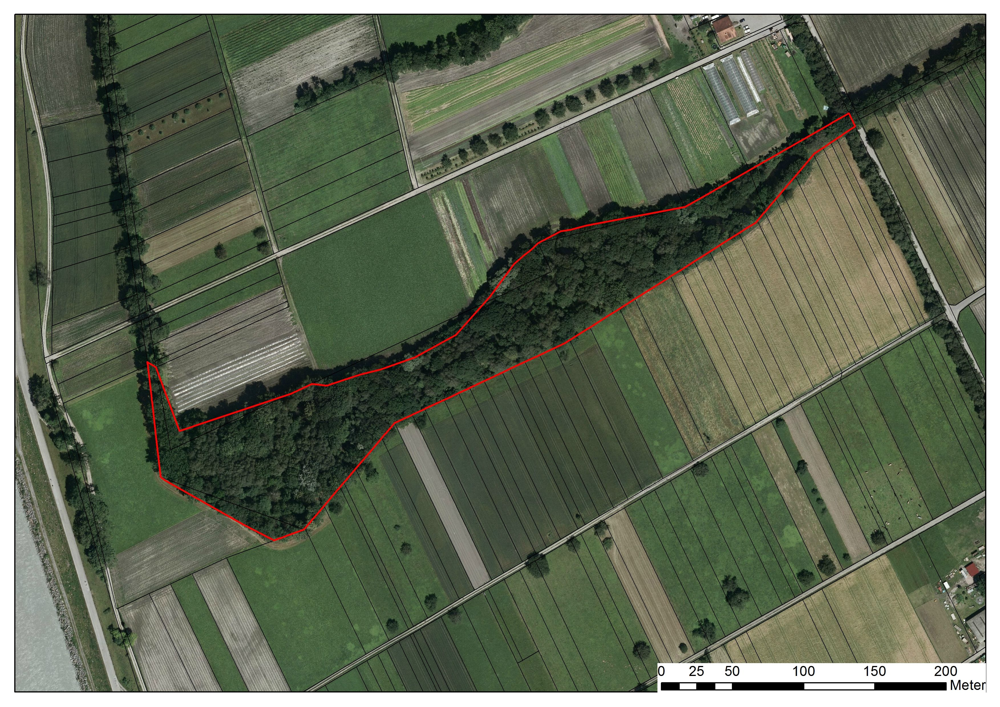

Verordnung vom 27. Juni 1966 betreffend das Naturschutzgebiet "Äulehäg" in Balzers Aufgrund von Art. 19 Abs. 3 und Art. 53 Bst. c des Gesetzes vom 23. Mai 1996 zum Schutz von Natur und Landschaft, LGBl. 1996 Nr. 117, in der geltenden Fassung, verordnet die Regierung: Art. 1 Unterschutzstellung Die Äulehäg in Balzers werden mitsamt den Rietflächen und der Baum- und Strauchbestockung als schutzwürdig erklärt und unter Naturschutz gestellt. Art. 2 Zweck Das Schutzgebiet dient vornehmlich ornithologischen Zwecken. Art. 3 Umfang des Naturschutzgebietes Das Schutzgebiet hat ein Flächenausmass von 2.77 ha. Der Perimeter des Naturschutzgebietes ist als Situationsplan im Anhang dieser Verordnung dargestellt. Der Umfang des Naturschutzgebietes ist vor Ort zu beschildern. Art. 4 Verbote Im Naturschutzgebiet Äulehäg ist der heutige Zustand aufrecht zu erhalten. Insbesondere wird verboten: a) den vorhandenen Baumbestand und die Gebüsche zu schlagen, zu roden und zu beschädigen, b) Quellen, Wasserläufe und Wasserflächen zu verunreinigen, c) die Bodengestalt zu verändern, sofern dies nicht im unmittelbaren Interesse des Schutzgebietes liegt, d) den vorhandenen Rietbiotop durch irgendwelche Eingriffe zu stören, e) Streue und Gras zu nutzen oder im Dürrezustand abzubrennen, f) wildwachsende Pflanzen oder Pflanzenteile zu entnehmen oder zu beschädigen, g) die Jagd auszuüben und allgemein die freilebenden Tiere zu stören, zu fangen, zu töten und ihre Bauten sowie die natürlichen und künstlich angebrachten Brutstätten zu beschädigen und zu zerstören. Art. 5 Pflegemassnahmen Eingriffe in neu aufkommende Baum- und Strauchverjüngungen sind zur Erhaltung einer parkähnlich aufgelockerten Bestockung notwendig und gestattet. Solche Eingriffe haben nach Massgabe des Amtes für Wald, Natur und Landwirtschaft zu geschehen und dürfen nur zur Winterszeit vorgenommen werden. Art. 6 Aufsichtsorgane Die Aufsicht über das Naturschutzgebiet "Äulehäg" obliegt der Liechtensteinischen Naturwacht. Im Weiteren sind die Forst-, Gewässer- und Jagdschutzorgane verpflichtet, die Einhaltung dieser Verordnung zu überwachen und Übertretungen der Regierung zur Anzeige zu bringen. Art. 7 Verstösse Verstösse gegen Art. 4 und 5 dieser Verordnung werden, sofern nicht eine strafbare Handlung nach Art. 49 des Gesetzes vorliegt, nach Art. 50 des Gesetzes bestraft. Art. 8 Inkrafttreten Diese Verordnung tritt am Tage ihrer Kundmachung in Kraft. Fürstliche Regierung: gez. Dr. Gerard Batliner Fürstlicher Regierungschef Anhang (Art. 3) Begrenzung des Naturschutzgebietes "Äulehäg" 

