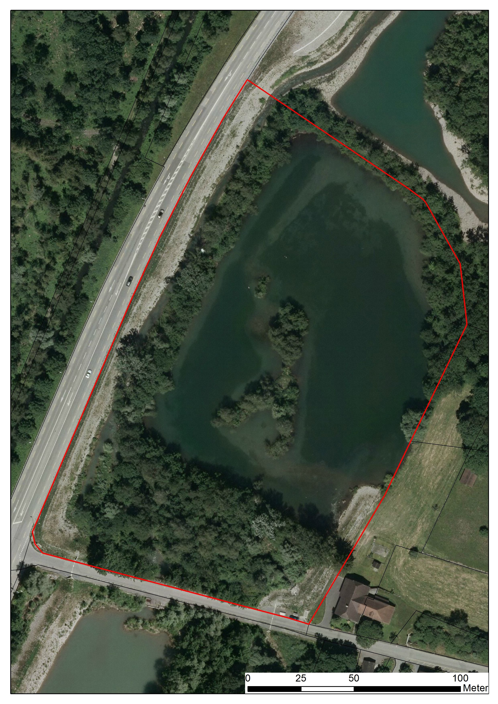

Verordnung vom 24. Februar 1969 betreffend das Naturschutzgebiet "Triesner Heilos" Aufgrund von Art. 19 Abs. 3 und Art. 53 Bst. c des Gesetzes vom 23. Mai 1996 zum Schutz von Natur und Landschaft, LGBl. 1996 Nr. 117, in der geltenden Fassung, verordnet die Regierung: Art. 1 Unterschutzstellung Das Gebiet "Triesner Heilos" wird als schutzwürdig erklärt und unter Naturschutz gestellt. Art. 2 Umfang des Naturschutzgebietes Das Schutzgebiet hat ein Flächenausmass von 3.12 ha. Der Perimeter des Naturschutzgebietes ist als Situationsplan im Anhang dieser Verordnung dargestellt. Der Umfang des Naturschutzgebietes ist vor Ort zu beschildern. Art. 3 Verbote 1) Das Naturschutzgebiet ist im heutigen Zustand zu belassen. Sämtliche Massnahmen sind verboten, welche zu einer Veränderung oder Zerstörung des Naturschutzgebietes und seines Landschaftshaushaltes führen oder die Natur und den Naturgenuss in anderer Weise beeinträchtigen. 2) Im Bereich des Naturschutzgebietes ist insbesondere verboten: a) durch künstliche Eingriffe den Wasserzufluss zu vermindern, den Wasserspiegel zu senken und die Wasserfläche zu verkleinern; b) das Wasser zu verunreinigen; c) bauliche Anlagen zu errichten, auch solche, die keiner Baubewilligung bedürfen; d) Pflanzen zu beschädigen, auszureissen, auszugraben oder Teile davon abzupflücken oder abzureissen; e) freilebenden Tieren nachzustellen, sie mutwillig zu beunruhigen, zu ihrem Fang geeignete Vorrichtungen anzubringen, sie zu fangen oder zu töten oder Puppen, Larven, Eier, Nester oder sonstige Brut- und Wohnstätten solcher Tiere fortzunehmen oder zu beschädigen; f) die Jagd auszuüben; g) zu baden und die Wasserpartien oder die Inseln zu betreten oder zu befahren; h) zu zelten, zu lagern, zu lärmen, Feuer zu entfachen, Abfälle wegzuwerfen oder das Naturschutzgebiet auf andere Weise zu beeinträchtigen; i) Schilf, Streu und Gras zu ernten oder im Dürrezustand abzubrennen; k) die Baum- und Buschbestockung zu roden oder zu beschädigen; l) durch Grabung oder Auffüllung die Bodengestalt zu verändern. 3) Aufgehoben Art. 4 Pflegemassnahmen Art. 3 dieser Verordnung findet keine Anwendung auf Massnahmen, die zur Erhaltung und Pflege der Strauch- und Baumbestockung nach Massgabe des Amtes für Wald, Natur und Landwirtschaft vorgenommen werden. Solche Massnahmen sollen sich auf den Winter beschränken. Art. 5 Aufsichtsorgane Die Aufsicht über das Naturschutzgebiet "Triesner Heilos" obliegt der Liechtensteinischen Naturwacht. Im Weiteren sind die Forst-, Gewässer- und Jagdschutzorgane verpflichtet, die Einhaltung dieser Verordnung zu überwachen und Übertretungen der Regierung zur Anzeige zu bringen. Art. 6 Verstösse Verstösse gegen Art. 3 und 4 dieser Verordnung werden, sofern nicht eine strafbare Handlung nach Art. 49 des Gesetzes vorliegt, nach Art. 50 des Gesetzes bestraft. Art. 7 Inkrafttreten Diese Verordnung tritt am Tage ihrer Kundmachnung in Kraft. Fürstliche Regierung: gez. Dr. Gerard Batliner Fürstlicher Regierungschef Anhang (Art. 2) Begrenzung des Naturschutzgebietes "Triesner Heilos" 

