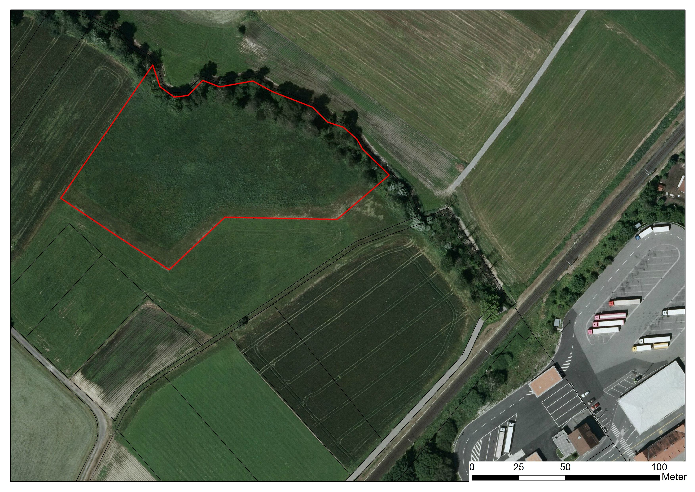

Verordnung vom 7. November 1972 betreffend das Naturschutzgebiet "Wisanels" in Mauren Aufgrund von Art. 19 Abs. 3 und Art. 53 Bst. c des Gesetzes vom 23. Mai 1996 zum Schutz von Natur und Landschaft, LGBl. 1996 Nr. 117, in der geltenden Fassung, verordnet die Regierung: Art. 1 Unterschutzstellung Ein Teilstück des Gebietes "Wisanels" in Mauren wird als schutzwürdig erklärt und unter Naturschutz gestellt. Art. 2 Umfang des Naturschutzgebietes Das Schutzgebiet hat ein Flächenausmass von 1.05 ha. Der Perimeter des Naturschutzgebietes ist als Situationsplan im Anhang dieser Verordnung dargestellt. Der Umfang des Naturschutzgebietes ist vor Ort zu beschildern. Art. 3 Verbote Es ist verboten, das Schutzgebiet zu zerstören, zu beschädigen oder in sonstiger Weise zu beeinträchtigen. Im Bereiche des Schutzgebietes ist insbesondere verboten: a) wildwachsende Pflanzen oder Pflanzenteile zu entnehmen oder zu beschädigen; b) die Streue oder das Trockengras abzubrennen; c) den Riedbiotop durch irgendwelche Eingriffe, insbesondere durch Düngung zu verändern; d) die Kulturart des Grundstückes zu ändern; e) die Bodengestaltung durch Grabungen oder auf sonstige Weise zu verändern; f) Herbizide, Insektizide und andere Pestizide zu verwenden; g) Vieh weiden zu lassen; h) Müll, Schutt oder Abraum abzulagern; i) Hochbauten irgendwelcher Art zu errichten; j) freilebende Tiere zu fangen oder zu töten und ihre Bauten und Brutstätten zu zerstören. Art. 4 Pflegemassnahmen Die anfallende Streue ist alljährlich ab dem 15. September bis zum 15. März des folgenden Jahres zu schneiden und zu entfernen. Art. 5 Aufsichtsorgane Die Aufsicht über das Naturschutzgebiet "Wisanels" obliegt der Liechtensteinischen Naturwacht. Im Weiteren sind die Forst-, Gewässer- und Jagdschutzorgane verpflichtet, die Einhaltung dieser Verordnung zu überwachen und Übertretungen der Regierung zur Anzeige zu bringen. Art. 6 Verstösse Verstösse gegen Art. 3 und 4 dieser Verordnung werden, sofern nicht eine strafbare Handlung nach Art. 49 des Gesetzes vorliegt, nach Art. 50 des Gesetzes bestraft. Art. 7 Inkrafttreten Diese Verordnung tritt am Tage der Kundmachung in Kraft. Fürstliche Regierung: gez. Dr. Alfred Hilbe Fürstlicher Regierungschef Anhang (Art. 2) Begrenzung des Naturschutzgebietes "Wisanels" 

