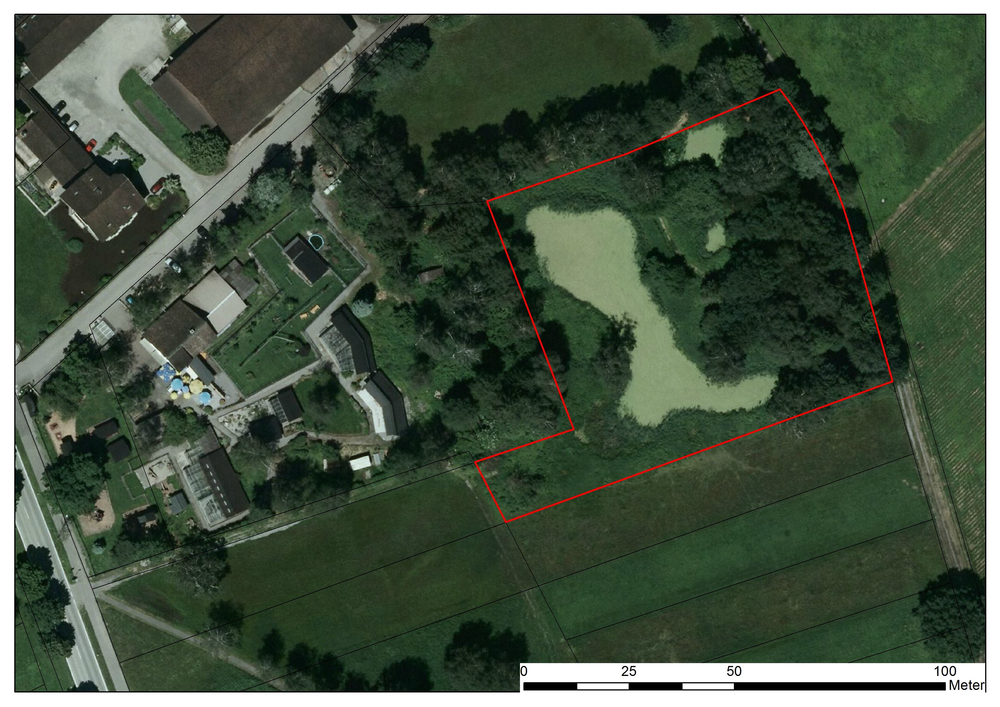

Verordnung vom 3. Dezember 1974 betreffend das Naturschutzgebiet "Birka" in Mauren Aufgrund von Art. 19 Abs. 3 und Art. 53 Bst. c des Gesetzes vom 23. Mai 1996 zum Schutz von Natur und Landschaft, LGBl. 1996 Nr. 117, in der geltenden Fassung, verordnet die Regierung: Art. 1 Unterschutzstellung Das Gebiet "Birka" in Mauren, Parzelle Nr. 2793, wird als schutzwürdig erklärt und unter Naturschutz gestellt. Art. 2 Umfang des Naturschutzgebietes Das Schutzgebiet hat ein Flächenausmass von 0.60 ha. Der Perimeter des Naturschutzgebietes ist als Situationsplan im Anhang dieser Verordnung dargestellt. Der Umfang des Naturschutzgebietes ist vor Ort zu beschildern. Art. 3 Verbote 1) Im Bereiche des Naturschutzgebietes sind sämtliche Massnahmen verboten, die zu einer Beeinträchtigung, Veränderung oder Zerstörung des Schutzgebietes und seines Landschaftshaushaltes führen oder die Natur in anderer Weise beeinträchtigen. 2) Im Bereiche des Naturschutzgebietes sind insbesonders verboten: a) durch künstliche Eingriffe den Wasserzufluss zu vermindern (Drainage), den Wasserspiegel zu senken und die Wasserfläche zu verkleinern; b) das Wasser zu verunreinigen; c) bauliche Anlagen zu errichten, auch solche, die keiner Baubewilligung bedürfen; d) Pflanzen zu beschädigen, auszureissen, auszugraben oder Teile davon abzupflücken oder abzureissen; e) freilebenden Tieren nachzustellen, sie mutwillig zu beunruhigen, zu ihrem Fang geeignete Vorrichtungen anzubringen, sie zu fangen oder zu töten oder Puppen, Larven, Eier, Nester oder sonstige Brut- und Wohnstätten solcher Tiere fortzunehmen oder zu beschädigen; f) die Jagd und Fischerei auszuüben; g) zu baden und die Wasserpartien oder die Insel zu betreten oder zu befahren; h) zu zelten, zu lagern, zu lärmen, Feuer zu entfachen, Abfälle wegzuwerfen; i) den Riedbiotop durch irgendwelche Eingriffe, insbesondere durch Düngung, zu verändern; j) das Vieh weiden zu lassen; k) Müll, Schutt oder Abraum abzulagern. Art. 4 Pflegemassnahmen Die anfallende Streue ist alljährlich frühestens ab dem 15. September und spätestens bis 15. März des folgenden Jahres zu schneiden und zu entfernen. Allfällige notwendige Änderungen der Pflegemassnahmen zur Erhaltung des Lebensraumes bedürfen einer Bewilligung des Amts für Wald, Natur und Landwirtschaft. Art. 5 Aufsichtsorgane Die Aufsicht über das Naturschutzgebiet "Birka" obliegt der Liechtensteinischen Naturwacht. Im Weiteren sind die Forst-, Gewässer- und Jagdschutzorgane verpflichtet, die Einhaltung dieser Verordnung zu überwachen und Übertretungen der Regierung zur Anzeige zu bringen. Art. 6 Aufgehoben Art. 7 Verstösse Verstösse gegen Art. 3 und 4 dieser Verordnung werden, sofern nicht eine strafbare Handlung nach Art. 49 des Gesetzes vorliegt, nach Art. 50 des Gesetzes bestraft. Art. 8 Inkrafttreten Diese Verordnung tritt am Tage ihrer Kundmachung in Kraft. Fürstliche Regierung: gez. Dr. Walter Kieber Fürstlicher Regierungschef Anhang (Art. 2) Begrenzung des Naturschutzgebietes "Birka" 

