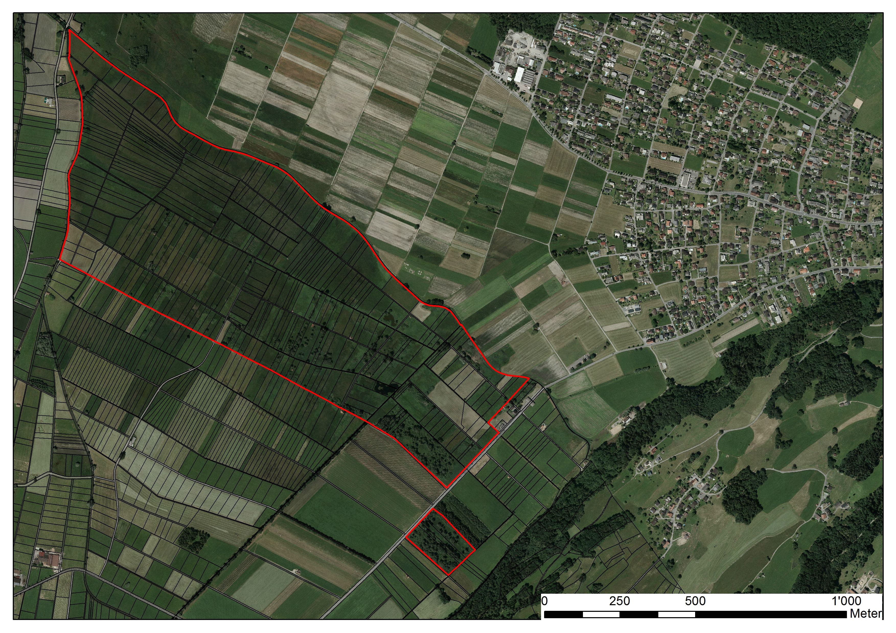

Verordnung vom 17. Oktober 1978 zum Schutze des "Ruggeller Rietes" Aufgrund von Art. 19 Abs. 3 und Art. 53 Bst. c des Gesetzes vom 23. Mai 1996 zum Schutz von Natur und Landschaft, LGBl. 1996 Nr. 117, in der geltenden Fassung, verordnet die Regierung: Art. 1 Unterschutzstellung Das in Art. 2 näher umschriebene Gebiet des "Ruggeller Rietes" wird als schutzwürdig erklärt und unter Naturschutz gestellt. Art. 2 Umfang des Naturschutzgebietes Das Schutzgebiet hat ein Flächenausmass von 90.86 ha. Der Perimeter des Naturschutzgebietes ist als Situationsplan im Anhang dieser Verordnung dargestellt. Der Umfang des Naturschutzgebietes ist vor Ort zu beschildern. Art. 3 Verbote 1) Im Naturschutzgebiet sind alle Vorkehrungen, die den Naturhaushalt gefährden und die Beschaffenheit des Bodens verändern können, verboten. 2) Es ist insbesondere verboten: a) bauliche Massnahmen aller Art auszuführen, sofern sie nicht dem Schutzzweck dienen; b) Ackerbau zu betreiben, die Riedflächen zu düngen und Biozide anzuwenden; c) Mauern und Einfriedungen, Reklamevorrichtungen, Antennen, Freileitungen und dergleichen zu errichten; d) die Mahd während der Zeit vom 16. März bis 14. September vorzunehmen; e) freilebenden Tieren nachzustellen, sie mutwillig zu beunruhigen, zu ihrem Fang geeignete Vorrichtungen anzubringen, sie zu fangen oder zu töten, oder Puppen, Larven, Eier, Nester oder sonstige Brut- und Wohnstätten solcher Tiere anzueignen oder zu zerstören; die Ausübung der Jagd ist hiervon unberührt. f) Pflanzen zu beschädigen, auszureissen, auszugraben oder Teile davon abzupflücken oder abzureissen; g) das bestehende Entwässerungssystem während der Vegetationszeit zu reinigen; h) durch künstliche Eingriffe den Wasserzufluss zu vermindern, den Wasserspiegel zu senken und die Wasserfläche zu verkleinern; i) das Wasser zu verunreinigen; k) die Fischerei auszuüben; l) zu baden und die Wasserpartien zu betreten oder zu befahren; m) zu zelten, zu lagern, zu lärmen, Feuer zu entfachen, Abfälle wegzuwerfen; n) Müll, Schutt oder Abraum abzulagern; o) Aufforstungen vorzunehmen. 3) Ausgenommen vom Verbot, bauliche Massnahmen aller Art auszuführen, sind insbesondere: a) der Unterhalt und die Instandstellung bestehender Torfhütten und Wege im bisherigen Umfang; b) der Wiederaufbau ehemaliger Torfhütten, sofern eine Verwendung gemäss ihrer Zweckbestimmung gewährleistet ist. 4) Die Planung und Ausführung baulicher Massnahmen gemäss Abs. 3 bedürfen der vorgängigen Begutachtung und Befürwortung der Natur- und Denkmalschutzkommission. Art. 4 Pflegemassnahmen 1) Die anfallende Streue ist alljährlich ab dem 15. September bis zum 15. März des folgenden Jahres zu schneiden und zu entfernen. 2) Unterbleibt diese Nutzung während zweier Jahre, so hat der Staat in geeigneter Weise für die Pflege zu sorgen. Der Eigentümer oder Nutzniesser hat diese Pflegemassnahme zu dulden. Art. 5 Vorbehalte 1) Im übrigen bleibt die landwirtschaftliche Nutzung, wie sie bisher ausgeübt wurde, unter Vorbehalt von Art. 3 gestattet. 2) Die Durchführung von Pflege und Gestaltungsmassnahmen im Interesse des Natur- und Landschaftsschutzes bleibt von den Vorschriften des Art. 3 unberührt. Art. 6 Betretungsverbot Das Betreten des Naturschutzgebietes ist Unbefugten nur auf den hierfür freigegebenen und besonders gekennzeichneten Wegen gestattet. Art. 7 Aufsichtsorgane Die Aufsicht über das Naturschutzgebiet "Ruggeller Riet" obliegt der Liechtensteinischen Naturwacht. Im Weiteren sind die Forst-, Gewässer- und Jagdschutzorgane verpflichtet, die Einhaltung dieser Verordnung zu überwachen und Übertretungen der Regierung zur Anzeige zu bringen. Art. 8 Verstösse Verstösse gegen Art. 3, 4 und 6 dieser Verordnung werden, sofern nicht eine strafbare Handlung nach Art. 49 des Gesetzes vorliegt, nach Art. 50 des Gesetzes bestraft. Art. 9 Inkrafttreten Diese Verordnung tritt am Tage ihrer Kundmachung in Kraft. Fürstliche Regierung: gez. Hans Brunhart Fürstlicher Regierungschef Anhang (Art. 2) Begrenzung des Naturschutzgebietes "Ruggeller Riet" 

