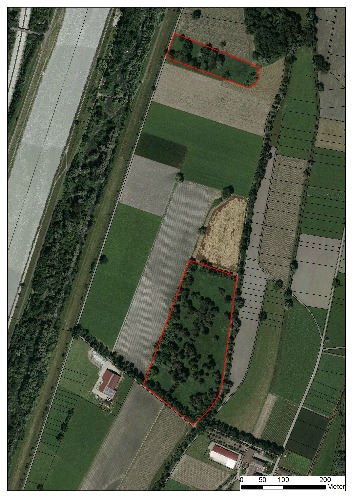

Verordnung vom 17. Oktober 1978 betreffend die Naturschutzgebiete "Schneckenäule" und eine Teilfläche in der "Au" in Ruggell Aufgrund von Art. 19 Abs. 3 und Art. 53 Bst. c des Gesetzes vom 23. Mai 1996 zum Schutz von Natur und Landschaft, LGBl. 1996 Nr. 117, in der geltenden Fassung, verordnet die Regierung: Art. 1 Unterschutzstellung Das "Schneckenäule", Ruggell, und eine Rietparzelle in der "Au", Ruggell, werden als schutzwürdig erklärt und unter Naturschutz gestellt. Art. 2 Umfang des Naturschutzgebietes Das Schutzgebiet "Schneckenäule" hat ein Flächenmass von 5.28 ha und jenes in der "Au" von 1.27 ha. Der Perimeter der Naturschutzgebiete ist als Situationsplan im Anhang dieser Verordnung dargestellt. Der Umfang der Naturschutzgebiete ist vor Ort zu beschildern. Art. 3 Verbote 1) Im Bereiche des Naturschutzgebietes sind sämtliche Massnahmen untersagt, die zu einer Beeinträchtigung, Veränderung oder Zerstörung des Schutzgebietes und seines Landschaftshaushaltes führen oder die Natur in anderer Weise beeinträchtigen. 2) Im Bereiche des Naturschutzgebietes sind insbesondere verboten: a) den Riedlebensraum durch Entwässerung, Düngung oder andere Massnahmen zu verändern; b) die heutige Bodengestalt zu verändern; c) wildwachsende Pflanzen oder Pflanzenteile zu entnehmen; d) freilebende Tiere zu fangen oder zu töten und ihre Brutstätten und Bauten zu zerstören; die Ausübung der Jagd ist hiervon unberührt; e) Müll und Schutt oder Abraum abzulagern; f) Bauten irgendwelcher Art zu errichten, auch solche, die keiner Baubewilligung bedürfen; g) Vieh weiden zu lassen; h) zu zelten, zu lagern, Feuer zu entfachen, zu lärmen oder Abfälle wegzuwerfen. Art. 4 Pflegemassnahmen Die anfallende Streue ist alljährlich ab dem 15. September bis zum 15. März des folgenden Jahres zu schneiden und zu entfernen. Die Bestockung ist zu erhalten und zu pflegen und allfälliger Ersatz hat mit standortgerechten, heimischen Baum- und Straucharten zu erfolgen. Art. 5 Aufgehoben Art. 6 Aufsichtsorgane Die Aufsicht über die Naturschutzgebiete "Schneckenäule" und "Au" obliegt der Liechtensteinischen Naturwacht. Im Weiteren sind die Forst-, Gewässer- und Jagdschutzorgane verpflichtet, die Einhaltung dieser Verordnung zu überwachen und Übertretungen der Regierung zur Anzeige zu bringen. Art. 7 Verstösse Verstösse gegen Art. 3 und 4 dieser Verordnung werden, sofern nicht eine strafbare Handlung nach Art. 49 des Gesetzes vorliegt, nach Art. 50 des Gesetzes bestraft. Art. 8 Inkrafttreten Diese Verordnung tritt am Tage ihrer Kundmachung in Kraft. Fürstliche Regierung: gez. Hans Brunhart Fürstlicher Regierungschef Anhang (Art. 2) Begrenzung der Naturschutzgebiete "Schneckenäule" und "Au" 

