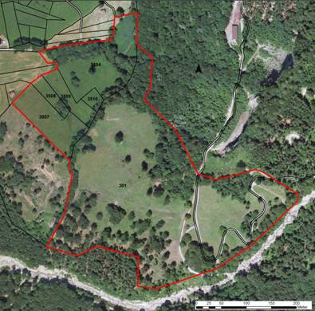

Verordnung vom 29. November 2011 über das Naturschutzgebiet "Matilaberg" in der Gemeinde Triesen Aufgrund von Art. 19 Abs. 3 und 53 des Gesetzes vom 23. Mai 1996 zum Schutz von Natur und Landschaft, LGBl. 1996 Nr. 117 , verordnet die Regierung: Art. 1 Unterschutzstellung 1) Das in Art. 2 näher umschriebene Gebiet "Matilaberg" in der Gemeinde Triesen wird als schutzwürdig erklärt und unter Naturschutz gestellt. 2) Ziel der Unterschutzstellung ist die Erhaltung der botanisch und faunistisch wertvollen Magerwiesen (Trocken-, Wechseltrocken- und Feuchtstandorte) sowie der angrenzenden Wiesen und Weiden mit den Einzelbäumen, Hecken und Waldränder. Art. 2 Umfang des Naturschutzgebietes Das Naturschutzgebiet umfasst das Gebiet "Matilaberg", einschliesslich der angrenzenden Gebiete "Matruala" und "Rietli", in der Gemeinde Triesen. Die Randflächen dieser Gebiete dienen als Pufferzone und sind ebenfalls Bestandteil des Schutzgebietes. Die Begrenzung des Naturschutzgebietes ist im Anhang in einem Kartenausschnitt dargestellt. Art. 3 Bewirtschaftung und Pflege 1) Die Wiesenflächen sind als Magerwiesen nach der Verordnung über die Ausrichtung von Bewirtschaftungsbeiträgen zur Erhaltung der Magerwiesen zu bewirtschaften. 2) Die Weideflächen, die Teil der Triesner Parzelle Nr. 301 sind, müssen extensiv und bodenschonend als Magerweide bewirtschaftet werden. Das Ausbringen von Düngern jeder Art, der Einsatz von Pestiziden sowie die Veränderung des Geländes sind verboten. 3) Die Pflege der Waldränder, Einzelbäume und Hecken hat so zu erfolgen, dass reichhaltige Strukturen sowie das vielfältige Landschaftsbild erhalten bleiben und die Magerwiesen und -weiden nicht beeinträchtigt werden. 4) Das Amt für Wald, Natur und Landwirtschaft kann mit den Bewirtschaftern für einzelne Teilflächen besondere Bewirtschaftungsmassnahmen vereinbaren. 5) Neophyten sind in Absprache mit dem Amt für Wald, Natur und Landwirtschaft zu bekämpfen. Art. 4 Schutz von Pflanzen und Tieren 1) Im Naturschutzgebiet sind verboten: a) das Ausreissen, Ausgraben und Pflücken von Pflanzen sowie die Beeinträchtigung ihres Standorts; b) die Ausübung von Sport- oder Erholungsaktivitäten. 2) Jagdliche, forstliche und landwirtschaftliche Massnahmen sind zulässig, wenn sie dem Schutzziel entsprechen. Art. 5 Strassenunterhalt und Wasserversorgung Arbeiten an der Lawenastrasse und der Wasserversorgung der Gemeinde Triesen sind auf das unbedingt Notwendige zu beschränken sowie auf schonende und dem Schutzziel entsprechende Weise durchzuführen. Art. 6 Verstösse Sofern nicht eine strafbare Handlung nach Art. 49 des Gesetzes vorliegt, werden Verstösse gegen Art. 3 bis 5 dieser Verordnung nach Art. 50 des Gesetzes bestraft. Art. 7 Inkrafttreten Diese Verordnung tritt am Tage der Kundmachung in Kraft. Fürstliche Regierung: gez. Dr. Klaus Tschütscher Fürstlicher Regierungschef Anhang (Art. 2) Begrenzung des Naturschutzgebietes "Matilaberg" 

