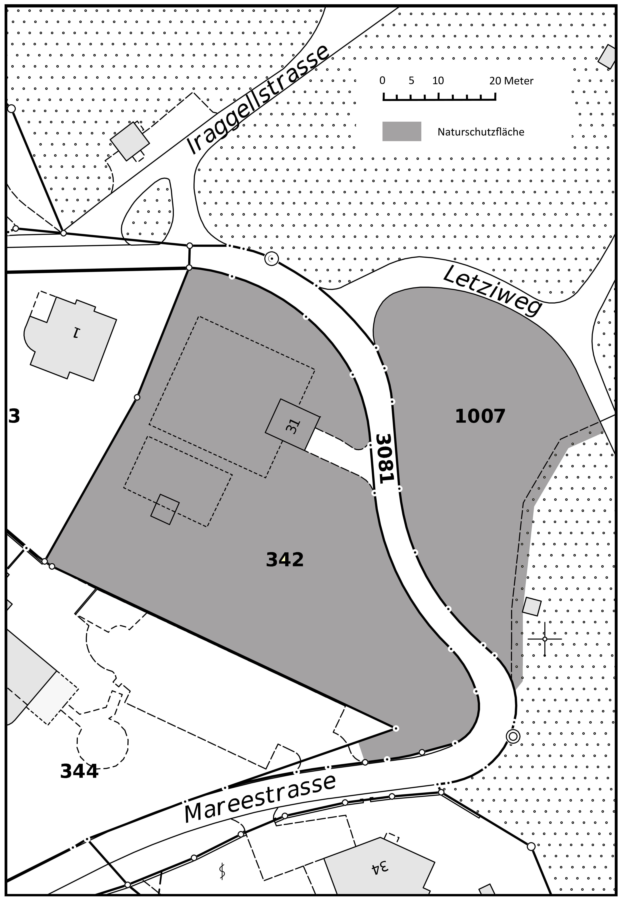

Verordnung vom 18. Dezember 2012 über das Naturschutzgebiet "Mareewiesen" in Vaduz Aufgrund von Art. 19 und 53 des Gesetzes vom 23. Mai 1996 zum Schutz von Natur und Landschaft, LGBl. 1996 Nr. 117, verordnet die Regierung: Art. 1 Unterschutzstellung 1) Die Magerwiesenflächen im Gebiet "Maree" in Vaduz werden als schutzwürdig erklärt und unter Naturschutz gestellt. 2) Ziel dieser Unterschutzstellung ist die Erhaltung der botanisch und faunistisch wertvollen Magerwiesen und angrenzenden Waldränder. Art. 2 Umfang des Naturschutzgebietes Das Naturschutzgebiet umfasst die Parzelle Vaduz Nr. 342 ohne Verkehrsflächen sowie die angrenzende Teilfläche der Parzelle Vaduz Nr. 1007. Die Fläche des Naturschutzgebietes ist im Anhang kartographisch dargestellt. Art. 3 Bewirtschaftung und Pflege 1) Die Wiesenflächen sind als Magerwiesen nach der Verordnung über die Ausrichtung von Bewirtschaftungsbeiträgen zur Erhaltung der Magerwiesen zu bewirtschaften. 2) Die Pflege der Waldränder hat so zu erfolgen, dass eine standortgerechte Vegetation erhalten werden kann und die Magerwiesen nicht beeinträchtigt werden. Art. 4 Verbote Auf den geschützten Flächen ist es verboten, Pflanzen auszureissen, auszugraben, zu pflücken oder deren Standort zu beeinträchtigen. Davon ausgenommen ist die Waldrandpflege. Art. 5 Wasserversorgung der Gemeinde Standortgebundene Bauarbeiten in Zusammenhang mit der Wasserversorgung sind zulässig. Alle Arbeiten sind auf schonende und dem Schutzziel entsprechende Weise durchzuführen. Art. 6 Verstösse Verstösse gegen Art. 3 bis 5 dieser Verordnung werden, sofern nicht eine strafbare Handlung nach Art. 49 des Gesetzes vorliegt, nach Art. 50 des Gesetzes bestraft. Art. 7 Inkrafttreten Diese Verordnung tritt am Tag nach der Kundmachung in Kraft. Fürstliche Regierung: gez. Dr. Klaus Tschütscher Fürstlicher Regierungschef Anhang (Art. 2) Fläche des Naturschutzgebietes "Mareewiesen" 

