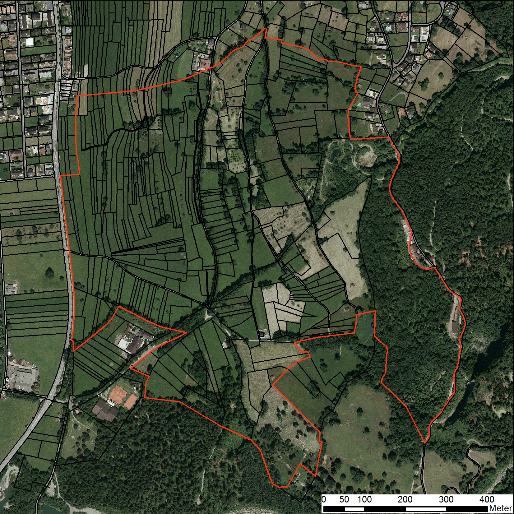

Verordnung vom 17. September 2013 über das Landschaftsschutzgebiet "Periol, Bofel, Neufeld, Undera Forst" in der Gemeinde Triesen Aufgrund von Art. 18 Abs. 3 und Art. 53 des Gesetzes vom 23. Mai 1996 zum Schutz von Natur und Landschaft, LGBl. 1996 Nr. 117, verordnet die Regierung: Art. 1 Unterschutzstellung 1) Das in Art. 2 näher umschriebene Gebiet in der Gemeinde Triesen wird als schutzwürdig erklärt und unter Landschaftsschutz gestellt. 2) Ziel der Unterschutzstellung ist die Erhaltung: a) der Eigenart und Schönheit des Landschaftsbildes; b) der charakteristischen Landschaftsräume mit den Rüfeläufen und -schuttkegeln; c) der vielfältigen Lebensräume für Fauna und Flora; d) der bestehenden natürlichen Vernetzungsstrukturen; e) der hohen Erholungsqualität. Art. 2 Umfang des Landschaftsschutzgebietes Das Landschaftsschutzgebiet umfasst im Wesentlichen die Gebiete "Periol", "Bofel", "Neufeld" und "Undera Forst" in der Gemeinde Triesen. Die Begrenzung des Landschaftsschutzgebietes ist im Anhang in einem Kartenausschnitt dargestellt. Art. 3 Bewirtschaftung und Pflege 1) Alle Flächen, Elemente und Strukturen sind schonend und dem Schutzziel entsprechend zu bewirtschaften und zu pflegen. 2) Eine andere als die gebiets- und sachgerechte land- und waldwirtschaftliche Nutzung ist mit Ausnahme der Nutzungen nach Abs. 3 untersagt. 3) Die Ausübung der Jagd und Fischerei ist gestattet. Sanierungen von Altlasten innerhalb des Schutzperimeters sind erlaubt, sofern nach Abschluss der Tätigkeiten das ursprüngliche Landschaftsbild wieder hergestellt werden kann. 4) Die Pflege der Waldränder, Einzelbäume, Hecken und Gewässer hat so zu erfolgen, dass reichhaltige Strukturen sowie das vielfältige Landschaftsbild erhalten bleiben. 5) Für Naturschutzgebiete, Sonderwaldflächen und Magerwiesen innerhalb des Landschaftsschutzgebietes gelten die Bewirtschaftungs- und Pflegevorschriften der jeweiligen Schutzverordnungen. Art. 4 Erstellung und Unterhalt von Bauten und Anlagen 1) Eingriffe, die den Charakter und die Eigentümlichkeit des Gebietes verändern, den Naturhaushalt ungünstig beeinflussen oder den Naturgenuss beeinträchtigen, sind verboten. 2) Im Landschaftsschutzgebiet ist die Erstellung von Bauten und Anlagen unzulässig. Ausnahmen sind in der Bauordnung der Gemeinde Triesen geregelt. 3) Der Unterhalt von Bauten und Anlagen muss im Sinne der Schutzziele natur- und landschaftsschonend geplant und ausgeführt werden. 4) Massnahmen zum Schutz vor Naturgefahren (Rüfe, Steinschlag, Hochwasser), insbesondere die Erstellung von Bauten und Anlagen, müssen möglichst natur- und landschaftsschonend geplant und ausgeführt werden. Art. 5 Veranstaltungen 1) Veranstaltungen bedürfen einer Bewilligung des Amtes für Wald, Natur und Landwirtschaft. Die Bewilligung wird erteilt, wenn die Veranstaltung: a) die Ziele der Unterschutzstellung fördert; und b) die Natur und Landschaft sowie den Erholungswert nicht beeinträchtigt. 2) Das Amt für Wald, Natur und Landwirtschaft hat vor Erteilung der Bewilligung das Einverständnis der Gemeinde Triesen einzuholen. Art. 6 Verstösse Sofern nicht eine strafbare Handlung nach Art. 49 des Gesetzes vorliegt, werden Verstösse gegen Art. 3 bis 5 dieser Verordnung nach Art. 50 des Gesetzes bestraft. Art. 7 Inkrafttreten Diese Verordnung tritt am 1. November 2013 in Kraft. Fürstliche Regierung: gez. Adrian Hasler Fürstlicher Regierungschef Anhang (Art. 2) Begrenzung des Landschaftsschutzgebietes "Periol, Bofel, Neufeld, Undera Forst" 

