Verordnung vom 14. Dezember 2010 über den Tierschutz beim Schlachten (VTSchS) Aufgrund von Art. 20 Abs. 2 und 3 sowie Art. 39 Abs. 1 des Tierschutzgesetzes (TSchG) vom 23. September 2010, LGBl. 2010 Nr. 333, verordnet die Regierung: I. Allgemeine Bestimmungen Art. 1 Gegenstand und Bezeichnungen 1) Diese Verordnung regelt den Tierschutz beim Schlachten im Sinne von Art. 2 Abs. 3 Bst. o der Tierschutzverordnung (TSchV). Sie enthält Bestimmungen über: a) das Ausladen, Unterbringen und Betreuen von Tieren in Schlachtbetrieben; b) die Anforderungen an Betäubungsanlagen und -geräte; c) das Treiben und Fixieren der Tiere vor dem Betäuben; d) die Betäubung und die Entblutung der Tiere; e) die Überwachung. 2) Sie lässt weitergehende Bestimmungen über den Tierschutz beim Schlachten nach der Tierschutzverordnung (TSchV) unberührt. 3) Unter den in dieser Verordnung verwendeten Berufs-, Funktions- und Personenbezeichnungen sind Angehörige des weiblichen und männlichen Geschlechts zu verstehen. II. Ausladen, Unterbringen und Betreuen von Tieren in Schlachtbetrieben Art. 2 Verantwortlichkeiten 1) Der Betreiber des Schlachtbetriebes ist als Empfänger der Tiere nach Art. 153 TSchV verantwortlich für: a) die Übernahme der Tiere; b) das Wartenlassen oder Aufstallen der Tiere im Schlachtbetrieb (Unterbringung); und c) die Pflege der Tiere. 2) Er muss die Personen bestimmen, welche die Tiere übernehmen, unterbringen und pflegen. Art. 3 Ausladen 1) Schlachtbetriebe müssen über geeignete Einrichtungen zum Ausladen der Tiere aus den Transportmitteln verfügen. 2) Ausladeeinrichtungen wie Laufstege oder Rampen müssen mit Schutzvorrichtungen versehen sein, damit die Tiere nicht stürzen oder entweichen können. 3) Ausladerampen dürfen höchstens eine Neigung von 20 Grad haben. Bei einem Gefälle über 10 Grad müssen sie mit einer Trittsicherung versehen sein. Art. 4 Zeitpunkt der Schlachtung 1) Andere Tiere als Rinder, Schafe, Ziegen und Schweine sind spätestens vier Stunden nach der Ankunft im Schlachtbetrieb zu schlachten. 2) Tiere, die bis zu ihrer Schlachtung in Transportbehältern verbleiben, sind spätestens zwei Stunden nach der Ankunft im Schlachtbetrieb zu schlachten. Ist im Wartebereich ein aktives Belüftungssystem vorhanden, so kann diese Zeitdauer auf maximal vier Stunden erhöht werden. 3) Milchabhängige Jungtiere müssen am Tag ihrer Ankunft geschlachtet werden. Art. 5 Anforderungen an die Unterbringung 1) Treibgänge dürfen nicht zur Unterbringung genutzt werden. 2) Für Tiere, die spätestens vier Stunden nach der Ankunft geschlachtet werden, müssen die Mindestanforderungen nach Anhang 4 TSchV erfüllt sein. Tiere, die mehr als vier Stunden nach der Ankunft geschlachtet werden, sind nach Anhang 1 TSchV unterzubringen. 3) Stallungen sowie Wartebereiche für Tiere in Transportbehältern müssen über ein wirkungsvolles Lüftungssystem verfügen. Besteht dieses aus einer aktiven Belüftung, so muss die Frischluftzufuhr auch bei einem Ausfall der Anlage gesichert sein. 4) In Wartebereichen im Freien ist für angemessenen Witterungsschutz zu sorgen. 5) Schweine müssen bei hohen Umgebungstemperaturen oder schwülem Wetter durch Besprühen mit Wasser abgekühlt werden. 6) Kranke, verletzte und geschwächte Tiere sind getrennt von anderen Tieren unterzubringen und müssen so schnell als möglich nach der Ankunft im Schlachtbetrieb geschlachtet oder getötet werden. 7) Tiere mit hochakuten oder hochgradig schmerzhaften Beeinträchtigungen sind unverzüglich zu betäuben und zu töten. Art. 6 Zusätzliche Anforderungen für das Aufstallen über Nacht 1) Für Tiere nach Art. 3 Bst. b der schweizerischen Verordnung über das Schlachten und die Fleischkontrolle (Schlachtvieh), die nicht am Tag der Ankunft geschlachtet werden, gelten die Art. 3 bis 14 TSchV sowie Anhang 1 TSchV. 2) Die Überwachung des Befindens nach Art. 181 Abs. 7 TSchV und die Versorgung der Tiere müssen am Abend des Anlieferungstages und danach regelmässig im Abstand von höchstens zwölf Stunden erfolgen. 3) Die kontrollierende Person muss Datum und Uhrzeit der Kontrolle sowie ihren Namen festhalten. Die entsprechenden Dokumente sind dem amtlichen Tierarzt auf Verlangen vorzuweisen. Art. 7 Belegungsplan 1) Für Stallungen zur Unterbringung der Tiere im Schlachtbetrieb muss ein Belegungsplan vorliegen. 2) Der Belegungsplan muss die maximal zulässige Belegdichte zur Unterbringung bis vier Stunden und zur Unterbringung von mehr als vier Stunden je Tierart und Tierkategorie enthalten. III. Anforderungen an Betäubungsanlagen und -geräte Art. 8 Pflichten des Betreibers des Schlachtbetriebes Der Betreiber des Schlachtbetriebes muss dem Amt für Lebensmittelkontrolle und Veterinärwesen nachweisen können, dass: a) vor der Inbetriebnahme von Betäubungsanlagen und -geräten eine technische Abnahme durch den Hersteller stattgefunden hat, die belegt, dass sich die Anlagen und Geräte in betriebsbereitem Zustand befinden sowie einwandfrei und bestimmungsgemäss funktionieren; b) er über alle zu den Betäubungsanlagen und -geräten gehörenden technischen Dokumente verfügt. Art. 9 Wartung der Betäubungsanlagen und -geräte 1) Bei der technischen Abnahme der Betäubungsanlagen und -geräte vor der Inbetriebnahme muss der Hersteller Umfang und Intervall der Wartung festlegen. Die Wartung muss vom Hersteller oder von einer von ihm beauftragten Person vorgenommen werden. 2) Das Intervall zwischen zwei Wartungen darf höchstens zwei Jahre betragen. IV. Treiben und Fixieren vor dem Betäuben Art. 10 Zutrieb und Eintrieb zur Betäubung 1) Die selbstständige Vorwärtsbewegung der Tiere ist unter Berücksichtigung ihres arttypischen Verhaltens durch geeignete bauliche Gestaltung der Treibgänge und des Eintriebsbereiches zu unterstützen. 2) Treibgänge und Eintriebsbereich müssen eben, trittsicher, verletzungssicher, blend- und schattenfrei ausgeleuchtet sein. 3) Treibgänge und Eintriebsbereich dürfen nicht aufweisen: a) keilförmige Verengungen oder Treibhindernisse; b) Engstellen in Kurven; c) ablenkende Einflüsse aus der Umgebung, die die Tiere am Vorwärtsgehen hindern; d) Richtungswechsel von weniger als 100 Grad; e) Kurvenradien von weniger als drei Metern. 4) Treibgänge müssen an allen Stellen so zugänglich sein, dass eine direkte Einwirkung auf die darin befindlichen Tiere jederzeit möglich ist. 5) Einzeltreibgänge müssen so eingerichtet sein, dass die Tiere nicht aufeinander aufspringen können. Dazu muss eine Höhenbegrenzung oder ein Aufsprungschutz durch Längsrohre angebracht sein. 6) In Einzeltreibgängen für Rinder muss die lichte Höhe mindestens 20 Zentimeter mehr als die Widerristhöhe betragen. 7) Der Eintrieb in eine für eine Tierbreite ausgelegte Fixationseinrichtung darf nicht gleichzeitig über mehrere parallele Einzelgänge erfolgen. Art. 11 Elektrische Treibhilfen 1) Als elektrische Treibhilfen dürfen nur Elektrotreiber verwendet werden, die die einzelnen Stromstösse auf maximal eine Sekunde begrenzen. 2) Elektrische Treibhilfen dürfen nur bei gesunden, unverletzten und gehfähigen Schweinen und Rindern eingesetzt und ausschliesslich an der Muskulatur der Hinterbeine angewendet werden. 3) Sie dürfen nur eingesetzt werden, wenn die Tiere im Bereich der Vereinzelung oder vor und während des unmittelbaren Eintriebs in eine Fixationseinrichtung jede Fortbewegung verweigern. 4) Die elektrische Treibhilfe darf nur wiederholt eingesetzt werden, wenn das Tier reagiert und dem Stromstoss ausweichen kann. 5) Die Elektroden elektrischer Betäubungsgeräte dürfen nicht als Treibhilfen eingesetzt werden. Art. 12 Lärmpegel im Zutriebsbereich Der Grundlärmpegel im Zutriebsbereich darf bei laufender Anlage und laufendem Tierzutrieb einen Schalldruck von 85 Dezibel nicht überschreiten. Einzelne Lärmspitzen sind erlaubt. Art. 13 Fixieren 1) Fixationseinrichtungen müssen ein rasches und wirksames Betäuben der Tiere ermöglichen und die unmittelbare Zuführung der Tiere zur Entblutung gewährleisten. Sie dürfen nicht als Warteraum benutzt werden. 2) Fixierte Tiere sind unverzüglich zu betäuben. 3) Die Konstruktion der Fixationseinrichtung muss die sofortige Nachbetäubung eines unzureichend betäubten Tieres erlauben. 4) Bei Rindern und Equiden muss die Fixationseinrichtung die Kopfbewegungen der Tiere so einschränken, dass das Betäubungsgerät sicher platziert werden kann. 5) Elektrische Betäubungsgeräte dürfen nicht dazu verwendet werden, Tiere zu fixieren oder bewegungsunfähig zu machen. Art. 14 Aufhängen von Geflügel 1) Grösse und Form der Schlachtbügel zum Aufhängen von lebendem Geflügel vor der Schlachtung müssen der Grösse und Art des Geflügels angepasst sein. Jedes Tier ist mit beiden Beinen im Schlachtbügel aufzuhängen. 2) Lebende Tiere, deren Körpergrösse oder Gewicht eine erfolgreiche Betäubung verunmöglichen, müssen manuell betäubt und entblutet werden. Sie dürfen erst nach der Entblutung aufgehängt werden. 3) Aufgehängtes Geflügel darf frühestens 12 Sekunden und muss spätestens 60 Sekunden nach dem Aufhängen betäubt werden. 4) Im Bereich der Hängestrecke müssen Lichtverhältnisse herrschen, die zur Beruhigung der Tiere geeignet sind. V. Betäubung Art. 15 Tierartspezifische Anforderungen an Betäubungsverfahren Je nach Tierart gelten für die Betäubungsverfahren spezielle technische Anforderungen. Diese sind in den Anhängen 1 bis 6 geregelt. Art. 16 Betäubungserfolg Die Wahrnehmungs- und Empfindungslosigkeit muss eintreten: a) sofort bei Verwendung von mechanischen Verfahren; b) innerhalb der ersten Sekunde bei Betäubung durch elektrischen Strom. Art. 17 Kontrolle des Betäubungserfolgs 1) Der Betreiber des Schlachtbetriebes muss eine Person bestimmen, die für die Kontrolle des Betäubungserfolgs verantwortlich ist. 2) Die verantwortliche Person muss regelmässig den Betäubungserfolg überprüfen. Sie muss insbesondere aufgetretene Mängel sowie die anschliessend vorgenommenen Korrekturen bei der Betäubung dokumentieren. Die Aufzeichnungen sind mindestens ein Jahr lang aufzubewahren und der zuständigen Behörde auf Verlangen vorzuweisen. 3) Die Kontrollmethoden sind nach Verfahren und Tierart in Anhang 1 Ziff. 3, Anhang 2 Ziff. 7 und 8, Anhang 3 Ziff. 3 sowie Anhang 4 Ziff. 5 geregelt. Art. 18 Sofortmassnahmen bei ungenügender Betäubung 1) Sind bei einem Tier nach abgeschlossenem Betäubungsvorgang Anzeichen eines wiederkehrenden Empfindungs- und Wahrnehmungsvermögens zu erkennen, so ist das Tier vor der Einleitung der Entblutung unverzüglich fachgerecht nachzubetäuben. Bei Geflügel ist auch das unverzügliche Töten zulässig. 2) Es sind geeignete Ersatzausrüstungen für den sofortigen Einsatz zur Nachbetäubung beziehungsweise zur Tötung bei Geflügel an Ort und Stelle bereit zu halten. VI. Entblutung Art. 19 Durchführung der Entblutung 1) Die Zeitdauer zwischen dem Abschluss des Betäubungsvorgangs und dem Beginn des Entblutens ist so zu bemessen, dass eine Wiederkehr des Empfindungs- und Wahrnehmungsvermögens bis zum Eintritt des Todes ausgeschlossen ist. 2) Wird bei Schlachtvieh und Laufvögeln ein Betäubungsverfahren angewendet, das nur zu einem vorübergehenden Zustand der Empfindungs- und Wahrnehmungslosigkeit führt, so sind den Tieren zum Entbluten beide Halsschlagadern zu öffnen oder es ist ein Bruststich durchzuführen. 3) Bei Schlachtvieh muss zwischen dem Beginn des Entblutens und dem Ausführen weiterer Schlachtarbeiten eine Zeitspanne von mindestens drei Minuten liegen. Art. 20 Kontrolle der Entblutung und des Eintritts des Todes 1) Die Durchführung der Entblutung ist regelmässig zu überprüfen. Der Betreiber des Schlachtbetriebes muss eine dafür verantwortliche Person bestimmen. 2) Bei der Überprüfung ist der Eintritt des Todes stichprobenweise zu kontrollieren. Dazu ist mit einer fokussierbaren Lichtquelle zu prüfen, ob eine maximale Pupillenweitung vorliegt. 3) Die verantwortliche Person muss Anzeichen eines wiederkehrenden Empfindungs- und Wahrnehmungsvermögens oder Anzeichen eines verzögerten Todeseintritts sowie die vorgenommenen Korrekturen dokumentieren. Die Aufzeichnungen sind mindestens ein Jahr lang aufzubewahren und der zuständigen Behörde auf Verlangen vorzuweisen. Art. 21 Sofortmassnahmen bei mangelhafter Entblutung 1) Sind bei einem Tier wegen mangelhafter Entblutung Anzeichen eines wiederkehrenden Empfindungs- und Wahrnehmungsvermögens zu erkennen, so ist das Tier unverzüglich fachgerecht nachzubetäuben. Bei Geflügel ist auch das unverzügliche Töten zulässig. 2) Ist bei einem Tier vor der Durchführung weiterer Schlachtarbeiten nicht sicher der Tod eingetreten, so ist dieses unverzüglich korrekt zu entbluten oder zu töten. 3) Wird Hausgeflügel durch Halsschnittautomaten entblutet, so muss sichergestellt werden, dass durch den Automaten nicht oder unzureichend erfasste Tiere unverzüglich von Hand entblutet werden. VII. Überwachung Art. 22 1) Der Betreiber des Schlachtbetriebes ist zuständig für die Kontroll- und Dokumentationsaufgaben nach den Art. 6 Abs. 3, 8, 17 Abs. 2 und 20 Abs. 3. 2) Der amtliche Tierarzt überprüft die Dokumentationen stichprobenweise. VIII. Übergangs- und Schlussbestimmungen Art. 23 Übergangsbestimmungen für Bauten und technische Einrichtungen 1) Bei bestehenden Bauten in bewilligten Schlachtbetrieben gilt für die notwendigen Anpassungen nach Art. 10 eine Übergangsfrist von zehn Jahren nach Inkrafttreten dieser Verordnung. 2) Bei bestehenden technischen Einrichtungen in bewilligten Schlachtbetrieben gilt für die notwendigen Anpassungen nach den Art. 13, 14 und 19, Anhang 2 Ziff. 1.1, 1.3, 1.4 und 1.5, Anhang 3 Ziff. 1.7 bis 1.11 sowie Anhang 4 Ziff. 1.1, 2.4 und 2.5 eine Übergangsfrist von fünf Jahren nach Inkrafttreten dieser Verordnung. Art. 24 Übergangsbestimmungen für Betäubungsverfahren 1) Das Amt für Lebensmittelkontrolle und Veterinärwesen kann den Betrieb eines am 1. Januar 2011 bestehenden Schlachtbetriebes, der die Anforderungen nach Art. 15 nicht erfüllt, bis längstens am 31. Dezember 2020 bewilligen. Gesuche sind dem Amt für Lebensmittelkontrolle und Veterinärwesen bis am 31. Mai 2011 einzureichen. 2) Das Amt für Lebensmittelkontrolle und Veterinärwesen stimmt dem Gesuch nur zu, wenn der Betreiber des Schlachtbetriebes mit einem Gutachten einer unabhängigen und anerkannten Fachperson nachweist, dass der Zustand der Empfindungs- und Wahrnehmungslosigkeit der Tiere mit dem im Schlachtbetrieb eingesetzten Verfahren bis zum Abschluss der Entblutung anhält. Im Gutachten sind die dafür erforderlichen Massnahmen aufzuführen. Das Gutachten ist dem Amt für Lebensmittelkontrolle und Veterinärwesen bis am 30. November 2011 einzureichen. Art. 25 Inkrafttreten Diese Verordnung tritt am 1. Januar 2011 in Kraft. Fürstliche Regierung: gez. Dr. Klaus Tschütscher Fürstlicher Regierungschef Anhang 1 (Art. 15 und 17 Abs. 3) Betäubung durch Bolzenschuss 1 Anforderungen an Geräte und Munition 1.1 Für die Betäubung durch Bolzenschuss dürfen nur für die jeweilige Tierart und deren Körpergewicht geeignete Geräte verwendet werden. 1.2 Das Bolzenschussgerät darf nur verwendet werden, wenn der Bolzen vor dem Schuss vollständig in den Schaft eingefahren ist. 1.3 Bolzenschussgeräte, die nicht auf Basis von Treibladungen oder Druckluft funktionieren, dürfen nur für Kaninchen, Geflügel und Laufvögel verwendet werden. 1.4 Die Länge und der Durchmesser sowie die Auftreffenergie des Bolzens müssen so bemessen sein, dass der Bolzen mit Sicherheit die Gehirnrinde durchschlägt. Für unterschiedlich grosse und schwere Tiere sind entsprechend den Herstellerangaben Treibladungen beziehungsweise Betriebsdrücke mit nachweislich ausreichender Stärke zu verwenden. 1.5 Ausser für Kaninchen, Geflügel und Laufvögel gelten für Bolzenschussapparate folgende Parameter: a) Austrittslänge des Bolzens: mindestens 8 cm; bei Rindern von über 800 kg Körpergewicht sowie Wasserbüffeln und Yaks mindestens 12 cm; b) Durchmesser des Bolzens: mindestens 7 mm für kleine Tiere wie Lämmer, Zicklein und Ferkel; mindestens 9 mm für grössere Tiere; c) Austrittsgeschwindigkeit: je nach Treibladung 55-60 m pro Sekunde; für grosskalibrige Bolzen 60-70 m pro Sekunde; d) Energie der Treibladung: 350-400 J. 1.6 Bei Kaninchen, Geflügel und Laufvögeln muss der Durchmesser des Bolzens 4-6 mm betragen. 1.7 Die Munition ist trocken aufzubewahren. 1.8 Feuchte Munition, insbesondere solche mit Farbabweichung, und offene Kartuschen, aus denen sich Pulverkörner herausgelöst haben, dürfen nicht mehr verwendet werden. 2 Ansatz des Bolzenschussgerätes 2.1 Der Ansatz des Bolzenschussgerätes muss so gewählt werden, dass mit der Schussabgabe die lebenswichtigen Zentren der Hirnbasis bei den zu betäubenden Tieren stark geschädigt oder zerstört werden. 2.2 Das Bolzenschussgerät muss bei der Schussabgabe fest auf den Kopf aufgesetzt und angedrückt sein. 2.3 Bei Rindern, mit Ausnahme von Wasserbüffeln, Equiden und Schweinen, darf der Schussapparat nicht am Hinterkopf angesetzt werden. 2.4 Bei Schafen und Ziegen darf der Schussapparat nur dann am Hinterkopf angesetzt werden, wenn das Ansetzen auf der Stirnregion wegen der Hörner unmöglich ist. Der Schussbolzen muss in Richtung Gehirnmitte zeigen. 2.5 Das Bolzenschussgerät ist wie folgt anzusetzen: a) bei Equiden: genau senkrecht zur Stirnfläche auf der Mittellinie, 2 cm oberhalb des Kreuzungspunktes der diagonalen Verbindungslinien zwischen Augenmitte und Mitte des gegenüberliegenden Ohransatzes (Ohrbasis); 

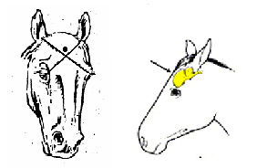

 b) bei Rindern, mit Ausnahme von ausgewachsenen Stieren, schweren Kühen und Yaks: genau senkrecht zur Stirnfläche auf der Mittellinie; bei ausgewachsenen Stieren, schweren Kühen und Yaks: etwa 1 cm neben der Mittellinie, knapp oberhalb des Kreuzungspunktes der diagonalen Verbindungslinien zwischen Augenmitte und der Mitte des gegenüberliegenden Hornansatzes (Hornbasis); 

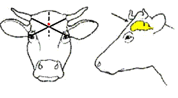

 c) bei unbehornten Schafen und Ziegen: in der Mitte der vorderen Verbindungslinie zwischen den Ohren mit Schuss nach unten in Richtung Kehle; 

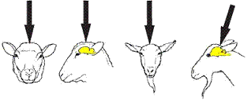

 d) bei behornten Schafen und Ziegen: hinter dem zwischen den Hörnern verlaufenden Schädelkamm auf der Mittellinie direkt hinter der Hornbasis mit Schuss in Richtung Zungenbasis oder von der Seite gesehen in Richtung Kehle; 

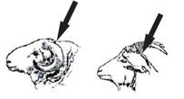

 e) bei Schweinen mit keilförmigem Kopf: in der Mittellinie des Kopfes 1 cm oberhalb der Verbindungslinie beider Augenmittelpunkte, von der Seite gesehen in Richtung des äusseren Ohransatzes; 

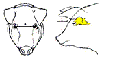

 f) bei Schweinen mit steiler Stirn: in der Mittellinie des Kopfes 2-3 cm über der Verbindungslinie beider Augenmittelpunkte senkrecht zur Stirnfläche; 

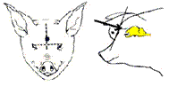

 g) bei Kaninchen: auf der Mittellinie des Schädeldachs zwischen den Ohren in Richtung Unterkiefer; das Tier muss dazu im Nacken fixiert sein; 

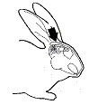

 h) bei Gehegewild: leicht neben der Mittellinie auf Höhe des Kreuzungspunktes der diagonalen Verbindungslinien zwischen Augenmitte und der Mitte der gegenüberliegenden Ohrbasis, bei Geweihträgern zwischen Augenmitte und der gegenüberliegenden Geweihbasis; 

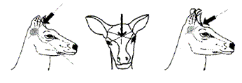

 i) bei Hausgeflügel und Laufvögeln: senkrecht am höchsten Punkt des Kopfes in Richtung Kehle oder im Kreuzungspunkt der diagonalen Verbindungslinien zwischen Augenmitte und Mitte der Ohrbasis. 

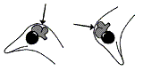

 3 Leitsymptome zur Kontrolle einer erfolgreichen Bolzenschussbetäubung 3.1 Der Betäubungserfolg ist anhand folgender Leitsymptome am Tier zu überprüfen: a) sofortiges Niederstürzen; b) tonischer Krampf (anhaltende Muskelkontraktionen von starker Intensität) mit nachfolgender klonischer Phase (rasch aufeinanderfolgende kurzdauernde Zuckungen); c) Ausfall der Atmung; d) Ausfall des Cornealreflexes; e) keine Rotation des Augapfels; f) keine Reaktion auf Setzen eines Schmerzreizes (Nasenscheidewandreflex bzw. Kammreflex bei Geflügel); g) keine Lautäusserungen; und h) keine gerichteten Bewegungen, keine Aufrichtversuche. 4 Zeitdauer bis zur Entblutung 4.1 Nach der Bolzenschussbetäubung muss der Entblutungsschnitt spätestens erfolgen innerhalb von: a) 60 Sek. bei Rindern, Schafen, Ziegen und Equiden; b) 20 Sek. bei behornten Schafen und Ziegen, die mit einem Schuss in den Hinterkopf betäubt wurden; c) 20 Sek. bei anderen Tieren. Anhang 2 (Art. 15) Elektrobetäubung einzelner Tiere 1 Anforderungen an Anlagen und Geräte 1.1 Elektrobetäubungsgeräte müssen wie folgt ausgestattet sein: a) mit kalibrierfähigen Messgeräten mit einer Anzeige der effektiven Betäubungsstromstärke und -spannung im Sichtfeld der ausführenden Person; b) mit einer Anzeige der Stromfrequenz, wenn die Stromfrequenz variabel eingestellt werden kann; c) ausser bei automatischer Betäubung, mit einem akustischen oder optischen Signal, das der ausführenden Person das Ende der Mindeststromflusszeit anzeigt, und mit einem Signal, das einen fehlerhaften Stromstärkeverlauf anzeigt; die beiden Signale müssen eindeutig unterscheidbar sein; d) mit der Möglichkeit zum Anschluss externer Messgeräte zur Erfassung der elektrischen Daten während des Betäubungsvorganges. 1.2 Die Elektroden müssen der Tierart und der Grösse der Tiere angepasst sein und über Ansatzflächen verfügen, die frei von Auflagerungen durch Rost, Schmutz oder Geweberesten sind. 1.3 Für Betäubungsgeräte mit variablen Einstellungen müssen Beschreibungen der elektrischen Parameter betreffend Stromform, effektiver Stromstärke (Ampère; A), Stromspannung (Volt; V), Stromfrequenz (Hertz; Hz) und Stromflussdauer (Sekunden; Sek.) der möglichen Programme vorliegen, die die Zuordnung der am Gerät angezeigten Einstellungen zum jeweiligen Programm zulassen. 1.4 Bei automatischen Betäubungsgeräten oder -anlagen mit variablen Einstellungen müssen die folgenden Parameter kontinuierlich aufgezeichnet werden: a) effektive Stromstärke (A); b) Stromspannung (V); c) Stromfrequenz (Hz); d) Stromflussdauer (Sek.). 1.5 Abweichungen vom vorgegebenen Betäubungsverlauf bezüglich effektive Stromstärke, Stromspannung, Stromfrequenz und Stromflussdauer müssen der ausführenden Person angezeigt werden. 2 Elektrodenansatz 2.1 Es sind Vorkehrungen zu treffen, die einen guten Stromkontakt und eine Herabsetzung des Übergangswiderstandes gewährleisten; insbesondere sind die Ansatzstellen der Elektroden von überschüssiger Wolle oder überschüssigem Fell zu befreien und zu befeuchten. Bei Schafen sind Elektroden mit ausreichend langen Spitzen zu verwenden, die die Wolle sicher durchdringen. 2.2 Bei der automatischen Betäubung müssen die Tiere, falls erforderlich, nach ihrer Grösse vorsortiert werden. 2.3 Die Elektroden sind im Bereich zwischen Auge und Ohr so anzusetzen, dass eine erfolgreiche Durchströmung des Gehirns gewährleistet ist (Kopfdurchströmung). 

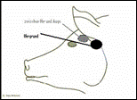

 Zangenansatz Kopf Schwein 2.4 Bei Rindern, Schafen und Ziegen kann die Durchströmung des Gehirns anstelle der Kopfdurchströmung nach Ziff. 2.3 durch den Ansatz je einer Elektrode am Kopf und am Rücken erreicht werden (Ganzkörperdurchströmung). 2.5 Wird eine Kopf-Herz-Durchströmung durch Umsetzen der Elektroden herbeigeführt (2-Phasen-Elektrobetäubung), so muss die eine Elektrode am Kopf, die andere im Bereich hinter der anatomischen Lage des Herzens platziert werden. 

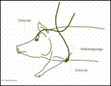

 Zangenansatz Kopf-Herz Schwein 3 Elektrische Durchströmung des Gehirns 3.1 Das Gehirn muss bei der Kopfdurchströmung vor, bei der Ganzkörperdurchströmung gleichzeitig mit dem Körper durchströmt werden. 4 Parameter für die elektrische Durchströmung des Gehirns bei Säugetieren 4.1 Bei Verwendung von Konstantstrom müssen bei Säugetieren innerhalb der ersten Sekunde bei einer anliegenden Spannung von mindestens 220 V und einer Frequenz von 50 Hz AC folgende minimale effektive Stromstärken erreicht werden: Tierkategorie Stromstärke Rinder bis 200 kg Lebendgewicht 1,3 A Rinder über 200 kg Lebendgewicht 1,5 A Schafe, Ziegen 1,0 A Schweine bis 150 kg Lebendgewicht 1,3 A Schweine über 150 kg Lebendgewicht 2,0 A Kaninchen 0,4 A 4.2 Es gelten folgende Mindestzeiten für den Stromfluss: a) 8 Sek. bei nicht fixierten Tieren, wenn nicht unmittelbar anschliessend eine Herzdurchströmung erfolgt; b) 3 Sek. bei nicht fixierten Tieren, wenn unmittelbar anschliessend eine Herzdurchströmung erfolgt; c) 3 Sek. bei fixierten Tieren, ausser bei der vollautomatischen Elektrobetäubung von Schweinen; d) 1 Sek. bei der vollautomatischen Betäubung von Schweinen vor Zuschaltung der Herzelektrode und total 3 Sek. 4.3 Zur elektrischen Betäubung dürfen nur sinus- oder rechteckförmige Wechselströme (AC) mit einer Frequenz von 50 Hz eingesetzt werden. Die analoge Wirkung bei Verwendung von Konstantspannung, anderen Stromformen als Sinus- oder Rechteck-Wechselstrom (AC) oder anderen Stromfrequenzen als 50 Hz AC muss durch den Betreiber des Schlachtbetriebes mit einem Gutachten nach Art. 24 Abs. 2 einer unabhängigen wissenschaftlichen Fachstelle nachgewiesen werden. 5 Parameter für die elektrische Durchströmung des Gehirns bei Geflügel 5.1 Bei Verwendung von Konstantstrom muss bei Geflügel innerhalb der ersten Sekunde folgende minimale effektive Stromstärke bei einer Stromfrequenz von 50 Hz AC erreicht und mindestens über die angegebene Dauer gehalten werden: Tierkategorie Stromstärke Dauer Hühner unter 2 kg Lebendgewicht 100 mA 4 Sek. Hühner ab 2 kg Lebendgewicht 400 mA 4 Sek. Truten 400 mA 4 Sek. Enten, Gänse 600 mA 6 Sek. Laufvögel 500 mA 4 Sek. 5.2 Bei Verwendung einer konstanten Wechselspannung muss die folgende Spannung eingesetzt sowie innerhalb der ersten Sekunde folgende minimale effektive Stromstärke erreicht und mindestens über die angegebene Dauer gehalten werden: Tierkategorie Stromstärke Spannung Dauer Hühner unter 2 kg Lebendgewicht 240 mA 110-120 V 7 Sek. Hühner ab 2 kg Lebendgewicht 400 mA 180 V 7 Sek. Truten 400 mA 180 V 7 Sek. Enten, Gänse 600 mA 180 V 7 Sek. 5.3 Die analoge Wirkung von anderen als den in den Ziff. 5.1 und 5.2 angegebenen Parametern muss durch den Betreiber des Schlachtbetriebes mit einem Gutachten nach Art. 24 Abs. 2 einer unabhängigen wissenschaftlichen Fachstelle nachgewiesen werden. 6 Auslösen eines funktionellen Herzstillstands durch Herzdurchströmung 6.1 Erfolgt die Entblutung nicht innerhalb von 20 Sek. nach der Kopfdurchströmung, so muss ein funktioneller Herzstillstand durch elektrische Durchströmung des Herzens hervorgerufen werden. 6.2 Vor der Herzdurchströmung muss eine Kopfdurchströmung während mindestens 3 Sek. erfolgt sein, ausgenommen bei der Ganzkörperdurchströmung und der vollautomatischen Elektrobetäubung von Schweinen. 6.3 Bei der vollautomatischen Betäubung von Schweinen muss eine vorgängige Kopfdurchströmung von mindestens 1 Sek. erfolgt sein. 6.4 Bei Rindern über 200 kg Lebendgewicht, bei Schweinen und bei Stromfrequenzen über 100 Hz ist während oder unmittelbar nach der Kopfdurchströmung eine zusätzliche Herzdurchströmung durchzuführen. 6.5 Die Herzdurchströmung muss mit einem 50-Hz-Sinusstrom und folgenden weiteren Parametern erfolgen: Tierart / -kategorie Stromstärke Stromflussdauer Zusätzliche Bedingung a) Schweine 1 A 4 Sek. - b) Rinder bis 200 kg 1 A 5 Sek. Kopfdurchströmung aufrechterhalten c) Rinder über 200 kg 1,5 A 5 Sek. Kopfdurchströmung aufrechterhalten d) Rinder über 200 kg 2,5 A 15 Sek. Im Anschluss an Kopfdurchströmung e) Hühner 0,24 A 5 Sek. - 7 Leitsymptome zur Kontrolle einer erfolgreichen Elektrobetäubung bei Kopfdurchströmung 7.1 Bei Säugetieren ist der Betäubungserfolg anhand folgender Leitsymptome zu überprüfen: a) sofortiges Erstarren und Niederstürzen; b) tonischer Krampf (anhaltende Muskelkontraktionen von starker Intensität) mit nachfolgender klonischer Phase (rasch aufeinanderfolgende kurzdauernde Zuckungen); c) Ausfall der Atmung während mehr als 20 Sek.; d) keine Reaktion auf Setzen eines Schmerzreizes nach dem Abklingen des tonisch-klonischen Krampfes (Ausfall des Nasenscheidewandreflexes); e) Ausfall des Cornealreflexes nach dem Abklingen des tonisch-klonischen Krampfes; f) keine Lautäusserungen; und g) keine gerichteten Bewegungen, keine Aufrichtversuche. 7.2 Bei Geflügel ist der Betäubungserfolg anhand folgender Leitsymptome zu überprüfen: a) sofortiges Erstarren bei der Durchströmung; b) tonischer Krampf von mindestens 20 Sek. Dauer mit Beinstreckung, weit geöffneten Augen und Ausfall der Atmung; c) klonische Phase mit reflexartigen Beinbewegungen und reflexartigem Flügelflattern; d) Ausfall des Cornealreflexes nach dem Abklingen des tonisch-klonischen Krampfes; e) keine Lautäusserungen; und f) keine Aufrichtversuche, keine gerichteten Bewegungen. 8 Leitsymptome zur Kontrolle einer erfolgreichen Elektrobetäubung mit Auslösung eines funktionellen Herzstillstands 8.1 Der Betäubungserfolg ist anhand folgender Leitsymptome zu überprüfen: a) sofortiges Erstarren bei der Durchströmung; b) Einsetzen eines tonischen Krampfes; c) Ausfall der Atmung; d) klonische Phase (rasch aufeinanderfolgende kurzdauernde Zuckungen); e) keine Reaktion auf Setzen eines Schmerzreizes nach dem Abklingen des tonisch-klonischen Krampfes; f) Ausfall des Cornealreflexes nach dem Abklingen der tonisch-klonischen Phase; und g) vollständiges Erschlaffen des gesamten Körpers und maximale Pupillenweitung. 9 Dokumentation und Massnahmen 9.1 Der Betäubungserfolg ist bei Schlachtzahlen von mehr als 10 Tieren pro Tag verteilt über jeden Schlachttag stichprobenweise zu überprüfen. Dabei sind die Leitsymptome einer erfolgreichen Elektrobetäubung unmittelbar vor Beginn der Entblutung zu kontrollieren. Mangelhafte Betäubungen müssen dokumentiert werden. 9.2 Beträgt die Zahl der Tiere mit eindeutigen Symptomen einer mangelhaften Betäubung 1 % oder mehr, so müssen Massnahmen zur Fehlerkorrektur ergriffen werden; die Massnahmen sind zu dokumentieren. 10 Zeitdauer bis zur Entblutung Bei warmblütigen Tieren muss der Entblutungsschnitt innerhalb von 20 Sek. nach der Elektrobetäubung erfolgen, ausgenommen bei vorgängig ausgelöstem funktionellem Herzstillstand. Anhang 3 (Art. 15) Elektrobetäubung von Geflügel im Wasserbad 1 Anforderungen an Anlagen und Geräte 1.1 Die Aufhängestrecke muss auf der gesamten Länge zugänglich sein. Das Wasserbad muss einsehbar sein. 1.2 Die Entblutungsstrecke muss auf der gesamten Länge einsehbar und sowohl am Anfang des Entblutens als auch unmittelbar vor dem Beginn des Brühens für Massnahmen nach Art. 21 zugänglich sein. 1.3 Das Wasserbecken zum Betäuben von Geflügel muss von der Grösse und von der Tiefe her so beschaffen sein, dass ein Eintauchen des gesamten Kopfes in das Wasserbad für alle Tiere gewährleistet ist; der Wasserspiegel muss regulierbar sein. 1.4 Beim Betäuben von Geflügel im Wasserbad darf kein anderer Körperteil vor dem Kopf in den Stromfluss gelangen. Insbesondere darf das Wasser beim Eintauchen der Tiere nicht zu einer Seite überlaufen und mit noch unbetäubten Tieren in Kontakt kommen. 1.5 Es sind geeignete Vorkehrungen zu treffen, die eine wirksame Durchströmung der Tiere gewährleisten. Insbesondere muss auf ausreichenden Kontakt zwischen Füssen und den Aufhängehaken und auf deren Befeuchtung geachtet werden. 1.6 Die Anordnung der Elektroden im Wasserbad und die Erdung müssen eine Ganzkörperdurchströmung jedes einzelnen Tieres gewährleisten. 1.7 Die ins Wasser eingelassenen Elektroden müssen sich über die gesamte Länge des Wasserbeckens erstrecken. 1.8 Die Elektrobetäubungsanlage muss ausgestattet sein mit: a) Messgeräten mit einer Anzeige der effektiven Betäubungsstromstärke und -spannung im Sichtfeld der ausführenden Person; b) einer Anzeige der Stromfrequenz, wenn diese variabel eingestellt werden kann; c) einem akustischen oder optischen Signal, das der ausführenden Person eine fehlerhafte Betäubung hinsichtlich des Stromstärkeverlaufs anzeigt; und d) der Möglichkeit zum Anschluss externer Messgeräte zur Erfassung der elektrischen Daten während des Betäubungsvorganges. 1.9 Für Betäubungsgeräte mit variablen Einstellungen müssen Beschreibungen der elektrischen Parameter betreffend Stromform, effektive Stromstärke, Stromspannung, Stromfrequenz und Stromflussdauer der möglichen Programme vorliegen, die die Zuordnung der am Gerät angezeigten Einstellungen zum jeweiligen Programm zulassen. 1.10 Bei Betäubungsanlagen mit variablen Einstellungen müssen die folgenden Parameter kontinuierlich aufgezeichnet werden: a) effektive Stromstärke (durchschnittlicher Effektivwert RMS in A); b) effektive Stromspannung (durchschnittlicher Effektivwert RMS1 in V); c) Stromfrequenz (Hz); und d) Bandgeschwindigkeit (m/Sek.). 1.11 Abweichungen der effektiven Stromspannung nach unten von mehr als 5 % sowie Abweichungen von der nominalen Stromfrequenz müssen aufgezeichnet und die Massnahmen zur Fehlerkorrektur dokumentiert werden. 2 Elektrische Durchströmung im Wasserbad 2.1 Beim Betäuben von Geflügel im Wasserbad muss durch ausreichende Stromspannung die Erzeugung einer wirksamen Stromstärke zur Betäubung jedes Tieres gewährleistet sein. 2.2 Tiere, die im Wasserbecken nicht oder ungenügend betäubt wurden, sind unverzüglich von Hand zu betäuben oder zu töten. 2.3 Bei Verwendung einer Stromfrequenz von 50 Hz muss innerhalb der ersten Sekunde folgende durchschnittliche minimale effektive Stromstärke erreicht werden und mindestens über die angegebene Dauer auf jedes Tier einwirken: Tierkategorie Stromstärke Dauer Hühner 100 mA 4 Sek. Truten 150 mA 4 Sek. Enten, Gänse 130 mA 6 Sek. Wachteln 45 mA 4 Sek. 2.4 Bei Verwendung einer Stromfrequenz über 50 Hz bei Hühnern und Truten muss bei der angegebenen Frequenz innerhalb der ersten Sekunde folgende durchschnittliche minimale effektive Stromstärke erreicht werden und über eine Dauer von mindestens 4 Sek. auf jedes Tier einwirken: Stromfrequenz Hühner Truten über 50 bis 200 Hz 100 mA 250 mA 200-400 Hz 150 mA 400 mA 400-1500 Hz 200 mA 400 mA 2.5 Die analoge Wirkung von anderen als den in den Ziff. 2.3 und 2.4 genannten Parametern muss durch den Betreiber des Schlachtbetriebes mit einem Gutachten nach Art. 24 Abs. 2 einer unabhängigen wissenschaftlichen Fachstelle nachgewiesen werden. 2.6 Erfolgt die Entblutung nicht innerhalb von 10 Sek. nach Beginn der elektrischen Durchströmung, so muss die elektrische Durchströmung einen funktionellen Herzstillstand nach Ziff. 2.7 bewirken. 2.7 Zur Auslösung eines funktionellen Herzstillstandes durch die elektrische Durchströmung muss mit einem 50-Hz-Sinusstrom folgende effektive Stromstärke über mindestens 1 Sek. einwirken: a) 150 mA bei Hühnern; b) 250 mA bei Truten. 3 Kontrolle einer erfolgreichen Elektrobetäubung und Entblutung 3.1 Der Betäubungserfolg ist anhand folgender Leitsymptome des Tieres zu überprüfen: a) sofortiges Erstarren bei der Durchströmung; b) keine Reaktion auf das Setzen des Entblutungsschnittes; c) während der Entblutung keine gerichteten Bewegungen, keine Aufrichtversuche; und d) Erschlaffen des Körpers, keine Augenreflexe und maximale Pupillenweitung vor dem Beginn des Brühens. 3.2 Der Erfolg der Elektrobetäubung und Entblutung ist zu Beginn jeder Charge stichprobenweise zu überprüfen. Dabei sind die Leitsymptome einer erfolgreichen Elektrobetäubung unmittelbar vor dem Beginn der Entblutung sowie unmittelbar vor dem Brühen und Rupfen zu kontrollieren. Mangelhafte Betäubungen müssen dokumentiert werden. 3.3 Der Stichprobenumfang umfasst die Anzahl Tiere, die pro Charge während 1 Min. über die Kette laufen, mindestens aber 20 Tiere. Werden innerhalb dieser Stichprobe Abweichungen registriert, so müssen unverzüglich Massnahmen zur Fehlerkorrektur ergriffen werden; die Massnahmen sind zu dokumentieren. Anhang 4 (Art. 15) Kohlendioxid-Betäubung von Schweinen 1 Anforderungen an Anlagen und Geräte 1.1 Kohlendioxid-Betäubungsanlagen für Schweine müssen folgende Anforderungen erfüllen: a) Der Einstieg in die Beförderungseinrichtung muss ebenerdig sowie schwellen- und gefällefrei angelegt sein. b) Die Beförderungsvorrichtung sowie die Kammer, in der die Schweine dem CO 2 ausgesetzt werden, müssen mit indirektem Licht beleuchtet sein. c) Die Kammer muss permanent und gefahrlos einsehbar sein. d) Die Schweine müssen ohne Einengung des Brustkorbes aufrecht und auf festem Boden stehen können, bis sie das Bewusstsein verlieren. 1.2 Es muss gewährleistet sein, dass die für die jeweilige Betäubungsanlage festgelegte Höchstkapazität (Anzahl Tiere pro Stunde) nicht überschritten werden kann. Die Mindestverweildauer in der festgelegten Mindestkonzentration an CO 2 in Kopfhöhe der Schweine darf nicht unterschritten werden. 1.3 Die Mindestkonzentration an CO 2 muss 84 Volumenprozente betragen. Die Mindestverweildauer in der CO 2 -Atmosphäre liegt bei 100 Sek. 1.4 Änderungen an den technischen Einstellungen dürfen nur von der dafür verantwortlichen Person vorgenommen werden; sie sind zu dokumentieren. 2 Messgeräte und Aufzeichnungen 2.1 Die Kammer, in der die Schweine dem CO 2 ausgesetzt werden, muss an folgenden, deutlich gekennzeichneten Stellen mit Sensoren zur Messung der Gaskonzentration ausgestattet sein: a) beim Eintauchen des Kopfes des Tieres in eine CO 2 -Konzentration von 84 Volumenprozent; b) beim Auftauchen des Kopfes des Tieres aus einer CO 2 -Konzentration von 84 Volumenprozent. 2.2 Die Betäubungsanlage muss über eine Einrichtung verfügen, mit der die Verweildauer der Tiere in der festgelegten Mindestkonzentration an CO 2 erfasst wird. 2.3 Die CO 2 -Konzentration und die Verweildauer der Tiere in mindestens 84 Volumenprozent CO 2 müssen kontinuierlich aufgezeichnet werden; Abweichungen und die Massnahmen zur Behebung der Mängel sind zu dokumentieren. 2.4 Die Messgeräte nach den Ziff. 2.1 und 2.2 müssen jederzeit ablesbar sein und ein optisches und akustisches Warnsignal abgeben, wenn die festgelegte Mindestverweildauer oder die festgelegte Mindestkonzentration an CO 2 unterschritten wird. Das Signal, das die Unterschreitung der Mindestkonzentration anzeigt, muss erfolgen, wenn die Mindestkonzentration an CO 2 für mehr als 60 Sek. um 2 oder mehr Volumenprozent unterschritten wird. 2.5 Die Messgeräte nach den Ziff. 2.1 und 2.2 sind mindestens halbjährlich auf ihre Funktionsfähigkeit zu überprüfen, und die Ergebnisse sind zu dokumentieren. 3 Verbringen der Schweine in die CO 2 -Atmosphäre 3.1 Automatisierter Gruppenzutrieb 3.1.1 Der automatische Einschubmechanismus eines seitlichen Gruppenzutriebs muss so arbeiten, dass keine zu grossen Kräfte auf die Schweine einwirken können. Der Druck, mit dem die Einschubtür möglichst unmittelbar an den Gondeleinstieg gefahren wird, ist auf einen maximalen Wert (Anzahl Tiere multipliziert mit 100 kg) zu begrenzen. 3.1.2 Bei Verwendung einer pneumatisch betriebenen Separierungstür vor dem Einschubabteil ist die Kraft, die seitlich auf ein Schwein ausgeübt wird, auf maximal 50 kg zu begrenzen. 3.1.3 Ist ein durch einen automatischen Treibschild gesteuerter, vorgelagerter Gruppierungsgang in den Zutrieb integriert, so ist eine tiergerechte Vortriebsgeschwindigkeit von 0,2-0,5 m/Sek. einzustellen. Der Treibschild darf einen maximalen Druck von 100 Kilogramm ausüben und muss bis unmittelbar an die allfällige Separierungstür herangefahren werden können. 3.2 Befördern der Tiere in der Betäubungsanlage 3.2.1 Die Schweine müssen unverzüglich und möglichst ohne Zwischenstopp, spätestens jedoch 20 Sek. nach dem Einschleusen des ersten Tieres in die Anlage, in die CO 2 -Atmosphäre mit der in Ziff. 7 aufgeführten Mindestkonzentration befördert werden. 3.2.2 Die Beförderungseinrichtungen müssen mit mindestens zwei Schweinen beladen werden; das Platzangebot muss für die Anzahl der Tiere angemessen sein. 4 CO 2 -Exposition 4.1 Die zum Betäuben der Schweine eingesetzte CO 2 -Konzentration muss mindestens 84 Volumenprozent CO 2 betragen und innerhalb von 15 Sek., nachdem die Schweine die Luftatmosphäre verlassen haben, erreicht sein. Die Verweildauer der Schweine in mindestens 84 Volumenprozent CO 2 muss mindestens 100 Sek. betragen. Eine Aufenthaltsdauer unter 100 Sek. kann nicht durch eine Erhöhung der CO 2 -Konzentration kompensiert werden. 4.2 In Systemen mit mehr als einem Halt in der CO 2 -Atmosphäre muss die Konzentration am tiefsten Punkt der Anlage mehr als 90 Volumenprozente in Kopfhöhe der Tiere betragen. 5 Kontrolle einer erfolgreichen CO 2 -Betäubung 5.1 Der Betäubungserfolg ist anhand folgender Leitsymptome zu überprüfen: a) keine Reaktion auf Setzen eines Schmerzreizes (Ausfall des Nasenscheidewandreflexes); b) Pupillenweitung; c) kein spontaner Lidschluss; d) Ausfall der regelmässigen Atmung, auch keine mehrmalige Schnappatmung in kurzen Abständen; e) keine Lautäusserungen; f) keine Aufrichtversuche, keine gerichteten Bewegungen; g) vollständiges Erschlaffen des Körpers; und h) keine Reaktion auf das Setzen des Entblutungsschnittes. 5.2 Der Erfolg der Betäubung ist verteilt über jeden Schlachttag stichprobenweise zu überprüfen. Dabei sind die Leitsymptome einer wirksamen CO 2 -Betäubung unmittelbar vor Beginn der Entblutung zu kontrollieren. Mangelhafte Betäubungen müssen dokumentiert werden. 5.3 Beträgt die Zahl der Tiere mit eindeutigen Symptomen einer ungenügenden Betäubung 1 % oder mehr, so müssen Massnahmen zur Fehlerkorrektur ergriffen werden; die Massnahmen sind zu dokumentieren. 6 Nachbetäubung 6.1 Unzureichend mit CO 2 betäubte Schweine sind durch Bolzenschuss zu betäuben. 6.2 Im Bereich des Auswurfs aus der Betäubungsanlage bis zum Ende der Entblutungsstrecke ist ein geeigneter Bolzenschussapparat mit entsprechender Treibladung für den sofortigen Einsatz zur Nachbetäubung unzureichend betäubter Tiere einsatzbereit zu halten. 7 Parameter für die Betäubung mit CO 2 7.1 Die CO 2 -Konzentration, die Verweildauer in der CO 2 -Atmosphäre und das Zeitintervall vom Auftauchen aus der CO 2 -Atmosphäre bis zum Beginn des Entblutens müssen wie folgt aufeinander abgestimmt sein: CO 2 -Konzentration Verweildauer Zeitintervall bis zum Beginn der Entblutung a) mind. 84 Vol.% CO 2 100 Sek. max. 55 Sek. nach Auftauchen b) mind. 84 Vol.% CO 2 120 Sek. max. 60 Sek. nach Auftauchen c) mind. 84 Vol.% CO 2 150 Sek. max. 70 Sek. nach Auftauchen d) mind. 88 Vol.% CO 2 150 Sek. max. 100 Sek. nach Auftauchen e) mind. 90 Vol.% CO 2 120 Sek. max. 70 Sek. nach Auftauchen 7.2 Das maximal zulässige Zeitintervall vom Auftauchen aus der CO 2 -Atmosphäre bis zum Setzen des Entblutungsschnitts gilt für jedes einzelne Tier; bei mehreren Tieren in einer Gondel gilt es für das zuletzt zur Entblutung kommende Tier. 7.3 Die analoge Wirkung anderer Werte für die vorgegebenen Parameter muss durch den Betreiber des Schlachtbetriebes mit einem Gutachten nach Art. 24 Abs. 2 einer unabhängigen wissenschaftlichen Fachstelle nachgewiesen werden. 7.4 Das Gutachten muss eine erfolgreiche Betäubung bei mindestens 1000 Schweinen im Normalbetrieb belegen. 7.5 Im Gutachten müssen die Abstimmung der unter Ziff. 7.1 aufgeführten Parameter und die daraus resultierende Höchstkapazität der Betäubungseinrichtung (Anzahl Tiere pro Stunde) aufgeführt sein. Anhang 5 (Art. 15) Kopfschlagbetäubung von Kaninchen und Geflügel 1 Stumpfe Schuss-Schlag-Betäubung von Kaninchen und Geflügel 1.1 Die stumpfe Schuss-Schlag-Betäubung darf nur bei Tieren mit einem Lebendgewicht von höchstens 10 kg und nur mit mechanischen Geräten durchgeführt werden, die einen Schlag auf das Stirnbein versetzen, ohne eine Stirnbeinfraktur herbeizuführen. 1.2 Die ausführende Person muss sicherstellen, dass der Ansatz des Gerätes und die Ladungsstärke der Kartusche oder die Federspannung bei mit Federzug betriebenen Geräten den Angaben des Herstellers entsprechen und dass das Tier sofort in einen bis zum Tod anhaltenden Zustand der Empfindungs- und Wahrnehmungslosigkeit versetzt wird. 1.3 Nach einer stumpfen Schuss-Schlag-Betäubung muss das Tier unverzüglich entblutet werden. 1.4 Der Entblutungsschnitt muss innerhalb von 10 Sek. nach der Betäubung erfolgen. 2 Kopfschlagbetäubung von Geflügel 2.1 Eine Person darf pro Tag höchstens 200 Tiere durch Kopfschlag betäuben. 2.2 Die Betäubung muss mit einem harten, stumpfen und schweren Gegenstand durch einen ausreichend kräftigen, gezielten Schlag auf den Hinterkopf erfolgen. 2.3 Der Entblutungsschnitt muss innerhalb von 10 Sek. nach der Betäubung erfolgen. Anhang 6 (Art. 15) Betäubung durch Kugelschuss ins Gehirn 1 Bei Schlachtvieh 1.1 Wird Schlachtvieh durch einen gezielten Kugelschuss ins Gehirn betäubt, so muss es nach dem Schuss unverzüglich entblutet werden. 1.1a Zulässig sind Kugelschüsse aus Pistolen, Revolvern, Gewehren und Kugelschussapparaten. 1.2 Der Kugelschuss ist so auf den Kopf des Tieres abzugeben, dass das Tier sofort betäubt wird. Das Geschoss muss über ein entsprechendes Kaliber verfügen und eine ausreichende Auftreffenergie aufweisen. 1.3 Es dürfen nur Geschosse verwendet werden, die sich beim Auftreffen in geeigneter Weise verformen oder zerlegen; die Verwendung von Vollmantelgeschossen ist verboten. 1.4 Die Schussposition ist wie folgt zu wählen: a) bei Equiden: senkrecht zur Stirnfläche auf der Mittellinie, im Kreuzungspunkt der diagonalen Verbindungslinien zwischen der Augenmitte und der Mitte des gegenüberliegenden Ohransatzes (Ohrbasis); 

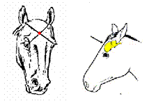

 b) bei Rindern bis 800 kg und Yaks: senkrecht zur Stirnfläche auf der Mittellinie, im Kreuzungspunkt der diagonalen Verbindungslinien zwischen der Augenmitte und der Mitte des gegenüberliegenden Hornansatzes (Hornbasis); 

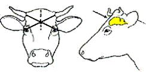

 c) bei Rindern über 800 kg sowie bei Wasserbüffeln: senkrecht zur Stirnfläche leicht neben der Mittellinie, fingerbreit neben dem Kreuzungspunkt der diagonalen Verbindungslinien zwischen der Augenmitte und der Mitte des gegenüberliegenden Hornansatzes (Hornbasis). 

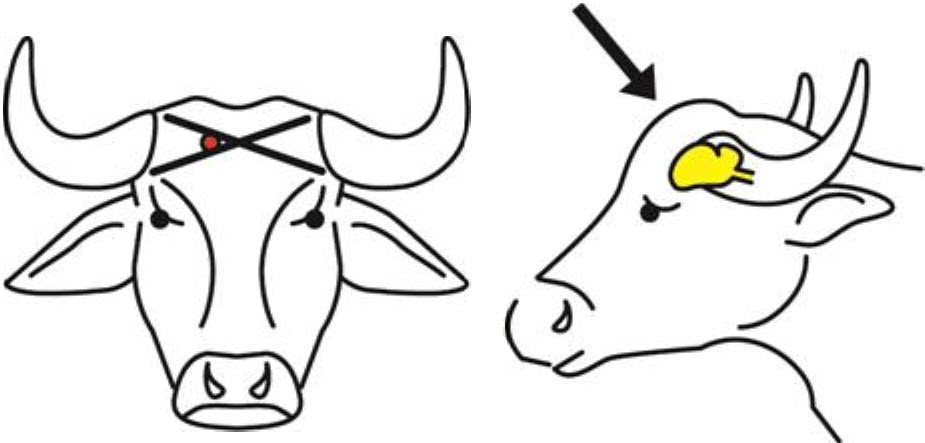

 1.5 Wird Schlachtvieh auf der Weide durch einen gezielten Kugelschuss in den Kopf betäubt, so muss ein Zielfernrohr verwendet werden. Die Abschussdistanz ist zwischen 10 und 20 m zu wählen; der Schuss muss aufgesetzt erfolgen. Das Geschoss muss mit einer Geschwindigkeit von mindestens 400 m/Sek. auftreffen und 100 % seiner Energie im Tierkörper abgeben. 2 Bei Gehegewild 2.1 Gehegewild darf nur mit Büchsenpatronen mit einem Kaliber von mindestens 6,5 mm (Kaliber .257) und einer Auftreffenergie von mindestens 2000 J auf 100 m betäubt werden. 2.2 Die Abschussdistanz ist zwischen 10 und 30 m zu wählen. 2.3 Damwild darf auch mit Büchsenpatronen mit einem Kaliber von mindestens 5,6 mm (Kaliber .222) und einer Mündungsenergie von mindestens 300 J betäubt werden, sofern: a) die Schussentfernung weniger als 25 m beträgt; b) der Schuss von einem bis zu 4 m hohen Hochstand abgegeben wird; und c) sich der Hochstand in einem geschlossenen Gehege mit unbefestigtem Boden befindet, dessen Einzäunung mindestens 1,80 m hoch ist. 2.4 Bei Gehegewild darf der Fangschuss, sofern er erforderlich ist, mit Pistolen- oder Revolvergeschossen mit einer Mündungsenergie von mindestens 250 J vorgenommen werden. Das Geschoss muss 100 % seiner Energie im Tierkörper abgeben.
