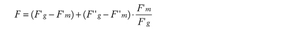
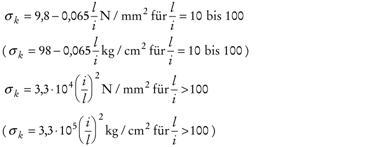

Schwachstromverordnung vom 7. August 1984 Aufgrund von Art. 3 des Elektrizitätsgesetzes vom 15. Dezember 1982, LGBl. 1983 Nr. 16 , verordnet die Regierung: I. Allgemeine Bestimmungen Art. 1 Geltungsbereich 1) Diese Verordnung gilt für alle Schwachstromanlagen nach Art. 3 des Elektrizitätsgesetzes, die nach ihrem Inkrafttreten erstellt werden. 2) Für in Betrieb stehende Anlagen gilt sie, wenn: a) solche Anlagen erweitert oder in grossem Umfang umgebaut oder repariert werden; b) der Betrieb durch andere elektrische Anlagen gestört wird; c) Personen oder Sachen gefährdet werden. 3) Können einzelne Bestimmungen dieser Verordnung nur unter ausserordentlichen Schwierigkeiten befolgt werden oder erweisen sie sich für die technische Entwicklung als hinderlich, so kann die Regierung oder in weniger bedeutenden Fällen die von ihr bezeichnete Kontrollstelle auf begründetes Gesuch hin Abweichungen bewilligen. Art. 2 Andere Vorschriften 1) Soweit diese Verordnung nichts anderes bestimmt, gelten: a) die Verordnung vom 7. August 1984 über die Erstellung, den Betrieb und den Unterhalt von elektrischen Starkstromanlagen; b) die Verordnung vom 7. August 1984 über die Parallelführungen und Kreuzungen elektrischer Leitungen unter sich und mit Eisenbahnen; c) die Verordnung vom 7. August 1984 über die Erstellung, den Betrieb und den Unterhalt der elektrischen Einrichtungen von Bahnen. 2) Im übrigen sind die anerkannten Regeln der Technik zu beachten. 3) Vorbehalten bleiben die Bestimmungen der Verordnung vom 9. Mai 1995 über den Verkehr mit elektrischen Betriebsmitteln im Europäischen Wirtschaftsraum, LGBl. 1995 Nr. 143, sowie der Verordnung vom 9. Mai 1995 über die elektromagnetische Verträglichkeit von Geräten im Europäischen Wirtschaftsraum, LGBl. 1995 Nr. 155. Art. 3 Begriffe In dieser Verordnung bedeutet: 1. Abspannmast Ein Mast, der die gesamten Zug- und Verdrehkräfte einer Leitung übernimmt. Er muss an kritischen Stellen in den Leitungszug eingebaut werden, um den Zusammenbruch grösserer Leitungsstrecken zu verhindern. 2. Anlageerdung Die Erdung (Ziff. 8) einer Hochspannungsanlage. 3. Betriebserdung Die für den Betrieb einer Schwachstromanlage erforderliche Erdung (Ziff. 8). 4. Bezugserde Derjenige Teil der Erdoberfläche ausserhalb des Einflussbereiches der Erdung (Ziff. 8), in dem zwischen zwei beliebigen Punkten keine erheblichen, vom Erdungsstrom herrührende Spannungen auftreten (neutrale Erde). 5. Eckmast Ein Mast, der in Winkelpunkten von Leitungen steht und die resultierenden Zugkräfte übernimmt. Er kann zusätzlich als Abspannmast ausgebaut werden. 6. Erden Einen leitfähigen Gegenstand über eine Erdungsleitung (Ziff. 9) mit Erdern (Ziff. 7) verbinden. 7. Erder Leiter, die ausschliesslich zum Erden im Erdreich oder in Betonfundamenten eingebettet sind und mit dem Erdreich in gut leitender Verbindung stehen. Als Erder können auch Wasserleitungen oder metallene Hüllen von Kabeln und dergleichen dienen. 8. Erdung Die miteinander verbundenen Erder (Ziff. 7) und Erdungsleitungen (Ziff. 9). 9. Erdungsleitung Die von den zu erdenden Anlageteilen zu Erdern (Ziff. 7) führende Leitung, soweit sie ausserhalb des Erdreichs oder isoliert im Erdreich verlegt ist. 10. Gemeinschaftstragwerk Ein Tragwerk, auf dem sowohl Niederspannungs- als auch Schwachstromleitungen geführt werden. 11. Hochspannungsbereich Er umfasst den Werk- (Ziff. 15) und den Übergangsbereich (Ziff. 13). 12. Tragmast Mast in gerader Leitungsstrecke. Er ist im wesentlichen zur Abstützung von Leitungen bestimmt und darf weder durch Zug- noch durch Verdrehkräfte stark beansprucht werden. 13. Übergangsbereich Das unmittelbar an den Werkbereich (Ziff. 15) anschliessende, zwischen diesem und der Bezugserde (Ziff. 4) liegende Gebiet, in dem zwischen zwei Punkten erhebliche, vom Erdungsstrom der Hochspannungsanlage herrührende Spannungen auftreten können. 14. Überspannungsschutz-Erdung Die für die Überspannungs-Schutzeinrichtung erforderliche Erdung (Ziff. 8). 15. Werkbereich Derjenige Bereich der Hochspannungsanlage und des angrenzenden Gebietes, in dem die Spannungsverteilung durch die Anlageerdung (Ziff. 2) so gesteuert wird, dass der Spannungsabfall am Boden erst ausserhalb erfolgt. Art. 4 Benachbarte Anlagen Schwachstromanlagen müssen, soweit dies ohne aussergewöhnlichen Aufwand möglich ist, so erstellt werden, dass ihr Betrieb durch andere elektrische Anlagen möglichst wenig gefährdet oder gestört wird und sie ihrerseits andere elektrische Anlagen möglichst wenig beeinträchtigen. Art. 5 Benachrichtigung anderer Betriebsinhaber Wer Schwachstromanlagen, die benachbarte elektrische Anlagen stören oder gefährden könnten, erstellen oder umbauen will, muss die Betriebsinhaber der benachbarten Anlagen von seinem Vorhaben rechtzeitig schriftlich benachrichtigen, damit im voraus Schutzmassnahmen getroffen werden können. Art. 6 Verfahren bei Gefährdungen und Störungen 1) Wird eine Schwachstromanlage durch eine elektrische Anlage gefährdet oder gestört und erhält die Kontrollstelle davon Kenntnis, so prüft diese zunächst, ob die Schwachstromanlage vorschriftsgemäss erstellt ist. Trifft dies zu oder hören die Gefährdungen oder Störungen trotz Verbesserungen an der Schwachstromanlage nicht auf, so ermittelt die Kontrollstelle die Ursachen. 2) Im Rahmen der von der Kontrollstelle vorgeschlagenen Massnahmen bleibt es zunächst den Betriebsinhabern überlassen, sich zu verständigen. Wird keine Verständigung erzielt, so entscheidet die Regierung. Art. 7 Verpflichtete Personen Wo die nachfolgenden Vorschriften nichts anderes bestimmen, verpflichten sie den Betriebsinhaber. II. Schutzmassnahmen 1. Anlagen- und Personenschutz Art. 8 Anlagen Zur Vermeidung von Gefahren und Beschädigungen müssen folgende Anlagen geschützt werden: a) oberirdische Leitungen und daran angeschlossene Anlageteile, einschliesslich der Erdkabel, gegen Überspannung und Überstrom. In nicht besonders blitzgefährdeten Gegenden kann bei Anlagen ohne Betriebserdung auf einen Überspannungsschutz im Gebäude verzichtet werden, wenn die oberirdische Leitung nicht länger als 100 m ist und keine oberirdischen Starkstromanlagen kreuzt; b) unterirdische Leitungen und angeschlossene Anlageteile gegen die von Starkstromanlagen verursachten Überspannungen. Gegen atmosphärische Überspannungen müssen Kabelanlagen nur bei besonders ungünstigen topographischen oder geologischen Verhältnissen geschützt werden; c) Aussenantennen gegen Blitzeinschläge; d) Leitungen und daran angeschlossene Anlageteile in explosionsgefährlichen Bereichen. Art. 9 Schwachstromanlagen im Bereich von Hochspannungsanlagen 1) Kann unter dem Einfluss eines Erdschlusses in einer Hochspannungsanlage oder auf einer Hochspannungsleitung zwischen der Erde und Teilen einer Schwachstromanlage eine Spannung von mehr als 500 V effektiv auftreten, so sind folgende Massnahmen zu treffen: 1. Die gefährdeten Teile müssen gegen ihre Umgebung für eine Prüfspannung vom 1.3fachen der höchstmöglich auftretenden Spannung, wenigstens aber für 4 kV effektiv isoliert werden. 2. Ist wegen der Eigenschaften der Schwachstromanlagen (Ausdehnung, mangelnde Übersichtlichkeit) damit zu rechnen, dass die Isolationsfestigkeit nicht dauernd aufrecht erhalten werden kann, so müssen Schutzübertrager mit entsprechender Spannungsfestigkeit in die Anlage eingebaut werden. Die Betriebserdung der Schwachstromanlage muss an die örtliche Erdung der Hochspannungsanlage angeschlossen werden. 2) Die metallische Hülle eines Schwachstromkabels kann mit der Anlageerdung verbunden werden, wenn dabei die Spannung nach Abs. 1 unter 500 V effektiv bleibt und keine gefährlichen, schwer kontrollierbaren Potentialverschleppungen oder Korrosionsschäden entstehen. 3) Erdkabel von Schwachstromanlagen müssen, wenn sie nahe bei Erdungen von Hochspannungsanlagen verlaufen, gegen gefährliche Einwirkungen geschützt werden. Art. 10 Berührungsschutz An denjenigen Teilen der Schwachstromanlage, an denen die nach der Starkstromverordnung vom 7. August 1984 zulässige Berührungsspannung überschritten werden kann, müssen Schutzeinrichtungen angebracht werden, die unbeabsichtigte Berührungen verhindern. Art. 11 Anforderungen an die Schutzeinrichtungen 1) Die Schutzeinrichtungen müssen so beschaffen und angebracht sein, dass sie die Anlagen gegen Überspannung und Überstrom soweit wie möglich schützen. Sie dürfen, wenn sie ansprechen, weder Personen noch Sachen gefährden. 2) Die Schutzwirkung muss auch bei einer Beschädigung durch aussergewöhnlich starke Beanspruchung wenigstens teilweise erhalten bleiben. 3) In Gebäuden müssen die Schutzeinrichtungen so beschaffen und angebracht sein, dass sie die Brandgefährdung bei dauernder Berührung einer oberirdischen Schwachstromleitung mit einer oberirdischen Niederspannungsleitung verhindern. 2. Erdung Art. 12 Überspannungsschutz-Erdung 1) Bei oberirdischer Einführung von Schwachstromleitungen in ein Gebäude muss die Überspannungsschutz-Einrichtung auf dem kürzesten Weg geerdet werden, vorzugsweise an ein metallenes Wasserleitungsnetz. Wo dies nicht möglich ist, muss ein Erder verlegt und mit den Wasserleitungen des Gebäudes verbunden werden. 2) Beim Übergang von oberirdischen Leitungen auf Erdkabel müssen über möglichst kurze Verbinder Überspannungsschutz-Einrichtungen zwischen die Leitungen und die Kabelhüllen geschaltet werden. Sind die metallenen Kabelhüllen vom Erdboden isoliert, so müssen Erdbänder oder metallene Kabelkanäle zur Erdung der Überspannungs-Einrichtungen verwendet werden. 3) Zur Vermeidung von gefährlichen Spannungen zwischen den verschiedenen Erdungen von Schwachstromeinrichtungen können diese innerhalb einer Anlage miteinander verbunden werden. Dabei müssen die Korrosionsverhältnisse berücksichtigt werden und die Verbindungen leicht kontrollierbar sein. Art. 13 Erder für Überspannungsschutz-Erdung 1) Als Erder sind Band oder Runddraht von mindestens 10 m Länge zu verwenden. Sie müssen mindestens 50 cm tief, gestreckt und wenn möglich in dauernd feuchtes Erdreich verlegt werden. Die Querschnitte richten sich nach Abs. 4. 2) Die Erder müssen ausreichend korrosionsbeständig sein; insbesondere muss die Bildung galvanischer Elemente (Korrosion) mit anderen im Boden vorhandenen Metallteilen verhindert werden. 3) Bei der Erstellung der Überspannungsschutz-Erdung von Schwachstromanlagen ist ein so grosser Abstand zu benachbarten Hochspannungsanlagen einzuhalten, dass die in Art. 9 zugelassenen Werte nicht überschritten werden. 4) Die minimalen Abmessungen von Erdern betragen: Runddraht Band Material Ø mm mm Feuerverzinkter oder verbleiter Stahl 8 3 × 25 Kupfer 6 2 × 20 Art. 14 Betriebserdung 1) Die Betriebserdung muss den betrieblichen Anforderungen genügen. 2) Ist neben der Betriebserdung noch eine Überspannungsschutz-Erdung vorhanden, so müssen beide miteinander verbunden werden. Die Verbindung ist so zu erstellen, dass die durch Ausgleichströme entstehenden Spannungen zwischen den Anlageteilen möglichst klein sind. Dabei müssen auch besondere Einwirkungen wie Kurzschlüsse in benachbarten Starkstromanlagen (Art. 9) und Blitzeinschläge berücksichtigt werden. 3) Die Betriebserdung darf nicht an Ableitungen der Gebäude-Blitzschutzanlage angeschlossen werden. Sie kann jedoch mit Wasser- und Zentralheizungsleitungen verbunden werden, auch wenn diese in die Gebäude-Blitzschutzanlage einbezogen sind. Art. 15 Anforderungen an Erdungsleitungen 1) Der Querschnitt der Betriebserdungsleitung richtet sich nach den betrieblichen Anforderungen. 2) Die Überspannungsschutz-Erdungsleitungen und ihre Verbindungsstellen müssen bezüglich Belastbarkeit, Haltbarkeit und mechanischer Festigkeit mindestens einem Kupferquerschnitt von 7 mm 2 bei oberirdischer und 20 mm 2 bei unterirdischer Verlegung entsprechen; der oberirdische Teil der Erdungsleitung von Antennen muss mindestens einem Kupferquerschnitt von 12 mm 2 entsprechen. In explosionsgefährlichen Bereichen muss die Erdungsleitung mindestens einem Kupferquerschnitt von 10 mm 2 entsprechen. 3) Verschraubte metallische Montagegestelle dürfen nur als Erdungsleitung benützt werden, wenn bei der Demontage von Anlageteilen die Verbindung gewährleistet bleibt. III. Leitungen 1. Oberirdische Schwachstromleitungen a) Allgemeine Bestimmungen Art. 16 1) Leitungen sollen wenn möglich nicht über oder neben Hauptstrassen geführt werden. 2) Bäume dürfen nicht als Tragwerke benützt werden. 3) Leitungen sind so zu erstellen, dass sie auch bei extremen Witterungsverhältnissen nicht durch Bäume und Sträucher beeinträchtigt werden. b) Leiter Art. 17 Leiterarten 1) Leiter können blank oder isoliert verwendet werden. 2) Luftkabel können entweder aus selbsttragenden Leitern oder aus nicht selbsttragenden Leitern mit Tragelementen erstellt werden. Art. 18 Leitermaterial Leiter und Tragelemente müssen ausreichend korrosionsbeständig oder mit einem lückenlosen Schutzüberzug versehen sein. Art. 19 Festigkeit Selbsttragende Leiter sowie Tragelemente mit einer absoluten Bruchlast von weniger als 1250 N (125 kg) dürfen nicht verwendet werden. Art. 20 Höchstbeanspruchung Die höchstzulässige Beanspruchung der selbsttragenden Leiter sowie der Tragelemente darf, unter Berücksichtigung von Art. 21, den elastischen Bereich nicht überschreiten. Art. 21 Belastungsannahmen 1) Zugbeanspruchung und Durchhang sind aufgrund folgender Belastungsannahmen zu berechnen: a) tiefste Ortstemperatur, ohne Zusatzlast und ohne Wind. Als tiefste Ortstemperatur sind mindestens folgende Werte einzusetzen: bis 1 000 m ü. M. - 20° C von 1 000 bis 1 500 m ü. M. - 25° C über 1 500 m ü. M. - 30° C; b) Temperatur von 0° C und eine gleichmässig verteilte Zusatzlast, z. B. Schnee, Eis und Rauhreif, von mindestens 8 N (0.8 kg) pro Meter Leiterlänge, ohne Wind. 2) Für Gegenden, wo erfahrungsgemäss wesentlich günstigere oder ungünstigere Verhältnisse herrschen, kann die Kontrollstelle in Einzelfällen auf Gesuch hin oder von Amts wegen andere Zusatzlasten oder Temperaturen festsetzen. 3) Die Berechnungen sind nach folgenden Methoden durchzuführen: a) bei Spannweiten bis 300 m und einem Winkel zwischen der Horizontalen und der Verbindungsgeraden der beiden Aufhängepunkte bis zu 30° nach der Parabelgleichung; b) bei allen anderen Spannweiten und bei Winkeln von mehr als 30° nach der Gleichung der Kettenlinie. Art. 22 Bodenabstände 1) Die Leiter müssen sowohl bei + 40° C als auch bei 0° C und der nach Art. 21 angenommenen Zusatzlast mindestens folgende Abstände vom Erdboden haben: a) 4 m auf nicht befahrbarem, wenig begangenem Gebiet; b) 5 m in Ortschaften, über Strassen und Plätzen sowie auf freiem Feld, falls mit hohen landwirtschaftlichen Fahrzeugen zu rechnen ist. 2) Die Kontrollstelle kann in begründeten Ausnahmefällen kleinere Abstände bewilligen. Art. 23 Verbindungen von Leitern und Tragelementen 1) Die Verbindungen der Leiter müssen denselben übertragungstechnischen Anforderungen genügen wie das Leitermaterial. 2) Die Verbindungen der selbsttragenden Leiter oder der Tragelemente müssen die Anforderungen nach den Art. 19 und 20 erfüllen. 3) Die Verbindungen der Leiter sind normalerweise an den Tragwerken zu erstellen. 4) Die Verbindungen selbsttragender Leiter können auch in freier Spannweite erstellt werden. 5) Die Verbindungen der nichtselbsttragenden Leiter der Luftkabel können ebenfalls in freier Spannweite erstellt werden, wenn sie vom Zug entlastet sind. 6) Wird von einem Leiter ein anderer abgezweigt, so muss die Verbindungsstelle vom Zug des abzweigenden Leiters entlastet werden. Art. 24 Befestigung 1) Für die Befestigung der blanken Leiter müssen witterungsbeständige Isolatoren verwendet werden, die gegen mechanische und elektrische Beanspruchungen widerstandsfähig genug sind. 2) Ein blanker Leiter muss am Isolator so befestigt sein, dass die richtige Lage dauernd und ohne nennenswerte Beeinträchtigung seiner Festigkeit gewährleistet ist. 3) Isolierte Leiter und Luftkabel müssen mit witterungsbeständigen Konstruktionselementen befestigt werden, die gegen mechanische Beanspruchung widerstandsfähig genug sind. Die Konstruktionselemente dürfen die Leiterisolation oder den Luftkabelmantel weder mechanisch noch elektrisch beeinträchtigen. 4) Für die Berechnung der Befestigungselemente müssen berücksichtigt werden: a) bei Stütz- oder Hängeelementen an Tragmasten der Betriebszustand der Leitung und die Zusatzlast nach Art. 21; b) bei Abspannelementen an Abspannmasten oder an zur Abspannung ausgebauten Eckmasten der einseitige Leiterzug und die Höchstbeanspruchung der Leiter nach Art. 20. c) Tragwerke aa) Allgemeine Bestimmungen Art. 25 Kennzeichnung 1) Alle Tragwerke müssen die Initialen des Leitungseigentümers tragen und fortlaufend numeriert werden. 2) Wenn es die Sicherheit erfordert, sind folgende Bezeichnungen zusätzlich anzubringen: a) Jahr der Aufstellung; b) Gesamtlänge des Tragwerks; c) Jahr der Behandlung gegen Fäulnis und die Initialen der ausführenden Unternehmung. 3) Alle Aufschriften müssen vom Boden aus gut lesbar sein. Art. 26 Tragwerkmaterial Das Material muss eine genügende Lebensdauer der Tragwerke gewährleisten und die Festigkeitsanforderungen erfüllen. Art. 27 Erdung 1) Folgende Tragwerke oder Tragwerkteile sind zu erden: a) Kabelüberführungstragwerke aus leitendem Material; b) metallische Konstruktionsteile an Kabelüberführungstragwerken aus nichtleitendem Material; c) Tragwerke aus leitendem Material an allgemein zugänglichen Stellen, wenn sie wegen ihres Standorts den atmosphärischen Entladungen besonders stark ausgesetzt sind. 2) Leitende Tragwerke an oder auf Gebäuden müssen geerdet werden. bb) Berechnung der Tragwerke Art. 28 Kräfteannahmen 1) Für die Berechnung der Festigkeit von Tragwerken gelten unter Berücksichtigung des Endausbaus folgende Kräfteannahmen: a) das Eigengewicht der Tragwerke und der Leiter, dazu die gleichmässig verteilte Zusatzlast nach Art. 21; b) der Leiterzug ohne Zusatzlast, mit senkrecht zur Leitungsrichtung waagrecht wirkendem Winddruck; c) der Leiterzug mit Zusatzlast nach Art. 21, jedoch ohne Winddruck; d) ein Winddruck für jeden Quadratmeter Fläche von: 1 000 N ( 100 kg) für senkrecht getroffene, ebene Flächen; 700 N ( 70 kg) für die Ansichtsfläche zylindrischer Tragwerkteile und der Isolatoren; 500 N ( 50 kg) für die Ansichtsfläche von Drähten und Draht- seilen. 2) Für Gegenden, wo erfahrungsgemäss wesentlich günstigere oder ungünstigere Verhältnisse herrschen, kann die Kontrollstelle in Einzelfällen auf Gesuch hin oder von Amts wegen andere Werte für den Winddruck festsetzen. 3) Die vom Wind getroffenen Flächen F eines Fachwerks sind nach folgender Formel zu bestimmen: 

 In dieser Formel bedeuten: F'g die ganze Umrissfläche der vorderen, dem Winde zugekehrten Mastwand, F'm die Fläche der Lücken der vorderen Mastwand, F"g die ganze Umrissfläche der hinteren Mastwand, F"m die Fläche der Lücken der hinteren Mastwand. 4) Die vorgeschriebenen Kräfteannahmen sind zu ergänzen für: a) Tragmasten durch den einseitigen Zug von 2 % der nach Art. 21 Abs. 1 Bst. b berechneten Belastung sämtlicher Leiter, der in Leitungsrichtung, auf der Höhe der Mittelkraft der Leiterzüge wirkt. b) Eckmasten durch den einseitigen Zug von 10 % der nach Art. 21 Abs. 1 Bst. b berechneten Belastung sämtlicher Leiter, der in Leitungsrichtung auf der Höhe der Mittelkraft der Leiterzüge wirkt. c) Abspannmasten durch die nach Art. 21 berechneten grössten Kräfte des einseitigen Leiterzuges. In besonderen Fällen sind den Berechnungen die ungünstigsten wirklich zu erwartenden Belastungen zugrundezulegen. Art. 29 Sicherheitswerte Die Festigkeit der Tragwerke muss Gewähr dafür bieten, dass bei Einwirken der nach Art. 28 angenommenen Kräfte die folgenden Sicherheitswerte nicht unterschritten werden: Holz 2.5fach Metall 2.25fach andere Materialien 2.5fach. Art. 30 Holztragwerke Der Berechnung der erforderlichen Festigkeit von Holztragwerken sind folgende Werte zugrunde zu legen: Zulässige Beanspruchung Einheit Zug Druck Biegung Abscherung Weich- und Hartholz (in der Faserrichtung) N/mm 2 10 10 19 1.5 (kg/cm 2 ) (100) (100) (190) (15) Elastizitätsmodul 8 000 N/mm 2 (80 000 kg/cm 2 ) Art. 31 Knicksicherheit der Konstruktionsteile aus Holz 1) Auf Druck beanspruchte Konstruktionsteile aus Holz, bei denen Knickgefahr besteht, sind auf ihre Knicksicherheit zu untersuchen. 2) Die Beanspruchung σ k darf bei ganz oder annähernd zentrischem Kraftangriff höchstens betragen: 

 In diesen Formeln ist die Sicherheit nach Art. 29 eingeschlossen. Für die freie Knicklänge l ist in der Regel die ganze freie Systemlänge, in Zentimeter, einzusetzen; handelt es sich indessen um Konstruktionsteile, die mit mehreren mechanischen Verbindungselementen befestigt sind, so darf der 0.8fache Betrag der Systemlänge in Rechnung gesetzt werden. Exzentrischer Kraftangriff oder besondere Einspannungs- oder Führungsverhältnisse, durch welche die Knicksicherheit besonders ungünstig beeinflusst wird, sind zu berücksichtigen. Der in Betracht fallende Trägheitshalbmesser i ist in Zentimeter in den Formeln zu verwenden. Wird der Durchmesser des Konstruktionsteils mit d bezeichnet, so ist i = d/4 . Art. 32 Metall und andere Materialien Tragwerke können auch aus Metall oder anderen geeigneten Materialien erstellt werden, wenn deren Festigkeit genügt. Die Kontrollstelle kann eine Festigkeitsprüfung durch eine Prüfanstalt anordnen. cc) Tragwerkfundamente Art. 33 1) Alle Tragwerke müssen so im Boden befestigt werden, dass sie bei der nach Art. 28 zu erwartenden Belastung weder verschoben noch schiefgestellt werden. 2) Holzstangen, die direkt in den Boden gesteIlt werden, sind fest zu verrammen. In besonderen Fällen muss, je nach Bodenbeschaffenheit, die Druckfläche vergrössert werden. 3) Holzstangen bis zu 7 m Gesamtlänge müssen normalerweise 120 cm tief eingegraben werden. Für jeden weiteren Meter Stangenlänge vergrössert sich die Eingrabtiefe um 10 cm. 4) Holzstangen dürfen nicht unmittelbar in den Boden einbetoniert werden. Als besondere Fundamente können Stangenfüsse aus Material verwendet werden, das gegen die Einwirkungen des Erdbodens widerstandsfähig ist. Die Stangen müssen auswechselbar und vor Erdfeuchtigkeit und Wasseransammlungen geschützt befestigt werden. Die Festigkeit der Stangenfüsse muss wenigstens gleich gross sein wie die der Tragwerke. 5) Fundamente anderer Tragwerke sind für die zu erwartende Höchstbelastung unter Berücksichtigung der Fundamenteinspannung zu berechnen. Die Kippsicherheit muss mindestens 1.5fach sein. 6) Betonfundamente für metallene Tragwerke sind wenn möglich über den Boden hinauszuführen. dd) Verstrebungen und Verankerungen von Tragwerken Art. 34 1) Das Material muss eine genügende Lebensdauer der Verstrebungen und Verankerungen gewährleisten und die Festigkeitsanforderungen erfüllen. 2) Werden Abspann- oder Eckmaste verstrebt oder verankert, so ist wo es die örtlichen Verhältnisse erlauben, die Strebe vorzuziehen. Durch geeignete Vorkehren muss verhindert werden, dass die Strebenenden ausreissen oder ausweichen. 3) Der aus dem Boden herausragende massive Ankerteil muss einen Querschnitt von mindestens 50 mm 2 aufweisen. 4) In die Verankerungen sind Nachspannvorrichtungen und in der Regel nichtstarre Verbindungen einzubauen. 5) Elektrisch leitende Verankerungen müssen so an den Tragwerken befestigt werden, dass unbeabsichtigte Berührungen mit unter Spannung stehenden Anlageteilen unmöglich sind. ee) Sicherheitsnachweis Art. 35 Die Festigkeit kann im Einvernehmen mit der Kontrollstelle durch Belastungsproben am fertigen Tragwerk geprüft werden. Sie wird als ausreichend erachtet, wenn die Proben die in Art. 29 vorgeschriebenen Sicherheitswerte ergeben. 2. Erdkabel Art. 36 Allgemeine Bestimmungen 1) Die Leiter sind mit einer zweckentsprechenden Hülle zu versehen. 2) Die leitenden Kabelmäntel und Armaturen sind unter Beachtung der Schutzvorschriften (Art. 8 bis 15) zu erden. Art. 37 Lagepläne 1) Der Verlauf der Erdkabel ist vom Betriebsinhaber in topographischen Karten, Lageplänen oder speziellen Aufzeichnungen festzuhalten. Diese Unterlagen müssen über die Lage von Bauwerken, Erdkabeln, Spleissungen, Linienausrüstungen und soweit möglich über Kreuzungen und Parallelführungen mit anderen Leitungen Aufschluss geben. 2) Bei Anlagen in öffentlichem Gebiet muss dem Amt für Tiefbau und Geoinformation und der zuständigen Gemeinde in der Regel die Lage der Kabel oder dann der Ort, wo die Pläne zur Einsicht aufliegen, bekanntgegeben werden. Art. 38 Verlegungstiefe Kabel, Kanäle, Rohre usw. müssen in der Regel so tief verlegt werden, dass eine Überdeckung von wenigstens 40 cm gewährleistet ist. Wo diese Verlegungstiefe nicht eingehalten werden kann oder nicht zweckmässig ist, müssen die Kabel durch geeignete Mittel gegen mechanische Beschädigung geschützt werden. Art. 39 Schutz 1) Erdkabel müssen, wo dies erforderlich ist, gegen äussere Einwirkungen zusätzlich geschützt werden. 2) Damit die nach den Umständen gebotene Lebensdauer der Erdkabel gewährleistet ist, muss das Schutzmaterial den chemischen, elektrischen und mechanischen Einflüssen widerstehen. 3) Spleissungen und Linienausrüstungen von Erdkabelanlagen müssen, den örtlichen Verhältnissen entsprechend, gegen äussere Einwirkungen geschützt werden. Art. 40 Kabeleinführung in Bauwerke Kabeleinführungen in Bauwerke sind den technischen und örtlichen Verhältnissen angepasst auszuführen. Sie müssen das Eindringen von gasförmigen und flüssigen Stoffen soweit wie möglich verhindern. IV. Stillegung Art. 41 Oberirdische Schwachstromleitungen 1) Ausser Betrieb gesetzte oberirdische Schwachstromleitungen müssen instandgehalten oder abgebrochen werden. 2) Bleiben ausser Betrieb gesetzte oberirdische Schwachstromleitungen stehen, so müssen entweder die Überspannungsschutz-Einrichtungen belassen oder die Drähte geerdet werden. Art. 42 Unterirdische Kabelanlagen Ausser Betrieb gesetzte, aber nicht entfernte unterirdische Kabelanlagen dürfen in den bestehenden Plänen nicht gelöscht und müssen in neue Pläne übernommen werden. Sie sind in den Plänen mit "Ausser Betrieb" zu kennzeichnen. V. Kontrollen und Unterhalt Art. 43 Schutzeinrichtungen gegen Überspannung und Überstrom 1) Der Betriebsinhaber muss die Schutzeinrichtungen gegen Überspannung und Überstrom, einschliesslich aller dazugehörigen Teile wie Erdungen usw., auf ihre vorschriftsgemässe Ausführung prüfen. 2) Er muss die Kontrollen in Zeitabständen, die der Gefährdung der Anlage angemessen sind, und bei baulichen Veränderungen wiederholen. Art. 44 Leitungen 1) Der Betriebsinhaber muss die Leitungen dauernd in gutem Zustand halten. 2) Er muss ausserdem Kreuzungen und Parallelführungen von oberirdischen Schwachstromleitungen mit öffentlichen Strassen, Plätzen, Eisenbahnen, Seilbahnen, schiffbaren Gewässern und Starkstromleitungen regelmässig überprüfen. Art. 45 Aufzeichnungen 1) Der Betriebsinhaber muss über die Kontrollen und die erfolgten Instandstellungen Aufzeichnungen führen. 2) Die Kontrollstelle kann verlangen, dass ihr die Aufzeichnungen vorgelegt werden. VI. Schlussbestimmungen Art. 46 Widerhandlungen Wer eine Schwachstromanlage unter Verletzung einer Bewilligungspflicht nach den Art. 1 Abs. 3, Art. 21 Abs. 2, Art. 22 Abs. 2 oder Art. 28 Abs. 2 erstellt oder ändert, wird nach Art. 30 Elektrizitätsgesetz bestraft. Art. 47 Inkrafttreten Diese Verordnung tritt am Tage der Kundmachung in Kraft. Fürstliche Regierung: gez. Hans Brunhart Fürstlicher Regierungschef
