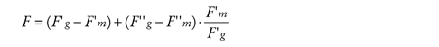
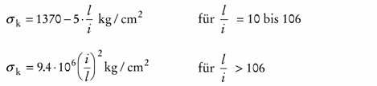
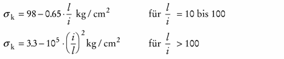
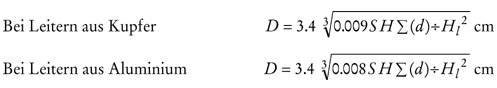
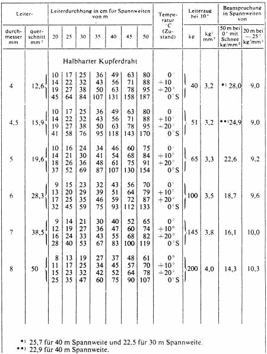
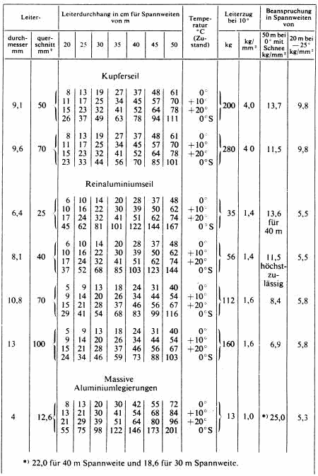
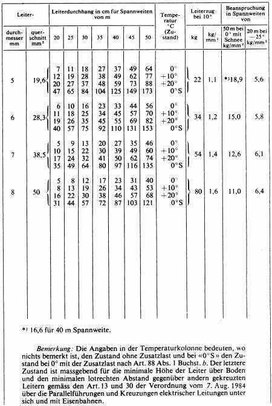
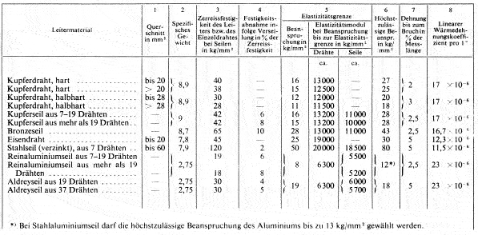
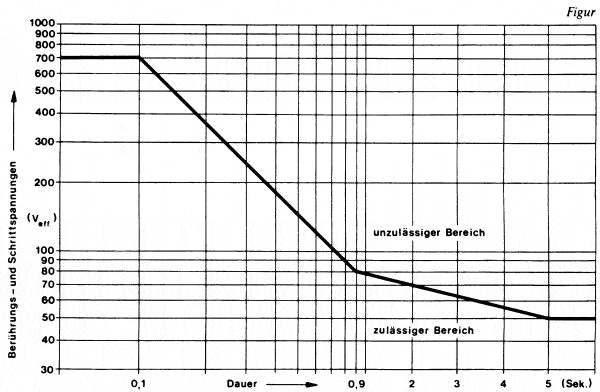

Starkstromverordnung vom 7. August 1984 Aufgrund von Art. 4 des Elektrizitätsgesetzes vom 15. Dezember 1982, LGBl. 1983 Nr. 16 , verordnet die Regierung: I. Geltungsbereich Art. 1 Anwendung der Verordnung 1) Die Bestimmungen dieser Verordnung sind bei der Erstellung neuer Anlagen und bei gänzlichem Umbau bestehender Anlagen in vollem Umfange anzuwenden. 2) Auf bestehende Anlagen finden sie Anwendung: a) in Fällen drohender Gefahr oder erheblicher störender Beeinflussung anderer elektrischer Anlagen; b) bei Erweiterungen, Umbauten und bedeutenderen Reparaturen, soweit dies ohne wesentliche Änderungen der bestehenden Anlagen möglich ist. 3) Stehen der Erfüllung einzelner Bestimmungen dieser Verordnung ausserordentliche Schwierigkeiten entgegen oder erweisen sie sich für die technische Entwicklung als hinderlich, so können auf begründetes Gesuch an die Regierung hin Abweichungen bewilligt werden. In Fällen von untergeordneter Bedeutung kann die von der Regierung bezeichnete Kontrollstelle für Starkstromanlagen von sich aus darüber entscheiden. Art. 2 Geltung anderer Vorschriften 1) Soweit in der vorliegenden Verordnung keine abweichenden Bestimmungen enthalten sind, gelten auch die Verordnungen über: a) elektrische Einrichtungen von Bahnen, b) elektrische Schwachstromanlagen, c) Parallelführungen und Kreuzungen, d) Vorlagen für elektrische Starkstromanlagen. 2) Vorbehalten bleiben die Bestimmungen der Verordnung vom 9. Mai 1995 über den Verkehr mit elektrischen Betriebsmitteln im Europäischen Wirtschaftsraum, LGBl. 1995 Nr. 143, sowie der Verordnung vom 9. Mai 1995 über die elektromagnetische Verträglichkeit von Geräten im Europäischen Wirtschaftsraum, LGBl. 1995 Nr. 155. II. Allgemeine Bestimmungen Art. 3 Grenze zwischen Hoch- und Niederspannung Anlagen, die mit höchstens 1 000 V Wechselspannung oder 1 500 V Gleichspannung betrieben werden, gelten als Niederspannungsanlagen, solche, die mit mehr als 1 000 V Wechselspannung oder 1 500 V Gleichspannung betrieben werden, als Hochspannungsanlagen. Art. 4 Sicherheit der Starkstromanlagen 1) Starkstromanlagen und die daran angeschlossenen elektrischen Erzeugnisse müssen nach den anerkannten Regeln der Technik erstellt, geändert, instandgehalten und kontrolliert werden. Sie dürfen bei bestimmungsgemässem Betrieb oder Gebrauch sowie in voraussehbaren Störfällen weder Personen noch Sachen gefährden. 2) Als anerkannte Regeln der Technik gelten insbesondere die technischen Normen des Schweizerischen Elektrotechnischen Vereins (SEV) sowie die technischen Vorschriften der PTT-Betriebe. Bestehen keine spezifischen technischen Normen, so ist nach jenen Normen vorzugehen, die sich sinngemäss anwenden lassen. 3) Besteht Unklarheit, welche Normen anwendbar sind oder ob die Vorschriften in Einzelfällen erfüllt sind, so entscheidet die Regierung. 4) Sind Starkstromanlagen und die daran angeschlossenen elektrischen Erzeugnisse für jedermann oder für Personal, das über ihre Gefahren nicht unterrichtet ist, zugänglich, so ist dafür zu sorgen, dass unter Spannung stehende Teile auch bei Unachtsamkeit weder direkt noch indirekt (z. B. mit Werkzeugen, Geräten des täglichen Gebrauchs usw.) berührt werden können. Art. 5 Rücksicht auf Schwachstromanlagen 1) Starkstromanlagen und elektrische Erzeugnisse müssen, soweit dies ohne ausserordentlichen Aufwand möglich ist, so erstellt, geändert und instandgehalten werden, dass sie in allen Betriebszuständen den bestimmungsgemässen Gebrauch anderer Stark- oder Schwachstromanlagen und anderer elektrischer Erzeugnisse nicht in unzumutbarer Weise stören. 2) Störungsgefährdete Stark- oder Schwachstromanlagen und die daran angeschlossenen elektrischen Erzeugnisse müssen, soweit dies ohne aussergewöhnlichen Aufwand möglich ist, so erstellt, geändert und instandgehalten werden, dass ihr bestimmungsgemässer Gebrauch in allen Betriebszuständen nicht durch andere elektrische Anlagen und Erzeugnisse in unzumutbarer Weise gestört wird. 3) Treten trotz Beachtung der anerkannten Regeln der Technik unzumutbare Beeinflussungen auf, die nur mit grossem Aufwand beseitigt werden können, so suchen sich die Beteiligten zu verständigen. Kommt keine Einigung zustande, so entscheidet die Regierung. Art. 6 Zugänglichkeit der Starkstromanlagen 1) Anlagen, die den Anforderungen von Art. 4 Abs. 4 nicht genügen, dürfen nur für Sachkundige zugänglich und ohne besondere Hilfsmittel nicht erreichbar sein. Dem Bedienungspersonal müssen dagegen die zum Zutritt zu den Anlagen erforderlichen Hilfsmittel jederzeit zur Verfügung stehen. 2) Müssen solche Anlagen aus irgendwelchen Gründen vorübergehend allgemein zugänglich gemacht werden, so sind Massnahmen zu treffen, welche die Gefährdung von Sachunkundigen verhindern. 3) Der Zutritt zu Starkstromanlagen, in denen Besucher Gefahren ausgesetzt sind, ist solchen nur in kleinen Gruppen unter sachkundiger und vom Betriebsinhaber ermächtigter Führung gestattet. Art. 7 Arbeiten an Starkstromanlagen 1) An Starkstromanlagen dürfen, auch wenn sie spannungslos sind, Arbeiten nur von fachlich ausgebildetem und zweckmässig ausgerüstetem Personal ausgeführt werden. Müssen für besondere Arbeiten Leute beigezogen werden, die nicht elektrotechnisch ausgebildet sind, so sind sie vorher entsprechend zu instruieren. 2) An unter Hochspannung stehenden Anlageteilen dürfen keine Arbeiten vorgenommen werden. 3) An unter Niederspannung stehenden Anlageteilen darf nur dann gearbeitet werden, wenn die Arbeitenden durch zuverlässige Sicherungsmassnahmen ausreichend geschützt sind und von den dafür verantwortlichen Dienststellen nur besonders für diese Arbeiten geeignetes Personal damit betraut wird. 4) Die Handhabung von Einrichtungen, welche für die Bedienung unter Spannung gebaut sind, wird nicht als Arbeit im Sinne der Bestimmungen unter den Abs. 2 und 3 betrachtet. 5) Bei Arbeiten an spannungslosen Anlageteilen müssen Vorkehrungen getroffen werden, um zu verhindern, dass benachbarte, unter Spannung stehende Anlageteile die Arbeitenden gefährden. Art. 8 Massnahmen zum Schutze der Arbeitenden 1) Im allgemeinen sind Vereinbarungen über Zeit, Ort, Art und Umfang der auszuführenden Arbeiten durch die verantwortlichen Betriebsorgane den mit der Ausführung der Arbeiten Beauftragten schriftlich zu übergeben. 2) Von einer schriftlichen Vereinbarung kann Umgang genommen werden, a) wenn der mit der Ausführung der Arbeit Beauftragte hinreichend technisches Verständnis und Erfahrung besitzt und genügend instruiert ist, um die notwendigen Sicherungsmassnahmen für sich und seine Gehilfen unter eigener Verantwortung treffen zu können; b) wenn das verantwortliche Betriebsorgan alle Schaltungen selbst vornimmt oder unter seiner Aufsicht vornehmen lässt und die Arbeiten persönlich überwacht. 3) Muss ein Auftrag durch mündliche oder telefonische Übermittlung erfolgen, so ist er vom Empfänger zu wiederholen. 4) Wenn ein Anlageteil spannungslos gemacht werden muss, um Arbeiten daran auszuführen, so darf die Arbeit nicht begonnen werden, bevor die Sicherheit besteht, dass der Anlageteil spannungsfrei ist. Ebenso darf nicht wieder eingeschaltet werden, bevor die Sicherheit besteht, dass dies ohne Gefahr für die Arbeitenden geschehen kann. Werden zu diesem Zwecke an der Arbeits- und Einschaltstelle bestimmte Zeiten für das Aus- und Einschalten abgemacht, so muss dies immer schriftlich geschehen. Die Uhren aller Beteiligten sind genau in Übereinstimmung zu bringen, und es muss genügend Zeit als Sicherheitszuschlag zwischen dem Einschalten und dem Aufhören der Arbeit eingeschaltet werden. 5) Wo eine Gefährdung der Arbeitenden durch irrtümliches oder unbefugtes Schalten möglich ist, sind die Schalter- und Trennerantriebe zu verriegeln oder es sind Anhängetafeln mit Aufschriften wie "Schalten verboten", "Auf Leitung wird gearbeitet" anzubringen. 6) Zu Arbeiten an unter Niederspannung stehenden Teilen im Freien (Art. 7 Abs. 3) müssen mindestens zwei Mann beordert werden, wobei einer derselben für die Durchführung verantwortlich zu machen ist. 7) Soll an abgeschalteten Hochspannungsanlageteilen gearbeitet werden, so sind diese vorher zu erden und kurzzuschliessen. Die verantwortlichen Betriebsorgane haben dafür zu sorgen, dass während der Dauer der Arbeiten keine Schaltungen vorgenommen oder andere Anordnungen getroffen werden, welche die Arbeitenden gefährden könnten. Erst nach Beendigung aller Arbeiten und Verständigung aller Beteiligten dürfen Kurzschliessung und Erdung aufgehoben werden. 8) Erdung und Kurzschliessung sind in der Nähe der Arbeitsstelle und wo möglich zwischen dieser und der Stromquelle vorzunehmen. Sie sind unter allen Umständen so anzubringen, dass sie durch die vorzunehmenden Arbeiten nirgends unterbrochen werden. Kann eine Arbeitsstelle von verschiedenen Seiten her unter Spannung kommen, so ist durch eine genügende Anzahl und entsprechende Anordnung der Erdungen und Kurzschliessungen hierauf besonders Rücksicht zu nehmen. Art. 9 Instruktion und Ausrüstung des Personals 1) Dem in Starkstromanlagen beschäftigten Personal sind die für seine Arbeiten und Pflichten aufgestellten Vorschriften und Bestimmungen durch die Unternehmung bekanntzugeben und zu erläutern. Bei nur vorübergehend oder unter Aufsicht Beschäftigten genügt eine ihrer Tätigkeit entsprechende Unterweisung. 2) Die Starkstromunternehmungen sind verpflichtet, das Personal für die Ausführung von Leben und Gesundheit gefährdenden Arbeiten mit den nötigen Hilfs- und Schutzmitteln auszurüsten sowie an geeigneten Orten nach Bedarf Einrichtungen zur Hilfeleistung bei Unfällen bereitzuhalten. Art. 10 Verständigung der Inhaber anderer Anlagen bei Arbeiten Will der Betriebsinhaber einer Anlage Arbeiten ausführen, durch welche Anlagen anderer Unternehmungen gefährdet oder gestört werden können oder bei denen sein Personal durch andere Starkstromanlagen gefährdet ist, so hat er die Betriebsinhaber der anderen Anlagen von seinem Vorhaben rechtzeitig in Kenntnis zu setzen. Aufgrund gegenseitiger Vereinbarungen sind alsdann alle zur Vermeidung von Störungen und Gefahren nötigen Schutzvorkehrungen zu treffen. Für solche Vereinbarungen gelten im übrigen sinngemäss die Bestimmungen des Art. 8. Art. 11 Fernmeldeverbindungen zwischen Anlagezentren Wichtige Stromerzeugungs- und -verteilungsanlagen müssen jederzeit durch öffentliche oder werkeigene Telefon- oder Telegrafenanlagen miteinander verkehren können. III. Schutzmassnahmen A. Erdung Art. 12 Zweck des Erdens 1) Leitfähige Anlageteile, die normalerweise nicht unter Spannung stehen, werden geerdet, um die Gefährdung von Personen und Sachen zu vermindern, die bei Erdschlüssen in elektrischen Anlagen Berührungs- und Schrittspannungen ausgesetzt sind. 2) Einzelne Stellen von Stromkreisen werden dauernd oder vorübergehend geerdet, um Spannungen zu beschränken, die Personen oder die Isolation gefährden. Art. 13 Erdungsarten 1) Die Anlagenerdung ist die Erdung einer Hochspannungsanlage. 2) Die Sondererdung ist eine Erdung, die von der Anlagenerdung isoliert ist und von ihr nur unwesentlich beeinflusst wird. 3) Die Nullung ist eine Schutzmassnahme, die in Niederspannungsanlagen Berührungs- und Schrittspannungen beschränkt. Sie besteht darin, dass ein besonderer Leiter des Netzes (PEN-Leiter oder Schutzleiter) Fehlerströme an die Speisestelle zurückführt (TN-Netz). 4) Die Schutzerdung ist eine Schutzmassnahme, die in Niederspannungsanlagen Berührungs- und Schrittspannungen beschränkt. Sie besteht darin, dass ein örtlicher Erder oder an dessen Stelle tretende Wasserleitungen und dergleichen Fehlerströme an die Speisestelle zurückführen (TT-Netz). Art. 14 Zulässige Berührungs- und Schrittspannungen in Hochspannungsanlagen 1) Bei einem Erdschluss in einer Hochspannungsanlage dürfen die Berührungs- und Schrittspannungen unter Berücksichtigung des höchstmöglichen einpoligen Erdschlussstromes dauernd 50 V nicht überschreiten. Für Einwirkzeiten unter fünf Sekunden gelten die Werte nach der Figur im Anhang. 2) Die aus Metall oder Stahlbeton bestehenden Tragwerke von Hochspannungsfreileitungen müssen bei Erdschluss folgende Anforderungen erfüllen: a) In Gebieten, in denen grössere Menschenansammlungen zu erwarten sind oder in denen sich Personen längere Zeit aufhalten, sind die in Abs. 1 festgelegten Anforderungen einzuhalten. Ist dies allein durch die Erdung der Tragwerke nicht zu erreichen, so sind Massnahmen nach Art. 16 oder andere besondere Vorkehrungen zu treffen, um Erdschlüsse auf der Leitung zu vermeiden. b) In besiedelten Gebieten, in der näheren Umgebung von Einzelbauten und an Verkehrswegen, wo sich Personen regelmässig für kurze Zeit aufhalten, dürfen höhere als die in Abs. 1 festgelegten Werte auftreten; sie dürfen aber nicht länger als zwei Sekunden bestehen bleiben. c) Im übrigen Gebiet dürfen die Berührungs- und Schrittspannungen die in Abs. 1 festgelegten Werte überschreiten. Spannungen über 50 V sollen jedoch nicht länger als wenige Stunden bestehen bleiben. Art. 15 Zulässige Berührungs- und Schrittspannungen in Niederspannungsanlagen 1) In Niederspannungs-Verteilnetzen muss beim Kontakt eines oder mehrerer Polleiter mit einem Leiter, welcher dem Schutz gegen gefährliche Berührungs- und Schrittspannungen dient (PEN-Leiter, Schutzleiter), die Speisung der betroffenen Polleiter sicher unterbrochen werden. Zwischen dem zum Schutz dienenden Leiter und den Stellen an der Oberfläche, die ausserhalb des Einflussbereiches der Erdungen liegen, darf keine Spannung von mehr als 100 V auftreten. 2) Niederspannungs-Installationen sind nach den anerkannten Regeln der Technik so zu errichten, dass keine zu hohen Berührungsspannungen auftreten können. Art. 16 Massnahmen zur Verminderung der Gefährdung in Hoch- und Niederspannungsanlagen 1) Um eine Gefährdung durch Erdschlüsse zu vermindern, sind die leitfähigen Teile einer Anlage, die normalerweise nicht unter Spannung stehen, vielfach leitend zusammenzuschliessen (vermaschen) und so zu erden, dass durch zweckmässige Anordnung der Erder die in den Art. 14 und 15 festgelegten Werte eingehalten werden. 2) In besonderen Fällen kann die Gefährdung mit folgenden Massnahmen vermindert werden: Bilden isolierter Standorte oder Isolieren von berührbaren leitfähigen Teilen; Abschrankungen; Schnellabschaltung; Vermeidung von Spannungsverschleppungen durch Isolieren; Einbau von Isolierstössen oder galvanische Trennung usw. Art. 17 Erden in Hochspannungsanlagen 1) In Hochspannungsanlagen sind alle zu erdenden Teile grundsätzlich mit der Anlagenerdung zu verbinden. Eine Hochspannungsanlage ist über mindestens zwei unabhängige Erdungsleitungen zu erden. 2) Überschreitet bei einem einpoligen Erdschluss die Erdungsspannung an der Anlagenerdung samt allen daran angeschlossenen Teilen die in der Figur im Anhang festgehaltenen Werte, so sind folgende Teile von der Anlagenerdung zu isolieren und mit einer Sondererdung zu verbinden: a) die Anschlussstellen für das betriebsmässige Erden von Niederspannungs-Stromkreisen, die über den Wirkungsbereich der Anlagenerdung hinausführen; b) die leitfähigen Apparatekörper und die leitfähigen Umhüllungen von Niederspannungskabeln, die über den Wirkungsbereich der Anlagenerdung hinausführen. 3) Die mit einer Sondererdung verbundenen Teile und die zugehörenden Erdungsleitungen sind gegenüber der Anlagenerdung und allen mit ihr verbundenen leitfähigen Teilen für die höchste an der Anlagenerdung zu erwartende Spannung zu isolieren, mindestens jedoch für eine Prüfspannung von 4 kV. 4) Anstelle der in Abs. 3 erwähnten Isolierung kann eine Einrichtung treten, welche die ausserhalb des Wirkungsbereiches der Anlagenerdung liegenden Teile von jenen galvanisch trennt, die innerhalb dieses Bereiches liegen. Die Isolationsfestigkeit der Trennstelle hat den in Abs. 3 festgelegten Anforderungen zu genügen. 5) Verfährt man nach Abs. 4, so sind alle zu erdenden Teile, die im Wirkungsbereich der Anlagenerdung liegen, mit dieser zu verbinden. Die ausserhalb liegenden sind jedoch mit einer Sondererdung zu verbinden. 6) Für die Schwachstromanlagen im Bereich von Hochspannungsanlagen sind die in der Schwachstromverordnung vom 7. August 1984 festgelegten Schutzmassnahmen zu treffen. Art. 18 Erden von Niederspannungsanlagen 1) In jedem Niederspannungsnetz ist ein Punkt nahe der Speisestelle direkt zu erden, um sein Potential festzuhalten. In Drehstromnetzen ist es in der Regel der Sternpunkt. Die Niederspannungsnetze sind als TN-Netze (Nullung) oder TT-Netze (Schutzerdung) auszubilden. 2) In Niederspannungs-Sonderanlagen (Steuersysteme; Wandlerstromkreise; Anspeisung einzelner Verbraucher; Anlagen, die keine Betriebsunterbrüche zulassen usw.) darf auf eine Erdung eines Punktes nahe der Speisestelle verzichtet werden (IT-Netz). 3) Wird in den Niederspannungs-Verteilnetzen und den daran angeschlossenen Niederspannungsinstallationen die Nullung angewendet, so gelten, in Ergänzung von Art. 15, die folgenden Anforderungen: a) Der zur Nullung dienende Leiter (PEN-Leiter, Schutzleiter) ist beim Übergang vom Netz in die Installation zu erden (Nullungserdleitung). b) Bei Freileitungen müssen Querschnitt und mechanische Festigkeit des zur Nullung dienenden Leiters überall mindestens so gross sein wie bei den zugehörenden Polleitern. c) Bei Kabelleitungen muss der zur Nullung dienende Leiter im allgemeinen den gleichen Leitwert haben wie die zugehörenden Polleiter. Art. 19 Erdung von Leitungsbestandteilen 1) Aus Metall oder Stahlbeton bestehende Tragwerke von Hochspannungsfreileitungen sind direkt oder über Erdseile so zu erden, dass die Anforderungen von Art. 14 eingehalten werden. Die Erdseile sind an ihren Enden mit der Anlagenerdung zu verbinden. 2) Betätigungseinrichtungen von Hochspannungsmastschaltern sind im allgemeinen zu erden, oder es sind andere Massnahmen zu treffen, um die Anforderungen von Art. 14 Abs. 1 einzuhalten. 3) Befinden sich leitfähige Tragwerke von Niederspannungsfreileitungen, andere leitfähige Konstruktionen für Verteilung oder Beleuchtung sowie Verkehrssignale und dergleichen an begangenen Orten, so sind sie mit einem zum Schutz gegen gefährliche Berührungs- und Schrittspannungen dienenden Leiter so zu verbinden, dass die Anforderungen nach Art. 15 Abs. 1 erfüllt sind. 4) Metallumhüllungen von Hochspannungskabeln sind grundsätzlich an beiden Enden zu erden. Führt dies zu erheblichen technischen Schwierigkeiten und wirtschaftlichen Nachteilen, so ist einseitiges Erden zulässig. Je nach örtlichen Verhältnissen sind zusätzliche Massnahmen zu treffen, damit die Anforderungen von Art. 14 eingehalten werden können. 5) Für Niederspannungskabel ist einseitiges Erden der Metallumhüllungen zulässig. Art. 20 Bemessung der Erdungen 1) Die Erdungsleitungen sind so zu bemessen, dass sie bis zur Ausschaltung durch Schutzeinrichtungen den dynamischen und thermischen Beanspruchungen, die durch den höchsten voraussehbaren in den Leitungen fliessenden Strom entstehen, ohne Schaden zu nehmen gewachsen sind. Sie müssen gegen mechanische Beschädigungen geschützt sein und dürfen weder Schalter noch Überstromunterbrecher enthalten. 2) Die Erder, die zur Ableitung eines Stromes ins Erdreich dienen, sind so zu bemessen und anzuordnen, dass bei den höchsten auftretenden einpoligen Erdschlussströmen die Anforderungen nach den Art. 14 und 15 eingehalten bleiben. Art. 21 Erdelektroden Die Ausführung, die Erhaltung der Wirksamkeit und die Kontrolle von Erdungsanlagen haben, unter Berücksichtigung von Art. 14, nach den anerkannten Regeln der Technik zu erfolgen. Art. 22 bis 27 Aufgehoben B. Überspannungsschutz Art. 28 Schutzmassnahmen gegen Überspannungen Gefährliche Überspannungen und ungewollte Unterspannungsetzungen sind je nach den Verhältnissen durch zweckentsprechenden Bau der Anlagen nach Möglichkeit zu vermeiden, durch geeignete Mittel im Entstehen zu unterdrücken oder durch entsprechende Apparate in ihrer Wirkung abzuschwächen. Art. 29 Ableitung statischer Ladungen Wechselstromhochspannungsanlagen sollen in der Regel durch dauernde Erdung eines Symmetriepunktes des Systems gegen das Auftreten gefährlicher Überspannungen infolge statischer Ladungen geschützt werden. C. Überstromschutz Art. 30 Massnahmen gegen Wirkungen von Überstrom Alle Anlageteile sind so zu bemessen und anzuordnen, dass sie in allen Betriebsfällen den Wirkungen des maximalen Kurzschlussstromes bis und mit seiner Unterbrechung widerstehen, ohne Personen zu gefährden, Brandausbrüche zu verursachen oder selbst Schaden zu nehmen. Hiebei ist mit Bezug auf die Erwärmung die Dauerkurzschlussstromstärke und mit Bezug auf die dynamische Beanspruchung die Momentan-Kurzschlussstromstärke massgebend. Art. 31 Schmelzsicherungen und selbsttätige Schalter 1) Der Schutz der Anlageteile vor Überstrom soll in der Regel durch Schmelzsicherungen oder selbsttätige Schalter erfolgen. 2) Der Überstromschutz ist so anzubringen, dass die gefährdeten Leiter in jedem Störungsfalle unterbrochen werden. In geerdeten Systemen darf dagegen beim Funktionieren des Überstromschutzes weder die Erdung vom System abgetrennt noch der Erdungswiderstand erhöht werden. 3) Die Schmelzsicherungen und selbsttätigen Schalter sind so zu wählen, dass sie den grössten Kurzschlussstrom, der an der betreffenden Stelle auftreten kann, zuverlässig unterbrechen. Die Schalter müssen mehrere kurz aufeinanderfolgende Überstromabschaltungen aushalten können, ohne betriebsuntauglich zu werden. IV. Apparate Art. 32 Schutz gegen Feuererscheinungen Starkstromapparate müssen so beschaffen oder angeordnet sein, dass bei ihrer Handhabung oder ihrem Funktionieren allfällig auftretende Feuererscheinungen weder Personen noch Sachen gefährden. Art. 33 Erwärmung bei dauernder Belastung 1) Die Apparate und ihre Verbindungen müssen so beschaffen sein, dass sie sich bei dauernder Belastung mit der höchsten Stromstärke, für die sie bestimmt sind, nicht in nachteiliger Weise erwärmen. 2) Apparate, bei denen ohne Nachteil für ihre Verwendung oder wegen ihres Zweckes Temperaturen vorkommen, die bei Übertragung auf andere Gegenstände gefährlich werden könnten, müssen so beschaffen und angeordnet sein, dass eine feuergefährliche Erwärmung entzündlicher Materialien nicht eintreten kann. Art. 34 Isolation 1) Die stromführenden Teile von Starkstromapparaten müssen unter sich und gegen Erde der Betriebsspannung und den örtlichen Verhältnissen entsprechend in dauernd sicherer Weise isoliert sein. 2) Befinden sich in einem Apparat neben dem Hauptstromkreis noch Hilfsstromkreise, so ist dafür zu sorgen, dass der Hauptstromkreis keine Störung der Hilfsstromkreise oder Gefährdungen verursachen kann. Art. 35 Schutzverschalungen Die Schutzverschalung eines gemäss Art. 4 Abs. 2 vor Berührung zu schützenden Apparates muss den am Aufstellungsort zu gewärtigenden mechanischen Beanspruchungen gewachsen sein und eine gefahrlose Bedienung, auch bei allfälligen Feuererscheinungen an den Apparaten, gewährleisten. Art. 36 Anordnung der Apparate 1) Apparate und Instrumente, die im Betriebe zu bedienen bzw. abzulesen sind, müssen an gut und gefahrlos zugänglichen Stellen angebracht werden und leicht bedienbar sein. 2) Schmelzsicherungen, die von Hand oder auch mit Schaltzangen und dergleichen bedient werden, und die Handgriffe von Schaltern müssen in Schaltanlagen in einer geeigneten Höhe, höchstens aber 1.70 m über dem Bedienungsstandort, angebracht werden. Art. 37 Antriebe 1) Die Antriebe von Starkstromapparaten müssen die im Betriebe vorkommenden Beanspruchungen ohne schädliche Deformation aushalten können und so angeordnet sein, dass sie im Falle eines Defektes nicht mit unter Spannung stehenden Teilen in Berührung kommen. 2) Gestänge, Drahtseile und Ketten von Übertragungsorganen sind so anzuordnen bzw. zu schützen, dass sie auch bei Bruch nicht mit unter Spannung stehenden Anlageteilen in Berührung kommen können. Art. 38 Schaltstellungen In ausgeschalteter Stellung muss die Unterbrechung der Schalter und Trenner vollkommen und sicher sein. Freileitungsschalter müssen dieser Bedingung unter dem Einfluss jeder Witterung genügen. Die Schaltstellungen jedes Apparates sind in Schaltanlagen und bei Freileitungen deutlich anzugeben; insbesondere müssen die Endstellungen eindeutig bezeichnet sein. Art. 39 Überstromschutz in Hilfsstromkreisen Im Stromkreis von Auslösemagneten, Relais und ähnlichen Hilfsapparaten, die selbsttätige Hauptapparate mit einem Hilfsstrom betätigen, dürfen in der Regel keine Schmelzsicherungen angebracht werden. Sind solche aus betriebstechnischen Gründen doch notwendig, so sollen sie ein Vielfaches des Hilfsstromes dauernd führen können. Art. 40 Schutzerdung Jeder Starkstromapparat, welcher der Berührung ausgesetzte Metallteile aufweist, die bei Isolationsdefekten unter Spannung kommen können, muss mit wenigstens einer Anschlussvorrichtung für die Erdleitung versehen oder in anderer Weise so gebaut sein, dass eine dauernd zuverlässige Verbindung der an Erde zu legenden Teile leicht herstellbar ist. Art. 41 Bezeichnungen an Apparaten Alle Starkstromapparate für mehr als 100 A Nennstrom sowie Messwandler, Messinstrumente und selbsttätige Abschaltapparate (einschliesslich Schmelzsicherungen) jeglicher Stromstärke und Spannung sind mit haltbaren deutlichen Bezeichnungen zu versehen, aus denen ihre Haupteigenschaften eindeutig hervorgehen. Die Bezeichnungen müssen so angeordnet werden, dass sie auch bei in Schaltanlagen eingebauten Apparaten möglichst leicht erkennbar sind. V. Anlagen A. Allgemeines Art. 42 Anordnung der Anlagen 1) Die Anlagen müssen klar und übersichtlich angeordnet sein, so dass für ihre Bedienung sowie für Revisionen und Reparaturen eine sichere und rasche Orientierung möglich ist. 2) Alle wichtigen Anlagebestandteile und Apparate müssen leicht zugänglich sein und ohne Schwierigkeit ein- und ausgebaut werden können. 3) Kommen in der gleichen Anlage verschiedene Spannungen oder Stromarten vor, so sind die zugehörigen Anlageteile nach Möglichkeit zu Gruppen zusammenzufassen und räumlich voneinander zu trennen. 4) Die Anlagen müssen so unterteilt werden, dass der Betrieb, auch bei Ausserbetriebsetzung einzelner Teile der Anlagen, durch Störungen oder für Revisionen und Reparaturen, weitgehend aufrechterhalten werden kann. Die ausser Betrieb gesetzten Anlageteile oder Apparate müssen an geeigneten, sichtbaren Trennstellen spannungslos gemacht werden können. 5) Bei der Anordnung der Anlagen ist auch auf voraussehbare Erweiterungen und den damit verbundenen Baubetrieb Rücksicht zu nehmen. Art. 43 Aufschriften Die einzelnen Räume und Anlageteile sowie die Maschinen, Apparate und Leitungen sind in dauerhafter Weise so zu bezeichnen, dass ihr Zweck für das Personal deutlich ersichtlich ist. Wo der Zweck von Apparaten ohne weiteres klar ist, können Bezeichnungen unterbleiben. Art. 44 Anschläge In den Anlagen sind an geeigneten Stellen anzuschlagen: a) die Anleitung zur Hilfeleistung bei durch elektrischen Strom verursachten Unfällen; b) das Schaltungsschema der Anlage; c) eine kurze Instruktion über die beim Bedienen der Anlagen besonders zu beachtenden Massnahmen. Art. 45 Verwendung brennbarer Materialien Brennbare Materialien dürfen nur Verwendung finden, sofern sie derart angeordnet oder verkleidet sind, dass Brand- und Rauchgefahr vermieden ist. Art. 46 Beleuchtung Alle Anlageteile müssen soweit möglich eine gute natürliche Beleuchtung, jedenfalls aber eine ausreichende und möglichst gleichmässige künstliche Beleuchtung besitzen. Ist letztere nicht in allen Betriebsfällen sichergestellt, so muss eine Notbeleuchtung vorhanden sein, welche die gefahrlose Begehung der Bedienungs- und Kontrollgänge und die Vornahme der erforderlichen Bedienungsarbeiten gestattet. Art. 47 Beschaffenheit von Fussböden In der Nähe von in Bewegung befindlichen Maschinenteilen und von unter Spannung stehenden Anlageteilen ist der Fussboden so zu erstellen und zu unterhalten, dass die Gefahr des Ausgleitens oder Strauchelns vermieden ist. Ist diese Gefahr nicht ausgeschlossen, so ist für Schutz gegen die Berührung der bewegten oder unter Spannung stehenden Teile zu sorgen. Art. 48 Benützung von Hochspannungsräumen zu anderen Zwecken 1) In Hochspannungsräumen dürfen keine Gegenstände aufbewahrt werden, die nicht unmittelbar zum Gebrauch in diesen Räumen notwendig sind. 2) Nicht ausgebaute Anlageteile dürfen nur dann für andere Zwecke benützt werden, wenn sie von in Betrieb befindlichen Anlageteilen vollkommen getrennt sind und wenn ihr Zugang nicht durch im Betrieb befindliche Teile führt. Art. 49 Bedienungsgeräte Alle Werkzeuge und Utensilien, die der Bedienung im Betriebe dienen, sind in geeigneter Weise aufzubewahren und dauernd in vollkommen gebrauchsfähigem Zustande zu erhalten. Art. 50 Revisionen Die Anlagen sind in angemessenen Zeitabständen zu reinigen und zu revidieren. Werden Apparate aussergewöhnlich beansprucht, so sind sie unabhängig von den periodischen Revisionen jeweilen so rasch als möglich nachzusehen. Über alle Revisionen sind Aufzeichnungen zu führen. B. Maschinenanlagen Art. 51 Aufstellung und Schutz bei Maschinen 1) Die elektrischen Maschinen sind so aufzustellen, dass ihre gefahrlose Bedienung, Revision und Reparatur gewährleistet ist. Die Bedienungsstandorte und Gänge sind stets freizuhalten. 2) Die Maschinen und allfällige Schutzeinrichtungen müssen so angeordnet sein, dass eine gleichzeitige, zufällige Berührung von Teilen, zwischen denen eine Spannung von mehr als 250 V herrscht, ausgeschlossen ist. 3) Die Entstehung und Ausbreitung von Maschinenbränden ist durch geeignete Anordnungen möglichst zu verhüten. Art. 52 Niederspannung bei isolierten Hochspannungsmaschinen Niederspannungsstromkreise, die mit isoliert aufgestellten Hochspannungsmaschinen und -apparaten in Verbindung stehen, sind mit Bezug auf ihre Anordnung und Bedienung als Hochspannungsanlageteile zu behandeln. C. Akkumulatorenanlagen Art. 53 Räume, Beleuchtung und Lüftung 1) In Akkumulatorenräumen ist für reichliche natürliche oder künstliche Lüftung zu sorgen. Die künstliche Beleuchtung von Akkumulatorenräumen, in denen Gasentwicklung auftreten kann, darf nur durch elektrisches Glühlicht erfolgen. Das Betreten solcher Räume mit offenen Flammen und das Rauchen darin ist zu verbieten. 2) Gebäudeteile und Leitungen sind so zu erstellen, dass sie in wirksamer Weise vor Zerstörungen durch Säure, Gase oder dergleichen geschützt sind. Art. 54 Aufstellung 1) Die Akkumulatoren sind durch nicht hygroskopische Isolierkörper von den Gestellen und diese wiederum von Erde zu isolieren. 2) Die Anordnung der Batterien sowie allfälliger Schutzeinrichtungen muss die gleichzeitige zufällige Berührung von Teilen, zwischen denen eine Spannung von mehr als 250 V herrscht, ausschliessen. 3) Die Aufstellung der Akkumulatoren hat so zu erfolgen, dass jede Zelle leicht besichtigt und gereinigt werden kann. 4) Die Bedienungsgänge müssen in Niederspannungsanlagen mindestens 60 cm, in Hochspannungsanlagen mindestens 80 cm breit sein und dürfen an keiner Stelle eine geringere Höhe als 2 m aufweisen. 5) Die Akkumulatorenbatterien müssen von den übrigen Anlagen allpolig abschaltbar sein. Art. 55 Schutz des Personals Das Betriebspersonal ist auf die bei der Behandlung der Akkumulatoren bestehenden Gefahren aufmerksam zu machen, und es sind Massnahmen zu seinem Schutze zu treffen. D. Schaltanlagen in geschlossenen Räumen Art. 56 Berührungsschutz in Anlagen mit mehr als 250 V gegen Erde 1) In Schaltanlageräumen, die vom Personal während des Betriebs betreten werden müssen und in denen die effektive Betriebsspannung zwischen irgendeiner Leitung und Erde 250 V überschreitet, müssen mindestens die nachstehend angegebenen Gangdimensionen und Schutzeinrichtungen, wie Schranken, Verschalungen und dergleichen, vorhanden sein. Die Unterschreitung dieser Dimensionen oder das Weglassen von Schranken oder Gittern ist nur zulässig, wenn alle unter Spannung stehenden Teile der Berührung dauernd entzogen sind oder eine allfällige Berührung durch andere Mittel unschädlich gemacht ist. 2) Befinden sich auf einer Seite eines Ganges unter Spannung stehende, durch Schranken oder Geländer geschützte Teile, so muss von diesen Teilen bis zur gegenüberliegenden Wand ein Abstand von mindestens 1.20 m, vermehrt um je 1.2 cm/kV Betriebsspannung, vorhanden sein. Dieser Abstand darf um einen Zehntel vermindert werden, sofern die unter Spannung stehenden Teile mindestens bis zu einer Höhe von 1.40 m durch widerstandsfähige engmaschige Gitter oder Verschalungen geschützt sind. 3) Befinden sich zu beiden Seiten eines Ganges unter Spannung stehende, durch Schranken oder Geländer geschützte Teile, so muss zwischen diesen Teilen ein Abstand von mindestens 1.40 m, vermehrt um je 2.4 cm/kV Betriebsspannung, vorhanden sein. Dieser Abstand darf um einen Zehntel verringert werden, sofern die unter Spannung stehenden Teile mindestens bis zu einer Höhe von 1.40 m zu beiden Seiten des Ganges durch widerstandsfähige engmaschige Gitter oder Verschalungen geschützt sind. 4) Die in den Abs. 2 und 3 angegebenen Abstände dürfen um einen weiteren Zehntel verringert werden, wenn in den betreffenden Gängen keine Apparate bedient oder keine Instrumente abgelesen werden müssen und sofern die daselbst im Betriebe voraussehbaren Transporte gefahrlos durchgeführt werden können. 5) Befinden sich über einem Bedienungsgange ungeschützte, unter Spannung stehende Teile, so muss von diesen Teilen bis zum Fussboden ein Abstand von mindestens 2.30 m, vermehrt um je 1.2 cm/kV Betriebsspannung, vorhanden sein. Sofern die unter Spannung stehenden Teile durch widerstandsfähige engmaschige Gitter oder Verschalungen geschützt werden, so sind die in den Abs. 6 und 7 dieses Artikels vorgeschriebenen Abstände einzuhalten. Sind im Gange Isolierschemel oder einzelne Stufen vorhanden, so ist die Minimalhöhe von solchen erhöhten Standorten aus einzuhalten. 6) Die lichte Gangbreite muss unter allen Umständen mindestens 85 cm betragen; bei Eingängen und Türen darf dieses Mass bis auf 70 cm verringert werden. Die lichte Höhe von Gängen und Türen muss durchwegs mindestens 2 m betragen. 7) Der Abstand unter Spannung stehender Teile von den Schranken oder Geländern darf nicht kleiner sein als 10 cm, vermehrt um je 0.8 cm/kV Betriebsspannung. Sofern Gitter oder Verschalungen angebracht sind, darf dieser Abstand um 5 cm verringert werden. 8) Die hievor angegebenen Abstände gelten als Mindestabstände für normale Verhältnisse. Sind Apparate vorhanden, die beim Funktionieren ihre Umgebung in grösserem Umkreis beeinflussen, wie z. B. Hörnerableiter und dergleichen, oder erheischen im Betriebe vorkommende Transporte oder die Bedienung von Apparaten einen grösseren Platzbedarf, so sollen entsprechend grössere Abstände gewählt werden. 9) In Räumen, in denen sich das Personal dauernd aufhalten muss, soll die Berührung unter Spannung stehender Anlageteile auch bei Unachtsamkeit ausgeschlossen sein. Art. 57 Erleichterungen in Anlagen bis zu 250 V gegen Erde 1) In Schaltanlagen, in denen die effektive Betriebsspannung zwischen irgendeiner Leitung und Erde 250 V nicht überschreitet, brauchen, in Abweichung von den Bestimmungen des Art. 56, unter Spannung stehende Teile vor zufälliger Berührung nicht geschützt zu werden. 2) In solchen Schaltanlagen darf der Mindestabstand unter Spannung stehender Teile von der gegenüberliegenden Wand auf 80 cm herabgesetzt werden. Wenn auf beiden Seiten der Gänge Teile unter Spannung stehen, so muss zwischen diesen ein Abstand von mindestens 1.20 m vorhanden sein. Dieser Abstand ist auch einzuhalten, wenn auf einer Seite unter Spannung stehende Teile, auf der anderen abzulesende Instrumente, zu betätigende Apparate oder dergleichen vorhanden sind. 3) Ferner dürfen in solchen Schaltanlagen die Mindestgangbreite und die Türbreite (Art. 56 Abs. 6) bis auf 65 cm, die lichte Höhe bis auf 1.90 m verringert werden. Art. 58 Kommunikationen in den Gebäuden 1) Gänge von Schaltanlagen, in denen erhebliche Rauch- oder Feuererscheinungen auftreten können, müssen an beiden Enden Ausgänge besitzen. 2) Die einzelnen Stockwerke von Schaltanlagen sind an gut zugänglichen Stellen durch feuersichere Treppen von mindestens 70 cm Breite zu verbinden. Für Räume, die nicht täglich betreten werden müssen, dürfen festangebrachte Leitern von mindestens 30 cm oder Treppen von mindestens 60 cm Breite angewendet werden. Dabei muss sowohl die Breite der lichten Aufstiegsöffnung für die Leitern als auch die von den Sprossen aus gemessene Tiefe der Öffnung mindestens 60 cm betragen. Die Aufstiegsöffnungen sind so anzuordnen oder durch Geländer so zu schützen, dass eine Absturzgefahr für das Personal ausgeschlossen erscheint. Sofern ein Raum nur durch einen Zugang erreicht werden kann, ist über Aufstiegsöffnungen die Anwendung von Klappdeckeln verboten. Art. 59 Anordnung von Apparaten in Raumwinkeln 1) Die Anordnung von Schaltgestellen in gebrochener oder gebogener Front mit Bedienungsstandort im Innern der dabei entstehenden Schaltwandwinkel ist tunlichst zu vermeiden. Wo dies nicht möglich ist, sind entweder alle unter Spannung stehenden Teile hinter Verschalungen zu legen, die gegen den Bedienungsstandort vollständig abgeschlossen sind, oder es sind im Bereiche der Bedienungsstandorte bei den gegeneinander abgedrehten Schaltanlagen minimale Abstände einzuhalten wie folgt: Der Abstand von einem unter Spannung stehenden Teile an einer Schaltwand bis zu der lotrechten Ebene, die durch einen unter Spannung stehenden Apparat an einer dagegen abgedrehten Schaltwandfront senkrecht zu dieser gelegt gedacht ist, darf nirgends kleiner sein als 40 cm, wenn der erstgenannte unter Spannung stehende Teil unter Niederspannung steht, und nirgends kleiner als 70 cm vermehrt um 1.2 cm/kV, wenn er unter Hochspannung steht. 2) Zur Verhütung zufälliger Berührung derart seitlich von Bedienungsstandorten gelegener Hochspannungsteile sind vor diesen Schranken oder Geländer gemäss Art. 56 anzubringen. Art. 60 Schaltschränke und dergleichen 1) Bei Schaltschränken, Schalttafeln und dergleichen müssen alle zu- und wegführenden Leitungen übersichtlich angeschlossen sein und ohne Schwierigkeit abgetrennt werden können; die Anschlüsse müssen kontrollierbar sein. 2) Ringsum verschalte Schaltschränke, Schaltgestelle und dergleichen von geringerer Höhe als 2.20 m, müssen auch oben geschlossen werden. E. Transformatorenstationen Art. 61 Für die Transformatorenstationen gelten auch die Vorschriften über Schaltanlagen, sofern im nachstehenden nicht ausdrücklich andere Bestimmungen enthalten sind. Art. 62 Abtrenn- und Abschaltbarkeit der Transformatorenstationen von der Oberspannung 1) Jede Transformatorenstation mit Freileitungsanschluss muss vor der Station durch einen in ihrer Nähe befindlichen Freileitungsschalter unabhängig von anderen Anlagen vom Netz abgetrennt werden können. Ist die Leistung der Station so gross, dass ihre Belastung durch den Freileitungsschalter nicht zuverlässig abgeschaltet werden kann, so muss ausserdem die Möglichkeit vorhanden sein, die Belastung im Innern der Station auf der Hochspannungsseite rasch abzuschalten. 2) Bei Transformatorenstationen mit Kabelzuleitungen muss die Abtrennung der Station durch unmittelbar bei den Kabelendverschlüssen befindliche Trennvorrichtungen möglich sein. Ausserdem muss auch bei solchen Transformatorenstationen die Anordnung im Innern so getroffen werden, dass die Belastung der Station rasch abgeschaltet werden kann. Sind dafür Schalter eingebaut, so müssen in unmittelbarer Nähe der Kabelendverschlüsse noch besondere Trenner angeordnet werden, sofern es nicht möglich ist, die Kabel in nicht zu grosser Entfernung abzuschalten. Art. 63 Abtrennbarkeit der Leitungen in den Stationen In den Transformatorenstationen muss sowohl auf der Primär- als auch auf der Sekundärseite jede an eine Sammelschiene angeschlossene oder von einer anderen Leitung abgezweigte Leitung mit einer unter Spannung bedienbaren Trennstelle versehen sein. Davon ausgenommen ist die Zweigleitung zu Überspannungsableitern und Spannungswandlern. Für die Nulleiter gelten die besonderen Bestimmungen von Art. 26 Abs. 7. Art. 64 Überstromschutz 1) Jeder Leistungstransformator ist für sich auf der Hochspannungsseite entweder durch eine Sicherung in jeder Phase gegen Kurzschluss oder durch einen Schalter mit Relais gegen Überlast und Kurzschluss allpolig zu schützen. Diese Schutzorgane müssen folgenden Anforderungen genügen: a) Jeder Kurzschluss an den Niederspannungsklemmen des Transformators und im Leitungsbereich bis zu den ersten Niederspannungsschutzorganen muss durch die Hochspannungssicherungen oder durch den zugeordneten Hochspannungsschalter innert höchstens fünf Sekunden abgeschaltet werden. b) Die Hochspannungsschutzapparate sind so zu bemessen, dass sie die bei Kurzschlüssen auf der Hochspannungsseite des Transformators auftretenden Beanspruchungen aushalten, ohne Schaden zu nehmen. 2) Jede von einer Transformatorenstation abgehende Niederspannungsleitung muss für sich gegen Überstrom geschützt sein. F. Freiluftanlagen Art. 65 Geltungsbereich Unter die Bestimmungen dieses Abschnittes fallen alle im Freien aufgestellten oder nicht allseitig geschlossenen Anlagen. Ausgenommen sind Freileitungen und zu den Hausinstallationen zu zählende Anlagen im Freien sowie Stangen-Transformatorenstationen, sofern bei ihnen keine unter Spannung stehenden ungeschützten Anlageteile tiefer an den Boden herunterreichen, als dies für Freileitungen zulässig ist. Art. 66 Schutzeinrichtungen und Gangdimensionen 1) Für Freiluftanlagen gelten sinngemäss die Vorschriften über Schaltanlagen, sofern im nachstehenden nicht andere Bestimmungen enthalten sind. 2) Freiluftanlagen müssen allseitig von einer mindestens 180 m hohen Umzäunung umgeben werden, die so beschaffen sein muss, dass Unbefugten der Eintritt in die Anlage ohne Anwendung besonderer Hilfsmittel nicht möglich ist. 3) Im Innern der Anlage dürfen längs der Umzäunung in einer Breite von 1.50 m, vermehrt um je 1.2 cm/kV Betriebsspannung, bis zu einer Höhe von 6 m über Boden keine unter Hochspannung stehenden Anlageteile angeordnet werden. 4) Unter Spannung stehende Teile, die im Innern der Anlage in geringere Höhe als 2 m, vermehrt um je 1.2 cm/kV Betriebsspannung, herabreichen, sind gegen Zutritt so zu schützen, dass eine Gefährdung des Personals auch bei Unachtsamkeit ausgeschlossen ist. 5) Über den Bedienungsstandorten dürfen unter Spannung stehende Teile nicht in geringerer Höhe als 3 m, vermehrt um je 1.2 cm/kV Betriebsspannung, angebracht werden. 6) In den eigentlichen Bedienungs- und Kontrollgängen muss zwischen den geerdeten Teilen von Apparaten, Verschalungen, Traggerüsten und dergleichen mindestens eine freie Breite von 1.20 m vorhanden sein. Ausserdem müssen diese Gänge eine freie Höhe von mindestens 2.5 m über Boden aufweisen. 7) Bei mehrstöckigen Freiluftanlagen ist Art. 58 Abs. 2 sinngemäss anzuwenden. Art. 67 Besondere Anforderungen an Apparate und Tragkonstruktionen 1) Alle Apparate und Einrichtungen sind so zu konstruieren bzw. zu wählen, anzuordnen und zu unterhalten, dass sie den Temperatur- und Witterungseinflüssen, wie Feuchtigkeit, Wind, Schnee- und Eisansatz, Elektrolyse, ohne Beeinträchtigung ihrer Funktion dauernd standhalten. 2) Alle Tragkonstruktionen sind den einschlägigen Vorschriften über Freileitungen gemäss zu dimensionieren. Niedrige Gestelle für Trennschalter, Messwandler und dergleichen gelten hiebei nicht als Tragkonstruktionen. G. Prüffelder und Laboratorien Art. 68 Anwendung der Verordnung Auf Anlagen in Prüffeldern und Laboratorien sind alle einschlägigen Bestimmungen dieser Verordnung, soweit der Zweck solcher Anlagen dies gestattet, sinngemäss anzuwenden. Der Schutz von Personen ist durch schriftliche Instruktion und andere geeignete Hilfsmittel zu gewährleisten. Art. 69 Abgrenzung Prüffelder und Laboratorien sind von den übrigen Räumen abzugrenzen. Der Zutritt zu ihnen ist nur den besonders hierzu ermächtigten Personen zu gestatten. Art. 70 Prüfungen in Fabrikations- und Montageräumen Prüfungen an elektrischen Maschinen in allgemeinen Fabrikations- und Montageräumen sind nur gestattet, wenn die zugehörigen, vorübergehenden Einrichtungen während der Prüfungen allseitig in genügendem Umkreis durch Umzäunungen abgegrenzt und vor zufälliger Annäherung durch Überwachung geschützt werden. VI. Leitungen A. Freileitungen 1. Allgemeines Art. 71 Geltungsbereich Die nachfolgenden Bestimmungen gelten für alle zwischen einzelnen Stützpunkten gespannten Starkstromleitungen im Freien. Art. 72 Schutz des Landschaftsbildes Bei der Erstellung von Freileitungen ist darauf Rücksicht zu nehmen, dass sie das landschaftliche Bild möglichst wenig stören. Art. 73 Anschläge; Feuerwehr 1) Starkstromunternehmungen, deren Freileitungen Ortschaften berühren, haben in ortsüblicher Weise Anleitungen zu veröffentlichen, die Auskunft geben über: a) die Gefahr der Leitungen; b) das Verhalten von Drittpersonen bei Arbeiten in der Nähe elektrischer Leitungen; c) das Verhalten gegenüber herabgefallenen Drähten; d) die erste Hilfeleistung bei durch elektrischen Strom verursachten Unfällen. 2) Soweit Freileitungen das überbaute Gebiet von Ortschaften berühren, haben die Starkstromunternehmungen ausserdem im Einvernehmen mit den Ortsbehörden dafür zu sorgen, dass bei der Feuerwehr Leute eingestellt werden, welche mit den Leitungen und den einschlägigen Arbeiten vertraut sind. Art. 74 Revisionen 1) Die Leitungen samt Tragwerken und Erdungen müssen von den Betriebsinhabern periodisch revidiert werden. 2) Über diese Revisionen und die erfolgten Instandstellungen sind Aufzeichnungen zu führen. Art. 75 Ausser Betrieb gesetzte Leitungen 1) Ausser Betrieb gesetzte Leitungen sind zu erden. 2) Freileitungen, die für längere Zeit ausser Betrieb gesetzt werden, sind entweder sofort abzubrechen oder so zu unterhalten und zu kontrollieren wie im Betrieb befindliche Leitungen. Art. 76 Leitungsarten In den nachfolgenden Artikeln werden bezeichnet als: a) Regelleitungen: Freileitungen mit einfachen Holzstangen und mit Spannweiten bis zu 50 m; b) Weitspannleitungen: Freileitungen mit Spannweiten von mehr als 50 m. Art. 77 Abnormale Spannweiten in Regelleitungen In Regelleitungen dürfen nur dort, wo es aus triftigen Gründen nötig ist, grössere Spannweiten, als die für solche Leitungen festgesetzte Maximalspannweite von 50 m, eingefügt werden. Vergrösserung der Spannweiten lediglich zum Zwecke, die Tragwerke auf Grenzmarchen aufzustellen, ist nicht zulässig. Teilstrecken von Regelleitungen, die der besonderen Gestaltung des Geländes wegen mit grösseren Spannweiten als 50 m erstellt werden müssen, sind als Weitspannleitungen zu behandeln. 2. Leiter und Isolatoren Art. 78 Leitermaterial 1) Für die Leiter ist Kupfer, Aluminium oder anderes in bezug auf Festigkeit und chemische Beständigkeit gleichwertiges Material zu verwenden. 2) Drähte und Drahtseile aus Eisen und Stahl dürfen nur verwendet werden, wenn sie mit einem ununterbrochenen, metallischen Schutzüberzug versehen sind, der gegen schädliche Einwirkungen am Verwendungsorte dauernd widerstandsfähig ist. 3) Für die Leiter von Freileitungen jeglicher Art und jeglichen Querschnitts aus Aluminium sowie für diejenigen von Weitspannleitungen aus anderem Material mit mehr als 50 mm 2 Leiterquerschnitt ist Drahtseil zu verwenden. 4) Material, dessen Elastizitätsgrenze im Verhältnis zu seiner Zerreissfestigkeit wesentlich höher oder tiefer liegt, als bei den in der Tabelle 2 am Schlusse dieser Verordnung erwähnten gebräuchlichsten Leitermaterialien, darf für Freileitungen nicht verwendet werden. Art. 79 Blanke und isolierte Leiter Für Freileitungen sind in der Regel blanke Drähte oder Drahtseile zu verwenden. Leiter mit isolierender Faserstoffhülle sind nur bei kurzzeitigen Anlagen ausnahmsweise zulässig, wenn die Witterungsbeständigkeit der Hülle während der Dauer ihrer Verwendung gewährleistet ist. Art. 80 Mindestfestigkeit und Durchmesser der Leiter 1) Die einzelnen Leiter von Niederspannungsleitungen müssen wenigstens 350 kg, diejenigen von Hochspannungsleitungen wenigstens 560 kg Zerreissfestigkeit aufweisen. 2) Die einzelnen Leiter von Niederspannungsleitungen aus Kupfer-, Bronze-, Eisen- oder Stahldraht sowie aus Aluminiumlegierung müssen einen Durchmesser von wenigstens 4 mm (12.5 mm 2 Querschnitt), diejenigen von Hochspannungsleitungen einen solchen von wenigstens 5 mm (19.6 mm 2 Querschnitt) besitzen. Art. 81 Leiterverbindungen 1) Leiterverbindungen in freier Spannweite sind möglichst zu vermeiden. Die Verwendung zusammengesetzter Abfallstücke von Leitern ist nicht zulässig. 2) Verbindungen in freier Spannweite von Regelleitungen müssen eine Zerreissfestigkeit von wenigstens 85 % derjenigen der zu verbindenden Leiter besitzen. Bei Hochspannungs-Regelleitungen dürfen die Verbindungen weder gelötet noch geschweisst sein. Dagegen sind bei Niederspannungs-Regelleitungen sorgfältig gelötete Leiterverbindungen in freier Spannweite zulässig. 3) Die Leiterverbindungen in freien Spannweiten von Weitspannleitungen müssen folgenden Bedingungen entsprechen: a) Sie dürfen weder gelötet noch geschweisst sein. b) Sie müssen eine Zerreissfestigkeit von wenigstens 90 % derjenigen der zu verbindenden Leiter besitzen. c) Sie müssen so beschaffen sein, dass die durch Proben mit Typenmustern nachgewiesene Zerreissfestigkeit auch bei nicht besonders sorgfältiger Herstellung erreicht wird. d) Sie müssen Gewähr für dauernd einwandfreie Leitfähigkeit und Festigkeit bieten. 4) Auf Verlangen der Kontrollstellen hat der Bauherr über die Eignung der vorgesehenen Typen von Leiterverbindungen einen Prüfungsbefund der Materialprüfungsanstalt einer von der Regierung anerkannten Hochschule zu erbringen. Die Kontrollstellen entscheiden über die Art und den Umfang der Prüfungen und über die Zulässigkeit der Verbindungen. Art. 82 Leiterverzweigungen Wird von einem Leiter ein anderer Leiter abgezweigt, so ist die Verbindungsstelle vom Zuge des abzweigenden Leiters zu entlasten und so herzustellen, dass die Festigkeit der Leiter nicht nennenswert beeinträchtigt wird. Art. 83 Befestigungsbünde 1) Alle Befestigungsbünde müssen so beschaffen sein, dass sie die richtige Lage des Leiters am Isolator dauernd sicher und ohne nennenswerte Beeinträchtigung seiner Festigkeit unter folgenden Annahmen gewährleisten: a) Regelbünde bei betriebsmässigem Zustand des Leiters, mit Zusatzlast nach Art. 88; b) Arretierbünde bei einem einseitigen Leiterzug, welcher der nach Art. 89 zulässigen Höchstbeanspruchung des Leiters entspricht; c) Endbünde bei einem einseitigen Leiterzug, welcher der Zerreissfestigkeit des Leiters entspricht. 2) Die Befestigungsbünde müssen ohne Beschädigung des Leiters und des Isolators lösbar sein. Art. 84 Isolatoren 1) Isolatoren müssen witterungsbeständig und von hinreichender Widerstandsfähigkeit gegenüber den auftretenden mechanischen und elektrischen Beanspruchungen sein. 2) Für die Befestigung der Isolatoren auf ihren Stützen und für den Zusammenbau ihrer einzelnen Teile dürfen keine Stoffe verwendet werden, die infolge von Volumenänderung oder von anderen Vorgängen den Isolator unzulässig beanspruchen. 3) Die Isolatorenstützen müssen unter den für die Tragwerkteile, an denen sie befestigt sind, geltenden Berechnungsannahmen wenigstens gleich hohe Sicherheit gegen Bruch bieten, wie diese Tragwerkteile selbst. Art. 85 Abstand der Leiter vom Tragwerk und unter sich 1) Der Abstand der einzelnen Leiter unter sich und vom Tragwerk ist so zu bemessen, dass keine Erd- und Kurzschlüsse durch Spannungsüberschlag auf das Tragwerk oder durch Zusammenschlagen der Leiter infolge von den durch Wind oder durch Abfallen von Schneelast auftretenden Schwingungen zu befürchten sind. 2) Die für die Befestigung von Isolatoren dienenden Tragwerkteile von Hochspannungsleitungen sind in der Nähe der Leiter möglichst so auszubilden, dass Erdschlüsse durch Vögel vermieden werden. Art. 86 Höhe der Leiter über Boden 1) Die Leiter müssen bei 0° und der gemäss Art. 88 Abs. 1 Bst. b bzw. Abs. 2 in Betracht zu ziehenden Zusatzlast in der Regel mindestens folgende Abstände vom Erdboden besitzen: Örtlichkeit Lotrecht gemessen In der Richtung des kleinsten Abstandes gemessen Hoch- span- nung Nieder- span- nung Hoch- span- nung Nieder- span- nung Nicht befahrbares, wenig begangenes Gebiet (Alp- und Weidgebiet, Gebirge, nicht schiffbare Gewässer) m 6.0 m 5.0 m 5.0 m 4.0 Befahrbares Gebiet (Wiesen, Äcker und Feldwege) 6.5 5.5 5.0 4.0 Ortschaften, Strassen und Plätze 7.0 6.0 5.0 4.0 Bei Leitungen mit höheren Spannungen sind diese Abstände um je 1 cm für jedes kV zu erhöhen, um das die Spannung 70 kV übersteigt. 2) Ausnahmsweise können unter Vorbehalt der Zustimmung der Kontrollstellen kleinere Abstände, als sie in der Tabelle angegeben sind, gewählt werden, wenn eine Berührungsgefahr zufolge der örtlichen Verhältnisse und allfälliger besonderer Vorkehren ausgeschlossen erscheint. 3) Über den schiffbaren oder noch schiffbar zu machenden Gewässerstrecken müssen die Leiter so hoch über dem Hochwasserspiegel angebracht werden, dass sie der freien Durchfahrt der höchsten Teile der auf den Gewässern verkehrenden Schiffe nicht hinderlich sind. Art. 87 Abstand der Leitungen von Bäumen Bäume in der Nähe von Freileitungen sind zu beseitigen oder so weit zurückzuschneiden, dass die Leitungen nicht gefährdet werden. Der Abstand zwischen Leitern und Obstbäumen muss so gross sein, dass Personen bei Besorgung der Bäume nicht der Gefahr zufälliger Berührung der Leiter ausgesetzt sind. Art. 88 Zug und Durchhang der Leiter 1) Der Berechnung der Zugbeanspruchung der Leiter und des für die grösste zulässige Leiterbeanspruchung massgebenden Durchhanges von Weitspannleitungen sind, je für sich, folgende Zustände zugrunde zu legen: a) tiefste Ortstemperatur, ohne Zusatzlast und ohne Wind; b) bei der Temperatur von 0°, ohne Wind, eine gleichmässig verteilte Zusatzlast, herrührend von Schnee und Eis, von 2 kg auf den Meter Länge. 2) Die Kontrollstellen können die Annahme grösserer Zusatzlasten verlangen, wenn es sich um Leitungen an Orten handelt, wo erfahrungsgemäss zeitweise solche vorkommen. Bei Leitern von über 4 cm Durchmesser ist ferner der Nachweis genügender Sicherheit zu leisten bei einem seitlichen Winddruck von 50 kg pro m 2 der Ansichtsfläche des Leiters bei der Temperatur von 0° ohne Zusatzlast. 3) Der Durchhang der Leiter von Regelleitungen ist normalerweise den in der Tabelle 1 am Schlusse dieser Verordnung enthaltenen Angaben entsprechend zu bemessen. Bei Spannweiten von mehr als 40 m ist in Gegenden, wo stärkere Eis- und Schneeansätze zu befürchten sind, die Verwendung von Kupferdrähten von weniger als 4.5 mm Durchmesser und von Aluminiumseilen von weniger als 40 mm 2 Querschnitt tunlichst zu vermeiden. Art. 89 Höchstbeanspruchung der Leiter 1) Die Zugbeanspruchung des Leitermaterials darf unter den in Art. 88 Abs. 1 bzw. 2 angenommenen Zuständen das in der Tabelle 2 am Schlusse dieser Verordnung angegebene Mass, jedenfalls aber zwei Drittel der Zerreissfestigkeit nicht übersteigen. 2) Leiter, die aus Teilen verschiedenen Materials bestehen, dürfen nicht stärker beansprucht werden als bis in irgendeinem der verwendeten Materialien die gemäss Abs. 1 zulässige Beanspruchung erreicht ist, sofern nicht das eine Material, ohne Rücksicht auf die Festigkeit des anderen, für sich allein als Tragorgan genügt. Im letzteren Falle ist das nicht vom Tragorgan herrührende Gewicht des Leitermaterials als Zusatzlast in Rechnung zu stellen. 3) Den Durchhangsberechnungen sind die in der Tabelle 2 angegebenen Zahlenwerte der Eigenschaften der Materialien zugrunde zu legen. Die Einsetzung anderer Eigenschaftswerte ist dann zulässig, wenn durch Prüfungsbefund der Materialprüfungsanstalt einer von der Regierung anerkannten Hochschule nachgewiesen wird, dass sie für das betreffende Material zutreffen. 4) Wenn es sich um Leitermaterial mit anderen als in der Tabelle 2 angegebenen Eigenschaften oder um Anlagen handelt, bei denen die genaue Kenntnis der Materialeigenschaften von besonderer Bedeutung ist, können die Kontrollstellen vom Bauherrn Prüfbefunde der Materialprüfungsanstalt einer von der Regierung anerkannten Hochschule über die Festigkeits- und Dehnungseigenschaften der zu verwendenden Leitermaterialien verlangen. Die Kosten der Prüfungen gehen in allen Fällen zu Lasten des Bauherrn. Art. 90 Spannweiten 1) Die Spannweite von Leitungen aus Leitern von verschiedenem Durchmesser oder Material ist durch denjenigen Leiter begrenzt, für den sich aus der Rechnung die kleinste zulässige Spannweite ergibt. 2) Soweit es die örtlichen Verhältnisse erlauben, sind beträchtliche Unterschiede in der Grösse benachbarter Spannweiten zu vermeiden. 3. Tragwerke Art. 91 Bezeichnung von Tragwerkarten Für die meist gebräuchlichen Ausführungsarten von Tragwerken gelten folgende Bezeichnungen: a) Tragmaste, für normalerweise in gerader Leitungsstrecke stehende Tragwerke. Sind sie im wesentlichen nur zur Abstützung von Leitern bestimmt und weder für eine beträchtliche Beanspruchung in der Längsrichtung der Leitung noch für Torsionsbeanspruchungen berechnet, so dürfen sie nur bei Aufstellung einer ausreichenden Anzahl von Abspannmasten verwendet werden. Besitzen sie dagegen für sich allein eine für die soeben genannten Beanspruchungen genügende Festigkeit, so kann von der Aufstellung von Abspannmasten abgesehen werden; b) Eckmaste, für Tragwerke, die in einem Winkelpunkt der Leitung stehen; c) Abspannmaste, für Verankerungstragwerke, deren Zweck darin besteht, im Falle des Bruches einzelner Leiter den Zusammenbruch grösserer Strecken der Leitung zu verhindern, oder für Tragwerke am Ende einer Freileitung. Art. 92 Tragwerkmaterial der Weitspannleitungen 1) Tragwerke von Weitspannleitungen sollen in der Regel aus haltbarem Material bestehen, wobei für Tragmaste in besonderen Fällen auch Holz zulässig ist. 2) Für Abspann- und Eckmaste der Weitspannleitungen darf nur ausnahmsweise Holz verwendet werden. In solchen Fällen sind für die Befestigung der Maste im Boden Fundamente nach Art. 105 Abs. 3 anzuwenden. 3) Auf Tragwerken aus haltbarem Material sind hölzerne Einbauten aus gegen Witterungseinflüsse widerstandfähigem Holz für die Befestigung von Stützisolatoren zulässig. Art. 93 Wertannahmen für die wirkenden Kräfte 1) Für die Festigkeitsberechnung von Tragwerken sind die in Rechnung zu stellenden Kräfte mit folgenden Werten anzunehmen: a) das Eigengewicht der Tragwerke und dasjenige der Leiter, bezogen auf die virtuelle Spannweite, dazu die Zusatzlast gleichmässig verteilt, entsprechend den in Art. 88 Abs. 1 Bst. b bzw. Abs. 2 angegebenen Werten; b) der Leiterzug entsprechend den Bestimmungen der Art. 94 und 95; c) ein Winddruck für jeden m 2 Fläche, von 100 kg für senkrecht getroffene ebene Flächen, 70 kg für die Ansichtsfläche zylindrischer Tragwerkteile und der Isolatoren, 50 kg für die Ansichtsfläche von Drähten und Drahtseilen. 2) Zur Bestimmung der vom Wind getroffenen Flächen F eines Fachwerkes ist folgende Formel zu verwenden: 

 In dieser Formel bedeuten: F'g die ganze Umrissfläche der vorderen, dem Winde zugekehrten Mastwand, F'm die Fläche der Lücken der vorderen Mastwand, F"g die ganze Umrissfläche der hinteren Mastwand, F"m die Fläche der Lücken der hinteren Mastwand. 3) Für Teile von Leitungen in mehr als 30 m Höhe über Boden sind die Ansätze für den Winddruck um 25 % zu erhöhen. Für die Leiter und das Erdseil ist dies indessen nur dann erforderlich, wenn sie sich auf ihrer ganzen Ausdehnung zwischen zwei Tragwerken in einer Höhe von mehr als 30 m über Boden befinden. Art. 94 Allgemeine Annahmen für Tragwerkberechnungen Die Festigkeitsberechnung ist für alle Arten von Tragwerken für folgende Annahmen über den Zustand und die Belastung durchzuführen: a) auf die in betriebsmässigem Zustand befindliche, keine Zusatzlast tragende Leitung wirke senkrecht zu ihrer Längsrichtung der in Art. 93 festgesetzte Winddruck waagrecht; b) auf die in betriebsmässigem Zustand befindliche Leitung wirke kein Wind, jedoch seien die Leiter mit der in Art. 88 Abs. 1 Bst. b bzw. Abs. 2 angegebenen Zusatzlast belastet. Art. 95 Berechnungsannahmen für die verschiedenen Tragwerkarten Ausser den in Art. 94 für alle Tragwerkarten vorgeschriebenen Festigkeitsberechnungen sind noch besondere für die einzelnen Tragwerkarten durchzuführen, welche folgenden Annahmen über den Zustand und die Belastung der Tragwerke entsprechen: I. Tragmaste 1. Für die Ausleger und Isolatorenstützen von Leitungen ohne Abspannmaste: Auf diese wirke einseitig vier Fünftel des maximal auftretenden Leiterzuges. Sind die Leiteraufhängungen beweglich, so darf die Verminderung des Leiterzuges durch ihre Beweglichkeit, nicht aber durch die allfällige Beweglichkeit der Ausleger, berücksichtigt werden, soweit sie durch eine Rechnung nachgewiesen wird. 2. Für den Mastschaft: Bei Leitungen mit Abspannmasten wirke auf den Tragmast einschliesslich Ausleger und Isolatoren in der Leitungsrichtung der in Art. 93 festgesetzte Winddruck und ausserdem in der Höhe der Mittelkraft der Leiterzüge, in der Achse des Mastes angreifend gedacht, ein einseitiger Zug entsprechend 5 % des maximal auftretenden Zuges sämtlicher Leiter. Dieser einseitige Zug darf bis auf 2 % des maximal auftretenden Zuges sämtlicher Leiter ermässigt werden, wenn die Tragwerke durch ein Erdseil, das wenigstens gleiche Festigkeit wie der stärkste Leiter aufweist und an den Mastspitzen unverschiebbar befestigt ist, unter sich verankert sind. Werden in der Leitung keine Abspannmaste aufgestellt, so sind für den Tragmast noch folgende Berechnungsannahmen zu machen: Annahme a. Auf den Mast wirke einseitig, in der Achse des Mastes angreifend gedacht, der maximal auftretende Zug des Leiters, der bei Bruch das grösste Biegungsmoment erzeugt. Annahme b. Auf den Mast wirke einseitig der maximal auftretende Zug des Leiters, der bei Bruch das ungünstigste Torsionsmoment erzeugt. Haben dabei die übrigen Leiter zufolge starrer Befestigung am Mast eine verankernde Wirkung, so darf diese berücksichtigt werden. Sind die Leiteraufhängungen beweglich, so darf die Verminderung des Leiterzuges durch diese Beweglichkeit berücksichtigt werden, soweit sie durch eine Rechnung nachgewiesen wird. Für die Bemessung der einzelnen Teile des Mastschaftes sind jeweilen die grössten der unter den Annahmen a und b sich ergebenden Kräfte massgebend. II. Eckmaste 1. Für die Ausleger und Isolatorenstützen: Es gelten entweder die Bestimmungen der Ziff. I 1 oder diejenigen der Ziff. III 1, je nachdem ein Trag- oder ein Abspannmast als Eckmast gewählt wird. Diese Berechnung ist bei Leitungen mit Abspannmasten für die nach Ziff. I 2 Abs. 1 berechneten Tragmaste in Leitungswinkeln von 175° und mehr, wenn sie als Eckmaste gebraucht werden, nicht erforderlich. 2. Für den Mastschaft: Wenn ein Trag- oder Abspannmast als Eckmast dient, so hat er zudem folgenden Bedingungen zu genügen: Annahme a. Auf den Mast wirke die aus den einzelnen Leiterzügen und dem Zug im Erdseil bei einer Temperatur von 0° ohne Zusatzlast sich ergebende Mittelkraft und der in Art. 93 festgesetzte Winddruck auf Leiter und Mast in gleicher Richtung. Annahme b. Auf den Mast wirke die aus dem maximal auftretenden Zug sämtlicher Leiter und des Erdseiles sich ergebende Mittelkraft. Für die Berechnung der Eckmaste, die in Winkelpunkten der Leitung von weniger als 175° (360°-Teilung) stehen, kommen weiter folgende Bedingungen hinzu: Annahme c. Auf den Mast wirke in der Höhe der Mittelkraft der Leiterzüge, senkrecht zur Winkelhalbierenden in der Mastachse angreifend gedacht, ein einseitiger Zug entsprechend 15 % des maximal auftretenden Zuges sämtlicher Leiter. Annahme d. Auf den Mast, einschliesslich Ausleger und Isolatoren, wirke senkrecht zur Winkelhalbierenden der in Art. 93 festgesetzte Winddruck und ausserdem in der Höhe der Mittelkraft der Leiterzüge, in der Achse des Mastes und in der gleichen Richtung wirkend gedacht, ein einseitiger Zug entsprechend 15 % des bei 0° ohne Zusatzlast herrschenden Zuges sämtlicher Leiter. Für die Bemessung der einzelnen Teile des Mastschaftes sind jeweils die grössten der unter den Annahmen a und b bzw. a, b, c und d sich ergebenden Kräfte massgebend, es sei denn, dass die Maste als reine Trag- oder Abspannmaste schon stärker beansprucht sind. III. Abspannmaste 1. Für die Ausleger und Isolatorenstützen: Auf diese wirke ein einseitiger Zug im Leiter, entsprechend dem maximal auftretenden Leiterzug. 2. Für den Mastschaft: Annahme a. Auf den Mast wirke in der Höhe der Mittelkraft der Leiterzüge, in der Achse des Mastes angreifend gedacht, ein einseitiger Zug von sovielen % des maximal auftretenden Zuges sämtlicher Leiter, als die nachfolgende Tabelle angibt: Gesamtzahl der Leiter (ausschl. Erdseil) In Rechnung zu stellender Prozentsatz 1 und 2 100 % 3 75 % 4 60 % 5 50 % 6 und mehr 40 % Steht der Abspannmast am Ende einer Leitung (Endmast), so kommen 100 % des maximal auftretenden Zuges sämtlicher Leiter in Anrechnung und dazu der Zug des Erdseiles, sofern ein solches am Maste selbst abgespannt ist. Annahme b. Auf den Mast wirke in denjenigen zwei benachbarten Leitern, die zusammen bei Bruch das ungünstigste Torsionsmoment erzeugen, oder auch nur in einem Leiter, wenn dieser Fall eine grössere Beanspruchung des Mastschaftes ergibt, ein einseitiger Zug entsprechend dem in den betreffenden Leitern maximal auftretenden Zuge. Haben dabei die übrigen Leiter eine verankernde Wirkung, so darf diese berücksichtigt werden, wenn sie durch eine Berechnung nachgewiesen wird. Für die Bemessung der einzelnen Teile des Mastschaftes sind jeweils die grösseren der unter den Annahmen a und b sich ergebenden Kräfte massgebend. IV. Besondere Fälle 1. In den unter den Ziff. I-III nicht vorgesehenen Fällen sind die ungünstigsten wirklich zu gewärtigenden Belastungen anzunehmen. 2. Die in den Art. 94 und 95 enthaltenen Bestimmungen sollen auch auf allfällige andere Tragwerkarten sinngemäss Anwendung finden, d. h. die Berechnungen sollen aufgrund der wirklich auftretenden Belastungen und der vorstehend vorgenommenen Milderungen ausgeführt werden. Art. 96 Zulässige Materialbeanspruchungen 1) Unter allen in den Art. 94 und 95 vorgeschriebenen Annahmen über Zustand und Belastung der Tragwerke darf die Beanspruchung ihrer einzelnen Teile, bei Verwendung von Material von Normalgüte, die in nachstehender Tabelle angegebenen Beträge nicht überschreiten. Bei Berechnung mit diesen Zahlen ist ein besonderer amtlicher Nachweis der Festigkeit der Materialien nicht erforderlich. Zulässige Beanspruchung in kg/cm 2 Material Zug Druck Biegung Ab- scherung Loch- leibungs- druck Weich- und Hartholz (in der Faserrichtung) 100 100 150 15 - Flussstahl 1 800 1 800 1 800 1 440 3 600 Nieten und eingepasste Schraubenbolzen 1 600 - - 1 600 3 600 Verbindungs- und Ankerschrauben 1 200 - 1 600 1 200 2 700 Bolzen 1 400 - 1 800 1 400 3 300 Mannesmannmaste 2 600 2 600 2 600 - - 2) Bei Verwendung von Konstruktionsmaterial von besonderer Qualität bleibt die Festsetzung der zulässigen Beanspruchung durch die Kontrollstellen aufgrund eines Prüfungsausweises der Materialprüfungsanstalt einer von der Regierung anerkannten Hochschule vorbehalten. In solchen Fällen darf die Zugbeanspruchung bei metallischen Baustoffen den einer 21/4fachen und bei Holz den einer dreifachen Sicherheit gegen Bruch entsprechenden Betrag erreichen. Die übrigen Beanspruchungen dürfen alsdann ebenfalls im gleichen Verhältnis wie die durch die Versuchsergebnisse nachgewiesene Erhöhung der Zugfestigkeit erhöht werden. 3) Auf Druck beanspruchte Fachwerkstäbe, bei denen Knickgefahr besteht, sind auf ihre Knicksicherheit zu untersuchen. Bezeichnen l die freie Knicklänge in Zentimetern und i den in Betracht fallenden Trägheitshalbmesser in Zentimetern, so darf bei ganz oder annähernd zentrischem Kraftangriff die Beanspruchung ( k höchstens betragen: a) für Tragwerkteile aus Flussstahl: 

 b) für Tragwerkteile aus Holz: 

 Für l ist in diesen Formeln in der Regel die ganze freie Länge einzusetzen. Handelt es sich indessen um Glieder, die mit mehreren Nieten oder Schrauben befestigt sind, so darf der 0.8fache Betrag der Systemlänge in Rechnung gesetzt werden. Fälle von exzentrischem Kraftangriff oder besonderen Einspannungs- bzw. Führungsverhältnissen, durch welche die Knicksicherheit besonders ungünstig beeinflusst wird, sind entsprechend zu berechnen. 4) Für die Berechnung von Tragwerken aus Eisenbeton gelten die auf Hochbauten bezüglichen Bestimmungen. Die Materialbeanspruchung der Tragwerke darf jedoch den 1.3fachen Betrag der dort als zulässig bezeichneten Beanspruchung erreichen. 5) Der Ausweis über die genügende Festigkeit von Tragwerken kann auch durch Belastungsproben am fertigen Tragwerk geleistet werden. Solche Proben sind im Einvernehmen mit den Kontrollstellen vorzunehmen. Die Festigkeit wird als ausreichend erachtet, wenn die Proben unter den gemäss den Art. 94 und 95 in Betracht fallenden Höchstbelastungen bei Tragwerken aus Metall oder Eisenbeton wenigstens zweifache und bei hölzernen Tragwerken und Tragwerkteilen wenigstens dreifache Sicherheit gegen Bruch ergeben. 6) Wenn über die Festigkeit von Tragwerken oder einzelner ihrer Teile Zweifel bestehen, kann die Kontrollstelle die Vornahme von Proben vom Bauherrn verlangen. Das Protokoll ist von dem der Probe beiwohnenden Vertreter der Kontrollstelle und dem Bauherrn oder seinem Vertreter zu unterzeichnen. In allen Fällen gehen die Kosten der Proben zu Lasten des Bauherrn. 7) Die einzelnen Teile von Eisenmasten müssen, ohne Rücksicht auf die sich nach der vorliegenden Verordnung rechnungsmässig ergebenden Beanspruchungen, so stark bemessen sein, dass ihre Sicherheit durch leichte Abrostung und durch die bei der Herstellung, Herbeischaffung und Aufstellung der Masten und beim Anbringen der Leiter entstehenden Zufallsbeanspruchungen nicht in Frage gestellt wird. Von untergeordneten Teilen abgesehen, dürfen Flacheisen von weniger als 4 mm Stärke und Profileisen mit weniger als 40 mm Breite nicht verwendet werden. 8) Die Verbindung der Tragwerkteile durch Schweissung ist zulässig. Solche Verbindungen müssen gegenüber den grössten rechnungsmässig auftretenden Belastungen wenigstens 21/4fache Sicherheit gegen Bruch bieten. Für ihre Berechnung sind die auf Hochbauten bezüglichen Bestimmungen sinngemäss anzuwenden. 9) Eisenbetonmaste sind so zu gestalten, dass die Ausrüstungsteile an den Masten dauernd sicher und ohne Beschädigung der letzteren befestigt werden können. Art. 97 Rostschutz eiserner Tragwerke Eiserne Tragwerke sind durch geeignete Massnahmen vor Verrostung zu schützen; ihre Betonfundamente sind über den Boden hinauszuführen, und es ist für guten Wasserablauf von der Sockeloberfläche zu sorgen. Art. 98 Aufschriften an den Tragwerken 1) Bei imprägnierten Holzstangen sind in einer Höhe von 4.5 m über dem unteren Stangenende die Jahreszahl der Imprägnierung und darüber die Stangenlänge und die Initialen der Imprägnieranstalt deutlich und dauerhaft einzubrennen. 2) Sämtliche Tragwerke sind mit den Initialen des Leitungseigentümers und der Jahreszahl der Aufstellung zu versehen und zu numerieren. Art. 99 Bemessung von Holztragwerken beliebiger Leitungen 1) Die Durchmesser einfacher Holzstangen dürfen nicht weniger betragen als: 2 m über dem Fussende am Kopfende bis zu 8 m Gesamtlänge 16 cm 11 cm bei 9 m Gesamtlänge 17 cm 12 cm bei 10 m Gesamtlänge 18 cm 12 cm bei 11 m Gesamtlänge 19 cm 13 cm bei 12 m Gesamtlänge 20 cm 13 cm bei 13 m Gesamtlänge 21 cm 14 cm bei 14 m Gesamtlänge 22 cm 14 cm bei 15 m Gesamtlänge 23 cm 15 cm bei 16 m Gesamtlänge 24 cm 15 cm bei 17 m Gesamtlänge 25 cm 15 cm bei 18 m Gesamtlänge 26 cm 15 cm bei 19 m Gesamtlänge 27 cm 15 cm bei 20 m Gesamtlänge 28 cm 15 cm bei 21 m Gesamtlänge 29 cm 15 cm bei 22 m Gesamtlänge 30 cm 15 cm 2) Die Bestimmungen der Art. 96 und 100 bleiben vorbehalten, insbesondere sind Tragwerkkonstruktionen aus Holz statisch zu berechnen und nach den für Holzbauten geltenden Regeln auszuführen. Art. 100 Bemessung von Holztragwerken der Regelleitungen 1) Sofern nicht nach Art. 99 grössere Durchmesser erforderlich sind, müssen Holzstangen von Regelleitungen an der Austrittsstelle aus dem Boden oder, bei auf Sockeln gestellten Stangen, am oberen Ende der Einspannung wenigstens folgende Durchmesser aufweisen: 

 Hierin bedeutet: D den Stangendurchmesser in Zentimetern, ( d die Summe der Durchmesser sämtlicher auf der Stange angebrachten Leiter in Millimetern, S die mittlere Spannweite in Metern, H die mittlere Leiterhöhe über Boden bzw. über dem höchst beanspruchten Stangenquerschnitt in Metern und H l die gesamte Stangenlänge über Boden bzw. über dem höchst beanspruchten Stangenquerschnitt in Metern. 2) Für andere Tragwerke von Regelleitungen ist ein besonderer Sicherheitsnachweis zu erbringen. 3) Hölzerne Eck- und Endtragwerke der Regelleitungen sind in sinngemässer Anwendung der Art. 95 und 96 zu berechnen. Art. 101 Verstrebungen und Verankerungen von Holztragwerken 1) Wenn Holzstangen verstrebt oder verankert werden müssen, so ist in der Regel der Verstrebung der Vorzug zu geben. Verankerungen sind an Orten, wo sie der Beschädigung ausgesetzt wären, zu vermeiden. 2) Streben dürfen im allgemeinen nicht schwächer sein als die zugehörige Stange; es müssen ferner geeignete Vorkehrungen gegen das Ausreissen verstrebter Stangen aus dem Boden getroffen werden. 3) Für Verankerungen dürfen Drähte oder Drahtseile nur verzinkt und mit einem Gesamtquerschnitt von wenigstens 25 mm 2 für den über Boden und von wenigstens 50 mm 2 für den im Boden befindlichen Teil verwendet werden; für diesen Teil ist auch Rundeisen von wenigstens 1 cm Durchmesser zulässig. Die Verbindungen der einzelnen Teile der Verankerungen unter sich, mit dem Tragwerk und mit dem Erdanker sind so herzustellen, dass sie wenigstens gleiche Zerreissfestigkeit aufweisen wie die Verankerungsdrähte oder -seile. Alle Verankerungen sind mit Nachspannvorrichtungen zu versehen. 4) Die Verankerungen von Holzgestängen dürfen die Isolatorenstützen und die mit diesen leitend verbundenen Metallteile nicht berühren. Die Stangenverankerungen aller Hochspannungsleitungen und derjenigen Niederspannungsleitungen, bei denen die Befestigung der Verankerung am Tragwerk nicht unterhalb des untersten Leiters erfolgt, sind wenigstens 50 cm unterhalb des letzteren durch den Einbau von der Spannung der Leiter gegen Erde entsprechenden Isolatoren elektrisch zu unterbrechen. Art. 102 Material der Holztragwerke 1) Für hölzerne Tragwerke und Tragwerkteile darf nur einwandfreies Material verwendet werden. 2) Stangen aus Weichholz müssen nach einem zuverlässigen Verfahren imprägniert sein. Ausnahmen sind zulässig, wenn es sich um Anlagen handelt, die nach ganz kurzer Zeit wieder beseitigt werden, oder wenn die Beschaffung imprägnierter Stangen mit aussergewöhnlich hohen Kosten oder Schwierigkeiten verbunden ist. 3) Bei Stangen aus Holz, das gegen Witterungseinflüsse besonders widerstandsfähig ist, kann die Imprägnierung unterbleiben. Art. 103 Feuchtigkeitsschutz von Holztragwerken 1) Hölzerne Stangen sind am Kopfende in zuverlässiger Weise gegen das Eindringen von Regenwasser zu schützen. 2) Bei Tragwerkkonstruktionen aus Holz ist durch entsprechende Ausbildung der Stossstellen dafür zu sorgen, dass nicht Wasseransammlungen an diesen Stellen entstehen können; ausserdem ist durch Teeranstrich oder dgl. vorzeitiger Fäulnis vorzubeugen. Art. 104 Berechnung der Tragwerkfundamente Die Tragwerkfundamente von Starkstromfreileitungen müssen unter den in den Art. 94 und 95 festgesetzten Belastungsannahmen folgende Bedingungen erfüllen: a) Die Sicherheit gegen Umsturz muss wenigstens 1.5fach sein. b) Die bei der grössten zulässigen Beanspruchung eintretende Schiefstellung der Tragwerke infolge der Lagenveränderung der Fundamente darf kein so hohes Mass erreichen, dass dadurch die Sicherheit des öffentlichen Verkehrs oder anderer Anlagen beeinträchtigt wird. Art. 105 Befestigung von Holzstangen 1) Die Eingrabetiefe von Holzstangen soll wenigstens betragen: für Stangen bis 8 m Länge über Boden 130 cm für je 1 m Mehrlänge 10 cm mehr. 2) Die Stangen sind den örtlichen Verhältnissen entsprechend mit Steinkränzen im Boden gut zu verrammen. 3) Werden besondere Fundamente angebracht, so sind dafür im Boden verrammte oder auf andere Weise sicher fundierte Stangenfüsse aus Material zu verwenden, das gegen die Einwirkungen des Erdbodens widerstandsfähig ist und auf denen die Stangen auswechselbar und vor Erdfeuchtigkeit und Wasseransammlungen geschützt befestigt sind. Die Stangenfüsse müssen wenigstens gleiche Festigkeit besitzen wie die Tragwerke. Die unmittelbare Einbetonierung von HoIzstangen ist nur bei kurzzeitigen Anlagen zulässig. Art. 106 Nachträgliche Anbringung von Leitern Vor der nachträglichen Anbringung von weiteren oder stärkeren Leitern an schon bestehenden Tragwerken ist zu prüfen, ob diese und ihre Fundamente die für die grössere Belastung erforderliche Festigkeit besitzen. Ist dies nicht der Fall, so sind sie entsprechend zu verstärken. 4. Erdungen Art. 107 Aufgehoben 5. Niederspannungsleitungen Art. 108 Schutzmassnahmen bei Leitungen an Gebäuden 1) Niederspannungsfreileitungen an Gebäuden oder in der Nähe solcher sowie Anschlussdrähte zu Häusern und anderen Verbrauchsstellen sind so anzuordnen, dass die Leiter der Berührung möglichst wenig ausgesetzt sind. Die zufällige Berührung der Leiter ohne besondere Hilfsmittel muss von allgemein zugänglichen Gebäudeteilen aus ausgeschlossen sein. 2) Die Höhe von unter Spannung stehenden Leitern über nicht allgemein zugänglichen Dächern muss wenigstens 1.8 m betragen. Diese Höhe darf für geerdete Leiter auf 1.5 m ermässigt werden. Art. 109 Leitungsträger an Häusern 1) An Häusern befestigte Leitungsträger sind mit Aufschriften, welche vor Berührung der Leiter warnen, zu versehen, sofern die letzteren von allgemein zugänglichen Orten oder von zugänglichen Gebäudeteilen aus ohne Anwendung besonderer Hilfsmittel erreicht werden können und wenn die Betriebsspannung der Leiter mehr als 100 V beträgt. 2) Bei Anlagen mit einer Spannung von mehr als 250 V gegen Erde müssen an allen Trägern an oder auf Gebäuden und bei allen Hausanschlüssen, auch wenn sie von allgemein zugänglichen Gebäudeteilen aus nicht erreichbar sind, Warnungstafeln angebracht werden. 6. Hochspannungsleitungen Art. 110 Hochspannungsleitungen in der Nähe von Gebäuden 1) Zwischen Hochspannungsleitungen und benachbarten Gebäuden ist in der Regel ein waagrecht gemessener seitlicher Abstand von wenigstens 5 m einzuhalten. Bei Häusern, welche die Leitung überragen, ist dieser Abstand um das Mass der Überragung zu vergrössern. 2) Die Anbringung von Hochspannungsfreileitungen an Gebäuden, die nicht ausschliesslich dem Betriebe elektrischer Anlagen dienen, ist nur zulässig, wenn eine andere Ausführung nicht möglich ist und wenn Massnahmen getroffen werden, die eine zufällige Berührung der Leitungen zuverlässig verhindern. Die Überführung von Hochspannungsleitungen über Gebäude, die nicht ausschliesslich dem Betriebe elektrischer Anlagen dienen, ist tunlichst zu vermeiden. Wo dies aus zwingenden Gründen nicht möglich ist, sind die Leitungen so anzuordnen, dass sie von irgendwelchen Gebäudeteilen aus ohne Anwendung besonderer Hilfsmittel nicht erreichbar sind. 3) Hochspannungsleitungen an oder über Gebäuden, die ausschliesslich dem Betriebe elektrischer Anlagen dienen, sind so anzuordnen, dass sie bei allfälligen Bauarbeiten möglichst wenig hinderlich und gefährlich sind. Art. 111 Hochspannungsleitungen an Strassen und über Plätzen 1) Die Anlage von Hochspannungsfreileitungen längs Strassen sowie namentlich über öffentliche Plätze ist tunlichst zu beschränken. 2) In der Nähe von Strassenrändern sind Tragwerke so aufzustellen, dass sie der Gefahr der Beschädigung durch auf der Strasse verkehrende Fuhrwerke möglichst wenig ausgesetzt sind und den Strassenverkehr nicht beeinträchtigen. Art. 112 Markierung von Hochspannungstragwerken 1) Alle Hochspannungstragwerke sind durch rote Marken oder durch Warnungstafeln zu kennzeichnen. Die Marken sind so anzuordnen, dass von allen Seiten eine Fläche von mindestens 10 x 10 cm sichtbar ist. 2) Hochspannungstragwerke an begangenen Orten sind mit Aufschriften zu versehen, welche auf die Todesgefahr beim Berühren der Leitungen in deutlich sichtbar bleibender Schrift aufmerksam machen. Diese Aufschriften sind gut zu befestigen und so anzubringen, dass sie nicht leicht beschädigt werden können. Art. 113 Abschaltbarkeit der Leitungen bei Ortschaften Durchqueren oder berühren Hochspannungsfreileitungen Ortschaften, so sind Massnahmen zu treffen, um in Notfällen deren rasche Abschaltung sicherzustellen. B. Kabelleitungen Art. 114 Bleimantel 1) Zur Einlegung in den Erdboden dürfen nur Kabel verwendet werden, deren Isolierschicht durch einen oder mehrere Bleimäntel nahtlos und feuchtigkeitsdicht umpresst ist. 2) Zum Schutze des Bleimantels gegen chemische Einflüsse sind die Kabel überdies, wo nötig, mit einer den Bleimantel lückenlos deckenden, imprägnierten und möglichst feuchtigkeitsbeständigen Umhüllung zu versehen. Art. 115 Verbindungen Verbindungen von Bleikabeln müssen das Eindringen von Feuchtigkeit und mechanische Beschädigungen verhindern und gleichzeitig einen guten elektrischen Anschluss vermitteln. Art. 116 Schutz und Eingrabetiefe der Kabel 1) In Erdreich verlegte Kabel für Spannungen von mehr als 250 V gegen Erde, ferner Starkstromkabel für niedrigere Spannungen, deren einzelne Leiter jedoch mit Überstromschutz für eine grössere Nennstromstärke als 25 A versehen sind, müssen mit einem wirksamen Kabelschutz überdeckt sein. Der Kabelschutz kann aus Eisen, Zement, Backsteinen, Holz und dergleichen bestehen. Er muss das Kabel vollständig überdecken, nach oben gegen Zertrümmerung durch Pickelschläge einen tunlichst grossen mechanischen Widerstand bieten und Erdarbeiter bei Grabungen rechtzeitig auf das Vorhandensein von Kabeln aufmerksam machen. 2) Die Kabel sind den örtlichen Verhältnissen entsprechend im allgemeinen so tief in den Boden einzulegen, dass sie in Strassen und Plätzen durch eine Erdschicht von mindestens 70 cm und im übrigen Terrain von mindestens 50 cm überdeckt sind. Art. 117 Feststellung der Lage der Kabel Unternehmungen, die Starkstromkabelleitungen besitzen, sind verpflichtet, die Lage der Kabel im Boden genau festzustellen und hierüber Aufzeichnungen aufzubewahren, die über Horizontalverlauf und Bodentiefe der Kabel zuverlässig Aufschluss geben. VII. Hausinstallationen Art. 118 bis 124 Aufgehoben Art. 125 Aufgehoben Art. 126 bis 128 Aufgehoben Art. 129 bis 132 Aufgehoben VIII. Schwachstromanlagen der Starkstromunternehmungen Art. 133 Schwachstromleitungen neben Starkstromleitungen Bei Schwachstromanlagen, die ausschliesslich dem Betriebe elektrischer Starkstromanlagen dienen, dürfen die Schwachstromleiter an den Tragwerken der Starkstromfreileitungen angebracht oder Schwachstromkabel direkt neben den Starkstromkabelleitungen verlegt werden. Solche Schwachstromanlagen haben nicht nur den einschlägigen Bestimmungen der Schwachstromverordnung vom 7. August 1984, sondern auch den Anforderungen des vorliegenden Abschnitts VIII zu genügen. Art. 134 Schutzmassnahmen gegen Übertritt von Starkstrom 1) Bei den Schwachstromanlagen, deren Leiter auf dem Tragwerk einer Starkstromleitung geführt werden, müssen Telefon- und andere Signalapparate sowie die zugehörigen Einrichtungen so beschaffen und angeordnet sein, dass bei allfälligem Übertritt von Starkstrom in die Schwachstromanlagen weder Personen noch Sachen gefährdet werden. 2) Die Sprech- und Signalstationen sind mit Schutzapparaten gegen Überspannungen auszurüsten. Diese sind auf feuerfester Unterlage anzubringen. 3) Diese Stationen sind tunlichst in der Nähe der Eintrittsstelle der Zuleitung in das Gebäude anzubringen. Wo dies nicht möglich ist oder wo mehrere Apparate im nämlichen Gebäude an die Leitung anzuschliessen sind, müssen wenigstens die Schutzapparate bei der Eintrittsstelle der Zuleitung in das Gebäude angebracht werden. 4) Direkt an die Zuleitungen angeschlossene Telefonapparate sind mit verlängertem Mikrofontrichter und Schallrohren aus gut isolierendem Material auszurüsten. Wenn es sich um Hochspannung handelt, so muss vor solchen Apparaten ein isolierender Standort für den Benützer geschaffen werden. Die Bestimmungen dieses Absatzes brauchen nicht eingehalten zu werden, sofern zwischen den Aussenleitungen und den Telefon- oder Signalapparaten Schutztransformatoren eingebaut werden, deren Sekundärstromkreis gegen Übertritt von Hochspannung durch entsprechende Isolation geschützt ist; es dürfen dann Apparate der gewöhnlichen Form verwendet werden. 5) Im Inneren der Gebäude sind die Schwachstromleitungen in möglichst grossem Abstand von den Starkstromleitungen zu führen und gegen das Gebäude wie Niederspannungsleitungen zu isolieren. Art. 135 Erdung der Schutzapparate Die Erdleitungen und Erdelektroden der Schutzapparate haben den einschlägigen Bestimmungen dieser Verordnung zu entsprechen. Art. 136 Ausführung der Leitungen 1) Werk-Schwachstromfreileitungen, die am Gestänge von Hochspannungsleitungen geführt, und Werk-Schwachstromkabelleitungen, die mit Hochspannungskabeln in gemeinsame Schutzkanäle eingelegt sind, müssen auf ihrem ganzen Verlaufe und insbesondere bei Parallelführungen und Kreuzungen mit anderen Leitungen wie Niederspannungsanlagen behandelt werden. 2) Dagegen dürfen Schwachstromleitungen, die gemäss Abs. 1 mit Hochspannungsleitungen parallel geführt sind, in ihrem weiteren Verlaufe dann als Schwachstromanlagen behandelt werden, wenn geeignete Massnahmen gegen Übertragung von gefährlichen oder störenden Spannungen und Strömen auf andere Leitungen getroffen worden sind. 3) Bei Werk-Schwachstromleitungen, die zwar im Freien unabhängig von Hochspannungsleitungen verlaufen, jedoch in Hochspannung enthaltende Anlagen der Starkstromunternehmungen eingeführt sind, müssen ebenfalls Massnahmen, wie unter Abs. 2 angegeben, getroffen werden, wenn sie beim Zusammentreffen mit anderen Leitungen als Schwachstromanlagen gelten sollen; andernfalls sind sie als Niederspannungsleitungen zu behandeln. 4) Schwachstromleitungen, die mit Niederspannungsleitungen parallel geführt sind, dürfen in ihrem weiteren Verlaufe wie gewöhnliche Schwachstromanlagen behandelt werden. Für solche Schwachstromleitungen gelten in vollem Umfange die Schwachstromverordnung vom 7. August 1984 sowie die Verordnung vom 7. August 1984 über die Parallelführungen und Kreuzungen elektrischer Leitungen unter sich und mit Eisenbahnen. Hiervon ausgenommen sind Schwachstromleitungen am Tragwerk von Fahrleitungen, für welche die besonderen Bestimmungen der Verordnung vom 7. August 1984 über die Erstellung, den Betrieb und den Unterhalt der elektrischen Einrichtungen von Bahnen gelten. IX. Provisorische Anlagen Art. 137 Sicherheit Bei provisorischen Anlagen sind die einschlägigen Bestimmungen dieser Verordnung nach Möglichkeit zu beachten. Wenn bei solchen Anlagen ausnahmsweise eine geringere als die durch diese Verordnung gewährleistete Sicherheit vorhanden ist, so muss durch geeignete Instruktion oder andere Vorkehren eine Gefährdung von Personen und Sachen vermieden werden. Die verantwortlichen Betriebsorgane haben darüber zu wachen, dass erlassene Vorschriften auch für Uneingeweihte wirksam sind und vorgesehene Sicherheitsmassnahmen wirklich durchgeführt werden. Art. 138 Verwendung brennbarer Materialien Die Verwendung brennbarer Materialien ist zulässig, sofern an allen Stellen, wo betriebsmässig Feuererscheinungen auftreten, durch geeignete Verkleidungen oder dergleichen der Rauch- oder Brandgefahr vorgebeugt wird. Art. 139 Zulässige Dauer Die Dauer provisorischer Anlagen ist auf die unbedingt notwendige Zeit zu beschränken. X. Schlussbestimmung Art. 140 Inkrafttreten Diese Verordnung tritt am Tage ihrer Kundmachung in Kraft. Fürstliche Regierung: gez. Hans Brunhart Fürstlicher Regierungschef Tabelle 1 Normale Durchhänge der Leiter von Regelleitungen, wie sie gemäss Art. 88 Abs. 3 einzuhalten sind, und dabei auftretende Zugkräfte und Beanspruchungen 

 

 

 Tabelle 2 Festigkeits- und Dehnungseigenschaften und zugelassenen Höchstbeanspruchungen der gebräuchlichen Leitermaterialien Gemäss Art. 89 Abs. 3 sind den Durchhangsberechnungen bei allen Freileitungen aus gebräuchlichem Leitermaterial die in dieser Tabelle enthaltenen Zahlen zugrunde zu legen, soweit nicht andere Eigenschaftszahlen durch den Prüfbefund der Materialprüfungsanstalt einer schweizerischen Hochschule für das zu verwendende Material nachgewiesen werden. *) Bei Stahlaluminiumseil darf die höchstzulässige Beanspruchung des Aluminiums bis zu 13 kg/mm2 gewählt werden. 

 Anhang (Art. 14 und 17) Zulässige Berührungs- und Schrittspannungen in Hochspannungs-Wechselstromanlagen mit einer Betriebsfrequenz unter 100 Hz 

