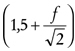

Verordnung vom 7. August 1984 über die Parallelführungen und Kreuzungen elektrischer Leitungen unter sich und mit Eisenbahnen Aufgrund von Art. 2 Abs. 2 Bst. b des Elektrizitätsgesetzes vom 15. Dezember 1982, LGBl. 1983 Nr. 16 , verordnet die Regierung: I. Geltungsbereich Art. 1 Anwendung 1) Die Bestimmungen dieser Verordnung sind bei der Erstellung neuer Anlagen und bei gänzlichem Umbau bestehender Anlagen in vollem Umfange anzuwenden. 2) Auf bestehende Parallelführungen und Kreuzungen finden sie Anwendung: a) in Fällen drohender Gefahr oder erheblicher störender Beeinflussung von Schwachstromanlagen durch Starkstromanlagen; b) bei Erweiterungen, Umbauten und bedeutenderen Reparaturen, soweit dies ohne wesentliche Änderung der bestehenden Anlagen möglich ist. 3) Stehen der Erfüllung einzelner Bestimmungen dieser Verordnung ausserordentliche Schwierigkeiten entgegen oder erweisen sie sich für die technische Entwicklung als hinderlich, so können auf begründetes Gesuch an die von der Regierung bezeichnete Kontrollstelle hin Abweichungen bewilligt werden. In Fällen von untergeordneter Bedeutung kann die Kontrollstelle von sich aus darüber entscheiden; in wichtigeren Fällen sind solche Gesuche der Regierung zum Entscheid zu unterbreiten. Art. 2 Geltung anderer Vorschriften 1) Soweit in der vorliegenden Verordnung keine abweichenden Bestimmungen enthalten sind, gelten auch die Verordnungen über: a) elektrische Schwachstromanlagen; b) elektrische Starkstromanlagen; c) Vorlagen für elektrische Starkstromanlagen. 2) Für das Zusammentreffen von elektrischen Leitungen mit Antennenvorrichtungen gelten die Vorschriften der Post-, Telefon- und Telegrafenbetriebe über radioelektrische Sende- und Empfangsanlagen. II. Allgemeine Bestimmungen Art. 3 Sicherungsmassnahmen für den Betrieb 1) Die Durchführung der Vorschriften muss in der für die Gesamtheit der zusammentreffenden Leitungen zweckmässigsten Weise erfolgen. 2) Will ein Betriebsinhaber Leitungen erstellen oder abändern, die mit anderen Leitungen zusammentreffen, so hat er die Betriebsinhaber der anderen Leitungen von seinem Vorhaben rechtzeitig in Kenntnis zu setzen. Aufgrund gegenseitiger schriftlicher Vereinbarungen sind alsdann die zur Vermeidung von Störungen und Gefahren nötigen Schutzvorkehrungen zu treffen. In dringenden Fällen können die Vereinbarungen auch in anderer als in schriftlicher Form getroffen werden. 3) Wird keine Verständigung über die zu treffenden Massnahmen erzielt, so entscheidet die von der Regierung bezeichnete Kontrollstelle. Sie kann die Einstellung der Bauarbeiten oder des Betriebes für die streitigen Teile der Anlage verfügen. Art. 4 Schutzmassnahmen bei Arbeiten 1) Will ein Betriebsinhaber an einer Stark- oder Schwachstromleitung Arbeiten ausführen, durch welche Anlagen anderer Unternehmungen gefährdet oder gestört werden könnten oder bei welchen sein Personal durch andere Starkstromanlagen gefährdet ist, so hat er die Betriebsinhaber der anderen Anlagen in der in Art. 3 angegebenen Weise zu verständigen. Für die bei den Arbeiten erforderlichen Schutzmassnahmen gelten die Bestimmungen des Abschnittes II der Starkstromverordnung. 2) An Schwachstromleitungen, die über Starkstromleitungen hinweggeführt sind, darf im allgemeinen nur gearbeitet werden, wenn die letzteren allpolig ausgeschaltet sind. Ist dies aus betriebstechnischen Gründen nicht möglich, so sind anderweitige, eine Gefahr ausschliessende Schutzvorkehren zu treffen. Art. 5 Begriffe der Parallelführung und Kreuzung 1) Parallelführungen liegen vor, wenn benachbarte Leitungen in angenähert gleicher Richtung nebeneinander verlaufen, ohne dass ihr Verlauf genau parallel zu sein braucht. 2) Kreuzungen liegen dort vor, wo sich die Trassen verschiedener Leitungen schneiden. Dabei werden die an der Kreuzungsstelle als Ganzes höher liegende Leitung als übergeführte und ihre nächstliegenden Tragwerke als Überführungstragwerke bezeichnet; Unterführungstragwerke sind die Tragwerke der untergeführten, mit ihren Leitern tiefer liegenden Leitung. III. Parallelführungen und Kreuzungen von Schwachstromleitungen mit Starkstromleitungen A. Parallelführungen von oberirdischen Schwachstromleitungen mit Starkstromfreileitungen Art. 6 Hochspannungs- und Schwachstromleitungen auf getrennten Tragwerken 1) Zur Vermeidung von Störungen und Schädigungen an Schwachstromanlagen sind parallel geführte Hochspannungs- und Schwachstromfreileitungen mit Rücksicht auf aussergewöhnliche Betriebszustände der Hochspannungsleitungen, abgesehen von der in Art. 7 behandelten Ausnahme, auf gesonderten Tragwerken zu führen; dabei ist der seitliche Abstand so gross zu wählen, als es die örtlichen Verhältnisse und die Rücksichten auf technisch und wirtschaftlich zweckmässige Ausführung gestatten. 2) Zwischen den einander zunächst liegenden Leitern von Schwachstromleitungen und parallel geführten Hochspannungsleitungen mit geringer Fernwirkung ist in der Regel ein seitlicher, waagrecht gemessener Abstand von wenigstens 20 m einzuhalten. Bei kurzen Parallelführungen an Winkelpunkten oder zur Umgehung von Hindernissen, wie einzelner Häuser, Bäume u. dgl., darf dieses Mass geringer sein, wenn dadurch keine Gefährdung oder Störung der Schwachstromanlagen entsteht. Muss dabei der Abstand zwischen den Leitungen auf weniger als 10 m verringert werden, so ist die Annäherung der Leitungen womöglich auf eine Länge von höchstens 50 m zu beschränken. 3) Handelt es sich um Parallelführungen von Schwachstrom- mit Hochspannungsleitungen, die infolge ihrer Betriebsart oder Leitungsanordnung starke Fernwirkungen ausüben, so bestimmen die Fernmeldedienste der Generaldirektion der PTT-Betriebe im Einvernehmen mit dem Betriebsinhaber der Hochspannungsleitung die kleinsten einzuhaltenden Abstände. 4) Befinden sich die tiefsten Punkte der Schwachstromleitungen höher als die nächstliegenden höchsten Punkte der Hochspannungsleitung, so muss der gemäss Abs. 2 einzuhaltende waagrechte Abstand um diesen Höhenunterschied grösser gemacht werden, oder es sind andere geeignete Massnahmen zu treffen, um bei Bruch der Schwachstromleitung eine Berührung mit der Hochspannungsleitung zu verhüten. 5) Für die im Betriebe von elektrischen Bahnen und Starkstromunternehmungen verwendeten Schwachstromleitungen können die Kontrollstellen geringere Abstände als die unter den Abs. 2 und 4 genannten gestatten. Art. 7 Hochspannungs- und Schwachstromleitungen auf gemeinsamem Tragwerk Parallelführungen von Hochspannungsleitern und Schwachstromleitern auf gemeinschaftlichen Tragwerken sind nur gestattet für Schwachstromanlagen, die lediglich dem Betrieb von Starkstromanlagen oder von elektrischen Bahnen dienen. Art. 8 Niederspannungs- und Schwachstromleitungen auf getrennten Tragwerken 1) Der waagrechte Abstand zwischen den Leitern parallel geführter Niederspannungs- und Schwachstromleitungen auf getrennten Gestängen soll in der Regel mindestens 2 m betragen. Auf ganz kurze Strecken ist grössere Annäherung zulässig bis auf einen kleinsten waagrechten Abstand von 1 m zwischen den Leitern, wenn die obersten Schwachstromleiter sich noch wenigstens 1 m tiefer als der unterste Niederspannungsleiter befinden. 2) Handelt es sich um Niederspannungsleitungen, die eine starke Fernwirkung ausüben, so können die Fernmeldedienste der Generaldirektion der PTT-Betriebe grössere Abstände verlangen, um Störungen der Schwachstromanlagen zu vermeiden. Art. 9 Niederspannungs- und Schwachstromleitungen auf gemeinsamem Tragwerk 1) Parallelführungen von Niederspannungs- und Schwachstromleitern auf denselben Tragwerken können in besonderen Fällen, wenn deren getrennte Erstellung grossen örtlichen Schwierigkeiten begegnet oder unverhältnismässig hohe Kosten verursacht, zugelassen werden, sofern die Schwachstromleiter nur in geringer Zahl vorhanden sind und es sich um Starkstromregelleitungen handelt, deren Leiter keine grössere Spannung als 250 V gegen Erde haben. Bei Schwachstromleitungen, die am Fahrleitungstragwerk elektrischer Bahnen angebracht sind, gelten die eisenbahnrechtlichen Bestimmungen. 2) Eine grössere Anzahl von Schwachstromleitern darf an Gestängen von Niederspannungsleitungen nur dann mit diesen parallel geführt werden, wenn keine andere technisch befriedigende Lösung möglich ist. 3) Bei der Parallelführung von Schwachstrom- und Niederspannungsleitern an gemeinschaftlichen Tragwerken gemäss diesem Artikel sind die Schwachstromleiter unterhalb der Niederspannungsleiter anzubringen, und der kleinste Vertikalabstand zwischen den Leitern der verschiedenen Systeme bis zu Spannweiten von 35 m muss wenigstens 1 m betragen, für jeden weiteren Meter Spannweite noch je 3 cm mehr. B. Kreuzungen von oberirdischen Schwachstromleitungen mit Starkstromfreileitungen Art. 10 Zulässige Anordnungen 1) Kreuzungen von Stark- mit Schwachstromleitungen sind, insbesondere auch durch Zusammenfassung von Einzelleitungen, in ihrer Anzahl möglichst zu beschränken. 2) Die Starkstromleiter sind möglichst über die Schwachstromleiter hinwegzuführen und die Trassen sollen sich tunlichst unter einem Winkel von mindestens 15° schneiden. 3) Kreuzungen mit Hochspannungsleitungen mit hölzernen Tragwerken sind da, wo die letzteren infolge von Winkeln oder Abzweigungen einseitig belastet sind, möglichst zu vermeiden. 4) Kreuzungen von Hochspannungsleitern mit Schwachstromleitern an gemeinsamen Tragwerken sind nicht statthaft. 5) Bei Weitspannleitungen sind die Kreuzungsstellen in der Nähe eines Überführungstragwerkes anzuordnen, soweit dies ohne grössere technische Übelstände und beträchtliche Mehrkosten möglich ist. Art. 11 Spannweiten und Verbindungen Für die zulässigen Spannweiten und allfällige Verbindungsstellen der an Kreuzungsstellen übergeführten Leiter gelten die einschlägigen Bestimmungen der Verordnung über Starkstromanlagen. Art. 12 Seitlicher Abstand Der waagrechte Abstand der untergeführten Schwachstromleiter von den ihnen zunächst liegenden Teilen von Überführungstragwerken muss bei Unterführung unter einer Hochspannungsleitung mindestens 1.5 m und unter einer Niederspannungsleitung mindestens 1 m betragen; das letztgenannte Mass kann, wenn die örtlichen Verhältnisse es erfordern, mit Einwilligung der von der Regierung bezeichneten Kontrollstelle noch herabgesetzt werden. Art. 13 Lotrechter Abstand Der lotrechte Abstand zwischen den einander zunächstliegenden Leitern sich kreuzender Leitungen muss wenigstens betragen: a) bei Kreuzungen in freier Spannweite mit Starkstromregelleitungen: 1 m zuzüglich 2 cm für jeden Meter Entfernung der Kreuzungsstelle vom näherliegenden Überführungstragwerk; b) bei Kreuzungen in freier Spannweite mit Weitspannleitungen auf Tragwerken mit festen Auslegern und mit starrer Befestigung der Leiter an den Isolatoren: 1 m zuzüglich 2 cm für jeden Meter Entfernung der Kreuzungsstelle vom näher liegenden Überführungstragwerke, zuzüglich 1 cm für jedes kV der Betriebsspannung der Starkstromleitung, unter Annahme einer Temperatur von 0° und einer Zusatzlast von 2 kg pro Meter an den übergeführten Leitern; c) bei Kreuzungen in freier Spannweite mit Weitspannleitungen auf Tragwerken mit beweglichen Auslegern oder ohne starre Befestigung der Leiter an den Isolatoren: das in Bst. b angegebene Mass; überdies sind den besonderen Verhältnissen entsprechende Massnahmen zu treffen, um beim Bruch eines Leiters Berührungen zwischen diesem und allfällig in benachbarten Spannweiten von ihm gekreuzten Leitern anderer Leitungen zu verhüten; d) bei Kreuzungen von Niederspannungsleitungen mit Schwachstromleitungen an gemeinsamen Tragwerken: 1 m. Art. 14 Hochspannungsüberführungen über Schwachstromleitungen 1) Bei Hochspannungsüberführungen über Schwachstromleitungen ist zwischen den Überführungstragwerken ein Schutzdraht von wenigstens 4 mm Durchmesser in dauerhafter Weise zu befestigen. Er ist an der Kreuzungsstelle ungefähr in halber Höhe zwischen den sich kreuzenden Leitern, jedenfalls aber nicht näher als 50 cm von jedem derselben, anzuordnen und so zu spannen, dass ein hinaufschnellender Schwachstromleiter nicht in Berührung mit den Hochspannungsleitern gelangen kann. Wenn die übergeführten Hochspannungsleiter in waagrechter Richtung weit auseinander liegen, kann von der Kontrollstelle die Anbringung von mehreren Schutzdrähten angeordnet werden. Bei Kreuzungen unter Weitspannleitungen können statt solcher Schutzdrähte an einem unmittelbar bei der Kreuzung aufgestellten Tragwerk der untergeführten Schwachstromleitung Fangrahmen angebracht werden, welche die Schwachstromleiter oben und seitlich umschliessen. 2) Solche Schutzdrähte sind auch anzubringen, wenn Werkschwachstromleitungen, die streckenweise am Gestänge von Hochspannungsleitungen verlaufen, über andere Schwachstromleitungen geführt werden, sofern mit dem Vorhandensein erheblicher Induktionsspannungen in den Werkschwachstromleitern zu rechnen ist. 3) Bietet eine der vorstehend erwähnten Lösungen technische Schwierigkeiten oder ist sie mit unverhältnismässig hohen Kosten verbunden, so können den gleichen Zweck erfüllende andere Massnahmen getroffen werden, über deren Zulässigkeit die Kontrollstellen entscheiden. 4) Beträgt der senkrechte Abstand der einander zunächstliegenden sich kreuzenden Leiter mehr als 10 m, so kann von der Anbringung von Fangrahmen oder Schutzdrähten vollständig abgesehen werden, wenn nicht der örtlichen Verhältnisse wegen trotz des grossen Abstandes die Gefahr einer Leiterberührung besteht. Ebenso ist kein Schutzdraht erforderlich, wenn sich unterhalb der Hochspannungsleiter längs diesen verlaufende Niederspannungsdrähte befinden, deren Betriebsspannung nicht mehr als 250 V gegen Erde beträgt. 5) Wenn bei Überführungen von Hochspannungs- über Schwachstromleitungen an hölzernen Hochspannungstragwerken Erdleitungen angebracht werden müssen, so sind sie so auszuführen, dass dadurch Stangenbrände im Falle von Beschädigungen an Isolatoren möglichst verhütet werden. Hiezu sind alle Metallteile, die bei Isolationsfehlern unter Spannung geraten könnten, entweder in genügender Weise zu isolieren oder direkt mit der Erdleitung zu verbinden. Art. 15 Schwachstromüberführungen über Hochspannungsleitungen 1) Die Überführung von Schwachstromleitungen über Hochspannungsleitungen ist nur zulässig, wenn die umgekehrte Leitungsanordnung mit aussergewöhnlichen technischen Schwierigkeiten oder unverhältnismässig hohen Kosten verbunden ist. 2) Schwachstromleiter, die mit einer Spannweite von mehr als 30 m über Hochspannungsleitungen geführt sind, müssen eine Zerreissfestigkeit von mindestens 560 kg haben. Beträgt ihre Spannweite 30 m oder weniger, so ist die Verwendung von Bronzedraht mit wenigstens 410 kg Zerreissfestigkeit zulässig. Art. 16 Niederspannungsüberführungen über Schwachstromleitungen 1) Bei Überführungen von Niederspannungsleitungen von mehr als 250 V Spannung gegen Erde über Schwachstromleitungen soll an den Überführungstragwerken ein Schutzdraht gemäss Art. 14 angebracht werden. 2) Überführungen von Niederspannungsleitungen über Schwachstromleitungen an gemeinschaftlichem Tragwerk sind zulässig, wenn der Kreuzung in freier Spannweite Schwierigkeiten entgegenstehen. Art. 17 Schwachstromüberführungen über Niederspannungsleitungen Über blanke oder nicht dauernd sicher isolierte Niederspannungsleitungen geführte Schwachstromleiter müssen wenigstens 350 kg Zerreissfestigkeit besitzen. Handelt es sich um dauernd sicher isolierte Niederspannungsleiter oder an Tragseilen aufgehängte Niederspannungsbleikabel mit geerdetem Mantel, so kann von einer Verstärkung der Schwachstromleiter abgesehen werden. C. Parallelführungen und Kreuzungen von unterirdischen Schwachstromleitungen mit unterirdischen Starkstromleitungen Art. 18 Abstände und Schutzmassnahmen 1) Bei Parallelführungen und Kreuzungen unterirdischer Starkstrom- mit Schwachstromleitungen sollen die Starkstromkabel, wo sie weniger als 30 cm von den Schwachstromkabeln entfernt sind, in geschlossene Schutzkanäle aus schlecht leitendem Material verlegt werden, oder es sind andere gleichwertige Schutzmassnahmen zu treffen. 2) Sind Schwachstromkabel parallel geführt mit Starkstromkabeln, die eine erhebliche Fernwirkung ausüben, so ist zwischen ihnen ein Abstand von mindestens 60 cm einzuhalten. 3) In besonderen Fällen können die Fernmeldedienste der Generaldirektion der PTT-Betriebe kleinere Abstände zulassen oder zur Wahrung des störungsfreien Betriebes der Schwachstromanlagen grössere Abstände verlangen. D. Besondere Fälle Art. 19 Zusammentreffen von Leitungen an und in Gebäuden 1) Wenn blanke Stark- und Schwachstromleiter an oder in Gebäuden zusammentreffen, so muss dafür gesorgt werden, dass gegenseitige Berührungen nicht vorkommen können. Für die Abspannung der Freileitungen an Gebäuden gelten die für gemeinschaftliche Tragwerke vorgeschriebenen Minimalabstände. Im Innern von Gebäuden zusammentreffende isolierte Stark- und Schwachstromleitungen sind als Bestandteile von Hausinstallationen zu behandeln. 2) Bei der Einführung von Schwachstromleitungen der Post-, Telefon- und Telegrafenbetriebe in Hochspannung führende elektrische Kraftwerke, Unterstationen, Transformatorenstationen u. dgl. sind Massnahmen zu treffen, um den Übertritt von gefährlichen oder störenden Spannungen und Strömen in das Schwachstromnetz der genannten Betriebe zu verhüten. IV. Parallelführungen und Kreuzungen von Starkstromleitungen unter sich A. Allgemeines Art. 20 Befestigung der Leiter an den Isolatoren Sowohl bei Parallelführungen von Hoch- und Niederspannungsregelleitungen an gemeinsamen Tragwerken als auch bei Kreuzungen solcher Leitungen müssen die Leiter der höher liegenden Leitung an den Isolatoren mit Arretierbund befestigt werden. B. Parallelführungen von Starkstromfreileitungen unter sich Art. 21 Anordnung von Leitungen verschiedener Spannung 1) Bei Parallelführungen von Starkstromleitern verschiedener Spannung auf gemeinsamen Tragwerken sind im allgemeinen diejenigen mit der höheren Spannung über denen mit der niedrigeren Spannung anzuordnen. Wo diese Anordnung besondere Schwierigkeiten bereitet, darf ausnahmsweise umgekehrt verfahren werden, sofern es sich nur um Hochspannungsleiter unter sich oder nur um Niederspannungsleiter unter sich handelt. 2) Der Abstand zwischen zwei Leitern von Leitungen verschiedener Spannung, seien diese an gemeinsamen oder an getrennten Gestängen angebracht, darf nicht kleiner sein als der Abstand zwischen den einzelnen Leitern der Leitung mit der höheren Spannung. Er ist in den besonderen, in den nachstehenden Artikeln aufgeführten Fällen entsprechend zu vergrössern. Art. 22 Hoch- und Niederspannungsleiter auf gemeinsamem Tragwerk 1) Die Parallelführung von Hoch- und Niederspannungsleitern auf gemeinsamem Tragwerk ist tunlichst zu vermeiden. 2) Wenn ausnahmsweise solche Parallelführungen durchaus nicht vermieden werden können, sind die Niederspannungsleiter in allen Fällen unterhalb der Hochspannungsleiter anzubringen, und der kleinste Vertikalabstand zwischen Leitern beider Spannungssysteme muss 3 cm pro Meter Spannweite, mindestens aber 1 m betragen. Art. 23 Leitungen verschiedener Unternehmungen auf getrennten Tragwerken 1) Nähern sich zwei Starkstromregelleitungen verschiedener Unternehmungen gegenseitig, ohne sich zu kreuzen, so muss zwischen den einander zunächst liegenden Leitern der beiden Leitungen ein kleinster, horizontal gemessener Abstand von mindestens 2 m eingehalten werden. 2) Bestehen zwei oder mehrere Starkstromregelleitungen nebeneinander mit einem gegenseitigen kleinsten Leiterabstand von 2 m oder weniger, so darf eine weitere, einer anderen Unternehmung gehörende Leitung nur mit einem Mindestabstand der einander zunächst liegenden Leiter von 8 m von der nächsten der bestehenden Leitungen erstellt werden. Beträgt der kleinste Leiterabstand zwischen den beiden näherliegenden bestehenden Leitungen mehr als 2 m, so darf der Abstand der weiteren Leitung um ebensoviel kleiner als 8 m gewählt werden, er muss jedoch mindestens 2 m betragen. Wo die Einhaltung so grosser Abstände zufolge der örtlichen Verhältnisse nicht möglich ist, hat eine besondere Vereinbarung zwischen den Unternehmungen stattzufinden. 3) Verlaufen Weitspannleitungen mit Weitspann- oder Regelleitungen einer anderen Unternehmung auf voneinander getrennten Tragwerken parallel, so ist zwischen den einander zunächst liegenden Leitern der beiden Leitungen ein kleinster horizontaler Abstand einzuhalten, der mindestens 2 m und dazu je 1 m pro 50 m Spannweite der Leitung mit den grösseren Spannweiten beträgt. Liegen die Leiter der Weitspannleitung auch beim grössten Durchhang noch höher als der oberste Leiter der benachbarten Starkstromleitung ohne Zusatzlast, so darf der Abstand verringert werden. Der kleinste Abstand zwischen den einander zunächst liegenden Leitern beider Leitungen muss jedoch mindestens so gross sein als der nach Art. 85 der Starkstromverordnung für die einzelnen Leiter einer Leitung unter sich erforderliche Abstand. 4) Vorbehalten bleiben die Bestimmungen von Art. 24. Art. 24 Leitungen verschiedener Unternehmungen auf gemeinsamem Tragwerk oder in kleinem Parallelabstand Parallelführungen von Starkstromleitungen, die verschiedenen Unternehmungen gehören, sind auf denselben Tragwerken oder bei getrennten Tragwerken in kleineren gegenseitigen Abständen als sie Art. 23 bestimmt, nur zulässig, wenn sich die Unternehmungen vorher hierüber verständigt haben. Zwingen die örtlichen Verhältnisse zu einer derartigen Annäherung von Leitungen verschiedener Unternehmungen und kommt eine Verständigung nicht zustande, so entscheidet die von der Regierung bezeichnete Kontrollstelle. In allen Fällen grösserer Annäherung, als sie Art. 23 für voneinander unabhängige Leitungen bestimmt, gelten für die Vornahme von Erstellungs-, Instandhaltungs- und Erweiterungsarbeiten die Bestimmungen der Art. 3 und 4. C. Kreuzungen von Starkstromfreileitungen unter sich Art. 25 Allgemeine Leitungsanordnung Starkstromfreileitungen sind so anzulegen, dass möglichst wenig Kreuzungsstellen zwischen Leitungen verschiedener Betriebe entstehen und dass die Hochspannungsleitungen an den Kreuzungsstellen wo irgend möglich über die Niederspannungsleitungen geführt sind. Art. 26 Überführung von Niederspannungsleitungen über Hochspannungsleitungen Die Überführung von Niederspannungsleitungen über Hochspannungsleitungen ist nur in solchen Fällen zulässig, wo die umgekehrte Leitungsanordnung mit aussergewöhnlichen technischen Schwierigkeiten oder unverhältnismässig hohen Kosten verbunden wäre. Die Niederspannungsleiter müssen in diesem Falle in bezug auf ihre mechanische Sicherheit den für Hochspannungsleiter geltenden Bestimmungen der Starkstromverordnung entsprechen. Art. 27 Kreuzungen von Weitspann- mit Regelleitungen Weitspannleitungen sind bei Kreuzung mit Regelleitungen normalerweise über letztere hinwegzuführen. Wenn ausnahmsweise die umgekehrte Kreuzungsanordnung unvermeidlich ist, so hat die Regelleitung hinsichtlich ihrer mechanischen Sicherheit den für Weitspannleitungen geltenden Vorschriften zu entsprechen. Art. 28 Kreuzungen in freier Spannweite und an gemeinschaftlichem Tragwerk 1) Kreuzungen von Starkstromleitungen unter sich sollen tunlichst in freier Spannweite erfolgen. Für allfällig in übergeführten Leitern vorhandene Verbindungsstellen gilt Art. 81 der Starkstromverordnung. 2) Kreuzungen von Starkstromleitungen an gemeinschaftlichem Tragwerk sind zulässig, wenn der Kreuzung in freier Spannweite grosse Schwierigkeiten entgegenstehen und das gemeinschaftliche Tragwerk dadurch nicht überlastet wird. Art. 29 Leiterabstand von Überführungstragwerken 1) Bei Starkstrom-Freileitungskreuzungen muss der waagrechte Abstand der untergeführten Leiter von den ihnen zunächst liegenden Teilen der Überführungstragwerke wenigstens betragen: a) bei untergeführten Hochspannungsregelleitungen 1.5 m; b) bei untergeführten Niederspannungsregelleitungen 1.0 m; c) bei untergeführten Weitspannleitungen 

 m, wobei f den Durchhang der Leiter mit Zusatzlast in Metern an der Kreuzungsstelle bedeutet. 2) Die Kreuzungen mit Weitspannleitungen sollen in der Regel in der Nähe eines Überführungstragwerkes angeordnet werden, soweit dies ohne grössere technische Übelstände und unverhältnismässige Mehrkosten möglich ist. Art. 30 Lotrechter Abstand sich kreuzender Leiter 1) Der lotrechte Abstand der einander zunächst liegenden Leiter von Leitungen, die sich in freier Spannweite kreuzen, muss wenigstens betragen bei Kreuzungen: a) von Starkstromregelleitungen unter sich: 1 m zuzüglich 2 cm für jeden Meter Entfernung der Kreuzungsstelle vom näherliegenden Überführungstragwerk; b) von Weitspannleitungen auf Tragwerken mit festen Auslegern und mit starrer Befestigung der Leiter an den Isolatoren über Starkstromregelleitungen: 1 m zuzüglich 2 cm für jeden Meter Entfernung der Kreuzungsstelle vom näherliegenden Überführungstragwerk, zuzüglich 1 cm für jedes kV der Betriebsspannung der Starkstromleitung mit der höheren Spannung. Diese lotrechten Abstände müssen vorhanden sein beim Zustand bei 0° mit Zusatzlast für die übergeführte Leitung und ohne Zusatzlast für die untergeführte Leitung; c) von Weitspannleitungen auf Tragwerken mit beweglichen Auslegern oder ohne starre Befestigung der Leiter an den Isolatoren über Starkstromregelleitungen: das in Bst. b angegebene Mass. Überdies sind den Verhältnissen entsprechende Massnahmen zu treffen, um beim Bruch eines Leiters Berührungen zwischen diesem und allfällig in benachbarten Spannweiten von ihm gekreuzten Leitern anderer Leitungen zu verhüten; d) von Weitspannleitungen unter sich oder mit übergeführten Regelleitungen: 1.5 m zuzüglich 1 cm für jeden Meter Entfernung der Kreuzungsstelle vom nächstliegenden Überführungstragwerk einerseits und ebenso vom nächstliegenden Unterführungstragwerk anderseits, zuzüglich 1 cm für jedes kV der Betriebsspannung der Leitung mit der höheren Spannung. Diese lotrechten Abstände müssen vorhanden sein beim Zustand bei 0° mit Zusatzlast für die übergeführte Leitung und ohne Zusatzlast für die untergeführte Leitung. 2) Bei Kreuzungen an gemeinsamem Tragwerk muss der lotrechte Abstand der einander zunächst liegenden Leiter sich kreuzender Leitungen mindestens betragen: a) 1.5 m, wenn wenigstens eine der Leitungen eine Hochspannungsleitung ist, jedoch nicht weniger als der zwischen den einzelnen Leitern der Leitung mit der höheren Spannung vorhandene Abstand; b) 1.0 m, wenn es sich um Kreuzungen von Niederspannungsleitungen unter sich handelt. D. Parallelführungen und Kreuzungen von Starkstromkabelleitungen unter sich Art. 31 Parallelführungen und Kreuzungen 1) Bei Parallelführungen und Kreuzungen von in Erdreich verlegten Hochspannungskabeln mit Niederspannungskabeln muss, wenn der kleinste Abstand zwischen den Kabeln der kreuzenden oder parallel geführten Leitungen weniger als 30 cm beträgt, jede Leitung für sich in Schutzkanäle oder zwischen nicht verschiebbare und ausreichend starke Trennwände aus schlecht wärmeleitendem und schwer schmelzbarem Material gelegt sein. Die gleiche Bestimmung gilt bei Parallelführungen und Kreuzungen von Hochspannungskabeln unter sich, die verschiedenen Stromkreisen angehören. 2) Ausnahmsweise können Niederspannungskabelleitungen, die ausschliesslich zum Anschluss von Instrumenten und Apparaten dienen, die nur dem geschulten Betriebspersonal der Elektrizitätswerke zugänglich sind, einen mit den Hochspannungskabeln des betreffenden Werkes gemeinsamen Kabelschutz erhalten oder ihre Leiter dürfen, unter entsprechender Isolation, mit den Hochspannungsleitern in gemeinsamem Kabel angebracht werden. In diesen Fällen sind Massnahmen zur möglichsten Unschädlichmachung eines allfälligen Übertrittes der Hochspannung in diese Niederspannungsleiter zu treffen. 3) Wo Niederspannungs- und Hochspannungskabel im gleichen Graben liegen, müssen letztere mindestens 20 cm tiefer gelegt werden als die ersteren. 4) Parallelführungen und Kreuzungen von Niederspannungskabeln verschiedener Unternehmungen sind gleich zu behandeln wie Parallelführungen und Kreuzungen zwischen Hoch- und Niederspannungskabeln. V. Parallelführungen und Kreuzungen elektrischer Leitungen mit Eisenbahnen A. Allgemeines Art. 32 Anordnung von oberirdischen Leitungen im Bahnnähe Das Lichtraumprofil der Bahn, die Sichtbarkeit der Bahnsignale und die Übersicht über die Geleise dürfen weder durch die Leitungen noch durch deren Tragwerke beeinträchtigt werden. Art. 33 Massnahmen zum Schutze von Kabeln Zum Schutze von Stark- und Schwachstromkabelleitungen, die längs oder quer zum Geleise elektrischer Bahnen verlaufen, sind wo nötig besondere Massnahmen zu treffen, um Schädigungen durch abirrende Schienenströme oder Störungen durch induktive Wirkungen zu vermeiden. B. Kreuzungen 1. Kreuzungen mit Eisenbahnen mit Fahrleitung Art. 34 Ausführungsart der Kreuzung 1) Schwachstrom- und Niederspannungsleitungen sind bei Kreuzung von Bahnen mit über 3 500 V Fahrleitungsspannung in der Regel unter der Bahnlinie durchzuführen. 2) Überführungen von Leitungen über Bahnen mit über 3 500 V Fahrleitungsspannung sind auf tunlichst wenige Stellen zu beschränken und nur zulässig: a) für Hochspannungsfreileitungen; b) für interurbane Telegrafen- und Telefonleitungen über freien Bahnstrecken, wobei aber bei der Erstellung von Anfang an auf die Vermeidung nachträglicher Änderungen oder anderer Arbeiten an den kreuzenden Leitungen Bedacht zu nehmen ist; c) für Schwachstrom- und Niederspannungsfreileitungen, wenn für den Fall des Bruches der übergeführten Leiter ihre Berührung mit Fahrleitungen ausgeschlossen ist; d) für Kabel, die an Brücken oder anderen Überbauten über der Bahn befestigt sind. 3) Bei Bahnen mit Fahrleitungsspannungen von 3 500 V und weniger dürfen Freileitungen jeder Art über die Bahnlinie hinweggeführt werden; jedoch sind die Überführungen auch hier auf tunlichst wenige Stellen zu beschränken. Beträgt die Spannweite der übergeführten Leiter mehr als 30 m, so sind solche Kreuzungen auch bei Fahrdrahtspannungen von weniger als 1 000 V wie Überführungen von Niederspannungsleitungen über Hochspannungsleitungen gemäss Art. 26 zu behandeln. 4) Die Bestimmungen dieses Artikels gelten auch für Kreuzungen von Bahnen, deren Elektrifizierung auf einen bestimmten Zeitpunkt beschlossen ist, soweit es sich nicht um Leitungen handelt, die vorher wieder beseitigt werden. Art. 35 Höhe übergeführter Leiter 1) Für die Bemessung des lotrechten Abstandes zwischen den bahndienstlichen Leitungen und übergeführten Leitern gelten sinngemäss die Bestimmungen der Art. 13 und 30. Zwischen Fahrleitungen mit über 3 500 V Spannung und den Leitern übergeführter Hochspannungsleitungen muss jedoch mindestens ein lotrechter Abstand von 2 m zuzüglich 2 cm für jeden Meter Entfernung der Kreuzungsstelle vom näherliegenden Überführungstragwerk eingehalten werden. 2) Bei Bahnen, deren Triebfahrzeuge mit Rollen- oder anderen leicht entgleisenden Stromabnehmern ausgerüstet sind, ist die Höhe der übergeführten Leiter so zu bemessen, dass ihre Berührung durch den aufschnellenden Stromabnehmer ausgeschlossen ist. 3) Handelt es sich um Kreuzungen mit Bahnen, deren Elektrifizierung auf einen bestimmten Zeitpunkt beschlossen ist, bei denen die Lage der Leiter der für den elektrischen Betrieb nötigen Leitungen und ihrer Tragwerke jedoch noch nicht bekannt ist, so ist anzunehmen, die Höhe des obersten Leiters der Bahnleitungen über Schienenoberkante betrage wenigstens: auf freien Strecken in Stationen bei Fahrleitungsspannungen über 3 500 V: m m auf Normalbahnen 9.0 10.5 auf Schmalspurbahnen 8.5 9.5 bei Fahrleitungsspannungen bis 3 500 V: mit einfacher Fahrleitungsaufhängung 6.5 7.0 mit vielfacher Fahrleitungsaufhängung 8.0 9.0 Art. 36 Schwachstromleitungen über Abspanndrähten 1) Über normalerweise spannungslosen Abspanndrähten von Bahnfahrleitungen sind Schwachstromleitungen tunlichst zu vermeiden. 2) Wo eine solche Überführung unvermeidlich ist, müssen die Schwachstromleitungen folgenden Bedingungen entsprechen: Die kleinste absolute Zerreissfestigkeit der Schwachstromleiter muss wenigstens 180 kg betragen und ihre Spannweite soll möglichst 30 m nicht überschreiten. Wo grössere Spannweiten unvermeidlich sind, müssen entsprechend stärkere Leiter verwendet werden. Die Schwachstromtragwerke sind so nahe an den Abspanndrähten aufzustellen, als die örtlichen Verhältnisse es erlauben. Der Vertikalabstand der Schwachstromleiter von den Abspanndrähten ist so zu bemessen, dass eine gegenseitige Berührung ausgeschlossen ist. 3) Schwachstromüberführungen über Abspanndrähte, die unter Spannung stehen, sind wie solche über Fahrdrähte zu behandeln. 2. Kreuzungen mit Eisenbahnen ohne Fahrleitung Art. 37 Ausführungsart der Kreuzung 1) Es dürfen Freileitungen jeder Art über die Bahn hinweg geführt werden, jedoch sind die Überführungen auf tunlichst wenige Stellen zu beschränken. 2) Die Höhe der Leiter und allfälliger Schutzdrähte über Schienenoberkante muss wenigstens 6 m betragen. 3) Der Durchmesser über die Bahn geführter Schwachstromleiter bis zu 40 m Spannweite muss wenigstens 2 mm für Bronze- und Stahldraht und wenigstens 3 mm für Eisendraht betragen. Für grössere Spannweiten sind entsprechend stärkere Drähte zu verwenden. 3. Freileitungsüberführungen über Eisenbahnen Art. 38 Isolatoren 1) Auf Bahnüberführungstragwerken mit Stützisolatoren sind die Leiter mit Arretierbund zu befestigen. 2) Wo die Gefahr des Abschmelzens der übergeführten Leiter durch Lichtbogen besteht, sind entsprechende Schutzmassnahmen zu treffen. Art. 39 Standort für Überführungstragwerke 1) Bei den Bahnüberführungstragwerken sind Winkel der Leitungstrasse tunlichst zu vermeiden. 2) Bei Weitspannleitungen ist ein Überführungstragwerk möglichst nahe der Bahnkreuzungsstelle anzuordnen, soweit dies ohne grössere technische Übelstände und beträchtliche Mehrkosten möglich ist. Art. 40 Material der Tragwerke 1) Für die Überführung von Hochspannungsregelleitungen mit einer Spannung von mehr als 30 kV und von Hochspannungsweitspannleitungen über alle Bahnen sowie von interurbanen Telefon- und Telegrafenleitungen über Bahnen mit Fahrleitungen von mehr als 3 500 V Spannung müssen Tragwerke aus Eisen oder Eisenbeton verwendet werden. 2) Von der vorstehenden Bestimmung sind ausgenommen Überführungen über industrielle Anschlussgeleise und Strassenbahnen sowie Überführungen temporärer Hochspannungsleitungen über alle Bahnen. 3) Auf Bahnüberführungstragwerken aus Eisen oder Eisenbeton sind kurze hölzerne Einbauten für die Befestigung von Stützisolatoren zulässig. Art. 41 Befestigung von hölzernen Überführungstragwerken Hölzerne Überführungstragwerke müssen auf im Boden verrammte oder auf andere Weise sicher fundierte Stangenfüsse aus Material, das gegen die Einwirkungen des Erdbodens widerstandsfähig ist, so befestigt werden, dass die Stangen auf diesen Füssen auswechselbar und vor Erdfeuchtigkeit und Wasseransammlungen geschützt sind. Die Stangenfüsse müssen wenigstens gleiche Festigkeit besitzen wie die Tragwerke. Die unmittelbare Einbetonierung von Holzstangen ist nur bei kurzzeitigen Anlagen zulässig. Art. 42 Festigkeit der Tragwerke 1) Die Tragwerke zur Überführung von Regelleitungen müssen mit Bezug auf ihre Festigkeit lediglich den Bestimmungen der Art. 99 und 100 der Starkstromverordnung genügen. Handelt es sich um Leitungen mit einer Betriebsspannung von mehr als 5 000 V, so müssen die Abstände der Leiter vom Tragwerk und unter sich wenigstens 10 % grösser sein als die Minimalwerte, welche in Art. 85 der Starkstromverordnung angegeben sind. 2) Die Tragwerke zur Überführung von Weitspannleitungen über Bahnen müssen, wenn ihr Abstand vom Geleise so gross ist, dass sie selbst bei allfälligem Umstürzen nicht in das Lichtraumprofil der Bahn hineinragen können, mit Bezug auf ihre Festigkeit lediglich den zutreffenden Bestimmungen der Art. 94 bis 96 der Starkstromverordnung genügen. Handelt es sich um Leitungen mit Abspannmasten, so muss die Festigkeit von Tragmasten, die im Falle des Umstürzens in das Lichtraumprofil der Bahn ragen können, wenigstens den Anforderungen von Art. 95 II Ziff. 2 c und d der Starkstromverordnung entsprechen. 4. Unterführung von Leitungen unter Eisenbahnen Art. 43 Benützung von Durchlässen; Kabelwege 1) Für die Unterführung elektrischer Leitungen unter Bahnlinien dürfen vorhandene Durchlässe benützt werden, soweit deren Revisionen und Reparaturen dadurch nicht gehindert werden. 2) Ist die Erstellung besonderer Unterführungskanäle nötig, so sind diese so auszuführen, dass sie weder die Festigkeit des Bahnkörpers beeinträchtigen, noch ein Hindernis für die Bahnunterhaltsarbeiten bilden. 3) Kabel und Unterführungskanäle müssen in einer Tiefe von wenigstens 70 cm unter der Schwellenoberkante liegen. 4) Unter Geleisen durchgeführte, bahnfremde Kabel sind wenigstens 1.3 m unter der Schwellenoberkante zu verlegen. Art. 44 Massnahmen für den Personenschutz 1) Die Einführungen von oberirdischen Leitungen in ihre Unterführung unter Bahnen sowie die untergeführten Leitungen sind so zu erstellen und instand zu halten, dass eine Berührung unter Spannung stehender Teile vom Bahnkörper aus weder unmittelbar noch mit den bei gewöhnlichen Bahnunterhaltsarbeiten verwendeten Werkzeugen möglich ist. 2) An Stellen, wo die Möglichkeit einer zufälligen Berührung gefährlicher Leitungen mit besonderen Mitteln vom Bahnkörper aus nicht vermieden werden kann, sind auffällige Warnungstafeln anzubringen und ausserdem, falls erforderlich, besondere Schutzvorrichtungen. 3) Metallische Schutzverkleidungen und Kabelarmaturen von Leitungen mit mehr als 125 V Betriebsspannung sind zu erden. VI. Zusammentreffen von Stark- und Schwachstromleitungen mit Drähten und Drahtseilen von Transportanlagen Art. 45 Geltungsbereich 1) Unter die Bestimmungen dieses Abschnittes fallen alle bleibenden und temporären Transportanlagen für die Beförderung von Gütern aller Art und für den nicht regelmässigen Transport von Personen, die als Trag- und Zugorgan durch die Luft gespannte Drähte oder Drahtseile verwenden. 2) Über die beim Zusammentreffen von Starkstromleitungen mit Luftseilbahnen, die für die Personenbeförderung konzessioniert sind, zu treffenden Massnahmen entscheidet die Regierung von Fall zu Fall. Art. 46 Verständigung über Sicherungsmassnahmen 1) Treffen Starkstromfreileitungen mit Transportanlagen gemäss Art. 45 Abs. 1 zusammen, so soll vor der Erstellung der Anlage, die das Zusammentreffen verursacht, zwischen den in Betracht fallenden Unternehmungen eine Vereinbarung im Sinne der nachfolgenden Bestimmungen zum Zwecke der Verhütung gefährlicher Einwirkungen der beiden Anlagen aufeinander stattfinden. 2) Können sich die Unternehmungen über die zur Vermeidung von Gefahren notwendigen Massnahmen im Rahmen der Bestimmungen dieser Verordnung nicht einigen, so entscheidet hierüber die für die elektrische Leitung zuständige Kontrollstelle. Art. 47 Kreuzungen 1) Kreuzungen von Starkstromfreileitungen mit Transportanlagen sind tunlichst zu vermeiden. 2) Ist nach den örtlichen Verhältnissen eine Kreuzung mit einer Transportanlage gemäss Art. 45 Abs. 1 nicht zu umgehen, so soll die Starkstromleitung wo irgend möglich über die Transportanlage geführt werden. An der Kreuzungsstelle ist überdies in genügendem Abstand unterhalb der Starkstromleiter ein wirksamer Prelldraht oder ein Schutzjoch anzubringen. Der Abstand zwischen den Seilen oder Drähten der Transportanlage und dem Prelldraht oder dem Querbalken des Schutzjoches soll so gross sein, dass eine gegenseitige Berührung zwischen den Seilen oder Drähten und dem Prelldraht bzw. Schutzjoch im normalen Betrieb nicht zu befürchten ist. 3) Lässt sich die Überführung einer solchen Transportanlage über eine Starkstromfreileitung durchaus nicht vermeiden, und ist auch eine Kabelunterführung der elektrischen Leitung unter der Seilanlage durch nicht angängig, so sind die zum Schutze gegen eine allfällige Berührung der Starkstromleitung mit dem Transportseil erforderlichen Sicherungsmassnahmen vor der Erstellung der Kreuzung durch die für die betreffende Starkstromanlage zuständige Kontrollstelle zu bestimmen. Art. 48 Erdung der Transportanlagen Transportanlagen, die von Starkstromfreileitungen über- oder unterkreuzt werden, sind zu beiden Seiten der Kreuzungsstelle den Bestimmungen der Starkstromverordnung entsprechend zu erden. Art. 49 Transportanlagen und Schwachstromanlagen Die vorstehenden Bestimmungen gelten sinngemäss auch beim Zusammentreffen von Transportanlagen mit Schwachstromleitungen. VII. Schlussbestimmung Art. 50 Inkrafttreten Diese Verordnung tritt am Tage der Kundmachung in Kraft. Fürstliche Regierung: gez. Hans Brunhart Fürstlicher Regierungschef
