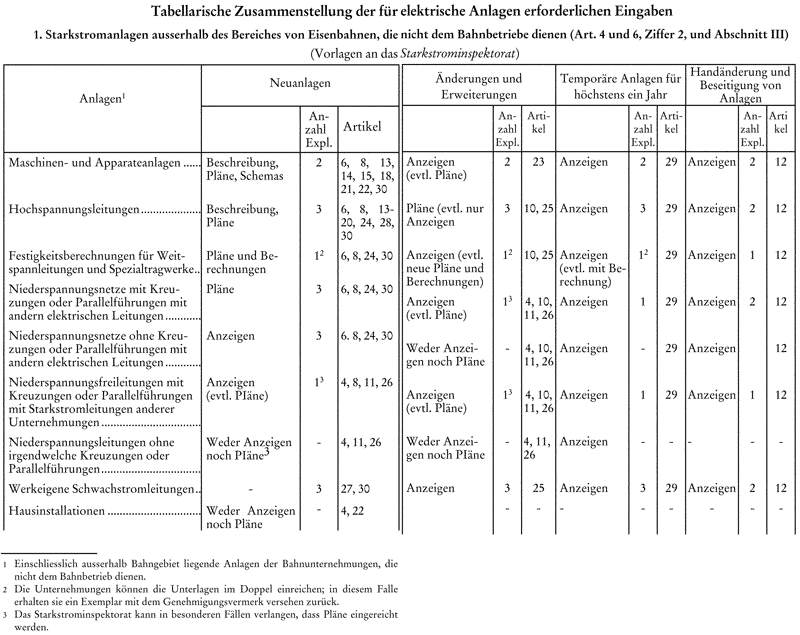
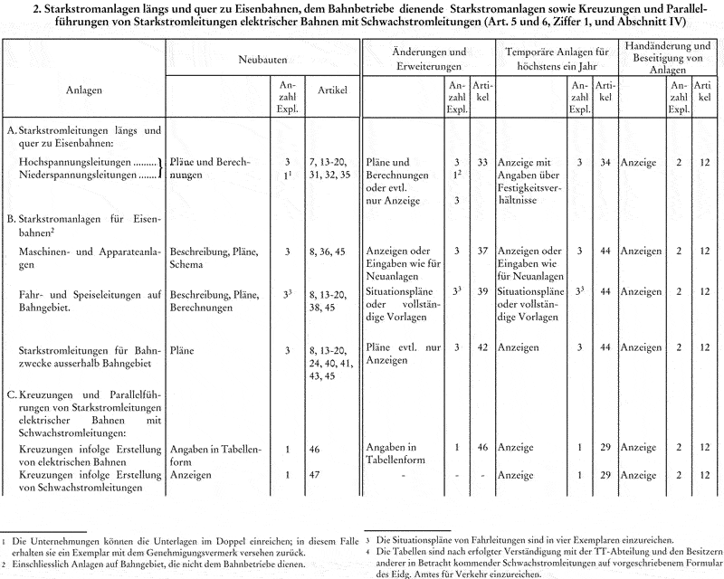
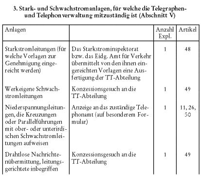

Verordnung vom 7. August 1984 über die Vorlagen für elektrische Starkstromanlagen Aufgrund von Art. 6 des Elektrizitätsgesetzes vom 15. Dezember 1982, LGBl. 1983 Nr. 16 , verordnet die Regierung: I. Genehmigung von Vorlagen für Starkstromanlagen A. Allgemeine Bestimmungen Art. 1 1. Genehmigung 1) Elektrische Starkstromanlagen dürfen nur erstellt oder geändert werden, wenn die Kontrollstelle vorher die Vorlage genehmigt hat. 2) Der Bauherr oder Betriebsinhaber der Anlage hat nach Art. 6 des Elektrizitätsgesetzes diese Genehmigung einzuholen und hiefür die in dieser Verordnung vorgeschriebenen Vorlagen und Anzeigen der Kontrollstelle zur Genehmigung einzureichen. Mit dem Bau der Anlage darf erst begonnen werden, wenn die in den Art. 58, 62 oder Art. 23 Abs. 3 hienach genannten Voraussetzungen erfüllt sind. Art. 2 2. Ausnahmen Eine Genehmigung ist im allgemeinen nicht notwendig für: a) Erweiterung von Niederspannungsnetzen, bei denen keine Kreuzungen oder Parallelführungen mit anderen Leitungen entstehen (vorbehalten bleiben die Art. 8 und 13 Abs. 4); b) Hausinstallationen (Art. 7 des Elektrizitätsgesetzes); c) Einzelanlagen auf Grund und Boden des Besitzers, bei denen die für Hausinstallationen zulässige Spannung nicht überschritten wird und keine Kreuzungen oder Parallelführungen mit anderen Leitungen entstehen (Art. 4 Abs. 2 des Elektrizitätsgesetzes). Art. 3 3. Strafbestimmung Wer die Vorlagepflicht nicht erfüllt, kann nach Art. 30f. des Elektrizitätsgesetzes mit einer Geldstrafe bestraft werden. B. Pflicht zur Einreichung von Vorlagen Im Plangenehmigungsverfahren Art. 4 a) Starkstromanlagen ausserhalb des Bereiches von Eisenbahnen Für Starkstromanlagen, die ausserhalb des Bereiches von Eisenbahnen erstellt werden und nicht dem Bahnbetriebe dienen, sind dem Starkstrominspektorat vor Beginn der Bauarbeiten die in Abschnitt III hienach beschriebenen Vorlagen einzureichen. Art. 5 b) Starkstromleitungen längs oder quer zu Eisenbahnen 1) Wenn ober- oder unterirdische Starkstromleitungen quer zu Eisenbahnen erstellt werden sollen, so sind Vorlagen nach Abschnitt IV hienach einzureichen, ebenso wenn Starkstromleitungen längs Eisenbahnen oder über Eisenbahntunnel führen und die Leiter oder Tragwerke bei Bruch auf Bahngebiet fallen können. Die Vorlagen sind bei der Regierung einzureichen. 2) Für Leitungen längs oder quer zu privaten Anschlussgeleisen sind die Vorlagen durch Vermittlung der Bahnverwaltung, an deren Anlage die Geleise angeschlossen sind, einzureichen. Art. 6 c) Starkstromanlagen von Bahnunternehmungen 1) Für Starkstromanlagen, die nur oder hauptsächlich dem Bahnbetriebe dienen, haben die privaten Bahnunternehmungen der Regierung die in Abschnitt IV hienach genannten Vorlagen zur Genehmigung einzureichen. Dasselbe gilt für Starkstromanlagen, die auf Bahngebiet erstellt werden sollen, aber nicht dem Bahnbetriebe dienen. 2) Für Starkstromanlagen, die ausserhalb des Bahngebietes liegen und nicht dem Bahnbetriebe dienen, haben auch die Bahnunternehmungen die Vorlagen dem Starkstrominspektorat einzureichen. C. Anzeigepflicht Art. 7 1. Bei Änderungen in der Nähe von Starkstromleitungen 1) Ändern sich die Verhältnisse in unmittelbarer Nähe einer bestehenden Starkstromleitung wegen geplanter Bauten, Schiessplatz-, Seiltransportanlagen oder dergleichen in einer für die Sicherheit ungünstigen oder den Vorschriften nicht mehr entsprechenden Weise, so ist dies der Kontrollstelle so bald wie möglich anzuzeigen. 2) Eine Planvorlage ist einzureichen, wenn die Kontrollstelle es verlangt oder die Leitung verlegt werden muss. Art. 8 2. Bei Änderungen oder Erweiterungen von Niederspannungsnetzen Sofern es sich nicht um neue Netze handelt, genügen bei Niederspannungsleitungen in der Regel die in Art. 23 hienach vorgeschriebenen Anzeigen. Art. 9 3. Bei Handänderung oder Beseitigung bestehender Anlagen 1) Handänderungen bestehender Anlagen sind der Kontrollstelle vom neuen Eigentümer unverzüglich anzuzeigen. 2) Werden Starkstromanlagen beseitigt, so hat der Besitzer der Anlage dies der Kontrollstelle sofort mitzuteilen. 3) Bei Parallelführungen oder Kreuzungen mit Eisenbahnen sind die Anzeigen durch Vermittlung der Bahnverwaltung einzureichen. II. Allgemeine Beschaffenheit der Vorlagen A. Form und Ausführung der Vorlagen Art. 10 1. Allgemeines 1) Die Vorlagen sollen alle Angaben über die Erfüllung der Vorschriften des Elektrizitätsgesetzes und der gestützt darauf erlassenen Verordnungen enthalten. Sie sind für jeden Gegenstand getrennt einzureichen. Für Verhältnisse und Anordnungen, die durch Pläne und Beschreibungen nicht in einfacher und zweckentsprechender Weise darstellbar sind, kann auf einen Augenschein verwiesen werden. 2) Für Anlagen, die nach früher genehmigten Plänen des gleichen Bauherrn in genau gleicher Weise wiederholt ausgeführt werden sollen, kann auf die früheren Vorlagen verwiesen werden. Art. 11 2. Format, Papier Alle Vorlageakten, wie z. B. Schreiben, Pläne, Berichte, Berechnungen, Tabellen und Anzeigen sind im Format 210 x 297 mm (Normalformat A4) oder auf dieses Format gefaltet einzureichen. Die durch Vervielfältigung hergestellten Pläne sind auf weissem Grund auszuführen; für Einzelheiten der Konstruktion sind Blaupausen zulässig. Art. 12 3. Aufschrift 1) Alle Aktenstücke sollen enthalten: a) den Namen oder die Firma des Bauherrn; b) in den Plänen die Bezeichnung des dargestellten Gegenstandes und den Massstab; c) das Datum der Eingabe mit der Unterschrift des Bauherrn oder eines bevollmächtigten Vertreters und bei der Übermittlung durch eine Bahnverwaltung auch deren Unterschrift. 2) Bei gefalteten oder in einen Umschlag gelegten Akten ist die Aufschrift auch aussen anzubringen. Art. 13 4. Darstellung der Leitungen 1) In den Leitungsplänen sind Hochspannungsleitungen rot, Niederspannungsleitungen blau und Schwachstromleitungen grün einzutragen. Neu zu erstellende Leitungen sind durch dicke Linien, bestehende durch dünne darzustellen. Kommen im gleichen Plane Freileitungen und Kabelleitungen vor, so sind die Kabelleitungen strichliniert auszuführen. Die Trasselinie der untergeführten Leitungen ist an den Kreuzungsstellen zu unterbrechen. 2) Bei Plänen, in denen die Leitungen nach einem Vervielfältigungsverfahren eingetragen sind, kann mit Ausnahme der den Gegenstand der Vorlage bildenden Leitung von der farbigen Darstellung der übrigen Leitungen abgesehen werden; in diesem Falle sind der Name des Eigentümers und die Art der Leitung (Hochspannungs-, Niederspannungs- oder Schwachstromleitung) in den Plan einzutragen. 3) Erweiterungen oder Änderungen kann der Besitzer der Starkstromanlage in die früher eingereichten Pläne genehmigter Vorlagen eintragen, wenn dadurch die Übersichtlichkeit nicht leidet und es sich nicht um Pläne aus Vorlagen handelt, die sich noch in Behandlung befinden. Der Umfang der Erweiterungen ist deutlich hervorzuheben. Art. 14 5. Darstellung der Parallelführungen und Kreuzungen 1) Bei Kreuzungen mit anderen Leitungen sind durch besondere Skizzen oder in einer Tabelle anzugeben: a) die Lage der beidseitigen Stützpunkte der anderen Leitungen; b) der kleinste lotrechte Abstand zwischen den sich kreuzenden Leitern; c) der kleinste waagrechte Abstand zwischen den untergeführten Leitern und den Tragwerken der übergeführten Leitungen. 2) Bei Parallelführungen mit anderen Leitungen sind der kleinste waagrechte Abstand der beiden einander am nächsten liegenden Leiter und ihr Höhenunterschied anzugeben. 3) Sind (z. B. in Ortschaften) die Kreuzungen oder Parallelführungen mit den ober- und unterirdischen Telefonleitungen so zahlreich, dass sie nicht gut in die Pläne eingetragen werden können, so kann ein mit dem Telefonamt zu vereinbarender Augenschein anstelle der Einzeichnung in einen Plan treten. Wenn die Vorlage im übrigen den Vorschriften entspricht, zeichnet das Telefonamt die Schwachstromanlagen auf Wunsch des Besitzers der Starkstromanlage in eine Ausfertigung der Pläne ein. Art. 15 6. Symbole Für abgekürzte Bezeichnungen sind die Buchstabensymbole und grafischen Symbole zu verwenden, die von der Internationalen Elektrotechnischen Kommission angenommen wurden. B. Inhalt der Pläne Art. 16 1. Freileitungen 1) In den Plänen für Freileitungen sind anzugeben: a) die Trasse der Leitungen; b) die Lage und Leistung der Kraftwerke, Umformer-, Transformatoren-, Verteil- und Schaltstationen, die im geplanten Leitungsteil vorkommen; c) die Betriebsspannung der Leitungen, die Stromart und die Periodenzahl; d) die Zahl, der Querschnitt und das Material der Leiter und der Erdungsleiter, die beim vollen Ausbau der Leitung verwendet werden; e) die Stellen, wo Leiter betriebsmässig geerdet sind oder Apparate sich befinden, durch die bestimmte Punkte der stromführenden Leitung unter Umständen an Erde gelegt (Blitzschutzapparate, Spannungssicherungen usw.) oder wo Leitungen unterbrochen werden können (Schalter, Unterbrecher, Sicherungen usw.). Kann der Standort solcher Apparate nicht zum voraus bestimmt werden, so ist er nach der Erstellung der Anlage in die Pläne einzuzeichnen; f) andere Starkstromleitungen (des Bauherrn oder anderer Unternehmungen), die die zu erstellende Leitung kreuzen oder sich ihr auf weniger als 50 m nähern. In den Grundrissplänen für Weitspannleitungen ist der lotrechte Abstand der einander am nächsten liegenden Leiter der kreuzenden Leitungen und die Entfernung der Kreuzungsstelle vom näher liegenden Überführungstragwerk in Zahlen anzugeben; g) die Schwachstromleitungen, die Starkstromleitungen kreuzen oder sich ihnen auf weniger als 50 m nähern; h) die Kreuzungen mit Schiessplatzanlagen, Seiltransportanlagen, Sprungschanzen, Holzriesen und dergl.; i) in den Grundrissplänen 1:500 bis 1:2 500: der Standort, der Typ und die Nummer der einzelnen Tragwerke, die genaue Umrisslinie der Häuser in der Nähe der Leitung, die Waldgrenzen, die zu entfernenden Bäume und dergl.; k) bei Leitungen, die nicht von Anfang an vollständig ausgebaut werden: die Teile, die für einen späteren Ausbau vorgesehen sind; l) die Nord-Süd-Richtung. 2) Soweit es für die Übersicht nötig ist, sollen in den Plänen über Baugebiete die Namen der wichtigsten Strassen, Plätze und Gebäude angegeben werden. Art. 17 2. Kabelleitungen 1) In den Plänen für Kabelleitungen sind anzugeben: a) andere unterirdische Starkstromleitungen (des Bauherrn oder anderer Unternehmungen), die die Kabelleitungen kreuzen oder sich ihnen auf weniger als 5 m nähern; b) unterirdische Schwachstromleitungen, die die Kabelleitungen kreuzen oder sich ihnen auf weniger als 5 m nähern. 2) Wenn für das Einlegen der Kabel in den Boden streckenweise kein Graben geöffnet wird, wie z. B. beim Einziehen von Kabeln in die Rohre, die durch das Erdreich unter Strassenbelägen durchgestossen werden sollen, ist dies in den Plänen zu vermerken. 3) Den Grundrissplänen für unterirdische Kabelleitungen sind massstäbliche Querschnittskizzen des Kabelgrabens beizufügen. Darin sind die Lage der einzelnen Kabel und der Kabelschutz einzuzeichnen. Ausserdem ist die Art der Kabelarmierung und des Kabelschutzes anzugeben. 4) Im übrigen gelten auch für die Pläne von Kabelleitungen sinngemäss die Bestimmungen des Art. 16. III. Vorlagen für das Starkstrominspektorat A. Maschinen- und Apparateanlagen Art. 18 1. Allgemeines 1) Für neu zu erstellende elektrische Maschinen-, Transformatoren-, Apparate- und Schaltanlagen sind einzureichen: a) ein Gesamtübersichtsplan mit Grundrissen und Aufrissen im Massstab 1:10 bis 1:200, woraus die Lage, Grösse und Aufstellungsart der elektrischen Maschinen-, Transformatoren-, Apparate- und Schaltanlagen sowie der Verlauf der Leitungen zu ersehen sind; b) Dispositionszeichnungen der Schaltanlagen mit den eingezeichneten Leitungen und Apparaten im Massstab 1:5 bis 1:100; c) das Schema der Anlage und der Erdungen; d) eine kurze Beschreibung mit Angaben über den Zweck der Anlage, über die Leistungen der Maschinen und Transformatoren, das Stromsystem, die Spannungen und über die Art der Erdungen; ausserdem sind Erläuterungen beizufügen über besondere Betriebsanordnungen, die nicht aus dem Schema und den Zeichnungen entnommen werden können. 2) Bei Vorlagen für Anlagen, die nicht sofort vollständig ausgebaut werden, ist in den Plänen und Beschreibungen anzugeben, welche Teile erst später erstellt werden sollen. Art. 19 2. Im Innern von Gebäuden 1) Wenn Hochspannungsanlagen im Innern von Gebäuden untergebracht werden sollen, die nicht nur der Erzeugung oder Verteilung elektrischer Energie dienen, wie z. B. in Fabriken, Waren- und Geschäftshäusern, Wohnhäusern usw., so sind die in Art. 18 verlangten Eingaben durch Pläne und Beschreibungen zu ergänzen, die Aufschluss geben über: a) die Lage der geplanten Hochspannungsanlage zur Gesamtheit der Gebäude; b) die Feuersicherheit der Hochspannungsräume und ihrer Abschlüsse; c) die Ventilationsöffnungen, Türen, Fenster usw.; d) die Verwendung der an den Hochspannungsraum anstossenden Räume; e) den Zugang aus dem Freien zum Hochspannungsraum; f) den genauen Verlauf der Hochspannungsleitungen von der Einführung ins Gebäude bis in den Hochspannungsraum und die Art der Schutzmassnahmen. 2) Für Hochspannungsanlagen, die den Charakter von Hausinstallationen haben (Art. 1 Abs. 2 der Verordnung vom 4. Dezember 1990 über elektrische Niederspannungsinstallationen, LGBl. 1990 Nr. 84) sind keine Vorlagen einzureichen. Art. 20 3. Änderungen und Erweiterungen Bei Änderungen oder Erweiterungen der in den Art. 18 und 19 bezeichneten Anlagen sind einzureichen: a) eine Anzeige, wenn dabei keine weiteren elektrischen Maschinen-, Transformatoren-, Apparate- und Schaltanlagen aufgestellt und keine Änderungen vorgenommen werden, die auf den elektrischen Teil der Anlage wesentlichen Einfluss ausüben; eine Anzeige genügt auch, wenn weitere elektrische Maschinen-, Transformatoren-, Apparate- und Schaltanlagen genau nach einer früher genehmigten Vorlage der gleichen Unternehmung aufgestellt werden; b) die in den Art. 18 und 19 für Neubauten vorgeschriebenen Eingaben für alle weitergehenden Änderungen oder Erweiterungen. B. Starkstromleitungen Art. 21 1. Neubauten 1) Für neu zu erstellende Hochspannungsleitungen sind Situationspläne einzureichen, und zwar für Fernleitungen in offenem Gelände im Massstab 1:5 000 bis 1:25 000 und für Leitungen im Baugebiet von Ortschaften im Massstab 1:500 bis 1:2 500. Für Fernleitungen in Gebirgsgegenden sind auch Karten im Massstab 1:50 000 zulässig, wenn solche im Massstab 1:25 000 nicht erhältlich sind. 2) Für neue Niederspannungsnetze sind Pläne im Massstab 1:500 bis 1:2 500 einzureichen, sofern die projektierten Leitungen mit anderen Stark- oder Schwachstromleitungen zusammentreffen; andernfalls genügt eine schriftliche Anzeige mit den zur Beurteilung nötigen Angaben. 3) Für Weitspannfreileitungen sind ausser einem Situationsplan in kleinerem Massstab nach Abs. 1 in allen Fällen auch Detailgrundrisspläne im Massstab 1:500 bis 1:2 500 und ein Längenprofil im gleichen Massstab einzureichen; in diesem ist der unterste Leiter bei der vorschriftsmässigen grössten Belastung einzuzeichnen. Detailgrundriss und Profil können auf einem Blatt vereinigt werden. Im Detailgrundrissplan sind die Grundstücksgrenzen mindestens bis auf einen Abstand von 50 m zu beiden Seiten der Leitung einzuzeichnen. Für die Leiter, das Erdseil und ihre Verbindungen und für die Tragwerke und Fundamente ist ausserdem durch Zeichnungen im Massstab 1:1 bis 1:50 und Berechnungen der Nachweis genügender Festigkeit und Standsicherheit zu leisten. Eine besondere Typenzeichnung in einem kleineren Massstab soll Auskunft geben über die Form und die Hauptmasse der Tragwerke. Art. 22 2. Änderungen und Erweiterungen; Allgemeines 1) Werden Leitungen geändert oder erweitert, so sind im allgemeinen Vorlagen einzureichen wie für Neuanlagen. Sind die Änderungen oder Erweiterungen nur unbedeutend, so kann das Starkstrominspektorat die Unternehmung auf ihr Gesuch von der Vorlagepflicht entbinden. 2) Wurde in früheren Vorlagen auf einen späteren Ausbau von Leitungen hingewiesen und soll dieser genau nach den genehmigten Plänen usw. erfolgen, so genügt die vorherige Zustellung einer Anzeige. Art. 23 3. Änderungen und Erweiterungen von Niederspannungsleitungen 1) Bei Änderungen oder Erweiterungen von Niederspannungsleitungen, die Kreuzungen oder Parallelführungen mit ober- oder unterirdischen Schwachstromleitungen zur Folge haben, genügt in der Regel eine Anzeige an das Telefonamt mit Angaben über den genauen Ort, die Stromart und die Betriebsspannung auf dem bei den Telefonämtern zu beziehenden Formular. 2) Bei Änderungen oder Erweiterungen von Niederspannungsfreileitungen, die Kreuzungen oder Parallelführungen mit Hochspannungsfreileitungen oder mit Niederspannungsfreileitungen anderer Unternehmungen zur Folge haben, genügt in der Regel eine einfache schriftliche Mitteilung an das Starkstrominspektorat mit Angaben über den Ort, die Stromart und die Betriebsspannung der Leitung. 3) Besitzt der Bauherr die erforderlichen Privatrechte, so darf die Anlage gebaut werden, wenn das Starkstrominspektorat oder das Telefonamt innert acht Tagen nach Empfang der Anzeige keine Einsprache erhoben haben und der Bauherr sich mit den Organen der Post-, Telefon- und Telegrafenbetriebe über die technischen Massnahmen nach Art. 3 der Verordnung über die Parallelführungen und Kreuzungen elektrischer Leitungen unter sich und mit Eisenbahnen verständigt hat. 4) Das Starkstrominspektorat kann auch für Niederspannungsanlagen verlangen, dass eine Planvorlage eingereicht werde. Art. 24 4. Werkschwachstromleitungen 1) Für werkeigene Schwachstromleitungen ist dem Starkstrominspektorat eine Anzeige einzureichen mit Angaben über die Zahl, das Material und den Querschnitt der Leiter sowie über die Art des Betriebes und der Anschlüsse an den Leitungsenden. 2) Keine Anzeigen sind einzureichen für werkeigene Schwachstromanlagen in Gebäuden oder im Areal von Freiluftanlagen, wenn sie nicht in gefährlicher Nähe von Hochspannungsanlagen verlaufen. Art. 25 5. Unterirdische Starkstromleitungen Die Art. 21 bis 23 gelten sinngemäss auch für unterirdische Starkstromleitungen. C. Gemeinsame Bestimmungen Art. 26 1. Temporäre Anlagen 1) Für Anlagen, die spätestens nach einem Jahr wieder abgebrochen werden, genügt eine Anzeige mit den nötigen Angaben. Die Anzeige für Leitungsanlagen und die Anzeige für Maschinen-, Transformatoren- und Schaltanlagen sind getrennt einzureichen. 2) Für Anlagen, die voraussichtlich mehr als ein Jahr bestehen bleiben, sind Vorlagen wie für die anderen Neuanlagen einzureichen; ebenso für Anlagen, bei denen sich erst später herausstellt, dass sie länger als ein Jahr bestehen werden. Art. 27 2. Zahl der Vorlagen 1) Die nach den vorstehenden Artikeln dem Starkstrominspektorat einzureichenden Aktenstücke, wie z. B. Pläne, Zeichnungen, Beschreibungen, Tabellen und Anzeigen sind im allgemeinen für Maschinenanlagen in zwei und für Starkstromleitungen in drei Ausfertigungen einzugeben. Bei den Berechnungen, Detailgrundriss- und Profilplänen von Weitspannleitungen genügt eine Ausfertigung; es können auch zwei Ausfertigungen eingereicht werden, wovon dann die eine mit dem Genehmigungsvermerk an die Unternehmung zurückgeht. 2) Sind im Plangenehmigungsverfahren ausser der TT-Abteilung noch andere Amtsstellen anzuhören, so kann das Starkstrominspektorat weitere Ausfertigungen verlangen. IV. Vorlagen für die Eisenbahnaufsichtsbehörden A. Starkstromleitungen längs oder quer zu Eisenbahnen Art. 28 1. Neubauten 1) Jede Vorlage für Starkstromleitungen längs oder quer zu Eisenbahnen muss enthalten: a) einen Situationsplan der Leitung oder des in Betracht fallenden Leitungsteiles im Massstab 1:1 000 mit Angaben über: 1. die Lage der Leitung und der Bahngeleise, diese mit der kilometrischen Bezeichnung; 2. die bestehenden Schwach- und Starkstromleitungen, deren Abstand weniger beträgt als 20 m von der geplanten Freileitung oder 5 m von der zu erstellenden Kabelleitung. Überdies sind die Namen ihrer Betriebsinhaber anzugeben; 3. die Betriebsspannung und die Stromart der Leitung und die Zahl, das Material und den Querschnitt der Leiter; b) ein Querprofil rechtwinklig zur Bahn, oder bei einer Längsführung eine Anzahl charakteristischer Querprofile, im Massstab 1:50 bis 1:200. Aus diesen Profilen sollen die kleinsten waagrechten und lotrechten Abstände der Leiter und ihrer Träger vom Geleise und von allfälligen Schwach- und Starkstromleitungen, die längs oder quer zur Bahn führen, ersichtlich sein. Für Leitungen auf Holzmasten sind deren Fussdurchmesser und die Art und Festigkeit allfälliger Stangenfüsse anzugeben; c) Zeichnungen der Tragwerke und Isolatoren von Weitspannleitungen im Massstab 1:1 bis 1:20; d) den Sicherheitsnachweis für Tragwerke von Weitspannleitungen. Soweit vom Starkstrominspektorat genehmigte Tragwerktypen verwendet werden, genügt ein Hinweis darauf. 2) Diese Vorschriften gelten sinngemäss auch für die Parallelführungen oder Kreuzungen von Starkstromleitungen mit Seiltransportanlagen (Luftseilbahnen, Schlittenaufzügen und dergl.), die der Aufsicht der Regierung unterstellt sind. 3) Bei Anlagen, die nicht von Anfang an ganz ausgebaut werden, sind die Vorlagen für den Vollausbau auszufertigen, und es ist anzugeben, welche Teile erst später erstellt werden sollen. Art. 29 2. Bahneigene Leitungen Für diejenigen Leitungen der Bahnunternehmungen, die nicht der elektrischen Zugförderung dienen, sind die in Art. 28 Abs. 1 Bst. a, c und d bezeichneten Vorlagen einzureichen. Für Regelleitungen genügen die in Art. 28 Abs. 1 Bst. a und b erwähnten Pläne. Art. 30 3. Änderungen und Erweiterungen 1) Für Änderungen oder Erweiterungen, die neue Kreuzungen mit der Bahn oder die Aufstellung neuer Tragwerke erfordern, hat der Bauherr nach Art. 5 hievor eine vollständige Vorlage zur Genehmigung einzureichen. 2) In den anderen Fällen kann statt einer Vorlage eine Anzeige mit den wichtigsten Angaben eingereicht werden. Art. 31 4. Temporäre Anlagen Für Leitungsanlagen, die spätestens nach einem Jahr wieder beseitigt werden, hat der Bauherr eine Anzeige einzureichen mit den wichtigsten Angaben über Stromart, Spannung und Festigkeitsverhältnisse. Art. 32 5. Zahl der Vorlagen 1) Alle nach den Art. 28 bis 31 vorzulegenden Aktenstücke sind in drei Ausfertigungen einzureichen. 2) Für den rechnerischen Sicherheitsnachweis nach Art. 28 Abs. 1 Bst. d genügt eine Ausfertigung; es können auch zwei Ausfertigungen eingereicht werden, wovon dann die eine mit dem Genehmigungsvermerk an die Unternehmung zurückgeht. B. Starkstromanlagen für Eisenbahnen 1. Maschinen- und Apparateanlagen Art. 33 a) Neubauten 1) Für neu zu erstellende elektrische Maschinen-, Transformatoren-, Umformer- und Schaltanlagen sind einzureichen: a) ein Gesamtübersichtsplan mit Grundrissen und Aufrissen im Massstab 1:10 bis 1:200, woraus die Lage, Grösse und Aufstellungsart der elektrischen Maschinen-, Transformatoren-, Umformer- und Schaltanlagen und der Verlauf der Leitungen zu ersehen sind; b) Dispositionszeichnungen der Schaltanlagen mit den Leitungen und Apparaten im Massstab 1:5 bis 1:100; c) das Schema der Anlage und der Erdungen; d) eine kurze Beschreibung mit Angaben über Stromsystem, Spannungen, Isolation der stromführenden Teile und Erdung; ausserdem sind Erläuterungen beizufügen über besondere Betriebsanordnungen, die aus Schema und Zeichnungen nicht ersichtlich sind. 2) Bei Vorlagen für Anlagen, die nicht sofort vollständig ausgebaut werden, ist in Plänen und Beschreibungen anzugeben, welche Teile erst später erstellt werden sollen. Art. 34 b) Änderungen und Erweiterungen Bei Änderungen oder Erweiterungen der in Art. 33 bezeichneten Anlagen sind einzureichen: a) eine Anzeige, wenn dabei keine anderen elektrischen Maschinen-, Transformatoren-, Apparate- und Schaltanlagen aufgestellt und nichts geändert wird, wodurch auf den elektrischen Teil der Anlage ein wesentlicher Einfluss ausgeübt wird; eine Anzeige genügt auch, wenn andere elektrische Maschinen-, Transformatoren-, Apparate- und Schaltanlagen genau nach einer früher genehmigten Vorlage der gleichen Unternehmung aufgestellt werden; b) die in Art. 33 für Neubauten vorgeschriebenen Eingaben für alle weitergehenden Änderungen oder Erweiterungen. 2. Fahr- und Speiseleitungen auf Bahngebiet Art. 35 a) Neubauten Für Fahr- und Speiseleitungen auf Bahngebiet sind einzureichen: a) Situationspläne der Bahnanlage im Massstab 1:1 000, worin ausser den in Art. 16 erwähnten Angaben auch einzutragen sind: 1. die Lage der Leitungen; 2. die Tragwerke mit den Verankerungen oder Verstrebungen, den Aufhängeseilen und -drähten der Fahrdrähte und allfälliger Spannvorrichtungen; 3. die Lage der Speisepunkte der Fahrleitung und der Strecken- und Linienschalter, Blitzschutzapparate, Streckentrenner, Schutzstrecken und dergl.; b) eine schematische Darstellung der Leitungsanlage mit den Speisepunkten, den Streckenschaltern oder Streckenisolatoren und ihrer bahnkilometrischen Lage; ausserdem sind die Zahl und der Querschnitt der Leitungen sowie allfälliger Rückleitungen anzugeben; c) die Berechnung der Spannungsverhältnisse bei den ungünstigsten Betriebszuständen; d) eine Anzahl charakteristischer Querprofile, woraus die Lage der Leitungen und ihrer Tragwerke zum Geleise zu ersehen ist; e) Zeichnungen im Massstab 1:1 bis 1:20 für die Tragwerke der Leitungen, deren Isolation, für die elektrischen Schienenverbindungen sowie für Streckentrenner und -schalter, Überspannungsapparate usw.; f) eine kurze Beschreibung mit Angaben über die Qualität und Festigkeit der verwendeten Materialien und über die Isolation und Erdung; ausserdem ist der rechnerische Nachweis der vorgeschriebenen Festigkeit und Standsicherheit der Leitungsanlage beizufügen. Art. 36 b) Änderungen und Erweiterungen Für Änderungen oder Erweiterungen der Fahrleitungsanlage oder der Speiseleitungen auf Bahngebiet sind einzureichen: a) Situationspläne nach Art. 35 Bst. a, wenn die gleichen Bautypen und Materialien verwendet werden wie für die bestehende Anlage; b) vollständige Vorlagen nach Art. 35 in allen anderen Fällen. 3. Starkstromleitungen ausserhalb des Bahngebietes Art. 37 a) Neubauten Für diejenigen Starkstromleitungen der Bahnunternehmungen, die ausserhalb des eigentlichen Bahngebietes zu Bahnzwecken erstellt werden sollen, sind die in Art. 21 bezeichneten Vorlagen einzureichen. Art. 38 b) Leitungsausrüstung Für Hochspannungsfreileitungen sind Zeichnungen im Massstab 1:1 bis 1:20 für die unter die Vorschriften über elektrische Anlagen fallenden Einzelheiten der Leitungsausrüstung einzugeben. Art. 39 c) Änderungen und Erweiterungen 1) Für Änderungen oder Erweiterungen von Starkstromleitungen nach Art. 37 sind im allgemeinen Vorlagen einzureichen wie für Neuanlagen. 2) In unbedeutenden Fällen oder bei späterem Ausbau einer Leitung nach früher genehmigter Vorlage genügt eine Anzeige. Art. 40 d) Kabelleitungen 1) Für unterirdische Starkstromleitungen gelten sinngemäss die Bestimmungen der Art. 37 und 39. 2) Den Lageplänen sind massstäbliche Querschnittskizzen des Kabelgrabens mit Einzeichnung der Lage der einzelnen Kabel und des Kabelschutzes beizufügen. Ausserdem ist die Art der Kabelarmierung und des Kabelschutzes sowie die Lage der Erdungsstellen anzugeben. Art. 41 4. Temporäre Anlagen Für Anlagen, die spätestens nach einem Jahr abgebrochen werden, sind der Regierung einzureichen: a) für Anlagen nach den Art. 33 und 35: Vorlagen wie für Änderungen oder Erweiterungen dieser Anlagen; b) für Anlagen nach Art. 37: Anzeigen mit den wichtigsten technischen Angaben. Art. 42 5. Zahl der Vorlagen 1) Alle nach den Art. 33 bis 41 einzureichenden Aktenstücke, wie z. B. Pläne, Zeichnungen, Beschreibungen, Anzeigen sind in drei, die Situationspläne von Fahrleitungen in vier Ausfertigungen einzureichen. 2) Sind im Plangenehmigungsverfahren ausser der TT-Abteilung noch andere Amtsstellen anzuhören, so kann die Regierung weitere Ausfertigungen verlangen. C. Kreuzungen und Parallelführungen von Starkstromleitungen elektrischer Bahnen mit Schwachstromleitungen Art. 43 1. Durch Erstellung oder Erweiterung elektrischer Bahnen 1) Unternehmungen, die elektrische Bahnen erstellen oder erweitern oder für eine bestehende Bahn den elektrischen Betrieb einführen wollen, haben sich mit der TT-Abteilung und mit den Besitzern anderer die Bahnen kreuzender oder damit parallel geführter Schwachstromleitungen über die nötigen Verlegungs- und Sicherungsmassnahmen zu verständigen. 2) Nach der Verständigung mit der TT-Abteilung und den Besitzern anderer in Betracht kommender Schwachstromleitungen haben die Bahnunternehmungen der Regierung auf einem von ihr zu beziehenden Formular in Tabellenform die nötigen Angaben über die vorschriftsmässige Erstellung der Kreuzungen zu machen. Dasselbe gilt auch für die Kreuzungen mit den eigenen Schwachstromleitungen der Bahnen. 3) Nach der Prüfung der Angaben bezeichnet die Regierung den Bahnunternehmungen die allfällig noch nötigen Änderungen und Ergänzungen. Art. 44 2. Durch Erstellung von Schwachstromleitungen 1) Wer Schwachstromleitungen über Starkstromleitungen elektrischer Bahnen führen will, hat dies der Regierung durch die zuständige Bahnverwaltung anzuzeigen. In der Anzeige ist die Lage der Kreuzung zur Kilometrierung der Bahn anzugeben. Ausserdem sollen darin alle Angaben enthalten sein über die Erfüllung der Vorschriften des Elektrizitätsgesetzes und der gestützt darauf erlassenen Verordnungen. 2) Dieser Artikel ist auf Schwachstromleitungen der Post-, Telefon- und Telegrafenbetriebe nicht anwendbar. V. Vorlagen für die Post-, Telefon- und Telegrafenbetriebe Art. 45 1. Für Starkstromleitungen Von Vorlagen für Starkstromleitungen übermittelt das Starkstrominspektorat der TT-Abteilung eine Ausfertigung zur Äusserung. Art. 46 2. Für Schwachstromleitungen 1) Für werkeigene Schwachstromleitungen, die über öffentliches Gebiet oder Grundeigentum von Privatpersonen führen und der elektrischen Zeichen-, Bild- und Lautübertragung dienen, sind der TT-Abteilung Konzessionsgesuche einzureichen (Art. 3 des Telegrafen- und Telefonverkehrsgesetzes). 2) Die Bestimmung gilt sinngemäss auch für Signalleitungen, die mit Starkstrom betrieben werden. 3) Konzessionsgesuche sind auch für drahtlose Nachrichtenübermittlungen einzureichen. Art. 47 3. Anzeigen an das Telefonamt Änderungen oder Erweiterungen von Niederspannungsleitungen, die Kreuzungen oder Parallelführungen mit Schwachstromleitungen zur Folge haben, sind dem Telefonamt nach Art. 23 hievor anzuzeigen. VI. Vorbereitende Handlungen A. Aussteckungen Art. 48 1. Pflicht zur Vornahme von Aussteckungen Im Plangenehmigungsverfahren sind die Änderungen, die im Gelände durch geplante Leitungen, Gebäude für Maschinen-, Transformatoren- und Schaltanlagen sowie Freiluftanlagen entstehen, in der Regel vor der Einreichung der Vorlagen durch Aussteckungen offenkundig zu machen oder wenn die Kontrollstelle es verlangt. Art. 49 2. Ausführung im allgemeinen Wenn die Aussteckung den Vorschriften dieser Verordnung nicht entspricht, können die Kontrollstellen die nötigen Ergänzungen und Änderungen verlangen. Art. 50 3. Regelleitungen 1) Für Regelleitungen (Art. 76 Bst. a der Starkstromverordnung) ist der Standort jeder Stange, Strebe oder Verankerung durch einen aus dem Boden herausragenden Holzpflock mit der Nummer der Stange zu bezeichnen. 2) Tragwerke mit grösseren Fundationen sind nach den Bestimmungen für Weitspannleitungen (Art. 51 dieser Verordnung) zu verpflöcken. Art. 51 4. Weitspannleitungen 1) Die Standorte der Tragwerke von Weitspannleitungen sind im Tragwerkmittelpunkt durch einen aus dem Boden herausragenden Holzpflock mit Nummer und rot gestrichenem Kopf zu kennzeichnen. Ausserdem müssen die äussersten Kanten der Tragwerkfundamente an den Stellen, wo sie aus dem Boden herausragen, durch Pflöcke mit gelb gestrichenem Kopf kenntlich gemacht werden. 2) Die Leitungsaxe ist im Gelände an unübersichtlichen Stellen durch über den Boden emporragende Richtungspflöcke mit weiss gestrichenen Köpfen erkennbar zu machen. 3) Die zu entfernenden Bäume sind nach Art. 52 hienach zu bezeichnen. Art. 52 5. Zu entfernende Bäume und Sträucher 1) Bäume, die entfernt werden müssen, sind mit rotem Farbring zu kennzeichnen. 2) Schneidet die Trasse der Leitung Gebüsch oder Unterholz, so sind die Grenzen, zwischen denen es entfernt werden muss, mit roter Farbe kenntlich zu machen. 3) Wo die Trasse durch einen Wald führt, sind die Randbäume der Kahlschlagzone mit rotem Farbring zu versehen. Art. 53 6. Gebäude und Freiluftstationen 1) Die äusseren Kanten von Gebäuden für elektrische Maschinen-, Transformatoren- und Schaltanlagen und von Freiluftstationen sind durch aus dem Boden herausragende Holzpflöcke zu kennzeichnen. 2) Ebenso ist die Umrisslinie des zu erwerbenden Grundeigentums, soweit sie nicht mit der nach Art. 48 verpflöckten Aussteckung übereinstimmt, durch Pflöcke in anderer Farbe zu kennzeichnen. B. Verfahren bei vorbereitenden Handlungen Art. 54 1. Pflicht zur öffentlichen Bekanntmachung 1) Werden von der geplanten Anlage nicht nur wenige Grundeigentümer betroffen, deren Erlaubnis der Bauherr für die Aussteckungen usw. bereits eingeholt hat, so ist der Beginn der Planauflage und der damit zusammenhängenden Arbeiten (Aussteckungen, Profilaufnahme, Aufstellung von Profilen usw.) in den betreffenden Gemeinden zum voraus in ortsüblicher Weise öffentlich bekanntzumachen. 2) Bevor mit irgendwelchen vorbereitenden Handlungen begonnen wird, hat sich der Bauherr zu vergewissern, dass die öffentliche Bekanntmachung erfolgt und amtlich belegt ist. Art. 55 2. Inhalt der Bekanntmachung 1) In der öffentlichen Bekanntmachung ist anzugeben, wann die Arbeiten für die Planaufnahme voraussichtlich beginnen. Darin ist auch darauf hinzuweisen, dass Sträucher und Baumäste, wodurch die Profilaufnahme etwa gehindert werden könnte, entfernt werden müssen und dass die Grundeigentümer für allen Schaden, der ihnen durch vorbereitende Handlungen entsteht, voll entschädigt werden. 2) In der Bekanntmachung ist ausserdem anzugeben, bei welcher Amtsstelle Schadenersatzansprüche anzumelden sind, über die sich die Unternehmung und die Geschädigten nicht einigen können. VII. Plangenehmigungsverfahren A. Allgemeines Art. 56 1. Zuständigkeit Die Genehmigung der Vorlagen für elektrische Anlagen steht der Kontrollstelle zu. Art. 57 2. Genehmigung 1) Die Kontrollstellen genehmigen die Vorlage erst, wenn die Äusserungen der anderen beteiligten Behörden und Ämter eingegangen sind. 2) Die von der Kontrollstelle erteilte Genehmigung ist auf allen Vorlageakten zu bescheinigen und dem Bauherrn mit den etwa nötigen Vorbehalten, Auflagen und Bedingungen in einem besonderen Genehmigungsschreiben mitzuteilen. Dabei ist ihm eine mit dem Hinweis auf die Genehmigung versehene Ausfertigung der eingereichten Vorlage zurückzugeben. Die Behörden und Ämter, die sich zu diesen Vorlagen geäussert hatten, erhalten eine Abschrift des Genehmigungsschreibens. 3) Von Vorlagen über Kreuzungen oder Parallelführungen von Starkstromleitungen mit Eisenbahnen sendet die Kontrollstelle der Bahnverwaltung zwei mit dem Hinweis auf die Genehmigung versehene Ausfertigungen und zwei Genehmigungsschreiben zurück. Die Bahnverwaltung hat dem Eigentümer der Starkstromleitung die Genehmigung unverzüglich schriftlich mitzuteilen und eine Ausfertigung der genehmigten Vorlagen und des Genehmigungsschreibens beizufügen. 4) Bei der Genehmigung der Vorlagen können vorher abgeschlossene Bau- und Lieferungsverträge nicht berücksichtigt werden. Art. 58 3. Baubeginn 1) Wenn sich der Bauherr mit allen Dritten, deren Rechte durch die geplante Anlage berührt werden, vor der Plangenehmigung verständigt hat, kann mit den Arbeiten begonnen werden, sobald entweder die 14tägige Beschwerdefrist für die Anfechtung der Plangenehmigungsverfügung unbenützt abgelaufen oder eine Beschwerde entschieden und rechtskräftig geworden ist. 2) Müssen dagegen noch Rechte enteignet werden, so gelten die besonderen Vorschriften von Art. 62 hienach. 3) Für die Ausführung einzelner genehmigter Teile braucht die Gesamtgenehmigung nicht abgewartet zu werden. Vorbehalten bleibt Abs. 2 des vorliegenden Artikels. 4) Bei Änderungen oder Erweiterungen von Niederspannungsanlagen kann mit dem Bau unter den in Art. 23 erwähnten Bedingungen begonnen werden. Ist jedoch von den Kontrollstellen als Ergänzung der Projektanzeige eine Planvorlage verlangt worden, so gelten für den Baubeginn die Bestimmungen der Abs. 1 und 2 des vorliegenden Artikels. Art. 59 4. Überwachung der Ausführung Die Kontrollstelle ist befugt, darüber zu wachen, dass die Anlage genau nach der genehmigten Vorlage ausgeführt wird. Ihre Weisungen sind auch bei Meinungsverschiedenheiten über Einzelheiten der Ausführung zu befolgen. Art. 60 5. Inbetriebsetzung 1) Neuanlagen oder Erweiterungen dürfen in Betrieb gesetzt werden, wenn der Bauherr der Kontrollstelle und bei Vorlagen für unter- oder oberirdische Leitungen zugleich auch der TT-Abteilung die Fertigstellung schriftlich angezeigt hat und keine dieser Stellen innert acht Tagen nach Empfang der Anzeige Einsprache erhebt. Bei Änderungen oder Erweiterungen von Niederspannungsleitungen, bei Kreuzungen oder Parallelführungen solcher Leitungen mit oberirdischen Hochspannungsleitungen und bei Spannungsänderungen nach Art. 8 hievor ist die Fertigstellung in der Regel nicht zu melden. 2) Werden nach dem Beginn des Betriebes bei einer Kontrolle der Anlage Mängel festgestellt, so hat der Betriebsinhaber sie zu beseitigen, sobald es die Betriebsverhältnisse gestatten. Bei gefährlichen Zuständen sind die Mängel sofort zu beseitigen. 3) Starkstromleitungen im Bereiche von Eisenbahnen dürfen nur in Betrieb gesetzt werden, wenn die Bahnverwaltung damit einverstanden ist. Im Streitfall entscheidet die Regierung. 4) Unterirdische Starkstromleitungen, die mit unterirdischen Schwachstromleitungen parallel geführt sind oder sie kreuzen, sind, bevor der Betrieb aufgenommen wird, dem Telefonamt schriftlich betriebsbereit zu melden. Kabelkanäle unterirdischer Starkstromleitungen dürfen bei solchen Kreuzungen oder Parallelführungen erst nach Kontrolle des Telefonamtes zugedeckt werden. Diese Kontrolle findet sofort nach dem Empfang der Anzeige in Gegenwart des Bauherrn oder eines Vertreters statt. 5) Wo Kabel ohne Öffnung eines Grabens streckenweise in durch das Erdreich gestossene Rohre eingezogen werden sollen, wie z. B. bei Strassen mit Hartbelägen, so dass die entstehenden Kabelkreuzungen nicht ohne weiteres kontrollierbar sind, hat sich der Bauherr mit dem Telefonamt vor Erstellung der Anlage über die nötigen Massnahmen zu verständigen. Art. 61 6. Nachträgliche Änderungen 1) Werden nach der Genehmigung Abweichungen von den genehmigten Plänen notwendig, so sind für die abzuändernden Teile die nötigen Pläne usw. einzureichen. Hiefür ist die Genehmigung wie für die ursprünglichen Vorlagen einzuholen. 2) Die Kontrollstelle kann dem Bauherrn Pläne zurückgeben, damit er sie ergänze oder berichtige. Der Eigentümer der Anlage hat alle Erweiterungen oder Änderungen genau nachzutragen. B. Verhältnis zum Enteignungsverfahren Art. 62 Baubeginn Mit dem Bau der elektrischen Anlage darf erst begonnen werden, wenn die Genehmigung der Vorlage dafür rechtsgültig geworden ist (Art. 58 Abs. 1) und keine enteignungsrechtlichen Hindernisse mehr vorliegen. VIII. Schlussbestimmung Art. 63 Diese Verordnung tritt am Tage der Kundmachung in Kraft. Fürstliche Regierung: gez. Hans Brunhart Fürstlicher Regierungschef Planvorlagen 

 

 

