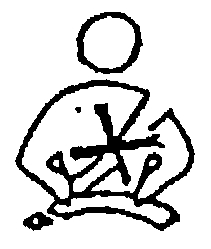

Verkehrsregelnverordnung (VRV) vom 1. August 1978 Aufgrund von Art. 2 Abs. 1 Bst. c und Abs. 2, Art. 8 Abs. 1, 2 und 3, Art. 28 Abs. 1, Art. 29 Abs. 2a und 2b, Art. 38 Abs. 2a, Art. 51 Abs. 4 Bst. a und b, Art. 53 Abs. 1 und 5 sowie Art. 99 Abs. 1, 2 und 3 des Strassenverkehrsgesetzes (SVG) vom 30. Juni 1978, LGBl. 1978 Nr. 18, sowie Art. 15 Abs. 1 Bst. c und Abs. 2 des Umweltschutzgesetzes (USG) vom 29. Mai 2008, LGBl. 2008 Nr. 199, verordnet die Regierung: Einleitung Art. 1 Begriffe und Bezeichnungen 1) Im Sinne dieser Verordnung gelten als: a) "Strassen": von Motorfahrzeugen, motorlosen Fahrzeugen oder Fussgängern benützte Verkehrsflächen; b) "öffentliche Strassen": Strassen, die nicht ausschliesslich privatem Gebrauch dienen; c) "Fahrbahn": dem Fahrverkehr dienender Teil der Strasse; d) "Fahrstreifen": markierte Teile der Fahrbahn, die für die Fortbewegung einer Fahrzeugkolonne Raum bieten (Art. 73 SSV); e) "Radwege": für Radfahrer bestimmte, von der Fahrbahn durch bauliche Massnahmen getrennte und entsprechend signalisierte Wege (Art. 33 Abs. 1 SSV); f) "Radstreifen": für Radfahrer bestimmte Fahrstreifen, die normalerweise durch gelbe unterbrochene oder ausnahmsweise durch ununterbrochene Linien gekennzeichnet sind (Art. 73 Abs. 5 SSV); g) "Verzweigungen": Kreuzungen, Gabelungen oder Einmündungen von Fahrbahnen. Das Zusammentreffen von Rad- oder Feldwegen, von Garage-, Parkplatz-, Fabrik- oder Hofausfahrten und dergleichen mit der Fahrbahn gilt nicht als Verzweigung; h) "Verkehrsregelung": das Anhalten und Freigeben des Verkehrs durch Polizei oder Lichtsignale; i) "fahrzeugähnliche Geräte": Rollschuhe, Inline-Skates, Trottinette oder ähnliche mit Rädern oder Rollen ausgestattete Fortbewegungsmittel, welche ausschliesslich durch die Körperkraft des Benützers angetrieben werden. Kinderräder sind den fahrzeugähnlichen Geräten gleichgestellt; k) Aufgehoben l) Aufgehoben m) "unteilbare Güter": eine Ladung, die für die Zwecke der Beförderung auf der Strasse nicht ohne unverhältnismässig hohe Kosten oder Schadenrisiken in zwei oder mehr Einzelladungen geteilt werden kann und die aufgrund ihrer Abmessung oder ihrem Gewicht nicht von Motorfahrzeugen, Anhängern oder einer Fahrzeugkombinationen, die in jeder Hinsicht den Vorschriften entsprechen, befördert werden kann; n) "unbegleiteter kombinierter Verkehr": die Beförderung von Ladebehältern (Container, Wechselaufbau) oder die Überführung eines Sattelanhängers von oder zu einer beliebigen im LSVA-Abgabengebiet liegenden Umladestation der Bahn bzw. von oder zu einem im LSVA-Abgabengebiet liegenden Hafen, ohne dass das Ladegut beim Übergang vom einen zum anderen Verkehrsträger das Transportgefäss wechselt. Die Regierung kann festlegen, welche in Grenznähe liegenden ausländischen Umladestationen den im LSVA-Abgabengebiet liegenden gleichgestellt sind. 2) Unter den in dieser Verordnung verwendeten Personenbezeichnungen sind alle Personen unabhängig ihres Geschlechts zu verstehen, sofern sich die Personenbezeichnungen nicht ausdrücklich auf ein bestimmtes Geschlecht beziehen. Art. 1a Verweisungen 1) Wird in dieser Verordnung auf EWR-Rechtsvorschriften verwiesen, auf die im EWRA Bezug genommen wird, so beziehen sich diese Verweise auf deren jeweils gültige Fassung, einschliesslich deren Abänderungen und Ergänzungen durch das EWRA. 2) Die Bestimmungen der EWR-Rechtsvorschriften, auf die in dieser Verordnung verwiesen wird, sind unmittelbar anwendbar und allgemein verbindlich. 3) Die gültige Fassung der in Abs. 1 genannten Rechtsvorschriften ergibt sich aus der Kundmachung der Beschlüsse des Gemeinsamen EWR-Ausschusses im Liechtensteinischen Landesgesetzblatt gemäss Art. 3 Bst. k des Kundmachungsgesetzes. 4) Wird in dieser Verordnung auf ECE-Reglemente verwiesen, so findet Art. 3 Abs. 5 und 6 VTS Anwendung. Art. 1b Ziffern bei Bezeichnungen von Signalen und Markierungen Die Ziffern in Klammern nach Bezeichnungen von Signalen und Markierungen beziehen sich auf die Abbildungen in Anhang 1 SSV. I. Teil Regeln für den Fahrverkehr 1. Abschnitt Allgemeine Fahrregeln Art. 2 Zustand des Führers 1) Wer wegen Übermüdung, Einwirkung von Alkohol, Arznei- oder Betäubungsmitteln oder aus einem anderen Grund nicht fahrfähig ist, darf kein Fahrzeug führen. 2) Fahrunfähigkeit wegen Alkoholeinwirkung (Angetrunkenheit) gilt in jedem Fall als erwiesen, wenn der Fahrzeugführer eine Blutalkohol-Konzentration von 0.8 oder mehr Gewichtspromillen aufweist oder eine Alkoholmenge im Körper hat, die zu einer solchen Blutalkohol-Konzentration führt. 2a) Fahrunfähigkeit gilt überdies als erwiesen, wenn im Blut des Fahrzeuglenkers nachgewiesen wird: a) Tetrahydrocannabinol (Cannabis): mindestens 1,5 µg/L; b) freies Morphin (Heroin/Morphin): mindestens 15 µg/L; c) Kokain: mindestens 15 µg/L; d) Amphetamin (Amphetamin): mindestens 15 µg/L; e) Methamphetamin: mindestens 15 µg/L; f) MDEA (Methylendioxyethylamphetamin): mindestens 15 µg/L; oder g) MDMA (Methylendioxymethamphetamin): mindestens 15 µg/L. 2b) Die Regierung erlässt Weisungen über den Nachweis der Substanzen nach Abs. 2 und 2a. 2c) Für Personen, die nachweisen können, dass sie eine oder mehrere der in Abs. 2a aufgeführten Substanzen gemäss ärztlicher Verschreibung einnehmen, gilt Fahrunfähigkeit nicht bereits beim Nachweis einer Substanz nach Abs. 2a als erwiesen. 3) Niemand darf ein Fahrzeug einem Führer überlassen, der nicht fahrfähig ist. 4) Aufgehoben Art. 2a Verbot des Fahrens unter Alkoholeinfluss 1) Das Fahren unter Alkoholeinfluss ist verboten: a) auf Fahrten des konzessionierten oder grenzüberschreitenden Personenverkehrs auf der Strasse; b) im berufsmässigen Personentransport; c) im Gütertransport mit schweren Motorwagen; d) beim Transport gefährlicher Güter mit kennzeichnungspflichtigen Beförderungseinheiten; e) Fahrlehrern während der Berufsausübung; f) Fahrzeugführern auf Lern- und Übungsfahrten; g) Begleitpersonen auf Lernfahrten. 2) Alkoholeinfluss liegt vor, wenn die Person: a) eine Blutalkohol-Konzentration von 0,10 oder mehr Gewichtspromille aufweist; oder b) eine Alkoholmenge im Körper hat, die zu einer Blutalkohol-Konzentration nach Bst. a führt. Art. 3 Bedienung des Fahrzeugs 1) Der Fahrzeugführer muss seine Aufmerksamkeit der Strasse und dem Verkehr zuwenden. Er darf beim Fahren keine Verrichtung vornehmen, welche die Bedienung des Fahrzeugs erschwert. Er hat ferner dafür zu sorgen, dass seine Aufmerksamkeit insbesondere durch Tonwiedergabegeräte sowie Kommunikations- und Informationssysteme nicht beeinträchtigt wird. 2) Die Führer von Gesellschaftswagen dürfen im dichten Verkehr oder auf schwierigen Strassen die Fahrgäste nicht über Sehenswürdigkeiten und dergleichen orientieren. Sie dürfen kein Handmikrophon verwenden. 3) Die Führer von Motorfahrzeugen und Fahrrädern dürfen die Lenkvorrichtung nicht loslassen. 3a) Bei Verwendung eines Einparkassistenzsystems darf der Führer während des Parkierungsmanövers die Lenkvorrichtung loslassen und das Fahrzeug verlassen, sofern das Assistenzsystem dies vorsieht. Er muss das Parkierungsmanöver überwachen und bei Bedarf abbrechen. 4) Der Fahrzeugführer hat den vorgeschriebenen Fahrtschreiber ständig in Betrieb zu halten und richtig zu bedienen. 5) Ist das Fahrzeug mit einem analogen Fahrtschreiber ausgerüstet, so darf ihn der Fahrzeugführer unterwegs zu Kontrollzwecken und muss ihn auf Verlangen der Polizei öffnen. Der Halter hat Schlüssel und Einlageblätter zur Verfügung zu stellen. Jedes Einlageblatt darf nur einmal verwendet werden; freiwillige Vermerke dürfen die Auswertung nicht erschweren. Es müssen genügend leere Einlageblätter mitgeführt werden. 6) Ist das Fahrzeug mit einem digitalen Fahrtschreiber ausgerüstet, so müssen die Fahrerkarten von Führer und Mitfahrer während der gesamten beruflichen Tätigkeit eingesteckt bleiben. Fahrten ohne eingesteckte Fahrerkarte sind zulässig, soweit die Verordnung über die Arbeits-, Lenk- und Ruhezeit der Führer von Motorfahrzeugen zum Güter- und Personentransport (ARV) für diese Fahrten nicht gilt. In diesen Fällen ist das Piktogramm "OUT" zu verwenden. Vorbehalten bleibt Art. 24 Abs. 3 ARV. Art. 4 Tragen von Sicherheitsgurten 1) Bei Fahrzeugen, die mit Sicherheitsgurten ausgerüstet sind, müssen Führer und mitfahrende Personen die vorhandenen Sicherheitsgurte während der Fahrt tragen. Die Fahrzeugführer haben sicherzustellen, dass Kinder unter 14 Jahren ordnungsgemäss gesichert sind. 2) Von der Gurtentragpflicht in Abs. 1 sind ausgenommen: a) Personen, die durch ein ärztliches Zeugnis (Anhang 2) nachweisen, dass ihnen das Tragen der Sicherheitsgurten nicht zugemutet werden kann. Das ärztliche Zeugnis ist stets mitzuführen und auf Verlangen vorzuweisen; b) Von-Haus-zu-Haus-Lieferanten im Auslieferungsquartier, wenn nicht schneller als 25 km/h gefahren wird; c) Führer und Mitfahrer bei Fahrten auf Feld- und Waldwegen und im Werkareal, wenn nicht schneller als 25 km/h gefahren wird; d) Führer beim Manövrieren im Schritttempo; e) Führer und mitfahrende Personen von Motorwagen im regionalen fahrplanmässigen Verkehr konzessionierter Transportunternehmungen (Linien- und Sonderlinienverkehr); f) Begleitpersonen von besonders betreuungsbedürftigen Personen in Fahrzeugen der Sanität und der Behindertenfahrdienste; g) Führer und mitfahrende Personen von Arbeitsmotorwagen, Traktoren und Motorkarren, wenn nicht schneller als 25 km/h gefahren wird. 3) Mitfahrende Personen in Gesellschaftswagen und Kleinbussen sind auf geeignete Art und Weise auf die Gurtentragpflicht aufmerksam zu machen. 4) Auf Plätzen mit Sicherheitsgurten muss für Kinder unter 14 Jahren eine geeignete Kinderrückhaltevorrichtung, zum Beispiel ein Kindersitz, verwendet werden, die nach dem UNECE-Reglement Nr. 44 oder Nr. 129 gemäss Anhang 1 VTS zugelassen ist. Keine Kinderrückhaltevorrichtung muss verwendet werden: a) für Kinder, die mindestens 150 cm gross sind; b) für Kinder ab vier Jahren auf speziell für Kinder zugelassenen Sitzplätzen; c) für Kinder ab vier Jahren in Gesellschaftswagen; d) für Kinder ab sieben Jahren auf Sitzplätzen mit Beckengurten. 5) Aufgehoben 6) Aufgehoben 7) Aufgehoben Art. 4a Tragen von Schutzhelmen 1) Die Führer und Mitfahrer von Motorrädern mit oder ohne Seitenwagen, von Leicht-, Klein- und dreirädrigen Motorfahrzeugen sowie die Führer von Motorfahrrädern müssen während der Fahrt Schutzhelme tragen. Die Fahrzeugführer haben sicherzustellen, dass mitfahrende Kinder unter 14 Jahren einen Schutzhelm tragen. 2) Von der Helmtragpflicht sind ausgenommen: a) Von-Haus-zu-Haus-Lieferanten im Auslieferungsquartier, wenn nicht schneller als 25 km/h gefahren wird; b) Personen bei Fahrten im Werkareal, wenn nicht schneller als 25 km/h gefahren wird; c) Personen in geschlossenen Kabinen; d) Personen auf Sitzen, die mit Sicherheitsgurten versehen sind; e) Personen auf Fahrzeugen mit einer bauartbedingten Höchstgeschwindigkeit bis 20 km/h; f) Führer von Motorfahrrädern, die durch ein ärztliches Zeugnis nachweisen, dass ihnen das Tragen eines Schutzhelmes nicht zugemutet werden kann; g) Personen auf Motorfahrrädern mit elektrischem Antrieb, der bis höchstens 25 km/h wirkt; h) Führer von motorisierten Rollstühlen. 3) Auf Motorrädern mit oder ohne Seitenwagen, auf Leicht-, Klein- und dreirädrigen Motorfahrzeugen und auf Motorfahrrädern ist ein Schutzhelm zu tragen, der nach dem UNECE-Reglement Nr. 22 in den Fassungen nach Anhang 1 VTS oder nach einer früheren in der VTS aufgeführten Fassung dieses Reglements geprüft ist. Auf Raupenfahrzeugen genügt ein Helm, der nach der Norm SN EN 1077 oder SN EN 1078 geprüft ist, auf Motorfahrrädern ein Fahrradhelm, der nach der Norm SN EN 1078 geprüft ist. Art. 5 Angemessene Geschwindigkeit 1) Der Fahrzeugführer darf nur so schnell fahren, dass er innerhalb der überblickbaren Strecke halten kann; wo das Kreuzen schwierig ist, muss er auf halbe Sichtweite halten können. 2) Aufgehoben 3) Aufgehoben 4) Aufgehoben 5) Der Fahrzeugführer darf ohne zwingende Gründe nicht so langsam fahren, dass er einen gleichmässigen Verkehrsfluss hindert. Art. 6 Allgemeine Höchstgeschwindigkeiten; Grundregel 1) Die allgemeine Höchstgeschwindigkeit für Fahrzeuge beträgt unter günstigen Strassen-, Verkehrs- und Sichtverhältnissen: a) in Ortschaften 50 km/h; b) ausserhalb von Ortschaften 80 km/h. 2) Die allgemeine Höchstgeschwindigkeit von 50 km/h (Abs. 1 Bst. a) gilt im ganzen dichtbebauten Gebiet der Ortschaft; sie beginnt beim Signal "Höchstgeschwindigkeit 50 generell" (2.30.1) und endet beim Signal "Ende der Höchstgeschwindigkeit 50 generell" (2.53.1). Für Fahrzeugführer, die aus unbedeutenden Nebenstrassen (wie Strassen, die nicht Ortschaften oder Ortsteile direkt verbinden, landwirtschaftliche Erschliessungsstrassen, Waldwege u. dgl.) in eine Ortschaft einfahren, gilt sie auch ohne Signalisation, sobald die dichte Überbauung beginnt. 3) Die allgemeine Höchstgeschwindigkeit von 80 km/h (Abs. 1 Bst. b) gilt ab dem Signal "Ende der Höchstgeschwindigkeit generell" (2.53.1) oder "Ende der Höchstgeschwindigkeit" (2.53). 4) Abweichende signalisierte Höchstgeschwindigkeiten gehen den allgemeinen Höchstgeschwindigkeiten (Abs. 1) vor, ebenso niedrigere Höchstgeschwindigkeiten für einzelne Fahrzeugarten nach Art. 7 und für einzelne Fahrzeuge nach Anordnung des Amts für Strassenverkehr. Art. 7 Höchstgeschwindigkeit für einzelne Fahrzeugarten 1) Die Höchstgeschwindigkeit beträgt: a) 80 km/h für: 1. schwere Motorwagen, ausgenommen schwere Personenwagen; 2. Anhängerzüge; 3. Sattelmotorfahrzeuge; 4. Fahrzeuge mit Spikesreifen; b) 60 km/h für gewerbliche Traktoren; c) 40 km/h beim: 1. Abschleppen von Fahrzeugen, auch mittels Abschlepprolli oder aufgesattelt; das Amt für Strassenverkehr kann in besonderen Fällen höhere Schleppgeschwindigkeiten gestatten, namentlich für feste Abschleppvorrichtungen, welche die Lenkung des geschleppten Fahrzeuges gewährleisten; 2. Nachziehen eines leeren Abschlepprollis; das Amt für Strassenverkehr kann in besonderen Fällen höhere Geschwindigkeiten gestatten; d) 30 km/h: 1. beim Mitführen von land- und forstwirtschaftlichen Anhängern, die nicht immatrikuliert sind; 2. beim Mitführen von immatrikulierten land- und forstwirtschaftlichen Anhängern, sofern deren Fahrzeugausweis keine höhere Geschwindigkeit zulässt; 3. für Fahrzeuge mit Metall- oder Vollgummireifen. 2) Die vorstehenden Höchstgeschwindigkeiten dürfen auch nicht überschritten werden, wo eine höhere Geschwindigkeitsgrenze signalisiert ist. 3) Wenn ein Führer die für die Kategorieeinteilung seines Fahrzeugs massgebende Höchstgeschwindigkeit überschreitet, verletzt er eine Verkehrsregel; dies gilt nicht für die Führer von Motorfahrrädern. Art. 8 Verhalten gegenüber Fussgängern und Benützern von fahrzeugähnlichen Geräten 1) Vor Fussgängerstreifen ohne Verkehrsregelung muss der Fahrzeugführer jedem Fussgänger oder Benützer eines fahrzeugähnlichen Gerätes, der sich bereits auf dem Streifen befindet oder davor wartet und ersichtlich die Fahrbahn überqueren will, den Vortritt gewähren. Er muss die Geschwindigkeit rechtzeitig mässigen und nötigenfalls anhalten, dass er dieser Pflicht nachkommen kann. 2) Bei Verzweigungen mit Verkehrsregelung haben abbiegende Fahrzeugführer den Fussgängern oder Benützern von fahrzeugähnlichen Geräten für das Überqueren der Querstrasse den Vortritt zu lassen. Dies gilt bei Lichtsignalen nicht, wenn die Fahrt durch einen grünen Pfeil freigegeben wird und kein gelbes Warnlicht blinkt. 3) Auf Strassen ohne Fussgängerstreifen hat der Fahrzeugführer im Kolonnenverkehr nötigenfalls zu halten, wenn Fussgänger oder Benützer von fahrzeugähnlichen Geräten darauf warten, die Fahrbahn zu überqueren. 4) Unbegleiteten Blinden ist der Vortritt stets zu gewähren, wenn sie durch Hochhalten des weissen Stockes anzeigen, dass sie die Fahrbahn überqueren wollen. 5) Die Führer dürfen gekennzeichnete Schulbusse, die halten und die Warnblinklichter eingeschaltet haben, nur langsam und besonders vorsichtig überholen; nötigenfalls müssen sie halten. 2. Abschnitt Einzelne Verkehrsvorgänge Art. 9 Aufgehoben Art. 10 Fahrstreifen, Kolonnenverkehr, Reissverschlussverkehr 1) Auf Strassen mit mehreren Fahrstreifen in der gleichen Richtung ist der äusserste Streifen rechts zu benützen. Dies gilt nicht beim Überholen, Einspuren, Fahren in parallelen Kolonnen sowie innerorts. 2) Das Fahren in parallelen Kolonnen ist bei dichtem Verkehr gestattet, wenn die rechte Fahrbahnhälfte dafür genügend Raum bietet. Mit langsamen Fahrzeugen ist in der äussersten Kolonne rechts zu fahren. 3) Beim Fahren in parallelen Kolonnen sowie innerorts auf Strassen mit mehreren Fahrstreifen in der gleichen Richtung ist das Rechtsvorbeifahren an andern Fahrzeugen gestattet, sofern diese nicht halten, um Fussgängern oder Benützern von fahrzeugähnlichen Geräten den Vortritt zu lassen. Das Rechtsüberholen durch Ausschwenken und Wiedereinbiegen ist jedoch untersagt. 4) Benützen mehrspurige Motorfahrzeuge und Radfahrer denselben Fahrstreifen, so müssen die Motorfahrzeuge links, die Radfahrer rechts fahren. Radfahrer können vom Gebot des Rechtsfahrens abweichen: a) auf Fahrstreifen, die das Linksabbiegen gestatten; b) auf Rechtsabbiegestreifen, auf denen die Fahrräder gemäss der Markierung (Art. 73a Abs. 7 Bst. e SSV) entgegen dem allgemeinen Verkehr geradeaus fahren dürfen. 5) Ist auf Strassen mit mehreren Fahrstreifen in eine Richtung das durchgehende Befahren eines Fahrstreifens nicht möglich oder endet ein Fahrstreifen, so ist unmittelbar vor Beginn der Verengung den am Weiterfahren gehinderten Fahrzeugen abwechslungsweise der Übergang auf den benachbarten Fahrstreifen zu ermöglichen. Art. 11 Kreuzen 1) Der Fahrzeugführer hat dem Gegenverkehr den Vortritt zu lassen, wenn das Kreuzen durch ein Hindernis auf seiner Fahrbahnhälfte erschwert wird. 2) Ist auf schmaler Strasse das Kreuzen nicht möglich, so haben Anhängerzüge den Vortritt vor anderen Fahrzeugen, schwere Motorfahrzeuge vor leichten und Gesellschaftswagen vor Lastwagen. Unter gleichartigen Fahrzeugen muss jenes zurückfahren, das sich näher bei einer Ausweichstelle befindet; für das Kreuzen auf steilen Strassen und Bergstrassen gilt Art. 37 Abs. 1 Satz 1. Art. 12 Überholen im allgemeinen 1) Der Fahrzeugführer, der überholen will, muss vorsichtig ausschwenken und darf nachfolgende Fahrzeuge nicht behindern. Er darf nicht überholen, wenn sich vor dem voranfahrenden Fahrzeug Hindernisse befinden, wie Baustellen, eingespurte Fahrzeuge oder Fussgänger, welche die Strasse überqueren. 2) Nach dem Überholen hat der Fahrzeugführer wieder einzubiegen, sobald für den überholten Strassenbenützer keine Gefahr mehr besteht. 3) Die Führer schwerer Motorwagen haben ausserorts den schnelleren Motorfahrzeugen das Überholen angemessen zu erleichtern, indem sie ganz rechts fahren, unter sich einen Abstand von wenigstens 100 m wahren und nötigenfalls auf Ausweichplätzen halten. Dies gilt auch für andere Motorfahrzeuge, wenn sie langsam fahren. Art. 13 Überholen in besonderen Fällen 1) Der Fahrzeugführer darf kein Fahrzeug überholen, das ein anderes Fahrzeug überholt, ausser wenn beide überholten Fahrzeuge nicht breiter als je ein Meter sind und die Strasse breit und übersichtlich ist. 2) Wenn die Benützer der eigenen Fahrbahnhälfte nicht behindert werden, darf rechts von Sicherheitslinien auch in Kurven und vor Kuppen überholt werden. Auf Bahnübergängen ohne Schranken darf der Fahrzeugführer niemanden überholen, ausgenommen Fussgänger, Benützer von fahrzeugähnlichen Geräten und Radfahrer bei guter Übersicht. 3) Im Bereich von Strassenverzweigungen, wo der Fahrzeugführer die einmündenden Strassen nicht überblicken kann, darf er nur überholen, wenn er sich auf einer Strasse mit Vortrittsrecht befindet oder der Verkehr durch Polizei oder Lichtsignale geregelt wird. Art. 14 Hintereinanderfahren 1) Der Fahrzeugführer hat beim Hintereinanderfahren einen ausreichenden Abstand zu wahren, so dass er auch bei überraschendem Bremsen des voranfahrenden Fahrzeugs rechtzeitig halten kann. 2) Brüskes Bremsen und Halten sind nur gestattet, wenn kein Fahrzeug folgt und im Notfall. 3) Stockt der Verkehr, so darf der Fahrzeugführer nicht auf Fussgängerstreifen und, bei Strassenverzweigungen, nicht auf der Fahrbahn für den Querverkehr halten. Art. 15 Einspuren und Abbiegen 1) Die Fahrzeugführer müssen beim Abbiegen frühzeitig einspuren. Dies gilt auch beim Abbiegen ausserhalb von Strassenverzweigungen und, soweit möglich, auf schmalen Strassen. 2) Beim Einspuren nach links darf der Fahrzeugführer den für den Gegenverkehr bestimmten Raum nicht beanspruchen. 3) Das Wechseln auf andere Fahrstreifen zum Überholen ist auf Einspurstrecken untersagt, ausgenommen auf Fahrstreifen, die mit den gleichen Fahrzielen bezeichnet sind. 4) Der Fahrzeugführer darf beim Abbiegen nach links auf Strassenverzweigungen die Kurve nicht schneiden. Fahrzeuge aus entgegengesetzten Richtungen, die beide auf einer Kreuzung nach links abbiegen wollen, haben sich links zu kreuzen. 5) Muss der Fahrzeugführer wegen der Grösse seines Fahrzeugs oder der örtlichen Verhältnisse vor dem Abbiegen nach der Gegenseite ausholen, so hat er besonders vorsichtig zu fahren und nötigenfalls zu halten. 6) Befördern Motorfahrzeuge oder ihre Anhänger sichthemmende Ladungen, ist beim Einspuren und Abbiegen besondere Vorsicht geboten. Nötigenfalls ist eine Hilfsperson beizuziehen, die das Fahrmanöver überwacht. Art. 16 Ausübung des Vortritts 1) Wer zur Gewährung des Vortritts verpflichtet ist, darf den Vortrittsberechtigten in seiner Fahrt nicht behindern. Er hat seine Geschwindigkeit frühzeitig zu mässigen und, wenn er warten muss, vor Beginn der Verzweigung zu halten. 2) Der Vortrittsberechtigte hat auf Strassenbenützer Rücksicht zu nehmen, welche die Strassenverzweigungen erreichten, bevor sie ihn erblicken konnten. 3) Dem vortrittsberechtigten Verkehr in parallelen Kolonnen ist der Vortritt auch zu lassen, wenn die nähere Kolonne stillsteht. 4) Reiter sowie Führer von Pferden und andern grösseren Tieren sind den Motorfahrzeugführern beim Vortritt gleichgestellt. 5) In nicht geregelten Fällen, zum Beispiel wenn auf einer Verzweigung zugleich aus allen Richtungen Fahrzeuge eintreffen, haben die Führer besonders vorsichtig zu fahren und sich über den Vortritt zu verständigen. Art. 17 Besondere Fälle des Vortritts 1) Ändert die Hauptstrasse die Richtung und münden zugleich Nebenstrassen ein, so hat der Fahrzeugführer, der aus der Hauptstrasse in eine Nebenstrasse fährt, nur dem Gegenverkehr auf der Hauptstrasse den Vortritt zu lassen. 2) Münden am gleichen Ort zwei oder mehr Strassen mit dem Signal "Stop" (3.01) oder "Kein Vortritt" (3.02) in eine Strasse mit Vortrittsrecht ein, so haben die Benützer der einmündenden Strassen unter sich den Rechtsvortritt zu beachten. 3) Wer aus Fabrik-, Hof- und Garageausfahrten, aus Feldwegen, Radwegen, Parkplätzen, Tankstellen und dergleichen oder über ein Trottoir auf eine Haupt- oder Nebenstrasse fährt, muss den Benützern dieser Strassen den Vortritt gewähren. Ist die Stelle unübersichtlich, so muss der Fahrzeugführer anhalten; wenn nötig, muss er eine Hilfsperson beiziehen, die das Fahrmanöver überwacht. Art. 18 Vortrittsberechtigte Fahrzeuge 1) Den Fahrzeugen der Feuerwehr, Sanität, Polizei und des Zolls, die sich durch Blaulicht und Wechselklanghorn ankündigen, müssen alle Strassenbenützer den Vortritt lassen, auch bei Verkehrsregelung durch Lichtsignale. 2) Wenn es zur sofortigen Freigabe der Fahrbahn unerlässlich ist, müssen die Fahrzeugführer mit der gebotenen Vorsicht auf das Trottoir ausweichen. 3) Blaulicht und Wechselklanghorn dürfen nur gebraucht werden, solange die Dienstfahrt dringlich ist und die Verkehrsregeln nicht eingehalten werden können. 4) Bei nächtlichen dringlichen Dienstfahrten darf das Blaulicht ohne Wechselklanghorn verwendet werden, solange der Fahrzeugführer nicht wesentlich von den Verkehrsregeln abweicht und sein besonderes Vortrittsrecht nicht beansprucht. Art. 18a Aufgehoben Art. 19 Wegfahren, Rückwärtsfahren, Wenden 1) Der Fahrzeugführer hat sich vor dem Wegfahren zu vergewissern, dass er keine Kinder oder andere Strassenbenützer gefährdet. Bei Fahrzeugen mit beschränkter Sicht nach hinten ist zum Rückwärtsfahren eine Hilfsperson beizuziehen, wenn nicht jede Gefahr ausgeschlossen ist. 2) Rückwärts darf nur im Schrittempo gefahren werden. Das Rückwärtsfahren über Bahnübergänge und unübersichtliche Strassenverzweigungen ist untersagt. 3) Über längere Strecken ist das Rückwärtsfahren nur zulässig, wenn das Weiterfahren oder Wenden nicht möglich ist. 4) Der Führer vermeidet es, das Fahrzeug auf der Fahrbahn zu wenden. An unübersichtlichen Stellen und bei dichtem Verkehr ist das Wenden untersagt. 5) Kündigt der Führer eines Busses im Linienverkehr innerorts bei einer gekennzeichneten Haltestelle mit den Richtungsblinkern an, dass er wegfahren will, so müssen die von hinten herannahenden Fahrzeugführer nötigenfalls die Geschwindigkeit mässigen oder halten, um ihm die Wegfahrt zu ermöglichen; dies gilt nicht, wenn sich die Haltestelle am linken Fahrbahnrand befindet. Der Busführer darf die Richtungsblinker erst betätigen, wenn er zur Wegfahrt bereit ist; er muss warten, wenn von hinten herannahende Fahrzeuge nicht rechtzeitig halten könnten. Art. 20 Halten 1) Fahrzeugführer haben nach Möglichkeit ausserhalb der Strasse zu halten. Auf der Fahrbahn halten sie nur am Rand und parallel dazu. Das Halten auf der linken Strassenseite ist nur zulässig, wenn rechts ein Halte- oder Parkverbot signalisiert oder markiert ist, in schmalen Strassen mit schwachem Verkehr und in Einbahnstrassen. 2) Das freiwillige Halten ist untersagt: a) an unübersichtlichen Stellen, namentlich im Bereich von Kurven und Kuppen; b) in Engpässen und neben Hindernissen in der Fahrbahn; c) auf Einspurstrecken sowie neben Sicherheitslinien, ununterbrochenen Längslinien und Doppellinien, wenn nicht eine wenigstens 3 m breite Durchfahrt frei bleibt; d) auf Strassenverzweigungen sowie vor und nach Strassenverzweigungen näher als 5 m von der Querfahrbahn; e) auf und seitlich angrenzend an Fussgängerstreifen sowie, wo keine Halteverbotslinie angebracht ist, näher als 5 m vor dem Fussgängerstreifen auf der Fahrbahn und dem angrenzenden Trottoir; f) auf Bahnübergängen und in Unterführungen; g) vor Signalen, wenn sie verdeckt würden. 3) Näher als 10 m vor und nach Haltestelltafeln öffentlicher Verkehrsbetriebe sowie vor Feuerwehrlokalen und Löschgerätemagazinen ist das Halten nur zum Ein- und Aussteigenlassen von Personen erlaubt; öffentliche Verkehrsmittel und Feuerwehr dürfen nicht behindert werden. 4) Das Halten zum Güterumschlag neben Fahrzeugen, die längs des Strassenrandes parkiert sind, ist nur zulässig, wenn der Verkehr nicht behindert wird. Parkierten Wagen ist die Wegfahrt auf Verlangen unverzüglich zu gestatten. Art. 21 Parkieren im allgemeinen 1) Parkieren ist das Abstellen des Fahrzeugs, das nicht bloss dem Ein- und Aussteigenlassen von Personen oder dem Güterumschlag dient. 2) Das Parkieren ist untersagt: a) wo das Halten verboten ist; b) auf Hauptstrassen ausserorts; c) auf Hauptstrassen innerorts, wenn für das Kreuzen von zwei Motorwagen nicht genügend Raum bliebe; d) auf Radstreifen und auf der Fahrbahn neben solchen Streifen; e) näher als 20 m bei Bahnübergängen; f) auf Brücken; g) vor Zufahrten zu fremden Gebäuden oder Grundstücken. 3) In schmalen Strassen dürfen Fahrzeuge nur auf einer Seite parkiert werden, wenn sonst die Vorbeifahrt anderer Fahrzeuge erschwert würde. 4) Es ist platzsparend zu parkieren, doch darf die Wegfahrt anderer Fahrzeuge nicht behindert werden. Art. 22 Parkieren in besonderen Fällen 1) Fahrzeuge ohne die vorgeschriebenen Kontrollschilder dürfen nicht auf öffentlichen Strassen oder Parkplätzen abgestellt werden; ausgenommen sind öffentliche Parkplätze privater Eigentümer, wenn diese das Abstellen gestatten. In besonderen Fällen kann die Regierung Ausnahmen bewilligen. 2) Wer sein Fahrzeug auf öffentlichen Strassen und Parkplätzen des Landes bzw. der Gemeinden nachts regelmässig an gleicher Stelle parkiert, bedarf einer Bewilligung der Regierung bzw. einer Bewilligung der betreffenden Gemeinde, sofern sie auf dieses Erfordernis nicht verzichten. 3) Aufgehoben Art. 22a Parkieren über Nacht sowie an Sonn- und Feiertagen 1) Ausserhalb von dafür besonders signalisierten oder markierten Parkplätzen ist das Parkieren über Nacht sowie an Sonn- und Feiertagen auf öffentlichen Strassen und Parkplätzen für schwere Motorwagen zur Güterbeförderung mit mehr als 3 500 kg Gesamtgewicht, Normalanhänger, Langmaterialanhänger, Arbeitsanhänger und Sattelanhänger zum Sachentransport mit einem zulässigen Gesamtgewicht von mehr als 3 500 kg verboten. 2) In begründeten Fällen kann die Landespolizei Ausnahmen von Abs. 1 bewilligen. Art. 22b Parkierungserleichterungen für gehbehinderte Personen 1) Gehbehinderte Personen und Personen, die sie transportieren, können die folgenden Parkierungserleichterungen in Anspruch nehmen, wenn sie über eine "Parkkarte für behinderte Personen" (Anhang 1a Ziff. 2 SSV) verfügen: a) an Stellen, die mit einem Parkverbot signalisiert oder markiert sind, höchstens drei Stunden parkieren; Parkierungsbeschränkungen nach Art. 21 Abs. 2 bis 4 sind in jedem Fall zu beachten; b) auf Parkplätzen zeitlich unbeschränkt parkieren; c) in Begegnungszonen auch ausserhalb der durch entsprechende Signale oder Markierungen gekennzeichneten Stellen höchstens zwei Stunden parkieren; in Fussgängerzonen gilt dieselbe Berechtigung, falls ausnahmsweise das Befahren der Zone erlaubt ist. 2) Die Parkierungserleichterungen können nur beansprucht werden: a) wenn der übrige Verkehr weder gefährdet noch unnötig behindert wird; b) wenn in der unmittelbaren Nähe keine zur zeitlich unbeschränkten allgemeinen Benutzung offen stehenden Parkplätze frei sind; c) wenn und solange der Fahrzeugführer, sofern er nicht selber gehbehindert ist, gehbehinderte Personen transportiert und begleitet. 3) Die Parkierungserleichterungen gelten nicht auf privat bewirtschafteten Parkflächen. 4) Die Parkkarte für behinderte Personen ist gut sichtbar hinter der Frontscheibe des Fahrzeugs anzubringen. 5) Eine Parkkarte wird ausgestellt für Personen, die mittels ärztlichem Zeugnis eine erhebliche Gehbehinderung nachweisen, und für Halter von Fahrzeugen, die nachweislich für den häufigen Transport von erheblich gehbehinderten Personen eingesetzt werden. Die Parkkarte wird durch das Amt für Strassenverkehr erteilt. Art. 23 Ein- und Aussteigen; Güterumschlag 1) Strassenbenützer dürfen durch das Ein- und Aussteigen nicht gefährdet werden; beim Öffnen der Türen ist besonders auf den Verkehr von hinten zu achten. 2) Können Fahrzeuge zum Güterumschlag nicht ausserhalb der Strasse oder abseits vom Verkehr halten, so ist die Behinderung anderer Strassenbenützer möglichst zu vermeiden und die Ladetätigkeit ohne Verzug zu beenden. 3) Muss ein Fahrzeug zum Güterumschlag halten, wo es den Verkehr gefährden könnte, z. B. auf kurvenreicher Bergstrasse, so sind Pannensignale oder Warnposten aufzustellen. Art. 24 Sichern des Fahrzeugs 1) Der Führer hat den Motor abzustellen, wenn er das Fahrzeug verlässt. Bevor er sich entfernt, muss er es gegen das Wegrollen und gegen die Verwendung durch Unbefugte sichern. 2) Im Gefälle ist die Bremse anzuziehen und eine weitere wirksame Sicherung gegen das Wegrollen zu treffen, wie Einschalten des niedrigsten Ganges oder Ablenken der Räder gegen ein Hindernis am Fahrbahnrand. 3) In starken Gefällen sind die Wagen ausserdem durch Unterlegkeile oder behelfsmässige Unterlagen zu sichern. Bei schweren Motorwagen, Anhängerzügen und losgelösten Anhängern sind auch in leichteren Gefällen Unterlegkeile anzubringen. Die Unterlagen sind vor der Wegfahrt von der Strasse zu entfernen. Art. 25 Verwendung von Pannensignal und Warnblinklichtern 1) Das vorgeschriebene Pannensignal (Art. 90 Abs. 2 VTS) muss im Fahrzeug leicht erreichbar sein. 2) Das Pannensignal ist am Fahrbahnrand aufzustellen, sobald ein Fahrzeug aus zwingenden Gründen vorschriftswidrig auf der Fahrbahn abgestellt wird. Es muss mindestens 50 m, auf Strassen mit schnellem Verkehr mindestens 100 m hinter dem Fahrzeug aufgestellt werden. Beim Nothalt auf signalisierten Abstellplätzen für Pannenfahrzeuge (4.16) muss das Pannensignal nicht aufgestellt werden. 3) Warnblinklichter (Art. 110 Abs. 1 Bst. g VTS) dürfen nur zur Warnung vor Gefahren wie folgt verwendet werden: a) am stehenden Fahrzeug zusätzlich zum Pannensignal sowie am gekennzeichneten Schulbus beim Ein- und Aussteigenlassen der Schüler (Art. 8 Abs. 5); b) am fahrenden Fahrzeug, namentlich vor einer unvermutet auftauchenden Unfallstelle oder bei einem Fahrzeugstau. 4) Aufgehoben 5) Aufgehoben 6) Das Pannensignal ist auch an der Rückseite abgeschleppter Fahrzeuge anzubringen. Art. 26 Verhalten bei Bahnübergängen und Schranken 1) Aufgehoben 2) Beim Überqueren von Bahnübergängen ist jede Verzögerung zu vermeiden; Fahrzeuge mit Reifen oder Raupen aus Metall sowie Tierfuhrwerke und Reiter dürfen den Übergang nur im Schritttempo überqueren. 3) Die Strassenbenützer dürfen Schranken, auch solche bei Flugplätzen und dergleichen, nicht öffnen, umfahren, umgehen, übersteigen oder unter ihnen durchgehen. Den Schranken sind die Halbschranken und Bedarfsschranken gleichgestellt, wobei Bedarfsschranken mit der vorgesehenen Bedienung geöffnet werden dürfen. 4) Aufgehoben Art. 27 Aufgehoben Art. 28 Lernfahrten 1) Solange Motorfahrzeuge von Inhabern eines Lernfahrausweises geführt werden, müssen sie eine blaue Tafel mit weissem "L" tragen. Die Tafel muss so angebracht sein, dass sie von hinten gut erkennbar ist. Sie ist zu entfernen, wenn keine Lernfahrt stattfindet. 2) Auf Lern- und Prüfungsfahrten mit Motorwagen muss der Begleiter neben dem Führer Platz nehmen, ausgenommen auf Übungsplätzen, beim Rückwärtsfahren oder beim Parkieren. Der Begleiter muss wenigstens die Handbremse leicht erreichen können, ausgenommen auf Lernfahrten mit Motorwagen der Kategorie C, sofern der Fahrzeugführer prüfungsreif ist. 3) Der Inhaber eines Lernfahrausweises darf keine Passagiere mitführen, die nicht selber über den entsprechenden Führerausweis verfügen: a) auf Motorrädern; b) auf oder in Motorfahrzeugen ohne Anhänger, mit denen er Lernfahrten ohne Begleitperson ausführen darf. 4) Fahrschüler dürfen verkehrsreiche Strassen erst befahren, wenn sie genügend ausgebildet sind. 5) Auf verkehrsreichen Strassen sind Anfahren in Steigungen, Wenden, Rückwärtsfahren und ähnliche Übungen untersagt, in Wohngebieten sind sie möglichst zu vermeiden. 6) Auf Lern- und Prüfungsfahrten darf auch dann über längere Strecken rückwärts gefahren werden, wenn das Weiterfahren oder Wenden möglich ist. 3. Abschnitt Sicherungsvorkehren Art. 29 Zeichengebung 1) Der Fahrzeugführer hat alle Richtungsänderungen anzukündigen, auch das Abbiegen nach rechts. Selbst der Radfahrer, der zum Überholen eines andern ausschwenkt, hat dies anzuzeigen. 2) Die Zeichengebung ist nach der Richtungsänderung unverzüglich einzustellen. Radfahrer können die Zeichengebung bereits während der Richtungsänderung einstellen. 3) Hat ein Fahrzeug keine Richtungsanzeiger oder sind sie nicht wirksam, so zeigt der Führer oder ein Mitfahrer mit dem Arm nach der einzuschlagenden Richtung. Ist dies nicht möglich, so muss er besonders vorsichtig abschwenken. 4) Befördern Motorkarren, Arbeitskarren, land- und forstwirtschaftliche Motorfahrzeuge oder ihre Anhänger sichthemmende Ladungen, so hat der Führer eine Winkkelle (Anhang 3 VTS) zu verwenden, sofern nicht das Fahrzeug mit einem besonderen Anzeigegerät versehen ist, mit dem der Führer gleichzeitig nach hinten blicken und das Abschwenken nach links anzeigen kann, oder am Ende des Zuges keine Richtungsblinker vorhanden und diejenigen des Zugfahrzeuges nicht sichtbar sind. Durch Kelle oder Anzeigegerät dürfen andere Strassenbenützer nicht gefährdet werden. Art. 30 Warnsignale 1) Der Fahrzeugführer hat sich so zu verhalten, dass akustische Warnsignale oder Lichtsignale möglichst nicht notwendig sind. Er darf solche Signale nur geben, wo die Sicherheit des Verkehrs es erfordert; dies gilt auch für Gefahrenlichter (Art. 109 Abs. 6 und 110 Abs. 3 Bst. b VTS). 2) Der Fahrzeugführer hat akustische Warnsignale zu geben, wenn Kinder im Bereich der Strasse nicht auf den Verkehr achten und vor unübersichtlichen, engen Kurven ausserorts. 3) Nach Eintritt der Dunkelheit dürfen nur Lichtsignale gegeben werden. Akustische Warnsignale sind nur in Notfällen zulässig. Art. 31 Verwendung der Lichter während der Fahrt 1) Vom Beginn der Abenddämmerung bis zur Tageshelle, bei schlechten Sichtverhältnissen und in Tunneln sind während der Fahrt die Abblendlichter zu verwenden. Bei Fahrzeugen ohne Abblendlicht sind die für die entsprechende Fahrzeugart vorgeschriebenen Lichter zu verwenden. 2) Im Übrigen sind bei Motorfahrzeugen die Tagfahrlichter oder die Abblendlichter und bei Motorfahrzeugen ohne solche Lichter die für die entsprechende Fahrzeugart vorgeschriebenen Lichter zu verwenden. Ausgenommen sind: a) Motorfahrzeuge, die von einer zu Fuss gehenden Person geführt werden; b) Motorfahrzeuge mit einer Höchstgeschwindigkeit bis 10 km/h; c) Motorfahrzeuge, die vor dem 1. Januar 1970 erstmals zum Verkehr zugelassen wurden. 3) Bei Bedarf können die Fernlichter verwendet werden; in Ortschaften ist jedoch nach Möglichkeit darauf zu verzichten. Die Fernlichter sind auszuschalten: a) rechtzeitig vor dem Kreuzen mit anderen Strassenbenützern oder einer neben der Strasse entgegenkommenden Bahn; b) beim Hintereinanderfahren oder beim Rückwärtsfahren. 4) Nebellichter und Nebelschlusslichter dürfen nur verwendet werden, wenn die Sicht wegen Nebels, Schneetreibens oder starken Regens erheblich eingeschränkt ist. 5) Bei längerem Halten kann auf die Standlichter umgeschaltet werden. Art. 32 Verwendung der Lichter an abgestellten Fahrzeugen 1) An ausserorts abgestellten mehrspurigen Fahrzeugen sind die Standlichter oder die Parklichter auf der Seite des Verkehrs zu verwenden. Bei Fahrzeugen ohne derartige Lichter sind die für die entsprechende Fahrzeugart vorgeschriebenen Lichter zu verwenden. 2) Bei mehrspurigen nicht motorisierten Fahrzeugen ist ein von vorn und hinten sichtbares, nicht blendendes gelbes Licht auf der Seite des Verkehrs ausreichend. 3) Innerorts und an Fahrzeugen mit einer Breite bis 1,00 m sind Rückstrahler ausreichend. Art. 33 Beleuchtung von Anhängern und geschleppten Fahrzeugen sowie Verwendung von Arbeitslichtern und Suchlampen 1) Anhänger und geschleppte Fahrzeuge sind gleichzeitig mit dem Zugfahrzeug zu beleuchten, ausser wenn am Zugfahrzeug nur Tagfahrlichter verwendet werden. Bei mehreren Anhängern eines Zugs müssen rückwärtige Lichter nur am letzten Anhänger brennen. 2) Arbeitslichter und Suchlampen dürfen verwendet werden, soweit sie für die entsprechende Tätigkeit unerlässlich sind. Art. 34 Vermeiden von Lärm Fahrzeugführer, Mitfahrende und Hilfspersonen dürfen keinen vermeidbaren Lärm erzeugen. Untersagt sind vor allem: a) unnötiges Vorwärmen und Laufenlassen des Motors stillstehender Fahrzeuge; b) hohe Drehzahlen des Motors im Leerlauf oder beim Fahren in niedrigen Gängen; c) zu schnelles Beschleunigen des Fahrzeugs, namentlich beim Anfahren; d) fortgesetztes unnötiges Herumfahren in Ortschaften; e) Verursachen von vermeidbarem Lärm der Auspuffanlage, insbesondere das Erzeugen von Knallgeräuschen durch Schalten oder abrupte Gaswegnahme; f) unsorgfältiges Beladen und Entladen von Fahrzeugen; g) Zuschlagen von Wagentüren, Motorhauben, Kofferdeckeln und dergleichen; h) Störungen durch Tonwiedergabegeräte, die im Fahrzeug eingebaut sind oder mitgeführt werden. Art. 35 Vermeiden anderer Belästigungen 1) Motorfahrzeuge sind so zu unterhalten und zu benützen, dass sie keinen vermeidbaren Rauch entwickeln. 2) Der Motor ist auch bei kürzeren Halten abzustellen, wenn dies das Wegfahren nicht verzögert. 3) Der Fahrzeugführer hat auf staubigen, schmutzigen oder nassen Strassen, besonders bei Schneeschmelze, so zu fahren, dass Strassenbenützer und Anwohner nicht belästigt werden. 4. Abschnitt Besondere Strassenverhältnisse Art. 36 Einbahnstrassen 1) Einbahnstrassen sind der rechten Hälfte einer für den Verkehr in beiden Richtungen offenen Strasse gleichgestellt. 2) An Verkehrsinseln und Hindernissen darf rechts oder links vorbeigefahren werden. 3) Auf Einbahnstrassen darf der Fahrzeugführer nicht rückwärtsfahren, ausser beim Parkieren, Ankuppeln von Anhängern und dergleichen. Art. 37 Steile Strassen und Bergstrassen 1) Können auf steilen Strassen und Bergstrassen gleichartige Fahrzeuge nicht kreuzen, so muss das abwärtsfahrende zurückfahren, ausser das andere befinde sich nahe bei einer Ausweichstelle. Für das Kreuzen mit ungleichartigen Fahrzeugen gilt Art. 11 Abs. 2 erster Satz. 2) Aufgehoben 3) Auf Bergpoststrassen müssen die Fahrzeugführer bei schwierigem Kreuzen und Überholen die Zeichen und Weisungen der Führer von Fahrzeugen im Linienverkehr beachten. Art. 38 Tunnel 1) In Tunneln sind das Rückwärtsfahren und das Wenden untersagt. 2) Fahrzeuge müssen stets beleuchtet sein. 3) Fahrzeugführer dürfen in Tunneln nur in Notfällen halten. Der Motor ist unverzüglich abzustellen. Art. 39 Radwege und Radstreifen 1) Die Radfahrer haben den Vortritt zu gewähren, wenn sie aus einem Radweg oder Radstreifen auf die anliegende Fahrbahn fahren und wenn sie beim Überholen den Radstreifen verlassen. 2) Fussgänger dürfen Radwege benützen, wo Trottoir und Fussweg fehlen. 3) Führer anderer Fahrzeuge dürfen auf dem mit einer unterbrochenen Linie abgegrenzten Radstreifen (6.09) fahren, sofern sie den Fahrradverkehr dadurch nicht behindern. 4) Ausserhalb von Verzweigungen, z. B. bei Einfahrten zu Liegenschaften, müssen Führer anderer Fahrzeuge beim Überqueren von Radwegen oder Radstreifen den Radfahrern den Vortritt lassen. 5) Verläuft ein Radweg in einem Abstand von nicht mehr als 2 m entlang einer Fahrbahn für den Motorfahrzeugverkehr, gelten bei Verzweigungen für die Radfahrer die gleichen Vortrittsregeln wie für die Fahrzeugführer der anliegenden Fahrbahn. Die Motorfahrzeugführer der anliegenden Fahrbahn haben beim Abbiegen den Radfahrern den Vortritt zu gewähren. Art. 40 Fusswege, Trottoirs 1) Fahrräder dürfen auf dem Trottoir abgestellt werden, sofern für die Fussgänger ein mindestens 1.50 m breiter Raum frei bleibt. 1a) Das Parkieren der anderen Fahrzeuge auf dem Trottoir ist untersagt, sofern es Signale oder Markierungen nicht ausdrücklich zulassen. Ohne eine solche Signalisation dürfen sie auf dem Trottoir nur halten zum Güterumschlag oder zum Ein- und Aussteigenlassen von Personen; für Fussgänger muss stets ein mindestens 1.50 m breiter Raum frei bleiben. Die Ladetätigkeit und das Ein- und Aussteigenlassen ist ohne Verzug zu beenden. 2) Muss mit einem Fahrzeug das Trottoir benützt werden, so ist der Führer gegenüber den Fussgängern, Benützern von fahrzeugähnlichen Geräten und weiteren Berechtigten zu besonderer Vorsicht verpflichtet; er hat ihnen den Vortritt zu lassen. 3) Längsstreifen für Fussgänger (6.19) dürfen von Fahrzeugen nur benützt werden, wenn der Fussgängerverkehr nicht behindert wird. 4) Sind weder Radweg noch Radstreifen vorhanden, so dürfen Kinder bis 12 Jahre auf Fusswegen und Trottoirs Rad fahren. Sie müssen ihre Geschwindigkeit und Fahrweise den Umständen anpassen. Insbesondere müssen sie auf die Fussgänger Rücksicht nehmen und diesen den Vortritt gewähren. Art. 40a Wohnquartiere und dergleichen Auf Nebenstrassen in Wohnquartieren oder auf Nebenstrassen, wo der Fahrzeugverkehr nur beschränkt zugelassen ist, haben die Fahrzeugführer besonders vorsichtig und rücksichtsvoll zu fahren. Art. 40b Kreisverkehrsplätze 1) Vor der Einfahrt in einen Kreisverkehrsplatz (Signal 2.41.1 in Verbindung mit Signal 3.02) muss der Führer die Geschwindigkeit mässigen und den im Kreis von links herannahenden Fahrzeugen den Vortritt lassen. 2) Bei der Einfahrt in den Kreisverkehrsplatz und, sofern kein Fahrtstreifenwechsel erfolgt, bei der Fahrt im Kreis muss der Führer die Richtung nicht anzeigen. Das Verlassen des Kreises muss angezeigt werden. 3) Auf Kreisverkehrsplätzen können Radfahrer vom Gebot des Rechtsfahrens abweichen. 5. Abschnitt Besondere Fahrzeugarten Art. 40c Schwere Motorwagen mit emissionsfreiem Antrieb 1) Wer schwere Motorwagen mit emissionsfreiem Antrieb (Art. 9a Abs. 2 VTS) führt, deren Gesamtgewicht höchstens 4 250 kg beträgt und deren 3 500 kg überschreitendes Gewicht einzig durch das Mehrgewicht der emissionsfreien Antriebstechnik verursacht wird, muss: a) die Verkehrsregeln und die Signalisation für die Führer leichter Motorwagen beachten; b) sofern das Fahrzeug als Gesellschaftswagen zugelassen ist: mitfahrende Personen auf geeignete Art und Weise auf die Gurtentragpflicht aufmerksam machen; c) sofern das Fahrzeug als Wohnmotorwagen zugelassen ist: die Signalisation für Wohnmotorwagen beachten, namentlich das Symbol "Wohnmotorwagen" (5.28). 2) In jedem Fall zu beachten sind signalisierte Gewichtsbeschränkungen (Art. 20 SSV). Art. 41 Motorräder, Motorfahrräder und Fahrräder; Allgemeines 1) Motorradfahrer und Radfahrer müssen den für sie bestimmten Platz einnehmen. Kinder dürfen ein Fahrrad nur benützen, wenn sie die Pedale treten können. 2) Motorradfahrer und Radfahrer dürfen keine Gegenstände mitführen, welche die Zeichengebung verunmöglichen oder andere Strassenbenützer gefährden. Mitgeführte Gegenstände dürfen höchstens 1 m breit sein. 3) Radfahrer dürfen rechts neben einer Motorfahrzeugkolonne vorbeifahren, wenn genügend freier Raum vorhanden ist; das slalomartige Vorfahren ist untersagt. Sie dürfen die Weiterfahrt der Kolonne nicht behindern und sich namentlich nicht vor haltende Wagen stellen. 4) Die Führer von Motorfahrrädern sowie die Führer von Elektro-Rikschas mit einer Breite bis 1,00 m haben die Vorschriften für Radfahrer zu beachten. Zusätzlich haben sie die allgemeinen und signalisierten Höchstgeschwindigkeiten einzuhalten. 5) Wo die Führer von schweren und schnellen Motorfahrrädern sowie von Elektro-Rikschas mit einer Breite bis 1,00 m von der Pflicht ausgenommen sind, Radwege zu benützen (Art. 63a Abs. 3 SSV), dürfen sie die anliegende Fahrbahn benützen. Art. 42 Motorräder, Motorfahrräder und Fahrräder; Hintereinanderfahren 1) Die Führer von Fahrrädern und Motorfahrrädern dürfen nicht neben andern Fahrrädern oder Motorfahrrädern fahren. Sofern der übrige Verkehr nicht behindert wird, ist das Nebeneinanderfahren zu zweit jedoch gestattet: a) in geschlossenem Verband von mehr als zehn Fahrrädern oder Motorfahrrädern; b) bei dichtem Fahrrad- oder Motorfahrradverkehr; c) auf Radwegen und auf signalisierten Rad-Wanderwegen auf Nebenstrassen; d) in Begegnungszonen. 2) Die Führer von Motorrädern dürfen weder nebeneinander noch neben Fahrrädern oder Motorfahrrädern fahren. Radfahrer und Motorfahrradfahrer dürfen nicht neben Motorrädern fahren. Art. 42a Rollstühle und Elektro-Stehroller 1) Nicht motorisierte Rollstühle dürfen von jedermann, motorisierte Rollstühle und Elektro-Stehroller nur von gehbehinderten Personen auf den für die Fussgänger bestimmten Verkehrsflächen verwendet werden. Dabei gelten die für Fussgänger anwendbaren Bestimmungen sinngemäss. Geschwindigkeit und Fahrweise sind den Umständen anzupassen. 2) Rollstühle dürfen auf den für den Fahrverkehr bestimmten Verkehrsflächen verwendet werden. Dabei gelten die für Radfahrer anwendbaren Bestimmungen sinngemäss. Wenn die Fahrbahn oder ein Radweg benützt wird, müssen die Rollstühle nachts und bei schlechten Sichtverhältnissen mit einem nach vorn weiss und nach hinten rot leuchtenden, gut erkennbaren Licht versehen sein. Art. 43 Aufgehoben II. Teil Regeln für den übrigen Verkehr 1. Abschnitt Fussgänger Art. 44 Strassenbenützung 1) Auf der Fahrbahn gehen die Fussgänger rechts statt links, wenn sie nur dort die Möglichkeit zum Ausweichen haben oder wenn sie ein Fahrzeug, ausgenommen einen Kinderwagen, mitführen. Sie vermeiden ein häufiges Wechseln der Strassenseite. 2) Die Fussgänger vermeiden es, unnötig auf der Fahrbahn zu verweilen, namentlich an unübersichtlichen und engen Stellen, an Strassenverzweigungen sowie bei Nacht und schlechter Witterung. 3) Für Tätigkeiten, namentlich Spiele, die auf einer begrenzten Fläche stattfinden, darf die für die Fussgänger bestimmte Verkehrsfläche und auf verkehrsarmen Nebenstrassen (z.B. in Wohnquartieren) der gesamte Bereich der Fahrbahn benützt werden, sofern die übrigen Verkehrsteilnehmer dadurch weder behindert noch gefährdet werden. Art. 45 Überschreiten der Fahrbahn 1) Die Fussgänger müssen, besonders vor und hinter haltenden Wagen, behutsam auf die Fahrbahn treten; sie haben die Strassen ungesäumt zu überschreiten. Sie müssen Fussgängerstreifen, Über- oder Unterführungen benützen, wenn diese weniger als 50 m entfernt sind. 2) Auf Fussgängerstreifen ohne Verkehrsregelung haben die Fussgänger den Vortritt. Sie dürfen jedoch den Vortritt nicht beanspruchen, wenn das Fahrzeug bereits so nahe ist, dass es nicht mehr rechtzeitig anhalten könnte. 3) Wo bei Fussgängerstreifen ohne Verkehrsregelung eine Verkehrsinsel den Streifen unterteilt, gilt jeder Teil des Übergangs als selbständiger Streifen. 4) Aufgehoben 5) Ausserhalb von Fussgängerstreifen haben die Fussgänger den Fahrzeugen den Vortritt zu lassen. 6) Aufgehoben Art. 46 Besondere Fälle 1) Die Führer von Handwagen mit höchstens 1 m Breite, von Kinderwagen, geschobenen Rollstühlen und geschobenen Fahrrädern haben wenigstens die Vorschriften und Signale für Fussgänger zu beachten. Auf der Fahrbahn müssen sie jedoch stets hintereinandergehen. 1a) Ski und Schlitten dürfen als Verkehrsmittel benützt werden, wo dies ortsüblich ist. 2) Aufgehoben 3) Personen, die auf der Fahrbahn oder in deren Bereich arbeiten, müssen nötigenfalls Signale aufstellen; bei Planungs-, Bau- oder Unterhaltsarbeiten müssen sie fluoreszierende und rückstrahlende Kleidung tragen, durch die sie sowohl bei Tag und als auch bei Nacht gut sichtbar sind. 4) Aufgehoben Art. 47 Aufgehoben 1a. Abschnitt Benützer von fahrzeugähnlichen Geräten Art. 48 Strassenbenützung 1) Fahrzeugähnliche Geräte dürfen als Verkehrsmittel verwendet werden auf: a) den für die Fussgänger bestimmten Verkehrsflächen wie Trottoirs, Fusswege, Längsstreifen für Fussgänger, Fussgängerzonen; b) Radwegen; c) der Fahrbahn von Tempo-30-Zonen und Begegnungszonen; d) der Fahrbahn von Nebenstrassen, wenn entlang der Strasse Trottoirs sowie Fuss- und Radwege fehlen und das Verkehrsaufkommen im Zeitpunkt der Benutzung gering ist. 2) Für Tätigkeiten, namentlich Spiele, die auf einer begrenzten Fläche stattfinden, darf die für die Fussgänger bestimmte Verkehrsfläche und auf verkehrsarmen Nebenstrassen (z.B. in Wohnquartieren) der gesamte Bereich der Fahrbahn benützt werden, sofern die übrigen Verkehrsteilnehmer dadurch weder behindert noch gefährdet werden. 3) Aufgehoben Art. 48a Verwendung als Verkehrsmittel 1) Für die Benützer von fahrzeugähnlichen Geräten gelten die für Fussgänger anwendbaren Verkehrsregeln. 2) Die Benützer von fahrzeugähnlichen Geräten müssen die Geschwindigkeit und die Fahrweise stets den Umständen und den Besonderheiten des Geräts anpassen. Insbesondere müssen sie auf Fussgänger Rücksicht nehmen und diesen den Vortritt gewähren. Beim Überqueren der Fahrbahn dürfen sie nur im Schritttempo fahren. 3) Sie müssen auf der Fahrbahn rechts fahren. Auf Radwegen haben sie die für die Radfahrer vorgeschriebene Fahrtrichtung einzuhalten. 4) Nachts und wenn die Sichtverhältnisse es erfordern, sind fahrzeugähnliche Geräte oder ihre Benützer auf der Fahrbahn und auf Radwegen mit einem nach vorne weiss und nach hinten rot leuchtenden, gut erkennbaren Licht zu versehen. 2. Abschnitt Reiter, Tiere Art. 49 Reiter 1) Auf Strassen mit starkem Verkehr dürfen nur geübte Reiter und nur auf verkehrsgewohnten Tieren reiten. Ein Reiter darf höchstens ein Handpferd mitführen. 2) Das Reiten zu zweit nebeneinander ist nur gestattet in einem geschlossenen Verband von wenigstens sechs Reitern sowie ausserorts bei Tag auf Strassen mit schwachem Verkehr. Art. 50 Einzelne Tiere, Herden 1) Wer ein Tier führt, muss es ständig in seiner Gewalt haben. Tiere dürfen nur geeigneten Führern anvertraut werden. 2) Ein einzelnes Tier darf im Berggebiet am linken Strassenrand geführt werden, wenn Führer und Tier dort sicherer sind. 3) Stillstehende Tiere dürfen den Verkehr nicht behindern; sind sie unbeaufsichtigt, so müssen sie zuverlässig angebunden werden. 4) Die Begleiter von Herden haben auf Hauptstrassen dafür zu sorgen, dass die linke Strassenseite frei bleibt. Bei Bahnübergängen ist die Herde nötigenfalls zu unterteilen. Art. 51 Gemeinsame Bestimmungen 1) Reiterkolonnen und Tierherden sind nach Möglichkeit zu unterteilen, um das Überholen zu erleichtern. 2) Nachts und wenn die Witterung es erfordert, hat der Reiter und der Führer eines Tieres wenigstens auf der dem Verkehr zugewendeten Seite ein von vorne und hinten sichtbares, nicht blendendes gelbes Licht zu tragen. Das Reittier ist zudem mit rückstrahlenden Gamaschen zu versehen. Bei Reiterkolonnen und Tiergruppen muss wenigstens links vorne und hinten ein gelbes Licht verwendet werden. III. Teil Verhalten bei Unfällen Art. 52 Sicherung der Unfallstelle 1) Entstehen durch Unfälle, Fahrzeugpannen, herabgefallene Ladungen, ausgeflossenes Öl usw. Verkehrshindernisse oder andere Gefahren, so müssen die Beteiligten, namentlich auch Mitfahrende, sofort Sicherheitsmassnahmen treffen. 2) Die Landespolizei ist sofort zu benachrichtigen, wenn eine Gefahr nicht unverzüglich beseitigt werden kann, namentlich auch, wenn ausfliessende Flüssigkeiten offene Gewässer oder Grundwasser verunreinigen könnten. Wird der Bahnbetrieb behindert, z. B. wenn Fahrzeuge oder Ladungen auf Bahnanlagen fallen, so ist die Bahnverwaltung sofort zu verständigen. 3) Aufgehoben Art. 53 Unfälle mit Personenschaden 1) Bei Unfällen mit Personenschaden ist die Landespolizei sofort zu benachrichtigen, wenn jemand äussere Verletzungen aufweist oder wenn mit inneren Verletzungen zu rechnen ist. 2) Die Meldung an die Landespolizei ist nicht erforderlich bei kleinen Schürfungen oder Prellungen; der Schädiger muss aber dem Verletzten Namen und Adresse angeben. Die Landespolizei muss ebenfalls nicht beigezogen werden, wenn nur der Fahrzeugführer, seine Angehörigen oder Familiengenossen geringfügig verletzt wurden und keine Drittpersonen am Unfall beteiligt sind. 3) Aufgehoben Art. 54 Feststellung des Tatbestandes 1) Die Lage an der Unfallstelle darf bis zum Eintreffen der Landespolizei nur verändert werden zum Schutz von Verletzten oder zur Sicherung des Verkehrs. Die ursprüngliche Lage soll vorher auf der Strasse angezeichnet werden. 1a) Die Landespolizei nimmt den Tatbestand auf bei Verkehrsunfällen, die nach Art. 47 SVG zu melden sind; in andern Fällen hat sie den Tatbestand aufzunehmen, wenn ein Beteiligter es verlangt. Die strafrechtliche Verfolgung bleibt vorbehalten. 2) Will ein Geschädigter die Landespolizei beiziehen, obwohl keine Meldepflicht besteht, so haben die übrigen Beteiligten bei der Feststellung des Sachverhalts mitzuwirken, bis sie von der Landespolizei entlassen werden. 3) Die Führer von Feuerwehr-, Sanitäts- und Polizei- und Zollfahrzeugen auf dringlicher Fahrt und die Führer von Fahrzeugen öffentlicher Verkehrsbetriebe im fahrplanmässigen Verkehr dürfen weiterfahren, wenn die Hilfe an Verletzte und die Feststellung des Sachverhalts gewährleistet sind. 4) Erfährt ein Fahrzeugführer erst nachträglich, dass er an einem Unfall beteiligt war oder beteiligt sein konnte, so hat er unverzüglich zur Unfallstelle zurückzukehren oder sich bei der Landespolizei zu melden. IV. Teil Verwendung der Fahrzeuge 1. Abschnitt Allgemeine Bestimmungen a) Betriebssicherheit und Abgasemissionen Art. 55 Allgemeines 1) Der Führer hat sich zu vergewissern, dass Fahrzeug und Ladung in vorschriftsgemässem Zustand sind und das erforderliche Zubehör, wie das Pannensignal, vorhanden ist. 2) Kontrollschilder, Geschwindigkeitstafeln und ähnliche Zeichen müssen in gut lesbarem Zustand, Lichter, Rückstrahler, Scheiben und Rückspiegel sauber gehalten werden. Ladung, Lastenträger, Arbeitsgeräte und dergleichen dürfen weder die Kontrollschilder noch die Beleuchtungsvorrichtungen verdecken; ausgenommen sind Lastenträger mit einem Kontrollschild für hintere Lastenträger nach Art. 71 Abs. 1 Bst. g VZV. 3) Treten unterwegs leichtere Mängel auf, so darf der Führer mit besonderer Vorsicht weiterfahren; die Reparatur ist ohne Verzug zu veranlassen. 4) Mit Motorfahrzeugen, die sich im Bau, Umbau oder in Reparatur befinden, dürfen Überführungsfahrten ausgeführt werden, wenn wenigstens Lenkung und Bremsen betriebssicher sind, ein Bremslicht vorhanden ist, bei Nacht oder schlechter Witterung die Beleuchtung den Vorschriften entspricht und kein übermässiger Lärm entsteht. Art. 56 Schutzvorkehren 1) Bestandteile, Arbeitsgeräte oder Ladestücke, die bei Zusammenstössen gefährlich werden könnten, namentlich wegen Spitzen, Schneiden oder Kanten, müssen mit Schutzvorrichtungen versehen werden. 2) Stehen Ladungen, Einzelteile oder Anhänger nicht leicht erkennbar seitlich vor, so sind die äussersten Stellen deutlich zu kennzeichnen, tags mit Wimpeln oder Tafeln, nachts und wenn die Witterung es erfordert, mit Licht oder Rückstrahlern, die nach vorne weiss und nach hinten rot leuchten; die Rückstrahler dürfen sich höchstens 90 cm über dem Boden befinden. Bei Ausnahmetransporten sind überbreite Ladungen oder Anhänger mit rechteckigen Flaggen oder Tafeln von mindestens 40 cm Seitenlänge zu kennzeichnen, die schräge, rund 10 cm breite rot-weisse Streifen aufweisen; nachts und wenn die Witterung es erfordert, sind die Zeichen zu beleuchten oder Markierlichter anzubringen. 2a) Das Ende von Ladungen oder Einzelteilen, die das Fahrzeug auf der Rückseite um mehr als 1 m überragen, ist deutlich zu kennzeichnen. 3) Bewegliche Teile, wie Kranarme oder Haken, sind für die Fahrt zu sichern; Hebegabeln müssen hochgeklappt sein oder gut sichtbare Schutzkasten tragen. 4) Aufgehoben 5) Motorfahrzeuge, die sichthemmende Ladungen oder Anhänger mitführen, müssen links und rechts aussen je einen Rückspiegel tragen, der dem Fahrer erlaubt, die Fahrbahn seitlich neben den Ladungen oder Anhängern und nach hinten mindestens 100 m weit zu überblicken. 6) Einklappbare oder einziehbare Einrichtungen zur Verringerung des Luftwiderstands (Art. 38 Abs. 1 Bst. s VTS), die hinten mehr als 500 mm über die höchstzulässige Fahrzeuglänge hinausragen, müssen auf Strassen, auf denen die signalisierte Höchstgeschwindigkeit 50 km/h oder weniger beträgt, eingezogen sein. Art. 57 Schutz der Fahrbahn Die Fahrzeugführer haben jede Beschmutzung der Fahrbahn zu vermeiden. Ist eine Fahrbahn beschmutzt worden, so ist für die Warnung der anderen Strassenbenützer und eine rasche Reinigung zu sorgen. Art. 57a Pflicht zur Abgaswartung 1) Für in Liechtenstein zugelassene Motorwagen gilt eine Pflicht zur Abgaswartung (Art. 35 VTS). Davon ausgenommen sind: a) Motorwagen mit einem anerkannten On-Board-Diagnosesystem (OBD-System); b) Motorwagen mit Fremdzündungsmotor und einer bauartbedingten Höchstgeschwindigkeit von weniger als 50 km/h sowie schwere Motorwagen mit Fremdzündungsmotor; c) land- und forstwirtschaftliche Arbeitskarren; d) vor dem 1. Januar 1976 erstmals zugelassene Motorwagen; e) Fahrzeuge von Haltern, die diplomatische oder konsularische Vorrechte geniessen. 2) Ein OBD-System ist anerkannt bei folgenden Motorwagen: a) leichten Motorwagen mit Fremdzündungsmotor, die mindestens die Abgasvorschriften Euro 3 erfüllen; b) leichten Motorwagen mit Selbstzündungsmotor, die mindestens die Abgasvorschriften Euro 4 erfüllen; c) schweren Motorwagen, die mindestens die Abgasvorschriften Euro 4 erfüllen und nach dem 30. September 2006 erstmals zum Verkehr zugelassen wurden. Art. 57b Wartungsfristen Der Halter muss Fahrzeuge, die der Abgaswartung unterstehen, innerhalb der folgenden Fristen warten lassen: a) leichte Motorwagen mit Fremdzündungsmotor und einer bauartbedingten Höchstgeschwindigkeit von 50 km/h und mehr: 1. ohne Katalysator: alle 12 Monate; 2. mit Katalysator: alle 24 Monate; b) Motorwagen mit Selbstzündungsmotor und einer bauartbedingten Höchstgeschwindigkeit von mehr als 30 km/h: alle 24 Monate; c) Motorwagen mit Selbstzündungsmotor und einer bauartbedingten Höchstgeschwindigkeit von 30 km/h und weniger: alle 48 Monate; d) Veteranenfahrzeuge, die gemäss Eintrag im Fahrzeugausweis als solche anerkannt sind: alle 72 Monate. Art. 57c Pflichten des Führers und des Halters 1) Für Fahrzeuge, die der Abgaswartung unterstehen, muss der Führer das Abgaswartungsdokument mitführen und den Kontrollorganen auf Verlangen vorweisen. 2) Für Fahrzeuge mit einem anerkannten OBD-System muss der Halter, wenn die Fehlfunktionsanzeige des OBD-Systems einen Fehler der abgasrelevanten Ausrüstung anzeigt, das Fahrzeug innert Monatsfrist nach dem erstmaligen Auftreten des Fehlers überprüfen und in Stand stellen lassen. b) Mitfahrende Art. 58 Mitfahren in mehrspurigen Motorfahrzeugen 1) Aufgehoben 2) In und auf Motorfahrzeugen und ihren Anhängern dürfen nur so viele Personen mitgeführt werden, als Plätze bewilligt sind. Während der Fahrt müssen die bewilligten Plätze benützt werden; in Gesellschaftswagen ist das kurzzeitige Verlassen des Sitzplatzes gestattet. 3) Auf Raupenfahrzeugen dürfen ausserhalb der bewilligten Plätze ausnahmsweise Verletzte und weitere Personen zu Hilfeleistungen transportiert werden, wenn ein angemessener Schutz sichergestellt ist. 4) In Räumen, die sich nicht von innen öffnen lassen, dürfen keine Personen mitfahren; polizeiliche Transporte sind ausgenommen. 5) Das Besteigen und Verlassen fahrender Motorfahrzeuge ist untersagt, ebenso das Hinauslehnen. 6) Führer und Mitfahrende dürfen keine Gegenstände zum Fahrzeug hinaushalten oder hinauswerfen, ausser bei Umzügen auf abgesperrten Strassen. Art. 59 Mitfahren auf Fahrzeugen zum Sachentransport und auf land- und forstwirtschaftlichen Fahrzeugen 1) Auf bewilligten Stehplätzen von Fahrzeugen zum Sachentransport darf nur das zum Auf- und Abladen und zur Überwachung der Ladung erforderliche Personal mitgeführt werden. 2) Auf folgenden Fahrzeugen müssen Kinder bis zum vollendeten 7. Altersjahr von einem mehr als 14 Jahre alten Mitfahrenden beaufsichtigt werden oder auf einem sicheren Kindersitz mitfahren: a) auf land- und forstwirtschaftlichen Motorfahrzeugen und Anhängern; b) auf gewerblichen Traktoren mit einer Höchstgeschwindigkeit bis 40 km/h, Motorkarren und Arbeitskarren sowie deren Anhänger, wenn sie für land- und forstwirtschaftliche Fahrten verwendet werden. 3) Auf Fahrzeugen nach Abs. 2 dürfen Personen im Rahmen von Art. 84 Abs. 1 Bst. c im Nahverkehr auch auf der Ladebrücke oder der Ladung mitgeführt werden, wenn ein angemessener Schutz sichergestellt ist und die bewilligten Plätze nicht ausreichen. 4) Für Fahrten der Feuerwehr, des Zivilschutzes oder der Polizei, für Fahrten mit Raupenfahrzeugen oder für Umzüge und dergleichen kann das Amt für Strassenverkehr weitere Personentransporte auf Motorwagen zum Sachentransport, land- und forstwirtschaftlichen Fahrzeugen und deren Anhängern gestatten. Es verfügt die nötigen Sicherheitsmassnahmen. 5) Mehr als neun Personen dürfen auf Motorwagen zum Sachentransport und Anhängerzügen nur mitgeführt werden, wenn dies gemäss Fahrzeugausweis gestattet ist; vorausgesetzt ist eine genügende Haftpflichtversicherung (Art. 3 Abs. 2 VVV). Art. 60 Aufgehoben Art. 61 Mitfahren auf Motorrädern und Fahrrädern 1) Mitfahrer auf Motorrädern, motorradähnlichen Leicht-, Klein- und dreirädrigen Motorfahrzeugen haben rittlings zu sitzen und müssen Trittbretter oder Fussrasten benutzen können. Ein Kind unter sieben Jahren darf nur auf einem durch die Zulassungsbehörde bewilligten Kindersitz mitgeführt werden. 2) Im Seitenwagen von Motorrädern dürfen nur so viele Personen mitgeführt werden, als Plätze bewilligt sind. Auf Anhängern von Motorrädern dürfen keine Personen befördert werden. 3) Fahrradfahrer über 16 Jahre dürfen mitführen: a) so viele Personen, wie Sitzplätze vorhanden sind; Kinder dürfen nur auf Plätzen mitgeführt werden, die für ihre Grösse geeignet sind; b) auf einem Nachlaufteil nach Art. 210 Abs. 5 VTS an ein- und zweiplätzigen Fahrrädern: 1. ein Kind, wenn es die Pedale sitzend treten kann, oder 2. eine behinderte Person im Rollstuhl; c) auf einer speziellen Fahrrad-Rollstuhl-Kombination: eine behinderte Person; oder d) in einem Fahrradanhänger an ein- und zweiplätzigen Fahrrädern: höchstens zwei Kinder auf geschützten Sitzplätzen. 4) Fahrradfahrer über 16 Jahre dürfen zusätzlich zu den Möglichkeiten nach Abs. 3 ein Kind auf einem sicheren Kindersitz mitführen. Der Sitz muss namentlich die Beine des Kindes schützen und darf den Radfahrer nicht behindern. 5) Auf Fahrrädern und Motorfahrrädern ohne Sitzgelegenheit für den Führer dürfen keine Personen mitgeführt werden. 6) Aufgehoben c) Masse und Gewichte Art. 62 Breite 1) Motorfahrzeuge und Anhänger dürfen 2.55 m, klimatisierte Fahrzeuge, deren feste und abnehmbare Aufbauten besonders für die Beförderung von Gütern in temperaturgeführtem Zustand ausgerüstet sind und deren Seitenwände einschliesslich der Wärmedämmung mindestens 45 mm dick sind, 2.60 m breit sein. Für den seitlichen Überhang der Ladung gilt Art. 71 Abs. 2. 2) Arbeitsfahrzeuge, Tiertransportfahrzeuge, Fahrzeuge mit einer Höchstgeschwindigkeit bis 30 km/h, land- und forstwirtschaftliche Fahrzeuge mit einer Höchstgeschwindigkeit bis 40 km/h und Tierfuhrwerke dürfen eine Breite von 2.55 m auch auf Strassen aufweisen, auf denen eine Höchstbreite von 2.30 m signalisiert ist. 3) Schneeräumgeräte dürfen breiter sein als die zu ihrem Einsatz verwendeten Fahrzeuge, müssen jedoch auffällig gekennzeichnet sein. Art. 63 Länge 1) Die Länge der Fahrzeuge darf ohne Ladung höchstens betragen für: a) Motorwagen, ausgenommen Gesellschaftswagen: 12.00 m; b) Anhänger, ausgenommen Sattelanhänger: 12.00 m; c) Gesellschaftswagen mit zwei Achsen: 13.50 m; d) Gesellschaftswagen mit mehr als zwei Achsen: 15.00 m; e) Sattelmotorfahrzeuge: 16.50 m; f) Anhängerzüge: 18.75 m; g) Gelenkbusse: 18.75 m. 1a) Bei Sattelmotorfahrzeugen, die im unbegleiteten kombinierten Verkehr 45-Fuss-Container und vergleichbare Transportbehälter von 45 Fuss Länge befördern, darf, auch im leeren Zustand, die zulässige Länge nach Abs. 1 Bst. e um höchstens 0.15 m überschritten werden. 1b) Bei folgenden Fahrzeugen dürfen die Längen nach Abs. 1 Bst. a, e und f überschritten werden, sofern kein grösseres Ladevermögen entsteht und die Kreisfahrbedingungen nach Art. 63a eingehalten werden: a) schwere Motorwagen, Anhängerzüge und Sattelmotorfahrzeuge mit verlängerten aerodynamischen Führerkabinen; b) schwere Motorwagen, Anhängerzüge und Sattelmotorfahrzeuge mit Wasserstoffbehältern oder Batterien für den Antrieb (Art. 94 Abs. 1b Bst. b VTS) im Binnenverkehr. 2) Die Länge der Gelenkbusse und der anderen Gesellschaftswagen darf einschliesslich der Länge von abnehmbaren Zubehörteilen wie Skiboxen die Höchstlänge nach Abs. 1 nicht überschreiten. 3) Bei Fahrzeugen, die für den Transport von mehrspurigen Motorfahrzeugen besonders eingerichtet sind, dürfen Stützvorrichtungen zur Sicherung der beförderten Fahrzeuge die zulässige Länge im Rahmen des zulässigen Überhanges (Art. 71 Abs. 3) um höchstens 1.10 m nach hinten und um höchstens 0.50 m nach vorne überschreiten. 4) Bei Anhängerzügen dürfen unter Anwendung von Art. 38 Abs. 1 Bst. s VTS die höchstzulässigen Teillängen folgende Masse nicht überschreiten: a) grösster Abstand zwischen dem vordersten äusseren Punkt der Ladefläche hinter der Führerkabine und dem hintersten äusseren Punkt des Anhängers der Fahrzeugkombination abzüglich des Abstandes zwischen der hinteren Begrenzung des Lastwagens und der vorderen Begrenzung des Anhängers: 15.65 m; b) grösster Abstand zwischen dem vordersten äusseren Punkt der Ladefläche hinter der Führerkabine und dem hintersten äusseren Punkt des Anhängers der Fahrzeugkombination: 16.40 m. 5) Der Abstand zwischen der letzten Achse eines Motorfahrzeugs und der ersten Achse eines Anhängers muss mindestens 3.0 m betragen. Art. 63a Kreisfahrt Motorfahrzeuge und Fahrzeugkombinationen im Fahrzustand müssen sich in einer Kreisringfläche mit einem äusseren Durchmesser von 25 m und einem inneren Durchmesser von 10.60 m bewegen können, ohne dass die Projektion eines Fahrzeugteils (ausgenommen Rückspiegel und vordere Richtungsblinker) auf der Fahrbahn ausserhalb der Kreisringfläche zu liegen kommt. Von dieser Regelung ausgenommen sind land- und forstwirtschaftliche Motorfahrzeuge und land- und forstwirtschaftliche Fahrzeugkombinationen. Art. 64 Höhe Die Höhe der Fahrzeuge darf mit der Ladung höchstens 4 m betragen. Art. 65 Gewichte 1) Das Betriebsgewicht von Fahrzeugen und Fahrzeugkombinationen darf höchstens betragen: a) 40.00 t bei Motorfahrzeugen mit mehr als vier Achsen, Anhängerzügen und Sattelmotorfahrzeugen; b) 36.00 t bei vierachsigen Anhängerzügen sowie bei vierachsigen Sattelmotorfahrzeugen mit einem Achsabstand des Sattelanhängers von 1.30 m bis 1.80 m; c) 38.00 t bei vierachsigen Sattelmotorfahrzeugen mit einem Achsabstand des Sattelanhängers von mehr als 1.80 m, wenn das zulässige Betriebsgewicht des Sattelmotorfahrzeuges (18.00 t) und die höchstzulässige Achslast der Doppelachse des Sattelanhängers (20.00 t) eingehalten werden und die Antriebsachse mit Doppelbereifung und Luftfederung oder mit einer als gleichwertig anerkannten Federung ausgerüstet ist; c bis ) Aufgehoben d) 44.00 t bei Sattelmotorfahrzeugen mit mehr als vier Achsen im unbegleiteten kombinierten Verkehr; e) 28.00 t bei Anhängerzügen mit weniger als vier Achsen; f) 32.00 t bei Motorfahrzeugen mit vier Achsen, wovon zwei lenkbar sind; g) 28.00 t bei dreiachsigen Gelenkbussen; h) 25.00 t bei dreiachsigen Motorfahrzeugen im Normalfall, 26.00 t bei dreiachsigen Motorfahrzeugen, wenn die Antriebsachse mit Doppelbereifung und Luftfederung oder mit einer als gleichwertig anerkannten Federung ausgerüstet ist oder wenn beide hinteren Antriebsachsen mit Doppelbereifung ausgerüstet sind und die maximale Achslast von 9.50 t je Achse nicht überschritten wird; i) 19.50 t bei zweiachsigen Gesellschaftswagen, bei allen anderen zweiachsigen Motorfahrzeugen 18.00 t; k) 32.00 t bei Anhängern mit mehr als drei Achsen, ausgenommen Sattelanhänger, Zentralachsanhänger und Starrdeichselanhänger; l) 24.00 t bei Anhängern mit drei Achsen, ausgenommen Sattelanhänger, Zentralachsanhänger und Starrdeichselanhänger; m) 18.00 t bei Anhängern mit zwei Achsen, ausgenommen Sattelanhänger, Zentralachsanhänger und Starrdeichselanhänger; n) 10.00 t bei Anhängern mit einer Achse. 1a) Im unbegleiteten kombinierten Verkehr hat: a) der Spediteur dem Transportunternehmen eine Erklärung auszufolgen, in der das Gewicht des transportierten Containers oder Wechselaufbaus angegeben ist; b) das Transportunternehmen den Kontrollorganen Zugang zu den Dokumenten nach Bst. a zu gewähren; c) der Fahrzeugführer ein geeignetes Nachweisdokument hinsichtlich der Durchführung des unbegleiteten kombinierten Verkehrs (z.B. Frachtbrief der Bahn) sowie das Dokument nach Bst. a mitzuführen und den Kontrollorganen auf Verlangen vorzuweisen. 1b) Das Betriebsgewicht von Fahrzeugkombinationen nach Abs. 1 Bst. a, b und c sowie von Motorfahrzeugen nach Abs. 1 Bst. g, h und i mit alternativem Antrieb (Art. 9a Abs. 1 VTS) darf um das für die alternative Antriebstechnik erforderliche Mehrgewicht, höchstens jedoch 1 t und bei Fahrzeugen mit emissionsfreiem Antrieb (Art. 9a Abs. 2 VTS) höchstens 2 t, höher sein. 1c) Im Binnenverkehr darf das Betriebsgewicht von Fahrzeugen nach Abs. 1 Bst. a und f mit alternativem Antrieb (Art. 9a Abs. 1 VTS) um das für die alternative Antriebstechnik erforderliche Mehrgewicht, höchstens jedoch 1 t und bei Fahrzeugen mit emissionsfreiem Antrieb (Art. 9a Abs. 2 VTS) höchstens 2 t, höher sein. 2) Die Achslasten dürfen höchstens betragen für: a) Einzelachsen: 10.00 t; b) angetriebene Einzelachsen bei: 1. land- und forstwirtschaftlichen Erntemaschinen mit Breitreifen (Art. 60 Abs. 6 VTS): 14.00 t; 2. Arbeitskarren mit Breitreifen (Art. 60 Abs. 6 VTS): 14.00 t; 3. den übrigen Motorwagen: 11.50 t; 4. Anhängern, die für den Einsatz im Gelände gebaut sind: 11.50 t; c) Doppelachsen mit einem Achsabstand von weniger als 1.00 m: 1. von Motorfahrzeugen: 11.50 t; 2. von Anhängern: 11.00 t; d) Doppelachsen mit einem Achsabstand von 1.00 m bis weniger als 1.30 m: 16.00 t; e) Doppelachsen mit einem Achsabstand von 1.30 m bis weniger als 1.80 m: 18.00 t; f) Doppelachsen mit einem Achsabstand von 1.30 m bis weniger als 1.80 m, wenn die Antriebsachse mit Doppelbereifung und Luftfederung oder einer als gleichwertig anerkannten Federung nach Art. 57 VTS ausgerüstet ist oder wenn jede Antriebsachse mit Doppelbereifung ausgerüstet ist und dabei die höchstzulässige Achslast von 9.50 t je Achse nicht überschritten wird: 19.00 t; g) Doppelachsen von Anhängern mit einem Achsabstand von 1.80 m oder mehr: 20.00 t; h) Dreifachachsen mit Achsabständen von nicht mehr als 1.30 m: 21.00 t; i) Dreifachachsen mit Achsabständen von mehr als 1.30 m und nicht mehr als 1.40 m: 24.00 t; k) Dreifachachsen mit einem Achsabstand von mehr als 1.40 m: 27.00 t. 3) Sind im Fahrzeugausweis tiefere als die in den Abs. 1, 2, 6 und 7 genannten Höchstwerte eingetragen, so dürfen diese nicht überschritten werden. 4) Das Gewicht auf den Antriebsachsen muss mindestens betragen (minimales Adhäsionsgewicht): a) 22 % des Betriebsgewichts für Fahrzeugkombinationen mit einer bauartbedingten Höchstgeschwindigkeit über 25 km/h bis 40 km/h; b) 25 % des Betriebsgewichts für Fahrzeuge und Fahrzeugkombinationen mit einer bauartbedingten Höchstgeschwindigkeit über 40 km/h. 5) Das Betriebsgewicht der Anhänger darf: a) die im Fahrzeugausweis des Zugfahrzeuges eingetragene Anhängerlast nicht übersteigen; b) bei leichten Motorwagen, die im Ausland immatrikuliert sind und im Fahrzeugausweis keine Anhängelast eingetragen haben, das Gesamtgewicht des Zugfahrzeuges nicht übersteigen. c) bei Traktoren und Motorkarren, bei denen keine Typengenehmigung über die Anhängelast vorliegt, 200 % des Gesamtgewichtes des Zugfahrzeuges nicht übersteigen. 6) Aufgehoben 7) Aufgehoben 8) Die nach den Abs. 2 und 3 zulässigen Achslasten dürfen um höchstens 2 % überschritten werden, wenn das Betriebsgewicht der Fahrzeuge und der Fahrzeugkombinationen nach den Abs. 1 und 3 eingehalten ist. 9) Die Regierung kann Weisungen über die höchstzulässigen Achsbelastungen und das minimale Adhäsionsgewicht bei Ausnahmefahrzeugen und Ausnahmetransporten erlassen. d) Mitführen von Anhängern, Schleppen Art. 66 Anhänger 1) An Motorfahrzeugen und Fahrrädern darf nur ein Anhänger mitgeführt werden. 2) Es gelten folgende Ausnahmen: a) Gewerbliche Motorkarren dürfen zwei, mit Bewilligung des Amts für Strassenverkehr drei Anhänger ziehen. b) Gewerbliche Traktoren dürfen zwei gewerbliche oder zwei land- und forstwirtschaftliche Anhänger ziehen. c) Im Nahverkehr kann das Amt für Strassenverkehr zwei gewerbliche Anhänger bewilligen. 3) An land- und forstwirtschaftlichen Traktoren und Motorkarren sind zwei land- und forstwirtschaftliche Anhänger gestattet, ebenso an land- und forstwirtschaftlichen Motoreinachsern, wenn die Achse des ersten Anhängers vom Motor angetrieben wird. Auf land- und forstwirtschaftlichen Fahrten kann an land- und forstwirtschaftlichen Anhängerzügen zusätzlich ein unbeladener Anhänger oder ein leichter Arbeitsanhänger mitgeführt werden. 4) Anhänger zum Personentransport dürfen nur im regionalen fahrplanmässigen Verkehr konzessionierter Transportunternehmungen verwendet werden. An Gesellschaftswagen ist nur ein Gepäckanhänger bis 3.50 t Gesamtgewicht zulässig. 5) Aufgehoben 6) Im Ernstfall und bei Ernstfallübungen dürfen an Motorwagen zwei Feuerwehr- oder Zivilschutzanhänger oder zwei für Hand- oder Pferdezug eingerichtete Feuerwehrgeräte mitgeführt werden. 7) Anhänger an Fahrrädern dürfen mit der Ladung höchstens 1,00 m breit sein. Nach hinten ist ein Überhang der Ladung von höchstens 50 cm gestattet. Das Betriebsgewicht darf höchstens 80 kg betragen. Art. 67 Aufgehoben Art. 68 Sicherheitsvorkehren bei Anhängern 1) Vor dem Wegfahren hat der Führer zu prüfen, ob der Anhänger oder Sattelanhänger zuverlässig angekuppelt ist, Bremsen und Beleuchtung einwandfrei wirken und bei Vorwärtsfahrt auch in Kurven ein Anstossen am Zugfahrzeug ausgeschlossen ist. 2) Der Fahrzeugführer und seine Hilfspersonen haben nötigenfalls Sicherheitsmassnahmen zu treffen und namentlich eine allfällige Lenkung des Anhängers ordnungsgemäss zu bedienen, wenn bei ungünstigem Nachlauf eines Anhängers enge Kurven befahren werden müssen. 3) Aufgehoben Art. 69 Schleppen und Stossen allgemein 1) Führer von Motorfahrzeugen und Fahrrädern sowie Mitfahrende dürfen keine Fahrzeuge und Gegenstände stossen, ziehen oder schleppen. Untersagt ist auch das Ziehen von Skifahrern, Sportschlitten und dergleichen sowie das Führen von Tieren. Erwachsene Radfahrer dürfen jedoch mit der gebotenen Vorsicht einen Hund an der Leine führen. 2) Das Amt für Strassenverkehr kann das Schleppen von Holz und dergleichen gestatten, ebenso das Ziehen von Skifahrern in Wintersportgebieten. 3) Aufgehoben Art. 70 Schleppen von Motorfahrzeugen 1) Motorfahrzeuge (ausgenommen Motorräder) dürfen höchstens ein anderes Motorfahrzeug ohne Anhänger schleppen, Motorräder höchstens ein Motorrad. Das Schleppen von Fahrzeugen, die gebrauchsfähige Tretpedale aufweisen, ist untersagt. Das Amt für Strassenverkehr kann das Schleppen von zwei Traktoren oder leichten Motorfahrzeugen - ausgenommen Motorräder - bewilligen. 2) Das geschleppte Fahrzeug muss von einem Führer mit Ausweis gelenkt werden, wenn die Abschleppvorrichtung seine Lenkung nicht gewährleistet. Auf Motorfahrzeugen, die ganz oder teilweise auf einer fahrbaren Abschleppvorrichtung aufliegen, dürfen keine Personen Platz nehmen. 3) Motorfahrzeuge, die nicht selbst gebremst werden können, müssen mit dem Schleppfahrzeug durch eine feste Vorrichtung verbunden sein; ihr Gewicht darf das Betriebsgewicht des Schleppfahrzeugs in der Regel nicht übersteigen. 4) Motorräder dürfen aufgesattelt an einem Motorfahrzeug - ausgenommen einem Motorrad ohne Seitenwagen - geschleppt werden. Auf dem aufgesattelten Fahrzeug darf niemand Platz nehmen; es darf weder sich lösen noch umkippen können. Mit einem Seil darf nur ein Motorrad in Panne geschleppt werden; sein Führer muss das Seil nötigenfalls sofort lösen können. 5) Schleppstangen dürfen höchstens 5 m, Schleppseile höchstens 8 m lang sein. Das Seil ist in der Mitte auffällig zu kennzeichnen. Ketten dürfen nicht verwendet werden, bei Motorrädern auch keine metallischen Seile. e) Ladung Art. 71 Ladung; Allgemeines 1) Die Ladung ist so anzuordnen, dass die Lenkachsen wenigstens 20 % des Betriebsgewichtes tragen. Bei Einachsanhängern muss der Schwerpunkt vor der Achse liegen. Die Ladung muss so gesichert werden, dass ein Verrutschen bei Brems- und Ausweichmanövern verhindert wird. Das Eigengewicht einer Ladung ist keine Sicherung und die verwendeten Sicherungsmittel müssen dem Gewicht, der Beschaffenheit und der Dimension der Ladung entsprechen. 2) Die Ladung darf mehrspurige Motorfahrzeuge und Anhänger seitlich nicht überragen. Es gelten folgende Ausnahmen: a) unteilbare Sportgeräte von höchstens 2.55 m Breite auf Sportgeräteanhängern; b) Heu- und Strohballen und dergleichen bis zu einer Breite von 2.55 m auf land- und forstwirtschaftlichen Fahrten; c) loses Heu, Stroh und dergleichen auf land- und forstwirtschaftlichen Fahrten, wenn keine festen Gegenstände über den Fahrzeugrand vorstehen. d) Fahrräder und Motorfahrräder, die hinten an Motorfahrzeugen befestigt sind, sofern die Überragung nicht mehr als 20 cm pro Seite (Art. 38 Abs. 1a VTS) und die Gesamtbreite nicht mehr als 2 m beträgt. 3) Die Ladung darf bei Motorfahrzeugen, von der Mitte der Lenkvorrichtung gemessen, höchstens 3 m nach vorne und bei Motorfahrzeugen und Anhängern höchstens 5 m hinter die Mitte der Hinterachse oder den Drehpunkt der Hinterachsen hinausreichen, wenn sie über die Ladefläche hinausragt. 4) Waren dürfen mit Motorfahrzeugen nur auf einer Ladefläche befördert werden. Das Amt für Strassenverkehr kann aus zwingenden Gründen für den Transport besonderer Güter an Kranen, auf Ladegabeln und dergleichen Ausnahmen bewilligen. Es trifft die erforderlichen Sicherheitsmassnahmen. 5) Durch geeignete Massnahmen ist sicherzustellen, dass Ladungen und Teile von Ladungen nicht leicht abgeweht werden können; dies gilt nicht für Fahrzeuge mit einer bauartbedingten Höchstgeschwindigkeit von maximal 40 km/h. 6) Auf Ladeflächen vor und neben dem Führersitz sind nur Ladungen gestattet, welche die Sicht nicht behindern. 7) Wo wegen Vereisung Gleitgefahr besteht, darf keine Ware transportiert werden, von der Wasser auf die öffentliche Strasse abtropft, z. B. nasser Kies, Sand und dergleichen. 8) Die Regierung kann Weisungen über die Ladungssicherung und deren Bindemittel erlassen und technische Normen als rechtsverbindlich erklären. Art. 72 Transport von Tieren 1) Beim Transport von Tieren dürfen keine Ausscheidungen nach aussen gelangen. Nötigenfalls muss der Boden mit genügend saugfähigem Material versehen sein. 2) Motorfahrzeuge und Anhänger dürfen zu regelmässigen Transporten von Klauen oder Huftieren nur verwendet werden, wenn sie gemäss Eintrag im Ausweis dafür zugelassen sind. Die Wände bis zur vorgeschriebenen Höhe und der Boden müssen so dicht sein, dass keine Ausscheidungen nach aussen gelangen. 3) Auf Motorrädern und Fahrrädern dürfen Tiere nur in Käfigen oder Körben befördert werden. 4) Vorbehalten bleiben die Bestimmungen der Tierschutzverordnung und der schweizerischen Tierseuchenverordnung. Art. 73 Aufgehoben f) Besondere Fälle Art. 74 Linienverkehr 1) Wenn es die örtlichen Verhältnisse gestatten, kann das Amt für Strassenverkehr auf dem Gebiet des Fürstentums Liechtenstein für Fahrzeuge zum Personentransport, die ausschliesslich im regionalen fahrplanmässigen Verkehr konzessionierter Transportunternehmungen eingesetzt werden, Ausnahmen bewilligen hinsichtlich Gesamtgewicht, Achsbelastung und Kreisfahrbedingungen und nach den Abs. 2 bis 4 hinsichtlich des Mitführens von Anhängern und der Ausmasse der Fahrzeuge. 2) Das Amt für Strassenverkehr kann an Gesellschaftswagen bewilligen: a) einen Normalanhänger zum Personentransport und zusätzlich einen Gepäckanhänger bis 3,5 t Gesamtgewicht; oder b) einen Anhänger zum Sachentransport. 3) Das Amt für Strassenverkehr kann an Gelenkbussen und Sattelmotorfahrzeugen zum Personentransport höchstens einen Gepäckanhänger bis 3.5 t Gesamtgewicht bewilligen. 4) Das Amt für Strassenverkehr kann eine Breite bis 2.55 m auch auf Strassen mit einer signalisierten Höchstbreite bewilligen sowie die folgenden Höchstlängen: a) 25 m beim Gelenkbus; b) 18.75 m beim Sattelmotorfahrzeug mit Gepäckanhänger; c) 25 m beim Gesellschaftswagen mit Anhänger zum Personentransport; d) 28 m beim Gesellschaftswagen, wenn ein Anhänger zum Personentransport und ein Gepäckanhänger mitgeführt werden, und beim Gelenkbus mit Gepäckanhänger. 5) Aufgehoben Art. 75 Arbeitsfahrzeuge; Schlittenanhänger; Transportbehälter 1) Mit Arbeitsfahrzeugen dürfen keine Waren befördert werden; dies gilt nicht für Fahrzeuge der Feuerwehr und des Zivilschutzes sowie für die folgenden Waren: a) Betriebsstoffe, Bestandteile und Verbrauchsmaterial für die Maschine; b) Werkzeuge und Arbeitsgeräte; c) Güter, die im Arbeitsprozess maschinell verändert oder verbraucht werden; d) Fahrzeuge zur Fortbewegung des Bedienpersonals. 2) Das Amt für Strassenverkehr kann die Beförderung von Waren gestatten für den werkinternen Verkehr auf öffentlicher Strasse, zum Warenumschlag zwischen benachbarten Stationen öffentlicher Transportunternehmungen und für Erdbewegungen über die Strasse und längs eines Bauplatzes durch Fahrzeuge mit Lademulden. 3) Das Mitführen von Schlittenanhängern ist nur an Traktoren, Motorwagen mit Allradantrieb und Raupenfahrzeugen zulässig. Es ist vom Amt für Strassenverkehr zu bewilligen. Das Amt für Strassenverkehr bestimmt die Strecken und verfügt die zur Sicherheit nötigen Auflagen. Es kann Personentransporte bewilligen. 3a) Keiner Bewilligung bedarf das Mitführen der folgenden Anhänger, wenn sie die Breite des Zugfahrzeugs nicht überschreiten: a) Schlittenanhänger für den Warentransport bis zu einem Betriebsgewicht von höchstens 150 kg; b) Schlittenanhänger auf land- und forstwirtschaftlichen Fahrten; c) einplätzige Handrettungsschlitten. 4) Fahrbare Transportbehälter dürfen mit Bewilligung des Amts für Strassenverkehr mit geeigneten Zugfahrzeugen von und zur Verladestation geschleppt werden. Die Bewilligung wird auf das Zugfahrzeug ausgestellt und auf bestimmte Arten von Behältern beschränkt. 2. Abschnitt Ausnahmefahrzeuge und Ausnahmetransporte Art. 76 Bewilligungen 1) Fahrzeuge, die wegen der Ladung den Vorschriften über Masse und Gewichte nicht entsprechen, sowie Ausnahmefahrzeuge (Art. 25 VTS) dürfen auf öffentlichen Strassen nur aufgrund einer schriftlichen Bewilligung verkehren. Einzelbewilligungen werden für eine oder mehrere bestimmte Fahrten und Dauerbewilligungen für beliebig häufige Fahrten erteilt. Bewilligungen für Übergewicht dürfen nur für Fahrzeuge bzw. Fahrzeugkombinationen erteilt werden, die gemäss Fahrzeugausweis für das gesetzlich zulässige Höchstgewicht zugelassen sind. 2) Für Fahrten, bei denen Höchstbreite, Höchsthöhe oder Höchstgewicht überschritten werden, sind nur Einzelbewilligungen zulässig. Dauerbewilligungen können jedoch durch das Amt für Strassenverkehr erteilt werden für: a) zusammengehörende Transporte auf derselben Strecke; b) Überführung, Transport und Verwendung von Arbeitsfahrzeugen; c) die Verwendung von Raupenfahrzeugen in Wintersportgebieten; d) den Transport unteilbarer Güter; e) die Beförderung von beladenen Eisenbahnwagen mit Rollschemeln auf bestimmten Strecken; f) den Transport unteilbarer Güter und die Verwendung von Ausnahmefahrzeugen im Rahmen der Limiten nach Abs. 2a. 2a) Bei Ausnahmefahrzeugen, die höchstens 30 m lang, 3 m breit und 4 m hoch sind sowie ein Betriebsgewicht von höchstens 44 t und eine Achsbelastung je Achse von höchstens 12 t aufweisen, kann die Dauerbewilligung im Fahrzeugausweis als Verfügung des Amts für Strassenverkehr eingetragen werden, sofern die Kreisfahrbedingungen nach Art. 63a eingehalten sind. 3) Die Bewilligung kann jederzeit entzogen werden, namentlich wenn sie missbraucht wurde, die Fahrzeuge im Verkehr Schwierigkeiten verursachen oder die bewilligten Fahrten nicht mehr nötig sind. Art. 77 Übermasse und Übergewichte 1) Ausnahmen von den gesetzlichen Höchstmassen und Höchstgewichten (Art. 62 bis 65) sind nur zulässig: a) für die Überführung und Verwendung von Ausnahmefahrzeugen, namentlich Arbeits- und Raupenfahrzeugen, die wegen ihrer Zweckbestimmung den Vorschriften nicht entsprechen können; b) für die Beförderung eines unteilbaren Gutes, wenn die Vorschriften trotz Verwendung geeigneter Fahrzeuge nicht eingehalten werden können; von dieser Regel kann zur Vermeidung eines zweiten Transportes abgewichen werden, wenn ein Arbeitsmotorwagen eigene Bestandteile, z. B. Kranarme, mitführt; c) für die Beförderung von Kranzubehör, namentlich Gegengewichte, zum oder vom Arbeitsort des Krans; d) für die Beförderung von Motorfahrzeugen zur Fortbewegung des Bedienpersonals von Arbeitsfahrzeugen mit stationärem Arbeitseinsatz, namentlich Kranwagen: bis höchstens 3 t. 2) Wird der Verkehr erheblich behindert, so ist die Bewilligung zu verweigern, ausser wenn die Wahl eines andern Verkehrsmittels wegen der Natur des Gutes, der Dringlichkeit der Fahrt, der Länge des Weges oder wegen Umladeschwierigkeiten usw. unzumutbar wäre. 3) Das Amt für Strassenverkehr kann auf Strassen mit einer signalisierten Höchstbreite Fahrten mit breiteren Fahrzeugen bewilligen, soweit die Strassenverhältnisse es zulassen. Art. 78 Bewilligungspflichtige Fahrten im Verkehr über die Zollgrenze 1) Im grenzüberschreitenden Verkehr kann das Amt für Strassenverkehr Bewilligungen für Transitfahrten erteilen. 2) Die Regierung kann die Zollämter ermächtigen, Bewilligungen gemäss Abs. 1 zu erteilen. Art. 79 Aufgehoben Art. 80 Bedingungen für Ausnahmeanhänger 1) Für die Begrenzung des Betriebsgewichts der Ausnahmeanhänger gilt Art. 65 Abs. 5 oder das in der Bewilligung nach Art. 76 eingetragene Gesamtzugsgewicht. 2) Beim Mitführen eines Ausnahmeanhängers ist kein weiterer Anhänger zulässig. Das Amt für Strassenverkehr kann jedoch in begründeten Fällen an Traktoren und Lastwagen höchstens zwei Ausnahmeanhänger, an den übrigen Motorfahrzeugen, ausser an Motorrädern, höchstens zwei kleine fahrbare Behälter bewilligen. Schaustellern kann es zwei Anhänger bis zu einer Gesamtlänge der Fahrzeugkombination von 30 m bewilligen. 3) Die Bewilligung für Ausnahmebehälter, ausgenommen fahrbare Behälter (Art. 75 Abs. 4), wird auf den Anhänger ausgestellt und auf bestimmte Zugfahrzeuge beschränkt. Art. 81 Beförderung von Eisenbahnwagen und Ladebehältern im kombinierten Verkehr Aufgehoben Art. 82 Schutzanordnungen 1) Das Amt für Strassenverkehr ordnet die Vorkehren an, die wegen der Besonderheit der Fahrzeuge nötig sind für die Sicherheit des Verkehrs und den Schutz der Fahrbahn sowie zur Vermeidung von Lärm und Verkehrsstörungen. Die Regierung erlässt hiefür Richtlinien. 2) Bei schwierigen Strassen- und Verkehrsverhältnissen haben Fahrzeugführer und Hilfspersonen von sich aus die erforderlichen weiteren Sicherheitsmassnahmen zu treffen. Art. 83 Verhalten im Verkehr 1) Die Fahrzeugführer müssen so fahren, dass die andern Strassenbenützer möglichst wenig behindert werden. Andern Fahrzeugen ist das Kreuzen und Überholen zu erleichtern, nötigenfalls durch Halten ausserhalb der Fahrbahn. 2) Aufgehoben 3) Mit Ausnahmefahrzeugen und auf Ausnahmetransporten darf aus zwingenden Gründen und bei genügenden Sicherheitsmassnahmen von den Verkehrsregeln sowie signalisierten oder markierten Anordnungen abgewichen werden. Dies gilt sinngemäss für deren Begleitfahrzeuge sowie für Fahrzeuge zum Bau, zum Unterhalt und zur Reinigung der Strasse. 4) Aufgehoben 3. Abschnitt Land- und forstwirtschaftliche Fahrzeuge Art. 84 Zulässige Fahrten 1) Mit land- und forstwirtschaftlichen Motorfahrzeugen und Anhängern (land- und forstwirtschaftliche Fahrzeuge) dürfen auf öffentlichen Strassen nur land- und forstwirtschaftliche Fahrten durchgeführt werden, nämlich: a) Gütertransporte im Zusammenhang mit der Bewirtschaftung eines Land- oder Forstwirtschaftsbetriebes; b) Überführungsfahrten von Arbeitsstelle zu Arbeitsstelle oder bei der Anschaffung und zum Unterhalt der Fahrzeuge und dergleichen; c) Personentransporte im Zusammenhang mit der Bewirtschaftung eines Land- oder Forstwirtschaftsbetriebes. 2) Den Land- und Forstwirtschaftsbetrieben sind gleichgestellt: a) Aufgehoben b) die dem Pflanzenbau, namentlich dem Gemüse-, Obst- und Weinbau dienenden Betriebe; c) die Gärtnereien; d) die Imkereien. 3) Land- und forstwirtschaftliche Fahrzeuge dürfen auch zu land- und forstwirtschaftlichen Fahrten für Dritte, selbst gegen Entgelt, verwendet werden. Personen und Betriebe, die nicht in der Land- oder Forstwirtschaft tätig sind, können land- und forstwirtschaftliche Fahrzeuge halten, wenn sie damit nur land- oder forstwirtschaftliche Fahrten und Arbeiten für Dritte ausführen. Art. 85 Fahrten zur Bewirtschaftung eines Land- oder Forstwirtschaftsbetriebes 1) Mit der Bewirtschaftung eines Land- oder Forstwirtschaftsbetriebes im Zusammenhang stehen die Fahrten zwischen den verschiedenen Teilen des Betriebes, namentlich zwischen dem Betrieb und dem bewirtschafteten Einsatzgebiet. 2) Zur Bewirtschaftung eines Land- oder Forstwirtschaftsbetriebes gehören auch die folgenden Fahrten, wenn sie nicht für Lieferanten oder Abnehmer erfolgen, die mit dem Transportgut gewerbsmässig Handel treiben, es gewerbsmässig herstellen oder verarbeiten: a) Zu- und Abfuhr von Betriebsmitteln wie Futter, Streue, Dünger und Samen, von land-, haus- und forstwirtschaftlichen Maschinen oder Geräten, von Hausrat und Baumaterialien; b) Zu- und Abfuhr von Vieh, z. B. im Zusammenhang mit der Sömmerung, mit Märkten oder Ausstellungen; c) Abfuhr der Produkte des Betriebes zur Verarbeitung oder Verwertung bis zum ersten Abnehmer; d) Transporte für eine Kiesgrube, einen Torfstich, eine Schweine-, Geflügel- oder Bienenhaltung, die als Nebengewerbe zu einem Land- oder Forstwirtschaftsbetrieb gehören. 3) Den Fahrten zur Bewirtschaftung eines Land- und Forstwirtschaftsbetriebes sind gleichgestellt: a) Transporte für Güterzusammenlegungen und Rodungen zur land- und forstwirtschaftlichen Nutzung des Bodens; b) Fuhren für Wuhrarbeiten und Verbauungen, an denen der Fahrzeughalter unmittelbar beteiligt ist; c) Transporte von Brennholz und sogenanntem Bürgerholz vom Wald zum ersten Abnehmer; d) Fahrten für die Feuerwehr und den Zivilschutz; e) unentgeltliche Fahrten, die gemeinnützigen Zwecken oder der Erhaltung alter land- und forstwirtschaftlicher Fahrzeuge als technisches Kulturgut dienen. Art. 86 Verbotene Fahrten Nichtlandwirtschaftliche und nichtforstwirtschaftliche Fahrten mit land- und forstwirtschaftlichen Fahrzeugen sind untersagt, namentlich: a) Fahrten für ein anderes als in Art. 85 Abs. 2 Bst. c genanntes Nebengewerbe, z. B. Mosterei, Sägerei, Futter- und Viehhandel; b) Fahrten für Betriebe, die nicht in der Land- oder Forstwirtschaft tätig sind, wie Einsammeln von Milch oder andern landwirtschaftlichen Erzeugnissen für eine Sammelstelle und Weitertransport der Produkte, Transport von Holz für Sägereien oder Händler, Abholen des Getreides und Rücktransport der Mahlprodukte für Kundenmühlen; c) Fahrten, die auf dem Submissionsweg übernommen werden oder in Zusammenhang stehen mit gewerblichen Aufgaben öffentlicher Verwaltungen, ausgenommen in den Fällen von Art. 85 Abs. 3. Art. 87 Genossenschaften Landwirtschaftliche und forstwirtschaftliche Genossenschaften können land- und forstwirtschaftliche Fahrzeuge halten und damit land- und forstwirtschaftliche Fahrten und Arbeiten für Genossenschaftsmitglieder oder andere in der Land- oder Forstwirtschaft tätige Betriebe ausführen. Die Fahrzeuge dürfen dagegen nicht für einen Handels- oder Gewerbebetrieb der Genossenschaft verwendet werden. Art. 88 Ausnahmebewilligungen 1) Das Amt für Strassenverkehr kann die gewerbliche Verwendung land- und forstwirtschaftlicher Fahrzeuge bewilligen: a) zu Fahrten für Staat und Gemeinde, namentlich für Bau und Unterhalt von Strassen und Wegen, für Kehrichtabfuhr und Schneeräumung; b) zu anderen einem allgemeinen Bedürfnis entsprechenden Fahrten. 2) Solche Bewilligungen dürfen nur aus zwingenden Gründen, wenn gewerbliche Fahrzeuge für eine zweckmässige Ausführung der Fahrten nicht zur Verfügung stehen, erteilt werden. Voraussetzung ist, dass die bewilligten Fahrten unbedeutend sind und die land- und forstwirtschaftliche Verwendung des Fahrzeugs überwiegt. Die Bewilligung kann jederzeit widerrufen werden. 3) Das Amt für Strassenverkehr kann die Verwendung land- und forstwirtschaftlicher Fahrzeuge bei Umzügen und dergleichen gestatten; es ordnet nötigenfalls Sicherheitsmassnahmen an. Für die Versicherung gilt Art. 3 Abs. 2 VVV sinngemäss. 4) Aufgehoben V. Teil Verschiedene Bestimmungen 1. Abschnitt Sonntags- und Nachtfahrverbot Art. 89 Grundsatz 1) Das Sonntagsfahrverbot gilt an allen Sonntagen und folgenden Feiertagen: Neujahr, Heilige Drei Könige, Ostermontag, 1. Mai, Auffahrt, Pfingstmontag, Fronleichnam, Maria Himmelfahrt, Maria Geburt, Allerheiligen, Maria Empfängnis, Weihnachten und St. Stefanstag (26. Dezember). Das Fahrverbot gilt auch für den Durchgangsverkehr. 2) Das Nachtfahrverbot gilt von 22.00 bis 05.00 Uhr. 3) Unter das Sonntags- und Nachtfahrverbot fallen: a) schwere Motorwagen (Art. 10 Abs. 2 VTS); b) gewerbliche Traktoren und Arbeitsmotorwagen; c) Sattelmotorfahrzeuge mit einem zulässigen Gesamtzugsgewicht (Art. 7 Abs. 6 VTS) von über 5 t; d) Fahrzeuge, die einen Anhänger mit einem zulässigen Gesamtgewicht (Art. 7 Abs. 4 VTS) von mehr als 3.5 t mitführen. Art. 89a Ausnahmen vom Verbot 1) Vom Sonntags- und Nachtfahrverbot sind ausgenommen: a) Fahrzeuge zum Personentransport; b) land- und forstwirtschaftliche Fahrzeuge; c) Fahrzeuge, die einen Sattelanhänger mit einem zum Wohnen dienenden Aufbau mitführen; d) Fahrten der Feuerwehr, des Zivilschutzes, der Sanität und der Polizei sowie Fahrten zur Hilfeleistung bei Katastrophen; e) gewerbliche Traktoren, Motorkarren und Arbeitskarren sowie deren Anhänger, sofern die Fahrzeuge während den Verbotszeiten ausschliesslich für land- und forstwirtschaftliche Fahrten verwendet werden (Art. 84 ff.); f) Fahrten der Liechtensteinischen Post Aktiengesellschaft im Rahmen der Universaldienstverpflichtung (Art. 41 des Postdienste- und Paketzustelldienstegesetzes); g) Transporte von Lebensmitteln (Art. 4 des schweizerischen Lebensmittelgesetzes), die nicht tiefgefroren, ultrahocherhitzt oder sterilisiert sind und deren Verbrauchsfrist höchstens 30 Tage beträgt; h) Transporte von Schlachttieren und Sportpferden; i) Transporte von Schnittblumen; k) Transporte von Tageszeitungen mit redaktionellem Inhalt sowie Fahrten für aktuelle Fernsehreportagen; l) Fahrten mit Raupenfahrzeugen zur Pistenbereitung; m) Fahrzeuge mit aufgebautem Nutzraum, der speziell zum Blutspenden eingerichtet ist; n) schwere Motorwagen mit einem Gesamtgewicht von höchstens 4 250 kg, sofern sie über einen emissionsfreien Antrieb (Art. 9a Abs. 2 VTS) verfügen und das 3 500 kg überschreitende Gewicht einzig durch das Mehrgewicht der emissionsfreien Antriebstechnik verursacht wird; o) Sattelmotorfahrzeuge mit einem zulässigen Gesamtzugsgewicht (Art. 7 Abs. 6 VTS) von höchstens 5 750 kg, sofern sie über einen emissionsfreien Antrieb (Art. 9a Abs. 2 VTS) verfügen und das 5 000 kg überschreitende Gewicht einzig durch das Mehrgewicht der emissionsfreien Antriebstechnik verursacht wird. 2) Vom Sonntags- und Nachtfahrverbot ausgenommen sind ferner Fahrten zur Hilfeleistung bei Unfällen, Fahrzeugpannen und Betriebsstörungen, namentlich in öffentlichen Transportunternehmungen und im Flugverkehr, sowie Fahrten bei Winterdiensteinsätzen. 2a) Vom Sonntagsfahrverbot ausgenommen sind Veteranenfahrzeuge, die gemäss Eintrag im Fahrzeugausweis als solche anerkannt sind. 3) Bei den Fahrten nach Abs. 1 Buchstaben f bis k kann ein Viertel des Ladevolumens des Fahrzeugs mit anderen Gütern aufgefüllt werden. Dem Transport darf eine Leerfahrt von höchstens 30 Minuten vorangehen oder nachfolgen. Für längere Leerfahrten ist eine Bewilligung nach Art. 90 Abs. 1 erforderlich. 4) Bei Fahrten während des Sonntags- oder Nachtfahrverbots ist jede vermeidbare Ruhestörung zu unterlassen. Art. 90 Transporte mit Bewilligungen 1) Sonntags- und Nachtfahrbewilligungen werden erteilt, wenn eine Fahrt am Sonntag oder zur Nachtzeit dringend ist und weder durch organisatorische Massnahmen noch durch die Wahl eines anderen Verkehrsmittels vermieden werden kann. Sie werden erteilt für den Transport auf kürzester Strecke und nötigenfalls für eine unumgängliche Leerfahrt. 2) Bewilligungen werden für folgende Fahrten erteilt: a) Transport von Postsendungen im Auftrag und im Rahmen der Universaldienstverpflichtung der Liechtensteinischen Post Aktiengesellschaft (Art. 41 des Postdienste- und Paketzustelldienstegesetzes); b) Transport von Zirkus-, Schausteller-, Marktfahrer-, Orchester-, Theatermaterial und dergleichen; c) Fahrten beim Bau und Unterhalt von Strassen und Gleisanlagen sowie von Werkleitungen wie Strom-, Wasser-, Telekomleitungen; d) Verschiebung von verkehrsstörenden Ausnahmefahrzeugen und für verkehrsstörende Ausnahmetransporte; e) Fahrten bei Veranstaltungen, namentlich zum Transport von Lebensmitteln und Getränken. 3) Bei jedem Transport kann ein Viertel des Ladevolumens des Fahrzeugs mit anderen Gütern aufgefüllt werden. Art. 91 Verfahren 1) Es dürfen Einzelbewilligungen für eine oder mehrere bestimmte Fahrten und Dauerbewilligungen für beliebig häufige Fahrten erteilt werden. Die Dauerbewilligungen sind auf höchstens zwölf Monate zu befristen. 2) In der Bewilligung sind anzugeben: a) bei Einzelbewilligungen: die Art des Ladegutes, die Zeit der Fahrt und die Fahrstrecke; b) bei Dauerbewilligungen: die Art des Ladegutes, das Gebiet und die Zeit der Fahrten. 3) Die Bewilligung kann jederzeit entzogen werden, namentlich wenn sie missbraucht wurde oder bewilligte Fahrten nicht mehr nötig sind. 1a. Abschnitt Ausnahmebewilligungen für das Befahren von mit einem Fahrverbot belegten Strassen Art. 91a Grundsatz 1) Für das Befahren von mit einem Fahrverbot belegten Strassen können bei Vorliegen eines berechtigten Interesses Ausnahmen in schriftlicher Form bewilligt werden. 2) Ausnahmebewilligungen werden erteilt: a) vom Amt für Strassenverkehr bei: 1. Zufahrtsstrassen zu Alpen (Alpstrassen); 2. mit einem Fahrverbot belegten Landstrassen; 3. mit einem befristeten Fahrverbot belegten Land- und Gemeindestrassen; 4. mit einem Fahrverbot belegten Gemeindestrassen, sofern das Fahrverbot mehrere Gemeinden betrifft; b) vom zuständigen Gemeindevorsteher bei allen übrigen Gemeindestrassen. 3) Dienstfahrzeuge der Landes- und Gemeindepolizei bedürfen keiner Ausnahmebewilligung nach Abs. 1. 4) Die Regierung erlässt Weisungen über die Erteilung von Ausnahmebewilligungen nach Abs. 1. 2. Abschnitt Sportliche Veranstaltungen Art. 92 Verbotene Veranstaltungen; Ausnahmen 1) Unter das Verbot der öffentlichen Rundstreckenrennen mit Motorfahrzeugen fallen alle Rennen, bei denen die gleiche Strecke ununterbrochen mehrmals zu befahren ist, wenn Zuschauer zugelassen sind. 2) Untersagt sind ferner Veranstaltungen, bei denen die Teilnehmer einander gemäss Reglement durch gegenseitige Beschädigung zum Ausscheiden zwingen dürfen (sogenannte Stock-Car-Veranstaltungen und dergleichen). 3) Gestattet sind jedoch mit Bewilligung der Regierungskanzlei Rasenrennen mit Motorrädern, Geschicklichkeits-Wettfahrten im Gelände, Rennen mit besonderen Fahrzeugen von höchstens 250 ccm Zylinderinhalt wie so genannte Karts und Autoslaloms. 4) Andere motor- und radsportliche Veranstaltungen auf öffentlichen Strassen (Art. 48 Abs. 2 SVG) bedürfen ebenfalls einer Bewilligung der Regierungskanzlei. 5) Die Regierungskanzlei holt vorgängig der Bewilligungserteilung nach Abs. 3 und 4 Stellungnahmen beim Amt für Tiefbau und Geoinformation und bei der Landespolizei ein. 6) Die Landespolizei kann Ausnahmen von den Verkehrsvorschriften gestatten, wenn genügend Sicherheitsmassnahmen getroffen sind (Art. 48 Abs. 4 SVG). Art. 93 Bewilligungen 1) Gesuche für bewilligungspflichtige Veranstaltungen müssen bei der Regierungskanzlei spätestens einen Monat vor der Durchführung eingereicht werden. Beizulegen sind der Entwurf des Reglements, der Strecken- und Zeitplan sowie Angaben über die vorgesehenen Sicherheitsmassnahmen, die Organisation des Sanitätsdienstes und die ungefähre Zahl der Teilnehmer. 2) Es besteht kein Anspruch auf die Bewilligung. Sie ist namentlich zu verweigern, wenn eine Belästigung durch übermässigen oder langandauernden Lärm zu befürchten ist. Für Veranstaltungen auf Pisten ist sie ferner zu versagen, wenn der nicht bewilligungspflichtige Betrieb der Piste den Zielen der Verkehrserziehung und Lärmbekämpfung zuwiderläuft. 3) Schnitzelfahrten, Orientierungsfahrten und dergleichen werden nur bewilligt, wenn die Bewertung nicht nach der kürzesten Fahrzeit erfolgt. Geschwindigkeitsprüfungen mit Motorfahrzeugen, wie Bergrennen, sind nur auf abgesperrten Strassen gestattet. 4) Sind Durchschnittsgeschwindigkeiten vorgesehen, so hat der Veranstalter geheime Kontrollen vorzunehmen und Überschreitungen bei der Bewertung angemessen zu berücksichtigen. 3. Abschnitt Strafbestimmungen Art. 94 Strafbestimmungen 1) Wer Vorschriften dieser Verordnung verletzt, wird, wenn keine andere Strafbestimmung anwendbar ist, nach Massgabe von Art. 85 iVm Art. 98 SVG bestraft. 2) Fehlen die in Art. 65 Abs. 1a Bst. a aufgeführten Informationen oder sind sie falsch und ist das Fahrzeug oder die Fahrzeugkombination überladen, so ist dieser Verstoss sowohl dem Spediteur als auch dem Transportunternehmen zuzurechnen. Art. 94a Abweichen von Verkehrsregeln 1) Motorfahrzeugführer der Feuerwehr, Sanität, Polizei und des Zolls dürfen auf Dienstfahrten zur Erfüllung hoheitlicher Aufgaben von den Verkehrsregeln abweichen, wenn: a) bei deren Beachtung ihnen die Erfüllung der Aufgaben unmöglich wäre; und b) durch die Nichtbeachtung der Verkehrsregeln die übrigen Strassenbenützer weder gefährdet noch unzumutbar behindert werden. Vorbehalten bleiben die Bestimmungen über die Straffreiheit der Führer wegen Missachtung der Verkehrsregeln auf dringlichen Dienstfahrten gemäss Art. 95 Abs. 4 SVG. 2) Führer von Polizeifahrzeugen, die vorgeschriebene Eskortierungen und Personenschutzaufgaben durchzuführen und für eine störungsfreie Fahrt zu sorgen haben, dürfen zu diesem Zweck unter Berücksichtigung der nötigen Sorgfalt von den Verkehrsregeln abweichen. Gestattet ist namentlich: a) die Benützung von Blaulicht mit oder ohne Wechselklanghorn; b) das Abweichen von der signalisierten Höchstgeschwindigkeit; c) das Nichteinhalten der rechten Fahrbahnseite und das Fahren links von unterbrochenen und ununterbrochenen Linien, Sperrflächen und Einspurstrecken; d) die Beanspruchung des Vortrittrechtes; e) das Nichteinhalten von Halte- und Parkverboten; f) das Nebeneinanderfahren von Motorrädern oder das Fahren in verdichteter Gliederung mit mehreren Motorrädern oder Motorwagen (Personenschutz); g) die Weiterfahrt nach Verkehrsunfällen (Art. 54 Abs. 3) mit nur eingeschaltetem Blaulicht oder mit eingeschaltetem Blaulicht und Wechselklanghorn. 4. Abschnitt Schlussbestimmungen Art. 95 Weisungen; Ausnahmen Die Regierung kann für die Durchführung dieser Verordnung Weisungen erteilen. In besonderen Fällen kann sie Ausnahmen von einzelnen Bestimmungen, namentlich für die Verwendung der Fahrzeuge, gestatten. Art. 95a Datenverarbeitung im Rahmen von Bewilligungsverfahren 1) Die zuständige Bewilligungsbehörde kann im Zusammenhang mit der Erteilung von Bewilligungen personenbezogene Daten verarbeiten und zu diesem Zweck Informationssysteme betreiben. 2) Im Zusammenhang mit der Bewilligungserteilung können insbesondere folgende Daten verarbeitet werden: a) Name und Adresse des Gesuchstellers, des Rechnungsempfängers und des Bewilligungsinhabers; b) Datum und Strecke der Fahrt; c) Fahrzeugart; d) technische Angaben zum verwendeten Fahrzeug; e) Angaben zum Ladegut. 3) Das Amt für Strassenverkehr kann überdies Kontaktdaten in- und ausländischer Vollzugs- und Polizeibehörden verarbeiten. 4) Die im Rahmen des Bewilligungsverfahrens verarbeiteten Daten können in- und ausländischen Bewilligungs- und Polizeibehörden offengelegt werden. 5) Die Daten nach Abs. 2 können überdies über eine Schnittstelle elektronisch übermittelt werden: a) den schweizerischen Bewilligungsbehörden; b) der Landespolizei. Art. 96 Beschwerde 1) Gegen Entscheidungen und Verfügungen des Amts für Strassenverkehr, der Landespolizei und der Regierungskanzlei kann binnen 14 Tagen ab Zustellung Beschwerde bei der Beschwerdekommission für Verwaltungsangelegenheiten erhoben werden. 2) Gegen Entscheidungen und Verfügungen der Regierung oder der Beschwerdekommission für Verwaltungsangelegenheiten kann binnen 14 Tagen ab Zustellung Beschwerde beim Verwaltungsgerichtshof erhoben werden. Art. 97 Aufhebung bisherigen Rechts Mit dem Inkrafttreten dieser Verordnung werden nachfolgende Vorschriften aufgehoben: a) die Verordnung vom 13. Dezember 1962 zum Gesetz über den Strassenverkehr, LGBl. 1962 Nr. 27; b) die Verordnung vom 6. Oktober 1969 zum Gesetz über den Strassenverkehr, LGBl. 1970 Nr. 1; c) die Verordnung vom 28. August 1973 zum Gesetz über den Strassenverkehr, LGBl. 1973 Nr. 43, soweit die schweizerische Verordnung über die Strassenverkehrsregeln vom 10. Juli 1972 in Kraft gesetzt wurde; d) die Verordnung vom 12. Februar 1974 zum Gesetz über den Strassenverkehr, LGBl. 1974 Nr. 14; e) die Verordnung vom 4. Januar 1977 zum Gesetz über den Strassenverkehr, LGBl. 1977 Nr. 11. Art. 98 Inkrafttreten Diese Verordnung tritt am 1. September 1978 in Kraft. Fürstliche Regierung: gez. Hans Brunhart Fürstlicher Regierungschef Anhang 1 Aufgehoben Anhang 2 Formular für das ärztliche Zeugnis (Art. 4 Abs. 2 Bst. a) Fürstentum Liechtenstein Ärztliches Zeugnis (Art. 4 Abs. 2 Bst. a VRV) (Art. 5 der Richtlinie 91/671/EWG) 

 Strassenverkehrsgesetz vom 30. Juni 1978, LGBl. 1978 Nr. 18 Ärztliches Zeugnis über die Befreiung der Gurtentragpflicht Name/Vorname: Geburtsdatum: Geburtsort: Staatsangehörigkeit/Heimatgemeinde: Beruf: Adresse (Plz./Ort/Strasse/Nr.): Ausstellungsdatum: Ablaufdatum: Stempel und Unterschrift des Arztes Das ärztliche Zeugnis ist stets mitzuführen und auf Verlangen vorzuweisen. Anhang 3 Anhang 4 Übergangsbestimmungen 741.11 Verkehrsregelnverordnung (VRV) Verordnung vom 1. Dezember 2015 über die Abänderung der Verkehrsregelnverordnung ... II. Übergangsbestimmung 1) Schutzhelme für Führer von Motorfahrrädern, die nach bisherigem Recht zulässig waren, dürfen noch bis zum 31. Dezember 2020 verwendet werden. 2) Bei Motorfahrzeugen, die vor dem 1. Oktober 1997 erstmals zum Verkehr zugelassen worden sind, darf die Achslast nach Art. 65 Abs. 2 Bst. b und c bis zum 31. Dezember 2022 maximal 12,00 t betragen, soweit dabei die im Fahrzeugausweis eingetragenen Höchstwerte nicht überschritten werden. 3) Bei Motorfahrzeugen, die vor dem 1. Oktober 1997 erstmals zum Verkehr zugelassen worden sind, darf die zulässige Achslast nach Art. 65 Abs. 2 Bst. f bis zum 31. Dezember 2022 maximal 20,00 t betragen, wenn dabei die höchstzulässige Achslast von 10,00 t je Achse und die im Fahrzeugausweis eingetragenen Höchstwerte nicht überschritten werden. ... Verordnung vom 16. Mai 2017 über die Abänderung der Verkehrsregelnverordnung ... II. Übergangsbestimmung Bei Sattelmotorfahrzeugen, die vor dem 1. Januar 1991 in Verkehr gesetzt wurden und deren Sattelanhänger nicht den Vorschriften des Art. 182 Abs. 1 Bst. b und c VTS entsprechen, darf die Länge der Fahrzeugkombination 15.50 m nicht überschreiten. ... Verordnung vom 8. Oktober 2024 über die Abänderung der Verkehrsregelnverordnung ... II. Übergangsbestimmung Das erstmalige Inverkehrbringen von Kinderrückhaltevorrichtungen nach dem UNECE-Reglement Nr. 44 ist ab dem 1. November 2024 nicht mehr zulässig. ...
