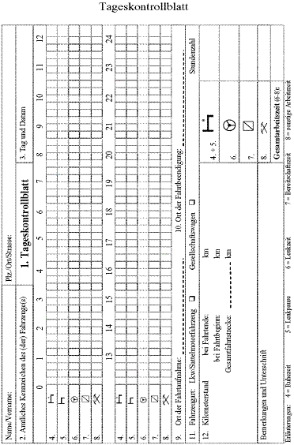

Verordnung vom 24. Mai 2011 über die Arbeits-, Lenk- und Ruhezeit der Führer von Motorfahrzeugen zum Güter- und Personentransport (ARV) Aufgrund von Art. 52, 97 und 99 des Strassenverkehrsgesetzes (SVG) vom 30. Juni 1978, LGBl. 1978 Nr. 18, in der geltenden Fassung, verordnet die Regierung: I. Allgemeine Bestimmungen Art. 1 Gegenstand und Zweck 1) Diese Verordnung regelt: a) die Arbeits-, Lenk- und Ruhezeit der Führer von Motorfahrzeugen zum Güter- und Personentransport einschliesslich des übrigen Fahrpersonals; b) die Kontrolle der Arbeits-, Lenk- und Ruhezeit; c) die Pflichten der Arbeitgeber. 2) Sie dient der Durchführung und Umsetzung: a) der Verordnung (EG) Nr. 561/2006 des Europäischen Parlaments und des Rates vom 15. März 2006 zur Harmonisierung bestimmter Sozialvorschriften im Strassenverkehr und zur Änderung der Verordnungen (EWG) Nr. 3821/85 und (EG) Nr. 2135/98 des Rates sowie zur Aufhebung der Verordnung (EWG) Nr. 3820/85 des Rates (EWR-Rechtssammlung: Anh. XIII - 24e.01); b) der Verordnung (EU) Nr. 165/2014 des Europäischen Parlaments und des Rates vom 4. Februar 2014 über Fahrtenschreiber im Strassenverkehr, zur Aufhebung der Verordnung (EWG) Nr. 3821/85 des Rates über das Kontrollgerät im Strassenverkehr und zur Änderung der Verordnung (EG) Nr. 561/2006 des Europäischen Parlaments und des Rates zur Harmonisierung bestimmter Sozialvorschriften im Strassenverkehr (EWR-Rechtssammlung: Anh. XIII - 21b.01); c) des Europäischen Übereinkommens vom 1. Juli 1970 über die Arbeit des im internationalen Strassenverkehr beschäftigten Fahrpersonals (AETR); und d) der Richtlinie 2002/15/EG des Europäischen Parlaments und des Rates vom 11. März 2002 zur Regelung der Arbeitszeit von Personen, die Fahrtätigkeiten im Bereich des Strassentransports ausüben (EWR-Rechtssammlung: Anh. XIII - 24d.01). 3) Wird in dieser Verordnung auf EWR-Rechtsvorschriften oder das AETR verwiesen, so beziehen sich diese Verweise auf deren jeweils geltende Fassung. Art. 2 Geltungsbereich und vorbehaltenes Recht 1) Diese Verordnung gilt für Beförderungen mit Motorfahrzeugen im Strassenverkehr, die: a) der Güterbeförderung dienen und deren zulässiges Gesamtgewicht nach Fahrzeugausweis, einschliesslich Anhänger oder Sattelanhänger, 3.5 t übersteigen; b) der Personenbeförderung dienen und die einschliesslich des Führers für eine Platzzahl von mehr als neun Personen konstruiert oder dauerhaft angepasst und zu diesem Zweck bestimmt sind. 2) Sie gilt für Personen, die Fahrtätigkeiten mit Motorfahrzeugen nach Abs. 1 ausüben. Für Arbeitgeber, Unternehmen und Werkstätten gilt sie nur, soweit einzelne Bestimmungen dieser Verordnung dies ausdrücklich vorsehen. 3) Vorbehalten bleiben die Vorschriften der Verordnungen (EG) Nr. 561/2006 und (EU) Nr. 165/2014 sowie, soweit der grenzüberschreitende Strassenverkehr von und/oder nach Drittstaaten betroffen ist, des AETR. 4) Soweit diese Verordnung für das Fahrpersonal keine Bestimmungen enthält, kommt das Arbeitsgesetz und die dazu ergangenen Verordnungen zur Anwendung. Art. 3 Ausnahmen vom Geltungsbereich 1) Diese Verordnung gilt nicht für Beförderungen im Strassenverkehr mit folgenden Fahrzeugen: a) Fahrzeuge mit einer zulässigen Höchstgeschwindigkeit von nicht mehr als 40 km/h; b) Fahrzeuge, die Eigentum des Bevölkerungsschutzes, der Feuerwehr oder der Landes- oder Gemeindepolizei sind oder von ihnen ohne Führer angemietet werden, sofern die Beförderung aufgrund der diesen Diensten zugewiesenen Aufgaben stattfindet und ihrer Aufsicht unterliegt; c) Fahrzeuge - einschliesslich Fahrzeuge, die für nichtgewerbliche Transporte für humanitäre Hilfe verwendet werden -, die in Notfällen oder bei Rettungsmassnahmen verwendet werden; d) Spezialfahrzeuge für medizinische Zwecke; e) spezielle Pannenhilfefahrzeuge, die im Inland eingesetzt werden; f) Fahrzeuge, mit denen zum Zweck der technischen Entwicklung oder im Rahmen von Reparatur- oder Wartungsarbeiten Probefahrten auf der Strasse durchgeführt werden, sowie neue oder umgebaute Fahrzeuge, die noch nicht in Betrieb genommen worden sind; g) Fahrzeuge oder Fahrzeugkombinationen mit einem zulässigen Gesamtgewicht von nicht mehr als 7.5 t, die verwendet werden: 1. zur nichtgewerblichen Güterbeförderung; oder 2. zur Beförderung von Material, Ausrüstungen oder Maschinen, die der Führer zur Ausübung seines Berufes benötigt; das Lenken des Fahrzeugs darf für den Führer nicht die Haupttätigkeit darstellen; h) Fahrzeuge, die in ihrem Zulassungsstaat als historisch gelten (Veteranenfahrzeuge) und die zur nichtgewerblichen Güter- oder Personenbeförderung verwendet werden. 2) Die Art. 5 bis 9 der Verordnung (EG) Nr. 561/2006 sowie die Bestimmungen der Verordnung (EU) Nr. 165/2014 und dieser Verordnung gelten nicht für Beförderungen im Inlandverkehr mit folgenden Fahrzeugen: a) Fahrzeuge, die im Eigentum von Behörden sind oder von diesen ohne Führer angemietet sind, um Beförderungen im Strassenverkehr durchzuführen, die nicht im Wettbewerb mit privatwirtschaftlichen Verkehrsunternehmen stehen; b) Fahrzeuge, die von Landwirtschafts-, Gartenbau-, Forstwirtschafts- oder Fischereiunternehmen zur Güterbeförderung im Rahmen ihrer eigenen unternehmerischen Tätigkeit benutzt oder ohne Führer angemietet werden; c) land- und forstwirtschaftliche Zugmaschinen, die für land- und forstwirtschaftliche Tätigkeiten eingesetzt werden; d) Fahrzeuge oder Fahrzeugkombinationen mit einem zulässigen Gesamtgewicht von nicht mehr als 7.5 t, die von Universaldiensteanbietern im Sinne des Art. 3 Abs. 1 Bst. p des Postdienste- und Paketzustelldienstegesetzes zum Zweck der Zustellung von Sendungen im Rahmen des Universaldienstes benutzt werden; e) Fahrzeuge, die zur Güterbeförderung mit Druckerdgas-, Flüssiggas- oder Elektroantrieb benutzt werden und deren zulässiges Gesamtgewicht einschliesslich Anhänger oder Sattelanhänger 7.5 t nicht übersteigt; f) Fahrzeuge, die zum Fahrschulunterricht und zur Fahrprüfung zwecks Erlangung des Führerausweises oder eines beruflichen Befähigungsnachweises dienen, sofern diese Fahrzeuge nicht für die gewerbliche Personen- oder Güterbeförderung benutzt werden; g) Fahrzeuge, die in Verbindung mit Kanalisation, Hochwasserschutz, Wasser-, Gas- und Elektrizitätsversorgung, Strassenunterhalt und -kontrolle, Hausmüllabfuhr, Telefondienstleistungen, Radio und Fernsehen sowie zur Erfassung von Radio- bzw. Fernsehsendern oder -geräten eingesetzt werden; h) Fahrzeuge mit 10 bis 17 Sitzen, die ausschliesslich zur nichtgewerblichen Personenbeförderung verwendet werden; i) Spezialfahrzeuge, die Ausrüstungen des Zirkus- oder Schaustellergewerbes transportieren; k) Fahrzeuge, die zum Abholen von Milch bei landwirtschaftlichen Betrieben und zur Rückgabe von Milchbehältern oder von Milcherzeugnissen für Futterzwecke an diese Betriebe verwendet werden; l) Fahrzeuge, die ausschliesslich auf Strassen in Güterverteilzentren wie Umschlaganlagen des Kombinierten Verkehrs und Eisenbahnterminals benutzt werden; m) Fahrzeuge, die für die Beförderung lebender Tiere von den landwirtschaftlichen Betrieben zu den lokalen Märkten und umgekehrt oder von den Märkten zu den lokalen Schlachthäusern verwendet werden; n) speziell ausgerüstete Projektfahrzeuge für mobile Projekte, die hauptsächlich im Stand zu Lehrzwecken dienen; o) Spezialfahrzeuge für Geld- und/oder Werttransporte; p) Fahrzeuge, die zur Beförderung von tierischen Abfällen oder von nicht für den menschlichen Verzehr bestimmten Tierkörpern verwendet werden. Art. 4 Begriffe und Bezeichnungen 1) Im Sinne dieser Verordnung gelten als: a) "Linienverkehr": inländische oder grenzüberschreitende Verkehrsdienste auf der Strasse im Sinne von Art. 2 Abs. 1 Bst. c des Personenbeförderungsgesetzes mit einer Linienstrecke bis 50 km; b) "Arbeitgeber": jede Person, die als Betriebsinhaber, gewerberechtlicher Geschäftsführer oder Vorgesetzter gegenüber dem Fahrpersonal weisungsbevollmächtigt ist; c) "Führer": jede Person, die das Fahrzeug, sei es auch nur kurze Zeit, selbst lenkt oder sich in dem Fahrzeug befindet, um es - als Bestandteil seiner Pflichten - gegebenenfalls lenken zu können; d) "Standort": der Ort, wo das Fahrzeug nach Gebrauch in der Regel für die Nacht abgestellt wird. Der Wohnsitz des Halters in Liechtenstein gilt als Standort bei Fahrzeugen, die während der Woche ausserhalb Liechtensteins verwendet und durchschnittlich mindestens zwei Mal im Monat über das Wochenende am inländischen Wohnsitz des Halters untergebracht werden (Art. 66 VZV); e) "Drittstaat": ein Staat, der weder Vertragspartei des Abkommens über den Europäischen Wirtschaftsraums (EWRA) noch des AETR ist; f) "Arbeitszeit": 1. beim Fahrpersonal: die Zeitspanne zwischen Arbeitsbeginn und Arbeitsende, während der ein Arbeitnehmer an seinem Arbeitsplatz ist, dem Arbeitgeber zur Verfügung steht und seine Funktion oder Tätigkeit ausübt, d.h. 1.1 die Zeit sämtlicher Tätigkeiten im Strassenverkehr. Diese Tätigkeiten umfassen insbesondere Folgendes: - Fahren; - Be- und Entladen; - Hilfe beim Ein- und Aussteigen der Fahrgäste; - Reinigung und technische Wartung; und - alle anderen Arbeiten, die dazu dienen, die Sicherheit des Fahrzeuges, der Ladung und der Fahrgäste zu gewährleisten bzw. die gesetzlichen oder behördlichen Formalitäten, die in einem direkten Zusammenhang mit der Transporttätigkeit stehen, zu erledigen. Hierzu gehören auch das Überwachen des Beladens/Entladens und die Erledigung von Formalitäten im Zusammenhang mit der Polizei, dem Zoll und vergleichbaren Einrichtungen und Behörden; 1.2 die Zeiten, während deren das Fahrpersonal nicht frei über seine Zeit verfügen kann und sich an seinem Arbeitsplatz bereit zu halten hat, um seine normale Arbeit aufzunehmen und bestimmte mit dem Dienst verbundene Aufgaben ausführt, insbesondere während der Zeit des Wartens auf das Be- und Entladen, wenn deren voraussichtliche Dauer nicht im Voraus bekannt ist, d.h. entweder vor der Abfahrt bzw. unmittelbar vor dem tatsächlichen Beginn des betreffenden Zeitraums oder gemäss den allgemeinen zwischen den Sozialpartnern ausgehandelten und/oder durch die Rechtsvorschriften der EWR-Mitgliedstaaten festgelegten Bedingungen; 2. bei selbstständigerwerbenden Führern: die Zeitspanne zwischen Arbeitsbeginn und Arbeitsende, während der der selbstständigerwerbende Führer sich an seinem Arbeitsplatz befindet, den Kunden zur Verfügung steht und seine Funktionen oder Tätigkeiten ausübt; dies umfasst nicht allgemeine administrative Tätigkeiten, die keinen direkten Zusammenhang mit der gerade ausgeführten Transporttätigkeit aufweisen. Zur Arbeitszeit werden auch die Ruhepausen, die unter der Mindestdauer nach Art. 6 Abs. 3 liegen, und die Bereitschaftszeiten nach Bst. g, wenn die Arbeitnehmer den Arbeitsplatz nicht verlassen dürfen, gerechnet; g) "Bereitschaftszeit": 1. andere Zeiten als Ruhepausen und Ruhezeiten, in denen das Fahrpersonal nicht verpflichtet ist, an seinem Arbeitsplatz zu bleiben, in denen es sich jedoch in Bereitschaft halten muss, um etwaigen Anweisungen zur Aufnahme oder Wiederaufnahme der Fahrtätigkeit oder zur Ausführung anderer Arbeiten Folge zu leisten. Als Bereitschaftszeit gelten insbesondere die Zeiten, in denen das Fahrpersonal ein Fahrzeug während der Beförderung auf einer Fähre oder mit einem Zug begleitet sowie Wartezeiten an den Grenzen und infolge von Fahrverboten. Diese Zeiten und ihre voraussichtliche Dauer müssen dem Fahrpersonal im Voraus bekannt sein, d.h. vor der Abfahrt bzw. unmittelbar vor dem tatsächlichen Beginn des betreffenden Zeitraums; 2. für das Fahrpersonal, das sich beim Fahren abwechselt, die Zeit, die während der Fahrt neben dem Führer oder in einer Schlafkabine verbracht wird; h) "Arbeitsplatz": 1. der Standort der Hauptniederlassung des Unternehmens, für das die Personen, die Fahrtätigkeiten im Bereich des Strassentransports ausüben, tätig sind, und seine verschiedenen Zweigniederlassungen, ob sie nun mit seinem Geschäftssitz oder seiner Hauptniederlassung zusammenfallen oder nicht; 2. das Fahrzeug, das die Personen, die Fahrtätigkeiten im Bereich des Strassentransports ausüben, bei ihrer Tätigkeit benutzen; und 3. jeder andere Ort, an dem die mit der Beförderung verbundenen Tätigkeiten ausgeführt werden; i) "Fahrpersonal": alle Arbeitnehmer, einschliesslich Praktikanten und Auszubildende, die im Dienst eines Unternehmens, das auf Rechnung Dritter oder auf eigene Rechnung Fahrgäste oder Waren im Strassenverkehr befördert, eine Fahrtätigkeit ausüben; k) "selbstständigerwerbender Führer": eine Person, 1. deren berufliche Tätigkeit hauptsächlich darin besteht, mit Gemeinschaftslizenz oder einer anderen berufsspezifischen Beförderungsermächtigung gewerblich im Sinne des EWR-Rechts Fahrgäste oder Waren im Strassenverkehr zu befördern; 2. die befugt ist, auf eigene Rechnung zu arbeiten, und die nicht durch einen Arbeitsvertrag oder ein anderes arbeitsrechtliches Abhängigkeitsverhältnis an einen Arbeitgeber gebunden ist; 3. die über den erforderlichen freien Gestaltungsspielraum für die Ausübung der betreffenden Tätigkeit verfügt; 4. deren Einkünfte direkt von den erzielten Gewinnen abhängt; und 5. die die Freiheit hat, allein oder durch eine Zusammenarbeit zwischen selbstständigerwerbenden Führern Geschäftsbeziehungen zu mehreren Kunden zu unterhalten. Führer, die diese Kriterien nicht erfüllen, gelten für die Zwecke dieser Verordnung als Fahrpersonal; l) "Personen, die Fahrtätigkeiten im Bereich des Strassentransports ausüben": das Fahrpersonal oder selbstständigerwerbende Führer; m) "Woche": der Zeitraum von Montag 00.00 Uhr bis Sonntag 24.00 Uhr; n) "Nachtzeit": die Zeit zwischen 00.00 Uhr und 04.00 Uhr; o) "Nachtarbeit": jede Arbeit, die während der Nachtzeit ausgeführt wird. 2) Im Übrigen finden die Begriffsbestimmungen des EWR-Rechts, insbesondere der Verordnungen (EG) Nr. 561/2006 und (EU) Nr. 165/2014, mit der Massgabe Anwendung, dass abweichend davon folgende Begriffe verwendet werden: a) "Motorfahrzeug" für "Kraftfahrzeug"; b) "Fahrtschreiber" für "Kontrollgerät"; c) "Einlageblatt" für "Schaublatt"; d) "Führer" für "Fahrer"; e) "Lenkpause" für "Fahrtunterbrechung"; f) "Gesamtgewicht" für "Höchstmasse". 3) Unter den in dieser Verordnung verwendeten Personen-, Berufs- und Funktionsbezeichnungen sind Angehörige des männlichen und weiblichen Geschlechts zu verstehen. II. Lenkzeiten, Arbeitszeiten, Pausen und Ruhezeiten Art. 5 Lenkzeit im Linienverkehr 1) Die tägliche Lenkzeit darf für Führer von Fahrzeugen im Linienverkehr 9 Stunden nicht überschreiten. Sie kann jedoch höchstens zweimal in der Woche auf höchstens 10 Stunden verlängert werden. 2) Die wöchentliche Lenkzeit darf bis zu höchstens 56 Stunden ausgeweitet werden und nicht dazu führen, dass die wöchentliche Höchstarbeitszeit nach Art. 8 überschritten wird. 3) Die Gesamtlenkzeit während zwei aufeinander folgenden Wochen darf 90 Stunden nicht überschreiten. Art. 6 Lenkpausen im Linienverkehr 1) Der Führer eines Fahrzeugs im Linienverkehr hat nach einer Lenkzeit von 4.5 Stunden eine Lenkpause von mindestens 30 Minuten einzulegen, sofern der Führer keine tägliche oder wöchentliche Ruhezeit nimmt. 2) Die Lenkpause nach Abs. 1 kann in Lenkpausen von mindestens je 10 Minuten aufgeteilt werden; solche Lenkpausen werden zur Arbeitszeit gerechnet, soweit sie weniger als 15 Minuten betragen. 3) Als Lenkpausen im Sinne von Abs. 1 und 2 gelten ausschliesslich die in den Dienstplänen festgelegten Lenkpausen einer Arbeitsschicht. Art. 7 Kumulierung der Arbeits- und Lenkzeit 1) Werden an einem Tag Fahrten mit einem Fahrzeug nach Art. 2 Abs. 1 und einem Fahrzeug nach Art. 3 durchgeführt, so sind alle Lenkzeiten dieser Fahrzeuge zu kumulieren, wobei die tägliche und wöchentliche Lenkzeit oder die Gesamtlenkzeit innerhalb eines Zeitraumes von zwei aufeinander folgenden Wochen von 90 Stunden nicht überschritten werden darf. 2) Die Arbeitszeiten bei verschiedenen Arbeitgebern werden zusammengerechnet. 3) Der Arbeitgeber fordert das Fahrpersonal schriftlich auf, ihm eine Aufstellung der bei einem anderen Arbeitgeber geleisteten Arbeitszeit vorzulegen. Die Angaben durch das Fahrpersonal sind schriftlich vorzulegen. Art. 8 Wöchentliche Höchstarbeitszeit 1) Die durchschnittliche wöchentliche Arbeitszeit des Fahrpersonals darf 48 Stunden nicht überschreiten. Die wöchentliche Höchstarbeitszeit kann bis zu 60 Stunden betragen, sofern der Wochendurchschnitt in einem Zeitraum von vier Monaten 48 Stunden nicht übersteigt. 2) Art. 4 Bst. g bis l iVm Art. 6 bis 9 der Verordnung (EG) Nr. 561/2006 oder erforderlichenfalls Art. 6 bis 9 des AETR haben Vorrang vor den Bestimmungen des Abs. 1, sofern die betroffenen Führer eine durchschnittliche Arbeitszeit von 48 Stunden pro Woche in einem Zeitraum von vier Monaten nicht überschreiten. 3) Die Regierung kann in Ausnahmefällen den Durchrechnungszeitraum unter Einhaltung der Bestimmungen von Abs. 1 auf bis zu sechs Monate verlängern, wenn eine Vertretung des Arbeitnehmers durch andere Arbeitnehmer nicht möglich ist und dem Arbeitgeber die Heranziehung betriebsfremder Personen nicht zugemutet werden kann. 4) Die Arbeitszeiten bei verschiedenen Arbeitgebern werden zusammengerechnet. 5) Der Arbeitgeber fordert das Fahrpersonal schriftlich auf, ihm eine Aufstellung der bei einem anderen Arbeitgeber geleisteten Arbeitszeit schriftlich vorzulegen. Die Angaben durch das Fahrpersonal sind schriftlich vorzulegen. Art. 9 Ruhepausen 1) Das Fahrpersonal hat nach einer Arbeitszeit von sechs Stunden eine Ruhepause von mindestens 30 Minuten einzulegen. 2) Bei einer Gesamtarbeitszeit von mehr als neun Stunden beträgt die Ruhepause mindestens 45 Minuten. 3) Die Ruhepausen können in Pausen von einer Mindestdauer von je 15 Minuten aufgeteilt werden. Art. 10 Nacht- und Sonntagsarbeit 1) Die Beschäftigung von Fahrpersonal in der Nacht sowie an Sonn- und Feiertagen ist ohne Ausnahmebewilligung nach dem Arbeitsgesetz zulässig. 2) Wird durch das Fahrpersonal Nachtarbeit geleistet, darf die tägliche Arbeitszeit in einem Zeitraum von jeweils 24 Stunden zehn Stunden nicht überschreiten. 3) Dem Fahrpersonal gebührt für Nachtarbeit binnen 14 Tagen ein Ausgleich durch eine Verlängerung einer täglichen oder wöchentlichen Ruhezeit im Ausmass der geleisteten Nachtarbeit. Art. 11 Tägliche Ruhezeit im Linienverkehr 1) Der Führer muss innerhalb eines jeden Zeitraumes von 24 Stunden eine ununterbrochene tägliche Ruhezeit von mindestens 11 Stunden einhalten. 2) Die tägliche Ruhezeit nach Abs. 1 kann in zwei Teilen genommen werden, wenn sie insgesamt mindestens 12 Stunden umfasst. Der erste Teil muss einen ununterbrochenen Zeitraum von mindestens 3 Stunden und der zweite Teil einen ununterbrochenen Zeitraum von mindestens 9 Stunden umfassen. 3) Die Regierung kann für Führer von Fahrzeugen im Linienverkehr gestatten, dass die tägliche Ruhezeit nach Abs. 1 in zwei oder drei Teilen genommen werden kann, wenn sie insgesamt mindestens 12 Stunden umfasst. Der erste Teil muss einen ununterbrochenen Zeitraum von mindestens 8 Stunden und die übrigen Teile jeweils einen ununterbrochenen Zeitraum von mindestens 1 Stunde umfassen. In diesen Fällen beginnt die neue Tagesarbeitszeit nach Ablauf des mindestens 8 Stunden umfassenden Teils der Ruhezeit. 4) Die tägliche Ruhezeit darf bis zu dreimal pro Woche auf einen ununterbrochenen Zeitraum von mindestens 9 Stunden reduziert werden. Die Reduzierung ist durch eine gleichwertige und ununterbrochene Ruhepause innerhalb der folgenden Woche auszugleichen; diese Ruhepause ist an eine andere Ruhezeit von mindestens 8 Stunden anzuhängen. Art. 12 Wöchentliche Ruhezeit im Linienverkehr 1) In jeder Woche muss der Führer eine ununterbrochene wöchentliche Ruhezeit von mindestens 36 Stunden einhalten. 2) Die wöchentliche Ruhezeit beginnt spätestens am Ende von sechs 24-Stunden-Zeiträumen nach dem Ende der vorangegangenen wöchentlichen Ruhezeit. 3) Die wöchentliche Ruhezeit darf bis auf eine Mindestzeit von 24 aufeinander folgenden Stunden reduziert werden. Die Reduzierung ist durch eine gleichwertige und ununterbrochene Ruhepause innerhalb der folgenden sechs Wochen auszugleichen; diese Ruhepause ist an eine andere Ruhezeit von mindestens 9 Stunden anzuhängen. 4) Eine wöchentliche Ruhezeit, die in einer Woche beginnt und in die folgende Woche hineinreicht, kann der einen oder der anderen, nicht aber beiden Wochen zugerechnet werden. 5) Die Regierung kann eine abweichende Regelung treffen, wenn es aus betrieblichen Gründen als notwendig erachtet wird. Art. 13 Verbot bestimmter Arten des Entgelts Die tägliche und wöchentliche Ruhezeit darf nur durch Geldleistungen oder andere Vergünstigungen abgegolten werden, wenn das Arbeitsverhältnis beendet wird. III. Kontrollbestimmungen A. Kontrollmittel Art. 14 Grundsatz Zur Kontrolle der Einhaltung der Lenkzeiten, Arbeitszeiten, Pausen und Ruhezeiten nach Art. 5 bis 12 dieser Verordnung, Art. 4 Bst. g bis l iVm Art. 6 bis 9 der Verordnung (EG) Nr. 561/2006 und Art. 6 bis 9 des AETR dienen namentlich: a) die Aufzeichnungen des analogen Fahrtschreibers und die Eintragungen auf den Fahrtschreiber-Einlageblättern oder den besonderen, den Einlageblättern oder der Fahrerkarte beigefügten Blättern (Art. 37 Abs. 2 der Verordnung (EU) Nr. 165/2014); b) die Aufzeichnungen des digitalen Fahrtschreibers und die vom Führer datierten und unterschriebenen Ausdrucke; c) die Fahrtschreiberkarten (Art. 15 Abs. 1); d) die unter Einhaltung der Datenintegrität aus dem digitalen Fahrtschreiber sowie den Fahrtschreiberkarten auf externe Speichermedien ausgelesenen Daten; e) die Eintragungen im persönlichen Tageskontrollblatt (Art. 26); f) die Eintragungen in betriebsinternen Tagesrapporten und die Daten betriebsinterner Zeiterfassungsgeräte; g) die Bescheinigung des Arbeitgebers über die berücksichtigungsfreien Tage (Art. 25 Abs. 4); h) die Eintragungen im Dienst- und Fahrplan (Art. 24). B. Fahrtschreiber 1. Digitaler Fahrtschreiber Art. 15 Fahrtschreiberkarten 1) Für die Kontrolle der Arbeits- und Ruhezeiten werden folgende Fahrtschreiberkarten ausgestellt: a) Fahrerkarten; b) Werkstattkarten; c) Unternehmenskarten; d) Kontrollkarten. 2) Fahrtschreiberkarten werden vor Ablauf ihrer Gültigkeitsdauer entzogen oder für ungültig erklärt, wenn: a) sie gefälscht sind; b) jemand eine Karte verwendet, deren Inhaber er nicht ist; c) sie auf der Grundlage falscher Angaben oder gefälschter Dokumente erteilt wurden; d) die Voraussetzungen für die Erteilung nicht mehr erfüllt sind. 3) Ändern sich die Angaben auf den Fahrtschreiberkarten, so muss eine neue Karte ausgestellt werden. Der Inhaber muss dem Amt für Strassenverkehr innerhalb von 14 Tagen jede entsprechende Änderung melden. Die bisherige Karte verliert mit der Aushändigung der neuen Karte ihre Gültigkeit. 4) Fahrtschreiberkarten können erneuert werden. Das Gesuch kann frühestens sechs Monate vor Ablauf der Gültigkeit der Karten gestellt werden. Geht das Gesuch weniger als 15 Tage vor Ablauf der Gültigkeit ein, so wird eine neue Karte ausgestellt. 5) Bei Beschädigung, Fehlfunktion, Verlust oder Diebstahl einer Fahrtschreiberkarte muss der Karteninhaber dem Amt für Strassenverkehr innerhalb von sieben Tagen Meldung erstatten; bei Verlust oder Diebstahl der Fahrtschreiberkarten muss eine Anzeigebestätigung der Landespolizei beigebracht werden. Innerhalb dieser Frist muss er den Ersatz der Karte beantragen. Mit der Anzeige verliert die betreffende Fahrtschreiberkarte ihre Gültigkeit. 6) Die in Liechtenstein anwendbare schweizerische Verordnung über das Fahrtschreiberkartenregister findet ergänzend Anwendung. Art. 16 Fahrerkarte 1) Fahrerkarten werden nur an Führer mit Wohnsitz in Liechtenstein erteilt, die einen Lernfahr- oder Führerausweis im Kreditkartenformat (FAK) der Kategorien B, C, D, der Unterkategorien C1 oder D1 oder der Spezialkategorie F (Art. 3 VZV) besitzen. 2) Das Gesuch um eine Fahrerkarte ist beim Amt für Strassenverkehr einzureichen und beinhaltet: a) die Personalien der gesuchstellenden Person; b) die Nummer des FAK beziehungsweise des Lernfahrausweises oder, bei einem in einem anderen EWR-Mitgliedstaat ausgestellten Führerausweis, die Daten zum Führerausweis. 3) Die Gültigkeitsdauer der Fahrerkarte beträgt fünf Jahre. 4) Es darf pro Führer nur eine Fahrerkarte ausgestellt werden. Die Fahrerkarte ist persönlich und nicht übertragbar. 5) Hat der Inhaber einer von einem ausländischen Staat erteilten gültigen Fahrerkarte den Wohnsitz nach Liechtenstein verlegt, so kann er beim Amt für Strassenverkehr ein Gesuch um Umtausch der Fahrerkarte stellen. Die ausländische Fahrerkarte muss dem Amt für Strassenverkehr abgegeben werden. 6) Fahrerkarten müssen dem Amt für Strassenverkehr bei Änderungen nach Art. 15 Abs. 3, Beschädigung oder Fehlfunktion zurückgegeben werden. Wird eine ersetzte Fahrerkarte wieder aufgefunden, so muss sie innerhalb von 14 Tagen dem Amt für Strassenverkehr abgegeben werden. Die auf der Karte gespeicherten Daten sind vorgängig zu sichern. 7) Der Diebstahl einer Fahrerkarte ist den zuständigen Behörden des Staates, in dem sich der Diebstahl ereignet hat, zu melden. Art. 17 Werkstattkarte 1) Werkstattkarten werden Werkstätten erteilt, die über eine entsprechende Bewilligung des Amts für Strassenverkehr verfügen (Art. 101 VTS) und die die Voraussetzungen für die Erteilung einer Unternehmenskarte nicht erfüllen. In begründeten Fällen können Werkstattkarten auch Werkstätten erteilt werden, die die Voraussetzungen für die Erteilung einer Unternehmenskarte erfüllen, wenn ihre unternehmerische Tätigkeit das Sicherheitssystem nicht gefährdet. 2) Das Gesuch um eine Werkstattkarte ist beim Amt für Strassenverkehr einzureichen und beinhaltet: a) Name, Adresse und Sitz der Werkstatt, des Fahrtschreiberherstellers oder des Fahrzeugherstellers; b) Zulassungsbewilligung nach Art. 101 VTS; c) Prüfzertifikatnummer, Datum, Aussteller; d) Name, Vorname, Geburtsdatum, Heimatort, Adresse des berechtigten Werkstatttechnikers. 3) Die Gültigkeitsdauer der Werkstattkarte beträgt ein Jahr. 4) Die Werkstattkarte wird auf die Werkstatt und deren berechtigte Techniker ausgestellt. Sie darf nur vom berechtigten Werkstatttechniker und nur am Sitz der entsprechenden Werkstatt benutzt werden. Der Techniker ist persönlich verantwortlich für die mit seiner Werkstattkarte durchgeführten Arbeiten und Kalibrierungen an digitalen Fahrtschreibern. 5) Werkstattkarten müssen dem Amt für Strassenverkehr bei Änderungen nach Art. 15 Abs. 3, Beschädigung oder Fehlfunktion zurückgegeben werden. Wird eine ersetzte Werkstattkarte wieder aufgefunden, so muss sie innerhalb von 14 Tagen dem Amt für Strassenverkehr abgegeben werden. Die auf der Karte gespeicherten Daten sind vorgängig zu sichern. Art. 18 Unternehmenskarte 1) Unternehmenskarten werden Arbeitgebern, selbstständigerwerbenden Führern und Vermietern von Fahrzeugen mit digitalem Fahrtschreiber erteilt. 2) Das Gesuch um eine Unternehmenskarte ist beim Amt für Strassenverkehr einzureichen und beinhaltet den Namen, die Adresse und den Sitz des Unternehmens. 3) Die Gültigkeitsdauer der Unternehmenskarte beträgt fünf Jahre. 4) Die Unternehmenskarte wird auf den Namen des Unternehmens ausgestellt. Einem Unternehmen können mehrere Unternehmenskarten erteilt werden. Art. 19 Kontrollkarte 1) Den für die Durchführung von Strassen- und Betriebskontrollen zuständigen Behörden werden eine oder mehrere Kontrollkarten erteilt. 2) Das Gesuch um eine Kontrollkarte ist beim Amt für Strassenverkehr einzureichen. 3) Die Gültigkeitsdauer der Kontrollkarte beträgt zwei Jahre. 4) Die Kontrollkarte ist unpersönlich und übertragbar. Art. 20 Bedienung des digitalen Fahrtschreibers 1) Die Fahrerkarte muss während der gesamten beruflichen Tätigkeit eingesteckt bleiben. 2) Der Führer muss auf dem Fahrzeug genügend Druckerpapier mitführen. Er darf kein beschmutztes, beschädigtes oder nicht für den Fahrtschreiber zugelassenes Druckerpapier verwenden und muss das Druckerpapier sachgemäss schützen. 3) Der Arbeitgeber hat dem Führer das Druckerpapier sowie die für das Herunterladen der Daten von der Fahrerkarte notwendigen Hilfsmittel unentgeltlich zur Verfügung zu stellen und ihm auf Verlangen unentgeltlich eine Kopie der Ausdrucke oder der übrigen Daten auszuhändigen. Art. 21 Digitaler Fahrtschreiber bei Mietfahrzeugen Vermieter von Fahrzeugen müssen dem Mieter auf Verlangen spätestens einen Monat nach Beendigung des Mietverhältnisses jene Daten im Speicher des Fahrtschreibers zur Verfügung stellen, die sich auf die vom Mieter durchgeführten Fahrten beziehen und auf die dieser nicht unmittelbar zugreifen kann. Dabei ist der Datenschutz zu gewährleisten. 2. Analoger Fahrtschreiber Art. 22 Verwendung der Einlageblätter 1) Der Arbeitgeber hat dem Führer die Einlageblätter unentgeltlich zur Verfügung zu stellen. 2) Freiwillige Vermerke sind auf dem Einlageblatt nicht zulässig. Art. 23 Abgabe der Einlageblätter 1) Der Führer hat die gebrauchten Einlageblätter und die besonderen, den Einlageblättern beizufügenden Blätter dem Arbeitgeber jeweils bis spätestens zehn Tage nach Ablauf der Mitführungspflicht von 28 Tagen zur Aufbewahrung (Art. 32) abzugeben. 2) Bei längeren Fahrten im Ausland sind die Unterlagen bei der Rückkehr nach Liechtenstein, bei längerem Auslandaufenthalt jedoch spätestens bis Anfang der ersten Woche des folgenden Kalendermonats, abzugeben. C. Kontrollmittel im Linienverkehr Art. 24 Dienst- und Fahrplan 1) Der Arbeitgeber hat einen Fahrplan und einen Dienstplan (Abs. 4) zu erstellen, in dem für jeden Führer von Fahrzeugen im Linienverkehr der Name, der Standort und der im Voraus festgelegte Zeitplan für die verschiedenen Zeiträume der Lenktätigkeit, der anderen Arbeiten, der Lenkpausen sowie der Bereitschaftszeiten aufgeführt sind. 2) Der Arbeitgeber hat zu gewährleisten, dass er jederzeit für die einzelnen Führer die Arbeits-, Lenk- und Ruhezeit schlüssig und lückenlos nachweisen kann. Dieser Nachweis hat zu erfolgen über: a) die führerbezogenen Aufzeichnungen nach Art. 20 bis 23 dieser Verordnung und Art. 32 bis 37 der Verordnung (EU) Nr. 165/2014; oder b) den Auszug aus dem Dienstplan (Abs. 4) und den fahrzeugbezogenen Aufzeichnungen des Fahrtschreibers. 3) Erfolgt der Nachweis nach Abs. 2 Bst. b, so muss jeder Führer einen Auszug aus dem Dienstplan (Abs. 4) und eine Ausfertigung des Fahrplanes mit sich führen. Der Fahrtschreiber ist ständig in Betrieb zu halten und so zu bedienen, dass die fahrzeugbezogenen Daten aufgezeichnet werden. Ist das Fahrzeug mit einem analogen Fahrtschreiber ausgerüstet, ist pro Tag und Fahrzeug ein Einlageblatt einzulegen und entsprechend zu beschriften. 3a) Bei Betriebsstörung oder Fehlfunktion des Fahrtschreibers muss der Arbeitgeber unverzüglich die Reparatur in einer Werkstätte durchführen lassen, die über eine entsprechende Bewilligung des Amts für Strassenverkehr verfügt (Art. 101 VTS). 4) Der Dienstplan muss: a) alle in Abs. 1 aufgeführten Angaben mindestens für den Zeitraum der vorangegangenen 28 Tage enthalten und ist in regelmässigen Abständen von höchstens einem Monat zu aktualisieren; b) die Unterschrift des Arbeitgebers oder eines leitenden Beauftragten tragen. 5) Wenn ein Führer von Fahrzeugen im Linienverkehr an einem Tag auch Fahrten mit einem Fahrzeug nach Art. 2 Abs. 1 durchführt, ist bei diesen Fahrten ein Dienstplan mitzuführen, in dem die Dienstzeiten der vorangegangenen 28 Tage ersichtlich sind. D. Bescheinigung über berücksichtigungsfreie Tage Art. 25 Nachweis über berücksichtigungsfreie Tage 1) Der Führer hat die in Art. 36 der Verordnung (EU) Nr. 165/2014, in Art. 12 des Anhangs zum AETR oder in dieser Verordnung vorgeschriebenen Nachweise manuell nach Massgabe des Abs. 2 zu erfassen, wenn er: a) erkrankt war oder sich im Krankheitsurlaub befand; b) sich im Erholungsurlaub als Teil seines Jahresurlaubes im Sinne der geltenden arbeitsrechtlichen Bestimmungen des ABGB befunden hat; c) ein vom Anwendungsbereich dieser Verordnung, der Verordnung (EG) Nr. 561/2006 oder des AETR ausgenommenes Fahrzeug gelenkt hat; d) aus anderen Gründen kein Fahrzeug gelenkt hat. 2) Die manuellen Nachträge nach Abs. 1 sind vor Fahrtantritt zu erfassen: a) bei der Verwendung eines digitalen Fahrtschreibers: mittels Eingabevorrichtung des Fahrtschreibers auf der Fahrerkarte; b) bei der Verwendung analogen Fahrtschreibers oder wenn eine Erfassung nach Bst. a aus technischen Gründen nicht möglich ist: lesbar unter Verwendung der in Art. 34 Abs. 5 der Verordnung (EU) Nr. 165/2014 aufgeführten Zeichen. Der Nachtrag ist auf der Rückseite des nächsten im Anschluss an den berücksichtigungsfreien Zeitraum verwendeten Fahrtschreiber-Einlageblatts oder Fahrtschreiberausdrucks (Ausdruck der Tätigkeiten des Fahrers am Fahrtag) vorzunehmen. Bei Bedarf können auch mehrere Fahrtschreiber-Einlageblätter oder Fahrtschreiberausdrucke verwendet werden. 3) Der Arbeitgeber hat dafür zu sorgen, dass der Führer die manuellen Nachträge nach Abs. 2 vornimmt. 4) Ist ein manueller Nachtrag nach Abs. 2 Bst. a aus technischen Gründen nicht möglich oder besonders aufwendig, darf abweichend von Abs. 2 Bst. b bei einer Kontrolle eine Bescheinigung des Arbeitgebers über die im Abs. 1 genannten Zeiten vorgelegt werden. Die Bescheinigung darf nicht handschriftlich ausgefüllt werden. Der Arbeitgeber hat dem betroffenen Führer die Bescheinigung mit den Gründen für das Fehlen von Arbeitszeitnachweisen vor Fahrtantritt auszustellen und auszuhändigen sowie dafür zu sorgen, dass der Führer die Bescheinigung während der Fahrt mit sich führt. Die Bescheinigung ist vom Arbeitgeber oder einer von ihm beauftragten Person sowie vom betroffenen Führer zu unterzeichnen und im Original der zuständigen Vollzugsbehörde auf Verlangen vorzulegen. 5) Für die Aufbewahrung der Nachträge und Bescheinigungen nach Abs. 2 und 4 durch den Arbeitgeber gilt Art. 32. E. Tageskontrollblatt Art. 26 Tageskontrollblatt 1) Führer von Fahrzeugen, die in einem Drittstaat zugelassen sind, müssen bei ihrer Einreise in Liechtenstein ein Tageskontrollblatt nach Anhang 2 führen, sofern das Fahrzeug nicht mit einem Fahrtschreiber nach der Verordnung (EU) Nr. 165/2014 ausgerüstet ist. Das Tageskontrollblatt und die Aufstellung sind der Kontrollbehörde auf Verlangen vorzuweisen. 2) Das Tageskontrollblatt enthält die für die Kontrolle erforderlichen Angaben über die Lenkzeit, Pausen, Ruhezeit, sonstige Arbeitszeit und Bereitschaftszeit des Führers; diese hat er von Hand laufend einzutragen. Die Eintragungen haben in leserlicher und unverwischbarer Schrift zu erfolgen. 3) Der Führer darf gleichzeitig pro Tag nur ein Tageskontrollblatt benützen, selbst wenn er bei mehreren Arbeitgebern beschäftigt ist. Das Tageskontrollblatt ist persönlich und nicht übertragbar. 4) Tageskontrollblätter können bei den Zollämtern oder bei der Landespolizei bezogen werden. 5) Werden in einem Land, in dem das Fahrzeug immatrikuliert ist, keine Kontrollmittel verlangt, so muss der Führer die Kontrollmittel verwenden, die er vor der Einreise in Liechtenstein im Nachbarstaat führen musste. Art. 27 Führen des Tageskontrollblattes 1) Der Führer muss das Tageskontrollblatt sofort nach Erhalt, spätestens bei der Benützung, beschriften. 2) Der Führer benützt für jeden Tag, an dem er fährt, ein Tageskontrollblatt. Es sind folgende Angaben und Aufzeichnungen vorzunehmen: a) vor Beginn der Fahrt bzw. sonstigen Arbeit: Kontrollschildnummer jedes Fahrzeuges, Datum, Ort der Arbeitsaufnahme, zusammenhängende Ruhezeit vor der Fahrt bzw. sonstigen Arbeitszeit und Kilometerstand; b) während der Arbeit: Pausen, Lenkzeit, Bereitschaftszeit und sonstige Arbeitszeit; c) nach Beendigung der Fahrt bzw. sonstigen Arbeitszeit: Ort der Fahrtbeendigung, Kilometerstand, Gesamtfahrtstrecke, Lenkzeit, Bereitschaftszeit, sonstige Arbeitszeit, Gesamtarbeitszeit, allfällige Bemerkungen und Unterschrift. 3) Pausen von weniger als 15 Minuten müssen nicht eingetragen werden. 4) Die Eintragungen im Tageskontrollblatt sind mit Tinte vorzunehmen und dürfen weder ausradiert, gestrichen noch überschrieben werden. Fehler sind unter der Rubrik "Bemerkungen" zu berichtigen. 5) Die Tageskontrollblätter der vorangegangenen 28 Tage sind mitzuführen. F. Verantwortlichkeiten und Pflichten des Arbeitgebers und des selbstständigerwerbenden Führers Art. 28 Verantwortlichkeiten 1) Der Arbeitgeber ist verpflichtet, seinen Betrieb so zu organisieren, dass das Fahrpersonal die Bestimmungen dieser Verordnung, der Verordnung (EG) Nr. 561/2006 sowie des AETR einhalten kann. Dies gilt auch für Fahrten im Hoheitsgebiet eines anderen EWR-Mitgliedstaates oder eines Drittstaates. 2) Neben dem Arbeitgeber sind auch die mit dem Arbeitgeber in geschäftlicher Verbindung stehenden Verlader, Spediteure, Reiseveranstalter, Hauptauftragnehmer, Unterauftragnehmer und Fahrvermittlungsagenturen für die Einhaltung der Vorschriften dieser Verordnung sowie der Verordnung (EG) Nr. 561/2006 verantwortlich. 3) Der Arbeitgeber haftet für Verstösse seines Fahrpersonals. Dies gilt auch für Fahrten im Hoheitsgebiet eines anderen EWR-Mitgliedstaates oder eines Drittstaates. Art. 29 Überwachung der Arbeits-, Lenk- und Ruhezeit 1) Der Arbeitgeber überwacht laufend anhand der verfügbaren Kontrollmittel nach Art. 14, ob die Bestimmungen über die Arbeits-, Lenk- und Ruhezeit einschliesslich Pausen sowie die Benutzungsvorschriften nach Art. 32 bis 37 der Verordnung (EU) Nr. 165/2014 oder ansonsten des AETR durch das Fahrpersonal eingehalten werden. 2) Abs. 1 gilt sinngemäss für selbstständigerwerbende Führer. Art. 30 Herunterladen von Daten beim digitalen Fahrtschreiber 1) Ist das Fahrzeug mit einem digitalen Fahrtschreiber ausgerüstet, so haben die Arbeitgeber und die selbstständigerwerbenden Führer dafür zu sorgen, dass: a) die Daten aus dem Speicher des Fahrtschreibers auf ein externes Speichermedium heruntergeladen werden, und zwar: 1. spätestens alle drei Monate, beginnend mit dem ersten Tag der Aufzeichnung, 2. bevor ein Fahrzeug oder ein Fahrtschreiber an ein anderes Unternehmen vermietet oder verkauft wird, 3. wenn der Fahrtschreiber nicht mehr korrekt funktioniert, die Daten aber noch heruntergeladen werden können, oder 4. vor einem Umtausch des Fahrtschreibers; b) die Daten von der Fahrerkarte heruntergeladen werden, und zwar: 1. spätestens alle 21 Tage, beginnend mit dem ersten Tag der Aufzeichnung, 2. bei Auflösung des Arbeitsverhältnisses des Arbeitnehmers, 3. vor Beginn der Fahrtätigkeit im Auftrag eines anderen Unternehmens und mit deren Fahrzeugen, oder 4. unmittelbar vor Ablauf der Gültigkeit der Fahrerkarte; c) die Daten von der Unternehmenskarte spätestens alle drei Monate, beginnend mit dem ersten Tag der Aufzeichnung, heruntergeladen werden; d) die aus dem digitalen Fahrtschreiber, von der Fahrerkarte und von der Unternehmenskarte heruntergeladenen Daten in chronologischer Reihenfolge nach Fahrzeugnummer und Fahrer beziehungsweise nach Fahrer gespeichert werden; e) von allen Daten unverzüglich Sicherungskopien erstellt werden, die auf einem gesonderten Datenträger aufzubewahren sind; f) sie vor der ersten Inbetriebnahme des Fahrtschreibers ihren Datenbereich schützen und diesen Schutz vor dem Verkauf oder der Vermietung des Fahrtschreibers wieder beenden. 2) Beim Herunterladen dürfen gespeicherte Daten weder verändert noch gelöscht werden. Art. 31 Weitere Pflichten des Arbeitgebers 1) Der Arbeitgeber muss das Fahrpersonal über die massgeblichen Rechtsvorschriften und allfällige Betriebsordnungen informieren und die Arbeit so zuteilen, dass es die Bestimmungen über die Arbeits-, Lenk- und Ruhezeit einschliesslich Pausen einhalten kann. Das Fahrpersonal muss dem Arbeitgeber rechtzeitig melden, wenn die zugeteilte Arbeit zu einer Verletzung dieser Bestimmungen führen könnte. 2) Der Arbeitgeber hat dafür zu sorgen, dass das Fahrpersonal die Bestimmungen über die Arbeits-, Lenk- und Ruhezeit einschliesslich Pausen einhält, die Kontrollmittel vorschriftsgemäss führt und sie ihm rechtzeitig abgibt. 3) Der Arbeitgeber führt ein Verzeichnis mit den Namen, Adressen, Geburtsdaten und Telefonnummern des Fahrpersonals. 4) Der Arbeitgeber ist verpflichtet, dem Fahrpersonal auf Anfrage eine Kopie der Aufzeichnung der geleisteten Stunden unentgeltlich auszuhändigen. 5) Der Arbeitgeber muss dafür sorgen, dass personenbezogene Daten des Fahrpersonals, die im Zusammenhang mit der Durchführung dieser Verordnung, der Verordnung (EG) Nr. 561/2006 und der Verordnung (EU) Nr. 165/2014 bei ihm anfallen, nur für diese Zwecke verwendet und gegen unbefugten Zugriff geschützt werden. Art. 32 Aufbewahrungs- und Auskunftspflicht 1) Arbeitgeber und selbstständigerwerbende Führer müssen am Geschäftssitz während mindestens zwei Jahren nach Fahrpersonal geordnet aufbewahren: a) die gebrauchten Einlageblätter und die besonderen, den Einlageblätter beizufügenden Blätter in zeitlicher Reihenfolge; b) alle aus dem Speicher des digitalen Fahrtschreibers und von den Fahrer- und Unternehmenskarten heruntergeladenen Daten und die jeweiligen Sicherungskopien (Art. 30); die Aufbewahrungsfrist beginnt mit dem Zeitpunkt, an dem das Datenpaket heruntergeladen wird; c) die Bescheinigung über berücksichtigungsfreie Tage; d) die Eintragungen in betriebsinternen Tagesrapporten und die Daten betriebsinterner Zeiterfassungsgeräte; e) die Eintragungen im Dienst- und Fahrplan; f) das Verzeichnis mit den Namen, Adressen, Geburtsdaten und Telefonnummern des Fahrpersonals. 2) Die Arbeitgeber, das Fahrpersonal und die selbstständigerwerbenden Führer müssen der Vollzugsbehörde den Zutritt zum Fahrzeug und zur Betriebstätte gestatten und die nötigen Abklärungen unterstützen. 3) Arbeitgeber sowie Fahrpersonal müssen der Vollzugsbehörde alle Auskünfte erteilen, die für die Anwendung dieser Verordnung und für die Kontrolle erforderlich sind. 4) Die Dokumente und Daten sind der Vollzugsbehörde auf Verlangen vorzuweisen oder in der von ihr verlangten Form einzusenden. 5) Auskünfte zu Statistik- oder Forschungszwecken richten sich nach der Datenschutz- und Statistikgesetzgebung. IV. Sonderbestimmungen Art. 33 Lastwagenführer-Lehrling 1) Die Arbeitszeit des Lastwagenführer-Lehrlings (Art. 6 Abs. 2 VZV) darf neun Stunden je Tag nicht überschreiten und muss in die Zeit von 05.00 Uhr bis 22.00 Uhr fallen; die Regierung kann im Interesse der beruflichen Ausbildung Ausnahmen bewilligen. Die tägliche und wöchentliche Ruhezeit nach Art. 8 der Verordnung (EG) Nr. 561/2006 ist einzuhalten und darf nicht verkürzt werden. 2) Der obligatorische Schulunterricht gilt als Arbeitszeit. 3) Bei Lernfahrten muss der Ausbilder: a) auf dem Einlageblatt des Fahrtschreibers neben dem Namen des Lehrlings seine Initialen eintragen; b) ein eigenes Einlageblatt benützen; oder c) seine Fahrerkarte in den für den Beifahrer bestimmten Steckplatz des digitalen Fahrtschreibers einstecken. 4) Die Lernfahrt des Lehrlings gilt auch für den Ausbilder als Lenkzeit. 5) Abweichend von Art. 5 Abs. 2 Satz 1 der Verordnung (EG) Nr. 561/2006 beträgt bei Beförderungen im Inlandverkehr das Mindestalter für Beifahrer zum Zwecke der Berufsausbildung 16 Jahre. Art. 34 Führer im Nebenberuf 1) Führer, deren berufliche Tätigkeit nur teilweise dieser Verordnung untersteht, dürfen in ihrer gesamten beruflichen Tätigkeit die in dieser Verordnung festgelegten Grenzen nicht überschreiten. 2) Der Arbeitgeber, der Führer im Nebenberuf einsetzt, muss sich vergewissern, dass der Führer diese Grenzen nicht überschreitet. 3) Die Regierung legt für Führer im Nebenberuf, die neben ihrer Tätigkeit als Führer keine Erwerbstätigkeit als Arbeitnehmer ausüben, wie Landwirte, Studenten, Hausfrauen, eine Anzahl Stunden als Grundarbeitszeit fest, soweit sich dies wegen der Beanspruchung in ihrer Hauptbeschäftigung aufdrängt. V. Strafbestimmungen Art. 35 Strafbestimmungen 1) Vom Landgericht wird wegen Übertretung mit einer Busse bis 20 000 Franken, im Nichteinbringlichkeitsfalle mit bis zu drei Monaten Freiheitsstrafe, bestraft, wer: a) die Bestimmungen über die Arbeits-, Lenk- und Ruhezeiten, Lenk- und Ruhepausen sowie das Verbot bestimmter Arten des Entgeltes (Art. 5 bis 9 und 10 Abs. 4 der Verordnung (EG) Nr. 561/2006, Art. 6 bis 8 des AETR und Art. 5 bis 13 dieser Verordnung) verletzt; b) die Kontrollbestimmungen (Art. 16 der Verordnung (EG) Nr. 561/2006, Art. 32 bis 37 der Verordnung (EU) Nr. 165/2014, Art. 10 und 11 des AETR sowie Art. 14 bis 32 dieser Verordnung) verletzt, insbesondere wer: 1. die Kontrollmittel (Art. 14) nicht oder nicht vorschriftsgemäss führt, bedient, sie nicht benutzt oder sie beschädigt, 2. gegenüber dem Amt für Strassenverkehr hinsichtlich der Fahrtschreiberkarte falsche oder unvollständige Angaben zu seiner Person macht (Art. 15 bis 19), 3. den Fahrtschreiber nicht in Betrieb hält, nicht richtig bedient, die Aufzeichnungen verfälscht oder die Reparatur des Fahrtschreibers nicht rechtzeitig durchführen lässt, 4. in Kontrolldokumenten und elektronischen Daten wahrheitswidrige oder unvollständige Angaben macht, die Lesbarkeit der Dokumente und Daten erschwert, ihren Inhalt verändert oder eine teilweise oder vollständige Datenlöschung herbeiführt, 5. eine defekte, gefälschte, ungültige oder keine Fahrtschreiberkarte für den digitalen Fahrtschreiber benutzt, 6. seine persönliche Fahrtschreiberkarte einer anderen Person zur Verfügung stellt oder eine Fahrtschreiberkarte benutzt, deren Inhaber er nicht ist, 7. das Gesamtsystem des digitalen Fahrtschreibers derart manipuliert, dass dieser falsche Daten liefert, 8. als Führer seine Pflichten nach den Art. 23, 24, 25 Abs. 1 und Art. 27 Abs. 5 verletzt, 9. als Arbeitgeber oder selbstständigerwerbender Führer seine Pflichten nach den Art. 24, 25 Abs. 2 und 6, Art. 30 bis 31 und 32 Abs. 1 verletzt, 10. die Vollzugsbehörde in ihrer Kontrolltätigkeit behindert, den Zutritt zum Fahrzeug oder Betrieb, die Herausgabe der Kontrolldokumente und der gespeicherten Daten oder die notwendigen Auskünfte verweigert oder ihr wahrheitswidrige Angaben erteilt (Art. 32 Abs. 2 bis 4); c) die nach den Sonderbestimmungen (Art. 33 und 34) bestehenden Pflichten oder anzuwendenden Vorschriften verletzt. 2) Der Arbeitgeber, der eine nach dieser Verordnung strafbare Handlung des Führers veranlasst oder nach seinen Möglichkeiten nicht verhindert, untersteht der gleichen Strafandrohung wie der Führer. Die Strafbehörde kann den Führer milder bestrafen oder von einer Bestrafung absehen, wenn die Umstände es rechtfertigen. Art. 36 Strafverfolgung 1) Widerhandlungen gegen diese Verordnung, die Art. 5 bis 9 und 10 Abs. 4 der Verordnung (EG) Nr. 561/2006, die Verordnung (EU) Nr. 165/2014 sowie die Art. 5 bis 8 sowie 10 bis 11 des AETR sind auch dann als Übertretung strafbar, wenn die Übertretung nicht im Inland, sondern auf einer Fahrtstrecke innerhalb des Geltungsbereiches dieser Bestimmungen begangen worden ist (Art. 2 Abs. 2 und 3 der Verordnung (EG) Nr. 561/2006). Als Ort der Übertretung gilt in diesem Falle der Ort der Betretung im Inland, bei der die Übertretung festgestellt worden ist. Von einer Bestrafung ist jedoch abzusehen, wenn die Übertretung im Inland nicht mehr andauert und der Führer nachweist, dass er wegen dieses Deliktes bereits im Ausland bestraft worden ist. 2) Lenkt ein Führer in einem Drittland ein Fahrzeug, das in Liechtenstein immatrikuliert ist, so gelten die Bestimmungen dieser Verordnung und des AETR. VI. Organisation und Durchführung Art. 37 Vollzug 1) Der Vollzug dieser Verordnung obliegt vorbehaltlich Abs. 2 bis 4 der Landespolizei. Sie führt auf der Strasse und in den Betrieben Kontrollen durch. Vorbehalten bleibt die Verordnung über die Kontrolle der Lenk- und Ruhezeit der berufsmässigen Motorfahrzeugführer (LRKV). 2) Die Betriebskontrollen werden am Geschäftssitz des Betriebes durchgeführt. Das Amt für Volkswirtschaft stellt der Landespolizei ein Verzeichnis der Betriebe, die in Liechtenstein ihren Geschäftssitz haben, zur Verfügung. 3) Das Amt für Strassenverkehr ist für die Erteilung, den Entzug und die Ungültigkeitserklärung der Fahrtschreiberkarten (Art. 15 Abs. 1) zuständig. 4) Das Amt für Volkswirtschaft ist Kontaktstelle im Sinne von Art. 40 der Verordnung (EU) Nr. 165/2014 und Art. 22 der Verordnung (EG) Nr. 561/2006. 5) Die Landespolizei ist verpflichtet, Anzeigen wegen Nichtbefolgen der Verordnungen (EG) Nr. 561/2006, (EU) Nr. 165/2014 und des AETR sowie dieser Verordnung zu prüfen, zu verfolgen und die notwendigen Massnahmen zu treffen. Bei Zuwiderhandlungen können Dokumente, die zur Beweisführung dienen, gegen Bestätigung sichergestellt werden. 6) Die Landespolizei kann Führer, die keinen oder einen nicht vollständigen Nachweis über die Arbeits-, Lenk- und Ruhezeiten sowie Lenk- und Ruhepausen vorweisen können, zurückweisen oder ihnen die Weiterfahrt untersagen. Art. 38 Administrativmassnahmen 1) Das Amt für Strassenverkehr kann Administrativmassnahmen anordnen, wenn durch eine Verletzung dieser Verordnung die Voraussetzungen von Art. 15 SVG erfüllt sind. 2) Das Amt für Volkswirtschaft kann Administrativmassnahmen anordnen, wenn durch eine Verletzung dieser Verordnung die Voraussetzungen von Art. 27 Abs. 2 Bst. d des Strassentransportgesetzes erfüllt sind. Art. 39 Verarbeitung und Übermittlung personenbezogener Daten sowie Amtshilfe 1) Die für den Vollzug dieser Verordnung zuständigen Behörden dürfen personenbezogene Daten, einschliesslich personenbezogener Daten über strafrechtliche Verurteilungen und Straftaten, verarbeiten oder verarbeiten lassen, soweit dies zur Erfüllung ihrer Aufgaben nach der Strassenverkehrsgesetzgebung erforderlich ist. 2) Sie dürfen Daten nach Abs. 1 übermitteln: a) anderen zuständigen Behörden, soweit diese die Daten zur Erfüllung der ihnen nach dieser Verordnung übertragenen Aufgaben benötigen; b) zuständigen Behörden eines EWR‐Mitgliedstaates oder der Schweiz, soweit diese die Daten zur Erfüllung der ihnen nach dieser Verordnung oder nach den Verordnungen (EG) Nr. 561/2006 und (EU) Nr. 165/2014 sowie, soweit der grenzüberschreitende Strassenverkehr von und/oder nach Drittstaaten betroffen ist, des AETR übertragenen Aufgaben benötigen. 3) Das Amt für Volkswirtschaft als Kontaktstelle leistet den zuständigen Behörden der anderen EWR-Mitgliedstaaten oder der Schweiz bei der Durchführung der Verordnungen (EG) Nr. 561/2006 und (EU) Nr. 165/2014 Amtshilfe in Verwaltungssachen. 4) Stellt die Landespolizei an einem Fahrzeug, das in einem anderen EWR-Mitgliedstaat oder der Schweiz immatrikuliert ist, Mängel an der Einrichtung und Funktion des Fahrtschreibers fest, so teilt sie dies unverzüglich dem Amt für Volkswirtschaft mit. Dieses meldet den zuständigen Behörden eines anderen EWR-Mitgliedstaates oder der Schweiz die Feststellungen der Landespolizei. Das Amt für Volkswirtschaft kann diese Behörden zudem ersuchen, gegenüber den betreffenden Personen oder Unternehmen angemessene Massnahmen zu ergreifen und es über die getroffenen Massnahmen zu informieren. Weitere Massnahmen nach dieser Verordnung bleiben unberührt. 5) Wird dem Amt für Volkswirtschaft durch eine zuständige Behörde eines anderen EWR-Mitgliedstaates oder der Schweiz ein Mangel im Sinne von Abs. 4 gemeldet oder ersucht diese Behörde um angemessene Massnahmen, so ergreift es die erforderlichen Massnahmen oder leitet das Ersuchen an die zuständige Behörde weiter. Das Amt für Volkswirtschaft informiert die ersuchende Behörde des anderen EWR-Mitgliedstaates oder der Schweiz über die getroffenen Massnahmen. Art. 40 Durchführungsbestimmungen 1) Die Regierung erlässt die für den Vollzug dieser Verordnung erforderlichen Weisungen. 2) Sie kann aus zwingenden Gründen im Einzelfall Abweichungen von einzelnen Bestimmungen gestatten. 3) Sie legt in Übereinstimmung mit den internationalen Vorschriften die Form und das Aussehen der Fahrtschreiberkarten fest und gibt sie heraus. VII. Übergangs- und Schlussbestimmungen Art. 41 Hängige Verfahren Auf hängige Verfahren findet das bisherige Recht Anwendung. Art. 42 Aufhebung bisherigen Rechts Es werden aufgehoben: a) Verordnung vom 17. September 1996 über die Lenk- und Ruhezeit der berufsmässigen Motorfahrzeugführer (ARV), LGBl. 1996 Nr. 155; b) Verordnung vom 7. Oktober 2003 betreffend die Abänderung der Verordnung über die Lenk- und Ruhezeit der berufsmässigen Motorfahrzeugführer (ARV), LGBl. 2003 Nr. 205; c) Verordnung vom 20. Juli 2006 betreffend die Abänderung der Verordnung über die Lenk- und Ruhezeit der berufsmässigen Motorfahrzeugführer (ARV), LGBl. 2006 Nr. 167; d) Verordnung vom 7. Oktober 2008 betreffend die Abänderung der Verordnung über die Arbeits- und Ruhezeit der berufsmässigen Motorfahrzeugführer, LGBl. 2008 Nr. 248; e) Verordnung vom 27. April 2010 betreffend die Abänderung der Verordnung über die Arbeits- und Ruhezeit der berufsmässigen Motorfahrzeugführer, LGBl. 2010 Nr. 110. Art. 43 Inkrafttreten Diese Verordnung tritt am Tage der Kundmachung in Kraft. Fürstliche Regierung: gez. Dr. Martin Meyer Regierungschef-Stellvertreter Anhang 1 Anhang 2 (Art. 26) 

 Übergangsbestimmungen 814.061.1 V über die Arbeits-, Lenk- und Ruhezeit der Führer von Motorfahrzeugen zum Güter- und Personentransport (ARV) Verordnung vom 19. Februar 2019 betreffend die Abänderung der Verordnung über die Arbeits-, Lenk- und Ruhezeit der Führer von Motorfahrzeugen zum Güter- und Personentransport ... II. Übergangsbestimmung Kontrollkarten, die vor dem 15. März 2019 ausgestellt wurden, behalten ihre Gültigkeitsdauer von fünf Jahren. ...
