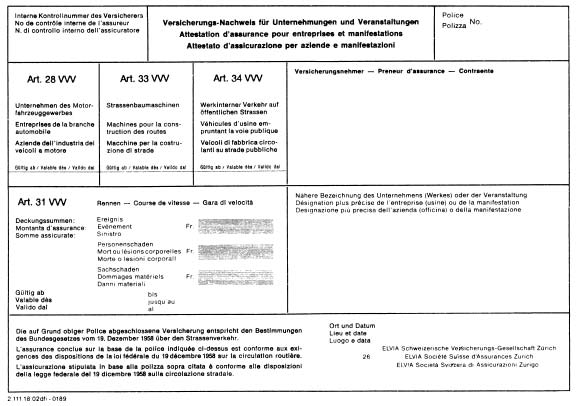
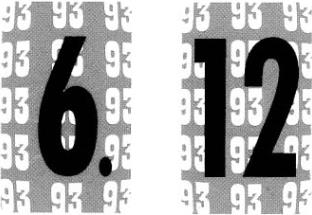
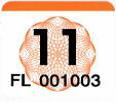

Verkehrsversicherungsverordnung (VVV) vom 1. August 1978 Aufgrund von Art. 23, 60, 66 Abs. 3, 68 Abs. 1, 70, 72 Abs. 1 und 4, 74, 75, 84 und 99 Abs. 1 und 2 des Strassenverkehrsgesetzes vom 30. Juni 1978, LGBl. 1978 Nr. 18 , verordnet die Regierung: I. Teil Allgemeine Bestimmungen Art. 1 Motorfahrzeuge Die im Strassenverkehrsgesetz (im folgenden SVG genannt) und in dieser Verordnung enthaltenen Haftpflicht- und Versicherungsbestimmungen für Motorfahrzeuge gelten, unter Vorbehalt von Art. 38 und 39 dieser Verordnung, für alle Motorfahrzeuge. Art. 2 Losgelöste Motorfahrzeuganhänger 1) Wird ein Schaden durch einen Anhänger verursacht, der nicht mit einem Motorfahrzeug verbunden ist, so trifft die Haftung gemäss Art. 65 SVG den Halter des Anhängers. Hat jedoch eine andere Person in ihrer Eigenschaft als Motorfahrzeughalter den Anhänger zur Zeit des Unfalles oder unmittelbar vorher verwendet, so obliegt diesem Motorfahrzeughalter die Haftung für den durch den Anhänger verursachten Schaden. 2) Hält der Haftpflichtige mehrere für das Ziehen des Anhängers geeignete Motorfahrzeuge, die bei verschiedenen Versicherern versichert sind, so obliegt die Versicherungsleistung dem Versicherer des Motorfahrzeugs, an dem der Anhänger zur Zeit des Unfalles oder unmittelbar vorher verwendet wurde. Besteht kein solcher Zusammenhang zwischen dem Anhänger und einem bestimmten Zugfahrzeug, so haften die verschiedenen Versicherer dem Geschädigten solidarisch für die Ersatzleistung. Diese wird unter die Versicherer verteilt nach der Zahl der bei jedem von ihnen versicherten Zugfahrzeuge. 3) Wird ein Schaden von einem Anhängewagen verursacht, der nicht für die Verwendung an Motorfahrzeugen bestimmt ist, so findet Art. 65 SVG nur Anwendung, wenn der Anhängewagen zur Zeit des Unfalles oder unmittelbar vorher an einem Motorfahrzeug verwendet wurde. II. Teil Haftpflichtversicherung der Motorfahrzeuge 1. Abschnitt Mindestversicherung und gemeinsame Bestimmungen a) Versicherungsnachweis Art. 3 Mindestversicherung 1) Die Versicherung muss die Ersatzrechte der anspruchsberechtigten Geschädigten je Unfallereignis wie folgt decken: a) für Personenschäden bis zum Betrag von mindestens 6.45 Millionen Euro oder den Gegenwert in Schweizer Franken; und b) für Sachschäden bis zum Betrag von mindestens 1.3 Millionen Euro oder den Gegenwert in Schweizer Franken. 2) Bei Motorwagen und Anhängerzügen, mit denen Personen befördert werden, erhöht sich die Mindestversicherung für Personenschäden je Unfallereignis: a) bei einer Platzzahl von 10 bis 50 Personen auf 10 Millionen Franken; und b) bei einer Platzzahl ab 51 Personen auf 20 Millionen Franken. Art. 4 Erfordernis 1) Motorfahrzeuge und zur Personenbeförderung bestimmte Anhänger, einschliesslich Sattelanhänger, ausgenommen Fahrzeuge des Staates, werden zum Verkehr nur zugelassen, wenn dem Amt für Strassenverkehr ein Versicherungsnachweis vorliegt. 2) Ein neuer Versicherungsnachweis ist dem Amt für Strassenverkehr zu übermitteln, wenn ein Fahrzeug im Verkehr belassen oder erneut zum Verkehr zugelassen werden soll: a) nach der Übernahme durch einen anderen Halter; b) nach der Hinterlegung der Kontrollschilder beim Amt für Strassenverkehr (Art. 64 Abs. 3 SVG); c) nach der Meldung des Versicherers über Aussetzen oder Aufhören der Versicherung (Art. 64 Abs. 2 SVG); d) bei der Ersetzung des Kontrollschildes durch ein solches mit anderer Nummer. 3) Der Versicherer kann den Geschädigten in den Fällen gemäss Abs. 2 Bst. a das Fehlen des neuen Versicherungsnachweises nicht entgegenhalten, solange das Fahrzeug mit dem bisherigen Fahrzeugausweis versehen ist. 4) Das Amt für Strassenverkehr meldet dem Bundesamt für Strassen nach den Vorschriften von Anhang 1: a) die Zulassung des Fahrzeuges (Kontrollmeldung); b) die Ausserverkehrsetzung des Fahrzeuges. 5) Das Bundesamt für Strassen gibt die Daten nach Abs. 4 dem Versicherer, der den Versicherungsnachweis ausgestellt hat, weiter. Art. 5 Inhalt und Form 1) Der Versicherungsnachweis enthält die erforderlichen Angaben über das Fahrzeug, den Halter und den Versicherer sowie über die für die Anwendung dieser Verordnung erheblichen Bedingungen des Versicherungsvertrages und bezeichnet den Tag, an dem die Versicherungsdeckung beginnt. 2) Bedingungen des Versicherungsnachweises, inbegriffen Beschränkungen und Befristungen, die in dieser Verordnung nicht vorgesehen sind, gelten als nicht vorhanden. 3) Die Versicherungsnachweise müssen in elektronischer Form ausgestellt und vom Versicherer an das automatisierte Fahrzeug- und Fahrzeughalterregister (MOFIS) übermittelt werden. Die Ausgestaltung und die Übermittlung der Versicherungsnachweise richten sich nach Anhang 1. Art. 6 Ausstellung der Nachweise 1) Versicherungsausweise können ausgestellt werden: a) von Versicherungsunternehmen, die nach der Versicherungsaufsichtsgesetzgebung zum Betrieb der Motorfahrzeug-Haftpflichtversicherung im Fürstentum Liechtenstein zugelassen sind; b) bei provisorischen Immatrikulationen von Versicherungsunternehmen, die in einem anderen Vertragsstaat des EWR-Abkommens zum Betrieb der Motorfahrzeug-Haftpflichtversicherung zugelassen sind, sofern der dem Versicherungsnachweis zugrunde liegende Versicherungsvertrag vom Versicherungsunternehmen weder durch eine Niederlassung in Liechtenstein noch im Dienstleistungsverkehr abgeschlossen wurde und 1. bereits vor der Immatrikulation in Liechtenstein in Kraft stand und damit bereits der Versicherungsschutz während der vorhergehenden Immatrikulation in einem anderen Vertragsstaat des EWR-Abkommens sichergestellt wurde; oder 2. der Versicherungsschutz dem Export eines Fahrzeuges dient und auf höchstens 30 Tage begrenzt ist. 1a) Die Finanzmarktaufsicht (FMA) teilt dem Amt für Strassenverkehr die Liste der Versicherungsunternehmen gemäss Abs. 1 Bst. a mit und gibt ihr die eintretenden Änderungen bekannt. 2) Versicherungsnachweise, die für den Versicherten auf den Beginn eines Monats ausgestellt werden, sind so zu übermitteln, dass das Amt für Strassenverkehr das Fahrzeug an den letzten beiden Arbeitstagen des Vormonats zum Verkehr zulassen kann. 3) Internationale Versicherungsausweise (Grüne Karten) werden vom Nationalen Versicherungsbüro oder, mit dessen Genehmigung, von im Fürstentum Liechtenstein zur Motorfahrzeug-Haftpflichtversicherung zugelassenen Versicherern abgegeben. Art. 7 Prüfung, Aufbewahrung 1) Das Amt für Strassenverkehr weist den Versicherungsnachweis zurück, wenn die darin enthaltenen Angaben unvollständig oder unzutreffend sind. In Zweifelsfällen veranlasst es die erforderlichen Erhebungen oder benachrichtigt den Versicherer. Dies gilt sinngemäss, wenn anzunehmen ist, dass die im Nachweis festgehaltenen Tatsachen nachträglich eine Änderung erfahren haben. 2) Versicherungsnachweise werden vom Bundesamt für Strassen während ihrer Gültigkeit und danach noch drei Jahre lang elektronisch aufbewahrt. 3) Aufgehoben b) Aussetzen und Aufhören der Versicherung Art. 8 Meldung des Versicherers 1) Der Versicherer darf das Aussetzen oder Aufhören der Versicherung frühestens an dem Tag melden, an dem die vertragsgemässe Versicherungsdeckung endet. Veranlasst der Versicherer das Aussetzen oder Aufhören der Versicherung, so hat er dem Versicherungsnehmer die bevorstehende Meldung und deren Folgen anzukündigen. 2) Nach Eingang der Meldung entzieht das Amt für Strassenverkehr unverzüglich den Fahrzeugausweis gemäss Art. 15 Abs. 1 SVG und ordnet den Entzug von Fahrzeugausweis und Kontrollschildern an. 3) Der Entzug des Fahrzeugausweises fällt dahin, wenn dem Amt für Strassenverkehr ein neuer Versicherungsnachweis vorliegt. 4) Liegt kein neuer Versicherungsnachweis vor und sind die Kontrollschilder am 30. Tag nach Ablauf der vertragsgemässen Versicherungsdeckung nicht beim Amt für Strassenverkehr eingetroffen, so werden sie zum Einzug im automatisierten Fahndungssystem (RIPOL) ausgeschrieben. Art. 8a Insolvenzverfahren über das Vermögen eines Versicherers 1) Wird über das Vermögen eines Versicherers ein Insolvenzverfahren eröffnet oder mangels kostendeckenden Vermögens nicht eröffnet, so macht die FMA dem Amt für Strassenverkehr davon unverzüglich Anzeige. 2) Das Amt für Strassenverkehr fordert die Fahrzeughalter unverzüglich auf, ihm innerhalb von vier Wochen einen neuen Versicherungsnachweis zu übermitteln oder die Kontrollschilder zu hinterlegen. 3) Liegt auf diesen Zeitpunkt kein neuer Versicherungsnachweis vor oder sind die Kontrollschilder nicht beim Amt für Strassenverkehr eingetroffen, so verfügt es unverzüglich den Entzug des Fahrzeugausweises nach Art. 15 Abs. 1 SVG, beauftragt die Polizei, Fahrzeugausweis und Kontrollschilder einzuziehen und schreibt letztere zum Einzug im automatisierten Fahndungssystem (RIPOL) aus. Art. 9 Hinterlegung von Fahrzeugausweis und Kontrollschildern 1) Der Halter, der die Versicherung ruhen lassen will, hat die Kontrollschilder beim Amt für Strassenverkehr zu hinterlegen (Art. 64 Abs. 3 SVG). Nimmt er das Fahrzeug nicht mehr in Betrieb, so hat er auch den Fahrzeugausweis abzugeben. Andernfalls kann das Amt für Strassenverkehr die Kontrollschilder für die erforderliche Dauer sperren. 2) Ausweis und Kontrollschilder können jederzeit dem Amt für Strassenverkehr abgegeben oder ihm durch die Post zugestellt werden. Die Versicherung ruht von dem auf die Abgabe oder Versendung folgenden Tag an. Das Amt für Strassenverkehr führt ein Verzeichnis der hinterlegten Ausweise und Kontrollschilder, aus dem hervorgeht, von welchem Tage an die Versicherung ruht. c) Ersatzfahrzeuge und vorläufige Verkehrsberechtigung Art. 10 Behördliche Bewilligung 1) Die Übertragung der Kontrollschilder eines Motorfahrzeuges auf ein Ersatzfahrzeug bedarf in jedem einzelnen Falle einer vorausgehenden schriftlichen Bewilligung des Amts für Strassenverkehr. 2) Die Bewilligung wird erteilt, wenn ein mit liechtensteinischen Kontrollschildern verkehrendes Fahrzeug wegen Beschädigung, Reparatur, Revision, Umbau und dergleichen nicht gebrauchsfähig und das Ersatzfahrzeug betriebssicher ist. 3) Für die Nachprüfung von Ersatzfahrzeugen gilt Art. 33 VTS sinngemäss. 4) Als Ersatzfahrzeug kann nur bewilligt werden: a) für ein Motorrad ein anderes Motorrad und für ein Kleinmotorrad ein anderes Kleinmotorrad; b) für ein Leichtmotorfahrzeug ein anderes Leichtmotorfahrzeug; c) für ein dreirädriges Motorfahrzeug ein anderes dreirädriges Motorfahrzeug oder ein Kleinmotorfahrzeug; d) für ein Kleinmotorfahrzeug ein anderes Kleinmotorfahrzeug oder ein dreirädriges Motorfahrzeug; e) für einen leichten Motorwagen ein anderer leichter Motorwagen; f) für einen schweren Personenwagen ein anderer Personenwagen; g) für einen schweren Motorwagen zum Sachentransport ein anderer Motorwagen zum Sachentransport; h) für einen Gesellschaftswagen ein anderer Gesellschaftswagen, dessen Platzzahl nach Art. 3 Abs. 2 keine höhere Mindestversicherung bedingt; i) für einen gewerblichen Traktor ein anderer gewerblicher Traktor; k) für ein land- oder forstwirtschaftliches Motorfahrzeug ein anderes land- oder forstwirtschaftliches Motorfahrzeug; l) für eine schwere oder leichte Arbeitsmaschine eine andere Arbeitsmaschine, für einen Arbeitskarren ein anderer Arbeitskarren; m) für einen Anhänger ein anderer Anhänger gleicher oder ähnlicher Art; bei Anhängern zur Personenbeförderung gilt Bst. h sinngemäss. 5) Das Amt für Strassenverkehr kann in begründeten Fällen Abweichungen von Abs. 4 gestatten, sofern für das Ersatzfahrzeug ein Versicherungsnachweis vorliegt; für Anhänger, die nicht der Personenbeförderung dienen, ist kein Versicherungsnachweis erforderlich. Art. 11 Verfahren, Frist 1) Die Bewilligung für die Verwendung des Ersatzfahrzeugs wird nur erteilt, wenn der Fahrzeugausweis des Originalfahrzeugs beim Amt für Strassenverkehr hinterlegt wird. 2) Die Bewilligung ist auf längstens 30 Tage zu befristen. 3) Die Bewilligung ist nach Ablauf der Frist unverzüglich dem Amt für Strassenverkehr zurückzugeben. Kommt der Halter dieser Pflicht nicht nach, so trifft das Amt für Strassenverkehr die erforderlichen Massnahmen. 4) Aufgehoben Art. 11a Generelle Ersatzfahrzeugbewilligungen 1) Das Amt für Strassenverkehr kann Unternehmen, die über betriebseigene Ersatzfahrzeuge verfügen, generelle Ersatzfahrzeugbewilligungen erteilen. Eine generelle Ersatzfahrzeugbewilligung ist zu erteilen, wenn mehrere Einzelhalter über ein gemeinsames Ersatzfahrzeug verfügen und durch eine gemeinsam genutzte Organisation, beispielsweise eine Taxizentrale, verbunden sind. Die Bewilligung ist auf ein Jahr zu befristen und kann jeweils um ein Jahr verlängert werden. 2) Die Bewilligung wird erteilt, wenn: a) das Ersatzfahrzeug betriebssicher ist; und b) die letzte amtliche Prüfung des Ersatzfahrzeuges bei der Erteilung oder Verlängerung der Bewilligung nicht weiter zurückliegt als die letzte amtliche Prüfung bei der ordentlichen Immatrikulation. 3) Im Fahrzeugausweis für Ersatzfahrzeuge oder in einem Anhang zum Fahrzeugausweis werden die Kontrollschild-Nummern und die Marke des Fahrzeuges oder der Fahrzeuge eingetragen, die zu ersetzen sind. Bei einem Ersatzfahrzeug mehrerer einzelner Halter ist die Bezeichnung der gemeinsam genutzten Organisation, beispielsweise einer Taxizentrale, einzutragen. 4) Der Ersatzfahrzeugausweis ist nur gültig, wenn gleichzeitig der Fahrzeugausweis des nicht gebrauchsfähigen Fahrzeuges mitgeführt wird. Art. 11b Vorläufige Verkehrsberechtigung 1) Der Halter darf für Fahrten in Liechtenstein ein amtlich geprüftes Fahrzeug, für das der Fahrzeugausweis noch nicht erteilt wurde, mit den Kontrollschildern seines Fahrzeuges verwenden, das ausser Verkehr gesetzt werden soll, wenn: a) ein gültiger Versicherungsnachweis vorliegt; ausgenommen sind Anhänger, die weder der Personenbeförderung noch dem Transport gefährlicher Güter dienen; b) die Unterlagen nach Art. 63 Abs. 1 Bst. a, b und c der Verkehrszulassungsverordnung (VZV) und der Fahrzeugausweis des Fahrzeuges, das ausser Verkehr gesetzt werden soll, dem Amt für Strassenverkehr oder zu deren Händen der Post übergeben sowie gegebenenfalls zusätzlich die Unterlagen nach Art. 70 Abs. 3 VZV und Art. 10 Abs. 2 oder Art. 8 Abs. 2 der Schwerverkehrsabgabeverordnung (SVAV) beigelegt worden sind; und c) die Erklärung nach Anhang 3 vom Halter ausgefüllt mitgeführt wird. 2) Die Berechtigung ist längstens 30 Tage ab Gültigkeitsbeginn des Versicherungsnachweises gültig. 3) Sie gilt für schwere und leichte Motorfahrzeuge und Anhänger unter sich, die gleichartige Kontrollschilder tragen dürfen, sowie für Motorfahrzeuge und Anhänger, die mit Wechselschildern verwendet werden. Sie gilt jedoch nicht für Motorfahrzeuge und Anhänger, die provisorisch immatrikuliert sind oder mit Tagesausweisen verwendet werden. 4) Massgeblich für die Ausser- und die Inverkehrsetzung ist das Datum des Poststempels. 5) Wurde der Versicherungsnachweis nicht oder nicht rechtzeitig übermittelt, so erstreckt sich die für das ursprüngliche Fahrzeug geltende Haftpflichtversicherung während höchstens 30 Tagen ab Inverkehrsetzung des neuen Fahrzeuges auch auf dieses. Der Versicherer kann Rückgriff auf den fehlbaren Halter nehmen. d) Bescheinigungen des Versicherers Art. 11c Bescheinigungen über den Schadenverlauf und die Schadenfreiheit 1) Der Versicherungsnehmer kann jederzeit sowohl eine Bescheinigung über den Schadenverlauf als auch eine Bescheinigung über die Schadenfreiheit verlangen. Die Versicherungsunternehmen sind verpflichtet, einem solchen Begehren innert fünfzehn Tagen nachzukommen. 2) Bescheinigungen über den Schadenverlauf sind Erklärungen eines Versicherungsunternehmens über die Anzahl und den Umfang der durch einen Versicherungsvertrag in den letzten fünf Jahren gedeckten Haftpflichtansprüche Dritter. 3) Bescheinigungen über die Schadenfreiheit sind Erklärungen eines Versicherungsunternehmens zur aktuellen Einstufung eines Versicherungsvertrages im Rahmen eines konkreten Bonus-/Malus-Systems. 2. Abschnitt Besondere Verhältnisse a) Erhöhte Risiken Art. 12 Art der Risiken 1) Der Halter bedarf einer behördlichen Bewilligung, die im Fahrzeugausweis zu vermerken ist, wenn er ein Motorfahrzeug oder einen Anhänger zum Transport von gefährlichen Gütern verwenden will, für das die erhöhte Versicherungsdeckung nach Art. 13 erforderlich ist. Die Bewilligung wird nur erteilt, wenn das erhöhte Risiko im Versicherungsnachweis vermerkt ist. 2) Motorwagen, die mit dem Führersitz mehr als neun Plätze aufweisen, werden zum Verkehr nur zugelassen, wenn im Versicherungsnachweis wenigstens soviele Plätze vermerkt sind, wie das Fahrzeug aufweist. 3) Aufgehoben 4) Der Versicherer kann den Geschädigten das Fehlen der vertraglichen Deckung für die in diesem Artikel genannten besonderen Risiken nicht entgegenhalten. Art. 13 Gefährliche Güter 1) Die Mindestversicherung für Motorfahrzeuge und Anhängerzüge, mit denen gefährliche Güter befördert werden, beträgt je Unfallereignis für Personen- und Sachschäden zusammen 15 Millionen Franken. Personenschäden sind zuerst zu decken. Werden gefährliche Güter nur auf einem Anhänger befördert, so ist für diesen Anhänger eine Zusatzversicherung erforderlich. 2) Sofern der Versicherungsvertrag nichts anderes bestimmt, gilt die erhöhte Versicherungsdeckung gemäss Abs. 1 nur, wenn der Schaden durch die gefährlichen Eigenschaften der Ladung verursacht wurde. 3) Die Liste der gefährlichen Güter wird von der Regierung aufgestellt. b) Wechsel-Kontrollschilder Art. 14 Allgemeine Bedingungen 1) Wechselschilder werden auf Ersuchen des Fahrzeughalters nach Massgabe der nachfolgenden Bestimmungen vom Amt für Strassenverkehr erteilt. 2) Ein Wechselschild oder Wechselschilderpaar wird nur für Fahrzeuge desselben Halters abgegeben. Wechselschilder werden für höchstens zwei Fahrzeuge erteilt. Diese Einschränkung gilt nicht für Arbeitsmotorwagen und Anhänger. Die Verwendung von mehr als einem Wechselschild oder Wechselschilderpaar an einem Fahrzeug ist nicht gestattet. 3) Ein Wechselschild oder Wechselschilderpaar wird nur für Motorfahrzeuge unter sich und für Anhänger unter sich abgegeben; die Fahrzeuge müssen überdies gleichartige Kontrollschilder tragen können. 4) Für jedes Fahrzeug, das mit Wechselschildern verwendet wird, ist ein gesonderter Fahrzeugausweis auszustellen. Art. 15 Verwendung 1) Von den Fahrzeugen, für die ein Wechselschild oder Wechselschilderpaar erteilt wurde, darf stets nur jenes im öffentlichen Verkehr verwendet werden, welches das Schild oder Schilderpaar trägt. 2) Werden Widerhandlungen gegen diese Bestimmung festgestellt, so kann das Amt für Strassenverkehr dem fehlbaren Halter die Bewilligung zur Verwendung von Wechselschildern zeitweilig oder dauernd entziehen. Art. 16 Versicherung 1) Für jedes Motorfahrzeug, für das ein Wechselschild oder Wechselschilderpaar erteilt wird, ist ein gesonderter Versicherungsnachweis erforderlich, der besonders gekennzeichnet sein kann. 2) Wird ein Fahrzeug, dem ein Wechselschild oder Wechselschilderpaar zugeteilt war, unter Zuteilung eines Kontrollschildes mit anderer Nummer neu immatrikuliert, so ist ein neuer Versicherungsnachweis beizubringen. 3) Der Versicherer kann Geschädigten die unerlaubte, gleichzeitige Verwendung von mehr als einem der Motorfahrzeuge nicht entgegenhalten; er kann jedoch in solchen Fällen auf den Halter Rückgriff nehmen. c) Provisorische Immatrikulation Art. 17 Anwendungsfälle 1) Motorfahrzeuge werden vom Amt für Strassenverkehr provisorisch immatrikuliert, wenn: a) sich ihr Standort nur oder nur noch für beschränkte Zeit im Fürstentum Liechtenstein befindet; b) dem Halter innerhalb von drei Jahren mindestens drei Entzugsverfügungen zugestellt wurden: 1. wegen Nichtbezahlens der Motorfahrzeugsteuern oder -gebühren (Art. 85 Abs. 2 Bst. c VZV); oder 2. wegen Nichterscheinens zur Fahrzeugprüfung (Art. 85 Abs. 1 Bst. b VZV). 2) Unverzollte Motorfahrzeuge, deren Halter nicht im Genuss der diplomatischen Vorrechte und Befreiungen stehen, dürfen vom Amt für Strassenverkehr nur provisorisch und nur mit Zustimmung der Zollbehörden immatrikuliert werden. 3) Die Bestimmungen über die Fahrzeuge, die im internationalen Verkehr mit ausländischen Ausweisen und Kontrollschildern zugelassen sind, bleiben vorbehalten. Art. 18 Fahrzeugausweis 1) Für provisorisch immatrikulierte Motorfahrzeuge wird ein besonders gekennzeichneter Fahrzeugausweis ausgestellt. Er ist nach Massgabe der folgenden Bestimmungen so zu befristen, dass seine Gültigkeit spätestens an dem im Versicherungsnachweis angegebenen Tage und stets auf das Ende eines Monats abläuft. 2) Die Gültigkeit des Ausweises hat spätestens mit dem zwölften auf die Ausstellung folgenden Monat zu enden. Davon abweichend können nachfolgende Ausweise wie folgt befristet werden: a) Ausweise, die im Oktober oder November ausgestellt werden, auf das Ende des folgenden Jahres; b) Ausweise, die von einem ausländischen Versicherungsunternehmen nach Art. 6 Abs. 1 Bst. b ausgestellt werden, auf den Ablauf des dem Versicherungsnachweis zugrunde liegenden Versicherungsvertrages. 2a) Die Verlängerung eines für kürzere Zeit ausgestellten Ausweises bis zu den in Abs. 2 genannten Fristen ist zulässig. 3) Die provisorische Immatrikulation eines Fahrzeugs kann vom Amt für Strassenverkehr aus zureichenden Gründen verlängert werden. Ist die Gültigkeit der provisorischen Immatrikulation während eines Auslandaufenthaltes abgelaufen, können die Zollbehörden bei einer Wiedereinreise die Verwendung des Fahrzeugs für höchstens 48 Stunden bewilligen; Voraussetzung dazu ist der Abschluss einer Grenzversicherung im Sinne von Art. 47 dieser Verordnung. 4) Die Erteilung des Ausweises kann von der Bezahlung oder Sicherstellung der Gebühren und der für die Gültigkeitsdauer des Ausweises geschuldeten Fahrzeugsteuern abhängig gemacht werden. Weitere Sicherheiten können nicht gefordert werden. Art. 19 Kontrollschilder und Kontrollmarke 1) Für provisorisch immatrikulierte Motorfahrzeuge werden besondere Kontrollschilder nach Anhang 1a Bst. A abgegeben. Die Kontrollschilder verlieren ihre Gültigkeit zusammen mit dem Fahrzeugausweis. Sie müssen, wenn die im Fahrzeugausweis festgelegte Dauer der provisorischen Immatrikulation abgelaufen ist, dem Amt für Strassenverkehr nicht zurückgegeben werden, sind jedoch bei missbräuchlicher Verwendung amtlich einzuziehen. 2) Jedes Kontrollschild trägt die Kontrollmarke nach Anhang 1a Bst. B; die Kontrollmarke nennt das Jahr und den Monat, in dem die Gültigkeit der provisorischen Immatrikulation abläuft. Art. 20 Versicherung 1) Für die provisorische Immatrikulation muss dem Amt für Strassenverkehr ein befristeter Versicherungsnachweis vorliegen. 2) Während der im Fahrzeugausweis festgelegten Dauer der provisorischen Immatrikulation wird das Aussetzen oder Aufhören der Versicherung gegenüber Geschädigten nur wirksam, wenn Ausweis und Kontrollschilder dem Amt für Strassenverkehr oder der Landespolizei zurückgegeben oder von ihnen eingezogen werden und frühestens von dem auf die Versendung, Abgabe oder Einziehung folgenden Tage an. 3) Im übrigen endet der Versicherungsschutz für Geschädigte frühestens am 15. Tage nach Ablauf der im Fahrzeugausweis festgelegten Dauer der provisorischen Immatrikulation. 4) Aufgehoben 5) Aufgehoben d) Tagesausweis Art. 21 Erteilung 1) Personen mit Wohnsitz in Liechtenstein werden auf Gesuch hin Tagesausweise für betriebssichere Motorfahrzeuge oder Anhänger ausgestellt. 2) Der Gesuchsteller hat zu bestätigen, dass das Fahrzeug betriebssicher ist. Das Amt für Strassenverkehr kann die Betriebssicherheit selber überprüfen oder eine Bestätigung einer von ihr anerkannten Reparaturwerkstätte verlangen. 3) Das Amt für Strassenverkehr kann vom Gesuchsteller verlangen, dass er weitere Dokumente wie den Fahrzeugausweis oder den Prüfungsbericht vorlegt. Es kann zur Sicherstellung der durch nicht rechtzeitige Rückgabe der Kontrollschilder entstandenen Kosten eine angemessene Kaution verlangen. 4) Tagesausweise werden ausgestellt für eine Gültigkeitsdauer von 24, 48, 72 oder 96 Stunden. 5) Die mit dem Tagesausweis abgegebenen Kontrollschilder sind spätestens beim Ablauf der Gültigkeit des Ausweises beim Amt für Strassenverkehr abzugeben oder ihm durch die Post zuzusenden. 6) Fahrzeughalter, welche die mit dem Tagesausweis verbundenen Bedingungen nicht beachten, können vom weiteren Bezug solcher Ausweise ausgeschlossen werden. Art. 21a Verwendung 1) Fahrzeuge, die mit einem Tagesausweis versehen sind, dürfen nur für unentgeltliche Fahrten verwendet und nicht vermietet werden; es dürfen sich höchstens acht Personen nebst dem Fahrzeugführer im Fahrzeug befinden. 2) Tagesausweise dürfen nicht verwendet werden für: a) den Transport gefährlicher Güter, wofür gemäss Art. 13 eine erhöhte Mindestversicherung erforderlich ist; b) Sachentransporte mit schweren Motorfahrzeugen oder Anhängern, deren Gesamtgewicht mehr als 3 500 kg beträgt, ausser für Transporte nach Art. 25 Abs. 4 Bst. a und b sowie Abs. 5. Art. 22 Versicherung 1) Der Halter, der sich um einen Tagesausweis bewirbt, hat der von der Regierung abzuschliessenden Kollektiv-Haftpflichtversicherung beizutreten. Abs. 5 ist vorbehalten. 2) Der Halter hat seinen Prämienanteil vor Bezug des Ausweises zu entrichten. Stellt er dem Amt für Strassenverkehr die Kontrollschilder nach Ablauf ihrer Gültigkeit nicht rechtzeitig zu, so schuldet er für jeden weiteren Tag eine Zusatzprämie. 3) Gehen die Kontrollschilder nach Ablauf der Gültigkeit nicht rechtzeitig beim Amt für Strassenverkehr ein, veranlasst es deren polizeiliche Einziehung. 4) Die Versicherungsdeckung und die Pflicht zur Prämienzahlung enden in jedem Falle 60 Tage nach Ablauf der Gültigkeit des Ausweises. 5) Tagesausweise für die Fahrt zur amtlichen Prüfung eines zu immatrikulierenden Motorfahrzeugs können aufgrund des für das Fahrzeug bestehenden Versicherungsnachweises erteilt werden. e) Kollektiv-Fahrzeugausweise Art. 23 Art und Natur der Ausweise 1) Kollektiv-Fahrzeugausweise in Verbindung mit Händlerschildern werden abgegeben für: a) Motorwagen; b) Motorräder; c) Kleinmotorräder; d) land- und forstwirtschaftliche Motorfahrzeuge; e) Arbeitsmotorfahrzeuge; f) Anhänger. 2) Ausser an den Fahrzeugen nach Abs. 1 dürfen verwendet werden: a) Händlerschilder für Motorwagen an allen mehrspurigen Motorfahrzeugen, die keine Motorräder sind; b) das Händlerschild für Motorräder an allen Motorfahrzeugen, die keine Motorwagen sind; c) das Händlerschild für Kleinmotorräder an Leichtmotorfahrzeugen und an Motorfahrrädern; d) alle Händlerschilder an Ausnahmefahrzeugen der entsprechenden Fahrzeugkategorie; e) das Händlerschild für land- und forstwirtschaftliche Motorfahrzeuge an land- und forstwirtschaftlichen Anhängern und Anhängerzügen. 2a) Beim Mitführen eines Anhängers an Motorwagen kann das hintere Schild des Zugfahrzeugs als Schild des Anhängers verwendet werden. 3) Verwendungs- und Verkehrsbeschränkungen für Arbeitsfahrzeuge oder land- und forstwirtschaftliche Fahrzeuge sowie die Pflicht zur Einholung einer Sonderbewilligung für Ausnahmefahrzeuge sind auch bei Verwendung mit Händlerschildern zu beachten. Art. 24 Erteilung 1) Kollektiv-Fahrzeugausweise werden abgegeben an Betriebe, welche die im Anhang 2 aufgeführten Voraussetzungen erfüllen und a) über die für die Art des Betriebes erforderlichen Bewilligungen verfügen, b) Gewähr für eine einwandfreie Verwendung des Kollektiv-Fahrzeugausweises bieten, und c) soweit es sich um Unternehmen des Motorfahrzeuggewerbes handelt, die die in Art. 67 Abs. 2 SVG vorgeschriebene Versicherung abgeschlossen haben. 2) Das Amt für Strassenverkehr kann von den Voraussetzungen des Anhangs 2 zu Gunsten des Bewerbers oder Inhabers ausnahmsweise abweichen, wenn die Gesamtbeurteilung des Betriebes ergibt, dass die Händlerschilder ohne Gefahr für die Verkehrssicherheit und die Umwelt abgegeben werden können. Art. 24a Entzug 1) Kollektiv-Fahrzeugausweise sind zu entziehen, wenn die Voraussetzungen für die Erteilung nicht mehr erfüllt sind. 2) Gewähr für eine einwandfreie Verwendung des Kollektiv-Fahrzeugausweises ist namentlich nicht mehr gegeben, wenn der Inhaber eine missbräuchliche Verwendung des Ausweises veranlasst oder geduldet hat, beispielsweise durch Unterlassen der erforderlichen Aufsicht oder dadurch, dass ein nicht betriebssicheres Fahrzeug in Verkehr gesetzt wurde. In leichten Fällen kann der Ausweisentzug angedroht werden. Art. 25 Verwendung 1) Der Kollektiv-Fahrzeugausweis berechtigt zum Anbringen der darin genannten Händlerschilder an geprüften und nicht geprüften, betriebssicheren und den Vorschriften entsprechenden Fahrzeugen der im Ausweis genannten Art. Nicht in allen Teilen den Vorschriften entsprechen muss das Fahrzeug auf Fahrten, die zur Feststellung oder Kontrolle der Behebung eines Mangels erforderlich sind. 2) Der Inhaber des Kollektiv-Fahrzeugausweises ist wie ein Halter für den betriebssicheren und vorschriftsgemässen Zustand des Fahrzeuges verantwortlich (Art. 88 Abs. 2 SVG). 3) Händlerschilder dürfen verwendet werden: a) zu Fahrten für die Behebung von Pannen und zum Abschleppen; b) zum Überführen und Erproben von Fahrzeugen im Zusammenhang mit dem Fahrzeughandel, mit Reparaturen oder Umbauten am Fahrzeug; c) zum Erproben von neuen Fahrzeugen durch Hersteller und Importeure; d) zum Begutachten von Fahrzeugen durch Sachverständige; e) für die amtliche Fahrzeugprüfung und die Fahrt zu dieser Prüfung; f) für alle weiteren unentgeltlichen Fahrten, sofern sich mit Einschluss des Führers höchstens neun Personen im oder auf dem Fahrzeug befinden. 4) Mit Händlerschildern versehene Motorfahrzeuge und Transportanhänger, deren Gesamtgewicht (Art. 7 Abs. 4 VTS) je über 3 500 kg liegt, dürfen nur für folgende Sachentransporte verwendet werden: a) Transporte von Fahrzeugteilen im Zusammenhang mit Fahrzeugreparaturen oder Fahrzeugumbauten im eigenen Betrieb; b) das Mitführen von Ballast in den Fällen nach Abs. 3 Bst. b bis e; c) das Abschleppen, Bergen und Überführen von Unfall- und Pannenfahrzeugen vom Unfall- oder Pannenort zu einer nahegelegenen Reparaturwerkstätte oder zum Betrieb des Inhabers des Kollektiv-Fahrzeugausweises. 5) In den Fällen von Abs. 3 Bst. a und f sowie Abs. 4 Bst. a und c dürfen Händlerschilder nur an verzollten und nach dem schweizerischen Automobilsteuergesetz vom 21. Juni 1996 versteuerten Fahrzeugen verwendet werden. Im Falle von Abs. 4 Bst. a dürfen Händlerschilder auch an unverzollten oder unversteuerten Fahrzeugen verwendet werden, sofern die transportierten Teile für Arbeiten am Fahrzeug selbst bestimmt sind. 6) Werden Händlerschilder an beladenen Motorfahrzeugen oder Anhängern zum Sachentransport verwendet, ist mit dem Kollektiv-Fahrzeugausweis ein Beleg über das zulässige Gesamtgewicht (wie z.B. der Typenschein, die Herstellergarantie oder der Fahrzeugausweis einer früheren Zulassung), bei der Verwendung der Händlerschilder an Anhängerzügen zusätzlich ein Beleg über die zulässige Anhängelast mitzuführen. Die Beförderung gefährlicher Güter bedarf einer behördlichen Bewilligung und der erforderlichen Zusatzversicherung nach Art. 13. Art. 26 Berechtigte Personen 1) Ein Motorfahrzeug, das mit Händlerschildern versehen ist oder einen mit Händlerschild versehenen Anhänger zieht, darf unter Vorbehalt der Abs. 2 und 3 nur verkehren, wenn eine der folgenden Personen das Fahrzeug führt oder den Führer begleitet: a) Inhaber oder Angestellte des Betriebes; b) Familienangehörige der Betriebsinhaber oder Betriebsleiter (Direktoren, Geschäftsführer, Betriebs- oder Verkaufschefs), wenn sie mit dem Inhaber oder Leiter des Betriebes im gleichen Haushalt leben. 2) Liegt die Überführung eines Fahrzeuges im Interesse des Betriebes, können weitere vom Betriebsinhaber oder Betriebsleiter beauftragte Personen Händlerschilder verwenden, müssen jedoch das Fahrzeug selber führen. 3) Mit Händlerschildern versehene Fahrzeuge können Kaufinteressenten für unbegleitete Fahrten überlassen werden, wenn sie betriebssicher sind und den Vorschriften entsprechen. Der Inhaber des Kollektiv-Fahrzeugausweises hat über diese Fahrten ein Verzeichnis zu führen, das während zwei Jahren aufzubewahren ist. Er hat den Kontrollorganen auf Verlangen Einsicht in dieses Verzeichnis zu gewähren. 4) Aufgehoben Art. 27 Versicherung 1) Wer sich um die Erteilung eines Kollektiv-Fahrzeugausweises für Motorfahrzeuge bewirbt, hat dem Amt für Strassenverkehr einen besonders gekennzeichneten Versicherungsnachweis übermitteln zu lassen. 2) Die Versicherung hat im Rahmen des SVG die Schäden zu decken, die durch das Fahrzeug verursacht werden, welches das aufgrund des Versicherungsnachweises erteilte Händlerschild trägt. 3) Die missbräuchliche Verwendung der Schilder, namentlich die Verwendung durch eine nicht berechtigte Person, kann dem Geschädigten nicht entgegengehalten werden. Vorbehalten bleiben die Bestimmungen über die Schadendeckung bei der Entwendung von Fahrzeugen zum Gebrauch (Art. 71 SVG). 3. Abschnitt Haftpflichtversicherung für Unternehmungen und Veranstaltungen a) Unternehmungen des Motorfahrzeuggewerbes Art. 28 Versicherungspflicht 1) Die Versicherung nach Art. 67 Abs. 2 SVG deckt die Haftpflicht der Unternehmer im Motorfahrzeuggewerbe für deren eigene Motorfahrzeuge ohne Halterversicherung und für die ihnen übergebenen Motorfahrzeuge. Zum Abschluss dieser Versicherung sind verpflichtet: a) die Inhaber von Unternehmungen, die Motorfahrzeuge oder Motorfahrzeuganhänger herstellen, montieren, mit Karosserien versehen, umbauen oder reparieren, b) die Importeure, Händler und Makler von Motorfahrzeugen und Motorfahrzeuganhängern, c) die Inhaber von Hilfsbetrieben des Motorfahrzeuggewerbes, wie Fahrzeugspenglereien, Sattlereien, Malereien, d) die Motorfahrzeug-Abbruchunternehmer. 2) Der Versicherungspflicht werden durch Verfügung des Amts für Strassenverkehr weitere Unternehmungen des Motorfahrzeuggewerbes unterstellt, in deren Betrieb regelmässig betriebsbereite, jedoch nicht mit Fahrzeugausweisen versehene Motorfahrzeuge vorhanden sind. 3) Von der Versicherungspflicht werden auf Gesuch hin durch Verfügung des Amts für Strassenverkehr die Unternehmer befreit, die nachweisen, dass sich in ihrem Betrieb ausschliesslich einzeln immatrikulierte, eigene oder nur vollständig gebrauchsunfähige Motorfahrzeuge befinden. Art. 29 Verfahren 1) Wer einen gemäss Art. 28 Abs. 1 dieser Verordnung versicherungspflichtigen Betrieb eröffnen will, hat dies dem Amt für Strassenverkehr vor der Eröffnung zu melden. 2) Das Amt für Strassenverkehr hat eine Verfügung zu treffen, wenn ein Unternehmer: a) der Meldepflicht gemäss Abs. 1 nicht nachkommt oder die Versicherungspflicht bestreitet, b) gemäss Art. 28 Abs. 2 der Versicherungspflicht zu unterstellen ist, c) die Befreiung von der Versicherungspflicht verlangt. Art. 30 Versicherungsnachweis 1) Der versicherungspflichtige Unternehmer hat dem Amt für Strassenverkehr einen besonderen Versicherungsnachweis zu übergeben. Dies entbindet ihn nicht von der Pflicht, die nach den Art. 3, 12, 16, 20 und 27 dieser Verordnung vorgeschriebenen Versicherungsnachweise abzugeben. 2) Aussetzen und Aufhören der Versicherung nach Art. 67 Abs. 2 SVG sind vom Versicherer dem Amt für Strassenverkehr zu melden und werden gegenüber Geschädigten erst wirksam nach Ablauf von 60 Tagen seit dem Eingang der Meldung beim Amt für Strassenverkehr. 3) Bringt ein Unternehmer trotz behördlich festgestellter und nicht durch Beschwerde angefochtener Versicherungspflicht den für die Versicherung nach Art. 67 Abs. 2 SVG erforderlichen Versicherungsnachweis nicht bei, so setzt ihm das Amt für Strassenverkehr hierfür eine Frist von 30 Tagen unter Hinweis auf die Strafdrohung des Art. 140 LVG. Dasselbe gilt, wenn der Versicherer das Aussetzen oder Aufhören der Versicherung meldet. b) Rennen Art. 31 Anwendungsfälle 1) Art. 68 SVG gilt für: a) Rennen, Wettfahrten oder Rekordversuche auf öffentlichen Strassen, sofern möglichst schnell oder mit einer Durchschnittsgeschwindigkeit von mehr als 50 km/h gefahren werden soll oder die tägliche Fahrzeit für einen Fahrzeugführer mehr als 12, für zwei sich ablösende Fahrzeugführer zusammen mehr als 15 Stunden beträgt, b) die Veranstaltungen dieser Art auf abgesperrten Strassen, auf Rennbahnen oder im Gelände, sofern als Teilnehmer oder Zuschauer andere Personen als die Mitglieder des veranstaltenden Verbandes zugelassen werden. 2) Die Regierungskanzlei kann im Einzelfall: a) weitere motor- und radsportliche Veranstaltungen der Haftpflicht und Versicherungspflicht gemäss Art. 68 SVG unterstellen, sofern ihre Durchführung mit besonderen Gefahren verbunden ist; b) Ausnahmen für einzelne Veranstaltungen oder die auf besonderen Rennbahnen durchgeführten Fahrten verfügen, sofern eine Gefährdung Dritter als ausgeschlossen erscheint. Art. 32 Versicherungsnachweis 1) Wer eine versicherungspflichtige Veranstaltung durchführt, hat der Regierungskanzlei einen Versicherungsnachweis abzugeben, der befristet sein kann. Ist der Nachweis befristet, so kann der Versicherer ihn nicht widerrufen. 2) Wer auf einer besonderen Anlage regelmässige Veranstaltungen durchführt, hat dem Amt für Strassenverkehr einen unbefristeten Versicherungsnachweis abzugeben. Der Versicherer hat dem Amt für Strassenverkehr das Aussetzen oder Aufhören der Versicherung zu melden. Art. 30 Abs. 3 ist sinngemäss anwendbar. c) Besondere Fälle Art. 33 Strassenbaumaschinen und Arbeitskarren mit bauartbedingter Höchstgeschwindigkeit bis 10 km/h 1) Die Verwendung der folgenden Fahrzeuge ohne Fahrzeugausweis und Kontrollschilder ist nur gestattet, wenn der Unternehmer nachweist, dass er als Halter nach Massgabe des SVG gegen Haftpflicht versichert ist: a) Arbeitsmotorwagen bei Arbeiten auf Strassen, die dem Verkehr nicht völlig verschlossen sind; b) Arbeitskarren mit einer bauartbedingten Höchstgeschwindigkeit bis 10 km/h. 2) Art. 30 dieser Verordnung gilt sinngemäss. Art. 34 Werkinterner Verkehr auf öffentlichen Strassen 1) Muss für den Fahrverkehr zwischen benachbarten Teilen eines Fabrik- oder Werkbetriebes die öffentliche Strasse benützt werden, so kann das Amt für Strassenverkehr dem Unternehmer die Verwendung von Motorfahrzeugen ohne Fahrzeugausweis und Kontrollschilder auf kurzer Strassenstrecke gestatten, sofern er nachweist, dass er als Halter aller dieser Fahrzeuge nach Massgabe des SVG gegen Haftpflicht versichert ist. 2) Art. 30 dieser Verordnung gilt sinngemäss. III. Teil Haftpflichtversicherung der Motorfahrzeuge von geringer Motorkraft oder Geschwindigkeit 1. Abschnitt Motorfahrräder Art. 35 Haftpflicht Benützer von Motorfahrrädern haften nach den Bestimmungen des ABGB. Art. 36 Versicherung 1) Der Staat schliesst eine Kollektiv-Haftpflichtversicherung für Motorfahrräder ab. Die wesentlichen Bestimmungen des Versicherungsvertrages werden durch die Regierung kundgemacht. 2) Die Versicherung für Motorfahrräder muss die Ersatzrechte der Geschädigten bis zum Betrag von 2 Millionen Franken je Unfallereignis für Personen- und Sachschäden zusammen decken. 3) Die Haftpflichtversicherung für Motorfahrräder muss bei Versicherungsunternehmen abgeschlossen werden, die gemäss Versicherungsaufsichtsgesetzgebung zum Betrieb der Haftpflichtversicherung im Fürstentum Liechtenstein zugelassen sind. Die FMA teilt dem Amt für Strassenverkehr die Liste dieser Unternehmen mit und gibt ihm die eintretenden Änderungen bekannt. 4) Die Vignette muss hinsichtlich Gestaltung dem Muster nach Anhang 1b entsprechen und die beiden letzten Ziffern des Abgabejahres sowie eine individuelle Nummer tragen. Sie ist im oberen Drittel des Kontrollschilds und im dafür vorgesehenen Feld des Fahrzeugausweises anzubringen. Art. 37 Gültigkeitsdauer und Ersatz der Vignetten 1) Die Vignetten sind vom 1. Januar des aufgedruckten Abgabejahres bis zum 31. Mai des folgenden Jahres gültig. 2) Vignetten, bei denen die Jahreszahl oder die individuelle Nummer unlesbar sind und abhanden gekommene Vignetten sind auf dem Kontrollschild und im Fahrzeugausweis zu ersetzen. Sie können durch Vignetten mit gleicher Gültigkeitsdauer ersetzt werden. Art. 38 Beschaffung und Abgabe der Vignetten Für die Beschaffung und die Abgabe der Vignetten ist das Amt für Strassenverkehr zuständig. 2. Abschnitt Motorhandwagen, Motoreinachser, Leicht-Motorfahrräder, Rollstühle Art. 39 Versicherung und Haftpflicht 1) Die Benützer der folgenden Motorfahrzeuge sind von der Versicherungspflicht nach Art. 59 SVG ausgenommen: a) Motorhandwagen; b) Motoreinachser, die nur von einer zu Fuss gehenden Person geführt und nicht für das Ziehen von Anhängern verwendet werden; c) Leicht-Motorfahrräder; d) Rollstühle mit elektrischem Antrieb und einer Höchstgeschwindigkeit bis 10 km/h. 2) Sie haften nach den Bestimmungen des ABGB. IV. Teil Nationales Versicherungsbüro und Nationaler Garantiefonds 1. Abschnitt Nationales Versicherungsbüro a) Ausländische Motorfahrzeuge und Anhänger Art. 40 Geltungsbereich 1) Die Art. 40 bis 50 gelten für Schäden, die von ausländischen Motorfahrzeugen auf dem Gebiet des Fürstentums Liechtenstein verursacht werden. Für ausländische Motorfahrzeuge nach Art. 39 gilt Art. 54a Bst. b. 2) Sie finden sinngemäss Anwendung, wenn der Halter eines ausländischen Motorfahrzeugs oder Motorfahrzeuganhängers nach Art. 65 SVG und Art. 2 dieser Verordnung für den von einem Anhänger oder einem geschleppten Fahrzeug auf dem Gebiet des Fürstentums Liechtenstein verursachten Schaden einstehen muss. 3) Fahrzeuge gelten als ausländisch, wenn sie aufgrund eines ausländischen Fahrzeugausweises und ausländischer Kontrollschilder zugelassen sind. Art. 41 Deckungsanspruch 1) Die Geschädigten können für die Schadenersatzansprüche, die ihnen gegen den haftpflichtigen Motorfahrzeughalter von Gesetzes wegen zustehen, vom Nationalen Versicherungsbüro Deckung verlangen. 2) Die Deckung kann jedoch nur im gleichen Umfang beansprucht werden, wie wenn der Unfall durch ein liechtensteinisches Fahrzeug verursacht worden wäre. Art. 43 Abs. 2 bleibt vorbehalten. 3) Eine über die liechtensteinische Mindestdeckung hinausgehende Forderung wird erfüllt, wenn: a) das schädigende Fahrzeug aus einem Staat stammt, der eine höhere gesetzliche Mindestdeckung vorschreibt; oder b) für das schädigende Fahrzeug aufgrund der Versicherungspolice eine höhere Deckung besteht und aus dem Ausland die entsprechende Deckungszusage vorliegt. 4) Der Deckungsanspruch unterliegt im übrigen denselben Regeln wie das direkte Forderungsrecht gegen einen Versicherer im Sinne von Art. 61 Abs. 1 SVG. Art. 42 Deckungspflicht 1) Das Nationale Versicherungsbüro ist für die Deckung der Schäden nach Art. 40 zuständig. Es wird dabei durch eine Mitgliedgesellschaft, einen geschäftsführenden Versicherer oder ein Schadenregulierungsunternehmen vertreten (Vertreter). 2) Das Nationale Versicherungsbüro bezeichnet seinen Vertreter unter Berücksichtigung der internationalen Zusammenarbeitsverträge. 3) Die Zusammenarbeit zwischen dem Nationalen Versicherungsbüro und dem Vertreter ist vertraglich zu regeln. 4) Das Nationale Versicherungsbüro bezeichnet innert 30 Tagen einen anderen Vertreter, wenn: a) sich eine Kollision zwischen den Interessen des zunächst bezeichneten Vertreters und der geschädigten Person ergibt, ausser der ausländische Versicherer stimme der Schadenregulierung durch den zunächst bezeichneten Vertreter zu; b) dies zur ordnungsgemässen Abwicklung der Schadenregulierung erforderlich ist. 5) Haben Geschädigte, die noch nicht abgefunden sind, Wohnsitz oder gewöhnlichen Aufenthalt im Ausland, so kann das Nationale Versicherungsbüro oder, mit dessen Zustimmung, der Vertreter einen ausländischen Versicherer oder ein ausländisches nationales Versicherungsbüro mit der Schadenregulierung im Namen des Nationalen Versicherungsbüros beauftragen, sofern die Beteiligten ihre Einwilligung geben. Art. 43 Pflichten der Geschädigten 1) Will ein Geschädigter die Schadendeckung nach Art. 70 Abs. 2 Bst. a SVG beanspruchen, so muss er den Schadenfall unverzüglich dem Nationalen Versicherungsbüro mit folgenden Angaben melden: a) Unfall (Ort, Datum, Zeit, Hergang, Unfallbeteiligte, Zeugen und Unfallprotokoll); b) Schaden (Art und Grössenordnung); c) schädigendes Fahrzeug (Art, Marke, Farbe, Kontrollschild, Zulassungsstaat); d) Hinweis, ob ein Polizeirapport erstellt wurde. 2) Verletzt der Geschädigte diese Meldepflicht schuldhaft, so kann die Entschädigung um den Mehraufwand, der dem Nationalen Versicherungsbüro dadurch entsteht, gekürzt werden. Art. 44 Pflichten des Vertreters 1) Der Vertreter hat dem Nationalen Versicherungsbüro die von ihm behandelten Schadenfälle mit den Angaben zu melden, die es letzterem ermöglichen: a) dem Geschädigten Auskunft zu erteilen, welcher Vertreter den Schadenfall bearbeitet; b) die korrekte Schadenregulierung und Abrechnung nach Massgabe der Vereinbarungen zwischen den nationalen Versicherungsbüros zu kontrollieren; c) die von den nationalen Versicherungsbüros beschlossenen und in den Statuten des Nationalen Versicherungsbüros vorgesehenen Statistiken zu erstellen. 2) Er muss den Fall an das Nationale Versicherungsbüro zurückgeben, wenn: a) sich eine Kollision zwischen seinen und den Interessen der geschädigten Person ergibt; b) sich nachträglich herausstellt, dass ein anderer als der ursprünglich angenommene ausländische Versicherer zuständig ist; oder c) dies zur ordnungsgemässen Abwicklung der Schadenregulierung erforderlich ist. 3) Das Nationale Versicherungsbüro entzieht dem Vertreter die Schadenregulierung in einem Fall nach Abs. 2, wenn der Vertreter den Fall nicht von sich aus zurückgibt. Art. 45 Grenzversicherung 1) Der Führer eines ausländischen Motorfahrzeugs muss bei der Einfahrt in Liechtenstein eine Grenzversicherung abschliessen, sofern die Voraussetzungen nach Art. 46 nicht erfüllt sind. 2) Die Grenzversicherung gewährt dem Halter des darin bezeichneten Fahrzeugs und den Personen, für die er verantwortlich ist, in den auf dem Grenzversicherungsnachweis aufgeführten Staaten mindestens einen Versicherungsschutz, der der Mindestdeckungspflicht im jeweiligen Staat entspricht. 3) Die Prämien werden vom Nationalen Versicherungsbüro festgelegt. Sie bedürfen der Genehmigung der Regierung. 4) Grenzversicherungsnachweise werden vom Nationalen Versicherungsbüro oder, mit dessen Genehmigung, von im Fürstentum Liechtenstein zur Motorfahrzeug-Haftpflichtversicherung zugelassenen Versicherern herausgegeben. Art. 46 Gleichwertige Versicherungsnachweise Keine Grenzversicherung benötigen Führer ausländischer Motorfahrzeuge, wenn die Schadendeckung im Fürstentum Liechtenstein aufgrund einer Vereinbarung des Nationalen Versicherungsbüros mit dem ausländischen nationalen Versicherungsbüro für alle Motorfahrzeuge gewährleistet ist: a) welche die ordentlichen Kontrollschilder des betreffenden Staates tragen, oder b) für welche bei der Einreise eine für Liechtenstein gültige internationale Versicherungskarte (Grüne Karte) oder ein anderer für Liechtenstein genügender ausländischer Grenzversicherungsnachweis vorgewiesen wird. Art. 47 Pflichten der ausländischen Fahrzeugführer 1) Ausländische Motorfahrzeuge dürfen im Fürstentum Liechtenstein nur verkehren, solange die Schadendeckung nach Art. 45 oder 46 gewährleistet ist. 2) Der Führer eines ausländischen Motorfahrzeugs muss die internationale Versicherungskarte (Grüne Karte) oder den Grenzversicherungsnachweis im Fahrzeug mitführen und auf Verlangen den Kontrollorganen vorweisen, sofern nicht das Kontrollschild als Versicherungsnachweis gilt. Art. 48 Motorsportliche Veranstaltungen Führt eine ausländische motorsportliche Veranstaltung über liechtensteinisches Gebiet, so darf die Regierungskanzlei die erforderliche Bewilligung nur erteilen, wenn ein im Fürstentum Liechtenstein zur Motorfahrzeug-Haftpflichtversicherung zugelassener Versicherer beim Nationalen Versicherungsbüro den Nachweis einer ausreichenden Deckung allfälliger Schäden hinterlegt hat. Art. 49 Aufgaben der Landespolizei 1) In den Rapporten hält die Landespolizei über die von ausländischen Motorfahrzeugen verursachten Unfälle die Angaben fest, die für die Ermittlung des Haftpflichtigen und seines Versicherers notwendig sind. 2) Sie erstellt die Rapporte unverzüglich und sendet dem Nationalen Versicherungsbüro oder dem Vertreter eine Kopie davon sowie das Doppel oder eine Kopie der Grünen Karte oder des Grenzversicherungsnachweises. Können die beiden letztgenannten Dokumente nicht kopiert werden, so wird deren Inhalt im Polizeirapport festgehalten. 3) Kann der Führer des ausländischen Motorfahrzeugs das erforderliche Dokument (Art. 45 und 46) nicht vorlegen, so ist dies unter Angabe der geltend gemachten Gründe im Rapport zu vermerken und festzuhalten, ob und bei welchem Unternehmen eine Haftpflichtversicherung für das Fahrzeug besteht. Art. 50 Ausschluss von einstweiligen Verfügungen Zur Sicherung der im Gesetz vorgesehenen Ersatzansprüche für die Schäden, die ein ausländisches Motorfahrzeug verursacht hat, sind einstweilige Verfügungen und polizeiliche oder strafrichterliche Beschlagnahme des Fahrzeugs oder anderer vom ausländischen Haftpflichtigen mitgeführten Gegenstände nur auf Antrag des Nationalen Versicherungsbüros möglich. b) Auskunftsstelle Art. 50a Register 1) Die Auskunftsstelle (Art. 75a SVG) nutzt zur Erfüllung ihrer Aufgaben das Fahrzeug- und Fahrzeughalterregister des Amts für Strassenverkehr. 2) Sie führt zusätzlich ein eigenes Register, das folgende Informationen enthält: a) die Versicherungsunternehmen, die Versicherungsnachweise zu Handen des Amts für Strassenverkehr ausgestellt haben sowie die von diesen im Ausland benannten Schadenregulierungsbeauftragten (Art. 75b SVG); b) die vom Staat nach Art. 69 Abs. 3 SVG bezeichneten Schadenregulierungsstellen. Art. 50b Zugriffsberechtigung Die Informationen im Register nach Art. 50a Abs. 2 können von den ausländischen Auskunftsstellen online abgerufen werden, um die von den liechtensteinischen Versicherungsunternehmen im Ausland benannten Schadenregulierungsbeauftragten zu ermitteln. Art. 50c Aufbewahrung der Daten Die Informationen im Register nach Art. 50a Abs. 2 müssen während sieben Jahren nach dem Erlöschen der Bewilligung zur Geschäftstätigkeit des Versicherungsunternehmens beziehungsweise der Auflösung des Vertrages zwischen dem Versicherer und seinem Schadenregulierungsbeauftragten oder der Beendigung der Tätigkeit als Schadenregulierungsstelle online abrufbar sein. Art. 50d Erteilung von Auskünften 1) Die Auskunftsstelle erteilt geschädigten Personen und Sozialversicherungen folgende Auskünfte zum Fahrzeug, das den Unfall verursacht haben soll: a) Name und Adresse des Haftpflichtversicherers sowie, wenn dieser seinen Sitz nicht im Wohnsitzstaat der geschädigten Person hat, Name und Adresse des Schadenregulierungsbeauftragten im Wohnsitzstaat der geschädigten Person; b) Nummer der Versicherungspolice und, wenn diese abgelaufen ist, den Zeitpunkt der Beendigung des Versicherungsschutzes; c) Name und Adresse des Halters, sofern die geschädigte Person ein berechtigtes Interesse geltend machen kann; d) Adresse der zuständigen Schadenregulierungsstelle des Staates, wenn der Schaden durch ein Fahrzeug verursacht worden ist, für welches der Staat haftet. 2) Auskünfte über im Fürstentum Liechtenstein immatrikulierte Motorfahrzeuge werden erteilt, sofern der Unfall nicht länger als sieben Jahre zurückliegt. Ist ein Motorfahrzeug im Ausland immatrikuliert, werden Auskünfte erteilt, sofern die Information bei der ausländischen Auskunftsstelle erhältlich ist. 3) Die Auskunftserteilung richtet sich nach Art. 98 VZV. 2. Abschnitt Nationaler Garantiefonds a) Ausländische Fahrräder Art. 51 Aufgehoben Art. 52 Geltungsbereich Aufgehoben b) Unbekannte oder nicht versicherte Fahrzeuge und fahrzeugähnliche Geräte Art. 53 Obliegenheiten des Geschädigten; Selbstbehalt 1) Will ein Geschädigter die Schadendeckung nach Art. 72 Abs. 2 Bst. a SVG beanspruchen, so muss er: a) den Schadenfall unverzüglich dem Nationalen Garantiefonds melden und alle Angaben machen, die zur Ermittlung der schädigenden und haftpflichtigen Personen führen können; b) eine Bestätigung beibringen, dass ein Polizeirapport erstellt wurde. 2) Verletzt er diese Meldepflicht schuldhaft, so kann die Entschädigung angemessen gekürzt werden. 3) Verursachen unbekannte Motorfahrzeuge oder Anhänger oder unbekannte Radfahrer oder Benützer von fahrzeugähnlichen Geräten Sachschäden, so hat jeder Geschädigte einen Anteil in der Höhe von 500 Euro oder den Gegenwert in Schweizer Franken selbst zu tragen. Haftet der Schädiger aus dem selben Ereignis für einen erheblichen Personenschaden, so entfällt der Selbstbehalt. 4) Hat der Schädiger keine leistungspflichtige Haftpflichtversicherung oder ist das Fehlen einer solchen Versicherung strittig, so ist der Nationale Garantiefonds zur Vorleistung verpflichtet. Art. 54 Deckungspflicht 1) Der Nationale Garantiefonds ist für die Deckung der Schäden nach Art. 72 Abs. 2 Bst. a SVG zuständig. Er wird dabei durch eine Mitgliedgesellschaft, einen geschäftsführenden Versicherer oder ein Schadenregulierungsunternehmen vertreten (Vertreter). 2) Der Nationale Garantiefonds bezeichnet seinen Vertreter unter Berücksichtigung der internationalen Zusammenarbeitsverträge. 3) Die Zusammenarbeit zwischen dem Nationalen Garantiefonds und dem Vertreter ist vertraglich zu regeln. 4) Der Nationale Garantiefonds bezeichnet einen anderen Vertreter, wenn: a) sich eine Kollision zwischen den Interessen des zunächst bezeichneten Vertreters und der geschädigten Person ergibt; b) dies zur ordnungsgemässen Abwicklung der Schadenregulierung erforderlich ist. 5) Der Vertreter hat dem Nationalen Garantiefonds die Angaben zu melden, die es letzterem ermöglichen: a) dem Geschädigten Auskunft zu erteilen, welcher Vertreter den Schadenfall bearbeitet; b) die korrekte Schadenregulierung und die Abrechnung zu kontrollieren. 6) Der Nationale Garantiefonds entzieht dem Vertreter die Schadenregulierung in einem Fall nach Abs. 4, wenn der Vertreter den Fall nicht von sich aus zurückgibt. Art. 54a Umfang der Leistungen Der Nationale Garantiefonds deckt die Haftung für Schäden, die verursacht werden durch: a) nicht ermittelte oder nicht versicherte Motorfahrzeuge oder Anhänger: im Umfang der obligatorischen Mindestversicherung; b) nicht ermittelte oder nicht versicherte Motorfahrzeuge nach Art. 39: im Umfang von 2 Millionen Franken je Unfallereignis für Personen- und Sachschäden zusammen; c) nicht ermittelte, ungenügend versicherte oder nicht versicherte Radfahrer oder Benützer von fahrzeugähnlichen Geräten: im Umfang von 2 Millionen Franken je Unfallereignis für Personen- und Sachschäden zusammen. Art. 55 Ausländische Geschädigte 1) Von der Schadendeckung nach Art. 72 Abs. 2 Bst. a SVG sowie nach Art. 51 bis 54 dieser Verordnung sind ausgenommen die Ansprüche der Geschädigten, die zur Zeit des Unfalles nicht in einem EWR-Mitgliedstaat Wohnsitz hatten. 2) Vorbehalten bleiben: a) abweichende zwischenstaatliche Vereinbarungen; b) von der Regierung anerkannte Abkommen zwischen dem Nationalen Garantiefonds und ausländischen nationalen Garantiefonds; c) andere Fälle, in denen Gegenrecht gewährt wird. c) Entschädigungsstelle Art. 55a 1) Werden Haftpflichtansprüche gegen die Entschädigungsstelle (Art. 75d SVG) erhoben, so prüft diese, ob die Voraussetzungen für die Behandlung des Falles erfüllt sind. Gegebenenfalls unterrichtet sie unverzüglich folgende Stellen darüber, dass ein Antrag auf Entschädigung bei ihr eingegangen ist und dass sie innert zweier Monate auf diesen eingehen werde: a) das Versicherungsunternehmen, bei dem das schädigende Fahrzeug versichert ist; b) den für das Fürstentum Liechtenstein zuständigen Schadenregulierungsbeauftragten desjenigen Versicherungsunternehmens, bei dem das schadenverursachende Fahrzeug versichert ist, wenn die betreffende Police im Ausland ausgestellt worden ist; c) die Entschädigungsstelle des Staates, in dem die Versicherungspolice ausgestellt worden ist; d) die Person, die den Unfall verursacht hat, sofern sie bekannt ist; e) das nationale Versicherungsbüro des Staates, in dem sich der Unfall ereignet hat, wenn das unfallverursachende Fahrzeug seinen gewöhnlichen Standort nicht in diesem Staat hat; f) die Schadenregulierungsstelle des Staates, wenn diese für das unfallverursachende Fahrzeug haftet; g) die FMA. 2) Die Entschädigungsstelle reguliert die Schadenersatzansprüche nach Massgabe des anwendbaren Rechts, wenn das Versicherungsunternehmen oder deren Schadenregulierungsbeauftragter nicht innert zweier Monate seit dem Eingang der Schadenersatzforderung bei der Entschädigungsstelle entweder eine begründete Antwort abgeben oder ein begründetes Angebot vorlegen. Sie berücksichtigt dabei die Leistungen der Sozialversicherungen. 3) Wird die Entschädigungsstelle von der Entschädigungsstelle eines anderen Staates darüber informiert, dass diese ein Schadenersatzbegehren gegen einen Versicherer erhalten hat, der im Fürstentum Liechtenstein eine Versicherungspolice ausgestellt hat, leitet sie diese Information an die FMA weiter. d) Insolvenz des Versicherers Art. 55b Grundsatz 1) Wird über das Vermögen eines im Fürstentum Liechtenstein zum Betrieb der Motorfahrzeug-Haftpflichtversicherung zugelassenen Versicherungsunternehmens ein Insolvenzverfahren eröffnet oder mangels kostendeckenden Vermögens nicht eröffnet, so übernimmt der Nationale Garantiefonds die Haftung für die Schäden. 2) Wird über das Vermögen eines in einem anderen EWR-Mitgliedstaat zum Betrieb der Motorfahrzeug-Haftpflichtversicherung zugelassenen Versicherungsunternehmens ein Insolvenzverfahren eröffnet oder mangels kostendeckenden Vermögens nicht eröffnet und tritt der Nationale Garantiefonds nach Art. 72 SVG in Vorleistung für die Schäden, so nimmt dieser Rückgriff auf die zuständige ausländische Entschädigungsstelle für Insolvenzfälle. 3) Die Abwicklung der Schadenfälle eines Versicherungsunternehmens, über dessen Vermögen ein Insolvenzverfahren eröffnet oder mangels kostendeckenden Vermögens nicht eröffnet wurde, erfolgt gegenüber den Geschädigten und den zuständigen ausländischen Entschädigungsstellen für Insolvenzfälle durch den Insolvenzverwalter. Dieser beauftragt den Nationalen Garantiefonds innerhalb von drei Monaten ab dem Tag, an dem der Geschädigte seinen Antrag auf Entschädigung beim Nationalen Garantiefonds gestellt hat, die geschuldeten Leistungen auszubezahlen. Der Nationale Garantiefonds tritt mit der Zahlung in die Rechte und Pflichten der Geschädigten ein. Die Beauftragung zur Auszahlung durch den Insolvenzverwalter gilt zugleich als Anmeldung der entsprechenden Forderungen des Nationalen Garantiefonds gegenüber der Insolvenzmasse. 4) Muss das Nationale Versicherungsbüro für im Ausland verursachte Schäden aufkommen, die durch Fahrzeuge oder Anhänger verursacht worden sind, die bei einem liechtensteinischen Versicherungsunternehmen versichert sind, über dessen Vermögen ein Insolvenzverfahren eröffnet oder mangels kostendeckenden Vermögens nicht eröffnet worden ist, so nimmt es Rückgriff auf den Nationalen Garantiefonds. 5) Die FMA regelt die Modalitäten im Einzelfall. e) Ausländische radsportliche Veranstaltungen Art. 55c Führt eine ausländische radsportliche Veranstaltung über liechtensteinisches Gebiet, so darf die erforderliche Bewilligung nur erteilt werden, wenn die zuständige Haftpflichtversicherung den Nachweis einer ausreichenden Deckung allfälliger Schäden hinterlegt hat. 3. Abschnitt Gemeinsame Bestimmungen für das Nationale Versicherungsbüro und den Nationalen Garantiefonds Art. 56 Statuten, Streitigkeiten 1) Die Statuten des Nationalen Versicherungsbüros und des Nationalen Garantiefonds sowie deren Änderungen bedürfen der Genehmigung der Regierung. 2) Bei Streitigkeiten zwischen dem Nationalen Versicherungsbüro und dem Nationalen Garantiefonds oder zwischen diesen und ihren Mitgliedern entscheidet die Regierung. Art. 57 Verhältnis 1) Steht nicht fest, ob der Schaden letztlich von einem ausländischen Versicherer gedeckt wird, so erfolgt die Schadenregulierung nach Massgabe der Wahrscheinlichkeit zu Lasten des Nationalen Versicherungsbüros oder des Nationalen Garantiefonds. Im Zweifelsfall wird ein Schaden zu Lasten des Nationalen Garantiefonds reguliert. In jedem Fall wird der Selbstbehalt nach Art. 53 Abs. 3 zur definitiven Regulierung zurückbehalten. 2) Stellt sich heraus, dass für den vom Nationalen Versicherungsbüro nach Abs. 1 übernommenen Schaden definitiv kein ausländischer Versicherer deckungspflichtig ist, so nimmt es Rückgriff auf den Nationalen Garantiefonds. 3) Wurde der Aufwand provisorisch vom Nationalen Garantiefonds gedeckt und ergibt sich eine Deckungspflicht eines ausländischen nationalen Versicherungsbüros nachträglich, so nimmt er Rückgriff auf das Nationale Versicherungsbüro. Das Nationale Versicherungsbüro erstattet dem Geschädigten den zurückbehaltenen Selbstbehalt, sobald die Rückgriffszahlung aus dem Ausland eingegangen ist. 4) Das Nationale Versicherungsbüro und der Nationale Garantiefonds sind verpflichtet, einander gegenseitig alle Tatsachen zu melden, die einen Rückgriff nach den Abs. 2 und 3 begründen. Art. 58 Besucherschutz Aufgehoben Art. 59 Beiträge der Motorfahrzeughalter Das Nationale Versicherungsbüro und der Nationale Garantiefonds berechnen die Beiträge nach anerkannten Regeln der Versicherungstechnik. Sie legen die Beiträge und das Kalkulationsschema der FMA zur Genehmigung vor. Die Genehmigung der FMA erfolgt im Einvernehmen mit der Regierung. Art. 60 Pflichten der Versicherungsunternehmen 1) Die im Fürstentum Liechtenstein zur Motorfahrzeug-Haftpflichtversicherung zugelassenen Versicherungsunternehmen müssen die Versicherungsnehmer über die Höhe der Beiträge informieren. 2) Sie müssen dem Nationalen Versicherungsbüro und dem Nationalen Garantiefonds: a) die Beiträge überweisen; b) die Angaben melden, die diese benötigen, um zu überprüfen, ob die Versicherungsunternehmen die Beitragserhebungspflicht korrekt erfüllen. 3) Ausländische Versicherungsunternehmen, die Versicherungsnachweise nach Art. 6 Abs. 1 Bst. b ausgestellt haben, haben gegenüber dem Nationalen Versicherungsbüro und dem Nationalen Garantiefonds die gleichen Pflichten wie Versicherungsunternehmen nach Abs. 1. Art. 60a Mitwirkung der Behörden Das Amt für Strassenverkehr und die FMA melden dem Nationalen Versicherungsbüro und dem Nationalen Garantiefonds die Angaben, die diese benötigen, um zu überprüfen, ob die Versicherungsunternehmen die Beitragserhebungspflicht korrekt erfüllen. Art. 60b Aufgehoben Art. 60c Leistungskoordination Die Koordination der Leistungen der Sozialversicherungen mit den Schadenersatzleistungen des Nationalen Versicherungsbüros oder des Nationalen Garantiefonds richtet sich nach den Bestimmungen des Sozialversicherungsrechts. V. Teil Strafbestimmungen Art. 61 Strafbestimmungen 1) Wer eine durch diese Verordnung vorgeschriebene Bewilligung nicht einholt, wer die zu einem Tagesausweis gehörenden Kontrollschilder oder die Ersatzfahrzeugbewilligung nicht rechtzeitig dem Amt für Strassenverkehr zurückgibt, wird vom Landgericht wegen Übertretung mit einer Busse bis zu 20 000 Franken, im Nichteinbringlichkeitsfalle mit einer Freiheitsstrafe bis zu drei Monaten bestraft. 2) Wer Beschränkungen, Auflagen oder Befristungen missachtet, die mit Bewilligungen oder besondern Fahrzeugausweisen im Sinne dieser Verordnung verbunden sind, insbesondere wer die Bestimmung von Art. 15 Abs. 1 dieser Verordnung über die Verwendung von Fahrzeugen mit Wechselschildern übertritt, wer ohne Berechtigung Händlerschilder verwendet, die nach Art. 25 Abs. 6 verlangten Belege nicht mitführt oder ein mit Händlerschildern versehenes Fahrzeug zu Fahrten verwendet, die nach dieser Verordnung nicht gestattet sind, wird vom Landgericht wegen Übertretung mit Busse bis zu 20 000 Franken, im Nichteinbringlichkeitsfalle bis zu drei Monaten Freiheitsstrafe bestraft. 3) Aufgehoben 4) Wer ausländische Kontrollschilder für Motorfahrzeuge ins Fürstentum Liechtenstein einführt, um sie unter Umgehung bestehender Vorschriften zu verwenden, wird vom Landgericht wegen Übertretung mit einer Busse bis zu 20 000 Franken, im Nichteinbringlichkeitsfalle mit einer Freiheitsstrafe bis zu drei Monaten bestraft. Die Zollbehörden können Kontrollschilder beschlagnahmen, wenn anzunehmen ist, dass sie missbräuchlicher Verwendung dienen sollen, und sie zur weiteren Abklärung des Sachverhaltes dem Amt für Strassenverkehr übermitteln; dieses zieht die Schilder endgültig ein, wenn die Absicht missbräuchlicher Verwendung festgestellt ist. 5) Der Fahrzeughalter oder Inhaber eines Kollektiv-Fahrzeugausweises und Personen, die an ihrer Stelle über Fahrzeug oder Ausweis verfügen, unterstehen der gleichen Strafdrohung wie der Täter, wenn sie von der Widerhandlung Kenntnis hatten oder bei pflichtgemässer Aufmerksamkeit haben konnten. 6) Die vorstehenden Strafbestimmungen finden keine Anwendung, wenn die Tat unter eine Strafdrohung des SVG fällt. VI. Teil Schlussbestimmungen Art. 62 Rechtsweg Gegen Entscheidungen und Verfügungen des Amts für Strassenverkehr kann binnen 14 Tagen ab Zustellung Beschwerde bei der Beschwerdekommission für Verwaltungsangelegenheiten erhoben werden. Art. 63 Aufhebung bisherigen Rechts Mit dem Inkrafttreten dieser Verordnung werden nachfolgende Vorschriften aufgehoben: a) die Verordnung vom 30. Dezember 1959 zum Gesetz über den Strassenverkehr, LGBl. 1960 Nr. 4, b) die Verordnung vom 16. Dezember 1975 zum Gesetz über den Strassenverkehr, LGBl. 1975 Nr. 66. Art. 64 Inkrafttreten Diese Verordnung tritt am 1. September 1978 in Kraft. Fürstliche Regierung: gez. Hans Brunhart Fürstlicher Regierungschef Anhang 1 Versicherungsnachweise A. Versicherungsnachweise für Motorfahrzeuge 1. Die Versicherungsnachweise müssen folgende Datenfelder beinhalten: - Versicherungsnachweisnummer - Kontrollschild - Fahrzeugart - Fabrikmarke/Typ - Fahrgestellnummer - Stammnummer - Besondere Verhältnisse - Datum des Beginns der Gültigkeit - Befristungsdatum - Grund der Inverkehrsetzung - Name, Vorname, Geburtsdatum, Heimatstaat und Adresse des Halters - Name, Vorname und Wohnort des Lenkers - Standort des Fahrzeuges - Name, Code und Adresse des Versicherers - Versicherungsreferenznummer - Schildart - Anzahl Plätze 2. Folgende Rubriken des Versicherungsnachweises müssen vom Versicherer übermittelt werden: - Angaben des Kontrollschildes (wenn dem Versicherer bekannt) - Fahrzeugart - Fabrikmarke und Typ - Fahrgestellnummer (das Amt für Strassenverkehr kann darauf verzichten) - Stammnummer - Besondere Verhältnisse - Datum des Beginns der Gültigkeit - Befristungsdatum (nur bei befristeten Versicherungsnachweisen) - Name, Vorname, Geburtsdatum und Adresse des Halters - Name, Vorname und Wohnort des Lenkers (nur wenn Standort nicht identisch mit Halteradresse) - Name, Code und Adresse des Versicherers - Police-Nummer 3. Dem Versicherer werden über das MOFIS folgende Daten rückübermittelt: - Fahrzeugart - Besondere Verwendungen - Anzahl Plätze - Sitzplätze/Stehplätze - Höchstgeschwindigkeit - Kontrollschild - Schildart - Schildfarbe - Versicherungsgesellschaftscode - Referenz/Policennummer - Halteradresse - Geburtsdatum - Heimatstaat - Standortadresse - Marke/Typ - Stammnummer - Fahrgestellnummer - Datum der Inverkehrsetzung - Befristungsdatum - Mutationsgrund Inverkehrsetzung - Datum der Ausserverkehrsetzung - Mutationsgrund Ausserverkehrsetzung - Übermittlungsdatum - Typenschein-Nummer inklusive Zusatzcode - Fahrzeugfarbe - Gesamtgewicht - Leergewicht - Karosserieform - Datum der ersten Inverkehrsetzung - Hubraum - Nutzlast - Dachlast - Gewicht des Zuges - Kilowatt - Leistung Kilowatt B. Versicherungsnachweis für Unternehmungen und Veranstaltungen 1. Die Versicherungsnachweise sind 21 cm breit und 14.8 cm hoch (Format A5). Die Grundfarbe des Papiers ist grau. 2. Die Versicherungsnachweise müssen wie folgt gestaltet sein: 

 C. Meldungen an die Versicherer (Art. 4 Abs. 4 Bst. a und b) 1. Das Amt für Strassenverkehr übermittelt die Kontrollmeldungen (Art. 4 Abs. 4 Bst. a) und die Meldungen über die Ausserverkehrsetzungen (Art. 4 Abs. 4 Bst. b) auf elektronischem Weg dem Bundesamt für Strassen. Dieses gibt die Meldungen dem Versicherer weiter. Die Daten auf diesen Meldungen werden einheitlich wiedergegeben analog den Versicherungsnachweisen. 2. Den Versicherern müssen dabei mindestens folgende Daten gemeldet werden: - Angaben des Kontrollschildes - Fahrzeugart - Fabrikmarke und Typ - Fahrgestell-Nummer - Stamm-Nummer - Inverkehrsetzungsdatum - Besondere Verwendungen - Halterangaben (Name, Vorname, Adresse, Geburtsdatum und Heimatstaat) - Name, Code und Adresse des Versicherers - Police-Nummer - Datum der Meldung an den Versicherer Zusätzlich bei der Kontrollmeldung: - Befristungsdatum (nur bei befristeten Versicherungsnachweisen) - Mutationsgrund (Mindestunterscheidung: Neueinlösung/WIK nach Hinterlegung der Kontrollschilder/WIK nach Abmeldung durchVersicherer) Zusätzlich bei der Meldung der Ausserverkehrsetzung: - Ausserverkehrsetzungsdatum - Mutationsgrund (Mindestunterscheidung: Depot Kontrollschilder/ übrige Ausserverkehrsetzungsgründe) Anhang 1a (Art. 19) Kontrollschilder und -marken bei provisorischer Immatrikulation A. Kontrollschilder 1. Die Schilder für provisorisch immatrikulierte Motorfahrzeuge werden unabhängig von den übrigen Kontrollschildern nummeriert. 2. Die Schilder für provisorisch immatrikulierte Motorfahrzeuge entsprechen in Ausführung und Beschriftung den Vorschriften, die für die übrigen Kontrollschilder gelten (Art. 72 und 74 VZV). Das Amt für Strassenverkehr kann die Verwendung anderer Materialien zulassen. 3. Die Schilder für provisorisch immatrikulierte Motorfahrzeuge tragen anschliessend an die Kontrollnummer einen erhaben gepressten, senkrechten roten Balken; Schilder unverzollter Fahrzeuge tragen zusätzlich den Buchstaben "Z". Auf den vorderen Schildern für Motorwagen und den Schildern für Motorräder und für Kleinmotorräder ist der rote Balken 33 mm breit und 67 mm hoch, auf den hinteren Schildern für Motorwagen 36 mm breit und 75 mm hoch. 4. Auf dem roten Balken wird die Jahrzahl des dem Verfalljahr vorangehenden Jahres vertieft eingepresst. B. Kontrollmarken 1. Auf dem roten Balken ist eine Kontrollmarke aufzukleben, die die Zahl des Verfallmonats und die beiden letzten Ziffern des Verfalljahres trägt. 2. Die Kontrollmarke ist 5 cm hoch und 3 cm breit. Die Ecken sind mit einem Radius von 0.2 cm abgerundet. Die Grundfarbe ist rot. Die letzten beiden Ziffern des Verfalljahres sind in weisser Schrift gemäss untenstehendem Muster auf der Marke platziert. Die Zahl des Verfallmonats steht in schwarzer, 3.3 cm hoher Schrift mit einer Strichstärke von 0.45 cm in der Mitte der Marke. 

 Anhang 1b (Art. 36 Abs. 4) Versicherungsvignetten für Motorfahrräder 

 Anhang 2 Mindestanforderungen für die Erteilung von Kollektiv- Fahrzeugausweisen 1. Fahrzeughersteller 1.1 Fachkenntnisse und Erfahrungen des Gesuchstellers oder einer andern im Betrieb verantwortlichen Person: - einen von der Regierung anerkannten Abschluss auf dem Gebiet Maschinen- oder Fahrzeugbau, oder - Fähigkeitszeugnis als Automobil-Mechatroniker und fünfjährige Tätigkeit in der Branche oder in einer Reparaturwerkstätte. 1.2 Umfang des Betriebes für 1.2.1 einen Kollektiv-Fahrzeugausweis: Herstellung von mindestens 20 Fahrzeugen pro Jahr; 1.2.2 weitere Kollektiv-Fahrzeugausweise: Anzahl Kollektiv-Fahrzeugausweise ≤ (√(1+8 y ) -1 )/2 , wobei y die Anzahl der direkt im Motorfahrzeugbereich hauptberuflich beschäftigten Personen ist. Zudem müssen pro Jahr je Kollektiv-Fahrzeugausweis weitere 20 Fahrzeuge hergestellt werden. 1.3 Räumlichkeiten: - Fabrikationsräume und Einrichtungen für die regelmässige Herstellung und Montage von Fahrzeugen, - Abstellplatz für mindestens fünf Fahrzeuge und - Büro mit Telefon. 1.4 Betriebseinrichtungen: - Maschinenpark, Einrichtungen und Werkzeugsortiment für die Herstellung und Montage von Fahrzeugen, - Batterieladegerät, Wagenheber, optisches Lichteinstellgerät. 2. Fahrzeugimporteure 2.1 Fachkenntnisse und Erfahrungen des Gesuchstellers oder einer andern im Betrieb verantwortlichen Person: - Fähigkeitszeugnis als Automobil-Mechatroniker und insgesamt fünfjährige Tätigkeit in der Branche oder in einer Reparaturwerkstätte, oder - sechsjährige Berufstätigkeit in der Branche oder in einer Reparaturwerkstätte. 2.2 Umfang des Betriebes für 2.2.1 einen Kollektiv-Fahrzeugausweis: Import von mindestens 20 neuen Fahrzeugen pro Jahr; 2.2.2 weitere Kollektiv-Fahrzeugausweise: Anzahl Kollektiv-Fahrzeugausweise ≤ (√(1+8 y ) -1 )/2 , wobei y die Anzahl der direkt im Motorfahrzeugbereich hauptberuflich beschäftigten Personen ist. Zudem müssen pro Jahr je Kollektiv-Fahrzeugausweis weitere 20 neue Fahrzeuge importiert werden. 2.3 Räumlichkeiten: - Raum für Fahrzeugaufbereitung und Fahrzeugpräsentation von mindestens 50 m 2 , - Abstellplatz für mindestens weitere 10 Fahrzeuge und - Büro mit Telefon. 2.4 Betriebseinrichtungen: - Einrichtungen und Werkzeugsortiment für die Bereitstellung von Fahrzeugen, - Lift oder Grube, Batterieladegerät, Wagenheber, optisches Lichteinstellgerät, typengeprüftes Abgasmessgerät. 3. Fahrzeughandel 3.1 Fachkenntnisse und Erfahrungen des Gesuchstellers oder einer andern im Betrieb verantwortlichen Person: - Fähigkeitszeugnis als Automobil-Mechatroniker und insgesamt fünfjährige Tätigkeit in der Branche oder in einer Reparaturwerkstätte, oder - sechsjährige Berufserfahrung in der Branche oder in einer Reparaturwerkstätte. 3.2 Umfang des Betriebs für 3.21 einen Kollektiv-Fahrzeugausweis: Verkauf pro Jahr von mindestens - 40 leichten Motorwagen, - 10 schweren Motorwagen, - 30 Motorrädern, - 20 land- und forstwirtschaftlichen Fahrzeugen, - 20 Arbeitsfahrzeugen, - 20 Anhängern, - 20 dreirädrigen Motorfahrzeugen, - 20 Kleinmotorfahrzeugen, oder - 20 Leichtmotorfahrzeugen; 3.22 weitere Kollektiv-Fahrzeugausweise: a) für leichte Motorwagen: ein Kollektiv-Fahrzeugausweis je 40 verkaufte leichte Motorwagen pro Jahr; b) für die übrigen Fahrzeugarten: Anzahl Kollektiv-Fahrzeugausweise ≤ (√(1+8 y ) -1 )/2 , wobei y die Anzahl der direkt im Motorfahrzeugbereich hauptberuflich beschäftigten Personen ist. Zudem müssen pro Jahr je Kollektiv-Fahrzeugausweis weitere - 10 schwere Motorwagen, - 30 Motorräder, - 20 land- und forstwirtschaftliche Fahrzeuge, - 20 Arbeitsfahrzeuge, - 20 Anhänger, - 20 dreirädrige Motorfahrzeuge, - 20 Kleinmotorfahrzeuge, oder - 20 Leichtmotorfahrzeuge verkauft werden. 3.3 Räumlichkeiten: - Raum für Fahrzeugaufbereitung und Fahrzeugpräsentation von mindestens 50 m 2 , - Abstellplatz für mindestens weitere zehn Fahrzeuge und - Büro mit Telefon. 3.4 Betriebseinrichtungen: - Einrichtungen und Werkzeugsortiment für die Bereitstellung von Fahrzeugen, - Lift oder Grube, Batterieladegerät, Wagenheber, optisches Lichteinstellgerät, typengeprüftes Abgasmessgerät. 4. Reparaturwerkstätte für leichte Motorwagen und ähnliche Fahrzeuge 4.1 Fachkenntnisse und Erfahrungen des Gesuchstellers oder einer andern im Betrieb verantwortlichen Person: - Fähigkeitszeugnis als Automobil-Mechatroniker oder Automobil-Fachmann und insgesamt fünfjährige Tätigkeit in der Branche, oder - sechsjährige Berufstätigkeit in der Branche. 4.2 Umfang des Betriebes für 4.2.1 einen Kollektiv-Fahrzeugausweis: Entgeltliche Reparaturarbeiten, die Probe- oder Überführungsfahrten notwendig machen, an mindestens 50 Fahrzeugen pro Jahr; 4.2.2 weitere Kollektiv-Fahrzeugausweise: Anzahl Kollektiv-Fahrzeugausweise ≤ (√(1+8 y ) -1 )/2 , wobei y die Anzahl der direkt im Motorfahrzeugbereich hauptberuflich beschäftigten Personen ist. Zudem müssen pro Jahr je Kollektiv-Fahrzeugausweis an weiteren 50 Fahrzeugen entgeltliche Reparaturarbeiten ausgeführt werden, die Probe- oder Überführungsfahrten notwendig machen. 4.3 Räumlichkeiten: - Reparaturraum für mindestens zwei Fahrzeuge, - Abstellplatz für mindestens weitere fünf Fahrzeuge und - Büro mit Telefon. 4.4 Betriebseinrichtungen: - Einrichtungen und Werkzeugsortiment für Reparaturen an leichten Motorwagen, - Lift oder Grube, Batterieladegerät, Schweissanlage, Wagenheber, Reifenmontiermaschine, Auswuchtmaschine, Lenkgeometrie-Prüfgerät (Messplatte), typengeprüftes Abgasmessgerät, optisches Lichteinstellgerät. 5. Reparaturwerkstätte für schwere Motorwagen 5.1 Fachkenntnisse und Erfahrungen des Gesuchstellers oder einer andern im Betrieb verantwortlichen Person: - Fähigkeitszeugnis als Automobil-Mechatroniker oder Automobil-Fachmann und insgesamt fünfjährige Tätigkeit in der Branche, oder - sechsjährige Berufstätigkeit in der Branche. 5.2 Umfang des Betriebes für 5.2.1 einen Kollektiv-Fahrzeugausweis: Entgeltliche Reparaturarbeiten, die Probe- oder Überführungsfahrten notwendig machen, an mindestens 20 Fahrzeugen pro Jahr; 5.2.2 weitere Kollektiv-Fahrzeugausweise: Anzahl Kollektiv-Fahrzeugausweise ≤ (√(1+8 y ) -1 )/2 , wobei y die Anzahl der direkt im Motorfahrzeugbereich hauptberuflich beschäftigten Personen ist. Zudem müssen pro Jahr je Kollektiv-Fahrzeugausweis an weiteren 20 Fahrzeugen entgeltliche Reparaturarbeiten ausgeführt werden, die Probe- oder Überführungsfahrten notwendig machen. 5.3 Räumlichkeiten: - Reparaturraum für mindestens zwei Fahrzeuge, - Abstellplatz für mindestens weitere fünf Fahrzeuge und - Büro mit Telefon. 5.4 Betriebseinrichtungen: - Einrichtungen und Werkzeugsortiment für Reparaturen an schweren Motorwagen, - Lift oder Grube, Batterieladegerät, Schweissanlage, Wagenheber, Reifenmontiermaschine, Auswuchtmaschine, vom Amt für Strassenverkehr anerkanntes Abgasmessgerät, optisches Lichteinstellgerät. 6. Reparaturwerkstätte für Motorräder und ähnliche Fahrzeuge 6.1 Fachkenntnisse und Erfahrungen des Gesuchstellers oder einer andern im Betrieb verantwortlichen Person: - Fähigkeitszeugnis als Motorradmechaniker und insgesamt fünfjährige Tätigkeit in der Branche, oder - sechs Jahre Berufstätigkeit in der Branche. 6.2 Umfang des Betriebes für 6.2.1 einen Kollektiv-Fahrzeugausweis: Entgeltliche Reparaturarbeiten, die Probe- oder Überführungsfahrten notwendig machen, an mindestens 30 Fahrzeugen pro Jahr; 6.2.2 weitere Kollektiv-Fahrzeugausweise: Anzahl Kollektiv-Fahrzeugausweise ≤ (√(1+8 y ) -1 )/2 , wobei y die Anzahl der direkt im Motorfahrzeugbereich hauptberuflich beschäftigten Personen ist. Zudem müssen pro Jahr je Kollektiv-Fahrzeugausweis an weiteren 30 Fahrzeugen entgeltliche Reparaturarbeiten ausgeführt werden, die Probe- oder Überführungsfahrten notwendig machen. 6.3 Räumlichkeiten: - Reparaturraum für mindestens zwei Fahrzeuge, - Abstellplatz für mehrere Fahrzeuge und - Büro mit Telefon. 6.4 Betriebseinrichtungen: - Einrichtungen und Werkzeugsortiment für Reparaturen an Motorrädern, - Batterieladegerät, Schweissanlage, Motorrad-Hebebühne, Reifenmontiermaschine, Auswuchtgerät, Lichteinstellgerät. 7. Reparaturwerkstätte für land- und forstwirtschaftliche Motorfahrzeuge 7.1 Fachkenntnisse und Erfahrungen des Gesuchstellers oder einer andern im Betrieb verantwortlichen Person: - Fähigkeitszeugnis als Landmaschinenmechaniker, Automobil-Mechatroniker oder Automobil-Fachmann und insgesamt fünfjährige Tätigkeit in der Branche, oder - sechsjährige Berufstätigkeit in der Branche. 7.2 Umfang des Betriebes für 7.2.1 einen Kollektiv-Fahrzeugausweis: Entgeltliche Reparaturarbeiten, die Probe- oder Überführungsfahrten notwendig machen, an mindestens 30 Fahrzeugen pro Jahr; 7.2.2 weitere Kollektiv-Fahrzeugausweise: Anzahl Kollektiv-Fahrzeugausweise ≤ (√(1+8 y ) -1 )/2 , wobei y die Anzahl der direkt im Motorfahrzeugbereich hauptberuflich beschäftigten Personen ist. Zudem müssen pro Jahr je Kollektiv-Fahrzeugausweis an weiteren 30 Fahrzeugen entgeltliche Reparaturarbeiten ausgeführt werden, die Probe- oder Überführungsfahrten notwendig machen. 7.3 Räumlichkeiten: - Reparaturraum für mindestens zwei Fahrzeuge, - Abstellplatz für mindestens weitere fünf Fahrzeuge und - Büro mit Telefon. 7.4 Betriebseinrichtungen: - Einrichtungen und Werkzeugsortiment für Reparaturen an land- und forstwirtschaftlichen Fahrzeugen, - Batterieladegerät, Schweissanlage, vom Amt für Strassenverkehr anerkanntes Abgasmessgerät, Lichteinstellgerät. 8. Reparaturwerkstätte für Anhänger 8.1 Fachkenntnisse und Erfahrungen des Gesuchstellers oder einer andern im Betrieb verantwortlichen Person: - Fähigkeitszeugnis als Automobil-Mechatroniker oder Automobil-Fachmann oder für einen technisch gleichwertigen Beruf und insgesamt fünfjährige Tätigkeit in der Branche, oder - sechsjährige Berufstätigkeit in der Branche. 8.2 Umfang des Betriebes für 8.2.1 einen Kollektiv-Fahrzeugausweis: Entgeltliche Reparaturarbeiten, die Probe- oder Überführungsfahrten notwendig machen, an mindestens 30 Fahrzeugen pro Jahr; 8.2.2 weitere Kollektiv-Fahrzeugausweise: Anzahl Kollektiv-Fahrzeugausweise ≤ (√(1+8 y ) -1 )/2 , wobei y die Anzahl der direkt im Motorfahrzeugbereich hauptberuflich beschäftigten Personen ist. Zudem müssen pro Jahr je Kollektiv-Fahrzeugausweis an weiteren 30 Fahrzeugen entgeltliche Reparaturarbeiten ausgeführt werden, die Probe- oder Überführungsfahrten notwendig machen. 8.3 Räumlichkeiten: - Reparaturraum für mindestens zwei Fahrzeuge, - Abstellplatz für mindestens weitere fünf Fahrzeuge und - Büro mit Telefon. 8.4 Betriebseinrichtungen: - Einrichtungen und Werkzeugsortiment für Reparaturen an Anhängern, - Schweissanlage, Wagenheber. 9. Karrosseriewerkstätte 9.1 Fachkenntnisse und Erfahrungen des Gesuchstellers oder einer andern im Betrieb verantwortlichen Person: - Fähigkeitszeugnis als Fahrzeugschlosser, Carrosseriespengler, Automobil-Mechatroniker oder Automobil-Fachmann und insgesamt fünfjährige Tätigkeit in der Branche, oder - sechsjährige Berufstätigkeit in der Branche. 9.2 Umfang des Betriebes für 9.2.1 einen Kollektiv-Fahrzeugausweis: Entgeltliche Arbeiten, die Probe- oder Überführungsfahrten notwendig machen, an mindestens 30 Fahrzeugen pro Jahr; 9.2.2 weitere Kollektiv-Fahrzeugausweise: Anzahl Kollektiv-Fahrzeugausweise ≤ (√(1+8 y ) -1 )/2 , wobei y die Anzahl der direkt im Motorfahrzeugbereich hauptberuflich beschäftigten Personen ist. Zudem müssen pro Jahr je Kollektiv-Fahrzeugausweis an weiteren 30 Fahrzeugen entgeltliche Arbeiten ausgeführt werden, die Probe- oder Überführungsfahrten notwendig machen. 9.3 Räumlichkeiten: - Reparaturraum für mindestens zwei Fahrzeuge, - Abstellplatz für mindestens weitere fünf Fahrzeuge und - Büro mit Telefon. 9.4 Betriebseinrichtungen: - Einrichtungen und Werkzeugsortiment für Karosseriewerkstatt, - Schweissanlage, Wagenheber, optisches Lichteinstellgerät. 10. Autospenglerei 10.1 Fachkenntnisse und Erfahrungen des Gesuchstellers oder einer andern im Betrieb verantwortlichen Person: - Fähigkeitszeugnis als Fahrzeugschlosser, Carrosseriespengler, Automobil-Mechatroniker oder Automobil-Fachmann und insgesamt fünfjährige Tätigkeit in der Branche, oder - sechsjährige Berufstätigkeit in der Branche. 10.2 Umfang des Betriebes für 10.2.1 einen Kollektiv-Fahrzeugausweis: Entgeltliche Reparaturarbeiten, die Probe- oder Überführungsfahrten notwendig machen, an mindestens 50 Fahrzeugen pro Jahr; 10.2.2 weitere Kollektiv-Fahrzeugausweise: Anzahl Kollektiv-Fahrzeugausweise ≤ (√(1+8 y ) -1 )/2 , wobei y die Anzahl der direkt im Motorfahrzeugbereich hauptberuflich beschäftigten Personen ist. Zudem müssen pro Jahr je Kollektiv-Fahrzeugausweis an weiteren 50 Fahrzeugen entgeltliche Reparaturarbeiten ausgeführt werden, die Probe- oder Überführungsfahrten notwendig machen. 10.3 Räumlichkeiten: - Reparaturraum für mindestens zwei Fahrzeuge, - Abstellplatz für mindestens weitere fünf Fahrzeuge und - Büro mit Telefon. 10.4 Betriebseinrichtungen: - Einrichtungen und Werkzeugsortiment für Autospenglerei, - Richtsystem (z.B. Dozzer), mobile Pressen, Schweissanlage, Richtplatte, optisches Lichteinstellgerät, Lenkgeometrie- Prüfgerät (Messplatte), Wagenheber. 11. Autospritzwerk 11.1 Fachkenntnisse und Erfahrungen des Gesuchstellers oder einer andern im Betrieb verantwortlichen Person: - Fähigkeitszeugnis als Autolackierer, Automobil-Mechatroniker oder Automobil-Fachmann und insgesamt fünfjährige Tätigkeit in der Branche, oder - sechsjährige Berufstätigkeit in der Branche. 11.2 Umfang des Betriebes für 11.2.1 einen Kollektiv-Fahrzeugausweis: Entgeltliche Arbeiten, die Probe- oder Überführungsfahrten notwendig machen, an mindestens 50 Fahrzeugen pro Jahr; 11.2.2 weitere Kollektiv-Fahrzeugausweise: Anzahl Kollektiv-Fahrzeugausweise ≤ (√(1+8 y ) -1 )/2 , wobei y die Anzahl der direkt im Motorfahrzeugbereich hauptberuflich beschäftigten Personen ist. Zudem müssen pro Jahr je Kollektiv-Fahrzeugausweis an weiteren 50 Fahrzeugen entgeltliche Arbeiten ausgeführt werden, die Probe- oder Überführungsfahrten notwendig machen. 11.3 Räumlichkeiten: - Reparaturraum für mindestens zwei Fahrzeuge, - Abstellplatz für mindestens weitere fünf Fahrzeuge und - Büro mit Telefon. 11.4 Betriebseinrichtungen: - Einrichtungen und Werkzeugsortiment für Autospritzwerk, - Spritzkabine, Farbmischanlage. 12. Autosattlerei 12.1 Fachkenntnisse und Erfahrungen des Gesuchstellers oder einer andern im Betrieb verantwortlichen Person: - Fähigkeitszeugnis als Carrosseriesattler, Automobil-Mechatroniker oder Automobil-Fachmann und insgesamt fünfjährige Tätigkeit in der Branche, oder - sechsjährige Berufstätigkeit in der Branche. 12.2 Umfang des Betriebes für 12.2.1 einen Kollektiv-Fahrzeugausweis: Entgeltliche Arbeiten, die Probe- oder Überführungsfahrten notwendig machen, an mindestens 20 Fahrzeugen pro Jahr; 12.2.2 weitere Kollektiv-Fahrzeugausweise: Anzahl Kollektiv-Fahrzeugausweise ≤ (√(1+8 y ) -1 )/2 , wobei y die Anzahl der direkt im Motorfahrzeugbereich hauptberuflich beschäftigten Personen ist. Zudem müssen pro Jahr je Kollektiv-Fahrzeugausweis an weiteren 20 Fahrzeugen entgeltliche Arbeiten ausgeführt werden, die Probe- oder Überführungsfahrten notwendig machen. 12.3 Räumlichkeiten: - Reparaturraum für mindestens ein Fahrzeug, - Abstellplätze für mindestens zwei weitere Fahrzeuge und - Büro mit Telefon. 12.4 Betriebseinrichtungen: Einrichtungen für Autosattlerei und vollständiges Sortiment von Sattlerwerkzeugen. 13. Autoelektrowerkstätte 13.1 Fachkenntnisse und Erfahrungen des Gesuchstellers oder einer andern im Betrieb verantwortlichen Person: - Fähigkeitszeugnis als Autoelektriker, Automobil-Mechatroniker oder Automobil-Fachmann und insgesamt fünfjährige Tätigkeit in der Branche oder in einer Reparaturwerkstätte, oder - sechsjährige Berufstätigkeit in der Branche. 13.2 Umfang des Betriebes für 13.2.1 einen Kollektiv-Fahrzeugausweis: Entgeltliche Arbeiten, die Probe- oder Überführungsfahrten notwendig machen, an mindestens 50 Fahrzeugen pro Jahr; 13.2.2 weitere Kollektiv-Fahrzeugausweise: Anzahl Kollektiv-Fahrzeugausweise ≤ (√(1+8 y ) -1 )/2 , wobei y die Anzahl der direkt im Motorfahrzeugbereich hauptberuflich beschäftigten Personen ist. Zudem müssen pro Jahr je Kollektiv-Fahrzeugausweis an weiteren 50 Fahrzeugen entgeltliche Arbeiten ausgeführt werden, die Probe- oder Überführungsfahrten notwendig machen. 13.3 Räumlichkeiten: - Reparaturraum für mindestens zwei Fahrzeuge, - Abstellplatz für mindestens weitere fünf Fahrzeuge und - Büro mit Telefon. 13.4 Betriebseinrichtungen: - Einrichtungen und Werkzeugsortiment für Autoelektriker, - typengeprüftes Abgasmessgerät, Elektroprüfbank, optisches Lichteinstellgerät. 14 Lenkgeometrie-Werkstätte 14.1 Fachkenntnisse und Erfahrungen des Gesuchstellers oder einer andern im Betrieb verantwortlichen Person: - Fähigkeitszeugnis als Automobil-Mechatroniker oder Automobil-Fachmann und insgesamt fünfjährige Tätigkeit in der Branche oder in einer Reparaturwerkstätte, oder - sechsjährige Berufstätigkeit in der Branche. 14.2 Umfang des Betriebes für 14.2.1 einen Kollektiv-Fahrzeugausweis: Entgeltliche Arbeiten, die Probe- oder Überführungsfahrten notwendig machen, an mindestens 50 Fahrzeugen pro Jahr; 14.2.2 weitere Kollektiv-Fahrzeugausweise: Anzahl Kollektiv-Fahrzeugausweise ≤ (√(1+8 y ) -1 )/2 , wobei y die Anzahl der direkt im Motorfahrzeugbereich hauptberuflich beschäftigten Personen ist. Zudem müssen pro Jahr je Kollektiv-Fahrzeugausweis an weiteren 50 Fahrzeugen entgeltliche Arbeiten ausgeführt werden, die Probe- oder Überführungsfahrten notwendig machen. 14.3 Räumlichkeiten: - Reparaturraum für mindestens zwei Fahrzeuge, - Abstellplatz für mindestens weitere fünf Fahrzeuge und - Büro mit Telefon. 14.4 Betriebseinrichtungen: - Einrichtungen und Werkzeugsortiment für Lenkgeometrie-Werkstatt, - optisches Achsvermessungsgerät, Lift oder Grube, Lenkgeometrie-Prüfgerät (Messplatte). 15. Fahrtschreibereinbau-Werkstätte 15.1 Fachkenntnisse und Erfahrungen des Gesuchstellers oder einer andern im Betrieb verantwortlichen Person: Fähigkeitszeugnis als Autoelektriker, Automobil-Mechatroniker oder Automobil-Fachmann und insgesamt fünfjährige Tätigkeit in der Branche oder in einer Reparaturwerkstätte oder Autoelektrowerkstätte, oder sechsjährige Berufstätigkeit in der Branche. 15.2 Umfang des Betriebes für 15.2.1 einen Kollektiv-Fahrzeugausweis: Entgeltliche Arbeiten, die Probe- oder Überführungsfahrten notwendig machen, an mindestens 50 Fahrzeugen pro Jahr; 15.2.2 weitere Kollektiv-Fahrzeugausweise: Anzahl Kollektiv-Fahrzeugausweise ≤ (√(1+8 y ) -1 )/2 , wobei y die Anzahl der direkt im Motorfahrzeugbereich hauptberuflich beschäftigten Personen ist. Zudem müssen pro Jahr je Kollektiv-Fahrzeugausweis an weiteren 50 Fahrzeugen entgeltliche Arbeiten ausgeführt werden, die Probe- oder Überführungsfahrten notwendig machen. 15.3 Räumlichkeiten: - Reparaturraum für mindestens zwei Fahrzeuge, - Abstellplatz für mindestens weitere fünf Fahrzeuge und - Büro mit Telefon. 15.4 Betriebseinrichtungen: Geräte und Einrichtungen für den Einbau, die Prüfung und die Reparatur von Fahrtschreibern. 15.5 Bewilligung: Bewilligung des Bundesamtes für Zoll und Grenzsicherheit als Werkstätte für den Einbau, die Nachprüfung und die Reparatur von Fahrtschreibern. 16. Diesel-Spezialwerkstätte 16.1 Fachkenntnisse und Erfahrungen des Gesuchstellers oder einer andern im Betrieb verantwortlichen Person: - Fähigkeitszeugnis als Automobil-Mechatroniker oder Automobil-Fachmann und insgesamt fünfjährige Tätigkeit in der Branche oder in einer Reparaturwerkstätte, oder - sechsjährige Berufstätigkeit in der Branche. 16.2 Umfang des Betriebes für 16.2.1 einen Kollektiv-Fahrzeugausweis: Entgeltliche Arbeiten, die Probe- oder Überführungsfahrten notwendig machen, an mindestens 50 Fahrzeugen pro Jahr; 16.2.2 weitere Kollektiv-Fahrzeugausweise: Anzahl Kollektiv-Fahrzeugausweise ≤ (√(1+8 y ) -1 )/2 , wobei y die Anzahl der direkt im Motorfahrzeugbereich hauptberuflich beschäftigten Personen ist. Zudem müssen pro Jahr je Kollektiv-Fahrzeugausweis an weiteren 50 Fahrzeugen entgeltliche Arbeiten ausgeführt werden, die Probe- oder Überführungsfahrten notwendig machen. 16.3 Räumlichkeiten: - Reparaturraum für mindestens zwei Fahrzeuge, - Abstellplatz für mindestens weitere fünf Fahrzeuge und - Büro mit Telefon. 16.4 Betriebseinrichtungen: - Einrichtungen und Werkzeugsortiment für Dieselpumpenreparaturen, - Pumpen- und Düsenprüfstand, vom Amt für Strassenverkehr anerkanntes Abgasmessgerät. 17. Bremsen-Spezialwerkstätte 17.1 Fachkenntnisse und Erfahrungen des Gesuchstellers oder einer andern im Betrieb verantwortlichen Person: - Fähigkeitszeugnis als Automobil-Mechatroniker oder Automobil-Fachmann und insgesamt fünfjährige Tätigkeit in der Branche oder in einer Reparaturwerkstätte, oder - sechsjährige Berufstätigkeit in der Branche. 17.2 Umfang des Betriebes für 17.2.1 einen Kollektiv-Fahrzeugausweis: Entgeltliche Arbeiten, die Probe- oder Überführungsfahrten notwendig machen, an mindestens 50 Fahrzeugen pro Jahr; 17.2.2 weitere Kollektiv-Fahrzeugausweise: Anzahl Kollektiv-Fahrzeugausweise ≤ (√(1+8 y ) -1 )/2 , wobei y die Anzahl der direkt im Motorfahrzeugbereich hauptberuflich beschäftigten Personen ist. Zudem müssen pro Jahr je Kollektiv-Fahrzeugausweis an weiteren 50 Fahrzeugen entgeltliche Arbeiten ausgeführt werden, die Probe- oder Überführungsfahrten notwendig machen. 17.3 Räumlichkeiten: - Reparaturraum für mindestens zwei Fahrzeuge, - Abstellplatz für mindestens weitere fünf Fahrzeuge und - Büro mit Telefon. 17.4 Betriebseinrichtungen: Einrichtungen und Werkzeugsortiment für Bremsenreparaturen, Bremsenprüfstand. 18. Betriebe mit grossem Motorfahrzeugpark 18.1 Fachkenntnisse und Erfahrungen des Gesuchstellers oder einer andern im Betrieb verantwortlichen Person: - Fähigkeitszeugnis als Automobil-Mechatroniker oder Automobil-Fachmann und insgesamt fünfjährige Tätigkeit in der Branche, oder - sechsjährige Berufstätigkeit in der Branche. 18.2 Umfang des Betriebes für 18.2.1 einen Kollektiv-Fahrzeugausweis: Eigener Fahrzeugpark von mindestens 30 Fahrzeugen; 18.2.2 weitere Kollektiv-Fahrzeugausweise: Anzahl Kollektiv-Fahrzeugausweise ≤ (√(1+8 y ) -1 )/2 , wobei y die Anzahl der direkt im Motorfahrzeugbereich hauptberuflich beschäftigten Personen ist. Zudem muss der eigene Fahrzeugpark je Kollektiv-Fahrzeugausweis 30 weitere Fahrzeuge umfassen. 18.3 Räumlichkeiten: Reparaturraum für mindestens zwei Fahrzeuge. 18.4 Betriebseinrichtungen: - Einrichtungen und Werkzeugsortiment für Reparaturen an Fahrzeugen, - Lift oder Grube, Batterieladegerät, Schweissanlage, Wagenheber, Reifenmontiermaschine, Auswuchtmaschine, Lenkgeometrie-Prüfgerät (Messplatte), typengeprüftes Abgasmessgerät, optisches Lichteinstellgerät. 19. Betriebe, die Fahrzeuge erproben 19.1 Fachkenntnisse und Erfahrungen des Gesuchstellers oder einer andern im Betrieb verantwortlichen Person: - Fähigkeitszeugnis als Automobil-Mechatroniker und insgesamt fünfjährige Tätigkeit in der Branche oder in einer Reparaturwerkstätte, oder - sechsjährige Berufstätigkeit in der Branche oder in einer Reparaturwerkstätte. 19.2 Umfang des Betriebes für 19.2.1 einen Kollektiv-Fahrzeugausweis: Erproben von mindestens 20 Fahrzeugen pro Jahr; 19.2.2 weitere Kollektiv-Fahrzeugausweise: Anzahl Kollektiv-Fahrzeugausweise ≤ (√(1+8 y ) -1 )/2 , wobei y die Anzahl der direkt im Motorfahrzeugbereich hauptberuflich beschäftigten Personen ist. Zudem müssen pro Jahr je Kollektiv-Fahrzeugausweis weitere 20 Fahrzeuge erprobt werden. 19.3 Räumlichkeiten: - Raum für Fahrzeugaufbereitung mindestens 50 m 2 , - Abstellplatz für mindestens weitere zwei Fahrzeuge und - Büro mit Telefon. 19.4 Betriebseinrichtungen: - Einrichtungen und Werkzeugsortiment für die Bereitstellung von Fahrzeugen, - Lift oder Grube, Batterieladegerät, Wagenheber, optisches Lichteinstellgerät, typengeprüftes Abgasmessgerät. 20. Betriebe, die in mehreren Betriebsarten tätig sind Betrieben, die in mehreren Betriebsarten tätig sind, deren Betriebsumfang je Betriebsart jedoch die geforderte Mindestgrösse nicht erreicht, kann ein Kollektiv-Fahrzeugausweis abgegeben werden, wenn der gesamte Betriebsumfang den für eine Betriebsart allein vorgeschriebenen Mindestumfang erreicht und die Räumlichkeiten und Betriebseinrichtungen den Anforderungen für jede einzelne Betriebsart insgesamt entsprechen. Anhang 3 (Art. 11b) Vorläufige Verkehrsberechtigung in Liechtenstein 1. Halter/Halterin Name/Firma: Vorname: Strasse/Nr.: PLZ/Ort: 2. Einzulösendes Fahrzeug Kontrollschild-Nr.: Marke/Typ: Fahrgestell-Nr.: Stamm-Nr.: 3. Der Halter/die Halterin bestätigt, dass er/sie am … bei der Motorhaftpflichtversicherung … einen Versicherungsnachweis angefordert hat. 4. Der Halter/die Halterin bestätigt, folgende Unterlagen am … der Post oder dem Amt für Strassenverkehr übergeben zu haben: a) Fahrzeugausweis für das einzulösende Fahrzeug oder Prüfbericht (Formular 13.20 A); b) Fahrzeugausweis für das Fahrzeug, das ausser Verkehr gesetzt werden soll; c) das amtliche Formular mit schriftlicher Zustimmung des Halters/der Halterin und der vom Eintrag begünstigten Person (z.B. Leasingfirma) bzw. rechtskräftiges Gerichtsurteil über die Eigentumsverhältnisse, wenn im Fahrzeugausweis der Code 178 "Halterwechsel verboten" eingetragen ist; d) für LSVA-pflichtige Fahrzeuge: Konformitätsausweis (Art. 10 Abs. 2 SVAV) oder auf den Halter/die Halterin lautende Befreiungserklärung des Bundesamtes für Zoll und Grenzsicherheit (Art. 8 Abs. 2 SVAV). Datum: Unterschrift (Halter/in): Hinweis : Das wahrheitsgemäss ausgefüllte Formular ist nach Art. 11b Abs. 1 der Verkehrsversicherungsverordnung in Fahrzeugen, welche vor der Erteilung des Fahrzeugausweises verwendet werden dürfen, mitzuführen. Die vorläufige Verkehrsberechtigung gilt für Fahrten in Liechtenstein bis zur Zustellung des Fahrzeugausweises, längstens aber 30 Tage ab Gültigkeitsbeginn des Versicherungsnachweises. Sie gilt nicht für Motorfahrzeuge und Anhänger, die provisorisch immatrikuliert sind oder mit Tagesausweisen verwendet werden. Übergangsbestimmungen 741.31 Verkehrsversicherungsverordnung (VVV) Verordnung vom 11. März 2008 über die Abänderung der Verkehrsversicherungsverordnung (VVV) ... II. Übergangsbestimmungen Versicherungsnachweise dürfen bis am 31. Dezember 2008 in Papierform ausgestellt werden. ... Verordnung vom 15. November 2011 über die Abänderung der Verkehrsversicherungsverordnung ... II. Übergangsbestimmungen 1) Art. 3 Abs. 1 findet erstmals Anwendung auf Unfallereignisse, die nach dem Inkrafttreten dieser Verordnung eintreten. 2) Aus den Versicherungsverträgen für Radfahrer und Benützer von Fahrzeugen nach dem bisherigen Art. 38, die für das Jahr 2011 abgeschlossen wurden, bleibt der Versicherer bis zum 31. Mai 2012 im bisherigen Umfang deckungspflichtig, sofern die Fahrradvignette am Fahrzeug befestigt ist. ...
