Verordnung vom 16. Juli 1996 über die technischen Anforderungen an Strassenfahrzeuge (VTS) Aufgrund von Art. 7, Art. 8 Abs. 1, Art. 17, 23, 97 und 99 des Strassenverkehrsgesetzes vom 30. Juni 1978 (SVG), LGBl. 1978 Nr. 18 , in der geltenden Fassung, verordnet die Regierung: I. Allgemeine Bestimmungen A. Einleitung Art. 1 Gegenstand und Geltungsbereich 1) Diese Verordnung regelt: a) die Kriterien für die Einteilung von Strassenfahrzeugen; b) die Zulassungsprüfung, Nachprüfung und Abgaswartung von Strassenfahrzeugen; c) die technischen Anforderungen an Strassenfahrzeuge. 2) Fahrzeuge, die auch auf Schienen, zu Wasser oder in der Luft verwendet werden, unterstehen dieser Verordnung, solange sie unabhängig von Gleisen auf öffentlichen Strassen verkehren. 3) Für das Inverkehrbringen von Fahrzeugen, die keiner Zulassung unterliegen, und von deren Bestandteilen und Ausrüstungsgegenständen finden die Vorschriften des Gesetzes über die Verkehrsfähigkeit von Waren ergänzend Anwendung. Art. 1a Nicht zugelassene Fahrzeuge Luftkissenfahrzeuge, Fahrzeuge mit Propeller- oder Rückstossantrieb sowie andere Motorfahrzeuge ohne Räder oder ohne Raupen sind zum Verkehr auf öffentlichen Strassen nicht zugelassen. Art. 2 Abkürzungen 1) Es werden folgende Abkürzungen für internationale und ausländische Organisationen verwendet: a) EU: für die Europäische Union; a bis ) EG: für die Europäische Gemeinschaft; b) UNECE: für die Wirtschaftskommission der Vereinten Nationen für Europa; c) ETRTO: für die European Tyre and Rim Technical Organisation; d) ETSI: für das European Telecommunications Standards Institute; e) EWR: für den Europäischer Wirtschaftsraum; f) Aufgehoben; g) IEC: für die Internationale Elektrotechnische Kommission; h) ISO: für die Internationale Normen Organisation; i) DIN: für das Deutsche Institut für Normung. 2) Es werden folgende Abkürzungen für Vorschriften verwendet: a) SVG: für das Strassenverkehrsgesetz; b) TSchV: für die Tierschutzverordnung; c) VRV: für die Verkehrsregelnverordnung; d) SSV: für die Signalisationsverordnung; e) VVV: für die Verkehrsversicherungsverordnung; f) TAFV1: für die Verordnung über technische Anforderungen an Transportmotorwagen und deren Anhänger; g) TAFV 2: für die Verordnung über technische Anforderungen an Traktoren und deren Anhänger; h) FAV1: für die Verordnung über die Abgasemissionen leichter Motorwagen; i) Aufgehoben k) FAV4: für die Verordnung über die Abgasemissionen von Motorfahrrädern; l) VZV: für die Verordnung über die Zulassung von Personen und Fahrzeugen zum Strassenverkehr; m) VTGGS: für die Verordnung über den Transport gefährlicher Güter auf der Strasse; n) ARV: für die Verordnung über die Arbeits-, Lenk- und Ruhezeit der Führer von Motorfahrzeugen zum Güter- und Personentransport; o) TAFV 3: für die Verordnung über die Anerkennung von EU-Genehmigungen und über technische Anforderungen an Motorräder, Leicht-, Klein- und dreirädrige Motorfahrzeuge sowie Motorfahrräder. Art. 3 Verweisungen 1) Wird in dieser Verordnung auf EWR-Rechtsvorschriften verwiesen, so beziehen sich diese Verweise auf deren jeweils gültige Fassung, einschliesslich deren Abänderungen und Ergänzungen durch das EWR-Abkommen. 2) Die Bestimmungen der EWR-Rechtsvorschriften, auf die in dieser Verordnung verwiesen wird, sind unmittelbar anwendbar und allgemein verbindlich. 3) Die gültige Fassung der in Abs. 1 genannten Rechtsvorschriften ergibt sich aus der Kundmachung der Beschlüsse des Gemeinsamen EWR-Ausschusses im Liechtensteinischen Landesgesetzblatt in Verbindung mit der Kundmachung ihres vollständigen Wortlautes im Amtsblatt der Europäischen Union . 4) Soweit in den Übergangsbestimmungen zu dieser Verordnung keine anderen Fristen vorgesehen sind, gelten die in den jeweiligen EWR-Rechtsvorschriften und UNECE-Reglementen enthaltenen Übergangsbestimmungen, wobei für die Zulassung auf den Zeitpunkt der Einfuhr oder der Herstellung in Liechtenstein oder der Schweiz abgestellt wird. 5) Publikations- und Änderungsdaten von UNECE-Reglementen sind dem Anhang 1 zu entnehmen. 6) Wo in UNECE-Reglementen abweichende Anforderungen oder Übergangsfristen vorgesehen sind, gelten die Anforderungen oder die Übergangsfristen der entsprechenden EWR-Rechtsvorschriften. 7) Die Texte der zitierten UNECE-Reglemente und Normen der OECD, ETRTO, ISO, IEC, des CEN, DIN und ETSI können beim Amt für Strassenverkehr eingesehen und bezogen werden. Art. 3a Anwendbares Recht bei Änderungen dieser Verordnung 1) Fahrzeuge, die bei Inkrafttreten einer Änderung dieser Verordnung schon im Verkehr stehen, müssen mindestens den Anforderungen entsprechen, die in Liechtenstein zum Zeitpunkt ihrer ersten Inverkehrsetzung für sie massgebend waren. Vorbehalten bleiben Übergangsbestimmungen, die eine Nachrüstungspflicht vorsehen. 2) Nachträglich eingeführte Erleichterungen können in Anspruch genommen werden, wenn die damit verbundenen Bedingungen und Auflagen eingehalten sind. 3) Werden an bereits in Verkehr stehenden Fahrzeugen tiefgreifende Änderungen vorgenommen, werden diese nach dem zum Zeitpunkt der Nachprüfung vor der Weiterverwendung (Art. 34 Abs. 2) geltenden Recht beurteilt. Tiefgreifende Änderungen sind namentlich: a) Änderungen, die das Konzept des Fahrzeugs verändern, wie der Austausch ganzer Karosserien oder der Einbau von Antriebseinheiten, die nicht aus der Epoche des Fahrzeugs stammen; b) Änderungen, die die Verkehrssicherheit beeinträchtigen, wie das nachträgliche Anbringen von gefährlichen aerodynamischen Anbauteilen. 4) Wird bei einem bereits in Verkehr stehenden Fahrzeug eine Antriebseinheit mit Fremdzündungsmotor eingebaut, die nicht aus der Epoche des Fahrzeugs stammt, so müssen betreffend Abgasemissionen mindestens die Anforderungen eingehalten werden, die ab dem 1. Oktober 1996 für die entsprechende Fahrzeugart in Liechtenstein massgebend waren oder, für Fahrzeuge mit Inverkehrsetzung nach diesem Datum, die bei der ersten Inverkehrsetzung massgebend waren. 5) Wird bei einem bereits in Verkehr stehenden Fahrzeug eine elektrische Antriebseinheit eingebaut und werden Komponenten verwendet, die bezüglich elektrischer Sicherheit nach dem Stand des UNECE-Reglements Nr. 100, abweichend von Art. 3 Abs. 5 in der Fassung der Änderungsserie 02 oder einer nachfolgenden Änderungsserie, genehmigt sind, so kann: a) bei der Prüfung der elektrischen Sicherheit des Einbaus der Komponenten und bei der Prüfung der elektromagnetischen Verträglichkeit (Art. 80 Abs. 3) durch eine vom Amt für Strassenverkehr anerkannte Prüfstelle von den in den massgebenden UNECE-Reglementen vorgeschriebenen Prüfverfahren abgewichen werden, wenn bei der Prüfung auf ein gleichwertiges Schutzniveau abgestellt wird; b) die Prüfung der elektrischen Sicherheit des Einbaus der Komponenten nach den Anforderungen des UNECE-Reglements Nr. 100, abweichend von Art. 3 Abs. 5 in der Fassung der Änderungsserie 01, erfolgen, sofern die Prüfung der Festigkeit des Einbaus der Batterien sinngemäss nach Anhang 5 des UNECE-Reglements Nr. 115, abweichend von Art. 3 Abs. 5 in der ursprünglichen Fassung, Ergänzung 5, erfolgt, wobei für die ohne Schaden zu absorbierenden Verzögerungswerte auf Ziffer 17.4.6 des UNECE-Reglements Nr. 67, abweichend von Art. 3 Abs. 5 in der Fassung der Änderungsserie 01, Ergänzung 10, abgestellt wird. Art. 4 Typengenehmigungsverfahren Die Typengenehmigung von Fahrzeugen und Gegenständen, für die in dieser Verordnung technische Anforderungen definiert sind, richtet sich nach folgenden EWR-Rechtsvorschriften, einschliesslich der dazu erlassenen Delegierten Rechtsakte und Durchführungsrechtsakte: a) Verordnung (EU) 2018/858 des Europäischen Parlaments und des Rates vom 30. Mai 2018 über die Genehmigung und die Marktüberwachung von Kraftfahrzeugen und Kraftfahrzeuganhängern sowie von Systemen, Bauteilen und selbstständigen technischen Einheiten für diese Fahrzeuge ; b) Verordnung (EU) Nr. 167/2013 des Europäischen Parlaments und des Rates vom 5. Februar 2013 über die Genehmigung und Marktüberwachung von land- und forstwirtschaftlichen Fahrzeugen; c) Verordnung (EU) Nr. 168/2013 des Europäischen Parlaments und des Rates vom 15. Januar 2013 über die Genehmigung und Marktüberwachung von zwei- oder dreirädrigen und vierrädrigen Fahrzeugen. Art. 5 Anerkennung internationaler und ausländischer Genehmigungen 1) Für die Typengenehmigung von Fahrzeugen, Fahrzeugsystemen oder Fahrzeugteilen werden folgende Unterlagen anerkannt: a) EG-Genehmigungen, die aufgrund der einschlägigen EWR-Rechtsvorschriften erteilt wurden; b) Genehmigungen und Konformitätszeichen, die von ausländischen Staaten nach nationalem oder internationalem Recht erteilt wurden, das in Anhang 1 aufgeführt oder den liechtensteinischen Vorschriften mindestens gleichwertig ist. 2) Für die Einzelprüfung werden zusätzlich Übereinstimmungsbescheinigungen nach der Verordnung (EU) 2018/858 anerkannt. B. Fahrzeugeinteilung 1. Definitionen Art. 6 Abmessungen 1) "Achsabstand" ist die Distanz zwischen den Radmitten zweier aufeinanderfolgender Räder auf der gleichen Fahrzeugseite. Bei mehr als zwei Achsen werden die Abstände - von vorne nach hinten angegeben - zwischen den einzelnen Achsen gemessen; die Summe dieser Abstände ergibt den "Gesamtachsabstand". 2) "Achsabstand eines Sattelanhängers" ist die Distanz zwischen der Mitte des Sattelzapfens und der ersten Achse das Sattelanhängers. Bei mehrachsigen Sattelanhängern wird der Gesamtachsabstand wie in Abs. 1 gemessen. 3) "Spurweite" ist der Abstand zwischen den Laufbandmitten der Räder einer Achse, gemessen am Berührungspunkt der Reifen mit dem Boden; bei Doppelbereifung ist die Mitte des Reifenzwischenraumes massgebend, bei unterschiedlich breiten Reifen die Mitte der Laufbandmitten. 4) Alle Messungen werden am unbeladenen Fahrzeug (Art. 7 Abs. 1) durchgeführt mit Ausnahme der Messung des Achsabstandes bei Fahrzeugen der Klassen M, N und O. Dieser wird am bis zum Garantiegewicht beladenen Fahrzeug gemessen. Art. 7 Gewichte 1) "Leergewicht" ist das Gewicht des einsatzbereiten, unbeladenen Fahrzeugs mit Kühl- und Schmiermittel und Treibstoff (mindestens 90 % der vom Hersteller oder von der Herstellerin angegebenen Treibstofffüllmenge), einschliesslich: a) der eventuell vorhandenen Zusatzausrüstung wie Ersatzrad, Anhängerkupplung und Werkzeug; b) des eventuell vorhandenen Sonderzubehörs; c) des Führers oder der Führerin, dessen oder deren Gewicht mit 75 kg angenommen wird. 1a) Bei Fahrzeugen mit Wechselaufbauten (Art. 66 Abs. 1) wird der Aufbau bei der Bestimmung des Leergewichtes nicht berücksichtigt. 2) "Betriebsgewicht" ist das jeweilige tatsächliche Gewicht des Fahrzeuges und beinhaltet namentlich auch das Gewicht der Fahrzeuginsassen, der Ladung und bei Zugfahrzeugen die Stütz- bzw. Sattellast eines angekuppelten Anhängers. 3) "Garantiegewicht" (technisch zulässiges Höchstgewicht) ist das vom Hersteller oder von der Herstellerin höchstens zugelassene Gewicht. Das Garantiegewicht entspricht der "Gesamtmasse" der EU-Terminologie. 4) "Gesamtgewicht" ist das für die Zulassung massgebende Gewicht (Art. 8 Abs. 4 SVG). Es ist das höchste Gewicht, mit dem das Fahrzeug verkehren darf. 5) "Nutzlast" ist die Differenz zwischen Gesamtgewicht und Leergewicht. 6) "Gesamtzugsgewicht" (Gewicht der Fahrzeugkombination) ist das Gesamtgewicht einer Kombination, bestehend aus Zugfahrzeug und Anhänger. 7) Aufgehoben Art. 8 Lasten 1) "Stützlast" (Deichsellast) ist die Last, die über die Zugvorrichtung (Anhängerdeichsel) auf die Verbindungseinrichtung (Anhängerkupplung) übertragen wird. 2) "Sattellast" ist der Gewichtsanteil, der vom Sattelanhänger auf den Sattelschlepper übertragen wird. 3) "Anhängelast" ist das Betriebsgewicht von Anhängern, die an einem Zugfahrzeug mitgeführt werden. Die zulässige Anhängelast bzw. das Gesamtzugsgewicht ist im Fahrzeugausweis des Zugfahrzeugs vermerkt. 4) "Achslast" ist das von den Rädern einer Einzelachse oder einer Achsgruppe auf die Fahrbahn übertragene Gewicht. 5) "Adhäsionsgewicht" ist das Gewicht auf der oder den Antriebsachsen eines Fahrzeugs oder einer Fahrzeugkombination. Art. 9 Fahrzeuge 1) "Fahrzeuge" im Sinne dieser Verordnung sind alle nachstehend definierten Motorfahrzeuge und motorlosen Fahrzeuge. 2) "Klimatisierte Fahrzeuge" sind Fahrzeuge, deren feste oder abnehmbare Aufbauten besonders für die Beförderung von Gütern in temperaturgeführtem Zustand ausgerüstet sind und deren Seitenwände einschliesslich der Wärmedämmung mindestens 45 mm dick sind. 3) "Raupenfahrzeuge" sind Fahrzeuge, die sich mittels Raupen fortbewegen. 4) Fahrzeuge, die sowohl zum Personen- als auch zum Sachentransport bestimmt sind, werden nach den überwiegenden Merkmalen eingeteilt. 5) "Land- und forstwirtschaftliche Fahrzeuge" sind Traktoren, Motorkarren, Arbeitskarren, Motoreinachser und Anhänger, die nur im Zusammenhang mit der Bewirtschaftung eines Land- oder Forstwirtschaftsbetriebs oder eines gleichgestellten Betriebs (Art. 84 VRV) verwendet werden und die für die Einteilung massgebenden Geschwindigkeiten nach Art. 161 für Motorfahrzeuge und nach Art. 207 für Anhänger nicht überschreiten. Art. 9a Fahrzeuge mit alternativem Antrieb und mit emissionsfreiem Antrieb 1) "Fahrzeuge mit alternativem Antrieb" sind Fahrzeuge, die teilweise oder ausschliesslich mit einer der folgenden Energiequellen angetrieben werden: a) Elektrizität; b) Wasserstoff; c) Erdgas, einschliesslich Biogas; d) Flüssiggas; oder e) mechanische Energie aus bordeigenen Speichern oder bordeigenen Quellen, einschliesslich Abwärme. 2) "Fahrzeuge mit emissionsfreiem Antrieb" sind Fahrzeuge ohne Verbrennungsmotor oder mit einem Verbrennungsmotor, dessen Emissionen weniger als 1 g CO 2 /kWh oder weniger als 1 g CO 2 /km betragen, insbesondere Fahrzeuge, die ausschliesslich mit Elektrizität oder Wasserstoff angetrieben werden. Die Ermittlung der CO 2 -Emissionen richtet sich dabei nach der Verordnung (EG) Nr. 595/2009 oder nach der Verordnung (EG) Nr. 715/2007 . 2. Motorwagen Art. 10 Einteilung 1) "Motorwagen" sind: a) Motorfahrzeuge (Art. 6 SVG) mit mindestens vier Rädern, ausgenommen Leicht- und Kleinmotorfahrzeuge (Art. 15 Abs. 2 und 3) und Motorhandwagen (Art. 17 Abs. 2); b) Motorfahrzeuge mit drei Rädern, die das Gewicht zur Einteilung als dreirädriges Motorfahrzeug (Art. 15 Abs. 1) übersteigen; c) Raupenfahrzeuge, die keine Motorschlitten, Leicht- oder Kleinmotorfahrzeuge oder Motorhandwagen sind. 2) Motorwagen bis zu 3500 kg Gesamtgewicht sind "leichte Motorwagen"; die übrigen sind "schwere Motorwagen". Art. 11 Transportmotorwagen nach liechtensteinischem Recht 1) "Transportmotorwagen" sind Motorwagen zum Personen- oder Sachentransport sowie Motorwagen zum Ziehen von Anhängern. Motorwagen, deren Aufbau als Nutzraum (Werkstatt, Verkaufsladen, Küche, Ausstellungslokal, Büro, Laboratorium, Kontrollraum usw.) dient, sind den Sachentransportmotorwagen gleichgestellt. Motorwagen, bei denen mindestens drei Viertel des zur Verfügung stehenden Volumens (inkl. Führer- und Gepäckraum) als Wohnraum und zum Personentransport eingerichtet ist, sind den Personentransportwagen gleichgestellt und gelten mit bis zu neun Sitzplätzen (einschliesslich Führer und Führerin) als Wohnmotorwagen. 2) Es werden die nachstehenden Arten von Transportmotorwagen unterschieden: a) "Personenwagen" sind leichte Motorwagen zum Personentransport mit höchstens neun Sitzplätzen einschliesslich Führer oder Führerin (Klasse M 1 bis 3.5 t); b) "Schwere Personenwagen" sind schwere Motorwagen zum Personentransport mit höchstens neun Sitzplätzen einschliesslich Führer oder Führerin (Klasse M 1 über 3.5 t); c) "Kleinbusse" sind leichte Motorwagen zum Personentransport mit mehr als neun Sitzplätzen einschliesslich Führer oder Führerin (Klasse M 2 bis 3.5 t); d) "Gesellschaftswagen" sind schwere Motorwagen zum Personentransport mit mehr als neun Sitzplätzen einschliesslich Führer oder Führerin (Klasse M 2 über 3.5 t oder M 3 ) und höchstens zwei Fahrgastebenen. Sie können einen Gepäckanhänger ziehen; e) "Lieferwagen" sind leichte Motorwagen zum Sachentransport (Klasse N 1 ), einschliesslich solcher mit zusätzlichen wegklappbaren Sitzen im Laderaum zum gelegentlichen und nicht berufsmässigen Personentransport, wenn insgesamt höchstens 9 Sitzplätze einschliesslich Führer oder Führerin vorhanden sind; f) "Lastwagen" sind schwere Motorwagen zum Sachentransport (Klassen N 2 oder N 3 ) mit höchstens neun Sitzplätzen einschliesslich Führer oder Führerin; g) "Motorkarren" sind Motorwagen mit einer Höchstgeschwindigkeit bis 30 km/h (Messtoleranz 10 %), die nicht für den Personentransport gebaut sind; h) "Traktoren" sind zum Ziehen von Anhängern und zum Betreiben von auswechselbaren Geräten gebaute Motorwagen mit höchstens einem geringen eigenen Tragraum; i) "Sattelschlepper" sind die zum Ziehen von Sattelanhängern gebauten Motorwagen (Klasse N). Sie können einen eigenen Tragraum haben. "Sattelmotorfahrzeug" ist die Kombination eines Sattelschleppers mit einem Sattelanhänger. Für die Einteilung als schwere oder leichte Fahrzeuge ist nur das Gesamtgewicht des Sattelschleppers massgebend; k) "Gelenkbusse" sind Gesellschaftswagen, die mit gelenkigen, fest verbundenen Nachlaufteilen einen durchgehenden Fahrgastraum aufweisen (Klassen M 2 über 3.50 t oder M 3 ). 3) Wohnmotorwagen und Fahrzeuge mit aufgebautem Nutzraum (Art. 11 Abs. 1) werden im Fahrzeugausweis lediglich als leichte oder schwere Motorwagen bezeichnet und nach ihrer Zweckbestimmung umschrieben. Dient ein Fahrzeug dem Personen- und Sachentransport, so sind Platzzahl und Nutzlast im Fahrzeugausweis einzutragen. Das Amt für Strassenverkehr kann ein Fahrzeug, das durch Austausch wesentlicher Teile seine Art wechselt, zwei Fahrzeugarten zuordnen. 4) Aufgehoben Art. 12 Klasseneinteilung nach EWR-Recht 1) Transportmotorwagen nach der Verordnung (EU) 2018/858 werden in die Klassen M und N eingeteilt. Transportmotorwagen der Klasse M sind Motorwagen zum Personentransport, diejenigen der Klasse N Motorwagen zum Sachentransport. Sie werden in folgende Klassen eingeteilt: a) Klasse M 1 : Fahrzeuge mit höchstens neun Sitzplätzen einschliesslich Führer oder Führerin; b) Klasse M 2 : Fahrzeuge mit mehr als neun Sitzplätzen einschliesslich Führer oder Führerin und mit einem Garantiegewicht von höchstens 5.00 t; c) Klasse M 3 : Fahrzeuge mit mehr als neun Sitzplätzen einschliesslich Führer oder Führerin und mit einem Garantiegewicht von über 5.00 t; d) Klasse N 1 : Fahrzeuge mit einem Garantiegewicht von höchstens 3.50 t; e) Klasse N 2 : Fahrzeuge mit einem Garantiegewicht von über 3.50 t bis höchstens 12.00 t; f) Klasse N 3 : Fahrzeuge mit einem Garantiegewicht von über 12.00 t. 2) Fahrzeuge der Klasse M oder N, die den Bedingungen von Anhang I Anlage 1 Ziff. 4 der Verordnung (EU) 2018/858 entsprechen, gelten als Geländefahrzeuge. Ihrer Klassenbezeichnung wird der Buchstabe "G" angefügt. 3) Motorwagen der Klasse T sind Traktoren mit Rädern nach der Verordnung (EU) Nr. 167/2013, die für den Einsatz in der Land- und Forstwirtschaft konzipiert sind. Sie werden in folgende Klassen eingeteilt: a) Klasse T 1 : Traktoren mit einer Spurweite der dem Führer oder der Führerin am nächsten liegenden Achse von mindestens 1.15 m, einem Leergewicht von mehr als 0.60 t und einer Bodenfreiheit bis 1.00 m; b) Klasse T 2 : Traktoren mit einer Mindestspurweite von weniger als 1.15 m, einem Leergewicht von mehr als 0.60 t und einer Bodenfreiheit bis 0.60 m; c) Klasse T 3 : Traktoren mit einem Leergewicht von höchstens 0.60 t; d) Klasse T 4 : Traktoren mit besonderer Zweckbestimmung der folgenden Unterklassen: 1. Klasse T 4.1 : Stelzradtraktoren, die für den Einsatz in hohen Reihenkulturen ausgelegt sind, ein überhöhtes Fahrwerk haben und deren Bodenfreiheit in der Arbeitsposition mehr als 1.00 m beträgt, 2. Klasse T 4.2 : überbreite Traktoren, 3. Klasse T 4.3 : Traktoren mit geringer Bodenfreiheit und Vierradantrieb, einer oder mehreren Zapfwellen, einem Garantiegewicht von höchstens 10 t und einem Verhältnis zwischen Garantiegewicht und Leergewicht von weniger als 2.5 sowie mit einem Schwerpunkt von weniger als 0.85 m über dem Boden. 4) Motorwagen der Klasse C sind Traktoren mit Raupen nach der Verordnung (EU) Nr. 167/2013, die für den Einsatz in der Land- und Forstwirtschaft konzipiert sind. Sie werden in dieselben Unterklassen eingeteilt wie Traktoren der Klasse T. 5) Der Klassenbezeichnung von Traktoren der Klassen T und C wird in Abhängigkeit von der bauartbedingten Höchstgeschwindigkeit ein Index angefügt: a) "a" für Traktoren mit einer bauartbedingten Höchstgeschwindigkeit von höchstens 40 km/h; b) "b" für Traktoren mit einer bauartbedingten Höchstgeschwindigkeit über 40 km/h. 6) Für die Klasseneinteilung eines Zugfahrzeuges, das zum Ziehen eines Sattelanhängers, eines Starrdeichselanhängers oder eines Zentralachsanhängers bestimmt ist, ist die Sattel- beziehungsweise Stützlast mit zu berücksichtigen. Art. 13 Arten von Arbeitsmotorwagen 1) "Arbeitsmotorwagen" sind, soweit sie nicht Transportmotorwagen (Art. 11) sind, Motorwagen: a) die zur Verrichtung von Arbeiten gebaut sind oder auf denen Maschinen zur Verrichtung von Arbeiten fest installiert sind; und b) die höchstens folgende Lasten aufweisen: 1. eine Nutz- oder eine Anhängelast für Teile, Werkzeuge, Betriebsstoffe und Verbrauchsmaterial für die Maschine bis 10 % des Gesamtgewichts, 2. bei ausschliesslich stationärem Arbeitseinsatz: eine Anhängelast bis 3 000 kg und eine Stützlast bis 200 kg für ein Motorfahrzeug oder eine Nutzlast bis 200 kg für einspurige Fahrzeuge bei Fahrzeugen, die zur Fortbewegung des Bedienpersonals mitgeführt werden (Art. 75 Abs. 1 Bst. d VRV). 2) Den Arbeitsmotorwagen sind gleichgestellt: a) Motorwagen nach Abs. 1: 1. die eine Möglichkeit zur vorübergehenden Aufnahme und Beförderung eines spezifischen Guts aufweisen, das im Arbeitsprozess maschinell verändert oder verbraucht wird oder das Ergebnis der verrichteten Arbeit ist, und 2. bei denen die Summe aus Nutzlast und Anhängelast höchstens einen Drittel des Gesamtgewichts, aber nicht mehr als 4 000 kg beträgt; b) Motorwagen, die zum Materialtransport auf zusammenhängenden und begrenzten, aber dem Verkehr nicht völlig verschlossenen Bau- und Arbeitsplätzen dienen und nur leer überführt werden; c) Motorwagen mit Arbeitsgeräten für den betrieblichen Unterhalt der öffentlichen Strasseninfrastruktur, die über kurze Distanzen ein Ladegut befördern, das sie ohne Bedienpersonal ausserhalb des Fahrzeugs auf der Fahrt aufnehmen oder abgeben; d) Motorwagen der Feuerwehr und des Zivilschutzes, mit denen ausschliesslich Angehörige und Material der betreffenden Organisation befördert werden. 3) Es werden folgende Arten von Arbeitsmotorwagen unterschieden: a) "Arbeitsmaschinen" sind Arbeitsmotorwagen mit einer bauartbedingten Höchstgeschwindigkeit von mehr als 30 km/h (Messtoleranz 10 %); b) "Arbeitskarren" sind Arbeitsmotorwagen mit einer bauartbedingten Höchstgeschwindigkeit bis 30 km/h (Messtoleranz 10 %). 4) Arbeitsmotorwagen können als Transportmotorwagen immatrikuliert werden, wenn sie allen anwendbaren Vorschriften entsprechen und die Arbeitsgeräte weder die Sicht des Führers oder der Führerin erheblich einschränken noch den Verkehr behindern. 3. Übrige Motorfahrzeuge Art. 14 Motorräder "Motorräder" sind folgende Fahrzeuge, soweit sie nicht Motorfahrräder (Art. 18) sind: a) einspurige Motorfahrzeuge mit zwei Rädern, mit oder ohne Seitenwagen; b) "Kleinmotorräder", das heisst: 1. zweirädrige Motorfahrzeuge mit einer bauartbedingten Höchstgeschwindigkeit von höchstens 45 km/h und einer Motorleistung von höchstens 4,00 kW sowie einem Hubraum von höchstens 50 cm³ bei Fremdzündungsmotoren; 2. dreirädrige Motorfahrzeuge mit einer bauartbedingten Höchstgeschwindigkeit von höchstens 45 km/h, einer Motorleistung von höchstens 4,00 kW, einem Hubraum von höchstens 50 cm³ bei Fremdzündungsmotoren oder von höchstens 500 cm³ bei Selbstzündungsmotoren sowie einem Gewicht nach Art. 136 Abs. 1 von höchstens 0,27 t; 3. "Elektro-Rikschas", das heisst zwei- oder mehrrädrige Fahrzeuge mit elektrischem Antrieb, einer Motorleistung von insgesamt höchstens 2,00 kW, einer bauartbedingten Höchstgeschwindigkeit von höchstens 20 km/h, einer allfälligen Tretunterstützung, die bis höchstens 25 km/h wirkt, einem Gewicht nach Art. 136 Abs. 1 von höchstens 0,27 t und einem Gesamtgewicht von höchstens 0,45 t; c) "Motorschlitten", das heisst mit Raupen versehene Motorfahrzeuge, die nicht durch Abbremsen einer Raupe gelenkt werden und die ein Gewicht nach Art. 136 Abs. 1 von höchstens 0,45 t haben, sofern sie nicht Leicht- oder Kleinmotorfahrzeuge, Motoreinachser oder Motorhandwagen sind. Art. 15 Leicht-, Klein- und dreirädrige Motorfahrzeuge 1) "Dreirädrige Motorfahrzeuge" sind Fahrzeuge mit drei symmetrisch angeordneten Rädern und einem Gewicht nach Art. 136 Abs. 1 von höchstens 1.00 t, die nicht als Kleinmotorräder gelten. 2) "Leichtmotorfahrzeuge" sind vierrädrige Motorfahrzeuge mit einer bauartbedingten Höchstgeschwindigkeit von höchstens 45 km/h, einer Motorleistung von höchstens 4,00 kW bei offenem Aufbau oder von höchstens 6,00 kW bei geschlossenem Aufbau, einem Hubraum von höchstens 50 cm³ bei Fremdzündungsmotoren oder von höchstens 500 cm³ bei Selbstzündungsmotoren sowie einem Gewicht nach Art. 136 Abs. 1 von höchstens 0,425 t. 3) "Kleinmotorfahrzeuge" sind vierrädrige Motorfahrzeuge mit einem Gewicht nach Art. 136 Abs. 1 von höchstens 0,45 t bei Fahrzeugen zum Personentransport oder von höchstens 0,60 t bei Fahrzeugen zum Sachentransport. 4) Leichtmotorfahrzeuge, Kleinmotorfahrzeuge und dreirädrige Motorfahrzeuge, mit denen keine Sachentransporte ausgeführt werden, sondern die zur Verrichtung von Arbeit gebaut sind und höchstens einen geringen Tragraum für Werkzeuge und Betriebsstoffe aufweisen, gelten als Arbeitsmotorwagen nach Art. 10 Abs. 1 und Art. 13. Art. 16 Doppelräder Für die Einteilung von Motorfahrzeugen nach den Art. 14 und 15 gelten zwei nebeneinander liegende Räder als ein Rad (Doppelrad), wenn der Abstand zwischen den Mittelpunkten der Aufstandsflächen der Reifen auf der Fahrbahn nicht mehr als 460 mm beträgt. Art. 17 Motoreinachser, Motorhandwagen 1) "Motoreinachser" sind Motorfahrzeuge mit zwei nebeneinander liegenden Rädern oder mit einem einzigen Rad, die von einer zu Fuss gehenden Person geführt oder mit einem Anhänger schwenkbar verbunden werden, und vergleichbare Fahrzeuge mit Raupen. Stützrollen hindern die Einteilung als Motoreinachser nicht. 2) "Motorhandwagen" sind mehrachsige Motorfahrzeuge mit drei oder mehr Rädern, die ausschliesslich für die Führung durch eine zu Fuss gehende Person eingerichtet sind, und vergleichbare Fahrzeuge mit Raupen. Art. 18 Motorfahrräder "Motorfahrräder" sind: a) "schnelle Motorfahrräder", das heisst einplätzige, einspurige Fahrzeuge mit einer bauartbedingten Höchstgeschwindigkeit im reinen Motorbetrieb von höchstens 30 km/h, einer Motorleistung von insgesamt höchstens 1,00 kW und einem Gesamtgewicht von höchstens 200 kg und: 1. einem Verbrennungsmotor mit einem Hubraum von höchstens 50 cm³, oder 2. elektrischem Antrieb sowie einer allfälligen Tretunterstützung, die bis höchstens 45 km/h wirkt; b) "Leicht-Motorfahrräder", das heisst Fahrzeuge mit einem Gesamtgewicht von höchstens 250 kg, einer Motorleistung von insgesamt höchstens 0,50 kW und einem elektrischen Antrieb, der bei Fahrzeugen: 1. mit Sitzgelegenheit für den Führer oder die Führerin bis höchstens 25 km/h wirkt, oder 2. ohne Sitzgelegenheit für den Führer oder die Führerin bis höchstens 20 km/h wirkt; c) "motorisierte Rollstühle", das heisst für gehbehinderte Personen konzipierte Fahrzeuge mit elektrischem Antrieb, einer bauartbedingten Höchstgeschwindigkeit von höchstens 25 km/h sowie einer Motorleistung von insgesamt höchstens 2,00 kW; d) "Elektro-Stehroller", das heisst einplätzige, selbstbalancierende Fahrzeuge mit elektrischem Antrieb, der bis höchstens 25 km/h wirkt, einem Gesamtgewicht von höchstens 250 kg und einer Motorleistung von insgesamt höchstens 2,00 kW, die zu einem wesentlichen Teil für das Halten der Balance des Fahrzeugs eingesetzt wird; e) "schwere Motorfahrräder", das heisst mehrspurige Fahrzeuge mit elektrischem Antrieb, der bis höchstens 25 km/h wirkt, einem Gesamtgewicht von höchstens 450 kg und einer Motorleistung von insgesamt höchstens 2,00 kW. 4. Motorlose Fahrzeuge Art. 19 Anhänger 1) "Anhänger" sind Fahrzeuge, die gebaut sind, um von anderen Fahrzeugen gezogen zu werden und mit diesen durch eine geeignete Verbindungseinrichtung schwenkbar verbunden sind. Fahrbare Abschleppvorrichtungen gelten nicht als Anhänger. 2) Für Motorfahrzeuge, die mit Hilfe einer Deichsel wie ein Anhänger gezogen werden, gelten die Vorschriften für Anhänger sinngemäss. Art. 20 Transportanhänger nach liechtensteinischem Recht 1) "Transportanhänger" sind Anhänger zum Personen- oder Sachentransport. Anhänger, deren Aufbau als Nutzraum (Werkstatt, Verkaufsladen, Ausstellungslokal, Büro, Laboratorium usw.) dient, sind den Transportanhängern gleichgestellt. 2) Es werden folgende Arten von Transportanhängern unterschieden: a) "Sachentransportanhänger" sind Anhänger mit Ladebrücken, Tanks oder anderen Laderäumen zur Beförderung von Sachen; b) "Personentransportanhänger" sind Anhänger, die zur Personenbeförderung besonders eingerichtet sind; c) "Wohnanhänger" sind Anhänger, bei denen mindestens drei Viertel des zur Verfügung stehenden Volumens (inkl. Gepäckraum) als Wohnraum eingerichtet ist. d) "Sportgeräteanhänger" sind Anhänger mit besonderen Einrichtungen zum Transport von Flug- und Wassersportgeräten sowie von Wettbewerbsfahrzeugen usw.; ihnen sind gleichgestellt die Anhänger zur Beförderung von Reitpferden. 3) Nach der Bauweise werden unterschieden: a) "Normalanhänger" sind Anhänger, deren Zugvorrichtung (Deichsel) am Anhänger in senkrechter Richtung schwenken kann; b) "Langmaterialanhänger" sind Anhänger ohne Ladebrücke oder Laderaum, die aus zwei Elementen bestehen, welche die Ladung tragen, oder deren Ladung auch auf dem Zugwagen aufliegt. Die beiden Anhängerelemente beziehungsweise der Zugwagen und der Anhänger können mit einer Hilfsbrücke, einem anderen Verbindungsteil oder nur durch die Ladung gekoppelt sein; c) "Sattelanhänger" sind Anhänger, die so an ein Motorfahrzeug (Sattelschlepper) angekuppelt werden, dass sie teilweise auf diesem aufliegen. Ein wesentlicher Teil des Gewichts des Anhängers und seiner Ladung wird vom Zugfahrzeug getragen; c bis ) "Starrdeichselanhänger" sind Anhänger, deren Deichsel in senkrechter Richtung nur geringfügig schwenken kann und konstruktionsbedingt eine vertikale Stützlast auf das Zugfahrzeug überträgt; d) "Zentralachsanhänger" sind Starrdeichselanhänger, deren Achse oder Achsen möglichst nahe beim Schwerpunkt des Anhängers angeordnet sind und deren Deichsel dadurch nur eine geringe vertikale Stützlast auf das Zugfahrzeug überträgt; e) "Starre Anhänger" sind Anhänger, die mit dem Zugwagen so verbunden sind, dass sie nur in senkrechter Richtung schwenken können; f) "Schlittenanhänger" sind Anhänger mit einer Höchstgeschwindigkeit bis 20 km/h, die teilweise oder ganz auf Kufen laufen. 4) Hydraulisch einstellbare Deichseln mit Gelenk, die eine vertikale Stützlast auf das Zugfahrzeug übertragen, gelten als Starrdeichseln. Art. 21 Klasseneinteilung von Anhängern nach EWR-Recht 1) Anhänger der Klasse O sind Transportanhänger nach der Verordnung (EU) 2018/858. Sie werden in folgende Klassen eingeteilt: a) Klasse O 1 : Anhänger mit einem Garantiegewicht von höchstens 0.75 t; b) Klasse O 2 : Anhänger mit einem Garantiegewicht von über 0.75 t bis höchstens 3.50 t; c) Klasse O 3 : Anhänger mit einem Garantiegewicht von über 3.50 t bis höchstens 10.00 t; d) Klasse O 4 : Anhänger mit einem Garantiegewicht von über 10.00 t. 2) Anhänger der Klasse R sind Transportanhänger nach der Verordnung (EU) Nr. 167/2013, die für den Einsatz in der Land- und Forstwirtschaft konzipiert sind. Sie werden in folgende Klassen eingeteilt: a) Klasse R 1 : Anhänger mit einem Garantiegewicht von höchstens 1.50 t; b) Klasse R 2 : Anhänger mit einem Garantiegewicht von über 1.50 t bis höchstens 3.50 t; c) Klasse R 3 : Anhänger mit einem Garantiegewicht von über 3.50 t bis höchstens 21.00 t; d) Klasse R 4 : Anhänger mit einem Garantiegewicht von über 21.00 t. 3) Anhänger der Klasse S sind Arbeitsanhänger nach der Verordnung (EU) Nr. 167/2013, die für den Einsatz in der Land- und Forstwirtschaft konzipiert sind. Sie werden in folgende Klassen eingeteilt: a) Klasse S 1 : Anhänger mit einem Garantiegewicht von höchstens 3.50 t; b) Klasse S 2 : Anhänger mit einem Garantiegewicht von über 3.50 t. 4) Der Klassenbezeichnung von Anhängern nach den Abs. 2 und 3 wird in Abhängigkeit von der bauartbedingten Höchstgeschwindigkeit ein Index angefügt: a) "a" für Anhänger mit einer bauartbedingten Höchstgeschwindigkeit von höchstens 40 km/h; b) "b" für Anhänger mit einer bauartbedingten Höchstgeschwindigkeit über 40 km/h. 5) Für die Klasseneinteilung von Sattelanhängern, Starrdeichselanhängern und Zentralachsanhängern ist das massgebliche Garantiegewicht gleich der von der oder den Achsen des Anhängers auf den Boden übertragenen Last, wenn der Anhänger mit dem Zugfahrzeug verbunden und bis zum technisch zulässigen Höchstgewicht beladen ist. Die Sattel- beziehungsweise Stützlast ist beim Zugfahrzeug zu berücksichtigen. Art. 22 Arten von Arbeitsanhängern 1) "Arbeitsanhänger" sind, soweit sie nicht Transportanhänger (Art. 20) sind, Anhänger: a) die zur Verrichtung von Arbeiten gebaut sind oder auf denen Maschinen zur Verrichtung von Arbeiten fest installiert sind; und b) deren Nutzlast für Teile, Werkzeuge, Betriebsstoffe und Verbrauchsmaterial für die Maschine höchstens 10 % der insgesamt zulässigen Achslast beträgt. 2) Ihnen gleichgestellt sind Anhänger: a) nach Abs. 1: 1. die eine Ladekapazität aufweisen, um während des Arbeitsprozesses erzeugtes oder benötigtes Gut aufzunehmen oder abzugeben, das im Arbeitsprozess maschinell verändert oder verbraucht wird oder das Ergebnis der verrichteten Arbeit ist, und 2. deren Nutzlast höchstens zwei Drittel der insgesamt zulässigen Achslast beträgt; b) zum Transport von Bestandteilen, Werkzeugen und Betriebsstoffen des Arbeitsmotorwagens, an dem sie mitgeführt werden; c) die keine eigenständige Arbeitsfunktion haben, sondern die Arbeitsfunktion des Zugfahrzeugs ergänzen und hierfür mit besonderen Verbindungen ausgerüstet sind; d) mit Arbeitsgeräten für den betrieblichen Unterhalt der öffentlichen Strasseninfrastruktur, die über kurze Distanzen ein Ladegut befördern, das sie ohne Bedienpersonal ausserhalb des Fahrzeugs auf der Fahrt aufnehmen oder abgeben; e) die so gebaut sind, dass sie nur ein bestimmtes Arbeitsgerät aufnehmen können und keine anderweitige Lademöglichkeit aufweisen; f) der Feuerwehr und des Zivilschutzes. 3) Arbeitsanhänger können als Transportanhänger immatrikuliert werden, wenn sie allen anwendbaren Vorschriften entsprechen und die Arbeitsgeräte den Verkehr nicht behindern. 4) Anhänger nach Abs. 2 werden als Arbeitsanhänger, solche mit aufgebautem Nutzraum (Art. 20 Abs. 1) als Anhänger bezeichnet und durch die Angabe ihres Gebrauchszweckes näher bestimmt. Art. 23 Handwagen, Tierfuhrwerke 1) "Handwagen", "Stosskarren" und "Handschlitten" sind Fahrzeuge ohne eigenen Antrieb, die von einer zu Fuss gehenden Person gezogen oder gestossen werden. 2) "Tierfuhrwerke" sind Fahrzeuge ohne eigenen Antrieb, inbegriffen Schlitten, die für den Tierzug eingerichtet sind. 3) Aufgehoben Art. 23a Rollstühle Für Rollstühle ohne Motor, die von einer Begleitperson gestossen oder von der behinderten Person selbst, z. B. mittels Griffringen an den Rädern oder Handkurbeln, fortbewegt werden, gelten die Vorschriften für Handwagen (Art. 211) sinngemäss. Art. 24 Fahrräder und Kinderräder 1) "Fahrräder" sind Fahrzeuge mit wenigstens zwei Rädern, die durch mechanische Vorrichtungen ausschliesslich mit der Kraft der sich darauf befindenden Personen fortbewegt werden. Kinderräder und Rollstühle gelten nicht als Fahrräder. 2) "Kinderräder" sind Fahrzeuge, welche der Definition des Fahrrades entsprechen, jedoch speziell für die Verwendung durch Kinder im vorschulpflichtigen Alter vorgesehen sind. 3) Für Fahrrad-/Rollstuhlkombinationen, ausgenommen Fahrräder mit Nachlaufteilen (Art. 210 Abs. 5), gelten die Vorschriften für mehrspurige Fahrräder sinngemäss. 5. Ausnahmefahrzeuge Art. 25 Definition 1) "Ausnahmefahrzeuge" sind Fahrzeuge, die wegen ihres besonderen Verwendungszwecks oder aus anderen zwingenden Gründen den Vorschriften über die Abmessungen, Gewichte oder Kreisfahrtbedingungen nicht entsprechen können. 2) Ausnahmefahrzeuge werden nur zugelassen, soweit ein Abweichen von den Vorschriften erforderlich ist und die Verkehrssicherheit nicht beeinträchtigt wird. 3) Die Erteilung von Bewilligungen für die Verwendung von Ausnahmefahrzeugen richtet sich nach den Art. 76 bis 83 VRV. Art. 26 Raupenfahrzeuge 1) Raupenfahrzeuge gelten als Ausnahmefahrzeuge. 2) Ausgenommen sind mit Raupen versehene Motorhandwagen und Motoreinachser, die von einer zu Fuss gehenden Person geführt werden und keinen Anhänger ziehen. Art. 27 Land- und forstwirtschaftliche Fahrzeuge mit Überbreite 1) Land- und forstwirtschaftliche Arbeitskarren und Arbeitsanhänger mit Überbreite werden als Ausnahmefahrzeuge (Art. 25) bis zu einer Breite von 3.50 m zugelassen. 1a) Andere land- und forstwirtschaftliche Fahrzeuge, welche die Breite von 2.55 m nur wegen der montierten Breitreifen (Art. 60 Abs. 6), Gummiraupen-Laufwerken, allenfalls vorhandenen Radabdeckungen oder notwendigen Arbeitsgeräten überschreiten, werden als Ausnahmefahrzeuge bis zu einer Breite von 3.00 m zugelassen. In Bezug auf die Reifen oder Raupen einschliesslich Radabdeckungen muss vom betreffenden Fahrzeugtyp eine Ausführung mit einer Breite von maximal 2.55 m existieren. 1b) Ein Ausnahmeanhänger nach Abs. 1a darf die Breite des Zugfahrzeugs (Art. 38 Abs. 1a) nicht überschreiten, ausser bei Zugfahrzeugen, die mit Breitreifen oder Doppelbereifungen oder mit Gummiraupen-Laufwerken ausgerüstet sind. In diesem Fall ist die Breite des Anhängers am Zugfahrzeug auffällig zu markieren. 2) Folgende land- und forstwirtschaftliche Fahrzeuge mit Überbreite dürfen ohne Bewilligung verkehren und gelten nicht als Ausnahmefahrzeuge: a) land- und forstwirtschaftliche Motorfahrzeuge mit vorübergehend angebrachten, erforderlichen Zusatzgeräten mit einer Breite bis zu 3.50 m; b) land- und forstwirtschaftliche Motorfahrzeuge mit vorübergehend angebrachten, erforderlichen Doppelbereifungen oder Gitterrädern bis zu einer Breite von 3.00 m; c) land- und forstwirtschaftliche Anhänger mit vorübergehend angebrachten, erforderlichen Doppelbereifungen, Gitterrädern oder Zusatzgeräten bis zu einer Breite von 3.00 m. 3) Anhänger nach Abs. 2 Bst. c dürfen die Breite des Zugfahrzeugs (Art. 38 Abs. 1a) nicht überschreiten, ausser bei Zugfahrzeugen, die mit Breitreifen oder Doppelbereifungen oder mit Gummiraupen-Laufwerken ausgerüstet sind. In diesem Fall ist die Breite des Anhängers am Zugfahrzeug auffällig zu markieren. Art. 28 Andere Fahrzeuge mit Überbreite Folgende Fahrzeuge mit Überbreite dürfen ohne Bewilligung verkehren und gelten nicht als Ausnahmefahrzeuge: a) Motorfahrzeuge mit vorübergehend angebrachten, erforderlichen Zusatzgeräten mit einer Breite bis zu 3.50 m oder vorübergehend angebrachten, erforderlichen Schneeräumungsgeräten; b) gewerblich immatrikulierte Traktoren mit einer Höchstgeschwindigkeit bis 40 km/h und Motorkarren, an denen für Fahrten zur Bewirtschaftung eines Land- oder Forstwirtschaftsbetriebs (Art. 85 VRV) erforderliche Doppelbereifungen oder Gitterräder bis zu einer Breite von 3.00 m vorübergehend angebracht sind; c) gewerblich immatrikulierte Anhänger, an denen für Fahrten zur Bewirtschaftung eines Land- oder Forstwirtschaftsbetriebs (Art. 85 VRV) erforderliche Doppelbereifungen, Gitterräder oder Zusatzgeräte bis zur Breite des Zugfahrzeugs vorübergehend angebracht sind. Art. 28a Fahrzeuge mit weit nach vorne reichenden Schneeräumgeräten Fahrzeuge, bei denen vorübergehend angebrachte, erforderliche Schneeräumgeräte mehr als 3.00 m vor die Mitte der Lenkvorrichtung reichen (Art. 38 Abs. 3), dürfen ohne Bewilligung verkehren und gelten nicht als Ausnahmefahrzeuge. II. Zulassungsprüfung, Nachprüfung, Abgaswartung A. Zulassungsprüfung Art. 29 Grundsatz 1) Für Motorfahrzeuge und ihre Anhänger muss vor ihrer Zulassung zum Verkehr amtlich geprüft werden, ob sie den Bau- und Ausrüstungsvorschriften entsprechen. 2) Keine Zulassungsprüfung nach den Art. 30 bis 32 ist erforderlich für Motorfahrräder. Für diese richtet sich das Zulassungsverfahren nach den Art. 79 bis 83 VZV. 3) Änderungen an Fahrzeugen, die zwischen der Zulassungsprüfung und der Zulassung vorgenommen werden, sind dem Amt für Strassenverkehr zu melden und nach Art. 34 Abs. 2 zu prüfen. 4) Als neu gelten Fahrzeuge: a) die erstmals zugelassen werden; b) die im Ausland vor einem Jahr oder weniger zugelassen wurden, wenn ihr Kilometerstand 2 000 km oder ihr Betriebsstundenstand 70 h nicht übersteigt. 5) Als vollständig gelten Fahrzeuge, die keiner Vervollständigung bedürfen, um die einschlägigen technischen Anforderungen dieser Verordnung zu erfüllen. 6) Als vervollständigt gelten Fahrzeuge, die das Ergebnis von mehreren Herstellungsstufen sind und die den einschlägigen technischen Anforderungen dieser Verordnung entsprechen. Art. 30 Prüfung von neuen Fahrzeugen: administrative Prüfung 1) Bei Personenwagen nach Art. 11 Abs. 2 Bst. a, die neu und vollständig sind, wird der Nachweis über die Einhaltung der Bau- und Ausrüstungsvorschriften erbracht mit: a) einem ausgefüllten und vom Typengenehmigungs- oder Datenblattinhaber unterzeichneten Prüfungsbericht; oder b) einem ausgefüllten und vom Importeur unterzeichneten Prüfungsbericht, der auf einem elektronischen Einzelfahrzeugdatensatz (Art. 61b VZV) beruht. 2) Bei folgenden Fahrzeugen wird der Nachweis über die Einhaltung der Bau- und Ausrüstungsvorschriften mit einem ausgefüllten und vom Typengenehmigungs- oder Datenblattinhaber unterzeichneten Prüfungsbericht erbracht: a) neue, vollständige leichte Motorwagen, bei denen es sich nicht um einen Personenwagen nach Abs. 1 handelt; b) neue, vollständige Anhänger mit einem Gesamtgewicht bis 3.50 t; c) neue, vollständige Motorräder; d) neue, vollständige Leicht-, Klein- und dreirädrige Motorfahrzeuge. Art. 30a Prüfung von neuen Fahrzeugen: Identifikationsprüfung und Funktionskontrolle 1) Für neue vollständige oder vervollständigte Fahrzeuge, die nicht unter Art. 30 fallen, für Fahrzeuge nach Art. 30 Abs. 2, für welche keine Typengenehmigung und kein Datenblatt vorliegt, sowie für Personenwagen nach Art. 11 Abs. 2 Bst. a, die neu und vollständig sind und für welche die Dokumente nach Art. 30 Abs. 1 nicht vorliegen, ist der Nachweis über die Einhaltung der Bau- und Ausrüstungsvorschriften erbracht mit: a) einer EU-Übereinstimmungsbescheinigung in Papierform und einer Identifikationsprüfung: 1. bei Personenwagen nach Art. 11 Abs. 2 Bst. a, 2. bei vollständigen Wohnmotorwagen mit einem Gesamtgewicht bis 3.50 t; b) einem elektronischen Einzelfahrzeugdatensatz (Art. 61b VZV) und einer Funktionskontrolle: bei vollständigen Wohnmotorwagen mit einem Gesamtgewicht bis 3.50 t; c) einer EU-Übereinstimmungsbescheinigung in Papierform, einem elektronischen Einzelfahrzeugdatensatz (Art. 61b VZV), einer Typengenehmigung oder einem Datenblatt sowie einer Funktionskontrolle: bei allen anderen vollständigen und vervollständigten Fahrzeugen; d) sofern keine EU-Übereinstimmungsbescheinigung in Papierform und kein elektronischer Einzelfahrzeugdatensatz (Art. 61b VZV) vorliegt: einer Funktionskontrolle und den nachfolgenden Nachweisdokumenten: 1. Konformitätserklärung nach dem UNECE-Reglement Nr. 0 sowie alle weiteren erforderlichen Genehmigungen zur Vervollständigung nach dem entsprechenden EU-Gesamtgenehmigungsrechtsakt, insbesondere der Verordnung (EU) 2018/858, der Verordnung (EU) 167/2013 und der Verordnung (EU) 168/2013, 2. Genehmigungen und Konformitätszeichen, die von ausländischen Staaten nach nationalem oder internationalem Recht erteilt wurden, das in Anhang 1 aufgeführt oder den liechtensteinischen Vorschriften mindestens gleichwertig ist, 3. Konformitätserklärungen, die nach dem anwendbaren EWR-Recht oder nach der schweizerischen Verordnung über die Typengenehmigung von Strassenfahrzeugen anerkannt sind, 4. Prüfberichte, die nach dem anwendbaren EWR-Recht oder den in Anhang 1 aufgeführten Vorschriften von durch die Regierung anerkannten Prüfstellen erstellt worden sind. 1a) Wenn der Halter oder die Halterin des Fahrzeuges diplomatische oder konsularische Vorrechte und Immunitäten geniesst, ist im Falle von Abs. 1 Bst. d eine Funktionskontrolle für den Nachweis über die Einhaltung der Bau- und Ausrüstungsvorschriften ausreichend. 2) Die Funktionskontrolle beschränkt sich auf die wichtigsten Vorrichtungen wie Lenkung, Bremsen und Beleuchtung sowie die Verbindungseinrichtungen von Zugfahrzeugen und Anhängern. 3) Der Nachweis der Gleichwertigkeit nach Abs. 1 Bst. d Ziff. 2 ist vom Gesuchsteller oder von der Gesuchstellerin zu erbringen. Art. 30b Prüfung von neuen Fahrzeugen: umfassende technische Prüfung Liegen für ein neues, vollständiges oder vervollständigtes Fahrzeug die Dokumente nach Art. 30 Abs. 1 nicht vor und sind die Voraussetzungen nach Art. 30a nicht erfüllt, so wird der Nachweis über die Einhaltung der Bau- und Ausrüstungsvorschriften mit einer umfassenden technischen Prüfung erbracht. Dabei wird insbesondere geprüft, ob das Fahrzeug den Abgas- und Geräuschvorschriften entspricht und für den beabsichtigten Gebrauch betriebssicher ist. Art. 30c Prüfung von neuen Fahrzeugen: technische Prüfung für Teile oder Änderungen Bei Fahrzeugen, für die nur ein Teil der Dokumente nach Art. 30a Abs. 1 Bst. d Ziff. 1 bis 4 vorliegen, und bei geänderten Fahrzeugen müssen die nicht geprüften Teile oder Änderungen umfassend technisch geprüft werden. Art. 31 Prüfung von nicht neuen Fahrzeugen: Funktionskontrolle und umfassende technische Prüfung 1) Bei Fahrzeugen, die nicht neu sind (Art. 29 Abs. 4), wird der Nachweis über die Einhaltung der Bau- und Ausrüstungsvorschriften mit einer Funktionskontrolle erbracht, wenn: a) ein ausgefüllter und vom Typengenehmigungs- oder Datenblattinhaber unterzeichneter Prüfungsbericht vorliegt; b) eine EU-Übereinstimmungsbescheinigung in Papierform vorliegt; c) ein elektronischer Einzelfahrzeugdatensatz (Art. 61b VZV) vorliegt; d) eine Konformitätserklärung nach dem UNECE-Reglement Nr. 0 sowie alle weiteren erforderlichen Genehmigungen zur Vervollständigung nach dem entsprechenden EU-Gesamtgenehmigungsrechtsakt, insbesondere der Verordnung (EU) 2018/858, der Verordnung (EU) 167/2013 und der Verordnung (EU) 168/2013, vorliegen; oder e) die Halter und Halterinnen diplomatische oder konsularische Vorrechte und Immunitäten geniessen. 2) Die Funktionskontrolle beschränkt sich auf die wichtigsten Vorrichtungen wie Lenkung, Bremsen und Beleuchtung sowie die Verbindungseinrichtungen von Zugfahrzeugen und Anhängern. 3) Sind die Voraussetzungen nach Abs. 1 nicht erfüllt, so wird eine umfassende technische Prüfung durchgeführt. Es wird dabei insbesondere geprüft, ob das Fahrzeug den Abgas- und Geräuschvorschriften entspricht und für den beabsichtigten Gebrauch betriebssicher ist. Art. 31a Fahrzeugsysteme und Fahrzeugteile, die von der Typengenehmigung des Fahrzeugs abweichen 1) Bei Fahrzeugsystemen und Fahrzeugteilen, die von der Typengenehmigung des Fahrzeugs abweichen, wird eine Funktionskontrolle durchgeführt, wenn eine der Voraussetzungen nach Art. 30a Abs. 1 Bst. b Ziff. 2 bis 4 erfüllt ist. 2) Bei den übrigen von der Typengenehmigung des Fahrzeugs abweichenden Fahrzeugsystemen und Fahrzeugteilen wird eine umfassende technische Prüfung durchgeführt. Es wird dabei insbesondere geprüft, ob sie für den beabsichtigten Gebrauch betriebssicher sind und ob keine ernsthafte Gefährdung der Umwelt oder der öffentlichen Gesundheit besteht. Art. 32 Selbstabnahme 1) Das Amt für Strassenverkehr kann für neue Fahrzeuge mit einer Typengenehmigung, einem Datenblatt, einer EU-Übereinstimmungsbescheinigung in Papierform oder einem elektronischen Einzelfahrzeugdatensatz (Art. 61b VZV) das Ausfüllen des Prüfungsberichts und die Funktionskontrolle an Personen delegieren, die für eine einwandfreie Durchführung Gewähr bieten. 2) Diese Ermächtigung kann sich erstrecken auf: a) leichte Motorwagen; b) schwere Transportmotorwagen mit emissionsfreiem Antrieb, deren Gesamtgewicht höchstens 4.25 t beträgt und deren 3.50 t überschreitendes Gewicht einzig durch das Mehrgewicht der emissionsfreien Antriebstechnik verursacht wird; c) Motorräder; d) Leicht-, Klein- und dreirädrige Motorfahrzeuge; e) Anhänger mit einem Gesamtgewicht bis 3.50 t. 3) Die Ermächtigung gilt nicht für Fahrzeuge, die von der typengenehmigten Ausführung abweichen. 4) Das Amt für Strassenverkehr führt Stichproben durch. Es entzieht die Ermächtigung, wenn schwere oder wiederholte Mängel festgestellt werden. B. Nachprüfungen Art. 33 Periodische Prüfungspflicht 1) Die mit Kontrollschildern zugelassenen Fahrzeuge, die in Abs. 2 aufgeführt sind, unterliegen der amtlichen, periodischen Nachprüfung. Das Amt für Strassenverkehr bietet die Halter oder Halterinnen zur Nachprüfung auf. 1a) Die Nachprüfung umfasst: a) die Identifikation des Fahrzeugs; b) die Bremsanlagen; c) die Lenkvorrichtung; d) die Sichtverhältnisse; e) die Beleuchtungseinrichtungen und die elektrische Anlage; f) die Fahrgestelle, Achsen, Räder, Reifen und Aufhängungen; g) die übrigen Ein- und Vorrichtungen; h) das Emissionsverhalten. 2) Es gelten folgende Prüfungsintervalle: a) erstmals ein Jahr nach der ersten Inverkehrsetzung, dann jährlich: 1. Fahrzeuge zum gewerbsmässigen Personentransport; 2. Gesellschaftswagen; 3. Anhänger zum Personentransport; 4. Lastwagen; 5. Sattelschlepper mit einem Gesamtgewicht über 3.5 t; 6. Sachentransportanhänger mit einem Gesamtgewicht über 3.5 t; 7. Fahrzeuge zum Transport gefährlicher Güter, für die nach der Richtlinie 94/55/EG des Rates vom 21. November 1994 zur Angleichung der Rechtsvorschriften der Mitgliedstaaten für den Gefahrenguttransport auf der Strasse und dem ADR eine jährliche Nachprüfung erforderlich ist; 8. Fahrzeuge zum Krankentransport; 9. Kleinbusse; b) erstmals vier Jahre nach der ersten Inverkehrsetzung, dann alle zwei Jahre: 1. Motorräder, ausgenommen Motorschlitten; 2. Leicht-, Klein- und dreirädrige Motorfahrzeuge; 3. leichte und schwere Personenwagen; 4. Lieferwagen; 5. Sattelschlepper mit einem Gesamtgewicht bis 3.5 t; 6. Wohnmotorwagen und Motorwagen mit aufgebautem Nutzraum; 7. gewerbliche Traktoren mit einer Höchstgeschwindigkeit von mehr als 40 km/h; c) erstmals fünf Jahre nach der ersten Inverkehrsetzung, anschliessend alle drei Jahre, folgende mit Kontrollschildern versehene Fahrzeuge: 1. gewerbliche Traktoren mit einer Höchstgeschwindigkeit von nicht mehr als 40 km/h; 2. Arbeitsmaschinen; 3. Transportanhänger, einschliesslich Anhänger mit aufgebautem Nutzraum, mit einem Gesamtgewicht über 0.75 t, ausgenommen Anhänger nach Bst. a Ziff. 3, 6, und 7 sowie Bst. d Ziff. 5; d) erstmals fünf Jahre nach der ersten Inverkehrsetzung, anschliessend alle fünf Jahre, folgende mit Kontrollschilden versehene Fahrzeuge: 1. Motorkarren; 2. Arbeitskarren; 3. land- und forstwirtschaftliche Fahrzeuge; 4. Motoreinachser; 5. Anhänger mit einem Gesamtgewicht über 0,75 t von Fahrzeugen nach den Ziff. 1 bis 4; 6. Arbeitsanhänger, ausgenommen Anhänger mit einem Gesamtgewicht bis 0,75 t sowie die Anhänger der Feuerwehr und des Zivilschutzes; 7. Anhänger von Schaustellern und Zirkussen mit einem Gesamtgewicht über 0.75 t, die im Fahrzeugausweis entsprechend bezeichnet sind und ausschliesslich Schausteller- und Zirkusmaterial transportieren; 8. Motorschlitten. e) Aufgehoben 2a) Die Halter und Halterinnen von Fahrzeugen nach Abs. 2 Bst. a Ziff. 4 bis 6 müssen bei Auslandfahrten selbst dafür sorgen, dass die Fahrzeuge rechtzeitig nachgeprüft werden. 3) Auf Wunsch des Halters oder der Halterin kann jedes Fahrzeug auch ausserhalb der in Abs. 2 aufgeführten Prüfungsintervalle nachgeprüft werden. 3a) Der Umfang der Prüfungspflicht ergibt sich aus Anhang I der Richtlinie 2014/45/EU des Europäischen Parlaments und des Rates vom 3. April 2014 über die regelmässige technische Überwachung von Kraftfahrzeugen und Kraftfahrzeuganhängern. 4) Aufgehoben 5) Fahrzeuge von Haltern oder Halterinnen, die diplomatische oder konsularische Vorrechte und Immunitäten geniessen, sind von der periodischen Prüfpflicht befreit. 6) Aufgehoben 7) Die Nachprüfung muss nach einem vom Amt für Strassenverkehr festgelegten Qualitätssicherungssystem durchgeführt werden. 8) Nach Abschluss der Nachprüfung stellt das Amt für Strassenverkehr eine Prüfbescheinigung nach Anhang II der Richtlinie 2014/45/EU aus. Art. 34 Ausserordentliche Prüfungspflicht 1) Die Polizei meldet dem Amt für Strassenverkehr Fahrzeuge, die bei Unfällen starke Schäden erlitten haben oder bei Kontrollen erhebliche Mängel aufwiesen. Diese müssen nachgeprüft werden. 2) Der Halter oder die Halterin hat dem Amt für Strassenverkehr Änderungen an den Fahrzeugen unverzüglich zu melden. Geänderte Fahrzeuge sind vor der Weiterverwendung nachzuprüfen. Namentlich betrifft dies: a) Änderungen der Fahrzeugeinteilung; b) Änderungen der Gewichte, der Abmessungen, des Achsabstandes und der Spurweite, ausser Spurweitenänderungen durch nicht nachprüfpflichtige Räder; c) Eingriffe, die die Abgasemissionen oder Geräuschemissionen verändern. Hierbei ist nachzuweisen, dass die bei der ersten Inverkehrsetzung gültigen Vorschriften über Abgase und Geräusche eingehalten sind; d) nicht für den Fahrzeugtyp genehmigte Auspuffanlagen; e) Änderungen an der Kraftübertragung (Getriebe- und Achsübersetzung); f) nicht für den Fahrzeugtyp genehmigte Räder, ausser Räder an Fahrzeugen der Klassen M1 und N1, bei denen nur die Einpresstiefe um höchstens 5 mm von einer vom Fahrzeughersteller oder von der -herstellerin vorgesehenen Variante abweicht; g) Änderungen der Lenkanlage oder Bremsanlage; h) das Anbringen einer Verbindungseinrichtung (Art. 91 Abs. 1); i) das Ausserbetriebsetzen von Rückhaltesystemen oder Teilen davon (z.B. Airbag, Gurtstraffer), soweit dies nicht vom Hersteller oder von der Herstellerin vorgesehen ist, vom Führer oder von der Führerin selbst vorgenommen werden kann und jeweils angezeigt wird; k) das Nichtinstandsetzen von defekten oder nicht betriebsfähigen Rückhaltesystemen oder Teilen davon (z.B. Airbag, Gurtstraffer); l) alle weiteren wesentlichen Änderungen. 2a) Von der Melde- und Prüfpflicht ausgenommen sind Fahrzeuge, die vorübergehend eine Ausrüstung nach den Art. 27 Abs. 2, 28 und 28a ohne Überschreitung der zulässigen Abmessungen aufweisen, sowie das Auswechseln von Wechselaufbauten. 3) Der Halter oder die Halterin hat dem Amt für Strassenverkehr weitere im Fahrzeugausweis einzutragende neue Tatsachen zu melden. 4) Fahrzeuge sind auch nachzuprüfen, wenn sie nach Art. 92 Abs. 1 an das Gebrechen einer körperlich behinderten Person angepasst werden. 5) Aufgehoben 5a) Aufgehoben 6) Das Amt für Strassenverkehr kann die Prüfung für das Anbringen von für den Fahrzeugtyp genehmigten Anhängerkupplungen an Personen- und Lieferwagen ohne durchgehende Bremsanlage an zur Selbstabnahme berechtigte Personen (Art. 32) delegieren. Diese Ermächtigung kann sich auf Fahrzeuge erstrecken, die über eine schweizerische Typengenehmigung, ein Datenblatt oder eine Übereinstimmungsbescheinigung nach der Verordnung (EU) 2018/858 verfügen. Art. 34a Delegation der Nachprüfungen Das Amt für Strassenverkehr kann die Nachprüfungen an Betriebe oder Organisationen delegieren, die für die einwandfreie Durchführung Gewähr bieten. Ausgenommen sind Nachprüfungen aufgrund von Meldungen der Polizei (Art. 34 Abs. 1). B bis . Gemeinsame Bestimmungen für Zulassungs- und Nachprüfungen Art. 34b 1) Zulassungs- und Nachprüfungen müssen von Verkehrsexperten und Verkehrsexpertinnen durchgeführt werden. Ausgenommen sind Zulassungsprüfungen nach Art. 30 Abs. 1 und Selbstabnahmen (Art. 32). 2) Die Zulassungsprüfungen und die Nachprüfungen von schweizerischen Zulassungsbehörden gelten in Liechtenstein als anerkannt. Ebenso anerkannt werden delegierte Prüfungen von Personen, die nachweisen, dass sie von einer schweizerischen Zulassungsbehörde zur Selbstabnahme ermächtigt sind (Art. 32). 3) Kann das Amt für Strassenverkehr bestimmte technische Überprüfungen nicht selber durchführen, so kann es dafür eine Prüfung durch eine von ihr anerkannte Prüfstelle verlangen. 4) Das Amt für Strassenverkehr kann für die ihm einzureichenden Unterlagen, die nicht in deutscher Sprache abgefasst sind, eine beglaubigte Übersetzung verlangen. 5) Es sind geeignete, marktübliche Prüfmittel zu verwenden. Sie sind regelmässig zu eichen. Ist keine Eichung möglich, so müssen die Prüfmittel nach einer massgebenden Norm hergestellt sein und die Messresultate gemäss dieser Norm ausweisen. In diesem Fall sind sie mindestens einmal im Jahr nach den Herstellerangaben durch die Prüfstelle oder durch Dritte zu warten. 6) Anhänger werden an geeigneten Zugfahrzeugen geprüft. 7) Bei der Zulassungsprüfung und jeder Nachprüfung erfasst das Amt für Strassenverkehr zum Zweck der Ausstellung der Prüfbescheinigung nach Anhang II der Richtlinie 2014/45/EU den Stand des Kilometer- oder Betriebsstundenzählers. C. Abgaswartung und Abgas-Nachkontrolle Art. 35 Abgaswartung 1) Die Abgaswartung bei Motorwagen mit Fremdzündungsmotor (Art. 57a Abs. 1 VRV) umfasst: a) die Kontrolle der für die Abgasemissionen massgeblichen Fahrzeugteile und ihrer Einstellung nach den Angaben des Herstellers oder der Herstellerin; b) wenn notwendig, die Einstellung, die Instandstellung oder den Ersatz der massgeblichen Teile; c) eine Messung des Gehalts an Kohlenmonoxid (CO), Kohlenwasserstoffen (HC) und Kohlendioxid (CO 2 ) im Abgas bei Leerlaufdrehzahl, bei Fahrzeugen mit einem geregelten Dreiweg-Katalysator zusätzlich eine Messung des Gehaltes an CO und HC im Abgas bei erhöhter Drehzahl, jeweils ermittelt bei unbelastetem Motor nach den Sollwerten und Messbedingungen des Herstellers oder der Herstellerin mit einem für amtliche Kontrollen zugelassenen Messgerät. 2) Die Abgaswartung bei Motorwagen mit Selbstzündungsmotor (Art. 57a Abs. 1 VRV) umfasst: a) die Kontrolle der für die Abgas- und Rauchemissionen massgeblichen Fahrzeugteile und ihre Einstellung nach den Angaben des Herstellers oder der Herstellerin sowie der im Abgas-Wartungsdokument aufgeführten Plomben und Versiegelungen; b) wenn notwendig, die Einstellung, die Instandstellung oder den Ersatz der massgeblichen Teile; c) eine Messung der Rauchemissionen bei freier Beschleunigung mit einem für amtliche Kontrollen zugelassenen Messgerät oder eine Messung der Partikelanzahl nach den Anforderungen der schweizerischen Luftreinhalte-Verordnung über die Abgaswartung von Baumaschinen sowie von nicht für den Strassenverkehr bestimmten Maschinen und Geräten mit Verbrennungsmotor. 3) Personen und Betriebe auf dem Gebiet Liechtensteins und der Schweiz dürfen die Abgaswartung ausführen, wenn sie über die für die fachgerechte Abgaswartung notwendigen Kenntnisse, Werkstattunterlagen, Werkzeuge und Einrichtungen sowie über vorschriftsgemäss zugelassene Abgasmessgeräte oder Rauchmessgeräte verfügen. 4) Untersteht ein Fahrzeug der Abgaswartung (Art. 57a VRV), so muss der Hersteller oder die Herstellerin, der Inhaber oder die Inhaberin der Typengenehmigung beziehungsweise des Datenblattes oder der Markenvertreter oder die Markenvertreterin dem Halter oder der Halterin vor der ersten Inverkehrsetzung ein Abgaswartungsdokument abgeben. Darin müssen die Einstelldaten, Messbedingungen und Sollwerte eingetragen sein, die gemäss den Angaben des Herstellers oder der Herstellerin das einwandfreie Funktionieren der abgasrelevanten Bauteile gewährleisten. Bei Fahrzeugen mit Selbstzündungsmotor müssen zudem die vorhandenen Plomben und Versiegelungen an abgasrelevanten Bauteilen oder Einstellvorrichtungen vermerkt sein. 5) Nach jeder durchgeführten Abgaswartung muss die Person, welche die Wartung durchgeführt hat, oder eine verantwortliche Person des entsprechenden Betriebes, dies im Abgas-Wartungsdokument durch einen Eintrag bestätigen. Sie hat dem Halter oder der Halterin einen Aufkleber abzugeben, der auf die Fälligkeit der nächsten Abgaswartung hinweist. Art. 36 Abgas-Nachkontrollen 1) Das Amt für Strassenverkehr führt anlässlich der amtlichen Nachprüfungen Abgas-Nachkontrollen durch. 2) Die Abgas-Nachkontrollen sind nach den Kontrolldaten, Messbedingungen und Sollwerten im Abgas-Wartungsdokument vorzunehmen. Bei Fahrzeugen mit anerkanntem On-Board-Diagnosesystem sind die Funktion der Fehlfunktionsanzeige und gegebenenfalls der Inhalt des Fehlerspeichers zu überprüfen. 3) Eine erneute Wartung oder Nachkontrolle wird angeordnet, wenn: a) die Wartung nicht oder nicht vorschriftsgemäss durchgeführt wurde; b) Defekte, Mängel oder Falscheinstellungen der abgasrelevanten Ausrüstung vorliegen; c) die Sollwerte nicht eingehalten sind. III. Technische Anforderungen A. Definitionen und allgemeine Anforderungen 1. Grundsatz und Geltungsbereich Art. 36a Grundsatz 1) Fahrzeuge müssen den technischen Anforderungen nach diesem Kapitel oder den technischen Anforderungen nach der TAFV 1, der TAFV 2 oder der TAFV 3 entsprechen. 2) Fahrzeuge mit EU-Gesamtgenehmigung oder mit entsprechender Konformitätserklärung des Herstellers oder der Herstellerin sowie Fahrzeuge, die den technischen Anforderungen nach der TAFV 1, der TAFV 2 oder der TAFV 3 entsprechen, müssen zusätzlich den Art. 45, 52 Abs. 6, Art. 53 Abs. 3, Art. 58 Abs. 4, Art. 66 Abs. 1a, Art. 68 Abs. 1 und 4, Art. 69 Abs. 2a, Art. 90, 99a bis 102, 114, 117 Abs. 2, Art. 134 Abs. 1, Art. 163 Abs. 4 Bst. b sowie Art. 195 Abs. 3 und 5 der vorliegenden Verordnung entsprechen. 3) Fahrzeuge zum Transport gefährlicher Güter müssen zusätzlich den technischen Anforderungen der VTGGS entsprechen. 4) Ausländische Fahrzeuge müssen den technischen Anforderungen nach diesem Abschnitt entsprechen, soweit er nicht strengere Anforderungen aufstellt als die internationalen Vereinbarungen oder das Recht des Immatrikulationslandes. Art. 37 Geltungsbereich Die nachstehenden Vorschriften gelten für alle Fahrzeugarten vorbehaltlich zusätzlicher oder abweichender Bestimmungen für die jeweilige Fahrzeugart. 1a. Abmessungen, Gewichte, Kennzeichnung Art. 38 Abmessungen 1) Die Fahrzeuglänge ist zu messen über die äussersten fest mit dem Fahrzeug verbundenen Teile, jedoch ohne: a) Wischer- und Wascheinrichtungen; b) vordere und hintere Kontrollschilder; c) Schutz- und Befestigungsvorrichtungen für Zollplomben; d) Einrichtungen zur Sicherung der Fahrzeugblachen und dazugehörende Schutzvorrichtungen; e) Beleuchtungsvorrichtungen; f) Spiegel und andere Systeme für indirekte Sicht sowie deren Halterungen, Profilanzeiger; g) Sichthilfen und Ortungseinrichtungen einschliesslich Radargeräten; h) Frontschutzsysteme an Fahrzeugen der Klassen M1 und N1, sofern sie der Verordnung (EU) 2019/2144 entsprechen; i) Längsanschläge für Wechselaufbauten; k) Trittstufen und Handgriffe; l) elastische Anfahrdämpfer oder vergleichbare Vorrichtungen, einschliesslich ihrer Befestigungsteile; m) Hebebühnen, Beladerampen und vergleichbare Einrichtungen in Fahrstellung bis höchstens 0.30 m, sofern die Ladekapazität nicht erhöht wird; n) Verbindungseinrichtungen an Motorfahrzeugen und abnehmbare Verbindungseinrichtungen an der Hinterseite eines Anhängers; o) Stützvorrichtungen an Fahrzeugen zum Transport von mehrspurigen Motorfahrzeugen (Art. 63 Abs. 3 VRV), wenn diese Stützvorrichtungen verschiebbar sind; p) Stromabnehmer von Elektrofahrzeugen im Linienverkehr; q) aussen am Fahrzeug angebrachte Sonnenblenden. r) einklappbare Fahrradträger; s) einklappbare oder einziehbare Einrichtungen zur Verringerung des Luftwiderstands an schweren Motorwagen, Kleinbussen und Anhängern der Klassen O 3 und O 4 , sofern diese Einrichtungen der Verordnung (EU) 2019/2144 entsprechen; t) einziehbare Ladestützen in ausgefahrener Stellung zum ausschliesslichen Transport eines Mitnahmestaplers am Heck von Lastwagen und Anhängern. 1a) Die Fahrzeugbreite ist zu messen über die äussersten fest mit dem Fahrzeug verbundenen Teile, jedoch ohne: a) Schutz- und Befestigungsvorrichtungen für Zollplomben; b) Einrichtungen zur Sicherung der Fahrzeugblachen und dazugehörende Schutzvorrichtungen in einer Höhe: 1. bis 2,00 m über dem Boden, sofern sie höchstens 20 mm je Seite überstehen, 2. von mehr als 2,00 m bis 2,50 m über dem Boden, sofern sie höchstens 50 mm je Seite überstehen, 3. von mehr als 2,50 m über dem Boden, sofern sie höchstens 150 mm je Seite überstehen; c) Reifendruck- und Reifenschadensanzeiger, sofern sie für beide Seiten zusammen insgesamt höchstens 100 mm überstehen; d) biegsame Kotschutzlappen oder Spritzschutzvorrichtungen; e) Beleuchtungsvorrichtungen; f) Hebebühnen, Beladerampen und vergleichbare Einrichtungen an Fahrzeugen der Klassen M 2 , M 3 , N 2 , N 3 und O, sofern sie in nicht entfaltetem Zustand höchstens 10 mm pro Seite überstehen; g) Spiegel und andere Systeme für indirekte Sicht sowie deren Halterungen, Sichthilfen, Profilanzeiger; h) einziehbare oder ausklappbare Trittstufen; i) Reifenabplattungen; k) Schneeketten; l) an Fahrzeugblachen seitlich angebrachte Luftstabilisatoren aus weichem Material mit einem Querschnitt von höchstens 50 mm × 50 mm; m) einziehbare Spurführungseinrichtungen (in ausgefahrener Stellung) von Gesellschaftswagen (einschliesslich Gelenkbussen), die in Spurbussystemen verwendet werden; n) Sichthilfen und Ortungseinrichtungen einschliesslich Radargeräten an Fahrzeugen der Klassen M 2 , M 3 , N 2 , N 3 und O, sofern sie für beide Seiten zusammen insgesamt höchstens 100 mm überstehen; o) einklappbare oder einziehbare Einrichtungen zur Verringerung des Luftwiderstands an schweren Motorwagen, Kleinbussen und Anhängern der Klassen O 3 und O 4 , sofern diese Einrichtungen der Verordnung (EU) 2019/2144 entsprechen; p) Sicherheitsgeländer an Fahrzeugen zum Transport von mindestens zwei mehrspurigen Fahrzeugen, sofern diese Geländer: 1. mindestens 2,00 m und höchstens 3,70 m über dem Boden sind, 2. höchstens 50 mm über die Fahrzeugseite hinausragen, und 3. die Fahrzeugbreite nicht auf über 2,65 m vergrössern. 1b) Die Fahrzeughöhe ist im fahrbereiten Zustand, bei Fahrzeugen mit Fahrwerkniveauregulierung in normaler Fahrstellung zu messen. Sie ist über die äussersten fest mit dem Fahrzeug verbundenen Teile zu messen, jedoch ohne: a) Rundfunk- und Funknavigationsantennen; b) Stromabnehmer in gehobener Stellung für Fahrzeuge im Linienverkehr. 2) Die Länge der Anhänger schliesst die ausgezogene Zugvorrichtung (Deichsel) in waagrechter Stellung ein. 3) Aufgehoben 4) Die Länge, Breite und Höhe bei Fahrzeugen mit Wechselaufbauten schliesst die Vorrichtungen für die Aufnahme der Aufbauten sowie den Aufbau selber ein. Art. 39 Gewichte 1) Für Fahrzeuge der Klassen M 2 , M 3 , N 2 , N 3 , O 3 und O 4 können die in den folgenden Regelungen festgelegten Abmessungen und Gewichte als massgebende technische Parameter verwendet werden, auch wenn sie von den liechtensteinischen Vorschriften abweichen: a) Richtlinie 96/53/EG des Rates vom 25. Juli 1996 zur Festlegung der höchstzulässigen Abmessungen für bestimmte Strassenfahrzeuge im innerstaatlichen und grenzüberschreitenden Verkehr in der Gemeinschaft sowie zur Festlegung der höchstzulässigen Gewichte im grenzüberschreitenden Verkehr; b) Verordnung (EU) 2019/2144. 2) Beim leeren, nur mit dem Fahrzeugführer oder der Fahrzeugführerin besetzten Fahrzeug müssen auf ebener Strasse die Lenkachsen mindestens 20 % des Betriebsgewichts tragen. 3) Beim leeren, nur mit dem Fahrzeugführer oder der Fahrzeugführerin besetzten Fahrzeug darf das Adhäsionsgewicht nicht weniger als 25 % des Betriebsgewichts des Fahrzeuges oder der Fahrzeugkombination betragen. Art. 40 Kreisfahrt und Ausschwenkmass 1) Motorfahrzeuge und Fahrzeugkombinationen müssen sich leer und beladen in einer Kreisringfläche mit einem äusseren Durchmesser von 25.00 m und einem inneren Durchmesser von 10.60 m bewegen können, ohne dass die Projektion eines Fahrzeugteils - ausgenommen der Rückspiegel und der vorderen Richtungsblinker - auf der Fahrbahn ausserhalb der Kreisringfläche zu liegen kommt. 2) Von Abs. 1 ausgenommen sind land- und forstwirtschaftliche Motorfahrzeuge und land- und forstwirtschaftliche Fahrzeugkombinationen. 3) Bezüglich Ausschwenkmass gelten für Fahrzeuge der Klassen N, M 2 und M 3 die Anforderungen der Verordnung (EU) 2019/2144. Art. 41 Hersteller und Herstellerinnen, Gewichtsgarantien 1) "Hersteller" und "Herstellerinnen" sind die Personen oder Stellen, die das Konzept des Fahrzeugs, des Systems oder des Fahrzeugteils entwerfen und gegenüber der Typengenehmigungsstelle beziehungsweise dem Amt für Strassenverkehr für alle Belange des Typengenehmigungs- beziehungsweise Zulassungsverfahrens sowie für die Sicherstellung der Übereinstimmung der Produktion verantwortlich sind. Es ist nicht von Bedeutung, ob sie direkt an allen Herstellungsphasen des Fahrzeugs, Systems oder Fahrzeugteils beteiligt sind, das Gegenstand des Typengenehmigungs- beziehungsweise des Zulassungsverfahrens ist. 2) Der Hersteller oder die Herstellerin hat eine Garantie über das technisch zulässige Höchstgewicht, über die technisch zulässige Anhängelast und bei Motorwagen und ihren Anhängern über die Tragkraft jeder einzelnen Achse abzugeben. 2a) Eine Garantieerklärung nach Abs. 2 wird anerkannt, wenn: a) der Hersteller oder die Herstellerin über die für die Durchführung der Prüfung notwendige Infrastruktur verfügt oder die Prüfung von einer Prüfstelle durchführen lässt, welche die Anforderungen der harmonisierten Normen über den Betrieb von Prüflaboratorien (EN ISO/IEC 17025) erfüllt oder von der zuständigen Behörde des jeweiligen Landes bevollmächtigt ist; b) der Hersteller oder die Herstellerin eine systematische innerbetriebliche Qualitätskontrolle durchführt (z.B. mit ISO 9001 bzw. EN 29001 Zertifizierung); und c) das Amt für Strassenverkehr auf die Prüfungs- und Berechnungsunterlagen sowie -ergebnisse Zugriff hat. 2b) Bei Fahrzeugen mit geringem Gewicht oder beschränkter Höchstgeschwindigkeit müssen die Voraussetzungen nach Abs. 2a nicht erfüllt sein, wenn ein ausgewiesener Fachbetrieb die Garantieerklärung ausstellt. 3) Das Garantiegewicht muss für alle Fahrzeuge gleicher Version einer Variante des Typs gleich gross sein. Für die Begriffe Version, Variante und Typ gelten die Definitionen von Anhang I Teil B der Verordnung (EU) 2018/858. Für Motorräder, Leicht-, Klein- und dreirädrige Motorfahrzeuge gelten die Definitionen nach Art. 3 der Verordnung (EU) Nr. 168/2013. Zulässig sind Änderungen des Garantiegewichtes durch den Fahrzeughersteller oder die -herstellerin im Zusammenhang mit einem Modellwechsel. 4) Erweckt eine Garantie Zweifel, so kann das Amt für Strassenverkehr eine Untersuchung durch eine von der Regierung anerkannte Prüfstelle verlangen. Garantien, die offensichtlich zu tief angesetzt sind, werden zurückgewiesen. Die Garantie wird ebenfalls zurückgewiesen, wenn der Hersteller oder die Herstellerin sie für Liechtenstein erheblich tiefer ansetzt als im Ausland. 5) Liegt für ein umgebautes Fahrzeug keine Garantie nach Abs. 2 vor, so kann der Umbauer oder die Umbauerin diese abgeben, wenn ein Prüfbericht einer von der Regierung anerkannten Prüfstelle die Betriebs- und Verkehrssicherheit bestätigt. Art. 42 Änderung des Garantiegewichts, Gewichte im Ausland 1) Die Heraufsetzung des Garantiegewichts, der Anhängelast, des Gesamtzugsgewichts oder der Tragkraft der Achsen erfordert eine neue Garantie des Herstellers oder der Herstellerin nach Art. 41 Abs. 2. 2) Änderungen am Fahrzeug, die eine Herabsetzung des Garantiegewichts bewirken, sind unzulässig. Zulässig ist die Anpassung des Fahrzeuges an eine bestehende Typengenehmigung oder an ein Datenblatt. 3) Für Fahrten im Ausland können höhere Gewichte, als sie in Liechtenstein gestattet sind, zugelassen werden, wenn alle von der Regierung bestimmten liechtensteinischen Bedingungen betreffend Bau und Ausrüstung eingehalten sind, die auch für den internationalen Verkehr als geboten erscheinen. Art. 43 Dachlast Das Gewicht von Dachlastenträgern und dergleichen darf zusammen mit ihrer Zuladung höchstens 50 kg betragen. Gestützt auf eine Garantie des Fahrzeugherstellers oder der Fahrzeugherstellerin kann das Amt für Strassenverkehr durch Eintrag im Fahrzeugausweis ein höheres Gewicht bewilligen. Art. 44 Fahrzeugidentifikation und -abmessungen 1) An leicht zugänglicher Stelle muss ein Schild aus dauerhaftem Material angebracht sein. Dieses muss bei Fahrzeugen mit einer EU-Gesamtgenehmigung mindestens die Angaben der entsprechenden EWR-Rechtsvorschrift enthalten. 2) Bei Fahrzeugen, die mittels EU-Mehrstufen-Typengenehmigungsverfahren zugelassen werden, müssen zusätzliche, der Anzahl der Fertigungsstufen entsprechende Schilder vorhanden sein. Auf diesen müssen der Name des Umbauers oder der Umbauerin, die neue EU-Typengenehmigungsnummer, die Genehmigungsstufe sowie die gegenüber dem Grundschild geänderten Angaben angebracht sein. 3) An Fahrzeugen, die über keine EU-Typengenehmigung verfügen, genügt ein Schild nach Abs. 1, das den Namen des Herstellers oder der Herstellerin oder die Fabrikmarke, die Fahrgestellnummer und bei Motorwagen und ihren Anhängern das Garantiegewicht und die Tragkraft der einzelnen Achsen enthält. 3a) Motorfahrzeuge der Klassen M 2 und M 3 und ihre Anhänger der Klasse O sowie Motorfahrzeuge der Klassen N 2 und N 3 und ihre Anhänger der Klassen O 3 und O 4 müssen zusätzlich zum Herstellerschild nach Abs. 1 bis 3 mit einem Schild oder Dokument nach Art. 6 der Richtlinie 96/53/EG versehen sein. Die Schilder und Dokumente werden als Nachweis für die Übereinstimmung der Fahrzeuge mit der Richtlinie 96/53/EG anerkannt. 4) Die Fahrzeugidentifikationsnummer muss auch am Fahrgestell, Rahmen oder einem anderen gleichwertigen Fahrzeugteil gut sichtbar eingeschlagen oder eingeprägt sein. Sie ist bei allen Fahrzeugen desselben Typs an der gleichen Stelle anzubringen. 5) Aufgehoben Art. 45 Kontrollschilder, amtliche Zeichen 1) Aufgehoben 2) Kontrollschilder sind gut lesbar und möglichst senkrecht anzubringen. Die Neigung darf nach oben maximal 30°, nach unten maximal 15° betragen. Der untere Rand muss sich in einer Höhe von mindestens 0.20 m, der obere von maximal 1.50 m befinden, wenn nicht technische oder betriebliche Gründe entgegenstehen. Das hintere Kontrollschild muss in der Längsachse des Fahrzeuges und beidseits davon innerhalb eines Winkels von 30° lesbar sein. Sind bei Fahrzeugen der Klassen M, N und O in der Durchführungsverordnung (EU) 2021/535 für das Anbringen der Kontrollschilder abweichende Anforderungen vorgesehen, so gelten diese. Namentlich muss sich der untere Rand des vorderen Kontrollschilds bei Fahrzeugen der Klassen M und N nur in einer Höhe von mindestens 0.10 m befinden. 3) Kontrollschilder dürfen nicht verändert, verbogen, zerschnitten oder unleserlich gemacht werden. Es darf nur das Unterscheidungszeichen des Immatrikulationslandes nach einem Abkommen gemäss Art. 93 Abs. 1 Bst. a VZV angebracht sein. 4) Zusätzliche, von der Regierung zugelassene amtliche Zeichen können, soweit erforderlich, vom Amt für Strassenverkehr mit Eintrag im Fahrzeugausweis bewilligt werden. Nichtamtliche Schilder oder Zeichen, die mit amtlichen verwechselt werden oder die Lesbarkeit der amtlichen Schilder beeinträchtigen könnten, sind untersagt. 2. Antrieb, Abgase, Geräusche Art. 46 Motorenleistung 1) Die Bestimmung der Leistung von Verbrennungsmotoren richtet sich nach folgenden Regelungen: a) Verordnung (EG) Nr. 595/2009; b) Verordnung (EU) Nr. 168/2013 und Delegierte Verordnung (EU) Nr. 134/2014 der Kommission vom 16. Dezember 2013 zur Ergänzung der Verordnung (EU) Nr. 168/2013 des Europäischen Parlaments und des Rates in Bezug auf die Anforderungen an die Umweltverträglichkeit und die Leistung der Antriebseinheit sowie zur Änderung ihres Anhangs V; c) UNECE-Reglement Nr. 85; oder d) UNECE-Reglement Nr. 120. 2) Die Bestimmung der Leistung von Elektromotoren richtet sich nach dem UNECE-Reglement Nr. 85. Massgebend ist: a) bei Motorwagen: die höchste Nutzleistung; b) bei Motorfahrrädern, Motorrädern, Leicht-, Klein- und dreirädrigen Motorfahrzeugen: die höchste 30-Minuten-Leistung. 3) Leistungsmessungen nach anderen Normen, wie nach der Norm IEC 60034-1, 2010, Drehende elektrische Maschinen - Teil 1: Bemessung und Betriebsverhalten, können anerkannt werden, wenn sie vergleichbare Resultate ergeben. Bei Motorfahrrädern mit elektrischem Antrieb und Elektro-Rikschas kann auch eine Leistungsmessung nach der Betriebsart S 1 der Norm IEC 60034-1, 2010, anerkannt werden. 4) Wird bei einem Fahrzeug die für die Kategorieneinteilung oder die Führerausweiskategorie massgebende Motorleistung begrenzt, so müssen die getroffenen Massnahmen dauerhaft sein, ausser wenn sie durch amtlich anerkannte Plomben gesichert sind. Die Plomben sind im Fahrzeugausweis zu vermerken. Art. 47 Kenngrösse des Motors 1) Die Kenngrösse wird bei Verbrennungsmotoren durch den Hubraum in Kubikzentimetern (cm³), bei Elektromotoren durch die Motorleistung in kW nach Art. 46 Abs. 2 ausgedrückt. 2) Die Regierung legt fest, welche Kenngrösse für Rotationskolbenmotoren, Turbinenmotoren usw. anzuwenden sind. Art. 48 Benzin-Ölmischverhältnis, Drehzahlregler, Plomben, Herabsetzung der Höchstgeschwindigkeit 1) Antriebsmotoren mit Gemischschmierung müssen für den Betrieb mit höchstens 2 % Ölbeimischung zum Treibstoff gebaut sein. Bei Motoren mit Frischölschmierung darf der Ölverbrauch im Verhältnis zum Treibstoffverbrauch im Durchschnitt nicht höher als 2 % sein. 2) Wird bei einem Fahrzeug die für die Kategorieneinteilung oder die Führerausweiskategorie massgebende Höchstgeschwindigkeit durch einen Geschwindigkeits- beziehungsweise Drehzahlregler begrenzt oder ist eine Geschwindigkeitsbegrenzungseinrichtung nach Art. 99 vorgeschrieben, so muss dieser so beschaffen sein, dass er nicht ausser Betrieb gesetzt werden kann. Die für die Geschwindigkeits- beziehungsweise Drehzahlbegrenzung notwendigen Vorrichtungen müssen zweckmässig gegen unbefugtes Verstellen gesichert oder mit amtlich anerkannten Plomben versehen sein. Werden Änderungen am Getriebe oder Sperrungen von Gängen oder Schaltstufen vorgenommen, so müssen diese gleich wirksam gesichert sein. 3) Die Plomben sind im Fahrzeugausweis zu vermerken. Das Fahrzeug darf weiterverwendet werden, wenn es zur Ersetzung einer weggefallenen Plombe schriftlich angemeldet ist. 4) Nach der erstmaligen Zulassung darf die bauartbedingte Höchstgeschwindigkeit nicht herabgesetzt werden. 5) Von Abs. 4 sind ausgenommen: a) der Umbau in land- und forstwirtschaftliche Fahrzeuge; b) der Einbau einer Geschwindigkeitsbegrenzungseinrichtung nach Art. 99; c) die Anpassung des Fahrzeuges an eine bestehende Typengenehmigung oder an ein Datenblatt; d) einspurige Fahrzeuge mit einem Hubraum bis 125 cm³ oder, bei Elektromotoren, einer Motorleistung von höchstens 11 kW; e) die Anpassung eines Fahrzeugs an eine bestehende Konformitätsbewertung oder Konformitätsbeglaubigung. Art. 49 Behälter und Leitungen 1) Behälter und Leitungen für Treibstoffe, Bremsflüssigkeiten und andere Flüssigkeiten müssen dicht und gegenüber ihrem Inhalt widerstandsfähig sein. Sie dürfen nicht aus leicht entflammbaren Material bestehen und sind vom Motor und andern Teilen, die sich stark erhitzen, zu trennen oder abzuschirmen. Abtropfender oder verdunstender Treibstoff darf sich nicht ansammeln oder an heissen Teilen entzünden können. 2) Behälter und Leitungen müssen gegen Beschädigungen durch Zusammenstösse, bewegte Fahrzeugteile usw. möglichst geschützt sein. 3) Bei Dampfmaschinen und Ersatztreibstoffanlagen dürfen keine festen und flüssigen Rückstände auf die Fahrbahn fallen. 4) Generatoren, Behälter und Leitungen für Treibgas müssen dicht und gegen Flammenrückschlag gesichert sein. Ihre Absperrvorrichtungen und Reguliervorrichtungen müssen deutlich erkennen lassen, ob sie offen oder geschlossen sind. 5) Behälter und Leitungen, in denen Gase oder Flüssigkeiten unter Druck stehen oder unter Druck treten können, müssen genügend stark gebaut und mit den nötigen Sicherheitsventilen versehen sein. Mit dem Fahrzeug fest verbundene Brenn- und Treibgasbehälter sowie Gefässe für verflüssigte tiefkalte Gase unterstehen, soweit sie nicht den in Anhang 1 aufgeführten Vorschriften entsprechen, den Normen für entsprechende Transportbehälter. 6) Soweit keine besonderen Vorschriften bestehen, richten sich Nachprüfung und Unterhalt von Behältern und Leitungen nach den Angaben des Herstellers oder der Herstellerin. Art. 50 Treibstoffsystem, Einfüllstutzen 1) Verschlüsse und Entlüftungen müssen so gestaltet sein, dass auch bei Kurvenfahrt kein Treibstoff und keine Öle ausfliessen können. 2) Bei Fahrzeugen mit Fremdzündungsmotoren muss das Treibstoffsystem hinsichtlich Verdampfungsemissionen Anhang 4 entsprechen. Ausgenommen sind Fahrzeuge, die nur mit gasförmigem Treibstoff betrieben werden. 3) Aufgehoben Art. 51 Elektrischer Antrieb 1) Auf elektrischen Antriebsmotoren müssen auch in eingebautem Zustand dauerhaft und deutlich lesbar folgende Angaben vermerkt sein: a) Name oder Marke des Motorenherstellers; b) die Motorleistung in kW (Art. 46 Abs. 2). 2) Der Strom für den Antrieb muss durch einen Schalter unterbrochen und die Inbetriebnahme des Fahrzeugs durch Unbefugte verhindert werden können. Bei Überlastung des elektrischen Antriebs muss eine Hauptsicherung den Stromkreis unterbrechen. 3) Der Strom für den Antrieb muss bei Vollbremsung selbsttätig ausschalten oder mitbremsen. Eine Stromrekuperation ist zulässig. Eine Bremse muss eine Reibungsbremse sein. 4) Vorbehalten bleiben die Bestimmungen der schweizerischen Verordnung über elektrische Niederspannungserzeugnisse (SR 734.26). Art. 52 Abgase, Auspuffanlage, Katalysator, Partikelfilter 1) Die Abgase müssen durch dichte Rohre abgeführt werden, die bei normalen Betriebsbedingungen des Fahrzeugs ausreichend gegen Schwingungen und Korrosionseinflüsse beständig sind. 2) Die Auspuffanlage muss nötigenfalls gegen brennbare Teile und austretende brennbare Flüssigkeiten abgeschirmt und kurze Auspuffrohre müssen mit einem Flammen- oder Funkenschutz versehen sein. 3) Die Auspuffanlage muss so gebaut sein, dass keine Abgase in das Fahrzeuginnere eindringen können. 4) Die Auspuffrohre dürfen seitlich nicht vorstehen. Ausgenommen sind Auspuffrohre an: a) Fahrzeugen der Klasse M 1 , die der Verordnung (EU) 2019/2144 oder dem UNECE-Reglement Nr. 26 entsprechen; b) Fahrzeugen der Klasse N, die der Verordnung (EU) 2019/2144 oder dem UNECE-Reglement Nr. 61 entsprechen; c) Leicht-, Klein- und dreirädrigen Motorfahrzeugen mit Aufbau, die der Verordnung (EU) Nr. 168/2013 und der Delegierten Verordnung (EU) Nr. 44/2014 der Kommission vom 21. November 2013 zur Ergänzung der Verordnung (EU) Nr. 168/2013 des Europäischen Parlaments und des Rates hinsichtlich der Anforderungen an die Bauweise von Fahrzeugen und der allgemeinen Anforderungen im Zusammenhang mit der Typgenehmigung von zwei-, drei- und vierrädrigen Fahrzeugen entsprechen. 5) Antriebsmotoren und ihre Auspuffanlagen müssen die Vorschriften über Rauch, Abgase und Kurbelgehäuse-Entlüftung nach Anhang 4 einhalten. Ziff. 211a dieses Anhangs gilt auch für Fremd- und Selbstzündungsmotoren von Arbeitsmotorwagen sowie für Arbeitsmotoren, die nicht dem Antrieb des Fahrzeugs dienen. 6) Schadhafte Katalysatoren und Partikelfilter sind durch für den Fahrzeugtyp genehmigte zu ersetzen. Ersatz-Katalysatoren und Ersatz-Partikelfilter dürfen die Wirkung der Schalldämpfung (Art. 53) nicht herabsetzen. Art. 53 Geräusche, Schalldämpfer 1) Die durch das Fahrzeug erzeugten Geräusche dürfen das technisch vermeidbare Mass nicht überschreiten. Auspuff- und Ansaugvorrichtungen sind mit wirksamen und dauerhaften Schalldämpfern auszurüsten. Verursachen andere Teile vermeidbaren Lärm, so sind schalldämpfende Massnahmen zu treffen. Für Geräuschmessungen und Geräuschgrenzwerte gilt Anhang 5. 2) Abgenutzte oder schadhafte Schalldämpferanlagen sind zu ersetzen. 3) Ersatz-Schalldämpferanlagen müssen: a) ebenso wirksam sein wie die vorschriftskonforme Erstausrüstung; oder b) für die entsprechende Version eines Fahrzeugtyps über eine Genehmigung nach einer der folgenden Regelungen verfügen: 1. Verordnung (EU) Nr. 540/2014 , 2. Richtlinie 70/157/EWG , 3. UNECE-Reglement Nr. 51, 4. UNECE-Reglement Nr. 59, 5. Verordnung (EU) Nr. 168/2013 und Delegierte Verordnung (EU) Nr. 134/2014, 6. UNECE-Reglement Nr. 41, 7. UNECE-Reglement Nr. 92, 8. Verordnung (EU) Nr. 167/2013 und Delegierte Verordnung (EU) 2015/96, 9. Verordnung (EU) Nr. 167/2013 und Delegierte Verordnung (EU) 2018/985. 4) Unnötige lärmsteigernde Eingriffe am Fahrzeug und an dessen genehmigten Bauteilen sind untersagt, selbst wenn die zulässige Geräuschgrenze eingehalten bleibt. 3. Kraftübertragung Art. 54 Kupplung, Anfahrvermögen 1) Der Motor, das Getriebe oder die Kupplung müssen ein ruckloses Anfahren sowie sehr langsames Fahren ermöglichen. 2) Der Antriebsmotor muss - ausgenommen bei Fahrzeugen mit elektrischem Antrieb - auch bei haltendem Fahrzeug weiterdrehen können. 3) Motorfahrzeuge und Fahrzeugkombinationen müssen mit voller Ladung in Steigungen bis 15 %, Fahrzeuge der Klasse M 1 , die einen Anhänger ziehen, alternativ dazu in Steigungen von 12 % fünfmal in fünf Minuten, einwandfrei anfahren können. Art. 55 Geschwindigkeitsmesser 1) Motorfahrzeuge müssen im Blickfeld des Führers oder der Führerin einen auch nachts ablesbaren Geschwindigkeitsmesser (Richtlinie 75/443/EWG des Rates vom 26. Juni 1975 zur Angleichung der Rechtsvorschriften der Mitgliedstaaten über den Rückwärtsgang und das Geschwindigkeitsmessgerät an Kraftfahrzeugen) haben; die Anzeige muss bis zur möglichen Höchstgeschwindigkeit des Fahrzeugs reichen und in Kilometer pro Stunde (km/h) erfolgen. Eine zusätzliche Anzeige der Geschwindigkeit in Meilen pro Stunde ist zulässig. 2) Geschwindigkeitsmesser müssen dem Stand der Technik entsprechen, wie er insbesondere im UNECE-Reglement Nr. 39 beschrieben ist. Die am Geschwindigkeitsmesser angezeigte Fahrgeschwindigkeit darf nie unter der tatsächlichen Geschwindigkeit liegen. Im Bereich zwischen 40 km/h und 120 km/h muss zwischen der vom Geschwindigkeitsmesser angezeigten Geschwindigkeit v1 und der tatsächlichen Geschwindigkeit v2 in km/h folgende Beziehung bestehen: a) bei Fahrzeugen nach den Art. 14 Bst. a und Art. 15 Abs. 1 und 3: 0 ≤ (v1 - v2) ≤ 0,1 v2 + 8 km/h; b) bei Fahrzeugen der Klassen M und N: 0 ≤ (v1 - v2) ≤ 0,1 v2 + 6 km/h; c) bei allen übrigen Fahrzeugen: 0 ≤ (v1 - v2) ≤ 0,1 v2 + 4 km/h. 3) Die Anforderungen von Abs. 2 gelten nicht für Geschwindigkeitsmesser, die in einem Fahrtschreiber eingebaut sind. 4) Ein zusätzlicher Geschwindigkeitsmesser ist nicht erforderlich, wenn ein Fahrtschreiber oder Datenaufzeichnungsgerät nach Art. 100 oder 102 vorhanden ist, der die in Abs. 1 an Geschwindigkeitsmesser gestellten Anforderungen erfüllt. 4. Achsen, Radaufhängung Art. 56 Achsabstand, Spurverbreiterung 1) Eine Änderung des Achsabstandes sowie eine Verbreiterung der Spur dürfen nur vom Fahrzeughersteller oder von der Fahrzeugherstellerin vorgenommen werden, oder wenn er oder sie erklärt, dass sich das Fahrzeug dafür eignet. 2) Jede Änderung des Achsabstandes, die nicht vom Hersteller oder von der Herstellerin ausgeführt wird, bedarf einer vorherigen Bewilligung des Amts für Strassenverkehr, die nur erteilt wird, wenn für fachgerechte Arbeit, inbegriffen Anpassung der Lenkung, Kraftübertragung und Bremsen, Gewähr besteht. Das Fahrzeug ist vor und nach Anbringen des Aufbaus nachzuprüfen. 3) Eine Spurverbreiterung, die ausschliesslich durch Anbringen von Distanzscheiben mit einer Dicke von höchstens 5 mm oder von nicht mit dem Fahrzeug geprüften Rädern mit anderer Einpresstiefe entsteht, ist ohne Eignungserklärung des Fahrzeugherstellers oder der -herstellerin zulässig, sofern sich die Spurweite insgesamt um nicht mehr als 2 % ändert. Dabei ist von der ursprünglichen beziehungsweise der grössten auf der Typengenehmigung oder auf dem Datenblatt aufgeführten Spurweite und der kleinsten aufgeführten Einpresstiefe auszugehen. Art. 57 Federung, Anfahrhilfen 1) Als Luftfederung oder als gleichwertig anerkannte Federung gilt eine Federung nach den entsprechenden Anforderungen der Verordnung (EU) 2019/2144. 2) Anfahrhilfen, die der Verordnung (EU) 2019/2144 entsprechen, sind zulässig. 5. Räder, Reifen Art. 58 Räder und Reifen 1) Die Räder müssen mit ausreichend tragfähigen Luftreifen oder andern, etwa gleich elastischen Reifen versehen sein, die sich für die Felgen eignen. 2) Reifen müssen sich für die mögliche Höchstgeschwindigkeit des Fahrzeugs eignen. Ausgenommen sind Winterreifen nach Art. 59 Abs. 3 und 4. 3) Alle Reifen eines Fahrzeuges müssen dieselbe Bauart (Radialreifen oder Diagonalreifen) aufweisen. 4) Bei Luftreifen darf das Gewebe nicht verletzt oder blossgelegt sein. Die Reifen müssen auf der ganzen Lauffläche mindestens 1.6 mm tiefe Profilrillen aufweisen. 5) Doppelreifen dürfen sich nicht berühren, sofern dies der Hersteller oder die Herstellerin nicht ausdrücklich gestattet. 6) Reifentragkraft, Geschwindigkeits-Index, Felgen-Reifenkombinationen und Abrollumfang müssen dem Stand der Technik entsprechen, wie er insbesondere in den Normen der ETRTO oder in den folgenden Regelungen beschrieben ist: a) UNECE-Reglement Nr. 30; b) UNECE-Reglement Nr. 54; c) UNECE-Reglement Nr. 75; oder d) Verordnung (EU) Nr. 168/2013 und Delegierte Verordnung (EU) Nr. 3/2014 der Kommission vom 24. Oktober 2013 zur Ergänzung der Verordnung (EU) Nr. 168/2013 des Europäischen Parlaments und des Rates hinsichtlich der Anforderungen an die funktionale Sicherheit von Fahrzeugen für die Genehmigung von zwei- oder dreirädrigen und vierrädrigen Fahrzeugen; e) Verordnung (EU) Nr. 167/2013 und Delegierte Verordnung (EU) 2015/208; oder f) UNECE-Reglement Nr. 106. 6a) Der Hersteller oder die Herstellerin, die Reifentragkraft und der Geschwindigkeits-Index müssen auf den Reifen dauerhaft vermerkt sein. Für nicht genormte Reifen, für Reifen oder Felgen-Reifenkombinationen, die von den Normen oder Regelungen abweichen, und für Reifen, deren Verwendung nicht der Kennzeichnung entspricht, ist eine Garantie des Fahrzeug- oder des Reifenherstellers erforderlich. In diesen Fällen sind Marke, Typ und Dimensionen und allenfalls abweichende Kennzeichnungen der Reifen und die erforderlichen Auflagen im Fahrzeugausweis einzutragen. 7) Reifen von Motorwagen, Motorrädern, Klein- und dreirädrigen Motorfahrzeugen müssen ein Genehmigungs- oder ein Prüfzeichen nach internationalen Normen aufweisen. 8) An Fahrzeugen der Klassen M, N und O mit einer bauartbedingten oder zulässigen Höchstgeschwindigkeit von 80 km/h und mehr müssen Reifen montiert sein, die der Verordnung (EU) 2019/2144 entsprechen. Art. 59 Ersatzräder, Noträder, Winterreifen 1) Ersatzräder müssen die gleichen Anforderungen wie die für das Fahrzeug zugelassenen Räder erfüllen. 2) Abweichend von Abs. 1 sind bei Fahrzeugen der Klasse M 1 Noträder zulässig. Sie müssen die Anforderungen der Verordnung (EU) 2019/2144 erfüllen und entsprechend gekennzeichnet sein. 3) Winterreifen, die sich nicht für die mögliche Höchstgeschwindigkeit des Fahrzeugs eignen, müssen: a) bei Motorwagen: mit dem Schneeflockenzeichen nach Anhang 7 Anlage 1 des UNECE-Reglements Nr. 117 gekennzeichnet sein und für mindestens 160 km/h geeignet sein; b) bei Motorrädern, Klein- oder dreirädrigen Motorfahrzeugen: die Zusatzbezeichnung M+S tragen und für mindestens 130 km/h geeignet sein. 4) Für Winterreifen nach Abs. 3 muss der Reifenverkäufer eine Aufschrift abgeben, die auf die für die Reifen zugelassene Höchstgeschwindigkeit hinweist. Art. 60 Besondere Reifenarten, Nachrillen von Reifen 1) Vollgummireifen, Eisenreifen und Raupenbänder sind nur zulässig, wo Luftreifen unzweckmässig wären. Metallische Reifen oder Bänder dürfen keine Rippen oder Stollen aufweisen. 2) Bei Luftkammer-, Vollgummi-, Hohlkammer- und Weichreifen darf der Gewichtsanteil je Zentimeter Breite der Auflagefläche 0.20 t, bei Eisenreifen 0.10 t nicht übersteigen. Bei Raupenbändern darf der Gewichtsanteil je cm 2 der Auflagefläche höchstens 8.2 kg betragen. Als Auflagefläche gilt nur derjenige Teil der Raupenbänder, der auf einer ebenen Fahrbahn tatsächlich aufliegt. 3) Reifen, die nachschneidbar sind, müssen eine entsprechende Kennzeichnung gemäss dem UNECE-Reglement Nr. 54 oder dem UNECE-Reglement Nr. 109 aufweisen. Das Nachschneiden anderer Reifen ist unzulässig. 4) Aufgehoben 5) Aufgummierte Reifen müssen den Namen oder ein Merkmal des Aufgummierungswerkes sowie Angaben über Reifengrösse, Höchstgeschwindigkeit, Tragfähigkeit, Zahl der Einlagen und Bauart tragen. Die Angaben müssen gut erkennbar sein. Die Anforderungen von Art. 58 Abs. 7 und 8 gelten nicht für aufgummierte Reifen. 6) Als Breitreifen gelten Reifen und Doppelreifen, deren gesamte Breite mindestens einen Drittel des Reifenaussendurchmessers oder mindestens 0.60 m beträgt. Art. 61 Spikesreifen 1) "Spikesreifen" sind Reifen mit eingelassenen Stiften. 2) Spikesreifen sind nur in Radialbauweise und mit Metallkarkasse (Stahlgürtelreifen) zulässig. Es müssen alle Räder eines Fahrzeuges damit ausgerüstet sein. 3) Spikesstifte dürfen ein Gewicht von höchstens 3 g aufweisen. Der Flanschdurchmesser darf nicht mehr als 6 mm betragen. Sie müssen im Reifen gut verankert sein und dürfen nicht mehr als 1.5 mm über die Lauffläche vorstehen. 4) Reifen mit einem Durchmesser bis zu 13 Zoll dürfen höchstens 110, solche mit einem Durchmesser über 13 Zoll höchstens 130 Spikesstifte aufweisen. Art. 62 Verwendungseinschränkungen, Kennzeichnung 1) Spikesreifen dürfen nur an Motorwagen mit einem Gesamtgewicht bis 7.5 t, Motorrädern, Leicht-, Klein- und dreirädrigen Motorfahrzeugen sowie den von ihnen mitgeführten Anhängern verwendet werden. Sie dürfen nur während der Zeit vom 1. November bis zum 30. April und ausserhalb dieser Zeitspanne bei winterlichen Verhältnissen verwendet werden. 2) Fahrzeuge, die mit Spikesreifen ausgerüstet sind, müssen an der Rückseite ein Höchstgeschwindigkeitszeichen mit der Zahl 80 gemäss Anhang 3 tragen. Abweichend von Ziff. 1 des Anhangs 3 darf der Rand schwarz sein und das Zeichen symbolische Spikes aufweisen. 3) Das Zeichen ist zu entfernen oder deutlich durchzustreichen, wenn das Fahrzeug ohne Spikesreifen verwendet wird. 4) Ausgenommen von Abs. 2 sind Fahrzeuge, deren bauartbedingte Höchstgeschwindigkeit niedriger ist. Ein allenfalls vorhandenes Höchstgeschwindigkeitszeichen muss angebracht bleiben. Art. 63 Schneeketten und Gleitschutzvorrichtungen 1) Schneeketten sowie ähnliche Gleitschutzvorrichtungen müssen auf Schnee und Eis das Anfahren, Bremsen und die Seitenführung gewährleisten; sie dürfen die Strasse nicht übermässig beschädigen. 2) Aufgehoben 6. Lenkung Art. 64 1) Die Lenkung darf nur wenig Spiel haben und muss leicht bedienbar sein. 2) Erfordert die Betätigung der Lenkung beim Befahren einer engen Kurve im 1. Gang eine Kraft von mehr als 300 N, so ist eine Lenkhilfe erforderlich; fällt diese aus, so darf die Betätigungskraft in den ersten sechs Sekunden 500 N nicht übersteigen. 3) Lenkmechanismus und Lenkgeometrie müssen so ausgelegt und eingestellt sein, dass Lenkungsschwingungen unterbleiben und das Fahrzeug bei Normallage der Lenkung geradeaus fährt. 4) Bei Fahrzeugen mit hydraulischen oder elektrischen Lenkungen ist nötigenfalls eine Warnvorrichtung anzubringen oder die Geschwindigkeit zu beschränken. 7. Bremsen Art. 65 1) Motorfahrzeuge und ihre Anhänger müssen mit Bremsanlagen versehen sein, die es gestatten, das Fahrzeug bei allen vorkommenden Geschwindigkeiten und Belastungen zum Stehen zu bringen. 2) Sie müssen, je nach ihrer Kategorieneinteilung mit einer Betriebs-, Hilfs-, Feststell- und Dauerbremsanlage sowie einem automatischen Blockierverhinderer (ABV) ausgerüstet sein. 8. Aufbau, Innenraum Art. 66 Fahrzeugaufbauten, Verschiedenes 1) Feste und wegnehmbare Aufbauten und ihre Verbindung mit dem Fahrgestell müssen den im Betrieb auftretenden Kräften gewachsen sein. Wechselaufbauten wie Container, Tankaufbauten, Silos und Wechselladebrücken gelten als Fahrzeugteile. 1a) Aufbauten von Fahrzeugen zum Sachentransport mit einem Gesamtgewicht über 3,50 t, die zum Transport fester Güter vorgesehen sind, müssen mit Befestigungsvorrichtungen zur Ladungssicherung ausgerüstet sein, die dem Stand der Technik entsprechen, wie er insbesondere in der EN 12640 beschrieben ist. Verstärkte Aufbauten, die der EN 12642 entsprechen, können als Vorrichtungen zur Ladungssicherung anerkannt werden, wenn in einem Beladungskonzept dargelegt wird, wie die Ladung zur wirkungsvollen Sicherung anzuordnen ist. 1b) Kippbare Führerkabinen und Aufbauten müssen gegen ein Zurückkippen zuverlässig gesichert werden können. 2) Führer, Führerinnen, Mitfahrer und Mitfahrerinnen müssen gegen eine Berührung mit den Rädern geschützt sein. Der Aufbau bzw. die Radabdeckungen müssen bei Geradeausfahrt die ganze Breite der Reifenlauffläche oben und nach hinten bis 0.10 m über die Höhe der Achsmitte decken. 3) Sanitäre Anlagen auf Fahrzeugen müssen so gebaut sein, dass keine Flüssigkeiten oder andere Abfälle auf die Fahrbahn gelangen können. 4) Türen, Kofferdeckel, Schiebedächer usw. müssen leise schliessbar sein. Bremsen, Seitenladen, Anhängerkupplungen, angebaute Geräte usw. dürfen keinen vermeidbaren Lärm verursachen. Art. 67 Fahrzeuggestaltung, gefährliche Fahrzeugteile, Abdeckung von drehenden Teilen 1) Fahrzeuge dürfen keine scharfen Spitzen oder Kanten und keine Vorsprünge oder Öffnungen aufweisen, die bei Kollisionen eine zusätzliche Verletzungsgefahr darstellen. Dies gilt sowohl für den Innenraum zum Schutz der Insassen und Insassinnen als auch für die äussere Fahrzeuggestaltung, namentlich zum Schutz von Fussgängern und Fussgängerinnen und von Zweiradfahrern und Zweiradfahrerinnen. 2) Fahrzeugteile, namentlich Rückspiegel, Beleuchtungsvorrichtungen, Scharniere und Türgriffe, müssen so gestaltet, angebracht oder geschützt sein, dass die Verletzungsgefahr für Insassen und Insassinnen und für Strassenbenützer und -benützerinnen bei Unfällen möglichst gering ist und Anhang 7 eingehalten ist. Untersagt sind unnötige gefährliche Teile, namentlich aussen am Fahrzeug; Frontschutzbügel, Zierfiguren und Verzierungen sind zulässig, wenn sie Anhang 7 entsprechen. Für Frontschutzbügel bleibt Art. 104a Abs. 3 vorbehalten. 3) Anschlüsse für den Antrieb von Anhängerachsen, Zapfwellen und dergleichen müssen mit wirksamen Schutzvorrichtungen versehen sein. Art. 68 Markierungen 1) Mit auffälligen, schrägen, rund 0.10 m breiten, schwarz-gelben oder rot-weissen Streifen, die retroreflektierend sein dürfen, sind zu versehen: a) Fahrzeuge, die wegen ihrer Bauart oder ihrer Verwendung für andere Strassenbenützer eine nicht leicht erkennbare Gefahr bilden. Die Markierungen können vorn und hinten angebracht sein; b) Fahrzeugteile, Anbaugeräte oder andere Geräte, die nicht leicht erkennbar mehr als 0.15 m seitlich oder mehr als 1.00 m nach vorne oder nach hinten vorstehen. 2) Fahrzeugteile, Anbaugeräte oder andere Geräte können nötigenfalls durch eine Haube oder einen Aufsatz mit der gleichen Kennzeichnung auffällig gemacht werden. 3) Lastwagen, Arbeitsmotorwagen, Traktoren und Anhänger dürfen hinten mit retroreflektierenden und fluoreszierenden Markierungstafeln entsprechend dem UNECE-Reglement Nr. 150 oder dem UNECE-Reglement Nr. 70 und entsprechend Anhang 3 gekennzeichnet sein. 4) Motorwagen, Leicht-, Klein- und dreirädrige Motorfahrzeuge mit einer bauartbedingten Höchstgeschwindigkeit bis 45 km/h und ihre Anhänger sowie Anhänger, deren Höchstgeschwindigkeit auf maximal 45 km/h beschränkt ist, müssen mit einer Heckmarkierungstafel entsprechend den Bestimmungen des UNECE-Reglements Nr. 150 oder des UNECE-Reglements Nr. 69 und entsprechend den Bestimmungen von Anhang 3 Ziff. 10 gekennzeichnet sein. Ausgenommen sind Traktoren sowie Fahrzeuge mit einer Breite von höchstens 1.30 m. 5) Hebebühnen in Arbeitsstellung oder heruntergeklappte Heckladen können mit Warnblinklichtern gemäss Art. 78 Abs. 2 sichtbar gemacht werden. Art. 69 Aufschriften und Bemalungen, auffällige Markierungen 1) Aufschriften und Bemalungen auf Fahrzeugen dürfen die Aufmerksamkeit anderer Strassenbenützer und -benützerinnen nicht übermässig ablenken. Sie dürfen weder selbstleuchtend, beleuchtet noch lumineszierend sein und retroreflektierend nur, wenn der Nachweis erbracht wird, dass sie den Anforderungen des UNECE-Reglements Nr. 150 oder des UNECE-Reglements Nr. 104 entsprechen. 2) Motorfahrzeuge und Anhänger dürfen nach hinten wirkende gelbe, rote oder weisse und nach der Seite wirkende gelbe oder weisse retroreflektierende Streifen zur Kenntlichmachung nach dem UNECE-Reglement Nr. 150 oder dem UNECE-Reglement Nr. 104 aufweisen. Für retroreflektierende Streifen an Fahrzeugen, die nicht in den Geltungsbereich dieser UNECE-Reglemente fallen, gelten deren Anforderungen sinngemäss, wobei für Motorräder, Leicht-, Klein- und dreirädrige Motorfahrzeuge sowie für Fahrzeuge der Klasse M1 schmälere Streifen zulässig sind. 2a) Fahrzeuge der Klassen N 2 mit einem Gesamtgewicht über 7,50 t und N 3 , ausgenommen Sattelschlepper, sowie O 3 und O 4 müssen bei einer Breite von über 2,10 m nach hinten und bei einer Länge von über 6,00 m nach der Seite gemäss dem UNECE-Reglement Nr. 48 kenntlich gemacht sein. 3) Fahrzeuge, die aufgrund ihrer besonderen Verwendungsart für andere Verkehrsteilnehmer und Verkehrsteilnehmerinnen eine nicht leicht erkennbare Gefahr darstellen können oder besondere Aufmerksamkeit verlangen, dürfen sowohl fluoreszierend als auch retroreflektierend gekennzeichnet sein. Art. 70 Werbung Für Werbung an Fahrzeugen gelten die Anforderungen von Art. 69 Abs. 1. Das Amt für Strassenverkehr kann bei Veranstaltungen Ausnahmen gestatten. Art. 71 Türen 1) Türen müssen gegen ungewolltes Öffnen gesichert sein. 2) Für Türen zu Räumen, in denen sich während der Fahrt Personen aufhalten, gilt: a) seitliche Türen, bei Doppeltüren der sich zuerst öffnende Teil, müssen die Scharniere vorn haben; ausgenommen davon sind Türen von Arbeitsmotorwagen, oben angeschlagene Türen, die im geöffneten Zustand das seitliche Fahrzeugprofil nicht überragen, und Türen, bei denen eine zusätzliche Sicherung vorhanden ist, die ein ungewolltes Öffnen während der Fahrt verhindert; b) automatische oder ferngesteuerte Türen müssen einen Klemmschutz haben und mit einer Notlösevorrichtung von innen geöffnet werden können. 3) Türen in der Rückwand müssen eine Sicherung aufweisen, die verhindert, dass sie beim Öffnen ungewollt seitlich über die äussersten fest mit dem Fahrzeug verbundenen Teile hinausragen können. Ausgenommen sind Türen, die zum Be- und Entladen bis zum Anliegen an die Längsseiten des Fahrzeugs geöffnet und in dieser Stellung arretiert werden können. Die Türen von Aufbauten zur Personenbeförderung müssen sich von innen öffnen lassen, ausgenommen bei Fahrzeugen für polizeiliche Transporte. 4) Aufgehoben 5) Aufgehoben Art. 71a Fenster und Sicht 1) Der Führer oder die Führerin muss, bei einer Augenhöhe von 0.75 m über der Sitzfläche, ausserhalb eines Halbkreises von 12.0 m Radius die Fahrbahn frei überblicken können. Das Amt für Strassenverkehr verfügt die erforderlichen Auflagen (zusätzliche Spiegel, Mitfahrer, Begleitfahrzeug), wenn diese Bedingung bei Arbeitsmotorwagen nicht erfüllt ist. 2) Alle Fensterscheiben bei Räumen für Führer, Führerinnen, Mitfahrer und Mitfahrerinnen müssen aus Sicherheitsglas oder einem ähnlichen Material bestehen, das bei Bruch keine erheblichen Verletzungen verursachen kann. 3) Windschutzscheiben müssen bei Bruch dem Führer oder der Führerin noch eine ausreichende Durchsicht ermöglichen. 4) Scheiben, die für die Sicht des Führers oder der Führerin nötig sind, müssen eine klare, verzerrungsfreie Durchsicht gestatten, witterungsfest sein und auch nach längerem Gebrauch mindestens 70 % Licht durchlassen. An, vor oder hinter diesen Scheiben dürfen keine Gegenstände angebracht werden, welche die Sicht des Führers oder der Führerin beeinträchtigen und die Lichtdurchlässigkeit unter 70 % vermindern. Ausgenommen sind Gegenstände, die gesetzlich vorgeschrieben oder vorgesehen sind oder für den Einsatz im Ordnungsdienst vorübergehend angebracht werden (z.B. Gitter), sowie Navigationsgeräte ausserhalb des Sichtkreises nach Abs. 1. 5) Blendschutzstreifen oben an der Windschutzscheibe sind zulässig, wenn der Führer oder die Führerin bei einer Augenhöhe von 0.75 m über der Sitzfläche einen Gegenstand in mindestens 4.00 m Höhe auf eine Distanz von 12.00 m ungehindert erkennen kann. 6) Farblose durchsichtige Luft- und Regenabweiser an Seitenfenstern sind zulässig, wenn der Führer oder die Führerin ungehindert auf die Rückspiegel sehen kann. Art. 72 Innenraum, Gurtverankerungen, Sicherheitsgurten, Kopfstützen, Airbag, Bedienungseinrichtungen 1) Führer, Führerinnen, Mitfahrer und Mitfahrerinnen von Motorwagen müssen gegen das Herausfallen und gegen die Berührung mit äusseren Hindernissen geschützt sein; Trittstufen und Einstiege müssen einen Gleitschutz aufweisen. Spitzen, scharfe Kanten und hervorstehende Teile im Fahrzeuginnern sind zu vermeiden, abzuschirmen oder zu polstern. 2) Die Verankerungen der Sicherheitsgurten müssen den folgenden Regelungen entsprechen: a) Verordnung (EU) 2019/2144; b) Verordnung (EU) Nr. 168/2013 und Delegierte Verordnung (EU) Nr. 3/2014; c) UNECE-Reglement Nr. 14; oder d) Verordnung (EU) Nr. 167/2013 und Delegierte Verordnung (EU) Nr. 1322/2014 der Kommission vom 19. September 2014 zur Ergänzung und Änderung der Verordnung (EU) Nr. 167/2013 des Europäischen Parlaments und des Rates hinsichtlich der Anforderungen an die Bauweise von Fahrzeugen und der allgemeinen Anforderungen im Zusammenhang mit der Typgenehmigung von land- und forstwirtschaftlichen Fahrzeugen. 3) Die Verankerungen der Sicherheitsgurten von quer zur Fahrtrichtung angeordneten Sitzen müssen den Anforderungen an Verankerungen für Beckengurten von nach vorne gerichteten Sitzen der jeweiligen Fahrzeugklasse entsprechen, wobei die Prüfkräfte in Fahrtrichtung aufzubringen sind. 4) Die Prüfkräfte für Sicherheitsgurt-Verankerungen von Sitzen, die für Kinder vorgesehen sind, betragen 50 % der Kräfte, die für Verankerungen der entsprechenden Erwachsenen-Sitze vorgesehen sind. 5) Die Sicherheitsgurten müssen den folgenden Regelungen entsprechen: a) Verordnung (EU) 2019/2144; b) Verordnung (EU) Nr. 168/2013 und Delegierte Verordnung (EU) Nr. 3/2014; c) UNECE-Reglement Nr. 16; oder d) Verordnung (EU) Nr. 167/2013 und Delegierte Verordnung (EU) Nr. 1322/2014. 5a) Kopfstützen müssen den folgenden UNECE-Reglementen entsprechen oder ein gleichwertiges Schutzniveau bieten: a) UNECE-Reglement Nr. 17; b) UNECE-Reglement Nr. 25; oder c) UNECE-Reglement Nr. 80. 6) Plätze, die für den Transport von Personen in Rollstühlen vorgesehen sind, müssen ausreichende Sicherungsmöglichkeiten für die Rollstühle und die darin befindlichen Personen aufweisen. Davon ausgenommen sind Fahrzeuge mit bewilligten Stehplätzen. 7) Freiwillig eingebaute Sicherheitsgurten müssen eine Schutzwirkung entfalten können, typengenehmigt und zweckmässig angeordnet sein. Ihre Verankerungspunkte müssen genügend stark sein. 8) Werden Airbags durch andere als vom Hersteller oder der Herstellerin vorgesehene ersetzt oder zusätzliche Airbags eingebaut, müssen diese nach dem UNECE-Reglement Nr. 114 geprüft und gekennzeichnet sein. 9) Sind Beifahrerplätze mit Airbags versehen, muss die Aufschrift "Airbag" oder ein dauerhafter, jederzeit sichtbarer Hinweis vorhanden sein, der vor dem Anbringen von nach hinten gerichteten Kinderrückhaltevorrichtungen auf diesen Sitzen warnt. Ausgenommen sind Systeme, bei denen jede diesbezügliche Gefahr ausgeschlossen ist. 10) Die Bedienungseinrichtungen müssen zweckmässig und die Kontrollgeräte leicht ablesbar sein. 9. Beleuchtung Art. 72a Massgebende Regelungen Lichter und Rückstrahler müssen entweder den technischen Anforderungen nach dieser Verordnung oder den technischen Anforderungen der folgenden, für die Fahrzeugart massgebenden Regelungen entsprechen: a) UNECE-Reglement Nr. 48; b) UNECE-Reglement Nr. 53; c) UNECE-Reglement Nr. 74; d) UNECE-Reglement Nr. 86; e) Verordnung (EU) Nr. 167/2013 und Delegierte Verordnung (EU) 2015/208 der Kommission vom 8. Dezember 2014 zur Ergänzung der Verordnung (EU) Nr. 167/2013 des Europäischen Parlaments und des Rates hinsichtlich der Anforderungen an die funktionale Sicherheit von Fahrzeugen für die Genehmigung von land- und forstwirtschaftlichen Fahrzeugen; oder f) Verordnung (EU) Nr. 168/2013 und Delegierte Verordnung (EU) Nr. 3/2014. Art. 73 Allgemeine Anforderungen an Lichter und Rückstrahler 1) Die Lichter müssen solide befestigt sein. Gegen das Eindringen von Wasser und Staub müssen sie durch Glas oder durch Kunststoff, der sich nicht verformt, schwer brennbar ist und stets klar bleibt, geschützt sein. Bei farbigem Licht muss die Färbung dauerhaft sein. Bestehen keine speziellen Vorschriften, dürfen die fotometrischen Eigenschaften (wie Lichtstärke, Farbe oder sichtbare leuchtende Fläche) eines Lichts während seines Betriebs nicht absichtlich verändert werden. Austauschbare Leuchtmittel müssen internationalen Vorschriften entsprechen. 2) Paarweise zusammengehörende Lichter und Rückstrahler gleicher Art müssen die gleiche Form, Stärke und Farbe aufweisen sowie symmetrisch zur Längsachse des Fahrzeugs in gleicher Höhe über dem Boden angebracht sein. Sie müssen mit Ausnahme der Parklichter und der Abbiegescheinwerfer gleichzeitig aufleuchten oder erlöschen. 3) Zwei Lichter oder Rückstrahler gleicher Funktion gelten als ein einziges Licht oder ein einziger Rückstrahler, wenn die Summe ihrer Projektionsflächen in der Hauptstrahlrichtung mindestens 60 % des Inhalts eines sie so eng wie möglich umfassenden Rechtecks ausmacht und wenn sie als Lichter des Typs "D" genehmigt und entsprechend gekennzeichnet sind beziehungsweise wenn sie zusammen die Anforderungen an einen einzigen Rückstrahler erfüllen. 4) Lichter verschiedener Art und Rückstrahler können in einem Beleuchtungskörper vereinigt werden, wenn die Vorschriften für jedes Element eingehalten bleiben und sie einander nicht beeinträchtigen. 5) Für Farbe, Anbau, Beleuchtungsstärke und Einstellung gilt Anhang 9. Art. 74 Fernlichter und Abblendlichter, Lichthupe 1) Fernlichter müssen die Fahrbahn auf eine Entfernung von wenigstens 100 m ausreichend beleuchten. Ihr Leuchten muss dem Fahrzeugführer oder der Fahrzeugführerin durch ein leicht sichtbares Kontrollicht angezeigt werden. Beim Umschalten auf die Abblendlichter und umgekehrt darf kein Lichtunterbruch wahrnehmbar sein. 2) Abblendlichter müssen einen nach oben deutlich begrenzten Lichtfleck oder eine deutliche Hell-Dunkel-Grenze aufweisen, die entweder durchgehend waagrecht oder links der Scheinwerferachse waagrecht verläuft und rechts davon um höchstens 15° ansteigt. Abblendlichter dürfen gleichzeitig mit den Fernlichtern leuchten. 3) Als Lichthupe kann das Fernlicht oder das Abblendlicht verwendet werden. Beim Loslassen der Betätigungsvorrichtung müssen die Lichtzeichen aufhören. Beim Betätigen der Lichthupe müssen die übrigen Lichter nicht mitleuchten. 4) Motorwagen mit Abblendlichtern mit Lichtquellenelementen, deren gesamter Soll-Lichtstrom 2000 Lumen übersteigt, müssen eine selbsttätig arbeitende Scheinwerfer-Verstelleinrichtung nach dem UNECE-Reglement Nr. 48 aufweisen. Motorräder, Leicht-, Klein- und dreirädrige Motorfahrzeuge mit solchen Lichtern müssen eine Scheinwerfer-Verstelleinrichtung nach dem UNECE-Reglement Nr. 53 aufweisen. Ausgenommen sind Fahrzeuge, welche die Ziff. 6.2.6.1 des UNECE-Reglements Nr. 48 bzw. die Ziff. 6.2.5.3 des UNECE-Reglements Nr. 53 auch ohne diese Verstelleinrichtung erfüllen. Motorwagen mit solchen Lichtern müssen zudem eine Scheinwerfer-Reinigungsanlage nach dem UNECE-Reglement Nr. 45 aufweisen. Für Fahrzeuge, die nicht in den Geltungsbereich der erwähnten UNECE-Reglemente fallen, gelten die vorstehenden Bestimmungen sinngemäss. 5) Scheinwerfer mit Gasentladungs-Lichtquellen müssen dem UNECE-Reglement Nr. 149 oder dem UNECE-Reglement Nr. 98 entsprechen. Art. 75 Stand-, Schluss-, Markier-, Park-, Bremslichter und Kontrollschildbeleuchtung 1) Stand-, Schluss-, Markier- und Parklichter dürfen nicht blenden und müssen nachts bei klarem Wetter auf eine Entfernung von 300 m sichtbar sein. 2) Stand-, Schluss-, Markierlichter und Kontrollschildbeleuchtung müssen stets leuchten, wenn die Fern-, Abblend- oder Nebellichter eingeschaltet sind. Die Stand-, Schluss- und Markierlichter können auch als Parklichter dienen, wenn sie nicht mehr als 0.40 m vom Fahrzeugrand angebracht sind. 3) Bremslichter müssen bei Tag auf wenigstens 100 m und in der Nacht auf wenigstens 300 m deutlich erkennbar sein, ohne zu blenden. Sie müssen bei Betätigung jeder Betriebsbremse aufleuchten. Ebenfalls aufleuchten dürfen sie bei Betätigung der Dauerbremse oder einer ähnlichen Einrichtung. Wenn sie mit den Schlusslichtern vereinigt sind, müssen sie sich durch die Farbe oder die Leuchtstärke deutlich von ihnen unterscheiden. 4) Das zusätzliche Bremslicht muss hinten in der Mitte innen oder aussen am Fahrzeug angebracht sein. Eine Kombination mit andern Lichtern ist nicht zulässig. Ist eine Anbringung in der Mitte aus technischen Gründen nicht möglich, z.B. bei Doppeltüren hinten, so können wahlweise ein um 150 mm seitlich versetztes oder zwei möglichst nahe beieinanderliegende zusätzliche Bremslichter angebracht werden. 5) Die Kontrollschildbeleuchtung muss das hintere Kontrollschild möglichst gleichmässig beleuchten, so dass es nachts bei klarem Wetter aus einer Entfernung von wenigstens 20 m leicht abgelesen werden kann. Es darf kein direktes Licht von hinten sichtbar sein. Die Bestimmung von Art. 73 Abs. 2 betreffend die symmetrische Anordnung zur Längsachse des Fahrzeugs ist nicht anwendbar. Art. 76 Nebel- und Nebelschlusslichter, Tagfahrlichter und Abbiegescheinwerfer 1) Nebellichter müssen ein breitstrahlendes, nach oben gut abgegrenztes Licht erzeugen; sie dürfen nur zu den Standlichtern, den Abblendlichtern, den Fernlichtern oder einer Kombination dieser Lichter zugeschaltet werden können. Der obere Rand ihrer Leuchtfläche darf nicht über jenem der Abblendlichter liegen. 2) Nebelschlusslichter müssen wenigstens 100 mm von den Bremslichtern entfernt angebracht sein. Werden zwei Nebelschlusslichter montiert, muss eines in der linken Hälfte, das andere in der rechten Hälfte der Fahrzeugrückseite symmetrisch zur Längsachse in gleicher Höhe angebracht sein. Ist nur ein Nebelschlusslicht montiert, muss es in der linken Hälfte oder in der Mitte der Fahrzeugrückseite angebracht sein. 3) Nebelschlusslichter müssen dem UNECE-Reglement Nr. 148 oder dem UNECE-Reglement Nr. 38 entsprechen. 4) Die Anforderungen an die elektrische Schaltung der Nebelschlusslichter richten sich bei Motorwagen nach dem UNECE-Reglement Nr. 48, bei Traktoren nach der Verordnung (EU) Nr. 167/2013 und der Delegierten Verordnung (EU) 2015/208 und bei Motorrädern, Leicht-, Klein- und dreirädrigen Motorfahrzeugen nach der Verordnung (EU) Nr. 168/2013 und der Delegierten Verordnung (EU) Nr. 3/2014. 5) Die Anforderungen an Tagfahrlichter richten sich nach dem UNECE-Reglement Nr. 148 oder dem UNECE-Reglement Nr. 87. Die Anforderungen an deren Anbau und Schaltung richten sich: a) für einspurige Motorräder: nach dem UNECE-Reglement Nr. 53; b) für Leicht-, Klein- und dreirädrige Motorfahrzeuge sowie für dreirädrige Kleinmotorräder: nach der Verordnung (EU) Nr. 168/2013 und der Delegierten Verordnung (EU) Nr. 3/2014; c) für Motorwagen, die in den Geltungsbereich der Verordnung (EU) Nr. 167/2013 fallen: nach der Verordnung (EU) 2015/208 oder nach dem UNECE-Reglement Nr. 86; d) für die übrigen Motorwagen: nach dem UNECE-Reglement Nr. 48. 5a) Bei Fahrzeugen der Polizei und des Zolls dürfen die Tagfahrlichter manuell ausschaltbar sein. 6) Die Anforderungen an Abbiegescheinwerfer richten sich nach dem UNECE-Reglement Nr. 149 oder dem UNECE-Reglement Nr. 119, die Anforderungen an den Anbau nach dem UNECE-Reglement Nr. 48. Art. 77 Rückfahrlichter und Rückstrahler 1) Rückfahrlichter dürfen nicht blenden und nur die nähere Umgebung hinter dem Fahrzeug beleuchten. Haben sie gerichtetes Licht, so muss die Mitte des Strahlenbündels in höchstens 15 m Entfernung auf die Fahrbahn auftreffen. Zusätzliche Rückfahrlichter nach Art. 110 Abs. 2 Bst. f und Art. 193 Abs. 1 Bst. q dürfen auch die nähere Umgebung neben dem Fahrzeug beleuchten. Die Rückfahrlichter müssen bei Vorwärtsfahrt und beim Ausschalten der Zündung erlöschen oder, wenn das Fahrzeug keine elektrische Zündung hat, beim Ausschalten des Hauptkontaktes oder der Fern- und Abblendlichter. 2) Rückstrahler müssen dem UNECE-Reglement Nr. 150 oder dem UNECE-Reglement Nr. 3 entsprechen. 3) Sie sind so anzubringen, dass sie das Licht am stärksten waagrecht und in der Fahrzeuglängsachse, bei seitlichen Rückstrahlern senkrecht zu dieser Achse zurückwerfen und sie im Scheine eines Motorfahrzeug-Fernlichtes auf eine Entfernung von mindestens 150 m auffallen. Art. 78 Warnblinklichter, Blaulichter, gelbe Gefahrenlichter und weitere Beleuchtungseinrichtungen 1) Als Warnblinklichter zur Kennzeichnung des Fahrzeugs können die Richtungsblinker oder die Bremslichter so geschaltet werden, dass sie zusammen aufleuchten und erlöschen. Zum Einschalten ist ein separater Schalter erforderlich. Die Blinkfrequenz muss 90 ± 30 pro Minute betragen. Eine Kontrollampe muss dem Fahrzeugführer oder der Fahrzeugführerin anzeigen, wenn die Warnblinkanlage eingeschaltet ist. 2) Als Warnblinklichter zur Kennzeichnung von Hebebühnen, heruntergeklappten Heckladen oder geöffneten Hecktüren gelten daran fest angebrachte Blinklichter. Sie müssen gelbes Blinklicht mit einer Blinkfrequenz von 90 ± 30 pro Minute ausstrahlen. Sie können zu den Warnblinklichtern nach Abs. 1 zugeschaltet werden. Anhang 9 Ziff. 21, 312 und 322 ist nicht anwendbar. 3) Die Anforderungen an Blaulichter und gelbe Gefahrenlichter richten sich nach dem UNECE-Reglement Nr. 65. Blaulichter müssen, unter Vorbehalt von Art. 110 Abs. 3 Bst. a Ziff. 2 bis 4 sowie von Art. 141 Abs. 2 Bst. a, rundum blinken. Gelbe Gefahrenlichter müssen entsprechend der Art der Gefahr, die vom betreffenden Fahrzeug ausgeht, vorwärts, rückwärts oder nach der Seite blinken. Das Leuchten der Blaulichter und der gelben Gefahrenlichter muss dem Fahrzeugführer oder der Fahrzeugführerin durch eine Kontrolleinrichtung angezeigt werden. 4) Das Notfallkennzeichen für Ärztefahrzeuge wird auf dem Fahrzeugdach befestigt. Die Vorrichtung darf gelbes Blinklicht mit der gleichen Blinkfrequenz ausstrahlen wie die Warnblinklichter. Es sind folgende Ausführungen möglich: a) ein keilförmiges Gehäuse aus gelbem durchscheinendem Kunststoff (Grundfläche ca. 0.26 m x 0.18 m, Höhe ca. 0.13 m), das als Symbol auf allen vier Seiten ein schwarzes Kreuz auf weissem Feld und auf der Vorderseite und Rückseite in schwarzer Farbe die Aufschrift "Arzt/Notfall" oder "Ärztin/Notfall" trägt; b) ein höchstens 0.20 m hohes, nach vorne und nach hinten wirkendes Kennzeichen mit der in schwarzer Farbe auf gelbem Grund versehenen Aufschrift "Arzt/Notfalleinsatz" oder "Ärztin/Notfalleinsatz" . 5) Arbeitslichter dürfen nicht blenden und nur das Fahrzeug und den für die Arbeit erforderlichen Bereich der Umgebung beleuchten. Ihr Leuchten muss durch eine Kontrollampe angezeigt werden, wenn es für den Fahrzeugführer oder die Fahrzeugführerin nicht leicht sichtbar ist. Art. 79 Richtungsblinker 1) Richtungsblinker müssen bei klarer Sicht nachts wenigstens auf 300 m und tagsüber wenigstens auf 100 m sichtbar sein, ohne zu blenden. 2) Die Richtungsblinker müssen spätestens eine Sekunde nach dem Einschalten aufleuchten und eine Blinkfrequenz von 90 ± 30 pro Minute aufweisen. Sie müssen je Seite vorn, seitlich und hinten gleichzeitig aufleuchten oder erlöschen. 3) Eine Kontrolleinrichtung muss die Funktion anzeigen. Sie kann akustisch oder optisch oder beides sein. 4) Die allgemeinen Anforderungen an die Lichter nach Art. 73 gelten sinngemäss. 10. Weitere Anforderungen und Zusatzausrüstungen Art. 80 Elektrische Anlage, elektromagnetische Verträglichkeit und Funkanlagen 1) Elektrische Leitungen müssen den auftretenden Stromstärken genügen, isoliert, gegen Reibung und Entflammung möglichst geschützt und nötigenfalls mit Sicherungen versehen sein. 2) Die Batterien sind so anzubringen oder zu schützen, dass keine Flüssigkeit auslaufen kann und kein Kurzschluss oder Brand zu befürchten ist. 3) Die elektrische Anlage, auch zusätzliche Motoren, darf den Radio- und Fernsehempfang sowie Fernmeldeanlagen nicht stören. Die Anforderungen an die elektro-magnetische Verträglichkeit richten sich nach Anhang 11. 4) Für Fahrzeugeinrichtungen, die Funkanwendungen nutzen, bleiben die Bestimmungen der schweizerischen Verordnung vom 25. November 2015 über Fernmeldeanlagen vorbehalten; zuständige Behörde ist das BAKOM. Art. 81 Scheibenwischer, Schweibenwaschanlage, Defroster und Ventilation 1) Windschutzscheiben, über die der Führer oder die Führerin nicht leicht hinwegsehen kann, müssen mit kräftigen Scheibenwischern, die ein ausreichendes Sichtfeld bestreichen, und mit einer Scheibenwaschanlage versehen sein. 2) Die Scheibenwischer müssen selbsttätig wirken und mindestens 40 einfache Bewegungen pro Minute ausführen können. 3) In geschlossenen Führerkabinen muss eine Vorrichtung (Defroster, Ventilation) das Beschlagen oder Vereisen der Windschutzscheibe während der Fahrt mindestens im Wirkungsbereich der Scheibenwischer verhindern. Art. 82 Akustische Warnvorrichtungen, andere Tonerzeuger, Aussenlautsprecher 1) Motorfahrzeuge müssen mit mindestens einer akustischen Warnvorrichtung ausgerüstet sein. Zulässig sind nur Vorrichtungen, die einen ununterbrochenen, gleichbleibenden Ton oder Akkord erzeugen. Die Prüfbedingungen und Lautstärken richten sich nach Anhang 10. 1a) Bei Hybridelektro- und Elektrofahrzeugen der Klassen M und N richtet sich die Ausrüstung mit einem akustischen Fahrzeug-Warnsystem nach der Verordnung (EU) Nr. 540/2014. Andere Hybridelektro- und Elektrofahrzeuge dürfen mit einem akustischen Fahrzeug-Warnsystem zur Sicherstellung der Hörbarkeit ausgerüstet sein, das dem Stand der Technik entspricht, wie er insbesondere in der Verordnung (EU) Nr. 540/2014 beschrieben ist. 1b) Abfallsammelfahrzeuge, die der EN 1501 entsprechen, dürfen mit einer Vorrichtung zur akustischen Warnung vor dem Rückwärtsfahren nach Ziff. 7.1.2.1 dieser Norm ausgerüstet sein. Andere Fahrzeuge mit einem Gesamtgewicht über 3,50 t dürfen mit einer Vorrichtung zur akustischen Warnung vor dem Rückwärtsfahren ausgerüstet sein, wenn diese Vorrichtung der EN 7731 entspricht und sich vom Fahrerplatz aus abschalten lässt. 2) Motorfahrzeuge mit Blaulicht sind mit einem wechseltönigen Zweiklanghorn zu versehen; Fahrzeuge im Linienverkehr auf Bergpoststrassen dürfen ein wechseltöniges Dreiklanghorn aufweisen. Die Prüfbedingungen und Lautstärken richten sich nach Anhang 10. 3) Nicht vorgesehene Tonerzeuger, besonders Sirenen und andere gellende Warnvorrichtungen, Phantasiesignale wie Glocken, Klingeln und Tierstimmen sowie Auspuffhörner sind verboten. 4) Aussenlautsprecher sind nur in den folgenden Fällen mit Bewilligung des Amts für Strassenverkehr zulässig: a) für Fahrzeuge im Linienverkehr; b) für Fahrzeuge der Polizei, des Zolls und der Feuerwehr; c) für Fahrzeuge, die infolge Sonderschutzmassnahmen (Panzerung) Seitenscheiben aufweisen, die nicht oder nur zum Teil geöffnet werden können; d) für Fahrzeuge, die während besonderen Veranstaltungen zum Einsatz kommen. Art. 83 Allgemeine Anforderungen an Fahrzeugalarmsysteme 1) Fahrzeugalarmsysteme (FAS) sind fest eingebaute Einrichtungen, die Schutz vor Einwirkungen am oder im Fahrzeug bieten und der widerrechtlichen Verwendung eines damit ausgerüsteten Fahrzeuges entgegenwirken sollen. Sind sie nicht nach der Verordnung (EU) 2019/2144 oder dem UNECE-Reglement Nr. 97 oder Nr. 116 genehmigt, so müssen sie den Art. 83 bis 88 entsprechen. 2) Ein FAS muss mindestens das Öffnen einer Fahrzeugtüre, der Motorhaube oder des Deckels des Kofferraumes feststellen und ein akustisches Warnsignal auslösen können. 3) Zulässig sind zusätzliche Komponenten wie "Ultraschall-Innenraumsensoren", "Infrarot-Innenraumsensoren", "Wegfahrsperren", "Neigungsgeber" und "Panikalarmfunktionen". 4) Nicht zulässig sind FAS, die während der Fahrt auf Motor, Getriebe, Bremsanlage oder Lenkung einwirken können und Komponenten, die auf Erschütterungen des Fahrzeuges reagieren. 5) Das FAS muss bezüglich Betriebssicherheit folgenden Anforderungen genügen: a) der Einbau darf die Betriebssicherheit des damit ausgerüsteten Fahrzeuges nicht beeinträchtigen; b) eine Funktionsstörung des FAS darf keinen Einfluss auf die Betriebssicherheit des Fahrzeuges haben; c) die Einzelteile des FAS und die damit verbundenen Komponenten müssen so gebaut und im Fahrzeug untergebracht sein, dass das Risiko einer Ausserbetriebssetzung oder Zerstörung von nicht berechtigter Seite her möglichst klein ist. Art. 84 Anfälligkeit auf Fehlalarme Das FAS muss so gebaut und im Fahrzeug installiert sein, dass die Wahrscheinlichkeit eines Fehlalarms so gering wie möglich ist. Dazu darf das System insbesondere bei Schlageinwirkung auf das Fahrzeug, beim Auftreten elektromagnetischer Spannungen, bei Abfall der Batteriespannung durch Selbstentladung oder bei Betätigung der Innenraumbeleuchtung ohne Öffnen der Fahrzeugtüren nicht reagieren. Art. 85 Einschaltung und Ausschaltung, Stromversorgung 1) Das Ausschalten bzw. Entschärfen des FAS darf in keinem Fall einen Fehlalarm verursachen. Das Einschalten bzw. Scharfstellen des Systems muss entweder über das Türschloss oder die Zentralverriegelung, über eine elektrische bzw. elektronische Vorrichtung, wie z.B. mittels einer Fernbedienungseinrichtung, oder über einen Schalter mit oder ohne Schlüssel oder über eine elektrische bzw. elektronische Einrichtung im Innenraum des Fahrzeuges erfolgen. 2) Die im Innenraum angebrachten Vorrichtungen müssen über eine Einschaltverzögerung und Ausschaltverzögerung verfügen. Die Verzögerungen müssen zwischen 15 Sekunden und 45 Sekunden beim Einschalten des Systems und zwischen 5 Sekunden und 15 Sekunden beim Ausschalten des Systems betragen. Beide Verzögerungen dürfen innerhalb des vorgeschriebenen Bereiches einstellbar sein. 3) Verfügt das FAS über eine Fernbedienung, muss diese dem aktuellen Stand der Technik entsprechen, wie er insbesondere in den Normen des ETSI festgelegt ist. Für Funkteile von FAS oder anderen Systemen gilt Art. 80 Abs. 4. 4) Die Stromversorgung des FAS kann über die Fahrzeugbatterie erfolgen. Besteht eine andere Stromversorgung, so muss diese aufladbar sein und darf nur an das FAS Strom abgeben. 5) Bei einem Stromunterbruch an der akustischen Warnvorrichtung muss das Weiterfunktionieren der übrigen Stromkreise des FAS sichergestellt sein. Ein Defekt oder ein Unterbruch des Stromflusses der Lichter, z.B. der Innenraumbeleuchtung, darf die Funktion des Systems nicht beeinträchtigen. Art. 86 Warnsignal des FAS 1) Das FAS muss bei Einwirkungen am oder im Fahrzeug ein akustisches Warnsignal abgeben. Zusätzlich sind optische Signale (Beleuchtungseinrichtungen) oder Funksignale möglich. Ebenfalls zulässig sind Warnsignale, die aus einer Kombination von zwei oder allen drei Signalarten bestehen. 2) Nach jeder Auslösung des Warnsignals muss sich das System selbständig wieder in die Ausgangsstellung bringen. Anschliessend darf das Warnsignal nur bei andauernder oder wiederholter Manipulation am Fahrzeug wieder einsetzen. Zwischen den Alarmphasen muss ein Unterbruch von mindestens 10 Sekunden Dauer sein. 3) Die akustische Warnvorrichtung des FAS muss ein gut hörbares Signal abgeben, das sich von den übrigen Signalen im Strassenverkehr merklich unterscheidet. Das akustische Signal muss mindestens 25 Sekunden dauern und darf 30 Sekunden Dauer nicht überschreiten. Das Signal darf als Dauerton, als aufschwellender und abschwellender Ton oder als intermittierender Ton abgegeben werden. Die Lautstärke, die Frequenzen sowie die Messbedingungen richten sich nach Anhang 10. 4) Das optische Warnsignal darf über die Richtungsblinker und/oder über die Innenbeleuchtung des Fahrzeugs (einschliesslich aller Lichter desselben Stromkreises) geschaltet sein. Es muss mindestens 25 Sekunden und höchstens fünf Minuten dauern. Wird die Anlage entschärft, so muss gleichzeitig das optische Signal unterbrochen werden. Ist das FAS mit einer akustischen Warnvorrichtung und einem optischen Warnsignal ausgerüstet, so dürfen die optischen Signale alternierend zu den akustischen Signalen abgegeben werden. 5) Das FAS darf mit einem durch Funk betätigten Warnsignal ausgerüstet sein. Für die Funkteile gilt Art. 80 Abs. 4. Art. 87 Wegfahrsperre 1) Zur Verhinderung einer widerrechtlichen Verwendung kann ein Fahrzeug mit einer mechanischen, elektrischen oder elektronischen Wegfahrsperre ausgerüstet sein. 2) Diese muss mindestens eine der drei für die Inbetriebnahme des Motors notwendigen Einrichtungen (Anlassersystem, Treibstoffversorgung oder Zündsystem) sperren können. 3) Die Aktivierung der Wegfahrsperre darf selbstschärfend (auch zeitverzögert), gleichzeitig mit der Scharfstellung der übrigen Komponenten das FAS oder über einen separaten Schalter (mit oder ohne Schlüssel) erfolgen. 4) Die Wegfahrsperre muss so abgesichert sein, dass sie nicht aktiviert werden kann, wenn der Motor läuft. Art. 88 Weitere fakultative Komponenten des FAS 1) Das FAS kann mit einer optischen oder akustischen Kontrolleinrichtung ausgestattet sein, die den Betriebszustand anzeigt. Diese Vorrichtung darf sich innen oder aussen am Fahrzeug befinden. 2) Die optische Anzeige des Betriebszustandes erfolgt durch Kontrollichter oder das Aufleuchten der Warnblinklichter oder der Standlichter (einschliesslich aller Lichter desselben Stromkreises). Die Lichtstärke der Kontrollichter aussen am Fahrzeug darf 0.5 Candela nicht überschreiten. 3) Die akustische Anzeige des Betriebszustandes erfolgt durch ein Signal mit einer Lautstärke von höchstens 60 dB(A) und einer Höchstdauer von drei Sekunden. Die Messung der Lautstärke erfolgt in einem Abstand von 1.00 m von der Vorrichtung. 4) Das FAS kann mit einer Panikalarmfunktion ausgerüstet sein. Dieser Alarm kann entweder im Innenraum des Fahrzeuges (z.B. mittels Schalter) oder ausserhalb des Fahrzeuges mittels Fernbedienung betätigt werden. Der Panikalarm kann optisch oder akustisch erfolgen. Er muss unabhängig von der Funktion der übrigen Komponenten des FAS ausgelöst werden können und darf diese nicht auslösen. Art. 89 Anordnung von Arbeitsgeräten und hinteren Lastenträgern 1) Arbeitsgeräte, hintere Lastenträger und dergleichen dürfen weder die Beleuchtungsvorrichtungen verdecken noch deren Ausstrahlungswinkel einschränken, ausgenommen wenn zusätzliche Beleuchtungsvorrichtungen vorhanden sind, welche die für die jeweiligen Lichter geltenden Anforderungen und Anbauvorschriften erfüllen. 2) Arbeitsgeräte, hintere Lastenträger und dergleichen dürfen die Kontrollschilder nicht verdecken; dies gilt nicht bei Verwendung eines Kontrollschildes für hintere Lastenträger nach Art. 71 Abs. 1 Bst. g VZV. Die Kontrollschilder können jedoch unter Einhaltung von Art. 45 Abs. 2 an anderer Stelle montiert werden. Für das hintere Kontrollschild muss in jedem Fall eine Kontrollschildbeleuchtung vorhanden sein. Art. 90 Winkkelle, Pannendreieck, Bordapotheke, Unterlegkeil 1) Die Winkkelle (Art. 29 Abs. 4 VRV) muss gemäss Anhang 3 ausgestaltet sein. 2) Auf Motorfahrzeugen mit mehr als 1.00 m Breite, ausgenommen Motorräder, Motorräder mit Seitenwagen, Motorhandwagen und Raupenfahrzeuge, sowie auf Anhängern an Motoreinachsern muss ein nach dem UNECE-Reglement Nr. 150 oder dem UNECE-Reglement Nr. 27 geprüftes und gekennzeichnetes Pannendreieck vorhanden sein. 3) In Motorfahrzeugen mit mehr als 1.00 m Breite, ausgenommen Motorfahrzeuge mit einer Höchstgeschwindigkeit bis 45 km/h, muss eine Bordapotheke mit noch nicht überschrittenem Ablaufdatum nach der DIN-Norm 13164 vorhanden sein. 4) In Kleinbussen, Gesellschaftswagen, Lastwagen und Sattelschleppern muss die Bordapotheke an leicht zugänglicher Stelle untergebracht sein. Diese Stelle ist deutlich zu kennzeichnen. 5) Unterlegkeile müssen aus festem Material bestehen, die Unterseite muss gleitsicher sein und darf keine Strassenschäden verursachen. Sie müssen hinsichtlich des Festhaltens des Fahrzeuges in Steigungen und Gefällen die gleichen Anforderungen erfüllen, wie sie für die Feststellbremse des betreffenden Fahrzeuges gelten. Art. 91 Verbindungseinrichtungen 1) "Verbindungseinrichtungen" sind Anhängerkupplungen an Zugfahrzeugen, Anhängevorrichtungen an Anhängern und Sattelkupplungen. 2) Verbindungseinrichtungen müssen dem Stand der Technik entsprechen, wie er insbesondere im UNECE-Reglement Nr. 55, im UNECE-Reglement Nr. 147, in der Verordnung (EU) Nr. 168/2013 und der Delegierten Verordnung (EU) Nr. 44/2014 oder in der Verordnung (EU) Nr. 167/2013 und der Delegierten Verordnung (EU) 2015/208 beschrieben ist. 3) Es müssen mindestens die folgenden Bestimmungen eingehalten sein: a) Der Kupplungsteil am Zugwagen muss an genügend starken Teilen befestigt sein und eine Sicherung gegen unbeabsichtigtes Öffnen aufweisen. b) Die am Zugfahrzeug angekuppelte Zugöse muss in der Höhe und nach der Seite genügend geschwenkt und um die Längsachse ausreichend verdreht werden können. 4) Verbindungseinrichtungen müssen auch in eingebautem Zustand dauerhaft und deutlich lesbar folgende Angaben tragen: a) ein internationales Genehmigungszeichen (wie "e" oder "E" gefolgt von einer Zahl) mit einer Genehmigungsnummer oder den Namen des Herstellers oder den Namen der Herstellerin oder die Fabrikmarke; b) die höchstzulässige Stützlast; c) die theoretische Vergleichskraft für die Deichselkraft zwischen Zugfahrzeug und Anhänger (D-Wert) oder die höchstzulässige Anhängelast. 5) Ausgenommen von Abs. 4 Bst. b und c sind genormte und entsprechend gekennzeichnete Verbindungseinrichtungen. 6) Die Anbringungsstelle der Verbindungseinrichtung und die zulässige Stützlast werden vom Fahrzeughersteller oder von der Fahrzeugherstellerin festgelegt. Die vom Hersteller oder von der Herstellerin der Verbindungseinrichtung festgelegte Stützlast darf jedoch nicht überschritten werden. 11. Besondere Bestimmungen Art. 92 Fahrzeuge für behinderte Personen 1) Um Fahrzeuge von behinderten Personen und Fahrzeuge, die regelmässig zur Beförderung von behinderten Personen verwendet werden, der jeweiligen Behinderung anzupassen, kann von den Ausrüstungsvorschriften abgewichen werden, soweit es die Betriebssicherheit gestattet. Dies betrifft namentlich die Bedienungsvorrichtungen und den Einbau von Einstiegshilfen. 2) Fahrzeuge von gehbehinderten oder gehörlosen Fahrzeugführern oder Fahrzeugführerinnen dürfen vorn und hinten mit dem entsprechenden Kennzeichen nach Anhang 3 versehen sein. Dieses muss verdeckt oder entfernt werden, wenn das Fahrzeug von einem Führer oder einer Führerin gelenkt wird, der oder die nicht gehbehindert oder nicht gehörlos ist. Art. 93 Fahrzeuge für den Transport von Tieren 1) Bei Fahrzeugen für den regelmässigen Transport von Tieren müssen alle Teile, mit denen Tiere in Kontakt kommen, aus gesundheitsunschädlichem Material bestehen und so beschaffen sein, dass die Verletzungsgefahr gering ist. Die Böden müssen dicht und gleitsicher sein. Trennwände, Gatter oder Stützvorrichtungen müssen verhindern, dass Tiere ausgleiten. Türen, Fenster und Luken müssen während der Fahrt sicher fixiert werden können. Eine genügende Frischluftzufuhr sowie Schutz vor schädlicher Witterung und den Abgasen des Motorfahrzeuges müssen gewährleistet sein. 2) Fahrzeuge für den Transport von Grossvieh müssen mit mindestens 1.50 m hohen und solche für den Transport von Kleinvieh mit mindestens 0.60 m hohen Fahrzeugwänden versehen sein. Für den Transport von Pferden genügt eine Türhöhe am Heck von 1.20 m. Anbindevorrichtungen, Netze und Überdachungen müssen verhindern, dass die Tiere den Kopf über die Wagenwand heben können. 3) Vorbehalten bleiben die Bestimmungen von Art. 72 VRV sowie der TSchV. B. Die Motorwagen 1. Abmessungen, Gewichte, Kennzeichnung Art. 94 Abmessungen 1) Die Länge eines Motorwagens darf höchstens betragen: a) Motorwagen, ausgenommen Gesellschaftswagen: 12.00 m; b) Gesellschaftswagen mit zwei Achsen: 13.50 m; c) Gesellschaftswagen mit mehr als zwei Achsen: 15.00 m; d) Gelenkbusse: 18.75m. 1a) Für abnehmbare Zubehörteile wie Skiboxen an den Gelenkbussen und den anderen Gesellschaftswagen gilt Art. 63 Abs. 2 VRV. 1b) Die folgenden schweren Motorwagen dürfen die Länge nach Abs. 1 Bst. a überschreiten, sofern die Kreisfahrtbedingungen nach Art. 40 Abs. 1 und die Anforderungen betreffend das Ausschwenkmass nach Art. 40 Abs. 3 eingehalten werden und der Ladebereich hinter der Kabine höchstens 10.5 m lang ist: a) Motorwagen mit einer verlängerten aerodynamischen Führerkabine, die der Verordnung (EU) 2019/2144 entspricht; b) Motorwagen mit Wasserstoffbehältern oder Batterien für den Antrieb des Fahrzeugs, sofern nur der durch die Energiespeicher verursachte Ladeflächenverlust kompensiert wird und kein grösseres Ladevermögen entsteht. 1c) Nach vorne dürfen Fahrzeugteile oder Arbeitsgeräte höchstens 4.00 m vor die Mitte der Lenkvorrichtung reichen. 1d) Nach vorne dürfen vorübergehend angebrachte Zusatzgeräte, die für Unterhaltsarbeiten im öffentlichen Raum, für land- und forstwirtschaftliche Arbeiten oder für Arbeitsmotorwagen erforderlich sind, höchstens 5.00 m vor die Mitte der Lenkvorrichtung reichen. Die zulässige Achslast (Art. 95 Abs. 2), die Tragkraft der Achsen (Art. 41 Abs. 2) und die Tragfähigkeit der Reifen (Art. 58 Abs. 1) dürfen nicht überschritten werden. 2) Die Breite von Motorwagen darf höchstens betragen: a) klimatisierte Fahrzeuge: 2.60 m; b) übrige Motorwagen: 2.55 m. 3) Die Höhe der Motorwagen darf höchstens betragen: 4.00 m. Art. 95 Gewichte, Achslasten 1) Das Gesamtgewicht darf, vorbehaltlich der Gewichte im internationalen Verkehr, höchstens betragen: a) Personenwagen: 3.50 t; b) Kleinbusse: 3.50 t; c) Lieferwagen: 3.50 t; d) Motorwagen mit zwei Achsen (ausgenommen zweiachsige Gesellschaftswagen): 18.00 t; d bis ) zweiachsige Gesellschaftswagen: 19.50 t; e) Motorwagen mit drei Achsen: 25.00 t; f) Motorwagen mit drei Achsen (ausgenommen dreiachsige Gelenkbusse), bei denen die Antriebsachse mit Doppelbereifung und einer Federung nach Art. 57 Abs. 1 ausgerüstet ist oder beide hinteren Antriebsachsen mit Doppelbereifung ausgerüstet sind und die Achslast von 9.50 t je Achse nicht überschritten wird: 26.00 t; g) Motorwagen mit vier Achsen: 32.00 t; h) Motorwagen mit mehr als vier Achsen und Raupenfahrzeuge: 40.00 t; i) Motorwagen mit mehr als vier Achsen im unbegleiteten kombinierten Verkehr: 44.00 t; k) dreiachsige Gelenkbusse: 28.00 t; l) Aufgehoben 1a) Das Gesamtgewicht von Fahrzeugen nach Abs. 1 Bst. d und e bis k mit alternativem Antrieb darf um das für die alternative Antriebstechnik erforderliche Mehrgewicht, höchstens jedoch 1 t und bei Fahrzeugen mit emissionsfreiem Antrieb höchstens 2 t, höher sein. 2) Die Achslasten dürfen, ohne Berücksichtigung einer Anfahrhilfe nach Art. 57 Abs. 2, höchstens betragen für: a) nicht angetriebene Einzelachsen: 10.00 t; b) angetriebene Einzelachsen bei: 1. land- und forstwirtschaftlichen Erntemaschinen mit Breitreifen (Art. 60 Abs. 6): 14.00 t; 2. Arbeitskarren mit Breitreifen (Art. 60 Abs. 6): 14.00 t; 3. den übrigen Motorwagen: 11.50 t; c) Doppelachsen mit einem Achsabstand von weniger als 1.00 m: 11.50 t; d) Doppelachsen mit einem Achsabstand von 1.00 m bis weniger als 1.30 m: 16.00 t; e) Doppelachsen mit einem Achsabstand von 1.30 m bis weniger als 1.80 m: 18.00 t; f) Doppelachsen mit einem Achsabstand von 1.30 m bis weniger als 1.80 m, bei denen die Antriebsachse mit Doppelbereifung und einer Federung nach Art. 57 Abs. 1 ausgerüstet ist oder jede Antriebsachse mit Doppelbereifung ausgerüstet ist und die Achslast von 9.50 t je Achse nicht überschritten wird: 19.00 t; g) Dreifachachsen mit Achsabständen bis zu 1.30 m: 21.00 t; h) Dreifachachsen mit Achsabständen von über 1.30 m bis zu 1.40 m: 24.00 t; i) Dreifachachsen mit einem Achsabstand von über 1.40 m: 27.00 t. Art. 96 Kontrollschild Motorwagen müssen vorn und hinten das für diese Stellen bestimmte Kontrollschild tragen. 2. Antrieb, Abgase, Geräusche und Kraftübertragung Art. 97 Anlasser, Motorleistung, Treibstoffverbrauch 1) Der Antriebsmotor muss vom Führersitz aus in Gang gesetzt werden können. 2) Die Motorleistung (Art. 46 Abs. 1 und 3) des Antriebsmotors muss je Tonne des Gesamtgewichtes mindestens betragen: a) 5.0 kW bei Motorwagen und Fahrzeugkombinationen; b) 4.4 kW bei Arbeitsmaschinen; c) 2.2 kW bei Traktorzügen. 3) Eine Steigerung der Motorleistung um mehr als 20 % darf nur vom Fahrzeughersteller oder von der Fahrzeugherstellerin vorgenommen werden oder wenn er oder sie erklärt, dass sich das Fahrzeug dafür eignet. 4) Bei Fahrzeugen der Klassen M und N sowie bei Motorrädern, Leicht-, Klein- und dreirädrigen Motorfahrzeugen sind anlässlich des Typengenehmigungsverfahrens der Treibstoff- oder Energieverbrauch und die CO 2 -Emissionen festzustellen. Davon ausgenommen sind Fahrzeuge der Klasse M 1 mit besonderer Zweckbestimmung nach der Verordnung (EU) 2018/858. 5) Die Ermittlung des Treibstoff- oder Energieverbrauches und der CO 2 -Emissionen richtet sich dabei nach der Verordnung (EG) Nr. 715/2007, nach der Verordnung (EG) Nr. 595/2009 oder nach der Verordnung (EU) Nr. 168/2013 und der Delegierten Verordnung (EU) Nr. 134/2014. Art. 98 Rückwärtsgang Motorwagen mit einem Gesamtgewicht von mehr als 0.20 t müssen einen Rückwärtsgang aufweisen. Motorwagen mit Elektromotor können mit einer anderen Rückwärtsfahreinrichtung ausgerüstet sein. 2a. Geschwindigkeitsbegrenzungseinrichtungen, Fahrtschreiber, Datenaufzeichnungsgeräte Art. 99 Geschwindigkeitsbegrenzungseinrichtungen 1) Fahrzeuge der Klassen M 2 , M 3 , N 2 , N 3 , T und C müssen mit einer automatischen Geschwindigkeitsbegrenzungseinrichtung nach der Verordnung (EU) 2019/2144 oder nach dem UNECE-Reglement Nr. 89 ausgerüstet sein. 2) Von Abs. 1 ausgenommen sind: a) Motorwagen der Feuerwehr, der Polizei, des Zolls, der Sanität und des Zivilschutzes; b) Motorwagen, die im Linienverkehr innerorts verkehren; c) Motorwagen, die eine öffentliche Dienstleistung erbringen und ausschliesslich innerorts verkehren; d) Fahrzeuge der Klassen T und C mit einer bauartbedingten Höchstgeschwindigkeit bis 60 km/h; e) Fahrzeuge der Klasse N 2 mit emissionsfreiem Antrieb, deren Gesamtgewicht höchstens 4.25 t beträgt und deren 3.50 t überschreitendes Gewicht einzig durch das Mehrgewicht der emissionsfreien Antriebstechnik verursacht wird. 3) Für Fahrzeuge der Klassen M 2 , M 3 , N 2 und N 3 richten sich die Regelgeschwindigkeiten nach der Richtlinie 92/6/EWG . Für Fahrzeuge der Klassen T und C richtet sich die Regelgeschwindigkeit nach der bauartbedingten Höchstgeschwindigkeit. 4) Geschwindigkeitsbegrenzungseinrichtungen und Anschlussteile müssen ständig mit den erforderlichen Plomben einer bewilligten Werkstätte versehen sein. Ein sichtbar an gut zugänglicher Stelle angebrachtes Schild muss auf die eingebaute Geschwindigkeitsbegrenzungseinrichtung hinweisen und mindestens das Typengenehmigungszeichen, die eingestellte Geschwindigkeit und das Datum der letzten Kalibrierung enthalten. Nach Arbeiten am Fahrzeug muss der Halter oder die Halterin sich vergewissern, dass die Plomben unverletzt sind. Art. 99a Einbau, Nachprüfung und Reparatur von Geschwindigkeitsbegrenzungseinrichtungen 1) Geschwindigkeitsbegrenzungseinrichtungen müssen durch Werkstätten eingebaut, nachgeprüft und repariert werden, die über eine entsprechende Bewilligung verfügen. Die Bewilligung wird vom Bundesamt für Zoll und Grenzsicherheit (BAZG) an Werkstätten erteilt, die für sorgfältige Ausführung dieser Arbeiten Gewähr bieten und über die erforderlichen Geräte und Einrichtungen, die erforderliche Software sowie über ausreichend ausgebildetes und geschultes Personal verfügen. 2) Geschwindigkeitsbegrenzungseinrichtungen in Fahrzeugen nach Art. 99 Abs. 1 müssen mindestens alle 24 Monate oder wenn Arbeiten am Fahrzeug die Regelgeschwindigkeit beeinträchtigt haben, nach den Vorgaben des Geräte- oder Fahrzeugherstellers nachgeprüft werden. Art. 100 Fahrtschreiber 1) Zur Kontrolle der Arbeits-, Lenk- und Ruhezeit und zur Abklärung von Unfällen müssen ausgerüstet sein: a) Fahrzeuge, deren Führer und Führerinnen der ARV unterstehen: mit einem digitalen Fahrtschreiber; b) andere schwere Motorwagen als nach Bst. a mit einer bauartbedingten Höchstgeschwindigkeit über 40 km/h, ausgenommen Arbeitsmotorwagen, Wohnmotorwagen und schwere Personenwagen: mit einem Datenaufzeichnungsgerät, einem System zur ereignisbezogenen Datenaufzeichnung nach EWR-Recht oder einem analogen oder digitalen Fahrtschreiber. 2) Digitale Fahrtschreiber müssen der Verordnung (EU) Nr. 165/2014 und Anhang I C der Durchführungsverordnung (EU) 2016/799 entsprechen (intelligenter Fahrtschreiber). 3) Für Fahrzeuge nach Abs. 1 Bst. b können digitale Fahrtschreiber dem Anhang I B der Verordnung (EWG) Nr. 3821/85 entsprechen. 4) Analoge Fahrtschreiber müssen Anhang I der Verordnung (EU) Nr. 165/2014 oder Anhang I der Verordnung (EWG) Nr. 3821/85 entsprechen. 5) Für die Anzeige der Geschwindigkeit bei Fahrtschreibern genügt ein Bereich bis 120 km/h. Vorbehalten bleibt Art. 55 Abs. 4. Art. 101 Einbau, Nachprüfung und Reparatur von Fahrtschreibern 1) Fahrtschreiber müssen durch Werkstätten eingebaut, nachgeprüft und repariert werden, die über eine entsprechende Bewilligung verfügen. Die Bewilligung wird vom BAZG an Werkstätten erteilt, die für sorgfältige Ausführung dieser Arbeiten Gewähr bieten und über die erforderlichen Geräte und Einrichtungen, die erforderliche Software sowie über ausreichend ausgebildetes und geschultes Personal verfügen. 2) Die periodische Nachprüfung von Fahrtschreibern und die Nachprüfungen infolge von Unregelmässigkeiten, die Plombierung, die Anbringung der Einbauplakette sowie die Dokumentierung von Eingriffen im Zusammenhang mit Reparaturen und Kontrollen am Fahrzeug richten sich nach den Art. 22 und 23 der Verordnung (EU) Nr. 165/2014 oder nach der Durchführungsverordnung (EU) 2017/548. Die Einbauplakette muss zusätzlich den Kilometerstand der letzten Kalibrierung aufweisen. 3) Haben Arbeiten am Fahrzeug die Genauigkeit der Aufzeichnungen beeinträchtigt, so müssen die Fahrtschreiber nachgeprüft werden. 4) Von der Nachprüfung der Fahrtschreiber und von der Anbringung der Einbauplakette ausgenommen sind von bewilligten Werkstätten während höchstens 14 Tagen eingebaute Ersatzgeräte sowie Fahrtschreiber in Ersatzfahrzeugen (Art. 10 und 11 VVV) im Binnenverkehr. 5) Nach Arbeiten oder Kontrollen am Fahrzeug muss der Halter oder die Halterin sich vergewissern, dass die Plomben unverletzt sind. 6) Die Werkstätte muss vor Arbeiten an digitalen Fahrtschreibern alle Daten aus dem Speicher des Fahrtschreibers herunterladen und den berechtigten Stellen und Personen auf deren Verlangen zur Verfügung stellen. Zudem muss sie unmittelbar nach den Arbeiten die Kalibrierungsdaten aus der eingesetzten Werkstattkarte speichern. 6a) Die Werkstätte muss nach Abschluss des Einbaus und nach jeder Nachprüfung des analogen Fahrtschreibers einen Prüfbericht erstellen. Der Prüfbericht muss die für Fahrtschreiber und Adapter verfügbaren Angaben der Einbauplakette nach der Durchführungsverordnung (EU) 2016/799, den Kilometerstand des Fahrtschreibers, das Plombierschema und die Unterschrift der ausführenden Person enthalten. 7) Die Werkstätte muss die heruntergeladenen Daten aus dem Fahrtschreiber und die Kalibrierungsdaten aus der Werkstattkarte drei Jahre lang aufbewahren. Nachprüfberichte, Kopien von Prüfberichten nach Abs. 6a und Prüfscheiben sind bis zur nächsten periodischen Nachprüfung aufzubewahren. Nach Ablauf dieser Fristen sind die Daten zu löschen und die Dokumente zu vernichten. Art. 102 Datenaufzeichnungsgerät 1) Fahrzeuge, die mit Blaulichtern und wechseltönigem Zweiklanghorn (Art. 78 Abs. 3 und Art. 82 Abs. 2) versehen sind, müssen mit einem Datenaufzeichnungsgerät ausgerüstet sein. 2) Das Datenaufzeichnungsgerät muss mindestens während 30 Sekunden vor einem Ereignis (Kollision usw.) oder auf den letzten 250 m Fahrstrecke die folgenden Daten aufzeichnen: a) Geschwindigkeit; b) Status des Bremslichts und der Richtungsblinker; c) Status des Abblendlichts; d) Aufgehoben e) Status des Blaulichts und des wechseltönigen Zweiklanghorns in den Fällen nach Abs. 1. 3) Die Aufzeichnung darf weder gelöscht noch inhaltlich verfälscht werden können. 4) Bau, Einbau, Nachprüfung und Reparatur des Datenaufzeichnungsgerätes richten sich nach den Angaben des Geräteherstellers. Bei der Zulassungsprüfung beziehungsweise bei der Nachprüfung eines umgebauten Fahrzeugs, das neu ein Datenaufzeichnungsgerät benötigt, ist dem Amt für Strassenverkehr eine Einbaubestätigung abzugeben, die mindestens die Angaben zu Gerätemarke, Gerätetyp, Geräteidentifikation, Einbaufirma und Einbaudatum enthält. Art. 102a System zur ereignisbezogenen Datenaufzeichnung nach EWR-Recht 1) Fahrzeuge der Klassen M und N müssen mit einem System zur ereignisbezogenen Datenaufzeichnung gemäss der Verordnung (EU) 2019/2144 und der Delegierten Verordnung (EU) 2022/545 ausgerüstet sein oder über ein System zur Datenaufzeichnung verfügen, das den anerkannten Systemen gemäss der Verordnung (EU) 2019/2144 und der Delegierten Verordnung (EU) 2022/545 sowie den UNECE-Reglementen nach Anhang 1 mindestens gleichwertig ist. Die Daten, die dieses System aufzeichnen kann, dürfen nur für die Untersuchung und Analyse von Unfällen, einschliesslich im Rahmen der Typengenehmigungsverfahren, gemäss den in Liechtenstein geltenden Bestimmungen über den Datenschutz über eine standardisierte Einrichtung zur Datenübertragung ausgelesen und von den für diese Aufgaben zuständigen Behörden bearbeitet werden. 2) Von der Ausrüstpflicht ausgenommen sind Fahrzeuge von Herstellern oder Herstellerinnen, die jährlich insgesamt nicht mehr als 1 500 Stück Fahrzeuge der Klassen M 1 und N 1 herstellen. 3. Bremsen, Assistenzsysteme sowie Schutz vor Cyberangriffen Art. 103 1) Bremsanlagen von Fahrzeugen der Klassen M und N müssen der Verordnung (EU) 2019/2144, dem UNECE-Reglement Nr. 13 oder dem UNECE-Reglement Nr. 13-H entsprechen. 1a) Schwere Motorwagen der Klassen M und N mit mehr als vier Achsen müssen mit automatischen Blockierverhinderern der Kategorie 1 nach dem UNECE-Reglement Nr. 13 ausgerüstet sein. 2) Bei Fahrzeugen, deren Unterlagen sich auf das nicht fertig karossierte Fahrzeug beziehen, muss der Umbauer oder die Umbauerin, der oder die das Fahrzeug fertigstellt, eine Bestätigung abgeben, dass anlässlich der Fertigstellung des Fahrzeuges die Aufbaurichtlinien des Fahrzeugherstellers oder der Fahrzeugherstellerin berücksichtigt worden sind. 3) Die Wirkung der Bremsanlagen kann nach Anhang 6 überprüft werden. 4) Für Bremsanlagen von Motorwagen, die nicht den Klassen M oder N angehören oder deren Höchstgeschwindigkeit 60 km/h nicht übersteigt, gelten die Bestimmungen der Art. 126 bis 130. 5) Fahrzeuge der Klassen M 1 und N 1 müssen hinsichtlich des Antiblockier-, Bremsassistenz- und Notbremsassistenzsystems, Fahrdynamik-Regelsystems, Notfall-Spurhalteassistenzsystems, Warnsystems bei Müdigkeit und nachlassender Aufmerksamkeit, Warnsystems bei nachlassender Konzentration, Reifendruck-Überwachungssystems, Rückfahr-Assistenzsystems sowie des Schutzes vor Cyberangriffen und vor nicht autorisierten Softwareaktualisierungen der Verordnung (EU) 2019/2144 und der Verordnung (EU) 2018/858 entsprechen oder ein gleichwertiges Schutzniveau bieten. Ausgenommen sind Fahrzeuge von Herstellern oder Herstellerinnen, die jährlich insgesamt nicht mehr als 1500 Fahrzeuge der Klassen M 1 und N 1 herstellen. 6) Fahrzeuge der Klassen M 2 , M 3 , N 2 und N 3 müssen hinsichtlich des Antiblockier- und Notbremsassistenzsystems, Fahrdynamik-Regelsystems, Spurhaltewarnsystems, Warnsystems bei Müdigkeit und nachlassender Aufmerksamkeit, Warnsystems bei nachlassender Konzentration, Reifendruck-Überwachungssystems, Rückfahr-Assistenzsystems, Totwinkel-Assistenzsystems, Systems zur Warnung vor Kollisionen mit Fussgängern und Fussgängerinnen sowie Radfahrern und Radfahrerinnen sowie des Schutzes vor Cyberangriffen und vor nicht autorisierten Softwareaktualisierungen der Verordnung (EU) 2019/2144 und der Verordnung (EU) 2018/858 entsprechen. 7) Für freiwillig eingebaute Assistenzsysteme nach den Art. 5 bis 7 und 9 der Verordnung (EU) 2019/2144 genügt die Erklärung des Herstellers oder der Herstellerin oder einer vom Amt für Strassenverkehr anerkannten Prüfstelle, dass die Funktionen des Systems denen gemäss der Verordnung (EU) 2019/2144 gleichwertig sind. Dies gilt auch für freiwillig eingebaute Systeme, die aktiv in das Fahrverhalten des Fahrzeugs eingreifen können, betreffend den Schutz vor Cyberangriffen sowie für freiwillig eingebaute Systeme mit veränderbarer Software betreffend den Schutz vor nicht autorisierten Softwareaktualisierungen gemäss der Verordnung (EU) 2018/858. 8) Ausnahmen von den Abs. 5 und 6 sind zulässig bei: a) Fahrzeugen, die mit Frontanbaugeräten zum Winterdienst und zum Strassenunterhalt ausgerüstet werden sollen; b) Fahrzeugen der Polizei, des Zolls und der Feuerwehr; c) Fahrzeugen von Rettungsdiensten und des Zivilschutzes; d) anderen Fahrzeugen als nach Bst. a bis c, bei denen die Einhaltung der Anforderungen nach den Abs. 5 oder 6 aus betrieblichen Gründen nicht möglich oder mit unverhältnismässigem technischem Aufwand verbunden ist. 9) Die Ausnahmen nach Abs. 8 Bst. d bedürfen einer Bewilligung durch das Amt für Strassenverkehr. 4. Aufbau, Innenraum Art. 104 Radabdeckungen Der Aufbau oder die Radabdeckungen (Art. 66 Abs. 2) müssen bei Fahrzeugen der Klasse M 1 bei Geradeausfahrt die ganze Breite der Reifenlauffläche an folgenden Stellen abdecken: a) oben bis 30° vor und 50° hinter die Radmitte; und b) hinten bis 15 cm über die Höhe der Achsmitte. Art. 104a Frontpartie und Frontschutzsysteme 1) Fahrzeuge der Klassen M 1 und N 1 müssen hinsichtlich des Schutzes der Insassen und Insassinnen beim Frontaufprall der Verordnung (EU) 2019/2144 entsprechen. Bei Fahrzeugen von Herstellern oder Herstellerinnen, die jährlich insgesamt nicht mehr als 1 500 Stück Fahrzeuge der Klassen M 1 und N 1 herstellen, genügt die Bestätigung einer vom Amt für Strassenverkehr anerkannten Prüfstelle, dass das Fahrzeug in dieser Hinsicht dem Stand der Technik entspricht. 2) Fahrzeuge der Klassen M 1 und N 1 müssen hinsichtlich des Fussgängerschutzes der Verordnung (EU) 2019/2144 entsprechen. Bei zum Eigengebrauch importierten Fahrzeugen sowie bei Fahrzeugen von Herstellern oder Herstellerinnen, die jährlich insgesamt nicht mehr als 1 500 Stück Fahrzeuge der Klassen M 1 und N 1 herstellen, genügt die Bestätigung einer vom Amt für Strassenverkehr anerkannten Prüfstelle, dass das Fahrzeug in dieser Hinsicht ein gleichwertiges Schutzniveau bietet. 2a) Für den Anbau von Frontanbaugeräten sind Ausnahmen von Abs. 2 zulässig bei: a) Fahrzeugen, die mit Frontanbaugeräten zum Winterdienst und zum Strassenunterhalt ausgerüstet werden sollen; b) Fahrzeugen der Polizei, des Zolls und der Feuerwehr; c) Fahrzeugen von Rettungsdiensten und des Zivilschutzes; d) anderen Fahrzeugen als nach Bst. a bis c, bei denen die Einhaltung der Anforderungen nach Abs. 2 aus betrieblichen Gründen nicht möglich oder mit unverhältnismässigem technischem Aufwand verbunden ist. 2b) Die Ausnahmen nach Abs. 2a Bst. d bedürfen einer Bewilligung durch das Amt für Strassenverkehr. 3) Frontschutzsysteme an Fahrzeugen der Klassen M 1 und N 1 müssen der Verordnung (EU) 2019/2144 entsprechen. 4) Fahrzeuge der Klassen N 2 und N 3 müssen mit einem vorderen Unterfahrschutz nach der Verordnung (EU) 2019/2144 oder nach dem UNECE-Reglement Nr. 93 ausgerüstet sein. 5) Von Abs. 4 ausgenommen sind: a) Motorkarren; b) Geländefahrzeuge (Art. 12 Abs. 2); c) Motorwagen, bei denen das Amt für Strassenverkehr im Einzelfall eine Ausnahme gestattet, weil das Anbringen eines vorderen Unterfahrschutzes aus technischen oder betrieblichen Gründen nicht möglich ist. Art. 104b Seitliche Schutzvorrichtungen 1) Fahrzeuge der Klassen M 1 und N 1 müssen hinsichtlich des Schutzes der Insassen und Insassinnen beim Seitenaufprall der Verordnung (EU) 2019/2144 entsprechen. Bei Fahrzeugen von Herstellern oder Herstellerinnen, die jährlich insgesamt nicht mehr als 1 500 Stück Fahrzeuge der Klassen M 1 und N 1 herstellen, genügt die Bestätigung einer vom Amt für Strassenverkehr anerkannten Prüfstelle, dass das Fahrzeug in dieser Hinsicht dem Stand der Technik entspricht. 2) Lastwagen der Klassen N 2 und N 3 müssen mit einer seitlichen Schutzvorrichtung nach der Verordnung (EU) 2019/2144 oder nach dem UNECE-Reglement Nr. 73 ausgerüstet sein. 3) Von Abs. 2 ausgenommen sind Motorwagen, bei denen das Amt für Strassenverkehr im Einzelfall eine Ausnahme gestattet, weil das Anbringen von seitlichen Schutzvorrichtungen aus technischen oder betrieblichen Gründen nicht möglich ist. Art. 104c Hinterer Unterfahrschutz 1) Fahrzeuge der Klassen M und N müssen mit einem hinteren Unterfahrschutz nach der Verordnung (EU) 2019/2144 oder nach dem UNECE-Reglement Nr. 58 ausgerüstet sein. 2) Von Abs. 1 ausgenommen sind: a) Motorkarren; b) Sattelschlepper; c) Motorwagen, bei denen das Amt für Strassenverkehr im Einzelfall eine Ausnahme gestattet, weil das Anbringen eines hinteren Unterfahrschutzes aus technischen oder betrieblichen Gründen nicht möglich ist. Art. 105 Windschutzscheibe, Innenraum 1) Motorwagen müssen eine Windschutzscheibe haben. 2) Bei leichten Motorwagen muss die Windschutzscheibe aus geprüftem Verbundsicherheitsglas (Mehrschichtensicherheitsglas) bestehen. Bei Fahrzeugen der Polizei und des Zolls, die für den Einsatz im Ordnungsdienst vorgesehen sind, darf die Windschutzscheibe aus anderem Material bestehen, wenn ein gleichwertiger Schutz für Fahrzeuginsassen und andere Strassenbenützer und -benützerinnen sichergestellt ist. 3) Fahrzeuge der Klassen M 2 , M 3 , N 2 und N 3 müssen hinsichtlich der direkten Sicht auf ungeschützte Verkehrsteilnehmende und Minimierung des toten Winkels der Verordnung (EU) 2019/2144 entsprechen. 4) Sitzplätze in Lastwagen müssen vollständig vom Laderaum getrennt sein. Abweichend davon sind Sitzplätze und Transportmöglichkeiten für Güter in demselben Bereich zulässig, wenn die Ladefläche mit Sicherungseinrichtungen ausgestattet ist, die dazu bestimmt sind, Fahrgäste vor der Verschiebung der Ladung zu schützen. 5) Die Führerkabine der Lastwagen und der Personenraum bei Motorwagen zum gewerbsmässigen Personentransport müssen Schutz gegen die Witterung bieten, gelüftet und geheizt werden können. Räume, in denen Personen transportiert werden, und Führerkabinen müssen einen Notausstieg nach Art. 123 Abs. 3 haben, wenn sie nur eine Türe aufweisen. Ausgenommen sind speziell eingerichtete Fahrzeuge für den Gefangenentransport. Art. 106 Sicherheitsgurten, Kindersitze, Kopfstützen 1) Die Ausrüstungspflicht und die Anforderungen an Sicherheitsgurten von Fahrzeugen der Klassen M und N richten sich nach der Verordnung (EU) 2019/2144 oder dem UNECE-Reglement Nr. 16. Für Fahrzeuge der Klasse M 1 mit besonderer Zweckbestimmung gelten die in der Verordnung (EU) 2018/858 enthaltenen Regelungen. 2) Sitze in Fahrzeugen der Klassen M und N, die quer zur Fahrtrichtung angeordnet sind, müssen mit Beckengurten versehen sein. Ausgenommen sind Fahrzeuge, die ausschliesslich im regionalen fahrplanmässigen Verkehr konzessionierter Transportunternehmungen oder für den Bahnersatz verwendet werden. Sitze, die bis 45° zur Längsachse des Fahrzeugs angeordnet sind, gelten als nach vorne beziehungsweise nach hinten gerichtet, die übrigen als quer zur Fahrtrichtung angeordnet. 3) Für Kinder vorgesehene Sitze in Fahrzeugen der Klassen M und N müssen für die betreffende Altersgruppe mindestens einen gleichwertigen Schutz bieten wie Kinderrückhaltesysteme nach dem UNECE-Reglement Nr. 129 oder dem UNECE-Reglement Nr. 44, abweichend von Art. 3 Abs. 5 in der Fassung der Änderungsserie 03 oder einer nachfolgenden Änderungsserie. 4) Fahrzeuge der Klassen M 1 und N 1 sowie Kleinbusse müssen an den vorderen äusseren Sitzen mit Kopfstützen ausgerüstet sein. 5) Arbeitsmotorwagen, die eine bauartbedingte Höchstgeschwindigkeit von über 40 km/h aufweisen, sowie Traktoren und Motorkarren mit geprüfter Schutzeinrichtung gegen das Überrollen müssen mit Sicherheitsgurten nach der Verordnung (EU) Nr. 167/2013 und der Delegierten Verordnung (EU) Nr. 1322/2014 oder nach dem UNECE-Reglement Nr. 16 ausgerüstet sein. Art. 107 Sitzplätze und Stehplätze 1) Alle Sitze müssen gut befestigt sein, eine Rückenlehne sowie eine Unterlage für die Füsse aufweisen. Quer zur Fahrtrichtung angebrachte Einzelsitze müssen Seitenlehnen oder Abschlüsse aufweisen. Längsbänke müssen beidseitig mit einem Abschluss versehen sein. Ausgenommen sind quer zur Fahrtrichtung angebrachte Einzelsitze und Längsbänke, die über Sicherheitsgurten verfügen. Der Führersitz oder die wichtigsten Bedienungseinrichtungen müssen in der Längsrichtung verstellbar sein und ein möglichst ermüdungsfreies Fahren erlauben. 1a) Quer zur Fahrtrichtung angeordnete Sitze sind in Fahrzeugen der Klassen M 1 und N 1 sowie M 2 und M 3 , die nicht über bewilligte Stehplätze verfügen, nicht zulässig. Ausgenommen sind Fahrzeuge der Feuerwehr, der Polizei und der Sanität sowie Fahrzeuge der Klasse M 3 mit einem Gesamtgewicht über 10.00 t, in denen im hinteren Teil des Fahrzeugs nach der Seite gerichtete Sitze so gruppiert sind, dass sie einen integrierten Salon bis zu 10 Sitzen bilden. 2) Stehplätze sind nur zulässig bei Gesellschaftswagen und Kleinbussen im regionalen fahrplanmässigen Verkehr konzessionierter Transportunternehmungen oder für den Bahnersatz sowie bei Motorwagen, auf denen Lade- oder Überwachungspersonal stehend mitgeführt werden muss. Im Nahverkehr kann das Amt für Strassenverkehr nötigenfalls auch in anderen Fällen Stehplätze bewilligen. Bei Stehplätzen sind genügend Haltevorrichtungen anzubringen. Äussere Stehplatten müssen gleitsicher sein. 3) Für die Bestimmung der Platzzahl von Motorwagen gilt Anhang 8 Ziff. 1 bis 3. Art. 108 Anordnung der Pedale Das Kupplungspedal muss links vom Bremspedal und das Bremspedal links vom Gaspedal angeordnet sein, ausgenommen bei Traktoren, Arbeitsmotorwagen und Raupenfahrzeugen. Sie müssen genügend Zwischenraum voneinander haben und mit Ausnahme des Gaspedals mit Gleitschutz versehen sein. 5. Beleuchtung Art. 109 Obligatorische Beleuchtungsvorrichtungen 1) Folgende Lichter und Rückstrahler müssen fest angebracht sein: a) vorn: zwei Fernlichter, zwei Abblendlichter und zwei Standlichter; b) hinten: zwei Schlusslichter, zwei Rückstrahler, zwei Bremslichter und eine Kontrollschildbeleuchtung. 1a) Fahrzeuge der Klassen M und N müssen über zwei Tagfahrlichter verfügen (Art. 76 Abs. 5). 1b) Fahrzeuge der Klassen M und N müssen hinsichtlich des Notbremslichtsystems der Verordnung (EU) 2019/2144 entsprechen. Ausgenommen sind Fahrzeuge ohne elektronisch gesteuertes Antiblockiersystem. 2) Fahrzeuge mit einer Länge von über 8.00 m müssen beidseitig mindestens je einen nach der Seite wirkenden fest angebrachten Rückstrahler in zweckmässiger Anordnung aufweisen. 3) Motorwagen ohne Batterie müssen vorn zwei Rückstrahler tragen. 4) An Motorwagen mit über 2.10 m Breite müssen zwei von vorne und zwei von hinten sichtbare Markierlichter angebracht werden. 5) Hebebühnen, die in Arbeitsstellung mehr als 0.75 m über die Fahrzeugkontur hinausragen, müssen möglichst weit aussen mit mindestens zwei Warnblinklichtern (Art. 78 Abs. 2) versehen sein. 6) Vorübergehend angebrachte Zusatzgeräte, die nach vorne mehr als 4.00 m vor die Mitte der Lenkvorrichtung reichen, müssen mit mindestens einem nach vorne und nach der Seite wirkenden gelben Gefahrenlicht ausgerüstet sein. Art. 110 Fakultative Beleuchtungsvorrichtungen 1) Erlaubt sind folgende zusätzlichen Einrichtungen: a) vorn: zwei Fernlichter, zwei Nebellichter, zwei Tagfahrlichter an Fahrzeugen, für die keine solchen vorgeschrieben sind, zwei Abbiegescheinwerfer, zwei Markierlichter und zwei nicht dreieckige Rückstrahler; sind vier einklappbare Fernlichter vorhanden: zwei zusätzliche Fern- oder Abblendlichter ausschliesslich für Lichthupesignale; b) hinten: 1. zwei Markierlichter, 2. ein oder zwei Rückfahrlichter, 3. ein oder zwei Nebelschlusslichter, 4. ein zusätzliches Bremslicht (Art. 75 Abs. 4) oder zwei zusätzliche, hoch angeordnete Bremslichter (Anh. 9 Ziff. 322 ist nicht anwendbar), 5. zwei zusätzliche, hoch angeordnete Richtungsblinker (Anh. 9 Ziff. 21 und 322 sind nicht anwendbar), 6. zwei zusätzliche, hoch angeordnete Schlusslichter, wenn keine entsprechenden Markierlichter vorhanden sind (Anh. 9 Ziff. 21 und 322 sind nicht anwendbar); c) nach der Seite wirkende Rückstrahler sowie seitliche Markierlichter; diese können bei Fahrzeugen bis 6 m Länge mit den Richtungsblinkern mitblinken, wenn sie der Anordnung V in Ziff. 51 des Anhangs 9 entsprechen; d) eine optische Warnvorrichtung (Lichthupe); e) eine Innenbeleuchtung für den Passagierraum und Laderaum, die nicht störend nach aussen wirkt; f) Warnlichter, die an geöffneten Türen nach hinten leuchten; g) Warnblinklichter zur Kennzeichnung des Fahrzeugs; h) Warnblinklichter zur Kennzeichnung von Hebebühnen, heruntergeklappten Heckladen oder geöffneten Hecktüren (Art. 78 Abs. 2) sowie Warnblinklichter an Abstellstützen und dergleichen, die in Arbeitsstellung über die Fahrzeugkontur hinausragen; i) Arbeitslichter an: 1. Einsatzfahrzeugen der Feuerwehr, der Polizei, des Zolls und der Sanität, 2. Fahrzeugen für den Pannendienst, 3. Fahrzeugen, mit denen Arbeiten ausgeführt werden, die Arbeitslichter erfordern, 4. Fahrzeugen mit Wechselaufbauten zum Auswechseln des Aufbaus, 5. Motorwagen mit bewilligter Anhängelast zum An- und Abkoppeln eines Anhängers; k) nicht blendende weisse Lichter, die bei geöffneten Türen den unmittelbaren Einstiegsbereich beleuchten. 2) Bei einzelnen Arten von Motorwagen sind weiter erlaubt: a) an Motorwagen, deren Länge 6.00 m und deren Breite 2.00 m nicht übersteigt: auf beiden Seiten Parklichter; b) an leichten Motorwagen für gewerbsmässige Personentransporte: eine nicht blendende Kennlampe sowie kleine Lichter zur Kontrolle der Taxuhr von aussen; c) an Kleinbussen und Gesellschaftswagen sowie an Fahrzeugen im Linienverkehr: nicht blendende beleuchtete oder selbstleuchtende Strecken- und Fahrzielanzeigen; d) an Fahrzeugen von Notfallärzten (Art. 24a Bst. b VZV): ein Kennzeichen "Arzt/Notfall", "Ärztin/Notfall", "Arzt/Notfalleinsatz" oder "Ärztin/Notfalleinsatz" (Art. 78 Abs. 4); e) Aufgehoben f) an Fahrzeugen der Klassen M 2 , M 3 , N 1 , N 2 und N 3 mit einer Länge von mehr als 6 m: zusätzlich zu den vorhandenen Rückfahrlichtern ein oder zwei nach hinten oder um maximal 15° nach der Seite gerichtete Rückfahrlichter; diese dürfen nur zugeschaltet werden können, wenn mindestens das Standlicht eingeschaltet ist; g) an Fahrzeugen der Klasse N 3 zwei zusätzliche Fernlichter, sofern insgesamt nur deren vier gleichzeitig aufleuchten können. 3) Mit Bewilligung des Amts für Strassenverkehr, durch Eintrag im Fahrzeugausweis, sind weiter erlaubt: a) an Fahrzeugen der Feuerwehr, der Polizei, der Sanität und des Zolls: 1. rundum blinkende Blaulichter, 2. an der Vorderseite zwei nach vorn gerichtete blinkende Blaulichter, 3. an den Aussenrückspiegeln zwei nach vorn gerichtete blinkende Blaulichter, 4. möglichst weit vorn zwei nach der Seite gerichtete blinkende Blaulichter, 5. Suchlampen, 6. auf dem Dach montierte, nach vorn und hinten sichtbare gelbe Warnblinkleuchten, die über einen separaten Schalter mit den Warnblinklichtern (Art. 78 Abs. 1) zusammengeschaltet sind; b) an Fahrzeugen, die für die übrigen Verkehrsteilnehmer oder Verkehrsteilnehmerinnen eine nicht leicht erkennbare Gefahr bilden, und an ihren Begleitfahrzeugen sowie an Fahrzeugen, die für das vorübergehende Anbringen von Zusatzgeräten mit einer Breite von über 3.00 m vorgesehen und ausgerüstet sind: gelbe Gefahrenlichter; c) an Fahrzeugen der Polizei und des Zolls: nach vorn und nach hinten gerichtete beleuchtete Aufschriften in Normal- oder Spiegelschrift, wie "Stau", "Unfall", "Stop Polizei", "Stop Grenzwache"; die Aufschriften dürfen nicht blenden; Anhang 9 Ziff. 1 ist nicht anwendbar; d) an Schneepistenfahrzeugen: Suchlampen, die den technischen Anforderungen für Fernlichter entsprechen müssen; e) an Fahrzeugen der Polizei, des Zolls, der Feuerwehr und der Sanität sowie an Fahrzeugen, die regelmässig für den Strassenunterhalt oder als Begleitfahrzeuge für Ausnahmefahrzeuge und Ausnahmetransporte eingesetzt werden: beleuchtete oder selbstleuchtende Wechselanzeigetafeln. 4) Alle weiteren, aussen am Fahrzeug angebrachten oder nach aussen gerichteten Beleuchtungsvorrichtungen, insbesondere Suchlampen und Weitstrahler, sind untersagt. Art. 111 Richtungsblinker und Warnblinklichter Motorwagen müssen mit Richtungsblinkern ausgerüstet sein. Fahrzeuge der Klassen M und N müssen zusätzlich über Warnblinklichter (Art. 78 Abs. 1) verfügen. 6. Weitere Anforderungen und Zusatzausrüstungen Art. 112 Spiegel und andere Einrichtungen für indirekte Sicht 1) Motorwagen müssen links und rechts aussen je einen Rückspiegel tragen, womit der Führer oder die Führerin die Fahrbahn seitlich neben dem Aufbau und nach hinten mindestens 100 m weit leicht überblicken kann. 2) Bei Fahrzeugen der Klassen M 1 und N 1 , die mit einem ausreichend grossen Heckfenster ausgerüstet sind und keine Anhänger mitführen können, kann ein Innenspiegel den rechten Aussenspiegel ersetzen. 3) Rückspiegel müssen möglichst erschütterungsfrei angebracht sein und ein verzerrungsfreies Bild ergeben. Die Spiegelfläche muss bei leichten Motorwagen mindestens 70 cm 2 , bei schweren Motorwagen, wenn sie konvex ist, mindestens 150 cm 2 und, wenn sie plan ist, mindestens 300 cm 2 betragen. Der Krümmungsradius konvexer Spiegel darf nicht weniger als 0.80 m messen. 4) Fahrzeuge der Klassen N 2 und N 3 müssen, zusätzlich zu den nach Abs. 1 vorgeschriebenen Rückspiegeln, mit folgenden Spiegeln ausgerüstet sein: a) mit einem Frontspiegel; davon ausgenommen sind Fahrzeuge der Klasse N 2 mit einem Gesamtgewicht bis 7.50 t; b) auf beiden Seiten mit einem grosswinkligen Aussenspiegel beziehungsweise einem Weitwinkelspiegel; und c) auf der dem Lenkrad gegenüberliegenden Seite mit einem Anfahr- oder Rampenspiegel. Fahrzeuge der Klasse N 2 mit einem Gesamtgewicht bis 7.50 t benötigen den Anfahr- oder Rampenspiegel nur, wenn dieser in einer Höhe von mindestens 2 m über dem Boden angebracht werden kann. 4a) Die Anforderungen an die Spiegel nach Abs. 4 und deren Anbringung richten sich nach der Verordnung (EU) 2019/2144 oder dem UNECE-Reglement Nr. 46. 4b) Anstelle der Spiegel nach Abs. 1 bis 4 sind andere Einrichtungen zulässig, die es dem Führer oder der Führerin ermöglichen, dasselbe Sichtfeld einzusehen, sofern diese Einrichtungen dem UNECE-Reglement Nr. 46 entsprechen. 5) Bei Motorwagen, bei denen Fahrzeugteile, Arbeits- oder Zusatzgeräte nach vorne mehr als 3.00 m, jedoch höchstens 4.00 m, vor die Mitte der Lenkvorrichtung reichen, sind Seitenblickspiegel erforderlich. Ausgenommen sind Fahrzeuge mit Schneeräumgeräten. Die Seitenblickspiegel müssen als Weitwinkelspiegel ausgeführt und bei rechteckiger oder ovaler Form im Querformat ausgerichtet sein. Sie müssen eine konvexe Spiegelfläche von je 500 cm² aufweisen. Sie sind möglichst weit vorne anzubringen und dürfen vom vordersten Punkt höchstens 2.50 m zurückversetzt sein. Anstelle der Seitenblickspiegel kann ein geprüftes Kamera-Monitor-System nach Abs. 6 verwendet werden. 6) Bei Motorwagen, bei denen Arbeits- oder Zusatzgeräte nach vorne mehr als 4.00 m vor die Mitte der Lenkvorrichtung reichen (Art. 94 Abs. 1d), ist ein geprüftes Kamera-Monitor-System erforderlich. Ausgenommen sind Fahrzeuge mit Schneeräumgeräten. Die Seitenblick-Kameras des Kamera-Monitor-Systems sind möglichst weit vorne anzubringen und dürfen vom vordersten Punkt des Zusatzgeräts höchstens 2.50 m zurückversetzt sein. Die Anforderungen an das Kamera-Monitor-System richten sich nach Anhang 12. Art. 113 Scheibenwaschanlage, Defroster und Ventilation Aufgehoben Art. 114 Unterlegkeil, Feuerlöscher 1) Schwere Motorwagen müssen mit mindestens einem leicht zugänglichen Unterlegkeil (Art. 90 Abs. 5) ausgerüstet sein. 2) Auf schweren Transportmotorwagen müssen leicht zugänglich ein oder mehrere zur Verwendung auf Fahrzeugen geeignete Feuerlöscher vorhanden sein, die dem Stand der Technik entsprechen, wie er insbesondere in der Norm EN 3 beschrieben ist. Die Feuerlöscher müssen insgesamt mindestens 6 kg Füllung aufweisen. 3) Die Anforderungen an die Kontrolle und Instandhaltung der nach dieser Verordnung oder nach der VTGGS vorgeschriebenen Feuerlöscher richten sich nach den Angaben des Geräteherstellers oder der Geräteherstellerin. Eine Wartung ist mindestens alle drei Jahre durchzuführen; der Termin (Monat/Jahr) für die jeweils nächste Wartung ist auf dem Feuerlöscher anzugeben. Vorbehalten bleiben weitergehende Bestimmungen der VTGGS. Art. 115 Diebstahlsicherung Personenwagen müssen über Tür- und Zündschloss sowie über eine wirksame, auf der Fahrt ungefährliche Diebstahlsicherung (z.B. Lenk- oder Getriebeschloss, Schalthebelverriegelung) verfügen; bei Personenwagen ohne geschlossenen Aufbau sind Türschlösser nicht erforderlich. Andere Motorwagen müssen eine Vorrichtung aufweisen, mit der sie wirksam gegen unbefugte Benützung gesichert werden können. Art. 116 Überfallanlagen Motorwagen zum berufsmässigen Personentransport und Fahrzeuge zum Tansport von Geld und Wertsachen dürfen mit Bewilligung des Amts für Strassenverkehr durch Eintrag im Fahrzeugausweis mit einer Alarmanlage versehen sein, die aus zwei Starktonhupen besteht, von denen eine einen tiefen Dauerton, die andere einen höheren unterbrochenen Ton abgibt. Die Lautstärke, die Frequenzen sowie die Messbedingungen richten sich nach Anhang 10. Art. 116a Recyclingfähigkeit Fahrzeuge der Klassen M 1 und N 1 müssen bezüglich der Recyclingfähigkeit der Richtlinie 2005/64/EG des Europäischen Parlaments und des Rates vom 26. Oktober 2005 über die Typgenehmigung für Kraftfahrzeuge hinsichtlich ihrer Wiederverwendbarkeit, Recyclingfähigkeit und Verwertbarkeit und zur Änderung der Richtlinie 70/156/EWG des Rates entsprechen. Ausgenommen sind Fahrzeuge eines Typs mit einer EG-Kleinserien-Typengenehmigung oder von dem jährlich nicht mehr als 100 Stück hergestellt werden. 7. Besondere Bestimmungen für einzelne Motorwagenarten a) Motorwagen mit beschränkter Höchstgeschwindigkeit Art. 117 Kriterien zur Beschränkung der Höchstgeschwindigkeit, Kennzeichnung 1) Die Geschwindigkeit kann, soweit erforderlich, beschränkt werden, wenn technische Eigenheiten, namentlich ungewöhnliche Lenkungen oder ungenügende Bremsmöglichkeiten oder fehlende Federung dies erfordern. 2) Motorwagen mit einer bauartbedingten, zulässigen, vom Amt für Strassenverkehr oder der Regierung (Art. 7 Abs. 1 Bst. b VRV) beschränkten Höchstgeschwindigkeit von weniger als 80 km/h müssen hinten gut sichtbar ein Höchstgeschwindigkeitszeichen mit der entsprechenden Zahl nach Anhang 3 tragen. Die Höchstgeschwindigkeit ist im Fahrzeugausweis einzutragen. Art. 118 Motorwagen mit einer Höchstgeschwindigkeit bis 45 km/h Für Motorwagen, deren Höchstgeschwindigkeit 45 km/h nicht überschreiten kann, gelten folgende Ausnahmen: a) eine Mindestmotorleistung wird nicht verlangt (Art. 97 Abs. 2); b) Reifen unterschiedlicher Bauart (Radialreifen/Diagonalreifen) an demselben Fahrzeug sind zulässig (Art. 58 Abs. 3). Ein Genehmigungs- oder Prüfzeichen ist nicht erforderlich (Art. 58 Abs. 7); c) die Betriebsbremse muss nicht als Zweikreisbremse gebaut sein. Die Betriebsbremse muss auf alle Räder wirken, kann jedoch an einer Achse vor dem Achsdifferential angeordnet sein. Die Dauerbremse ist nicht erforderlich (Art. 103); d) die Windschutzscheibe und die Führerkabine sind nicht erforderlich (Art. 105); e) die Bestimmung über die Türscharniere (Art. 71 Abs. 2) ist nicht anwendbar; f) Fernlichter und ein Notbremslichtsystem sind nicht erforderlich (Art. 109 Abs. 1 Bst. a und 1b); g) eine Scheibenwaschanlage ist nicht erforderlich (Art. 81 Abs. 1); h) Ein Antiblockier- und Notbremsassistenzsystem, Fahrdynamik-Regelsystem, Spurhaltewarnsystem, Notfall-Spurhalteassistenzsystem, Warnsystem bei Müdigkeit und nachlassender Aufmerksamkeit, Warnsystem bei nachlassender Konzentration, Reifendruck-Überwachungssystem, Totwinkel-Assistenzsystem und System zur Warnung vor Kollisionen mit Fussgängern und Fussgängerinnen sowie Radfahrern und Radfahrerinnen gemäss Art. 103 Abs. 5 und 6 sind nicht erforderlich; i) Feuerlöscher (Art. 114 Abs. 2) sind nicht erforderlich; k) Rückfahr-Assistenzsysteme können von der Verordnung (EU) 2019/2144 abweichen, müssen aber mindestens ein gleichwertiges Schutzniveau bieten (Art. 103 Abs. 5 und 6). Art. 118a Land- und forstwirtschaftliche Traktoren mit einer Höchstgeschwindigkeit bis 40 km/h 1) Für land- und forstwirtschaftliche Traktoren mit einer bauartbedingten Höchstgeschwindigkeit bis 40 km/h gelten neben den Erleichterungen von Art. 118 auch diejenigen von Art. 119 Bst. a, d und e. 2) Die Bestimmungen über den seitlichen Abstand der Abblend- und Nebellichter sowie über den Zwischenraum der Abblendlichter gelten nicht (Anh. 9 Ziff. 21 und 23). 3) Aufgehoben Art. 119 Motorwagen mit einer Höchstgeschwindigkeit bis 30 km/h Für Motorwagen, deren Höchstgeschwindigkeit 30 km/h nicht überschreiten kann, gelten zusätzlich zu den Erleichterungen von Art. 118 folgende Erleichterungen: a) das Adhäsionsgewicht darf weniger als 25 % des Betriebsgewichts betragen (Art. 39 Abs. 3); b) der Motor muss nicht vom Führersitz aus in Gang gesetzt werden können (Art. 97 Abs. 1); c) ein Geschwindigkeitsmesser (Art. 55) ist nicht erforderlich; d) die Reifen müssen kein Profil aufweisen (Art. 58 Abs. 4); e) Spikesreifen müssen nicht auf allen Rädern eines Fahrzeuges montiert sein (Art. 61 Abs. 2); f) die Betriebsbremse muss nur auf die Räder einer Achse wirken. Sie kann vor den Achsdifferentialen angeordnet sein, wenn zwei Achsen gebremst sind. Die Hilfsbremse muss nicht abstufbar sein und kann alle mechanischen Übertragungsteile der Betriebsbremse mitbenutzen; g) Radabdeckungen sind nicht erforderlich (Art. 66 Abs. 2); h) der Führersitz ist nicht erforderlich. Der Fahrzeugführer oder die Fahrzeugführerin kann stehen. Ist ein Führersitz vorhanden, so muss dieser weder verstellbar sein, noch eine Rückenlehne aufweisen (Art. 107 Abs. 1); i) Sicherheitsgurten sind nicht erforderlich, ausser bei Traktoren und Motorkarren mit geprüfter Schutzeinrichtung gegen das Überrollen; k) die Abblendlichter müssen die Fahrbahn auf 30 m genügend beleuchten. Eine Hell-Dunkel-Grenze (Art. 74 Abs. 2) ist nicht erforderlich, wenn die Begrenzung des Lichtbündels eine korrekte Einstellung zulässt; l) Bremslichter sind nicht erforderlich (Art. 75 Abs. 3); m) die Bestimmungen über den seitlichen Abstand und den Zwischenraum der Abblendlichter, der Tagfahrlichter, der Richtungsblinker und der Nebellichter (Art. 76 Abs. 5 und Anhang 9 Ziff. 21 und 23) gelten nicht; n) Rückspiegel (Art. 112) an Fahrzeugen, die einen offenen Führersitz mit freier Sicht nach hinten und keine hintere Ladefläche aufweisen und für die der Fahrzeughersteller oder die Fahrzeugherstellerin keine Garantie für die zulässige Anhängelast abgibt, sind nicht erforderlich; o) die Scheibenwischer dürfen handbetätigt sein (Art. 81); p) Kopfstützen sind nicht erforderlich (Art. 106 Abs. 4); q) Tankabteile oder Schwallwände sind nicht erforderlich (Art. 125 Abs. 1); r) Aufgehoben s) die Bestimmungen der Art. 104a Abs. 1 und Art. 104b Abs. 1 über den Insassenschutz beim Front- und beim Seitenaufprall gelten nicht; t) Quer zur Fahrtrichtung angeordnete Sitze sind zulässig (Art. 107 Abs. 1a). Art. 120 Motorwagen mit einer Höchstgeschwindigkeit bis 15 km/h Für Motorwagen, deren Höchstgeschwindigkeit 15 km/h nicht überschreiten kann, gelten zusätzlich zu den Erleichterungen von Art. 118 und 119 folgende Erleichterungen: a) die Betriebsbremse kann vor dem Differential (z.B. auf die Getriebeausgangswelle oder die Kardanwelle) wirken (Art. 127 Abs. 1); b) Verbindungseinrichtungen müssen nicht gekennzeichnet sein (Art. 91); c) Abblendlichter sind nicht erforderlich (Art. 74 Abs. 2); d) die akustische Warnvorrichtung ist nicht erforderlich (Art. 82 Abs. 1). e) die Reifen müssen nicht gekennzeichnet sein (Art. 58 Abs. 6). Art. 120a Motorwagen mit einer Höchstgeschwindigkeit bis 10 km/h Für Motorwagen, deren Höchstgeschwindigkeit 10 km/h nicht überschreiten kann, gelten zusätzlich zu den Erleichterungen von Art. 118, 119 und 120 folgende Erleichterungen: a) Beleuchtungsvorrichtungen müssen nicht fest angebracht sein; ist eine Beleuchtung erforderlich (Art. 38 SVG; Art. 31, 32 und 38 VRV), so muss mindestens ein von vorn und hinten sichtbares, nicht blendendes gelbes Licht auf der Seite des Verkehrs angebracht sein. b) Richtungsblinker sind nicht erforderlich, wenn die Handzeichen zur Richtungsanzeige von vorne und hinten deutlich wahrgenommen werden können. b) Gesellschaftswagen (einschliesslich Gelenkbusse und Trolleybusse) und Kleinbusse Art. 121 Innenraum, Aufbau 1) Aufgehoben 2) Durchgänge und Stehplätze müssen gleitsicher sein. Zusätzliche Sitzplätze im Mittelgang sind unzulässig. Die Mindesthöhe der Durchgänge beträgt: a) bei einstöckigen Gesellschaftswagen mit mehr als 23 Sitzplätzen einschliesslich Führer oder Führerin sowie bei Stehplätzen: 1.80 m; b) bei Gesellschaftswagen mit höchstens 23 Sitzplätzen einschliesslich Führer oder Führerin: 1.50 m; c) bei doppelstöckigen Gesellschaftswagen 1. im oberen Stock: 1.50 m; 2. im unteren Stock: 1.77 m; 3. im unteren Stock im Bereich über oder hinter der Hinterachse: 1.62 m; d) bei Kleinbussen, ausgenommen Schulbussen: 1.50 m. 2a) In doppelstöckige Gesellschaftswagen der Klassen I und II, bei denen im oberen Stock mehr als 50 Fahrgäste transportiert werden können, müssen die beiden Stöcke über zwei Treppen miteinander verbunden sein. Bei Fahrzeugen der Klasse III gilt diese Bestimmung, wenn im oberen Stock mehr als 30 Fahrgäste transportiert werden können. 3) Der Fahrgastraum muss elektrische Beleuchtung haben. Ist er vom Führerraum getrennt, so müssen die Mitfahrenden Nothalte veranlassen können. 4) Aus den Gepäckträgern darf Gepäck auch bei starkem Bremsen nicht herunterfallen können. 5) Gesellschaftswagen müssen bezüglich Festigkeit ihres Aufbaus der Verordnung (EU) 2019/2144 oder dem UNECE-Reglement Nr. 66 entsprechen. Art. 122 Sitz- und Stehplätze 1) Bei Gesellschaftswagen muss der Führersitz von den übrigen Sitzen abgetrennt sein. In Fahrzeugen mit Stehplätzen muss dem Führer oder der Führerin während der Fahrt freie Sicht in einem Winkel von je 90° nach rechts und links gesichert sein. Wo dies aus betrieblichen Gründen nötig ist, sind Schranken oder dergleichen anzubringen. 2) Die Zahl der erlaubten Sitzplätze und Stehplätze ist im Fahrzeug gut sichtbar anzugeben. 3) Aufgehoben Art. 123 Türen, Notausstiege, zusätzliche Ausrüstung 1) Gesellschaftswagen müssen auf der rechten Seite eine Türe mit mindestens 0.65 m lichter Weite sowie eine weitere Türe mit wenigstens 0.55 m lichter Weite haben. 2) Die Anforderungen an das Öffnen von Türen bei Gesellschaftswagen richten sich nach dem UNECE-Reglement Nr. 107. 3) Gesellschaftswagen und Kleinbusse benötigen Notausstiege mit einer lichten Weite von mindestens 0.60 m auf 0.43 m. Die Anzahl (n) richtet sich nach folgender Formel: n ≥ Anzahl Mitfahrerplätze 10 Türen zählen ebenfalls als Notausstiege. Die Notausstiege sind deutlich zu kennzeichnen und möglichst gleichmässig auf beiden Fahrzeugseiten anzuordnen. Sie müssen sich rasch und leicht öffnen oder freimachen lassen. Erforderliche Werkzeuge sind gut sichtbar und griffbereit anzuordnen. 4) In einem Gesellschaftswagen muss ein Feuerlöscher mit wenigstens 6 kg Füllung vorhanden sein. Der Feuerlöscher muss an gut sichtbarer und leicht zugänglicher Stelle in der Nähe des Führers oder der Führerin untergebracht sein. 5) Die Anforderungen an den Brandschutz von Gesellschaftswagen richten sich nach der Verordnung (EU) 2019/2144 oder den UNECE-Reglementen Nr. 107 und Nr. 118. 6) Aufgehoben 7) Fahrzeuge der Klassen M 2 mit einem Gesamtgewicht über 3.50 t und M 3 müssen für den Motorraum und den Raum für eine allenfalls vorhandene treibstoffbefeuerte Heizung mit einem Feuerdetektionssystem nach dem UNECE-Reglement Nr. 107 ausgerüstet sein. Art. 123a Schulbusse, Zeichen für Schülertransporte 1) Schulbusse sind Kleinbusse und Gesellschaftswagen mit reduzierten Platz- und Innenraumabmessungen sowie reduziertem Personengewicht. Sie werden nur zugelassen, wenn der Prüfbericht einer von der Regierung anerkannten Prüfstelle bestätigt, dass sie für die betreffende Altersgruppe einen gleichwertigen Schutz bieten wie Kinderrückhaltesysteme nach dem UNECE-Reglement Nr. 129 oder dem UNECE-Reglement Nr. 44, abweichend von Art. 3 Abs. 1 in der Fassung der Änderungsserie 03 oder einer nachfolgenden Änderungsserie. 2) Kleinbusse und Gesellschaftswagen, die für Schülertransporte verwendet werden, dürfen vorn und hinten mit dem entsprechenden Kennzeichen nach Anhang 3 versehen sein. Dieses muss verdeckt oder entfernt werden, wenn das Fahrzeug nicht für Schülertransporte verwendet wird. c) Sattelschlepper Art. 124 1) Ist ein Sattelanhänger dauerhaft mit dem Schlepper verbunden oder verkehrt ein Sattelmotorfahrzeug mit Händlerschildern, so kann das hintere Schild als Schild des Anhängers verwendet werden. 2) Aufgehoben d) Motorwagen mit Tankaufbauten oder Siloaufbauten Art. 125 1) Tanks zum Transport von Stoffen in flüssigem Zustand, die keine gefährlichen Güter nach der VTGGS sind, müssen Tankabteile oder durch Schwallwände unterteilte Abschnitte aufweisen, deren Rauminhalte höchstens 7 500 l betragen. 1a) Die Fläche der Schwallwände muss jeweils mindestens 70 % der Querschnittsfläche des Tankkörpers entsprechen. 1b) Das Amt für Strassenverkehr kann Tanks ohne Schwallwände oder ohne Tankabteile zulassen, wenn sie für die transportierten Stoffe die Viskosität oder bestimmte Füllstände durch Eintrag im Fahrzeugausweis explizit vorschreibt. 2) Fahrzeuge mit Tanks oder Silos zum Transport von Stoffen, die keine gefährlichen Güter sind, müssen bei der breitesten Achse eine Distanz zwischen den äussersten Stellen der Auflagefläche der Reifen auf der Fahrbahn aufweisen, die mindestens 90 % der Schwerpunkthöhe des gleichmässig beladenen Fahrzeugs beträgt. 3) Tankfahrzeuge zum Transport von Benzin müssen so gebaut und ausgerüstet sein, dass ein Umschlag nach Art. 13 der Verordnung vom 24. August 1987 zum Luftreinhaltegesetz, möglich ist. e) Arbeitsmotorwagen Art. 126 Bremsen 1) Arbeitsmotorwagen müssen mit einer Betriebs-, Hilfs- und Feststellbremse und gegebenenfalls mit einer Dauerbremse ausgerüstet sein. Die Bremsanlage kann entweder den Anforderungen des Art. 103 oder den folgenden Mindestanforderungen entsprechen. 2) Die Wirkung sowie das Prüfverfahren richten sich nach Anhang 6. Art. 127 Betriebsbremse 1) Die Betriebsbremse muss zwei Kreise aufweisen und auf alle Räder wirken. Sie muss über eine Bedienungseinrichtung sowie über zwei getrennte Übertragungsvorrichtungen verfügen, von denen jede mindestens zwei auf verschiedenen Fahrzeugseiten liegende Räder bremst. Das Ausfallen eines Bremskreises muss für den Fahrzeugführer oder die Fahrzeugführerin deutlich erkennbar sein. Die Betriebsbremse muss mit den Rädern des Fahrzeugs über nicht auskuppelbare Teile verbunden sein und gleichmässig auf alle Räder derselben Achse wirken. 2) Unmittelbar vor den Druckluft-Bremszylindern sind Prüfanschlüsse mit 8 mm oder 16 mm Durchmesser anzubringen. 3) Die Betriebsbremse des Arbeitsmotorwagens muss wirksam bleiben, wenn ein Anhänger sich unbeabsichtigt löst. 4) Zugfahrzeuge mit einer bewilligten Anhängelast von mehr als 5.00 t für druckluftgebremste Anhänger müssen mit Zweileitungs-Anhängerbremsen kompatibel sein. Die Schlauchkupplungen dürfen sich nicht falsch anschliessen lassen; die Anschlüsse dürfen keinen Absperrhahn aufweisen. 5) Wird die vorgeschriebene Bremswirkung nur mit Hilfe von Druckluft erreicht, so gelten folgende Anforderungen: a) das Druckluftsystem der Bremse muss gegen alle andern druckluftverbrauchenden Anlagen gesichert und gegen Frost geschützt sein; b) der Betriebsdruck am Kupplungskopf für die Anhängerbremsleitung sowie der Druck am Kupplungskopf für die Vorratsleitung richten sich nach Anhang 6; c) eine Vorrichtung (z.B. Manometer, optische oder akustische Warnvorrichtung) muss den Führer oder die Führerin warnen, wenn der Vorratsdruck der Behälter um mehr als ein Drittel unter den Sollwert abfällt; d) bei Betätigung der Anhängerbremse durch Druckabfall ist die Kupplung der Bremsleitung in gelber Farbe, jene der Vorratsleitung in roter Farbe zu kennzeichnen. Die Kupplung der Vorratsleitung ist in Fahrtrichtung gesehen links anzuordnen. Art. 128 Hilfsbremse und Feststellbremse 1) Die Hilfsbremse und Feststellbremse müssen wenigstens auf alle Räder einer Achse wirken. Die Feststellbremse muss von der Betriebsbremse unabhängig sein; die unmittelbar vor den Reibungsflächen befindlichen mechanischen Teile - bei Federspeicherbremsen auch die Federspeicherzylinder - können jedoch gemeinsam benützt werden, wenn sie genügend stark sind. 2) Die Hilfsbremse muss beim Ausfallen der Betriebsbremse gestatten, das Fahrzeug zum Stehen zu bringen. Die Wirkung muss abstufbar sein. Erfüllt jeder Kreis einer Zweikreisbremse die Anforderungen an die Hilfsbremse, ist keine separate Hilfsbremse erforderlich. 3) Die Hilfsbremse und Feststellbremse können in einer Vorrichtung vereinigt sein, wenn die oben genannten Anforderungen für beide erfüllt bleiben. Art. 129 Dauerbremse 1) Arbeitsmotorwagen mit einem Garantiegewicht von mehr als 12.00 t müssen mit einer Dauerbremse versehen sein. 2) Die Dauerbremse kann eine gemeinsame Betätigungseinrichtung mit der Betriebsbremse aufweisen. Art. 130 Federspeicherbremse 1) Federspeicherbremsen sind als Betriebs-, Hilfs- und Feststellbremsen zulässig, wenn damit die entsprechenden Anforderungen erfüllt werden können. Dienen sie nur als Feststellbremse, so muss die Wirkung nicht abstufbar sein. 2) Federspeicherbremsen müssen bei Ausfall der üblichen Energiequelle mit einer Hilfslöseeinrichtung (z.B. mechanisch, hydraulisch oder mit Druckluft aus einem vom Federspeicher-Bremssystem unabhängigen Vorratsbehälter) gelöst werden können. Ausgenommen sind Arbeitsmotorwagen mit hydrostatischem Antrieb und einem Gesamtgewicht von nicht mehr als 5 t. 3) Federspeicher-Hilfsbremsen benötigen für die Druckluft keinen besonderen Behälter. Art. 131 Transportraum, Radabdeckungen 1) Arbeitsmotorwagen dürfen im Rahmen ihrer Zweckbestimmung Transporträume aufweisen. Für Raumanteile, die für Transportaufgaben vorgesehen sind, gelten hinsichtlich des Schutzes der Insassen und Insassinnen und der Einrichtungen für die Ladungssicherung die Anforderungen der entsprechenden Transportmotorwagen. Nicht als Transportraum gelten die für das Bedienungspersonal und die Arbeitsverrichtungen erforderlichen Plattformen. 2) Radabdeckungen (Art. 66 Abs. 2) dürfen aus technischen oder betrieblichen Gründen fehlen. Art. 132 Beleuchtung 1) Lichter und Richtungsblinker müssen nicht fest angebracht sein, wenn technische oder betriebliche Gründe entgegenstehen. Für Fahrten auf öffentlichen Strassen sind tagsüber die Bremslichter und, wenn die Handzeichen nicht von allen Seiten gut sichtbar sind, die Richtungsblinker anzubringen. Nachts und bei schlechter Witterung sind Lichter und Richtungsblinker anzubringen. 2) Arbeitskarren benötigen keine Kontrollschildbeleuchtung. f) Traktoren Art. 133 Zulassung, Ladefläche 1) Die Zulassung von Traktoren, die den Anforderungen an land- und forstwirtschaftliche Traktoren entsprechen, richtet sich nach Art. 161 Abs. 5. 2) Aufgehoben 3) Für die Anforderungen an Ladeflächen von Traktoren gilt Anhang XXVIII der Delegierten Verordnung (EU) 2015/208. Die Beschränkung von Länge und Breite der Ladefläche gilt nicht für aufgebaute und vom Fahrzeug angetriebene Geräte wie Ladewagen, Mistzeter und dergleichen. Art. 134 Nutzlast, Bremsen 1) Die Nutzlast von Traktoren ist auf 50 % des Fahrzeugleergewichts, jedoch auf höchstens 4.00 t, beschränkt. Diese Beschränkung gilt nicht für land- und forstwirtschaftliche Traktoren und für Traktoren ohne Ladefläche, Tank oder eine andere Möglichkeit zum Sachentransport. 2) Traktoren mit einem Gesamtgewicht von mehr als 3.50 t müssen mit einer Dauerbremse versehen sein. Die übrigen Anforderungen an die Bremsanlage richten sich nach den Art. 126 bis 130. g) Raupenfahrzeuge Art. 134a Erleichterungen für Raupenfahrzeuge 1) Für Raupenfahrzeuge gelten folgende Erleichterungen: a) Unterlegkeile (Art. 114 Abs. 1) sind nicht erforderlich; b) bei Fahrzeugen mit einer Höchstgeschwindigkeit bis 30 km/h und hydrostatischem Antrieb, der auch als Betriebsbremse dient, muss die Hilfsbremse nicht abstufbar sein (Art. 128 Abs. 2), wenn sie beim Ausfall des Antriebs selbsttätig wirkt. 2) Für Raupenfahrzeuge, die als Kleinbusse oder Gesellschaftswagen gelten, sind die Bestimmungen über die Mindesthöhe der Durchgänge (Art. 121 Abs. 2) sowie über die Anzahl und die Anordnung der Türen (Art. 123 Abs. 1) nicht anwendbar. 3) Für Pistenfahrzeuge gelten zusätzlich zu Abs. 1 folgende Erleichterungen: a) Schutzvorrichtungen (Art. 67 Abs. 2) über den Raupen sind nicht erforderlich, wenn die Verletzungsgefahr auf andere Weise (z. B. durch Anbaugeräte) ausgeschlossen ist; b) können wegen der Bauart oder Verwendung des Fahrzeugs die Vorschriften über den seitlichen Abstand und die Anbringungshöhe (Anh. 9 Ziff. 2 und 3) nicht eingehalten werden, dürfen die Lichter, Rückstrahler und Richtungsblinker am Kabinenaufbau angebracht werden. Die Markierlichter müssen nicht fest angebracht sein. Sie sind jedoch nachts oder bei schlechter Witterung für Fahrten auf öffentlichen Strassen im vorgeschriebenen seitlichen Abstand anzubringen. c) die Heckmarkierungstafel (Art. 68 Abs. 4) und das Höchstgeschwindigkeitszeichen (Art. 117 Abs. 2) sind nicht erforderlich; d) die Bestimmungen über die selbsttätig arbeitenden Scheinwerfer-Verstelleinrichtungen und über die Scheinwerfer-Reinigungsanlagen bei Abblendlichtern nach Art. 74 Abs. 4 sind nicht anwendbar. C. Motorräder, Leicht-, Klein- und dreirädrige Motorfahrzeuge 1. Abmessungen, Gewichte, Plätze, Kennzeichnung Art. 135 Abmessungen 1) Die Abmessungen dürfen höchstens betragen: a) Länge: 4.00 m; b) Breite: 2.00 m; c) Höhe: 2.50 m. 2) Für Kleinmotorräder nach Art. 14 Bst. b Ziff. 1 gelten folgende von Abs. 1 abweichende Abmessungen: Breite: 1.00 m. 3) Für Leichtmotorfahrzeuge mit geschlossenem Aufbau und für Motorschlitten gelten folgende von Abs. 1 abweichende Abmessungen: a) Länge: 3.50 m; b) Breite: 1.50 m. Art. 136 Gewichte, Anhängelast, Kontrollschild 1) Bei Motorrädern, Leicht-, Klein- und dreirädrigen Motorfahrzeugen ist für die Kategorieneinteilung das Gewicht in fahrbereitem Zustand massgebend. Das Gewicht in fahrbereitem Zustand ist das Leergewicht (Art. 7 Abs. 1), jedoch ohne Sonderzubehör, ohne die Gewichte für die Speicherung von Alternativtreibstoffen und ohne Fahrzeugführer oder -führerin. 1a) Bei Leicht-, Klein- und dreirädrigen Motorfahrzeugen sowie bei Kleinmotorrädern nach Art. 14 Bst. b Ziff. 2 darf das Gewicht des Sonderzubehörs maximal 10 % des Gewichts nach Abs. 1 betragen. Als Sonderzubehör gilt die Ausrüstung, die über die vom Hersteller angebotene Standardausrüstung hinausgeht. Aufbau, Führerkabine, Scheiben und Türen gelten nicht als Sonderzubehör. 1b) Als Gewichte für die Speicherung von Alternativtreibstoffen gelten: a) das Gewicht der Behälter für die Speicherung von komprimierter Luft zum Antrieb von Druckluftfahrzeugen; b) das Gewicht des Zufuhrsystems für gasförmige Treibstoffe und der Behälter für gasförmige Treibstoffe bei Fahrzeugen mit Einstoff-, Zweistoff- oder Mehrstoffbetrieb; c) das Gewicht der Traktionsbatterien von Fahrzeugen mit Hybrid- oder Elektroantrieb. 1c) Bei nachträglicher Umrüstung auf Raupen bleibt die ursprüngliche Kategorieneinteilung erhalten. 2) Die Nutzlast (Art. 7 Abs. 5) der Fahrzeuge darf höchstens betragen für: a) Kleinmotorräder nach Art. 14 Bst. b Ziff. 2 zum Sachentransport und Leichtmotorfahrzeuge zum Sachentransport: 0.30 t; b) Kleinmotorräder nach Art. 14 Bst. b Ziff. 2 zum Personentransport und Kleinmotorräder nach Art. 14 Bst. b Ziff. 1: 0.25 t; c) dreirädrige Motorfahrzeuge: 1.0 t; d) Leichtmotorfahrzeuge zum Personentransport: 0.25 t; e) Kleinmotorfahrzeuge zum Personentransport: 0.45 t; f) Kleinmotorfahrzeuge zum Sachentransport: 1.0 t. 3) Die Anhängelast darf, ausgenommen bei Motorschlitten, 50 % des Gewichts nach Abs. 1 nicht überschreiten, wenn sie höher als 80 kg ist. 3a) Für Leicht-, Klein- und dreirädrige Motorfahrzeuge sowie für Kleinmotorräder nach Art. 14 Bst. b Ziff. 2 kann in Abweichung von Abs. 3 eine Anhängelast für gebremste Anhänger von höchstens der Hälfte des Gesamtgewichts des Zugfahrzeugs zugelassen werden, wenn: a) alle massgebenden Vorschriften eingehalten sind; b) die voll beladene Fahrzeugkombination gegen eine Neigung von 12 % vorwärts und rückwärts anfahren kann; und c) die Stellbremse des Zugfahrzeugs die voll beladene Fahrzeugkombination in einer Steigung und einem Gefälle bis 12 % halten kann. 3b) Für Leicht- und Kleinmotorfahrzeuge, die mit Raupen ausgerüstet sind, kann in Abweichung von Abs. 3 eine Anhängelast bis zur Höhe des Leergewichts zugelassen werden. Der Hersteller oder die Herstellerin muss eine separate Garantie für die Anhängelast im Raupenbetrieb abgeben. 4) Bei Motorrädern, Leicht-, Klein- und dreirädrigen Motorfahrzeugen muss das Kontrollschild hinten angebracht werden. Art. 136a Anzahl Plätze Die Anzahl Plätze der Fahrzeuge darf einschliesslich Führer oder Führerin höchstens betragen für: a) Kleinmotorräder nach Art. 14 Bst. b Ziff. 2: 2 Plätze; b) dreirädrige Motorfahrzeuge zum Personentransport: 5 Plätze; c) dreirädrige Motorfahrzeuge zum Sachentransport: 2 Plätze; d) Leichtmotorfahrzeuge: 2 Plätze; e) Kleinmotorfahrzeuge zum Personentransport ohne geschlossenen Aufbau: 2 Plätze; f) Kleinmotorfahrzeuge zum Personentransport ohne geschlossenen Aufbau, aber mit Schutzeinrichtung gegen das Überrollen: 3 Plätze; g) Kleinmotorfahrzeuge zum Personentransport mit geschlossenem Aufbau: 4 Plätze; h) Kleinmotorfahrzeuge zum Sachentransport: 2 Plätze. 2. Antrieb, Räder und Reifen Art. 137 Anlassvorrichtung, Anfahrvermögen, Antrieb 1) Der Antriebsmotor muss am stillstehenden Fahrzeug in Betrieb gesetzt werden können und ein ruckfreies Anfahren ermöglichen. 2) Die Anforderungen von Art. 54 Abs. 3 über das Anfahrvermögen gelten nicht. 3) Bei mehrspurigen Fahrzeugen müssen sich kurveninnere und kurvenäussere Räder im normalen Strassenbetrieb mit unterschiedlichen Geschwindigkeiten drehen können. Art. 138 Bereifung 1) Reifen unterschiedlicher Bauart, wie Radialreifen und Diagonalreifen, sind an demselben Fahrzeug zulässig. An Klein- und dreirädrigen Motorfahrzeugen müssen jedoch alle Reifen einer Achse vom gleichen Reifentyp sein. 2) Bei dreirädrigen Kleinmotorrädern, Leichtmotorfahrzeugen sowie bei Klein- und dreirädrigen Motorfahrzeugen mit einer Höchstgeschwindigkeit von nicht mehr als 45 km/h darf die Profiltiefe der Bereifung weniger als 1.6 mm betragen. 3. Aufbau, Innenraum, Bemalungen Art. 139 1) Verschalungen dürfen die Führung des Fahrzeugs nicht behindern. 2) Die Anforderungen von Art. 66 Abs. 2 zweiter Satz an den Aufbau bzw. die Radabdeckungen gelten nicht. 3) Für den Führer oder die Führerin sowie für allfällige Mitfahrer und Mitfahrerinnen müssen Sitzgelegenheiten vorhanden sein. Diese müssen gut am Fahrzeugrahmen befestigt sein. Für die Personengewichte, die für die Bestimmung der Platzzahl massgebend sind, gilt Anhang 8 Ziff. 41. 4) Bemalungen dürfen lumineszierend sein. 4. Beleuchtung Art. 140 Obligatorische Beleuchtungsvorrichtungen 1) Folgende Lichter und Rückstrahler müssen fest angebracht sein: a) vorn: ein Fernlicht, ein Abblendlicht und ein Standlicht; b) hinten: ein Schlusslicht, ein Bremslicht, eine Kontrollschildbeleuchtung und ein nicht dreieckiger Rückstrahler; c) Richtungsblinker. 2) Bei Fahrzeugen mit Wechselstromanlagen dürfen die Richtungsblinker je Seite vorn/hinten wechselweise aufleuchten. 3) Ist kein Tagfahrlicht vorhanden, so muss das Abblendlicht automatisch eingeschaltet sein, wenn der Motor läuft. 4) Einzelne Lichter, ausgenommen die Kontrollschildbeleuchtung, müssen in der Längsachse des Fahrzeuges angeordnet sein. Fern- und Abblendlicht können jedoch nebeneinander angeordnet sein, wenn sie den gleichen Abstand zur Längsachse des Fahrzeugs und die gleiche Höhe aufweisen. Das Standlicht kann in einem der beiden Scheinwerfer eingebaut sein. Art. 141 Fakultative Beleuchtungsvorrichtungen 1) Neben den obligatorischen Beleuchtungsvorrichtungen sind weitere Vorrichtungen erlaubt. Es dürfen jedoch, einschliesslich der obligatorischen Vorrichtungen, höchstens vorhanden sein: a) zwei Fern- oder Abblendlichter; b) eine Lichthupe, geschaltet auf Fern- oder Abblendlicht; c) zwei Standlichter; d) zwei Schlusslichter; e) zwei Bremslichter; f) vorne zwei Tagfahrlichter; g) vier Warnblinklichter; h) vorne zwei Nebellichter; i) hinten zwei Nebelschlusslichter; k) links und rechts je zwei seitwärts wirkende, nicht dreieckige Rückstrahler, die sich nicht an den Rädern befinden dürfen; l) vorne zwei nicht dreieckige Rückstrahler; m) hinten zwei nicht dreieckige Rückstrahler; n) pro Pedal je ein nach vorne und ein nach hinten gerichteter Rückstrahler; o) je ein seitlicher Richtungsblinker bei Klein- und dreirädrigen Motorfahrzeugen; p) zwei Rückfahrlichter bei mehrspurigen Fahrzeugen mit Rückwärtsgang. 2) Mit Bewilligung des Amts für Strassenverkehr, durch Eintrag im Fahrzeugausweis, sind weiter erlaubt: a) an Fahrzeugen der Feuerwehr, Polizei, Sanität und des Zolls: Blaulichter; in Ausnahme von Art. 78 Abs. 3 können sie auch nur nach vorne gerichtet sein; sie müssen nicht in der Längsachse des Fahrzeugs (Art. 140 Abs. 4) und nicht symmetrisch (Art. 73 Abs. 2) angeordnet sein; b) an Fahrzeugen der Polizei und des Zolls: 1. eine Suchlampe, 2. gelbe Gefahrenlichter; diese müssen nicht in der Längsachse des Fahrzeugs (Art. 140 Abs. 4) und nicht symmetrisch (Art. 73 Abs. 2) angeordnet sein, 3. nach vorn und nach hinten gerichtete beleuchtete Aufschriften in Normal- oder Spiegelschrift, wie "Stau", "Unfall", "Stop Polizei", "Stop Grenzwache"; die Aufschriften dürfen nicht blenden; Anhang 9 Ziff. 1 ist nicht anwendbar; c) an Raupenfahrzeugen, die für Rettungszwecke eingesetzt werden: gelbe Gefahrenlichter. 3) Erlaubt sind auch Warnblinklichter zur Kennzeichnung von Hebebühnen, heruntergeklappten Heckladen oder geöffneten Hecktüren (Art. 78 Abs. 2) sowie Warnblinklichter an Abstellstützen und dergleichen, die in Arbeitsstellung über die Fahrzeugkontur hinausragen. 4) Alle weiteren am Fahrzeug angebrachten und nach aussen gerichteten Beleuchtungsvorrichtungen, insbesondere Suchlampen und Weitstrahler, sind untersagt. Art. 142 Verdoppelung der Beleuchtungsvorrichtungen 1) Bei einer Breite von mehr als 1.00 m benötigen mehrspurige Kleinmotorräder, Leicht-, Klein- und dreirädrige Motorfahrzeuge, Motorschlitten und Motorräder mit Seitenwagen je zwei hintere Rückstrahler. Sind vordere Rückstrahler vorhanden, so müssen es ebenfalls zwei sein. 2) Bei einer Breite von mehr als 1.30 m benötigen mehrspurige Kleinmotorräder, Leicht-, Klein- und dreirädrige Motorfahrzeuge je zwei Fernlichter, zwei Abblendlichter, zwei Standlichter, zwei Schlusslichter und zwei Bremslichter. Sind Tagfahrlichter und Nebellichter vorhanden, so müssen es ebenfalls je zwei sein. 5. Weitere Anforderungen und Zusatzausrüstungen Art. 143 Rückspiegel 1) Links und rechts aussen ist je ein Rückspiegel mit einer Fläche von mindestens 69 cm² erforderlich. Bei zweirädrigen Fahrzeugen mit einer bauartbedingten Höchstgeschwindigkeit von bis zu 50 km/h genügt ein Rückspiegel links aussen. Bezüglich Bau, Anbringung und Sichtwinkel gilt Art. 112. 2) Bei Fahrzeugen mit geschlossenem Aufbau, die keine Anhänger mitführen können, kann ein Innenspiegel den rechten Aussenspiegel ersetzen, wenn das Heckfenster ausreichend gross ist. 3) Andere Vorrichtungen, die es dem Führer oder der Führerin ermöglichen, dasselbe Sichtfeld nach hinten einzusehen, sind ebenfalls zulässig. Art. 144 Weitere Anforderungen 1) Fahrzeuge müssen mit einer wirksamen, auf der Fahrt ungefährlichen Diebstahlsicherung versehen sein (z.B. Lenk- oder Getriebeschloss, Schalthebelverriegelung). Auf gebrauchten Fahrzeugen genügt ein Schliesskabel oder eine Schliesskette. 2) Aufgehoben 3) Für "Fahrzeugalarmsysteme" (FAS) gelten die Art. 83 bis 88 und Anhang 10 Ziff. 6 sinngemäss. 4) Für den Anhängerbetrieb ist eine Eignungserklärung des Herstellers oder der Herstellerin oder eine Garantie des Umbauers oder der Umbauerin nach Art. 41 Abs. 5 unter Angabe der Lage des Drehpunktes der Verbindungseinrichtung erforderlich. 5) Die Geschwindigkeit kann, soweit erforderlich, beschränkt werden, wenn technische Eigenheiten des Fahrzeuges dies erfordern. 6) Für die Steigerung der Motorleistung gilt Art. 97 Abs. 3. 7) Für Fahrzeuge mit einer beschränkten Höchstgeschwindigkeit können die Erleichterungen der Art. 118 und 119 bis 120a beansprucht werden. Für die Kennzeichnung und Eintragung der Höchstgeschwindigkeit gilt Art. 117 Abs. 2, ausgenommen bei Kleinmotorrädern und Leichtmotorfahrzeugen. Bei Fahrzeugen mit einer bauartbedingten Höchstgeschwindigkeit bis 20 km/h genügt eine Fahrradglocke als akustische Warnvorrichtung; auf das Abblendlicht darf verzichtet werden, wenn ein Standlicht vorhanden ist. 8) Leicht-, Klein- und dreirädrige Motorfahrzeuge, die für gewerbsmässige Personentransporte verwendet werden, müssen mit einem Fahrtschreiber nach Art. 100 ausgerüstet sein. 6. Besondere Bestimmungen a) Motorräder nach Art. 14 Bst. a Art. 145 Bremsen 1) Motorräder müssen mit zwei voneinander unabhängigen Betriebsbremsen versehen sein, von denen eine auf das Vorderrad und die andere auf das Hinterrad wirkt. Sie können kombiniert sein, sofern im Störungsfall eine Bremse wirksam bleibt. Bei hydraulischen Bremsanlagen muss der Flüssigkeitsstand leicht überprüfbar sein. 1a) Motorräder ohne Seitenwagen nach Art. 14 Bst. a müssen hinsichtlich Antiblockiersystem oder kombiniertem Bremssystem der Verordnung (EU) Nr. 168/2013 entsprechen oder ein gleichwertiges Schutzniveau bieten. Ausgenommen sind Fahrzeuge, die nicht in den Geltungsbereich dieser EU-Verordnung fallen. 2) Die Wirkung der Bremsen sowie das Prüfverfahren richten sich nach Anhang 6. Art. 145a Motorleistung Motorräder ohne Seitenwagen nach Art. 14 Bst. a mit einer Motorleistung von über 11 kW, aber nicht mehr als 35 kW sowie einem Verhältnis von Leistung zu Gewicht in fahrbereitem Zustand (Art. 136 Abs. 1) von über 0.1 kW/kg, aber höchstens 0.2 kW/kg, dürfen nicht von einem Motorrad abgewandelt sein, dessen Motorleistung mehr als doppelt so hoch ist. Art. 146 Aufbau und weitere Anforderungen 1) Für Mitfahrer oder Mitfahrerinnen von Motorrädern muss ein solid befestigtes Haltesystem vorhanden sein. Das System kann aus einem Haltegurt oder einem oder mehreren Haltegriffen bestehen. 2) Für den Fahrer oder die Fahrerin und für den Mitfahrer oder die Mitfahrerin sind Fussrasten oder ein Trittbrett erforderlich. 3) Motorräder müssen mindestens eine seitliche oder eine mittlere Abstellstütze haben, welche den Strassenbelag nicht beschädigt. Die Abstellstütze muss während der Fahrt gut gesichert sein und den folgenden Anforderungen entsprechen: a) die seitliche Abstellstütze muss automatisch nach hinten klappen, sobald das Motorrad in seine normale (senkrechte) Fahrstellung gebracht oder wenn es absichtlich vorwärts bewegt wird; dies ist nicht erforderlich, wenn das Motorrad bei ausgeklappter seitlicher Abstellstütze nicht in Gang gesetzt werden kann; b) die mittlere Abstellstütze muss automatisch nach hinten klappen, sobald das Motorrad nach vorne bewegt wird. 4) Der Drehpunkt der Verbindungseinrichtung muss sich in der Längsachse des Fahrzeuges befinden. 5) Eine Scheibenwischanlage ist nicht erforderlich. Scheibenwischer sind nur erforderlich, wenn das vorgeschriebene Sichtfeld nicht vom Führersitz aus gereinigt werden kann (Art. 81 Abs. 1). b) Motorräder mit Seitenwagen Art. 147 Aufbau, Federung, Bremsen 1) Motorräder dürfen mit einem Seitenwagen versehen werden, wenn eine Eignungserklärung des Herstellers oder der Herstellerin oder eine Garantie des Umbauers oder der Umbauerin nach Art. 41 Abs. 5 vorliegt. Vorspur, Radsturz und Voreilung (Achsabstand zwischen dem Rad des Seitenwagens und dem Hinterrad des Motorrades) sind so einzustellen, dass das Fahrzeug nicht von selbst von der Fahrspur abweicht. 2) Seitenwagen müssen gefedert sein. 3) Für das Bremssystem von Motorrädern mit Seitenwagen gilt Art. 145 Abs. 1 und 2. Seitenwagen müssen jedoch nur mit einer eigenen Bremse versehen sein, wenn die Bremsen des Motorrades allein hinsichtlich ihrer Wirksamkeit die Anforderungen für Motorräder mit Seitenwagen nach Anhang 6 nicht erfüllen. Die Betätigung der Bremse des Seitenwagens kann separat oder zusammen mit einer Bremse des Motorrades erfolgen. Art. 148 Beleuchtung, Richtungsblinker und weitere Anforderungen 1) Seitenwagen müssen möglichst weit aussen nach vorn ein Standlicht und nach hinten ein Schlusslicht sowie einen Rückstrahler tragen, die in einer Vorrichtung vereinigt sein können; die Lichter müssen stets zusammen mit denen des Motorrades leuchten. Am Seitenwagen ist ein Bremslicht zulässig. 2) Anordnung und Sichtwinkel von Richtungsblinkern richten sich nach Anhang 9. 3) Die Bestimmungen von Art. 73 Abs. 2 über Form, Symmetrie und Anbringungshöhe sind für Beleuchtung und Richtungsblinker für Motorräder mit Seitenwagen nicht anwendbar. 4) Für das Haltesystem für den Mitfahrer oder die Mitfahrerin sowie für Fussrasten und Trittbretter gilt Art. 146 Abs. 1 und 2. c) Zweirädrige Kleinmotorräder Art. 149 Bremsen 1) Für das Bremssystem von einspurigen zweirädrigen Kleinmotorrädern gilt Art. 145 Abs. 1 und 2. Fahrzeuge mit einem Leergewicht ohne Führer oder Führerin von maximal 35 kg sind von der Anforderung der leichten Überprüfbarkeit des Flüssigkeitsstands bei hydraulischen Bremsanlagen ausgenommen. 1a) Mehrspurige Elektro-Rikschas müssen mit einer Betriebs- und Feststellbremse ausgerüstet sein. Eine Reibungsbremse ist nicht erforderlich. Für die Bremsen gilt: a) Die Betriebsbremse kann bestehen aus: 1. zwei voneinander unabhängigen Bremsen, die jeweils gleichmässig auf beide Räder wirken; oder 2. einer Bremse, die gleichmässig auf beide Räder wirkt, und einer abstufbaren Hilfsbremse. b) Die Feststellbremse muss auf beide Räder wirken. Die Hilfsbremse nach Bst. a Ziff. 2 darf als Feststellbremse benützt werden. 2) Die Wirkung der Bremsen sowie das Prüfverfahren richten sich nach Anhang 6. Art. 150 Haltesysteme, Fussrasten, Diebstahlsicherung 1) Für das Haltesystem für den Mitfahrer oder die Mitfahrerin sowie für Fussrasten und Trittbretter von zweirädrigen Kleinmotorrädern gilt Art. 146 Abs. 1 und 2. 2) Abweichend von Art. 146 Abs. 2 können bei zweirädrigen Kleinmotorrädern für den Führer oder die Führerin anstelle von Fussrasten Tretpedale vorgesehen sein. 3) Eine Diebstahlsicherung (Art. 144 Abs. 1) ist nicht erforderlich. Art. 151 Beleuchtung, Abstellstütze und weitere Anforderungen 1) Fernlicht, Standlicht, Kontrollschildbeleuchtung, ein Kontrolllicht für das Fernlicht und eine Einrichtung zur Kontrolle der Richtungsblinker sind nicht erforderlich. 2) Für die Abstellstütze von zweirädrigen Kleinmotorrädern gilt Art. 146 Abs. 3. Abstellstützen von mehrspurigen zweirädrigen Kleinmotorrädern müssen nicht automatisch hochklappen, wenn die Inbetriebnahme des Fahrzeugs mit ausgeklappter Abstellstütze nicht möglich ist. 3) Für die Verbindungseinrichtung gilt Art. 146 Abs. 4. 4) Für Scheibenwischer und Scheibenwischanlage gilt Art. 146 Abs. 5. d) Kleinmotorräder mit mehr als zwei Rädern und Leichtmotorfahrzeuge Art. 152 Rückwärtsfahreinrichtung, Fahrtschreiber, Datenaufzeichnungsgerät und Raupen 1) Kleinmotorräder mit mehr als zwei Rädern und Leichtmotorfahrzeuge mit jeweils einem Gesamtgewicht von mehr als 0.20 t müssen einen Rückwärtsgang aufweisen. Haben sie einen Elektromotor, so können sie eine andere Rückwärtsfahreinrichtung aufweisen. 1a) Für Fahrzeuge nach Abs. 1 mit einem Gesamtgewicht von höchstens 0.45 t ist eine Rückwärtsfahreinrichtung nicht erforderlich, wenn das Fahrzeug vom Führersitz aus leicht zurückgestossen werden kann. 2) Für die Ausrüstung der Fahrzeuge mit Fahrtschreibern oder Datenaufzeichnungsgeräten gelten die Art. 100 bis 102. 3) Die Umrüstung von Leichtmotorfahrzeugen auf Raupen ist zulässig. Art. 153 Bremsen 1) Kleinmotorräder mit mehr als zwei Rädern und Leichtmotorfahrzeuge müssen mit einer Betriebs- und einer Feststellbremse ausgerüstet sein. Für die Bremsen gilt: a) Die Betriebsbremse kann bestehen aus: 1. zwei voneinander unabhängigen Bremsen, die bei gleichzeitiger Betätigung auf alle Räder wirken; oder 2. einer Bremse, die auf alle Räder wirkt, und einer abstufbaren Hilfsbremse. b) Die Feststellbremse muss auf die Räder mindestens einer Achse wirken. Die Hilfsbremse nach Bst. a Ziff. 2 darf als Feststellbremse benützt werden. 2) Die Wirkung der Bremsen sowie das Prüfverfahren richten sich nach Anhang 6. Art. 154 Beleuchtung 1) Aufgehoben 2) Fernlichter, Kontrollschildbeleuchtung, ein Kontrolllicht für das Fernlicht und eine Einrichtung zur Kontrolle der Richtungsblinker sind nicht erforderlich. Art. 155 Sicherheitsgurten, Defroster und Ventilation, Diebstahlsicherung 1) Sicherheitsgurten und Gurtverankerungen sind nicht erforderlich, ausser an Sitzen von Leichtmotorfahrzeugen mit Aufbau und einem Gewicht nach Art. 136 Abs. 1 von mehr als 0,27 t. 2) Bei Fahrzeugen mit geschlossenem Aufbau und einer Motorleistung von nicht mehr als 4 kW ist ein Defroster oder eine Ventilation nicht erforderlich (Art. 81 Abs. 3). 3) Eine Diebstahlsicherung (Art. 144 Abs. 1) ist nicht erforderlich. e) Kleinmotorfahrzeuge und dreirädrige Motorfahrzeuge Art. 156 Rückwärtsfahreinrichtung, Fahrtschreiber, Datenaufzeichnungsgerät und Raupen 1) Klein- und dreirädrige Motorfahrzeuge mit einem Gesamtgewicht von mehr als 0.20 t müssen einen Rückwärtsgang aufweisen. Haben sie einen Elektromotor, so können sie eine andere Rückwärtsfahreinrichtung aufweisen. 1a) Für Fahrzeuge nach Abs. 1 mit einem Gesamtgewicht von höchstens 0.45 t ist ein Rückwärtsgang nicht erforderlich, wenn das Fahrzeug vom Führersitz aus leicht zurückgestossen werden kann. 2) Für die Ausrüstung der Fahrzeuge mit Fahrtschreibern oder Datenaufzeichnungsgeräten gelten die Art. 100 bis 102. 3) Die Umrüstung von Kleinmotorfahrzeugen auf Raupen ist zulässig. Art. 157 Bremsen 1) Kleinmotorfahrzeuge und dreirädrige Motorfahrzeuge müssen mit einer Betriebs-, einer Hilfs- und einer Feststellbremse ausgerüstet sein. 2) Die Betriebsbremse muss auf alle Räder wirken. Die Hilfsbremse muss abstufbar sein; sie kann auch als Feststellbremse verwendet werden. 3) Die Wirksamkeit der Bremsen sowie das Prüfverfahren richten sich nach Anhang 6. Art. 158 Sicherheitsgurten 1) Sitze von Kleinmotorfahrzeugen mit geschlossenem Aufbau müssen mindestens mit Dreipunktgurten ausgerüstet sein. 2) Sitze von Kleinmotorfahrzeugen mit nicht geschlossenem Aufbau und von dreirädrigen Motorfahrzeugen mit Aufbau müssen mit Sicherheitsgurten ausgerüstet sein, wenn das Gewicht nach Art. 136 Abs. 1 mehr als 0,27 t beträgt. Der Fahrersitz und die äusseren Vordersitze dieser Fahrzeuge müssen mindestens über Dreipunktgurten verfügen. Art. 159 Motorleistung, bauartbedingte Höchstgeschwindigkeit Kleinmotorfahrzeuge müssen hinsichtlich Motorleistung und bauartbedingter Höchstgeschwindigkeit der Verordnung (EU) Nr. 168/2013 entsprechen, wenn sie in deren Geltungsbereich fallen. Für Kleinmotorfahrzeuge, die nicht in den Geltungsbereich dieser EU-Verordnung fallen, beträgt die maximale Motorleistung 15,00 kW. f) Motorschlitten Art. 160 1) Motorschlitten müssen mit einer Betriebsbremse und Feststellbremse ausgerüstet sein. Sie können gemeinsame Übertragungseinrichtungen aufweisen. Die Betätigungseinrichtungen müssen unabhängig sein. Diejenige der Feststellbremse muss mechanisch sein. 2) Die Wirksamkeit der Bremsen sowie das Prüfverfahren richten sich nach Anhang 6. 3) Für das Haltesystem für den Mitfahrer oder die Mitfahrerin sowie für Fussrasten und Trittbretter von Motorschlitten gilt Art. 146 Abs. 1 und 2. 4) Fernlichter, Kontrollschildbeleuchtung und Richtungsblinker sind nicht erforderlich. Zur Diebstahlsicherung genügt eine Schliesskette oder eine andere gleich sichere Schliessvorrichtung. 5) Für den Montagepunkt der Verbindungseinrichtung gilt Art. 146 Abs. 4. D. Land- und forstwirtschaftliche Motorfahrzeuge Art. 161 Höchstgeschwindigkeit, Einteilung 1) Die bauartbedingte Höchstgeschwindigkeit von land- und forstwirtschaftlichen Motorfahrzeugen darf unbeladen auf ebener Strasse 30 km/h nicht übersteigen. Die Messtoleranz beträgt 10 %. 2) Land- und forstwirtschaftliche Traktoren der Klassen T und C, die den technischen Anforderungen der Verordnung (EU) Nr. 167/2013 entsprechen, dürfen eine bauartbedingte Höchstgeschwindigkeit von 40 km/h erreichen. 3) Traktoren der Klassen T und C mit einer bauartbedingten Höchstgeschwindigkeit von mehr als 40 km/h, die der Verordnung (EU) Nr. 167/2013 entsprechen, werden als gewerbliche Traktoren zugelassen. Vorbehalten bleiben die Art. 100 Abs. 1 Bst. a und 134 Abs. 1. 4) Beträgt bei Traktoren der Klassen T2 und T4.1 der Quotient aus der Höhe des Schwerpunkts über dem Boden und der mittleren Mindestspurweite der Achsen mehr als 0.90, so darf die bauartbedingte Höchstgeschwindigkeit 30 km/h nicht übersteigen. 5) Fahrzeuge, die alle Vorschriften für land- und forstwirtschaftliche Traktoren erfüllen, können auch als Motorkarren (Art. 11 Abs. 2 Bst. g) beziehungsweise als gewerbliche Traktoren zugelassen werden. Vorbehalten bleiben die Art. 100 Abs. 1 und 134 Abs. 1. 6) Für land- und forstwirtschaftliche Motoreinachser gelten die Art. 167 bis 172. Art. 162 Kontrollschild, Lenkung 1) Land- und forstwirtschaftliche Motorfahrzeuge tragen ein Kontrollschild. Dieses kann an geeigneter Stelle vorne oder hinten angebracht sein. Land- und forstwirtschaftliche Ausnahmefahrzeuge müssen vorne und hinten mit einem Kontrollschild versehen sein. 2) Bei land- und forstwirtschaftlichen Traktoren darf die Betätigungskraft beim Übergang von der Geradeausfahrt zum Lenkeinschlag, der zur Einfahrt in einen Kreis mit einem äusserem Radius von 12.00 m erforderlich ist, 250 N nicht überschreiten. 3) Bei Hilfskraft-Lenkungen darf bei der Prüfung nach Abs. 2 die Betätigungskraft bei Ausfall der Hilfskraft 600 N nicht überschreiten. Art. 163 Bremsen 1) Die Bremsanlage von land- und forstwirtschaftlichen Motorfahrzeugen und die Anschlüsse für die Anhängerbremse müssen entweder sowohl der Verordnung (EU) Nr. 167/2013 als auch der Delegierten Verordnung (EU) 2015/68 oder der Norm EN 17344 entsprechen. 2) Die Prüfung der Wirkung der Bremsanlagen kann abhängig vom Geltungsbereich nach der Delegierten Verordnung (EU) 2015/68, der Norm EN 17344 oder nach Anhang 6 erfolgen. 3) Zugfahrzeuge mit einer bauartbedingten Höchstgeschwindigkeit bis 30 km/h und einer bewilligten Anhängelast für Anhänger mit Auflaufbremse bis 8.00 t müssen nicht mit Anschlüssen für eine Anhängerbremse ausgerüstet sein. 4) Ein Hydraulikanschluss für eine Einleitungs-Anhängerbremse ist abweichend von Abs. 1 und Art. 161 Abs. 2 zulässig, wenn mindestens die Anschlüsse für eine hydraulische oder pneumatische Zweileitungs-Anhängerbremse vorhanden sind. Für den Anschluss der hydraulischen Einleitungs-Anhängerbremse gelten folgende Anforderungen: a) Der Steuerleitungsanschluss muss der Norm ISO 5676, 1983, "Traktoren und Maschinen für die Land- und Forstwirtschaft; hydraulische Kupplungen; Bremskreis" entsprechen; der Stecker muss sich auf dem Zugfahrzeug befinden. b) Bei einer Abbremsung von 30 % muss der Druck am Anschluss 100 bar ± 15 bar (10 000 kPa ± 1500 kPa) betragen. Der Maximaldruck muss zwischen 130 bar (13 000 kPa) und 150 bar (15 000 kPa) liegen. 5) Ist das Anschliessen von hydraulischen Zweileitungs- und Einleitungs-Anhängerbremsen vorgesehen (Abs. 4), so muss der Steuerleitungsanschluss für beide Systeme kompatibel sein. Die Erkennung einer Einleitungs-Anhängerbremse und die Einstellung des Bremsdrucks nach Abs. 4 Bst. b müssen selbsttätig erfolgen. Art. 164 Schutzeinrichtung 1) Aufgehoben 2) Land- und forstwirtschaftliche Traktoren und Motorkarren müssen mit einer geprüften Schutzeinrichtung, wie z.B. Sicherheitskabine, Sicherheitsrahmen oder Sicherheitsbügel versehen sein, die bei Unfällen ein Überrollen des Fahrzeugs nach Möglichkeit verhindert und den Führer oder die Führerin schützt. Diese Sicherheitseinrichtungen müssen den im Anhang 1 aufgeführten Normen entsprechen. 3) Von Abs. 2 ausgenommen sind: a) umgebaute Fahrzeuge (z.B. Lieferwagen, Lastwagen usw.) mit Original-Führerkabine; b) Fahrzeuge mit einem Leergewicht ohne Zusatzgeräte und Führer oder Führerin von höchstens 0.60 t; c) Fahrzeuge, für die der Fahrzeughersteller oder die Fahrzeugherstellerin oder eine anerkannte Prüfstelle bestätigt, dass eine Schutzeinrichtung aufgrund des speziellen Aufbaus keine zusätzliche Sicherheit bietet. Art. 165 Beleuchtung 1) Die Anforderungen an die Beleuchtung richten sich nach den Art. 109 bis 111. Nicht erforderlich ist jedoch eine Kontrollschildbeleuchtung. 2) An land- und forstwirtschaftlichen Motorfahrzeugen, die vorne für das Mitführen von Zusatzgeräten eingerichtet sind, dürfen zwei zusätzliche Abblendlichter in einer Anbauhöhe von höchstens 3.00 m angebracht werden, sofern jeweils gleichzeitig nur ein Abblendlicht-Paar leuchten kann. 3) An land- und forstwirtschaftlichen Motorfahrzeugen mit einer Breite über 2.10 m müssen in Abweichung von Art. 109 Abs. 4 auch dann keine Markierlichter angebracht werden, wenn die Standlichter und die Schlusslichter mehr als 0.10 m vom Fahrzeugrand entfernt sind. 4) An Stelle der Rückstrahler können retroreflektierende Beläge von wenigstens 100 cm 2 Leuchtfläche angebracht werden. Werden Rückstrahler oder Lichter durch Arbeitsgeräte verdeckt, so sind nachts und bei schlechter Witterung entsprechende Ersatzvorrichtungen anzubringen. 5) Aufgehoben Art. 166 Aufgehoben E. Übrige Motorfahrzeuge 1. Motoreinachser Art. 167 Kontrollschild Das Kontrollschild muss gut sichtbar angebracht sein. Art. 168 Antrieb, Abgas, Geräusch, Höchstgeschwindigkeit 1) Die Vorschriften über Auspuff, Abgase und Schalldämpfung (Art. 52 und 53), ausgenommen diejenigen über Länge und Richtung des Auspuffs (Art. 52 Abs. 3), ebenso wie die Vorschriften über Behälter und Leitungen (Art. 49 und 50), gelten sinngemäss. 2) Bei zweirädrigen Motoreinachsern müssen beide Räder vom Motor angetrieben sein. Beträgt das Gewicht ohne Arbeitsgeräte mehr als 0.20 t oder die Spurweite mehr als 0.70 m, so ist ein Differential erforderlich. 3) Die bauartbedingte Höchstgeschwindigkeit darf 25 km/h nicht übersteigen. Die Messtoleranz beträgt 10 %. Art. 169 Bremsen Motoreinachser müssen wenigstens eine auf alle Räder wirkende Bremse und eine Feststellvorrichtung aufweisen, die die in Anhang 6 vorgeschriebene Wirkung erreichen, ausser wenn die Bremsverzögerung durch blosses Gaswegnehmen erreicht wird und das Fahrzeug bei abgestelltem Motor in einer Steigung und einem Gefälle bis 12 % nicht wegrollen kann. Art. 170 Achsen, Betätigungsvorrichtungen 1) Eine Nachlaufachse, die nur einen Sitz für den Führer oder für die Führerin trägt, gilt nicht als Anhänger. Bei der Benützung einer solchen Achse dürfen keine Anhänger mitgeführt werden. 2) Die beim Fahren benötigten Vorrichtungen müssen auch während Wendemanövern leicht bedient werden können. Art. 171 Beleuchtung 1) Motoreinachser müssen vorn zwei Abblendlichter und zwei Rückstrahler und hinten zwei Rückstrahler aufweisen. 2) Bei Motoreinachsern mit einer Breite ohne Arbeitsgeräte von höchstens 1.00 m genügt eines der vorgeschriebenen Lichter und der Rückstrahler links. 3) Arbeitsgeräte, die den Motoreinachser seitlich um mehr als 0.15 m überragen, müssen möglichst weit aussen eigene Rückstrahler aufweisen. 4) Für Motoreinachser, die ohne Zusatzgeräte nicht mehr als 80 kg wiegen, richtet sich die Beleuchtung nach Art. 120a Bst. a. Art. 172 Weitere Anforderungen 1) Für die akustische Warnvorrichtung gelten die Anforderungen des Art. 82 Abs. 1 sowie der Ziff. 2 des Anhangs 10 sinngemäss. 2) Die Verbindungseinrichtung muss eine Sicherung gegen unbeabsichtigtes Öffnen aufweisen. 3) Für Motoreinachser mit beschränkter Höchstgeschwindigkeit können die Erleichterungen des Art. 120 beansprucht werden, wobei auf die Abblendlichter nur verzichtet werden kann, wenn Standlichter vorhanden sind. 2. Motorhandwagen Art. 173 Abmessungen, Gewichte, Fahrradschild 1) Motorhandwagen dürfen ohne Deichsel höchstens 3.00 m lang und höchstens 1.80 m breit sein. Ihr Gesamtgewicht darf 3.00 t und ihre Höchstgeschwindigkeit 8 km/h nicht übersteigen. 2) Aufgehoben 3) Sofern für Motorhandwagen keine besonderen Bestimmungen bestehen, können die Erleichterungen der Art. 118 und 119 bis 120a beansprucht werden. Art. 174 Antrieb, Bremsen, Beleuchtung 1) Motorhandwagen müssen eine Sicherung gegen unbefugtes und ungewolltes Ingangsetzen aufweisen. Wird die Lenkvorrichtung losgelassen, muss selbsttätig der Antrieb ausgeschaltet und die Bremse betätigt werden. 2) Motorhandwagen müssen eine Bremse und eine Feststellvorrichtung aufweisen, die die in Anhang 6 vorgeschriebene Bremsverzögerung erreichen, ausser wenn diese Bremsverzögerung durch blosses Gaswegnehmen oder Ausschalten des Stromes erreicht wird und das Fahrzeug mit voller Ladung in einer Steigung und einem Gefälle bis 12 % nicht wegrollen kann. 3) Als Beleuchtung sind, möglichst weit aussen angebracht, erforderlich: a) vorn: zwei Standlichter und zwei Rückstrahler; b) hinten: zwei Schlusslichter und zwei Rückstrahler. 4) Können die Handzeichen zur Richtungsanzeige wegen Aufbauten oder wegen der Ladung von hinten nicht deutlich wahrgenommen werden, so sind hinten oder seitlich Richtungsblinker erforderlich. 3. Die Motorfahrräder a) Gemeinsame Bestimmungen Art. 175 Allgemeines, Abmessungen, Gewichte, Plätze 1) Motorfahrräder müssen hinsichtlich der technischen Anforderungen nur den Art. 175 bis 181a entsprechen. 2) Motorfahrräder dürfen höchstens 1,00 m breit sein. Rückspiegel, die bei mässigem Druck nachgeben, dürfen in eingeklapptem Zustand gemessen werden. 3) Motorfahrräder ohne Sitzgelegenheit für den Führer oder die Führerin müssen über eine Lenk- oder Haltestange verfügen. Sie dürfen keine Plätze für Mitfahrerinnen oder Mitfahrer aufweisen. 4) Sitzplätze müssen Pedale oder Fussauflagen aufweisen. 5) Die Anzahl der Plätze muss so festgelegt werden, dass das zulässige Gesamtgewicht, unter Annahme eines Personengewichts von 65 kg pro Mitfahrerin oder Mitfahrer, nicht überschritten wird. Für speziell eingerichtete Kindersitzplätze, die über einen Schutz der Extremitäten vor Berührung mit beweglichen Fahrzeugteilen, eine Rückenlehne und ein Rückhaltesystem verfügen, kann ein tieferes Personengewicht festgelegt werden. 6) Zur Anpassung des Fahrzeugs an eine Behinderung des Führers oder der Führerin sind Abweichungen von den Vorschriften zulässig, soweit die Verkehrs- und Betriebssicherheit nicht beeinträchtigt werden. Art. 176 Kennzeichnung, Kontrollschild 1) Am Rahmen muss eine leicht feststellbare, individuelle Nummer eingeschlagen und der Name des Herstellers oder der Name der Herstellerin oder eine Marke unverwischbar aufgetragen sein. 2) Bei Verbrennungsmotoren muss ein nicht leicht auswechselbarer Teil des Motors ein Typenzeichen des Motors, die Angabe des Hubraumes und den Namen des Herstellers oder der Herstellerin oder die Fabrikmarke aufweisen. Für die Kennzeichnung von Elektromotoren gilt Art. 51 Abs. 1. 3) Bei allen Fahrzeugen des gleichen Typs müssen die erforderlichen Kennzeichnungen auf die gleiche Weise, an derselben Stelle und unverwischbar angebracht sein. 4) Bei Motorfahrrädern, die ein Kontrollschild benötigen, muss dieses hinten möglichst senkrecht und von hinten gut sichtbar angebracht sein. Das Kontrollschild darf nicht verändert, verbogen, zerschnitten oder unleserlich gemacht werden. Art. 177 Geräusch, Antrieb, Abgas 1) Die Anforderungen betreffend Geräuschemissionen richten sich nach Anhang 5. 2) Das Fahrzeug, insbesondere Motor, Getriebe und Kraftübertragung, muss so beschaffen sein, dass eine Erhöhung der Motorleistung und der Höchstgeschwindigkeit durch nachträgliche Eingriffe oder Auswechslung von Teilen möglichst ausgeschlossen ist. 3) Verbrennungsmotoren mit Gemischschmierung müssen für den Betrieb mit höchstens 2 % Ölbeimischung zum Treibstoff gebaut sein. Die Anforderungen betreffend Abgasemission richten sich nach Anhang 4. 4) Die Grundeinstellung des Zündzeitpunkts muss unveränderlich sein; eine automatische Zündverstellung und eine Einstellmöglichkeit der Unterbrecherkontakte sind zulässig. Die Vergaserdüsen dürfen nicht verstellbar sein. 5) Die Auspuffanlage muss ein unverwischbares Kennzeichen tragen. Wenn sie trennbar ist, so müssen sowohl das Auspuffrohr als auch der Schalldämpfer gekennzeichnet sein. 6) Die Bestimmung der Motorleistung richtet sich nach Art. 46 Abs. 1 bis 3. Für Fahrzeuge mit elektrischem Antrieb gelten zusätzlich die Anforderungen nach Art. 51 Abs. 2 bis 4. Für die Tretunterstützung ist eine selbsttätige Abschaltung des Stroms bei Vollbremsung nicht erforderlich (Art. 51 Abs. 3). Art. 178 Rahmen, Räder, Reifen, Bremsen, Aufbau, Aufschriften 1) Rahmen, Lenkstange, Gabeln und Räder müssen genügend stark gebaut sein. 2) Die Räder müssen geeignete Luftreifen oder andere, etwa gleich elastische Reifen haben; das Gewebe darf nicht sichtbar sein. 3) Motorfahrräder müssen mit zwei kräftigen Bremsen versehen sein, von denen die eine auf das Vorder- und die andere auf das Hinterrad wirkt. Die Bremsen müssen das Fahrzeug unter allen Betriebsbedingungen, auch bei Nässe und bei längerer oder wiederholter Bremsbetätigung, sicher und spurtreu zum Stillstand bringen. 4) Bei mehrspurigen Motorfahrrädern müssen die Räder einer Achse gleichzeitig und gleichmässig gebremst werden, ausser wenn jedes Rad der Achse über eine eigene Betätigungsvorrichtung verfügt und allein die für beide Bremsen zusammen vorgeschriebene Bremswirkung spurtreu erbringt. In diesem Fall ist eine Bremse an der zweiten Achse nicht erforderlich. Eine Bremse muss mechanisch feststellbar sein und das vollbeladene Fahrzeug in einer Steigung und einem Gefälle bis 12 % am Wegrollen hindern. 5) Die Wirkung der Bremsanlage sowie das Prüfverfahren richten sich nach Anhang 6. 6) Motorfahrräder mit geschlossenen Aufbauten müssen über Richtungsblinker verfügen. 7) Aufschriften und Bemalungen dürfen die Aufmerksamkeit anderer Strassenbenützer und -benützerinnen nicht übermässig ablenken. Sie dürfen sowohl retroreflektierend als auch lumineszierend, ansonsten jedoch weder selbstleuchtend noch beleuchtet sein. Art. 178a Beleuchtung, Rückstrahler, Richtungsblinker 1) An Motorfahrrädern müssen mindestens ein nach vorne weiss und ein nach hinten rot leuchtendes, ruhendes Licht angebracht sein. Die Lichter dürfen nicht blenden und müssen nachts bei guter Witterung auf 100 m sichtbar sein. 2) An Motorfahrrädern muss mindestens ein nach hinten gerichteter Rückstrahler mit einer Leuchtfläche von mindestens 10 cm² fest angebracht sein. 3) Mehrspurige Motorfahrräder sind auf jeder Seite an den äussersten Stellen mit je einem solchen nach vorne und nach hinten gerichteten Rückstrahler zu versehen. 4) Die Pedale müssen vorne und hinten Rückstrahler mit einer Leuchtfläche von mindestens 5 cm² tragen. Ausgenommen sind Rennpedale, Sicherheitspedale und dergleichen. 5) Für die Farben der Rückstrahler und zusätzlichen Lichter gilt Anhang 9. 6) Allfällige Richtungsblinker an Motorfahrrädern müssen fest angebracht sein. Sie müssen mindestens gleichwertigen Anforderungen wie denjenigen für Richtungsblinker von Kleinmotorrädern (Art. 79, 140 Abs. 1 Bst. c und Abs. 2, Art. 151 Abs. 1 und Anhang 9) entsprechen. Art. 178b Weitere Anforderungen 1) An Motorfahrrädern muss eine gut hörbare Glocke angebracht sein. Anstelle einer Glocke ist eine Warnvorrichtung nach der Verordnung (EU) Nr. 168/2013 und der Delegierten Verordnung (EU) Nr. 3/2014 oder nach dem UNECE-Reglement Nr. 28 zulässig. Andere Warnvorrichtungen sind untersagt. 2) Die allgemeinen Vorschriften über die elektrische Anlage und die elektromagnetische Verträglichkeit (Art. 80) gelten sinngemäss. 3) Motorfahrräder, deren Antrieb auch über 25 km/h wirkt, müssen während der Fahrt im Blickfeld des Führers oder der Führerin einen Geschwindigkeitsmesser haben. Dieser muss mindestens die tatsächliche Geschwindigkeit anzeigen. Die angezeigte Geschwindigkeit darf jedoch nicht mehr als 10 % plus 4 km/h über der tatsächlichen Geschwindigkeit liegen. b) Besondere Bestimmungen für schnelle Motorfahrräder Art. 179 Leergewicht, Kraftübertragung, Räder, Bremsen, Ausrüstung 1) Das Leergewicht ohne Führer oder Führerin darf 65 kg nicht übersteigen, ausgenommen bei Motorfahrrädern mit elektrischem Antrieb. 2) Bei Motorfahrrädern mit Verbrennungsmotor sind nur automatische Kupplungen, verbunden mit einem Einganggetriebe, einem stufenlosen Antriebssystem oder einem automatischen Mehrganggetriebe zulässig. Diese müssen so gebaut sein, dass ein Hochdrehen des Motors im Stand ausgeschlossen ist. 3) Schnelle Motorfahrräder müssen eine Lenkstange mit mindestens 0,35 m Breite, zwei Räder, einen Sattel und Pedale aufweisen. Sie müssen durch Pedalantrieb fortbewegt werden können. 4) Aufgehoben 5) Motorfahrräder mit Verbrennungsmotor müssen eine Abstellstütze haben. Diese darf den Strassenbelag nicht beschädigen, muss selbsttätig nach hinten aufklappen, wenn das Fahrzeug vom Ständer genommen wird, und muss in aufgeklapptem Zustand gesichert bleiben. 6) Schnelle Motorfahrräder müssen über eine Reibbremse für jedes Rad verfügen. Für schnelle Motorfahrräder mit einer Tretunterstützung, die auch über 30 km/h wirkt, gelten für die Wirkung der Bremsanlage sowie das Prüfverfahren die Anforderungen an Kleinmotorräder in Anhang 6. Art. 179a Beleuchtung 1) Folgende Lichter müssen fest angebracht sein: a) vorn: ein Abblendlicht; b) hinten: ein Schlusslicht. 2) Folgende Beleuchtungseinrichtungen sind zusätzlich erlaubt: a) ein Fernlicht; b) ein Standlicht; c) ein Bremslicht; d) Richtungsblinker; e) eine Kontrollschildbeleuchtung; f) Tagfahrlichter. 3) Scheinwerfer müssen dem UNECE-Reglement Nr. 113 oder der Klasse A des UNECE-Reglements Nr. 112 entsprechen oder gleichwertigen Anforderungen genügen. 4) Schlusslichter müssen dem UNECE-Reglement Nr. 50 entsprechen oder gleichwertigen Anforderungen genügen. 5) Weitere Lichter sind untersagt. Art. 179b Weitere Anforderungen und Zusatzausrüstung 1) Links aussen muss ein Rückspiegel mit einer Fläche von mindestens 50 cm² vorhanden sein. 2) Aufgehoben c) Besondere Bestimmungen für Leichtmotorfahrräder Art. 180 1) Leicht-Motorfahrräder mit Sitzgelegenheit für den Führer oder die Führerin dürfen zusätzlich folgende Plätze aufweisen: a) einen Sitzplatz für einen Mitfahrer oder eine Mitfahrerin und zwei Kindersitzplätze nach Art. 175 Abs. 5 zweiter Satz; oder b) vier Kindersitzplätze nach Art. 175 Abs. 5 zweiter Satz. 2) Leicht-Motorfahrräder dürfen aus einer speziellen Fahrrad-Rollstuhl-Kombination bestehen. 3) Richtungsblinker an Leicht-Motorfahrrädern ohne geschlossenen Aufbau dürfen, wenn sie gut sichtbar bleiben, wie folgt von den Anforderungen nach Anhang 9 Ziff. 52 und 312 abweichen: a) Es genügen zwei Richtungsblinker, die links und rechts aussen am Lenker angebracht sind und von denen jeder in einem Beleuchtungskörper vereinigt nach vorne und nach hinten wirkt. b) Beim hinteren Paar Richtungsblinker darf der vorgeschriebene Abstand von 0,35 m zwischen dem unteren Rand der Leuchtflächen und dem Boden unterschritten werden, sofern: 1. das hintere Ende des Fahrzeugs für eine Anbringung der Richtungsblinker auf dieser Höhe zu niedrig ist, und 2. ein Mindestabstand der Leuchtflächen vom Boden von 0,15 m gewahrt bleibt. d) Besondere Bestimmungen für motorisierte Rollstühle Art. 181 1) Aufgehoben 2) Bei Rollstühlen mit elektrischem Antrieb und einer Höchstgeschwindigkeit bis 10 km/h können die Lichter abnehmbar sein. Sie sind am Fahrzeug anzubringen, wenn es die übrigen Strassenbenützer und -benützerinnen sonst nicht rechtzeitig erkennen könnten. 3) Aufgehoben 4) Aufgehoben 5) Rollstühle mit elektrischem Antrieb und einer bauartbedingten Höchstgeschwindigkeit von höchstens 10 km/h dürfen zwei Plätze aufweisen. Bei einer bauartbedingten Höchstgeschwindigkeit von mehr als 10 km/h ist nur ein Platz zulässig. 6) Aufgehoben e) Besondere Bestimmungen für Elektro-Stehroller Art. 181a Bremsen, Ausrüstung 1) Elektro-Stehroller müssen mit einer Betriebs- und einer Feststellbremse ausgerüstet sein. Eine Reibungsbremse ist nicht erforderlich. 2) Die Betriebsbremse kann bestehen aus: a) zwei voneinander unabhängigen Bremsen, die jeweils gleichmässig auf alle Räder einer Achse wirken und bei gleichzeitiger Betätigung auf alle Räder wirken; b) einer Bremse, die auf alle Räder wirkt, und einer abstufbaren Hilfsbremse. 3) Die Hilfsbremse nach Abs. 2 Bst. b darf als Feststellbremse benützt werden. Anstelle der Feststellbremse kann eine Abstellstütze dienen, wenn sie das vollbeladene Fahrzeug in einer Steigung und einem Gefälle bis 12 % am Wegrollen hindern kann. Für einrädrige Fahrzeuge ist eine andere geeignete Abstellmöglichkeit ausreichend, wenn dadurch die gleichen Bedingungen erfüllt werden. 4) Aufgehoben 5) Aufgehoben f) Besondere Bestimmungen für schwere Motorfahrräder Art. 181b 1) Schwere Motorfahrräder müssen über eine Reibbremse für jedes Rad verfügen. 2) Links aussen muss ein Rückspiegel mit einer Fläche von mindestens 50 cm 2 angebracht sein. 3) An für den Führer oder die Führerin gut sichtbarer Stelle muss dauerhaft und deutlich lesbar die Anzahl bewilligter Plätze und die Nutzlast zuzüglich 75 kg vermerkt sein. F. Anhänger 1. Abmessungen, Gewichte, Kennzeichnung Art. 182 Abmessungen 1) Die Abmessungen von Anhängern dürfen höchstens betragen: a) Länge (ausgenommen Sattelanhänger): 12.00 m; b) Abstand zwischen der Mitte das Sattelzapfens und dem hintersten Punkt des Sattelanhängers: 12.00 m; c) Abstand zwischen der Mitte des Sattelzapfens und jedem beliebigen vordersten Punkt des Sattelanhängers: 2.04 m; d) Breite klimatisierter Fahrzeuge: 2.60 m; e) Breite der übrigen Anhänger: 2.55 m; f) Höhe: 4.00 m. 2) Bei Sattelanhängern, die für den Transport von 45-Fuss-Containern und vergleichbaren Transportbehältern von 45 Fuss Länge besonders eingerichtet sind, darf die zulässige Länge nach Abs. 1 Bst. b um höchstens 0.15 m überschritten werden (Art. 63 Abs. 1a VRV). Art. 183 Gewichte und Achslasten 1) Das Gesamtgewicht darf, vorbehaltlich der Gewichte im internationalen Verkehr, höchstens betragen bei: a) Aufgehoben b) zweiachsigen Anhängern, ausgenommen Sattelanhänger, Starrdeichselanhänger und Zentralachsanhänger: 18.00t; c) dreiachsigen Anhängern, ausgenommen Sattelanhänger, Starrdeichselanhänger und Zentralachsanhänger: 24.00t; d) Anhänger mit mehr als drei Achsen, ausgenommen Sattelanhänger, Starrdeichselanhänger und Zentralachsanhänger: 32.00t. 2) Die Achsbelastung darf höchstens betragen bei: a) nicht angetriebenen Einzelachsen: 10.00t; a bis ) angetriebenen Einzelachsen an Anhängern der Klassen R und S (Art. 21 Abs. 2 und 3): 11.50t; b) Doppelachsen mit einem Achsabstand von weniger als 1.00 m: 11.00 t; c) Doppelachsen mit einem Achsabstand von 1.00 m bis weniger als 1.30 m: 16.00 t; d) Doppelachsen mit einem Achsabstand von 1.30 m bis weniger als 1.80 m: 18.00 t; e) Doppelachsen mit einem Achsabstand von 1.80 m oder mehr: 20.00 t; f) Dreifachachsen mit Achsabständen bis zu 1.30 m: 21.00 t; g) Dreifachachsen mit Achsabständen von über 1.30 m bis zu 1.40 m: 24.00 t; h) Dreifachachsen mit einem Achsabstand von über 1.40 m: 27.00 t. Art. 184 Stützlast und Gewichtsverteilung 1) Die Stützlast von Starrdeichselanhängern der Klassen R und S mit Zugkugelkupplungen darf maximal 4.00 t, mit anderen Zugvorrichtungen maximal 3.00 t betragen. Bei Arbeitsanhängern, die an Lastwagen, schweren Motorkarren oder Traktoren mitgeführt werden, darf die Stützlast bis zu 40 % des Garantiegewichts des Anhängers betragen. 2) Bei Zentralachsanhängern müssen die Achsen so nahe am Schwerpunkt des Fahrzeuges angeordnet sein, dass bei gleichmässiger Belastung eine Stützlast von höchstens 10 % des Garantiegewichts des Anhängers, jedoch nicht mehr als 1.00 t, auf das Zugfahrzeug übertragen wird. Art. 185 Kontrollschild Anhänger tragen hinten ein Kontrollschild. 2. Achsen, Radaufhängung Art. 186 1) Die Achsen der Anhänger müssen gefedert sein. 2) Dies gilt nicht für: a) Längspendelachsen und gleichwertige Konstruktionen; b) Anhänger an Zugfahrzeugen mit einer Höchstgeschwindigkeit bis 45 km/h; c) Anhänger, bei denen die Federung aus betrieblichen Gründen, z.B. wegen häufiger Verwendung im Gelände, hinderlich wäre. 3. Räder, Reifen, Lenkung Art. 187 Reifen 1) Bei Anhängern, deren bauartbedingte Höchstgeschwindigkeit zwischen 80 und 100 km/h liegt, müssen die Reifen für eine Geschwindigkeit von 100 km/h ausgelegt sein. 2) Für Anhänger, die nur an Motorfahrzeugen mitgeführt werden, deren Höchstgeschwindigkeit auf unter 80 km/h beschränkt ist, genügen Reifen, die für die zulässige Höchstgeschwindigkeit ausgelegt sind. 3) Anhänger der Klassen O 3 und O 4 müssen hinsichtlich des Reifendruck-Überwachungssystems der Verordnung (EU) 2019/2144 entsprechen. Art. 188 Lenkung Für die Lenkvorrichtungen von Anhängern gelten die Vorschriften von Art. 64 sinngemäss. 4. Bremsen, Assistenzsysteme und Antrieb Art. 189 1) Die Bremsanlagen von Anhängern der Klasse O müssen der Verordnung (EU) 2019/2144 oder dem UNECE-Reglement Nr. 13 entsprechen. 2) Bei Fahrzeugen, deren Unterlagen sich auf das nicht fertig karossierte Fahrzeug beziehen, muss der Umbauer oder die Umbauerin, der oder die das Fahrzeug fertigstellt, eine Bestätigung abgeben, dass anlässlich der Fertigstellung des Fahrzeuges die Aufbaurichtlinien des Fahrzeugherstellers oder der Fahrzeugherstellerin berücksichtigt worden sind. 3) Die Wirkung der Bremsanlage kann nach Anhang 6 überprüft werden. 4) Die Bremse muss selbsttätig wirken, wenn sich der Anhänger unbeabsichtigt vom Zugfahrzeug löst. Ausgenommen davon sind Anhänger, deren Gesamtgewicht 1.50 t nicht übersteigt und die mit einer zusätzlichen Sicherheitsverbindung nach Abs. 5 ausgerüstet sind. 5) Bei Anhängern ohne Betriebsbremsanlage ist eine zusätzliche Sicherheitsverbindung (Seil, Kette) mit dem Zugfahrzeug erforderlich. 6) An Anhängern der Klassen O 1 und O 2 können andere Bremssysteme zugelassen werden. Für Bremsanlagen und Sicherheitsverbindungen von Anhängern, die nicht der Klasse O angehören oder deren Höchstgeschwindigkeit auf maximal 60 km/h beschränkt ist, gelten die Art. 201 und 203. 7) Anhänger der Klassen O 3 und O 4 müssen hinsichtlich Fahrdynamik-Regelsystem der Verordnung (EU) 2019/2144 entsprechen. Ausgenommen sind Anhänger mit einer Höchstgeschwindigkeit bis 60 km/h. 8) Anhänger dürfen nicht über einen eigenen Antrieb verfügen. 5. Aufbau, Innenraum Art. 190 Aufbau 1) Auf und in Anhängern dürfen keine Plätze bewilligt werden. Ausgenommen sind Plätze in Anhängern zum Personentransport (Art. 196) und Plätze für Personal, das zum Lenken, Bremsen, Überwachen der Ladung oder zum Auf- und Abladen mitgeführt werden muss. Für Sitz- und Stehplätze gelten die Bestimmungen von Art. 107 Abs. 1 und 2. 2) Für Tank- und Siloaufbauten gilt Art. 125. Art. 191 Seitliche Schutzvorrichtungen, hinterer Unterfahrschutz 1) Anhänger müssen hinsichtlich der seitlichen Schutzvorrichtung entweder der Verordnung (EU) 2019/2144 oder sowohl der Verordnung (EU) Nr. 167/2013 als auch der Delegierten Verordnung (EU) 2015/208 entsprechen. 2) Von Abs. 1 ausgenommen sind: a) Aufgehoben; b) Langmaterialanhänger; c) ausziehbare Anhänger in ausgezogenem Zustand; die Anforderungen müssen nur in zusammengeschobenem Zustand eingehalten sein; d) Aufgehoben e) Anhänger, bei denen das Anbringen von seitlichen Schutzvorrichtungen aus technischen oder betrieblichen Gründen nicht möglich ist; bei solchen Fahrzeugen kann das Amt für Strassenverkehr im Einzelfall Ausnahmen gestatten. f) Anhänger an Motorwagen mit einer bauartbedingten Höchstgeschwindigkeit bis 30 km/h sowie land- und forstwirtschaftliche Anhänger. 3) Anhänger müssen hinsichtlich des hinteren Unterfahrschutzes entweder der Verordnung (EU) 2019/2144 oder sowohl der Verordnung (EU) Nr. 167/2013 als auch der Delegierten Verordnung (EU) 2015/208 entsprechen. 4) Von Abs. 3 ausgenommen sind: a) Anhänger an Motorwagen mit einer bauartbedingten Höchstgeschwindigkeit bis 30 km/h sowie land- und forstwirtschaftliche Anhänger; b) Langmaterialanhänger; c) Anhänger, bei denen das Anbringen eines hinteren Unterfahrschutzes aus technischen oder betrieblichen Gründen nicht möglich ist; bei solchen Anhängern kann das Amt für Strassenverkehr im Einzelfall Ausnahmen gestatten. 6. Beleuchtung Art. 192 Obligatorische Beleuchtungsvorrichtungen 1) An Anhängern müssen folgende Lichter und Rückstrahler fest angebracht sein: a) nach vorn wirkend: zwei Rückstrahler an der Vorderseite des Fahrzeugs und, wenn die Fahrzeugbreite mehr als 1.60 m beträgt, zwei Standlichter; b) hinten: zwei Schlusslichter, zwei Bremslichter, eine Kontrollschildbeleuchtung, sofern ein Kontrollschild erforderlich ist, und zwei dreieckige Rückstrahler. 2) Anhänger mit einer Breite von über 2.10 m müssen mit zwei von vorne und zwei von hinten sichtbaren Markierlichtern versehen sein. 3) Bei Anhängern mit einer Länge von über 5.00 m sind je ein seitwärts wirkender, nicht dreieckiger Rückstrahler in zweckmässiger Anordnung erforderlich. 4) Bei Anhängern mit einer Länge von über 7.00 m muss möglichst weit hinten je ein nach vorn wirkendes Markierlicht angebracht sein. 5) Alternativ zu Abs. 4 ist die folgende Anordnung von seitwärts wirkenden Markierlichtern gestattet: a) je ein Markierlicht, das nicht weiter als 3.00 m vom vordersten Fahrzeugrand (einschliesslich Verbindungseinrichtung) und b) je ein Markierlicht, das nicht weiter als 1.00 m vom hintersten Fahrzeugrand entfernt ist. 6) Hebebühnen, die in Arbeitsstellung mehr als 0.75 m über die Fahrzeugkontur hinausragen, müssen möglichst weit aussen mit mindestens zwei Warnblinklichtern (Art. 78 Abs. 2) versehen sein. Art. 193 Fakultative Beleuchtungsvorrichtungen 1) Erlaubt sind folgende zusätzliche Vorrichtungen: a) zwei Brems- und zwei Standlichter, wenn sie nicht vorgeschrieben sind, sowie zwei von vorne und zwei von hinten sichtbare Markierlichter sowie seitliche Markierlichter; b) ein oder zwei Rückfahrlichter; c) nach der Seite wirkende Rückstrahler sowie seitliche Markierlichter; d) Aufgehoben e) eine Innenbeleuchtung für den Passagierraum oder Laderaum, die nicht störend nach aussen wirkt; f) Warnblinklichter; g) an Anhängern zum Personentransport im Linienverkehr: beleuchtete Streckentafeln und Fahrzieltafeln; h) gelbe Gefahrenlichter (es gelten die Bedingungen von Art. 110 Abs. 3 Bst. b); i) ein oder zwei Nebelschlusslichter; k) Warnblinklichter zur Kennzeichnung von Hebebühnen, heruntergeklappten Heckladen oder geöffneten Hecktüren (Art. 78 Abs. 2) sowie Warnblinklichter an Abstellstützen und dergleichen, die in Arbeitsstellung über die Fahrzeugkontur hinausragen; l) nicht dreieckige Rückstrahler hinten, sofern sie mit einer hinteren Beleuchtungsvorrichtung zusammengebaut sind; m) Arbeitslichter, sofern mit dem Fahrzeug Arbeiten ausgeführt werden, die diese erfordern. n) ein zusätzliches Bremslicht (Art. 75 Abs. 4) oder zwei zusätzliche, hoch angeordnete Bremslichter (Anh. 9 Ziff. 322 ist nicht anwendbar); o) zwei zusätzliche, hoch angeordnete Richtungsblinker (Anh. 9 Ziff. 21 und 322 sind nicht anwendbar); p) zwei zusätzliche, hoch angeordnete Schlusslichter, wenn keine entsprechenden Markierlichter vorhanden sind (Anh. 9 Ziff. 21 und 322 sind nicht anwendbar); q) an Fahrzeugen der Klassen O mit einer Länge von mehr als 6 m: zu den vorhandenen Rückfahrlichtern ein oder zwei zusätzliche nach hinten oder um maximal 15° nach der Seite gerichtete Rückfahrlichter; diese dürfen nur bei eingeschaltetem Standlicht des Zugfahrzeugs zugeschaltet werden können; r) an Anhängern im Linienverkehr: beleuchtete Strecken- und Fahrzieltafeln; s) an Anhängern der Polizei, des Zolls, der Feuerwehr, des Zivilschutzes und der Sanität sowie an Anhängern, die regelmässig für den Strassenunterhalt eingesetzt werden: beleuchtete oder selbstleuchtende Wechselanzeigetafeln; t) je Seite möglichst weit aussen: ein oder zwei von vorn und hinten sichtbare, nicht blendende gelbe Lichter. 2) Die hinteren Rückstrahler von Anhängern können aus retroreflektierendem Belag bestehen und müssen ein gleichseitiges Dreieck mit nach oben gerichteter Spitze bilden. Die Seitenlänge beträgt mindestens 0.15 m und höchstens 0.20 m. 3) Alle weiteren, aussen am Fahrzeug angebrachten oder nach aussen gerichteten Beleuchtungsvorrichtungen sind untersagt. Art. 194 Richtungsblinker Anhänger müssen an der Rückseite mit zwei Richtungsblinkern versehen sein. 7. Weitere Anforderungen und Zusatzausrüstungen Art. 195 1) Anhänger mit Anhängerkupplungen gelten bezüglich der hinteren Verbindungseinrichtung und der zulässigen Anhängelast als Zugfahrzeuge (Art. 91). 1a) Bei Starrdeichselanhängern darf die Verbindungseinrichtung nicht aus einem Sattelzapfen und einer Sattelkupplung bestehen. 2) Starrdeichselanhänger mit mehr als 50 kg Stützlast bei gleichmässiger Belastung sowie Sattelanhänger müssen eine zweckmässige, verstellbare Abstellstütze haben, wenn sie nicht dauerhaft mit dem Zugfahrzeug verbunden sind. Wenn die Kupplung und die Verbindung der Leitungen von solchen Anhängern selbsttätig erfolgen, müssen sich Abstellstützen ebenfalls selbsttätig heben. 3) Bei einem Gesamtgewicht über 0.75 t ist mindestens ein Unterlegkeil (Art. 90 Abs. 5) erforderlich. 4) Die Geschwindigkeit kann soweit erforderlich beschränkt werden, wenn technische Eigenheiten des Anhängers dies erfordern. 5) Für Anhänger mit einer beschränkten Höchstgeschwindigkeit und für Anhänger, die nur an Zugfahrzeugen mit beschränkter Höchstgeschwindigkeit mitgeführt werden, können die Erleichterungen der Art. 118, 119 und 120 beansprucht werden. Für die Kennzeichnung und die Eintragung der Höchstgeschwindigkeit bei Anhängern, deren Höchstgeschwindigkeit beschränkt ist, gilt Art. 117 Abs. 2 sinngemäss. 8. Besondere Bestimmungen für einzelne Anhängerarten a) Anhänger zum Personentransport Art. 196 1) Zur Personenbeförderung (Art. 66 Abs. 4 und 74 VRV) sind nur Sattelanhänger oder Normalanhänger zulässig. Sie dürfen nicht breiter sein als das Zugfahrzeug. 2) Folgende Bestimmungen sind anwendbar: a) Motorwagen: über Sitzplätze und Stehplätze (Art. 107 Abs. 1 und 2); b) Gesellschaftswagen und Kleinbusse: über den Innenraum (Art. 121 und 122) sowie über Türen, Notausstiege und zusätzliche Ausrüstung (Art. 123). b) Starre Anhänger Art. 197 1) Starre Anhänger an Personenwagen, Lieferwagen und Kleinbussen dürfen höchstens 1.50 m lang und nicht breiter sein als das Zugfahrzeug und ein Gesamtgewicht von höchstens 0.30 t aufweisen. 2) Sie müssen an mindestens zwei gleich hohen Stellen mit starken Teilen des Zugfahrzeugs verbunden und gesichert sein. Eine zusätzliche Sicherheitsverbindung nach Art. 189 Abs. 5 ist nicht erforderlich. 3) Die Achse muss nicht gefedert, aber das Rad bei Anhängern mit über 1.00 m Länge seitlich schwenkbar sein. 4) Stellbremse, Abstellstütze, Standlichter und vordere Rückstrahler sind nicht erforderlich. Bremslichter und Richtungsblinker können fehlen, wenn diejenigen des Zugfahrzeugs durch den Anhänger und seine Ladung nicht verdeckt werden. c) Anhänger an Motorrädern, Leicht-, Klein- und dreirädrigen Motorfahrzeugen Art. 198 1) Bis zu einer Breite von 0.80 m genügt ein links angeordnetes Schlusslicht. Die hinteren Rückstrahler müssen nicht dreieckig sein. 2) Anhänger an Kleinmotorrädern und Leichtmotorfahrzeugen benötigen keine Kontrollschildbeleuchtung. 3) Richtungsblinker sind nicht erforderlich, wenn das Zugfahrzeug nicht damit ausgerüstet ist und die Handzeichen des Führers oder der Führerin von hinten deutlich sichtbar sind. 4) Die Verbindung zwischen Zugfahrzeug und Anhänger muss genügend stark sein und sich nicht von selbst lösen können. Eine zusätzliche Sicherheitsverbindung nach Art. 189 Abs. 5 ist nicht erforderlich. Einradanhänger dürfen keine andere Seitenneigung einnehmen können als das Zugfahrzeug. d) Anhänger an Motoreinachsern Art. 199 1) Das Gesamtgewicht der Anhänger an Motoreinachsern darf 500 % des Leergewichts des Zugfahrzeugs erreichen, wenn der Zug mit voller Ladung in 12 % Steigung anfahren kann. 2) Die Anhänger müssen eine vom Führersitz aus bedienbare und feststellbare Bremse haben, mit der die Bremsverzögerung nach Anhang 6 erreicht und das Wegrollen des vollbeladenen Zuges in einer Steigung und einem Gefälle bis 12 % verhindert werden kann. Anhänger mit einem Gesamtgewicht bis 0.15 t benötigen keine Bremse, wenn sie nur an einem Motoreinachser verwendet werden, der den ganzen Zug mit der erforderlichen Wirkung bremsen kann. 3) Die Anhänger brauchen kein Bremslicht. Bis zu einer Breite von 1.00 m müssen sie nur ein Schlusslicht links tragen. Bei einer Breite von über 1.00 m müssen sie vorn mit zwei Markierlichtern ausgerüstet sein. 4) Anhänger an Motoreinachsern sind ausgenommen von den Bestimmungen von Art. 189 Abs. 4 und 5 über die selbsttätige Wirkung der Bremse und über die zusätzliche Sicherheitsverbindung. e) Arbeitsanhänger Art. 200 Kontrollschild Kann das Kontrollschild nicht hinten, so muss es seitlich, nach Möglichkeit auf der rechten Seite, angebracht werden. Art. 201 Bremsen 1) Die Bremsanlagen von Arbeitsanhängern müssen Art. 189 der vorliegenden Verordnung oder den technischen Anforderungen der Verordnung (EU) Nr. 167/2013 und der Delegierten Verordnung (EU) 2015/68 entsprechen. 2) Die Wirkung der Bremsanlage kann statt nach der Delegierten Verordnung (EU) 2015/68 nach Anhang 6 überprüft werden. 3) Für Sattelanhänger mit Bremsanlagen nach der Verordnung (EU) Nr. 167/2013 und der Delegierten Verordnung (EU) 2015/68 gelten die Vorschriften für Starrdeichselanhänger. Für die Verbindungsleitungen zwischen Sattelschlepper und Sattelanhänger und für die Bremswirkung gelten die Anforderungen für Sattelanhänger nach Art. 189 Abs. 1 der vorliegenden Verordnung. Auflaufbremsanlagen sind nicht zulässig. Art. 202 Aufgehoben Art. 203 Sicherheitsverbindung 1) Aufgehoben 2) Aufgehoben 3) Arbeitsanhänger an Zugfahrzeugen mit einer Höchstgeschwindigkeit bis 30 km/h benötigen keine Sicherheitsverbindung nach Art. 189 Abs. 5. Art. 204 Aufbau, Federung, Beleuchtung 1) Arbeitsanhänger dürfen nur jene Transporträume aufweisen, die nach ihrer Zweckbestimmung erforderlich sind. 2) Die Achsen müssen nicht gefedert sein. Radabdeckungen können fehlen, wenn sie aus technischen oder betrieblichen Gründen nicht angebracht werden können. 3) Lichter und Richtungsblinker müssen nicht fest angebracht sein. Eine Kontrollschildbeleuchtung ist nicht erforderlich. Für Fahrten auf öffentlicher Strasse müssen tagsüber Bremslichter und Richtungsblinker angebracht werden, wenn diejenigen des Zugfahrzeugs nicht leicht gesehen werden können. Nachts und bei schlechter Witterung sind Lichter und Richtungsblinker anzubringen. 4) Bei Anhängern bis 2.50 m Länge und 1.20 m Breite sind die Lichter und Richtungsblinker nicht erforderlich, wenn diejenigen des Zugfahrzeugs nicht verdeckt werden. f) Anhänger an Motor- und Arbeitskarren Art. 205 1) Auf dem Herstellerschild (Art. 44 Abs. 3) muss neben den übrigen Angaben auch das Herstellungsjahr und das Garantiegewicht vermerkt sein. 2) Aufgehoben 3) Die Bremsanlage muss den technischen Anforderungen der Verordnung (EU) Nr. 167/2013 und der Delegierten Verordnung (EU) 2015/68 entsprechen. 4) Aufgehoben 4a) Aufgehoben 5) Sicherheitsverbindungen nach Art. 189 Abs. 5 sind nicht erforderlich. 6) Aufgehoben g) Anhänger an Traktoren Art. 206 1) Für Anhänger an Traktoren mit einer bauartbedingten Höchstgeschwindigkeit bis zu 30 km/h gilt Art. 205. 2) Anhänger an Traktoren mit einer bauartbedingten Höchstgeschwindigkeit über 30 km/h unterliegen den allgemeinen Bestimmungen für Anhänger. Vorbehalten bleibt Art. 207 Abs. 5. h) Land- und forstwirtschaftliche Anhänger Art. 207 Allgemeines, Kennzeichnung 1) Die Höchstgeschwindigkeit von land- und forstwirtschaftlichen Anhängern darf 40 km/h nicht übersteigen. 2) Auf dem Herstellerschild (Art. 44 Abs. 3) muss neben den übrigen Angaben auch das Herstellungsjahr vermerkt sein. 3) Die Immatrikulationspflicht von land- und forstwirtschaftlichen Anhängern richtet sich nach Art. 61 Abs. 1 Bst. c VZV. 4) Für Anhänger an land- und forstwirtschaftlichen Motoreinachsern gilt Art. 199. Nicht erforderlich sind jedoch vordere Markierlichter. 5) Anhänger, die alle Vorschriften für land- und forstwirtschaftliche Anhänger erfüllen, können mit entsprechend beschränkter Höchstgeschwindigkeit und entsprechender Kennzeichnung auch gewerblich zugelassen werden mit der Auflage, dass sie nur an Zugfahrzeugen mit einer Höchstgeschwindigkeit von maximal 45 km/h mitgeführt werden dürfen. 6) Anhänger mit einer Höchstgeschwindigkeit von mehr als 40 km/h, die der Verordnung (EU) Nr. 167/2013 entsprechen, werden als gewerbliche Anhänger zugelassen. Art. 208 Bremsen, Federung und Sicherheitsverbindung 1) Die Bremsanlagen und die Sicherheitsverbindungen von land- und forstwirtschaftlichen Anhängern mit einer Höchstgeschwindigkeit bis 30 km/h müssen den technischen Anforderungen der Verordnung (EU) Nr. 167/2013 und der Delegierten Verordnung (EU) 2015/68 entsprechen. Sicherheitsverbindungen nach Art. 189 Abs. 5 sind nicht erforderlich. 1a) Die Bremsanlagen und die Sicherheitsverbindungen von land- und forstwirtschaftlichen Anhängern mit einer Höchstgeschwindigkeit von über 30 km/h müssen der Verordnung (EU) Nr. 167/2013 und der Delegierten Verordnung (EU) 2015/68 entsprechen. 2) Bei land- und forstwirtschaftlichen Arbeitsanhängern dürfen: a) die Feststellbremse und die Sicherheitsverbindung fehlen, wenn die Anhänger wegen ihrer Bauart in einer Steigung und einem Gefälle bis 12 % nicht wegrollen können; b) die Feststellbremse fehlen, wenn die Anhänger mit den mitgeführten Unterlegkeilen gleich wirksam gesichert werden können; c) Bremskraftregler eingebaut sein, die die Bremskraft für Einsätze abseits der Strasse reduzieren; die Abbremsung der Betriebsbremse darf dadurch nicht unter 22 % sinken; die Einstellung muss beim Ausschalten der Arbeitsfunktion selbsttätig aufgehoben werden. 3) Die Achsen der land- und forstwirtschaftlichen Anhänger müssen nicht gefedert sein. Art. 209 Beleuchtung, Erleichterungen 1) Für Beleuchtung und Richtungsblinker von land- und forstwirtschaftlichen Anhängern gelten die Art. 192 bis 194. Für Beleuchtung und Richtungsblinker von land- und forstwirtschaftlichen Arbeitsanhängern gilt zusätzlich Art. 204 Abs. 3 und 4. 2) Standlichter und Kontrollschildbeleuchtung sind nicht erforderlich. Retroreflektierende Beläge mit einer Fläche von mindestens 100 cm² können anstelle des vorderen Rückstrahlers verwendet werden. 3) Aufgehoben 4) Aufgehoben 5) Mit montierten Breitreifen darf der Aussenrand der Radabdeckungen (Art. 66 Abs. 2) um bis zu einen Drittel der Reifenbreite nach innen versetzt sein. Radabdeckungen dürfen die gesetzliche Höchstbreite nur so weit überschreiten wie die montierten Reifen. Das vordere Ende der Radabdeckung muss von der senkrechten Ebene durch den Radmittelpunkt einen Winkel von mindestens 30° und das hintere Ende einen Winkel von mindestens 60° abdecken. 6) Für land- und forstwirtschaftliche Anhänger mit einer Höchstgeschwindigkeit von 40 km/h gelten zusätzlich die Erleichterungen von Art. 119 Bst. d, g und q. i) Anhänger an Fahrrädern und Motorfahrrädern Art. 210 1) Anhänger an Fahrrädern und Motorfahrrädern müssen nur Art. 66 VRV und den nachstehenden Vorschriften entsprechen. 2) An der Vorderseite und an der Rückseite muss rechts und links möglichst weit aussen ein nicht dreieckiger Rückstrahler fest angebracht sein. Richtungsblinker sind nur zulässig, wenn das Zugfahrzeug damit ausgerüstet ist. Wird das hintere Licht des Fahrrades durch den Anhänger oder seine Ladung verdeckt, so muss der Anhänger in der Nacht hinten ein rotes oder gelbes Licht tragen. 3) Aufgehoben 4) Anhänger sind mit einer betriebssicheren Kupplung am Zugfahrzeug schwenkbar zu befestigen. 5) Nachlaufteile gelten als Anhänger. Nachlaufteile sind: a) schwenkbar angekuppelte Rahmenkonstruktionen mit einem oder zwei Rädern, die mit Pedalen, Sitzgelegenheit und einer Festhalteeinrichtung ausgerüstet sind; b) für Kinder vorgesehene Fahrräder, die mit angehobenem oder demontiertem Vorderrad mittels einer betriebssicheren Verbindungseinrichtung am Zugfahrzeug angehängt sind; oder c) Rollstühle, die mittels einer betriebssicheren Verbindungseinrichtung am Zugfahrzeug angehängt sind. 6) Anhänger an Fahrrädern und Motorfahrrädern dürfen über einen eigenen Antrieb verfügen, der bis höchstens 6 km/h wirkt. k) Schlittenanhänger Art. 210a 1) Schlittenanhänger müssen nur den nachstehenden Vorschriften entsprechen. 2) An der Vorderseite muss rechts und links möglichst weit aussen je ein runder weisser, an der Hinterseite je ein dreieckiger roter Rückstrahler fest angebracht sein. Wird das hintere Licht des Zugfahrzeugs durch den Anhänger oder seine Ladung verdeckt, so muss der Anhänger nachts und bei schlechter Witterung mindestens ein von vorn und hinten sichtbares, nicht blendendes, gelbes Licht auf der Seite des Verkehrs tragen. 3) Bei einem Garantiegewicht von mehr als 0.15 t müssen Vorrichtungen vorhanden sein, die das Bremsen ermöglichen, wie Kretzer oder Kritzketten. G. Übrige motorlose Fahrzeuge 1. Tierfuhrwerke, Handwagen, Stosskarren und Handschlitten Art. 211 1) Tierfuhrwerke, Handwagen, Stosskarren und Handschlitten müssen nur den nachfolgenden Bestimmungen entsprechen. 2) Tierfuhrwerke und Handwagen mit einem Garantiegewicht von mehr als 0.15 t müssen eine wirksame, abstufbare Feststellbremse haben, die das Fahrzeug in einer Steigung und einem Gefälle bis 12 % am Wegrollen hindern kann. Schlitten müssen mit gleich wirksamen Kretzern, Kritzketten oder ähnlichen Vorrichtungen versehen sein. 3) Tierfuhrwerke und Handwagen, ausgenommen kleine Stosskarren, müssen auf beiden Seiten möglichst weit aussen vorn je einen weissen, hinten je einen roten Rückstrahler tragen. Die Rückstrahler der Tierfuhrwerke sind gleich wie die der land- und forstwirtschaftlichen Anhänger, diejenigen der Handwagen dürfen nicht dreieckig sein und müssen eine Fläche von 20 cm² aufweisen. Bei Fahrzeugen mit einer Breite bis 1,00 m genügt ein Rückstrahler hinten links oder in der Mitte. Bei Tierfuhrwerken und mehr als 1,00 m breiten Handwagen und Stosskarren richtet sich die Beleuchtung nach Art. 120a Bst. a. Art. 212 Aufgehoben 2. Fahrräder Art. 213 Allgemeines, Abmessungen, Kennzeichnung 1) Fahrräder müssen den Bestimmungen der Art. 213 bis 218 entsprechen. 1a) Fahrräder dürfen höchstens 1.00 m breit sein; beim Transport von Behinderten höchstens 1.30 m. 1b) Aufgehoben 2) Beim Inverkehrbringen muss am Rahmen serienmässig hergestellter Fahrräder eine leicht feststellbare, individuelle Nummer eingeschlagen und der Name des Herstellers oder der Herstellerin oder eine Marke unverwischbar aufgetragen sein. 3) Aufgehoben Art. 214 Räder, Bremsen 1) Die Räder müssen geeignete Luftreifen oder andere, etwa gleich elastische Reifen haben; das Gewebe darf nicht sichtbar sein. 2) Fahrräder müssen mit zwei kräftigen Bremsen versehen sein, von denen die eine auf das Vorderrad und die andere auf das Hinterrad wirkt. 3) Bei mehrspurigen Fahrrädern müssen die Räder einer Achse gleichzeitig und gleichmässig gebremst werden, ausser wenn jedes Rad der Achse über eine eigene Betätigungsvorrichtung verfügt und allein die für beide Bremsen zusammen vorgeschriebene Bremswirkung spurtreu erbringt. In diesem Fall ist eine Bremse an der zweiten Achse nicht erforderlich. Eine Bremse muss feststellbar sein und das vollbeladene Fahrzeug in einer Steigung und einem Gefälle bis 12 % am Wegrollen hindern. 4) Die Wirkung der Bremsanlage sowie das Prüfverfahren richten sich nach Anhang 6. Art. 215 Rahmen, Aufschriften, Sitzplätze 1) Rahmen, Lenkstange, Gabeln und Räder müssen genügend stark gebaut sein. 1a) Aufschriften und Bemalungen dürfen die Aufmerksamkeit anderer Strassenbenützer und -benützerinnen nicht übermässig ablenken. Sie dürfen sowohl retroreflektierend als auch lumineszierend, ansonsten jedoch weder selbstleuchtend noch beleuchtet sein. 2) Mit Ausnahme eines Platzes oder höchstens vier Kindersitzplätzen nach Art. 175 Abs. 5 zweiter Satz müssen alle Plätze über Tretpedale verfügen. Auf mehrspurigen Fahrrädern kann das Amt für Strassenverkehr mehr Plätze ohne Pedale bewilligen. 3) Fahrräder ohne Sitzgelegenheit für den Führer oder die Führerin müssen einplätzig sein, über eine für den Stehbetrieb geeignete Pedalerie verfügen und eine Lenkvorrichtung aufweisen, an welcher der Führer oder die Führerin sich festhalten kann und die bei Richtungsänderung sichere Handzeichen ermöglicht. Art. 216 Beleuchtung 1) Fahrräder müssen, wenn eine Beleuchtung erforderlich ist (Art. 38 SVG; Art. 31 und 38 VRV), mindestens mit einem nach vorn weiss und einem nach hinten rot leuchtenden, ruhenden Licht ausgerüstet sein. Diese Lichter müssen nachts bei guter Witterung auf 100 m sichtbar sein. Sie können fest angebracht oder abnehmbar sein. 2) Die Lichter an Fahrrädern dürfen nicht blenden. 3) Für die Farben zusätzlicher Lichter gilt Anhang 9. 4) Richtungsblinker sind zulässig. Sie müssen gelb (Anh. 9 Ziff. 111) und paarweise symmetrisch angebracht sein. Sie müssen klar als Richtungsanzeige erkennbar sein und dürfen nicht blenden. Sind Richtungsblinker angebracht, so sind andere blinkende Lichter nicht zulässig. Art. 217 Rückstrahler 1) An Fahrrädern müssen mindestens ein nach vorn und ein nach hinten gerichteter Rückstrahler mit einer Leuchtfläche von mindestens 10 cm 2 fest angebracht sein. Die Rückstrahler müssen nachts bei guter Witterung auf 100 m im Scheine eines Motorfahrzeug-Fernlichts sichtbar werden. 2) Mehrspurige Fahrräder sind auf jeder Seite an den äussersten Stellen mit einem solchen Rückstrahler nach vorn und nach hinten zu versehen. 3) Für die Farben der Rückstrahler gilt Anhang 9. 4) Pedale müssen vorn und hinten Rückstrahler tragen. Ausgenommen sind Rennpedale, Sicherheitspedale und dergleichen. 5) Anstelle der Rückstrahler können andere retroreflektierende Vorrichtungen verwendet werden, wenn sie in der Wirkung den Anforderungen an Rückstrahler nach Abs. 1 entsprechen. Art. 218 Aufgehoben IV. Rechtsmittel; Straf- und Schlussbestimmungen A. Rechtsmittel Art. 218a Beschwerde 1) Gegen Entscheidungen und Verfügungen des Amts für Strassenverkehr und der Landespolizei kann binnen 14 Tagen ab Zustellung Beschwerde bei der Beschwerdekommission für Verwaltungsangelegenheiten erhoben werden. 2) Gegen Entscheidungen und Verfügungen der Regierung oder der Beschwerdekommission für Verwaltungsangelegenheiten kann binnen 14 Tagen ab Zustellung Beschwerde beim Verwaltungsgerichtshof erhoben werden. B. Strafbestimmungen Art. 219 1) Ein Fahrzeug gilt als nicht vorschriftsgemäss, und Art. 88 Abs. 2 SVG ist anwendbar, wenn: a) dauernd, zeitweilig oder für bestimmte Fälle vorgeschriebene Teile fehlen oder den Vorschriften nicht entsprechen; b) dauernd oder zeitweilig untersagte Teile vorhanden sind; c) bewilligungspflichtige Teile ohne Bewilligung angebracht sind; d) es unberechtigterweise oder unzulässige Spikesreifen aufweist; e) es nur teilweise mit Spikesreifen ausgerüstet ist, obwohl es eine Höchstgeschwindigkeit von mehr als 30 km/h aufweist; f) es das für Spikesreifen erforderliche Höchstgeschwindigkeitszeichen nicht trägt; g) es nicht mit Spikesreifen ausgerüstet ist und dennoch eine dafür vorgesehene, jedoch nicht durchgestrichene Geschwindigkeitstafel trägt. 2) Es wird, sofern keine strengere Strafdrohung anwendbar ist, vom Landgericht mit Busse bis zu 20 000 Franken, im Nichteinbringlicheitsfalle bis zu drei Monaten Freiheitsstrafe, bestraft, wer: a) an einem Fahrzeug unerlaubte Änderungen vornimmt, dazu Gehilfenschaft leistet oder anstiftet; b) vorgeschriebene Angaben zur Identifikation auslöscht oder verfälscht, insbesondere betreffend die Fahrgestellnummer, die Motorenkennzeichen oder die Aufschriften auf Anhänger und Sattelkupplungen; c) die in der Verordnung vorgesehenen Nachweise für Motorfahrräder oder Plomben fälscht oder ein gefälschtes Zeichen dieser Art an ein Fahrzeug anbringt; d) ein Zeichen dieser Art ohne Ermächtigung oder bei fehlenden Voraussetzungen anbringt; e) Fahrzeugteile, die offensichtlich zu unerlaubten Fahrzeugänderungen dienen oder vom Amt für Strassenverkehr ausdrücklich verboten wurden, oder aufgummierte Reifen ohne die erforderlichen Angaben in den Handel bringt; f) als Fahrzeughalter oder Fahrzeughalterin meldepflichtige Änderungen nicht meldet; g) Teile der Fahrzeugelektronik, die das Abgas-, Geräusch- oder Leistungsverhalten beeinflussen und nicht der für den Fahrzeugtyp genehmigten Ausführung entsprechen, vertreibt, ohne dass dafür eine Typengenehmigung vorliegt, oder wer solche Teile öffentlich anbietet, ohne dass eine Anmeldung zur Typengenehmigung vorliegt; h) Änderungen an der Fahrzeugelektronik, die das Abgas-, Geräusch- oder Leistungsverhalten beeinflussen, vornimmt oder dazu Gehilfenschaft leistet, ohne dass dafür beziehungsweise für die verwendeten Teile eine Typengenehmigung vorliegt, oder wer solche Änderungen öffentlich anbietet, ohne dass eine Anmeldung zur Typengenehmigung vorliegt. 3) Der gleichen Strafdrohung unterstehen die zur Selbstabnahme ermächtigten Personen, wenn sie: a) Fahrzeuge mangelhaft ausliefern; b) geänderte Fahrzeuge nicht zur amtlichen Prüfung melden; c) im Prüfungsbericht vorsätzlich unrichtige Angaben eintragen. C. Schlussbestimmungen Art. 220 Vollzug 1) Die Regierung erlässt für die Durchführung dieser Verordnung Weisungen und regelt Einzelheiten, insbesondere über: a) die Anerkennung von internationalen und ausländischen Genehmigungen; b) die Abgaswartung (Durchführung der Abgaswartung, die zu wartenden Fahrzeugteile, die anzuwendenden Prüfmethoden und Messmethoden, die anerkannten OBD-Systeme, die erforderlichen Messgeräte), das Abgaswartungsdokument (Inhalt, Form, Abgabe und Ausfüllen), den Kleber (Abgabe und Anbringen), die Sollwerte und Messbedingungen für Fahrzeuge, von denen die Angaben des Herstellers oder der Herstellerin fehlen, und die Einzelheiten der Abgas-Nachkontrolle; c) die Anerkennung von gleichwertigen Messmethoden zur Bestimmung der Motorleistung (Art. 46 Abs. 1 bis 3); d) die Anforderungen an Fahrzeuge mit Gasantrieb; e) die Anforderungen an und die Kontrolle von Werkstätten, die Geschwindigkeitsbegrenzungseinrichtungen oder Fahrtschreiber einbauen, prüfen und reparieren; f) die Verwendungsdauer von Spikesreifen; g) die Anforderungen an Schneeketten und Gleitschutzvorrichtungen; h) die Karosserie- und Aufbaugestaltung sowie die Anforderung an Anbauteile; i) Aufgehoben 2) Das Amt für Strassenverkehr kann in besonderen Fällen Ausnahmen von einzelnen Bestimmungen gestatten, wenn deren Zweck (Art. 7 Abs. 2 SVG) gewahrt bleibt. 3) Das Amt für Strassenverkehr kann verfügen, dass nicht der Typengenehmigung unterliegende Fahrzeuge, Fahrzeugteile und Ausrüstungsgegenstände, die den Vorschriften widersprechen, sowie Fahrzeugteile und Ausrüstungsgegenstände, die nur oder hauptsächlich unzulässigen Änderungen an Fahrzeugen dienen, nicht auf den Markt gebracht werden dürfen. 4) Das Amt für Strassenverkehr kann folgende Fahrzeuge von einzelnen Vorschriften des III. Kapitels ausnehmen: a) Fahrzeuge, die zur Ausfuhr bestimmt sind und mit Kontrollschildern für provisorisch immatrikulierte Motorfahrzeuge zugelassen werden; b) unverzollte Fahrzeuge, die mit Kontrollschildern für provisorisch immatrikulierte Motorfahrzeuge mit dem Buchstaben "Z" zugelassen werden; c) Fahrzeuge, die als Ausstattungsgut oder Erbschaftsgut abgabenfrei importiert werden; d) Fahrzeuge, die im Ausland während mindestens 6 Monaten nachweislich auf den Halter oder die Halterin immatrikuliert waren und als Übersiedlungsgut abgabenfrei importiert werden; e) Fahrzeuge, die gestützt auf einen völkerrechtlichen Vertrag abgabenfrei importiert werden. Art. 221 Vollzugsbehörden 1) Die Regierung kann für Gesellschaftswagen im Linienverkehr Ausnahmen hinsichtlich Abmessungen, Gewichte und Kreisfahrtbedingungen bewilligen (Art. 74 VRV). 2) Das Amt für Strassenverkehr kann Fahrzeuge, die nur im werkinternen Verkehr auf öffentlichen Strassen (Art. 34 VVV) verwendet werden, von den Erfordernissen dieser Verordnung befreien, wenn die Sicherheit gewahrt bleibt und Dritte nicht belästigt werden. 3) Das Amt für Strassenverkehr und die Landespolizei stellt dieser Verordnung zuwiderlaufende Fahrzeuge, Fahrzeugteile oder Ausrüstungsgegenstände sicher, soweit dies zur Verhinderung einer unerlaubten Weiterverwendung erforderlich ist. 4) Kann der Gegenstand nicht in vorschriftsgemässen Zustand gebracht werden, verfügt die Behörde, welche gemäss Abs. 3 die Sicherstellung vorgenommen hat, dessen Vernichtung. Die entstandenen Aufwendungen werden dem Halter oder der Halterin belastet. Art. 222 Übergangsbestimmungen 1) Die schon im Verkehr stehenden Fahrzeuge müssen den Anforderungen des bisherigen Rechts genügen. Die durch diese Verordnung eingeführten Erleichterungen kommen ihnen zugute, wenn die damit allenfalls verbundenen Bedingungen und Auflagen eingehalten sind. 2) Zugelassen werden können altrechtliche Fahrzeuge, wenn sie bis spätestens am 30. September 1997 eingeführt worden sind. Vorbehalten bleiben die abweichenden Übergangsbestimmungen der Abs. 3 bis 13. 3) Die Bestimmungen des Art. 60 Abs. 3 und 5 über die Angaben auf nachgerillten und aufgummierten Reifen gelten für alle damit ausgerüsteten Fahrzeuge ab 1. Januar 1999. 4) Die Bestimmungen des Art. 67 und des Anhangs 7 über Fahrzeuggestaltung und gefährliche Fahrzeugteile gelten für: a) Fahrzeuge, die ab dem 1. Oktober 1996 neu in Verkehr gesetzt werden; b) alle übrigen Fahrzeuge ab dem 1. Januar 1997. 5) Die Bestimmungen des Art. 95 Abs. 2 über die zulässigen Achslasten von Motorwagen gelten für Fahrzeuge, die ab dem 1. Oktober 1997 erstmals in Verkehr gesetzt werden. 6) Die Bestimmungen des Art. 97 Abs. 4 über die Ermittlung des Treibstoffverbrauches gelten für: a) Fahrzeuge der Klasse M 1 , die mit einer EG-Gesamtgenehmigung ausgestattet sind und ab dem 1. Oktober 1996 neu in Verkehr gesetzt werden; b) alle Fahrzeuge der Klasse M 1 , die ab dem 1. Oktober 1997 neu in Verkehr gesetzt werden. 7) Die Bestimmungen des Art. 99 über Geschwindigkeitsbegrenzungseinrichtungen gelten für: a) Fahrzeuge, die ab 1. Oktober 1996 neu in Verkehr gesetzt werden; b) Fahrzeuge, die zwischen dem 1. Januar 1988 und dem 30. September 1996 neu in Verkehr gesetzt worden sind, ab 1. Juli 1997; c) Fahrzeuge nach Bst. b, die nur im Inland eingesetzt werden, ab 1. Januar 1998. 8) Die Bestimmungen des Art. 100 Abs. 1 über den Fahrtschreiber gelten für: a) alle Fahrzeuge nach Art. 100 Abs. 1 Bst. a, b und c, die innergemeinschaftliche Beförderungen im Sinne von Art. 2 Abs. 1 der Verordnung (EWG) Nr. 3820/85 ausführen, ab 1. Mai 1995; b) Fahrzeuge, die nur im Inland Beförderungen nach Art. 2 Abs. 1 der Verordnung (EWG) Nr. 3820/85 ausführen, ausgenommen Fahrzeuge eines Unternehmers bzw. mietenden Unternehmens und Fahrzeuge zum gewerbsmässigen Personentransport, ab 1. Oktober 1998; c) Fahrzeuge, die mit einem bisherigen Fahrtschreiber ausgerüstet sind und nur Beförderungen im Inland ausführen, ab 1. Oktober 1998. 9) Für die Ziff. 211, 211.1 und 213 des Anhangs 4 gelten folgende Bestimmungen: a) Die in Ziff. 211 aufgeführte Richtlinie 70/220/EWG des Rates vom 6. Februar 1970 zur Angleichung der Rechtsvorschriften der Mitgliedstaaten über Massnahmen gegen die Verunreinigung der Luft durch Emissionen von Kraftfahrzeugen ist wie folgt anwendbar: 1. in der Fassung der Richtlinie 93/59/EWG des Rates vom 28. Juni 1993 für die erstmalige Zulassung aller ab 1. Oktober 1996 eingeführten oder in Liechtenstein hergestellten Fahrzeuge der entsprechenden Fahrzeugklasse; 2. in der Fassung der Richtlinie 94/12/EG des Europäischen Parlaments und des Rates vom 23. März 1994 für alle ab 1. Oktober 1996 neu typengenehmigten und für die erstmalige Zulassung aller ab 1. Januar 1997 eingeführten oder in Liechtenstein hergestellten Fahrzeuge der entsprechenden Fahrzeugklassen. b) Fahrzeuge, die vor dem 1. Januar 1997 eingeführt oder in Liechtenstein hergestellt worden sind, können aufgrund einer bestehenden Abgasgenehmigung nach der Verordnung vom 18. August 1987 über die Abgasemissionen leichter Motorwagen (FAV 1) zugelassen werden. c) Die in Ziff. 211 aufgeführte Richtlinie 88/77/EWG des Rates vom 3. Dezember 1977 zur Angleichung der Rechtsvorschriften der Mitgliedstaaten über Massnahmen gegen die Emission gasförmiger Schadstoffe und luftverunreinigender Partikel aus Dieselmotoren ist in der Fassung der Richtlinie 91/542/EWG des Rates vom 1. Oktober 1991 für alle ab 1. Oktober 1996 neu typengenehmigten und für die erstmalige Zulassung aller ab dem 1. Oktober 1996 eingeführten oder in Liechtenstein hergestellten Fahrzeuge der entsprechenden Fahrzeugklasse anwendbar. d) Das in Ziff. 211 aufgeführte UNECE-Reglement Nr. 49 ist in der Fassung E/ECE/TRANS/505/Rev. 1/Add. 48/Rev. 2 vom 11. September 1992 für alle ab 1. Oktober 1996 neu typengenehmigten und für die erstmalige Zulassung aller ab 1. Oktober 1996 eingeführten oder in Liechtenstein hergestellten Fahrzeuge der entsprechenden Fahrzeugklasse, anwendbar. e) Die Ziff. 213 gilt für die erstmalige Zulassung aller ab 1. Oktober 1996 eingeführten oder in Liechtenstein hergestellten Motorräder, Kleinmotorräder, Leicht-, Klein- und dreirädrigen Motorfahrzeuge. 10) Die Ziffern des Anhangs 5 gelten wie folgt: a) Die Ziff. 111.1 für alle ab 1. Oktober 1996 neu typengenehmigten und für alle ab 1. Oktober 1996 eingeführten oder in Liechtenstein hergestellten Fahrzeuge der Klassen M und N. b) Ziff. 111.2 für alle ab 1. Oktober 1996 eingeführten oder in Liechtenstein hergestellten landwirtschaftlichen Traktoren. c) Ziff. 111.3 für alle ab 1. Oktober 1996 eingeführten oder in Liechtenstein hergestellten Motorräder mit oder ohne Seitenwagen. d) Ziff. 111.4 für alle ab 1. Oktober 1996 eingeführten oder in Liechtenstein hergestellten Arbeitsmotorwagen, Motorkarren, gewerblichen Traktoren, Motorfahrzeuge mit einer bauartbedingten Höchstgeschwindigkeit von nicht mehr als 25 km/h, Motorräder mit einer bauartbedingten Höchstgeschwindigkeit von nicht mehr als 50 km/h, Kleinmotorräder, Leicht-, Klein- und dreirädrigen Motorfahrzeuge. e) Ziff. 4 für alle ab 1. Oktober 1996 eingeführten oder in Liechtenstein hergestellten Motorfahrzeuge. 11) Die Bestimmungen des Art. 90 Abs. 3 über die Bordapotheke gelten für: a) Fahrzeuge, die ab 1. Januar 1997 neu in Verkehr gesetzt werden; b) alle übrigen Fahrzeuge ab 1. Januar 1998. 12) Die Bestimmungen des Art. 114 über die Unterlegkeile bei schweren Motorwagen gelten für: a) Fahrzeuge, die ab 1. Januar 1997 neu in Verkehr gesetzt werden; b) alle übrigen Fahrzeuge ab 1. Januar 1998. 13) Die Bestimmungen des Art. 195 Abs. 3 über die Unterlegkeile bei einem Gesamtgewicht von über 0.75 t gelten für: a) Fahrzeuge, die ab 1. Januar 1997 neu in Verkehr gesetzt werden; b) alle übrigen Fahrzeuge ab 1. Januar 1998. Art. 223 Aufhebung bisherigen Rechts Es werden aufgehoben: a) Verordnung vom 1. August 1978 über Bau und Ausrüstung der Strassenfahrzeuge (BAV), LGBl. 1978 Nr. 23, einschliesslich aller Abänderungserlasse; b) Verordnung vom 14. November 1978 über die Verordnung von Spikesreifen, LGBl. 1978 Nr. 36, in der Fassung der Verordnung vom 11. April 1995, LGBl. 1995 Nr. 85; c) Verordnung vom 14. September 1982 über Abgase von Motorwagen mit Benzinmotoren (Abgasverordnung [AGV]), LGBl. 1982 Nr. 68, in der Fassung der Verordnung vom 24. Juli 1985, LGBl. 1985 Nr. 57, und der Verordnung vom 14. Juli 1992, LGBl. 1992 Nr. 80; d) Verordnung vom 18. August 1987 über die Abgasemissionen schwerer Motorwagen (FAV2), LGBl. 1987 Nr. 42, in der Fassung der Verordnung vom 17. Mai 1989, LGBl. 1989 Nr. 34, und der Verordnung vom 2. August 1994, LGBl. 1994 Nr. 51. Art. 224 Inkrafttreten Diese Verordnung tritt am 1. Oktober 1996 in Kraft. Fürstliche Regierung: gez. Dr. Mario Frick Fürstlicher Regierungschef Anhang 1 (Art. 3 Abs. 5, 5 Abs. 1 Bst. b, 30a Abs. 1 Bst. b Ziff. 4, 49 Abs. 5, 164 Abs. 2) Verzeichnis der internationalen Vorschriften 1 Transportmotorwagen und ihre Anhänger, land- und forstwirtschaftliche Traktoren, Motorräder, Leicht-, Klein- und dreirädrige Motorfahrzeuge 11 UNECE-Reglemente UNECE-Reglement Titel des Reglements mit Ergänzungen UNECE-Reglement Nr. 0 UNECE-Reglement Nr. 0 vom 19. Juli 2018 über einheitliche Vorschriften hinsichtlich die Internationale Gesamtfahrzeug-Typengenehmigung; zuletzt geändert durch Änderungsserie 06, in Kraft seit 15. Juni 2024 (Add.0 Rev.6). UNECE-Reglement Nr. 1 UNECE-Reglement Nr. 1 vom 8. August 1960 über einheitliche Vorschriften für die Genehmigung von Motorfahrzeugscheinwerfern für asymmetrisches Abblendlicht und/oder Fernlicht, die mit Glühlampen der Kategorie R2 und/oder HS1 ausgerüstet sind; zuletzt geändert durch Änderungsserie 02, in Kraft seit 8. September 2001 (Add.1 Rev.4 Änd.5). UNECE-Reglement Nr. 3 UNECE-Reglement Nr. 3 vom 1. November 1963 über einheitliche Vorschriften für die Genehmigung der Rückstrahler für Motorfahrzeuge und ihre Anhänger; zuletzt geändert durch Änderungsserie 03, in Kraft seit 15. Oktober 2019 (Add.2 Rev.5). UNECE-Reglement Nr. 4 UNECE-Reglement Nr. 4 vom 15. April 1964 über einheitliche Vorschriften für die Genehmigung der Beleuchtungseinrichtungen für das hintere Kennzeichenschild von Motorfahrzeugen und ihren Anhängern; zuletzt geändert durch Änderungsserie 01, in Kraft seit 15. Oktober 2019 (Add.3 Rev.4). UNECE-Reglement Nr. 5 UNECE-Reglement Nr. 5 vom 30. September 1967 über einheitliche Vorschriften für die Genehmigung der Motorfahrzeug-"Sealed-Beam"-Scheinwerfer (SB-Scheinwerfer) für europäisches asymmetrisches Abblendlicht oder Fernlicht oder für beides; zuletzt geändert durch Änderungsserie 03, in Kraft seit 10. Juni 2014 (Add.4 Rev.5). UNECE-Reglement Nr. 6 UNECE-Reglement Nr. 6 vom 15. Oktober 1967 über einheitliche Vorschriften für die Genehmigung der Richtungsblinker für Motorfahrzeuge und ihre Anhänger; zuletzt geändert durch Änderungsserie 02, in Kraft seit 15. Oktober 2019 (Add.5 Rev.7). UNECE-Reglement Nr. 7 UNECE-Reglement Nr. 7 vom 15. Oktober 1967 über einheitliche Vorschriften für die Genehmigung von Begrenzungsleuchten, Schlussleuchten, Bremsleuchten und Umrissleuchten für Motorfahrzeuge (ausgenommen Motorräder) und ihre Anhänger; zuletzt geändert durch Änderungsserie 03, in Kraft seit 15. Oktober 2019 (Add.6 Rev.7). UNECE-Reglement Nr. 8 UNECE-Reglement Nr. 8 vom 15. November 1967 über einheitliche Vorschriften für die Genehmigung der Motorfahrzeugscheinwerfer mit Halogenlampen (H1-, H2-, H3-, HB3-, HB4-, H7-, H8-, H9-, HIR1-, HIR2- und/oder H11-Glühlampen) für asymmetrisches Abblendlicht oder für Fernlicht oder für beides; zuletzt geändert durch Revision 4 Korrigendum 1, in Kraft seit 12. März 2003 (Add.7 Rev.4 Korr.1). UNECE-Reglement Nr. 9 UNECE-Reglement Nr. 9 vom 26. Januar 1994 über einheitliche Vorschriften für die Genehmigung von Fahrzeugen der Klassen L 2 , L 4 und L 5 hinsichtlich ihrer Geräuschentwicklung; geändert durch Änderungsserie 08 Ergänzung 2, in Kraft seit 8. Oktober 2022 (Add.8 Rev.4 Änd.2). UNECE-Reglement Nr. 10 UNECE-Reglement Nr. 10 vom 1. April 1969 über einheitliche Vorschriften für die Genehmigung der Fahrzeuge hinsichtlich der elektromagnetischen Verträglichkeit; zuletzt geändert durch Änderungsserie 06 Ergänzung 3, in Kraft seit 22. September 2024 (Add.9 Rev.6 Änd.3). UNECE-Reglement Nr. 11 UNECE-Reglement Nr. 11 vom 1. Juni 1969 über einheitliche Vorschriften für die Genehmigung von Motorfahrzeugen hinsichtlich der Türschlösser und Türaufhängungen; zuletzt geändert durch Änderungsserie 04 Ergänzung 2, in Kraft seit 28. Mai 2019 (Add.10 Rev.3 Änd.2). UNECE-Reglement Nr. 12 UNECE-Reglement Nr. 12 vom 1. Juli 1969 über einheitliche Vorschriften für die Genehmigung der Motorfahrzeuge hinsichtlich des Schutzes des Fahrzeugführers vor der Lenkanlage bei Unfallstössen; zuletzt geändert durch Änderungsserie 05, in Kraft seit 4. Januar 2023 (Add.11 Rev.5). UNECE-Reglement Nr. 13 UNECE-Reglement Nr. 13 vom 1. Juni 1970 über einheitliche Vorschriften für die Genehmigung der Fahrzeuge der Klassen M, N und O hinsichtlich der Bremsen; zuletzt geändert durch Änderungsserie 13, Ergänzung 1, in Kraft seit 22. September 2024 (Add.12 Rev.10). UNECE-Reglement Nr. 13-H UNECE-Reglement Nr. 13-H vom 11. Mai 1998 über einheitliche Vorschriften für die Genehmigung der Personenwagen hinsichtlich der Bremsen; zuletzt geändert durch Änderungsserie 01, Ergänzung 4, in Kraft seit 4. Januar 2023 (Add.12H Rev.4 Änd.4). UNECE-Reglement Nr. 14 UNECE-Reglement Nr. 14 vom 1. April 1970 über einheitliche Vorschriften für die Genehmigung der Fahrzeuge hinsichtlich der Sicherheitsgurtverankerungen, der ISOFIX-Verankerungen, der Verankerungen für den oberen ISOFIX-Haltegurt und der iSize-Sitzpositionen; zuletzt geändert durch Änderungsserie 09 Ergänzung 3, in Kraft seit 15. Juni 2024 (Add.13 Rev.7 Änd.3). UNECE-Reglement Nr. 16 UNECE-Reglement Nr. 16 vom 1. Dezember 1970 über einheitliche Vorschriften für die Genehmigung der: I Sicherheitsgurte, Rückhaltesysteme, Kinder-Rückhaltesysteme und ISOFIX-Kinder-Rückhaltesysteme für Personen in Motorfahrzeugen; II Fahrzeuge mit Sicherheitsgurten, Gurtwarnleuchten, Rückhaltesysteme, Kinder-Rückhaltesysteme, ISOFIX-Kinder-Rückhaltesysteme und iSize-Kinder-Rückhaltesysteme; zuletzt geändert durch Änderungsserie 09, in Kraft seit 15. Juni 2024 (Add.15 Rev.11). UNECE-Reglement Nr. 17 UNECE-Reglement Nr. 17 vom 1. Dezember 1970 über einheitliche Vorschriften für die Genehmigung von Fahrzeugen hinsichtlich der Widerstandsfähigkeit der Sitze und ihrer Verankerungen sowie der Eigenschaften der für diese Sitze vorgesehenen Kopfstützen; zuletzt geändert durch Änderungsserie 11, in Kraft seit 15. Juni 2024 (Add.16 Rev.8). UNECE-Reglement Nr. 18 UNECE-Reglement Nr. 18 vom 1. März 1971 über einheitliche Vorschriften für die Genehmigung von Motorfahrzeugen hinsichtlich ihrer Sicherheit gegen unbefugte Benützung; zuletzt geändert durch Änderungsserie 03 Ergänzung 4, in Kraft seit 30. September 2021 (Add.17 Rev.3 Änd.4). UNECE-Reglement Nr. 19 UNECE-Reglement Nr. 19 vom 1. März 1971 über einheitliche Vorschriften für die Genehmigung der Nebelscheinwerfer für Motorfahrzeuge; zuletzt geändert durch Änderungsserie 05, in Kraft seit 15. Oktober 2019 (Add.18 Rev.8). UNECE-Reglement Nr. 20 UNECE-Reglement Nr. 20 vom 1. Mai 1971 über einheitliche Vorschriften für die Genehmigung der Motorfahrzeugscheinwerfer mit Halogenglühlampen (H4-Glühlampen) für asymmetrisches Abblendlicht oder Fernlicht oder für beides; zuletzt geändert durch Änderungsserie 03, in Kraft seit 9. September 2001 (Add.19 Rev.3). UNECE-Reglement Nr. 21 UNECE-Reglement Nr. 21 vom 1. Dezember 1971 über einheitliche Vorschriften für die Genehmigung der Fahrzeuge hinsichtlich ihrer Innenausstattung; zuletzt geändert durch Änderungsserie 01 Ergänzung 4, in Kraft seit 29. Mai 2020 (Add.20 Rev.2 Änd.3). UNECE-Reglement Nr. 22 UNECE-Reglement Nr. 22 vom 1. Juni 1972 über einheitliche Vorschriften für die Genehmigung der Schutzhelme und ihrer Visiere für Fahrer und Mitfahrer von Motorrädern und Motorfahrrädern; zuletzt geändert durch Änderungsserie 06 Ergänzung 2, in Kraft seit 4. Januar 2023 (Add.21 Rev.5 Änd.2). UNECE-Reglement Nr. 23 UNECE-Reglement Nr. 23 vom 1. Dezember 1971 über einheitliche Vorschriften für die Genehmigung der Rückfahrscheinwerfer und der Manövrierlampen für Motorfahrzeuge und ihre Anhänger; zuletzt geändert durch Änderungsserie 01, in Kraft seit 15. Oktober 2019 (Add.22 Rev.5). UNECE-Reglement Nr. 24 UNECE-Reglement Nr. 24 vom 1. Dezember 1971 über einheitliche Vorschriften für: I die Genehmigung der Motoren mit Kompressionszündung (Dieselmotoren) hinsichtlich der Emission sichtbarer luftverunreinigender Stoffe; II die Genehmigung der Motorfahrzeuge hinsichtlich des Einbaus eines Motors mit Kompressionszündung (Dieselmotor) eines genehmigten Typs; III die Genehmigung der mit einem Motor mit Kompressionszündung (Dieselmotor) ausgerüsteten Motorfahrzeuge hinsichtlich der Emission sichtbarer luftverunreinigender Stoffe aus dem Motor; IV die Messung der Leistung von Motoren mit Kompressionszündung (Dieselmotoren); zuletzt geändert durch Änderungsserie 03 Ergänzung 11, in Kraft seit 15. Juni 2024 (Add.23 Rev.2 Änd.11). UNECE-Reglement Nr. 25 UNECE-Reglement Nr. 25 vom 1. März 1972 über einheitliche Vorschriften für die Genehmigung von in Fahrzeugsitzen einbezogenen und von nicht einbezogenen Kopfstützen; zuletzt geändert durch Änderungsserie 04 Ergänzung 1, in Kraft seit 15. Juni 2015 (Add.24 Rev.1 Änd.3). UNECE-Reglement Nr. 26 UNECE-Reglement Nr. 26 vom 1. Juli 1972 über einheitliche Vorschriften für die Genehmigung der Fahrzeuge hinsichtlich ihrer vorstehenden Aussenkanten; zuletzt geändert durch Änderungsserie 04, in Kraft seit 25. September 2020 (Add.25 Rev.2). UNECE-Reglement Nr. 27 UNECE-Reglement Nr. 27 vom 15. September 1972 über einheitliche Vorschriften für die Genehmigung der Warndreiecke; zuletzt geändert durch Änderungsserie 05, in Kraft seit 15. Oktober 2019 (Add.26 Rev.2 Änd.2). UNECE-Reglement Nr. 28 UNECE-Reglement Nr. 28 vom 15. Januar 1973 über einheitliche Vorschriften für die Genehmigung der akustischen Warnvorrichtungen und der Motorfahrzeuge hinsichtlich ihrer akustischen Warnsignale; zuletzt geändert durch Ergänzung 6, in Kraft seit 25. September 2020 (Add.27 Änd.6). UNECE-Reglement Nr. 29 UNECE-Reglement Nr. 29 vom 15. Juni 1974 über einheitliche Vorschriften für die Genehmigung der Fahrzeuge hinsichtlich des Schutzes der Insassen der Führerkabine von Nutzfahrzeugen; zuletzt geändert durch Änderungsserie 03 Ergänzung 5, in Kraft seit 29. Mai 2020 (Add.28 Rev.2 Änd.5). UNECE-Reglement Nr. 30 UNECE-Reglement Nr. 30 vom 1. April 1974 über einheitliche Vorschriften für die Genehmigung der Luftreifen für Motorfahrzeuge und ihre Anhänger; zuletzt geändert durch Änderungsserie 02 Ergänzung 25, in Kraft seit 24. September 2023 (Add.29 Rev.3 Änd.11). UNECE-Reglement Nr. 31 UNECE-Reglement Nr. 31 vom 1. Mai 1975 über einheitliche Vorschriften für die Genehmigung der Sealed-Beam-Scheinwerfer (SB) für Motorfahrzeuge für europäisches asymmetrisches Abblendlicht und/oder Fernlicht; zuletzt geändert durch Änderungsserie 03, in Kraft seit 10. Juni 2014 (Add.30 Rev.3). UNECE-Reglement Nr. 32 UNECE-Reglement Nr. 32 vom 1. Juli 1975 über einheitliche Vorschriften für die Genehmigung der Fahrzeuge hinsichtlich des Verhaltens des Fahrzeugaufbaus bei einem Auffahrunfall; zuletzt geändert durch Revision 1 Korrigendum 1, in Kraft seit 24. Juni 2009 (Add.31 Rev.1 Korr.2). UNECE-Reglement Nr. 33 UNECE-Reglement Nr. 33 vom 1. Juli 1975 über einheitliche Vorschriften für die Genehmigung der Fahrzeuge hinsichtlich des Verhaltens des angestossenen Fahrzeugaufbaus bei einem Frontalaufprall; zuletzt geändert durch Revision 1 Korrigendum 1, in Kraft seit 24. Juni 2009 (Add.32 Rev.1 Korr.1). UNECE-Reglement Nr. 34 UNECE-Reglement Nr. 34 vom 1. Juli 1975 über einheitliche Vorschriften für die Genehmigung der Fahrzeuge hinsichtlich der Verhütung von Bränden; zuletzt geändert durch Änderungsserie 04, in Kraft seit 5. Juni 2023 (Add.33 Rev.4). UNECE-Reglement Nr. 35 UNECE-Reglement Nr. 35 vom 10. November 1975 über einheitliche Vorschriften für die Genehmigung der Motorfahrzeuge hinsichtlich der Anordnung der Pedale; zuletzt geändert durch Änderungsserie 01, in Kraft seit 9. Juni 2021 (Add.34 Rev.2). UNECE-Reglement Nr. 36 UNECE-Reglement Nr. 36 vom 1. März 1976 über einheitliche Vorschriften hinsichtlich der Konstruktion von Gesellschaftswagen; zuletzt geändert durch Änderungsserie 03 Ergänzung 12, in Kraft seit 10. November 2007 (Add.35 Rev.3). UNECE-Reglement Nr. 37 UNECE-Reglement Nr. 37 vom 1. Februar 1978 über einheitliche Vorschriften für die Genehmigung von Glühlampen zur Verwendung in genehmigten Leuchten von Motorfahrzeugen und ihren Anhängern; zuletzt geändert durch Änderungsserie 03 Ergänzung 49, in Kraft seit 22. September 2024 (Add.36 Rev.7 Änd.12). UNECE-Reglement Nr. 38 UNECE-Reglement Nr. 38 vom 1. August 1978 über einheitliche Vorschriften für die Genehmigung von Nebelschlussleuchten für Motorfahrzeuge und ihre Anhänger; zuletzt geändert durch Änderungsserie 01, in Kraft seit 15. Oktober 2019 (Add.37 Rev.4). UNECE-Reglement Nr. 39 UNECE-Reglement Nr. 39 vom 20. November 1978 über einheitliche Vorschriften für die Genehmigung der Fahrzeuge hinsichtlich der Geschwindigkeitsmessgeräte und ihres Einbaus; zuletzt geändert durch Änderungsserie 01, Ergänzung 2, in Kraft seit 8. Oktober 2022 (Add.38 Rev.2 Änd.2). UNECE-Reglement Nr. 41 UNECE-Reglement Nr. 41 vom 1. Juni 1980 über einheitliche Vorschriften für die Genehmigung von Motorrädern hinsichtlich ihrer Geräuschentwicklung; zuletzt geändert durch Änderungsserie 05 Ergänzung 1, in Kraft seit 5. Januar 2024 (Add.40 Rev.3 Änd.2). UNECE-Reglement Nr. 42 UNECE-Reglement Nr. 42 vom 1. Juni 1980 über einheitliche Vorschriften für die Genehmigung von Fahrzeugen hinsichtlich ihrer vorderen und hinteren Schutzeinrichtungen (Stossstangen usw.); zuletzt geändert durch Ergänzung 2, in Kraft seit 3. Januar 2021 (Add.41 Änd.2). UNECE-Reglement Nr. 43 UNECE-Reglement Nr. 43 vom 15. Februar 1981 über einheitliche Vorschriften für die Genehmigung der Sicherheitsverglasungswerkstoffe und ihres Einbaus in Fahrzeuge; zuletzt geändert durch Änderungsserie 01 Ergänzung 11, in Kraft seit 15. Juni 2024 (Add.42 Rev.4 Änd.7). UNECE-Reglement Nr. 44 UNECE-Reglement Nr. 44 vom 1. Februar 1981 über einheitliche Vorschriften für die Genehmigung von Rückhaltesystemen für Kinder in Motorfahrzeugen; zuletzt geändert durch Änderungsserie 04 Ergänzung 18, in Kraft seit 9. Juni 2021 (Add.43 Rev.3 Änd.11). UNECE-Reglement Nr. 45 UNECE-Reglement Nr. 45 vom 1. Juli 1981 über einheitliche Vorschriften für die Genehmigung von Scheinwerfer-Reinigungsanlagen und der Motorfahrzeuge mit Scheinwerfer-Reinigungsanlagen; zuletzt geändert durch Änderungsserie 01 Ergänzung 13, in Kraft seit 22. September 2024 (Add.44 Rev.2 Änd.7). UNECE-Reglement Nr. 46 UNECE-Reglement Nr. 46 vom 1. September 1981 über einheitliche Vorschriften für die Genehmigung von Einrichtungen für indirekte Sicht und der Motorfahrzeuge hinsichtlich der Anbringung von Einrichtungen für indirekte Sicht; zuletzt geändert durch Änderungsserie 06, in Kraft seit 22. September 2024 (Add.45 Rev.8). UNECE-Reglement Nr. 48 UNECE-Reglement Nr. 48 vom 1. Januar 1982 über einheitliche Vorschriften für die Genehmigung der Fahrzeuge hinsichtlich des Anbaus der Beleuchtungs- und Lichtsignaleinrichtungen; zuletzt geändert durch Änderungsserie 09, in Kraft seit 22. September 2024 (Add.47 Rev.15). UNECE-Reglement Nr. 49 UNECE-Reglement Nr. 49 vom 15. April 1982 über einheitliche Vorschriften der zu ergreifenden Massnahmen zur Reduktion der gasförmigen Schadstoffemissionen sowie der Partikelemissionen von Selbstzündungsmotoren zum Antrieb von Fahrzeugen sowie zur Reduktion von gasförmigen Schadstoffemissionen von Fremdzündungsmotoren zum Antrieb von Fahrzeugen, die mit Erdgas oder mit Flüssiggas betrieben werden; zuletzt geändert durch Änderungsserie 07 Ergänzung 2, in Kraft seit 5. Januar 2024 (Add.48 Rev.8 Änd.2). UNECE-Reglement Nr. 50 UNECE-Reglement Nr. 50 vom 1. Juni 1982 über einheitliche Vorschriften für die Genehmigung der Standleuchten, Schlussleuchten, Bremsleuchten, Richtungsblinker und Beleuchtungseinrichtungen für das hintere Kontrollschild für Fahrzeuge der Klasse L; zuletzt geändert durch Änderungsserie 01, in Kraft seit 15. Oktober 2019 (Add.49 Rev.3 Änd.5). UNECE-Reglement Nr. 51 UNECE-Reglement Nr. 51 vom 15. Juli 1982 über einheitliche Vorschriften für die Genehmigung von Motorfahrzeugen mit mindestens vier Rädern hinsichtlich ihrer Geräuschentwicklung; zuletzt geändert durch Änderungsserie 03 Ergänzung 9, in Kraft seit 5. Januar 2024 (Add.50 Rev.3 Änd.9). UNECE-Reglement Nr. 52 UNECE-Reglement Nr. 52 vom 1. November 1982 hinsichtlich der konstruktiven Merkmale von Kleinbussen und Gesellschaftswagen (M2, M3) mit geringer Sitzplatzzahl (max. 23 inkl. Führer); zuletzt geändert durch Änderungsserie 01 Ergänzung 9, in Kraft seit 10. November 2007 (Add.51 Rev.3). UNECE-Reglement Nr. 53 UNECE-Reglement Nr. 53 vom 1. Februar 1983 über einheitliche Vorschriften für die Genehmigung von L3-Fahrzeugen (Motorrädern) hinsichtlich des Anbaus der Beleuchtungs- und Lichtsignaleinrichtungen; zuletzt geändert durch Änderungsserie 04, Ergänzung 1, in Kraft seit 22. September 2024 (Add.52 Rev.6 Änd.1). UNECE-Reglement Nr. 54 UNECE-Reglement Nr. 54 vom 1. März 1983 über einheitliche Vorschriften für die Genehmigung der Luftreifen für Nutzfahrzeuge und ihre Anhänger; zuletzt geändert durch Ergänzung 26, in Kraft seit 5. Januar 2024 (Add.53 Rev.3 Änd.8). UNECE-Reglement Nr. 55 UNECE-Reglement Nr. 55 vom 1. März 1983 über einheitliche Vorschriften für die Genehmigung von mechanischen Verbindungseinrichtungen für Fahrzeugkombinationen; zuletzt geändert durch Änderungsserie 03, in Kraft seit 22. September 2024 (Add.54 Rev.4). UNECE-Reglement Nr. 56 UNECE-Reglement Nr. 56 vom 15. Juni 1983 über einheitliche Vorschriften für die Genehmigung der Scheinwerfer für Motorfahrräder und ihnen gleichgestellte Fahrzeuge; zuletzt geändert durch Änderungsserie 01, in Kraft seit 12. September 2001 (Add.55 Rev.1 Änd.2). UNECE-Reglement Nr. 57 UNECE-Reglement Nr. 57 vom 15. Juni 1983 über einheitliche Vorschriften für die Genehmigung der Scheinwerfer für Motorräder und ihnen gleichgestellte Fahrzeuge; zuletzt geändert durch Änderungsserie 02, in Kraft seit 12. September 2001 (Add.56 Rev.1 Änd.2). UNECE-Reglement Nr. 58 UNECE-Reglement Nr. 58 vom 1. Juli 1983 über einheitliche Vorschriften für die Genehmigung von: I Einrichtungen für den hinteren Unterfahrschutz; II Fahrzeugen hinsichtlich der Anbringung von Einrichtungen eines genehmigten Typs für den hinteren Unterfahrschutz; III Fahrzeugen hinsichtlich ihres hinteren Unterfahrschutzes; zuletzt geändert durch Änderungsserie 03 Ergänzung 3, in Kraft seit 22. Juni 2022 (Add.57 Rev.3 Änd.3). UNECE-Reglement Nr. 59 UNECE-Reglement Nr. 59 vom 1. Oktober 1983 über einheitliche Vorschriften für die Genehmigung von Austauschschalldämpfern für Fahrzeuge der Klassen M 1 und N 1 ; zuletzt geändert durch Änderungsserie 03, in Kraft seit 25. September 2020 (Add.58 Rev.3). UNECE-Reglement Nr. 60 UNECE-Reglement Nr. 60 vom 1. Juli 1984 über einheitliche Vorschriften für die Genehmigung von zweirädrigen Motorfahrrädern und Motorrädern hinsichtlich der vom Fahrzeugführer zu betätigenden Bedienungsteile sowie der Kennzeichnung von Bedienungsteilen, Kontrollleuchten und Anzeigern; zuletzt geändert durch Ergänzung 5, in Kraft seit 9. Februar 2017 (Add.59 Rev.1 Änd. 1). UNECE-Reglement Nr. 61 UNECE-Reglement Nr. 61 vom 15. Juli 1984 für die Genehmigung der Nutzfahrzeuge hinsichtlich der aussen vorstehenden Teile vor der Rückwand der Führerkabine; zuletzt geändert durch Ergänzung 3, in Kraft seit 18. Juni 2016 (Add.60 Änd.3). UNECE-Reglement Nr. 62 UNECE-Reglement Nr. 62 vom 1. September 1984 über einheitliche Vorschriften für die Genehmigung von Motorfahrzeugen mit Lenkstange hinsichtlich ihrer Sicherung gegen unbefugte Benützung; zuletzt geändert durch Änderungsserie 01, in Kraft seit 25. September 2020 (Add.61 Rev.1). UNECE-Reglement Nr. 63 UNECE-Reglement Nr. 63 vom 15. August 1985 über einheitliche Vorschriften für die Genehmigung von zweirädrigen Motorfahrrädern und Kleinmotorrädern hinsichtlich ihrer Geräuschentwicklung; geändert durch Änderungsserie 02 Ergänzung 5, in Kraft seit 8. Oktober 2022 (Add. 62 Rev.1 Änd. 5). UNECE-Reglement Nr. 64 UNECE-Reglement Nr. 64 vom 1. Oktober 1985 über einheitliche Vorschriften für die Genehmigung von Fahrzeugen, die mit Noträdern/-reifen ausgerüstet sind; zuletzt geändert durch Änderungsserie 03 Ergänzung 1, in Kraft seit 11. Januar 2020 (Add.63 Rev.2 Änd.1). UNECE-Reglement Nr. 65 UNECE-Reglement Nr. 65 vom 15. Juni 1986 über einheitliche Vorschriften für die Genehmigung von besonderen Warnlichtern für Motorfahrzeuge; zuletzt geändert durch Ergänzung 12, in Kraft seit 24. September 2023 (Add.64 Rev.2 Änd.5). UNECE-Reglement Nr. 66 UNECE-Reglement Nr. 66 vom 1. Dezember 1986 über einheitliche Vorschriften für die Genehmigung von Gesellschaftswagen hinsichtlich der Festigkeit ihres Aufbaus; zuletzt geändert durch Änderungsserie 02, in Kraft seit 19. August 2010 (Add.65 Rev.1 Änd.2). UNECE-Reglement Nr. 67 UNECE-Reglement Nr. 67 vom 1. Juni 1987 über einheitliche Vorschriften für die: I Genehmigung der speziellen Ausrüstung in Motorfahrzeugen der Klassen M und N, in deren Antriebssystem verflüssigte Gase verwendet werden; II Genehmigung von Fahrzeugen der Klassen M und N, die mit der speziellen Ausrüstung für die Verwendung von verflüssigten Gasen in einem Antriebssystem ausgestattet sind, in Bezug auf den Einbau dieser Ausrüstung; geändert durch Änderungsserie 01, in Kraft seit 13. November 1999 (Add.66 Rev.1), einschliesslich sämtlicher folgender Änderungen bis: - Änderungsserie 04 Ergänzung 2, in Kraft seit 24. September 2023 (Add.66 Rev.7 Änd.2). UNECE-Reglement Nr. 69 UNECE-Reglement Nr. 69 vom 15. Mai 1987 über einheitliche Vorschriften für die Genehmigung von Tafeln zur hinteren Kennzeichnung bauartbedingt langsam fahrender Motorfahrzeuge und ihrer Anhänger; zuletzt geändert durch Änderungsserie 02, in Kraft seit 15. Oktober 2019 (Add.68 Rev.1 Änd.3). UNECE-Reglement Nr. 70 UNECE-Reglement Nr. 70 vom 15. Mai 1987 über einheitliche Vorschriften für die Genehmigung von Tafeln zur hinteren Kennzeichnung schwerer und langer Fahrzeuge; zuletzt geändert durch Änderungsserie 02, in Kraft seit 15. Oktober 2019 (Add.69 Rev.1 Änd.5). UNECE-Reglement Nr. 71 UNECE-Reglement Nr. 71 vom 1. August 1987 über einheitliche Vorschriften für die Genehmigung von landwirtschaftlichen Traktoren hinsichtlich des Sichtfeldes für den Fahrzeugführer (Add.70). UNECE-Reglement Nr. 72 UNECE-Reglement Nr. 72 vom 15. Februar 1988 über einheitliche Vorschriften für die Genehmigung von Scheinwerfern mit Halogenlampen (HS1-Glühlampen) für asymmetrisches Abblendlicht und Fernlicht für Motorräder; zuletzt geändert durch Änderungsserie 01, in Kraft seit 12. September 2001 (Add.71 Änd.3). UNECE-Reglement Nr. 73 UNECE-Reglement Nr. 73 vom 1. Januar 1988 über einheitliche Vorschriften für die Genehmigung von schweren Motorwagen, Anhängern und Sattelanhängern hinsichtlich ihres Seitenschutzes (seitliche Schutzvorrichtung); zuletzt geändert durch Änderungsserie 01 Ergänzung 2, in Kraft seit 15. Oktober 2019 (Add.72 Rev.1 Änd.2). UNECE-Reglement Nr. 74 UNECE-Reglement Nr. 74 vom 15. Juni 1988 über einheitliche Vorschriften für die Genehmigung von Motorfahrrädern hinsichtlich des Anbaus von Beleuchtungs- und Lichtsignaleinrichtungen; zuletzt geändert durch Änderungsserie 03, in Kraft seit 15. Juni 2024 (Add.73 Rev.4). UNECE-Reglement Nr. 75 UNECE-Reglement Nr. 75 vom 1. April 1988 über einheitliche Vorschriften für die Genehmigung von Luftreifen für Motorräder; zuletzt geändert durch Ergänzung 20, in Kraft seit 5. Januar 2024 (Add.74 Rev.2 Änd.7). UNECE-Reglement Nr. 76 UNECE-Reglement Nr. 76 vom 1. Juli 1988 über einheitliche Vorschriften für die Genehmigung von Scheinwerfern für Abblendlicht und Fernlicht von Motorfahrrädern; zuletzt geändert durch Änderungsserie 01, in Kraft seit 12. September 2001 (Add.75 Änd.1). UNECE-Reglement Nr. 77 UNECE-Reglement Nr. 77 vom 30. September 1988 über einheitliche Vorschriften für die Genehmigung von Parkleuchten für Motorfahrzeuge; zuletzt geändert durch Änderungsserie 01, in Kraft seit 15. Oktober 2019 (Add.76 Rev.4). UNECE-Reglement Nr. 78 UNECE-Reglement Nr. 78 vom 15. Oktober 1988 über einheitliche Vorschriften für die Genehmigung von Fahrzeugen der Klasse L hinsichtlich der Bremsen; zuletzt geändert durch Änderungsserie 06, in Kraft seit 5. Januar 2024 (Add.77 Rev.4). UNECE-Reglement Nr. 79 UNECE-Reglement Nr. 79 vom 1. Dezember 1988 über einheitliche Vorschriften für die Genehmigung von Fahrzeugen hinsichtlich ihrer Lenkanlage; zuletzt geändert durch Änderungsserie 04 Ergänzung 5, in Kraft seit 22. September 2024 (Add.78 Rev.5 Änd.5). UNECE-Reglement Nr. 80 UNECE-Reglement Nr. 80 vom 23. Februar 1989 über einheitliche Vorschriften für die Genehmigung der Sitze von Gesellschaftswagen sowie dieser Fahrzeuge hinsichtlich der Widerstandsfähigkeit der Sitze und ihrer Verankerungen; zuletzt geändert durch Änderungsserie 04, in Kraft seit 29. Mai 2020 (Add.79 Rev.3). UNECE-Reglement Nr. 81 UNECE-Reglement Nr. 81 vom 1. März 1989 über einheitliche Vorschriften für die Genehmigung von Rückspiegeln für zweirädrige Motorfahrzeuge mit oder ohne Seitenwagen und hinsichtlich der Anbringung der Rückspiegel an der Lenkstange; zuletzt geändert durch Ergänzung 2, in Kraft seit 18. Juni 2007 (Add.80 Änd.2). UNECE-Reglement Nr. 82 UNECE-Reglement Nr. 82 vom 17. März 1989 über einheitliche Vorschriften für die Genehmigung von Scheinwerfern mit Halogenlampen (HS2-Glühlampen) für Motorfahrräder und ihnen gleichgestellte Fahrzeuge; geändert durch Änderungsserie 01, in Kraft seit 12. September 2001 (Add.81 Änd.1). UNECE-Reglement Nr. 83 UNECE-Reglement Nr. 83 vom 5. November 1989 über einheitliche Vorschriften für die Genehmigung der Fahrzeuge hinsichtlich der Emission gasförmiger Schadstoffe aus dem Motor entsprechend den Treibstofferfordernissen des Motors; zuletzt geändert durch Änderungsserie 08, in Kraft seit 5. Januar 2024 (Add.82 Rev.5 Änd.17). UNECE-Reglement Nr. 84 UNECE-Reglement Nr. 84 vom 15. Juli 1990 über einheitliche Vorschriften für die Genehmigung von Motorfahrzeugen, die mit einem Verbrennungsmotor ausgerüstet sind, hinsichtlich des Treibstoffverbrauchs (Add.83). UNECE-Reglement Nr. 85 UNECE-Reglement Nr. 85 vom 15. September 1990 über einheitliche Vorschriften für die Genehmigung von Verbrennungsmotoren oder elektrischen Antriebssystemen für den Antrieb von Motorfahrzeugen der Klassen M und N hinsichtlich der Messung der Nutzleistung und der höchsten Dreissig-Minuten-Leistung elektrischer Antriebssysteme; zuletzt geändert durch Ergänzung 12, in Kraft seit 5. Januar 2024 (Add.84 Rev.1 Änd.6). UNECE-Reglement Nr. 86 UNECE-Reglement Nr. 86 vom 1. August 1990 über einheitliche Vorschriften für die Genehmigung von land- und forstwirtschaftlichen Fahrzeugen hinsichtlich des Anbaus der Beleuchtungs- und Lichtsignaleinrichtungen; zuletzt geändert durch Änderungsserie 03, in Kraft seit 15. Juni 2024 (Add.85 Rev.5). UNECE-Reglement Nr. 87 UNECE-Reglement Nr. 87 vom 1. November 1990 über einheitliche Vorschriften für die Genehmigung von Tagfahrleuchten für Motorfahrzeuge; zuletzt geändert durch Änderungsserie 01, in Kraft seit 15. Oktober 2019 (Add.86 Rev.3 Änd.5). UNECE-Reglement Nr. 88 UNECE-Reglement Nr. 88 vom 10. April 1991 über einheitliche Vorschriften für die Genehmigung von retroreflektierenden Reifen für Zweiradfahrzeuge; zuletzt geändert durch Ergänzung 1, in Kraft seit 18. Juni 2007 (Add.87 Änd.1). UNECE-Reglement Nr. 89 UNECE-Reglement Nr. 89 vom 1. Oktober 1992 über einheitliche Vorschriften für die Genehmigung von: I Fahrzeugen hinsichtlich der Begrenzung ihrer Höchstgeschwindigkeit; II Fahrzeugen hinsichtlich des Einbaus einer Geschwindigkeits-Begrenzungsanlage (SLD) eines genehmigten Typs; III Geschwindigkeits-Begrenzungseinrichtungen (SLD); zuletzt geändert durch Ergänzung 3, in Kraft seit 29. Dezember 2018 (Add.88 Änd.3). UNECE-Reglement Nr. 90 UNECE-Reglement Nr. 90 vom 1. November 1992 über einheitliche Vorschriften für die Genehmigung von Ersatz-Bremsbelag-Einheiten, Ersatz-Trommelbremsbelägen sowie Ersatz-Bremsscheiben und Ersatz-Bremstrommeln für Motorfahrzeuge und ihre Anhänger; zuletzt geändert durch Änderungsserie 02 Ergänzung 11, in Kraft seit 15. Juni 2024 (Add.89 Rev.3 Änd.11). UNECE-Reglement Nr. 91 UNECE-Reglement Nr. 91 vom 15. Oktober 1993 über einheitliche Vorschriften für die Genehmigung von Seitenmarkierungsleuchten für Motorfahrzeuge und ihre Anhänger; zuletzt geändert durch Änderungsserie 01, in Kraft seit 15. Oktober 2019 (Add.90 Rev.3 Änd.3). UNECE-Reglement Nr. 92 UNECE-Reglement Nr. 92 vom 1. November 1993 über einheitliche Vorschriften für die Genehmigung von nicht originalen Austauschschalldämpferanlagen (NORESS) für Fahrzeuge der Klassen L 1 , L 2 , L 3 , L 4 und L 5 hinsichtlich der Geräuschemissionen; zuletzt geändert durch Änderungsserie 02, in Kraft seit 15. Oktober 2019 (Add.91 Rev.2). UNECE-Reglement Nr. 93 UNECE-Reglement Nr. 93 vom 27. Februar 1994 über einheitliche Vorschriften für die Genehmigung von: I Einrichtungen für den vorderen Unterfahrschutz (FUPDs); II Fahrzeugen hinsichtlich des Anbaus einer Einrichtung eines genehmigten Typs für den vorderen Unterfahrschutz; III Fahrzeugen hinsichtlich ihres vorderen Unterfahrschutzes (FUP); geändert durch Ergänzung 1, in Kraft seit 9. Juni 2021 (Add.92 Änd. 1). UNECE-Reglement Nr. 94 UNECE-Reglement Nr. 94 vom 1. Oktober 1995 über einheitliche Vorschriften für die Genehmigung der Motorfahrzeuge (M 1 < 2,5 t) hinsichtlich des Schutzes der Insassen bei einem Frontalaufprall; zuletzt geändert durch Änderungsserie 05, in Kraft seit 15. Juni 2024 (Add.93 Rev.5). UNECE-Reglement Nr. 95 UNECE-Reglement Nr. 95 vom 6. Juli 1995 über einheitliche Vorschriften für die Genehmigung der Motorfahrzeuge (M 1 und N 1 ) hinsichtlich des Schutzes der Insassen bei einem Seitenaufprall; zuletzt geändert durch Änderungsserie 06, in Kraft seit 15. Juni 2024 (Add.94 Rev.5). UNECE-Reglement Nr. 96 UNECE-Reglement Nr. 96 vom 15. Dezember 1995 über einheitliche Vorschriften für die Genehmigung der Motoren für land- und forstwirtschaftliche Traktoren und mobile Maschinen, die nicht für den Strassenverkehr bestimmt sind, hinsichtlich der Emissionen von Schadstoffen aus dem Motor; zuletzt geändert durch Änderungsserie 05, in Kraft seit 29. Mai 2018 (Add.95 Rev.4). UNECE-Reglement Nr. 97 UNECE-Reglement Nr. 97 vom 1. Januar 1996 über einheitliche Vorschriften für die Genehmigung von Fahrzeugalarmsystemen (FAS) und Motorfahrzeugen hinsichtlich ihrer Alarmsysteme (AS); zuletzt geändert durch Änderungsserie 01 Ergänzung 9, in Kraft seit 30. September 2021 (Add.96 Rev.1 Änd.5). UNECE-Reglement Nr. 98 UNECE-Reglement Nr. 98 vom 15. April 1996 über einheitliche Vorschriften für die Genehmigung der Motorfahrzeug-Scheinwerfer mit Gasentladungs-Lichtquellen; zuletzt geändert durch Änderungsserie 02 Ergänzung 2, in Kraft seit 30. September 2021 (Add.97 Rev.4). UNECE-Reglement Nr. 99 UNECE-Reglement Nr. 99 vom 15. April 1996 über einheitliche Vorschriften für die Genehmigung von Gasentladungs-Lichtquellen für genehmigte Gasentladungs-Leuchteinheiten von Motorfahrzeugen; zuletzt geändert durch Ergänzung 14, in Kraft seit 28. Mai 2019 (Add.98 Rev.3 Änd.5). UNECE-Reglement Nr. 100 UNECE-Reglement Nr. 100 vom 23. August 1996 über einheitliche Vorschriften für die Genehmigung der batteriebetriebenen Elektrofahrzeuge hinsichtlich der besonderen Anforderungen an die Bauweise und die Betriebssicherheit; zuletzt geändert durch Änderungsserie 03 Ergänzung 3, in Kraft seit 15. Juni 2024 (Add.99 Rev.3 Änd.3). UNECE-Reglement Nr. 101 UNECE-Reglement Nr. 101 vom 1. Januar 1997 über einheitliche Vorschriften für die Genehmigung der Personenwagen, die nur mit einem Verbrennungsmotor oder mit Hybrid-Elektro-Antrieb betrieben werden, hinsichtlich der Messung der Kohlendioxidemission und des Kraftstoffverbrauchs und/oder der Messung des Stromverbrauchs und der elektrischen Reichweite sowie der nur mit Elektroantrieb betriebenen Fahrzeuge der Klassen M 1 und N 1 hinsichtlich der Messung des Stromverbrauchs und der elektrischen Reichweite; zuletzt geändert durch Änderungsserie 01 Ergänzung 12, in Kraft seit 5. Januar 2024 (Add.100 Rev.3 Änd.11). UNECE-Reglement Nr. 102 UNECE-Reglement Nr. 102 vom 13. Dezember 1996 über einheitliche Vorschriften für die Genehmigung: I einer Kurzkupplungseinrichtung; II von Fahrzeugen hinsichtlich des Anbaus eines genehmigten Typs einer Kurzkupplungseinrichtung; (Add.101). UNECE-Reglement Nr. 103 UNECE-Reglement Nr. 103 vom 23. Februar 1997 über einheitliche Bestimmungen für die Genehmigung von emissionsmindernden Einrichtungen für den Austausch; zuletzt geändert durch Ergänzung 4, in Kraft seit 10. Juni 2014 (Add.102 Rev.1 Änd.1). UNECE-Reglement Nr. 104 UNECE-Reglement Nr. 104 vom 15. Januar 1998 über einheitliche Vorschriften für die Genehmigung retroreflektierender Markierungen für Fahrzeuge der Klassen M, N und O; zuletzt geändert durch Änderungsserie 01, in Kraft seit 15. Oktober 2019 (Add.103 Rev.1 Änd.4). UNECE-Reglement Nr. 105 UNECE-Reglement Nr. 105 vom 7. Mai 1998 über einheitliche Vorschriften für die Genehmigung von Motorfahrzeugen für den Transport gefährlicher Güter hinsichtlich ihrer speziellen Konstruktionsmerkmale; zuletzt geändert durch Änderungsserie 06 Ergänzung 2, in Kraft seit 24. September 2023 (Add.104 Rev.3 Änd.2). UNECE-Reglement Nr. 106 UNECE-Reglement Nr. 106 vom 7. Mai 1998 über einheitliche Vorschriften für die Genehmigung der Luftreifen für landwirtschaftliche Fahrzeuge und ihre Anhänger; zuletzt geändert durch Ergänzung 21, in Kraft seit 22. September 2024 (Add.105 Rev.2 Änd.11). UNECE-Reglement Nr. 107 UNECE-Reglement Nr. 107 vom 18. Juni 1998 über einheitliche Vorschriften für die Genehmigung von Fahrzeugen der Klassen M 2 und M 3 hinsichtlich ihrer allgemeinen Konstruktionsmerkmale; zuletzt geändert durch Änderungsserie 10, in Kraft seit 8. Oktober 2022 (Add.106 Rev.10). UNECE-Reglement Nr. 108 UNECE-Reglement Nr. 108 vom 23. Juni 1998 über einheitliche Vorschriften für die Genehmigung der Herstellung runderneuerter Luftreifen für Motorfahrzeuge und ihre Anhänger; zuletzt geändert durch Ergänzung 6, in Kraft seit 8. Oktober 2022 (Add.107 Änd.6). UNECE-Reglement Nr. 109 UNECE-Reglement Nr. 109 vom 23. Juni 1998 über einheitliche Vorschriften für die Genehmigung der Herstellung runderneuerter Luftreifen für Nutzfahrzeuge und ihre Anhänger; zuletzt geändert durch Ergänzung 12, in Kraft seit 5. Januar 2024 (Add.108 Rev.1 Änd.6). UNECE-Reglement Nr. 110 UNECE-Reglement Nr. 110 vom 28. Dezember 2000 über einheitliche Vorschriften für die Genehmigung der: I speziellen Bauteile von Motorfahrzeugen, in deren Antriebssystem komprimiertes Erdgas (CNG) verwendet wird; II Fahrzeuge hinsichtlich des Einbaus spezieller Bauteile eines genehmigten Typs für die Verwendung von komprimiertem Erdgas (CNG) in ihrem Antriebssystem; zuletzt geändert durch Änderungsserie 06, in Kraft seit 24. September 2023 (Add.109 Rev.8). UNECE-Reglement Nr. 111 UNECE-Reglement Nr. 111 vom 28. Dezember 2000 über einheitliche Vorschriften für die Genehmigung von Tankfahrzeugen der Klassen N und O hinsichtlich der Überschlagsicherheit; geändert durch Ergänzung 1, in Kraft seit 4. April 2005 (Add.110 Änd.1). UNECE-Reglement Nr. 112 UNECE-Reglement Nr. 112 vom 21. September 2001 über einheitliche Vorschriften für die Genehmigung von Motorfahrzeug-Scheinwerfern für asymmetrisches Abblendlicht und/oder Fernlicht, ausgerüstet mit Glühlampen und/oder Leuchtdioden-Modulen (LED); zuletzt geändert durch Änderungsserie 02 Ergänzung 1, in Kraft seit 29. Mai 2020 (Add.111 Rev.3 Änd.7). UNECE-Reglement Nr. 113 UNECE-Reglement Nr. 113 vom 21. September 2001 über einheitliche Vorschriften für die Genehmigung von Motorfahrzeug-Scheinwerfern für symmetrisches Abblendlicht und/oder Fernlicht, ausgerüstet mit Glühlampen, Gasentladungs-Lichtquellen oder LED-Modulen; zuletzt geändert durch Änderungsserie 03 Ergänzung 2, in Kraft seit 30. September 2021 (Add.112 Rev.5). UNECE-Reglement Nr. 114 UNECE-Reglement Nr. 114 vom 1. Februar 2003 über einheitliche Vorschriften für die Genehmigung: I eines Airbag-Moduls für ein Ersatz-Airbag-System; II eines Ersatz-Lenkrades, ausgestattet mit einem genehmigten Typ eines Airbag-Moduls; III eines Ersatz-Airbag-Systems, welches nicht in einem Ersatz-Lenkrad eingebaut ist; (Add.113). UNECE-Reglement Nr. 115 UNECE-Reglement Nr. 115 vom 30. Oktober 2003 über einheitliche Vorschriften für die Genehmigung der: I speziellen Nachrüstsysteme für Flüssiggas (LPG) zum Einbau in Motorfahrzeuge zur Verwendung von Flüssiggas in ihrem Antriebssystem; II speziellen Nachrüstsysteme für komprimiertes Erdgas (CNG) zum Einbau in Motorfahrzeuge zur Verwendung von komprimiertem Erdgas in ihrem Antriebssystem; zuletzt geändert durch Ergänzung 10, in Kraft seit 9. Juni 2021 (Add.114 Rev.1 Änd.5). UNECE-Reglement Nr. 116 UNECE-Reglement Nr. 116 vom 6. April 2005 über einheitliche technische Vorschriften hinsichtlich des Schutzes von Motorfahrzeugen gegen die unbefugte Verwendung; zuletzt geändert durch Änderungsserie 01 Ergänzung 1, in Kraft seit 24. September 2023 (Add.115 Rev.1 Änd.1). UNECE-Reglement Nr. 117 UNECE-Reglement Nr. 117 vom 6. April 2005 über einheitliche Vorschriften für die Genehmigung von Reifen hinsichtlich der Rollgeräuschemissionen und/oder der Haftung auf nassen Oberflächen und/oder des Rollwiderstandes; zuletzt geändert durch Änderungsserie 04 Ergänzung 1, in Kraft seit 5. Januar 2024 (Add.116 Rev.5 Änd.2). UNECE-Reglement Nr. 118 UNECE-Reglement Nr. 118 vom 6. April 2005 über einheitliche Vorschriften über das Brennverhalten und/oder die Dichtigkeit gegenüber Treibstoffen und Schmiermitteln von verwendeten Ausstattungen in der Konstruktion von Motorfahrzeugen bestimmter Klassen; zuletzt geändert durch Änderungsserie 04 Ergänzung 1, in Kraft seit 5. Juni 2023 (Add.117 Rev.4 Änd.1). UNECE-Reglement Nr. 119 UNECE-Reglement Nr. 119 vom 6. April 2005 über einheitliche Vorschriften für die Genehmigung von Abbiegescheinwerfern für Motorfahrzeuge; zuletzt geändert durch Änderungsserie 02, in Kraft seit 15. Oktober 2019 (Add.118 Rev.3). UNECE-Reglement Nr. 120 UNECE-Reglement Nr. 120 vom 6. April 2005 über einheitliche Vorschriften für die Genehmigung von Verbrennungsmotoren für land- und forstwirtschaftliche Traktoren sowie für mobile Maschinen und Geräte, die nicht für den Strassenverkehr bestimmt sind, hinsichtlich der Messung der Nutzleistung, des Nutzdrehmoments und des spezifischen Kraftstoffverbrauchs; zuletzt geändert durch Änderungsserie 02, in Kraft seit 29. Dezember 2018 (Add.119 Rev.2). UNECE-Reglement Nr. 121 UNECE-Reglement Nr. 121 vom 18. Januar 2006 über einheitliche Vorschriften für die Genehmigung von Fahrzeugen hinsichtlich der Anordnung und Kennzeichnung der Handbetätigungseinrichtungen, Kontrollleuchten und Anzeiger; zuletzt geändert durch Änderungsserie 01 Ergänzung 6, in Kraft seit 24. September 2023 (Add.120 Rev.2 Änd.5). UNECE-Reglement Nr. 122 UNECE-Reglement Nr. 122 vom 18. Januar 2006 über einheitliche technische Vorschriften für die Typengenehmigung von Fahrzeugen der Klassen M, N und O hinsichtlich ihrer Heizungssysteme; zuletzt geändert durch Ergänzung 7, in Kraft seit 15. Juni 2024 (Add.121 Änd.7). UNECE-Reglement Nr. 123 UNECE-Reglement Nr. 123 vom 2. Februar 2007 über einheitliche Vorschriften für die Genehmigung von adaptiven Frontbeleuchtungssystemen (AFS) für Motorfahrzeuge; zuletzt geändert durch Änderungsserie 02 Ergänzung 2, in Kraft seit 30. September 2021 (Add.122 Rev.3). UNECE-Reglement Nr. 124 UNECE-Reglement Nr. 124 vom 2. Februar 2007 über einheitliche Vorschriften für die Genehmigung von Rädern für Personenwagen und ihre Anhänger; zuletzt geändert durch Ergänzung 3, in Kraft seit 7. Januar 2022 (Add.123 Änd.3). UNECE-Reglement Nr. 125 UNECE-Reglement Nr. 125 vom 9. November 2007 über einheitliche Vorschriften für die Genehmigung von Motorfahrzeugen hinsichtlich des Sichtfeldes des Fahrzeugführers nach vorn; zuletzt geändert durch Änderungsserie 02 Ergänzung 3, in Kraft seit 24. September 2023 (Add.124 Rev.3 Änd.3). UNECE-Reglement Nr. 126 UNECE-Reglement Nr. 126 vom 9. November 2007 über einheitliche Vorschriften für die Genehmigung von nachrüstbaren Trennsystemen zum Schutz von Fahrzeuginsassen vor Gepäck, das sich aus seiner Lage verschiebt (Add.125). UNECE-Reglement Nr. 127 UNECE-Reglement Nr. 127 vom 17. November 2012 über einheitliche Vorschriften für die Genehmigung von Motorfahrzeugen hinsichtlich ihrer Eigenschaften in Bezug auf den Fussgängerschutz; zuletzt geändert durch Änderungsserie 04 Ergänzung 1, in Kraft seit 5. Januar 2024 (Add.126 Rev.4 Änd.1). UNECE-Reglement Nr. 128 UNECE-Reglement Nr. 128 vom 17. November 2012 über einheitliche Vorschriften für die Genehmigung von Leuchtdioden-Lichtquellen (LED) zur Verwendung in genehmigten Leuchteinheiten von Motorfahrzeugen und ihren Anhängern; zuletzt geändert durch Ergänzung 12, in Kraft seit 22. September 2024 (Add.127 Änd.12). UNECE-Reglement Nr. 129 UNECE-Reglement Nr. 129 vom 9. Juli 2013 über einheitliche Vorschriften für die Genehmigung von weiterentwickelten Kinderrückhaltesystemen (ECRS); zuletzt geändert durch Änderungsserie 04, in Kraft seit 15. Juni 2024 (Add.128 Rev.5). UNECE-Reglement Nr. 130 UNECE-Reglement Nr. 130 vom 9. Juli 2013 über einheitliche Vorschriften für die Genehmigung von Motorfahrzeugen hinsichtlich ihres Spurhaltewarnsystems (LDWS); zuletzt geändert durch Änderungsserie 01, in Kraft seit 22. September 2024 (Add.129 Änd.2). UNECE-Reglement Nr. 131 UNECE-Reglement Nr. 131 vom 9. Juli 2013 über einheitliche Vorschriften für die Genehmigung von Motorfahrzeugen hinsichtlich des Notbremsassistenzsystems (AEBS); zuletzt geändert durch Änderungsserie 02 Ergänzung 1, in Kraft seit 24. September 2023 (Add.130 Rev.2 Änd.1). UNECE-Reglement Nr. 132 UNECE-Reglement Nr. 132 vom 17. Juni 2014 über einheitliche Vorschriften für die Genehmigung von Nachrüst-Abgasreinigungsanlagen (REC) für schwere Nutzfahrzeuge, land- und forstwirtschaftliche Traktoren und für mobile Maschinen und Geräte, ausgerüstet mit Kompressionszündungsmotoren; geändert durch Änderungsserie 01 Ergänzung 1, in Kraft seit 28. Mai 2019 (Add.131 Rev.1 Änd.1). UNECE-Reglement Nr. 133 UNECE-Reglement Nr. 133 vom 17. Juni 2014 über einheitliche Vorschriften für die Genehmigung von Motorfahrzeugen hinsichtlich ihrer Wiederverwendbarkeit, Rezyklierbarkeit und Verwertbarkeit; geändert durch Ergänzung 1, in Kraft seit 22. Juni 2022 (Add.132 Änd.1). UNECE-Reglement Nr. 134 UNECE-Reglement Nr. 134 vom 15. Juni 2015 über einheitliche Vorschriften für die Genehmigung von Motorfahrzeugen und ihrer Bauteile hinsichtlich der Sicherheitsvorschriften für wasserstoffbetriebene Fahrzeuge; zuletzt geändert durch Änderungsserie 02, in Kraft seit 15. Juni 2024 (Add.133 Rev.2). UNECE-Reglement Nr. 135 UNECE-Reglement Nr. 135 vom 15. Juni 2015 über einheitliche Vorschriften für die Genehmigung von Fahrzeugen hinsichtlich ihres Verhaltens bei Seitenaufprall-Tests gegen einen Pfahl; zuletzt geändert durch Änderungsserie 02 Ergänzung 2, in Kraft seit 15. Juni 2024 (Add.134 Rev.2 Änd.2). UNECE-Reglement Nr. 136 UNECE-Reglement Nr. 136 vom 20. Januar 2016 über einheitliche Vorschriften für die Genehmigung von Fahrzeugen der Klasse L hinsichtlich der besonderen Anforderungen an den elektrischen Antriebsstrang; geändert durch Änderungsserie 01, in Kraft seit 4. Januar 2023 (Add.135 Rev.1). UNECE-Reglement Nr. 137 UNECE-Reglement Nr. 137 vom 9. Juni 2016 über einheitliche Vorschriften für die Genehmigung von Personenwagen in Bezug auf den Insassenschutz bei einem Frontaufprall, mit Schwerpunkt auf Rückhaltesysteme; zuletzt geändert durch Änderungsserie 03, in Kraft seit 15. Juni 2024 (Add.136 Rev.3). UNECE-Reglement Nr. 138 UNECE-Reglement Nr. 138 vom 5. Oktober 2016 über einheitliche Vorschriften für die Genehmigung von geräuscharmen Strassenfahrzeugen im Hinblick auf ihre reduzierte Wahrnehmbarkeit; zuletzt geändert durch Änderungsserie 01 Ergänzung 3, in Kraft seit 24. September 2023 (Add.137 Rev.1 Änd.3). UNECE-Reglement Nr. 139 UNECE-Reglement Nr. 139 vom 22. Januar 2017 über einheitliche Vorschriften für die Genehmigung von Personenwagen im Hinblick auf das Bremsassistenzsystem (BAS); geändert durch Ergänzung 1, in Kraft seit 29. Dezember 2018 (Add.138 Änd.1). UNECE-Reglement Nr. 140 UNECE-Reglement Nr. 140 vom 22. Januar 2017 über einheitliche Vorschriften für die Genehmigung von Personenwagen im Hinblick auf das Fahrdynamik-Regelsystem; zuletzt geändert durch Ergänzung 6, in Kraft seit 22. September 2024 (Add.139 Änd.6). UNECE-Reglement Nr. 141 UNECE-Reglement Nr. 141 vom 22. Januar 2017 über einheitliche Vorschriften für die Genehmigung von Fahrzeugen im Hinblick auf das Reifendruck-Überwachungssystem; geändert durch Änderungsserie 01 Ergänzung 2, in Kraft seit 4. Januar 2023 (Add.140 Rev.1 Änd.2). UNECE-Reglement Nr. 142 UNECE-Reglement Nr. 142 vom 22. Januar 2017 über einheitliche Vorschriften für die Genehmigung von Motorfahrzeugen im Hinblick auf die Montage ihrer Reifen; zuletzt geändert durch Änderungsserie 01 Ergänzung 1, in Kraft seit 8. Oktober 2022 (Add.141 Rev.1 Änd.1). UNECE-Reglement Nr. 143 UNECE-Reglement Nr. 143 vom 19. Juni 2017 über einheitliche Vorschriften für die Genehmigung von Nachrüstsystemen für Dual-Fuel-Motoren von schweren Motorfahrzeugen, bestimmt zum Einbau in deren Dieselmotoren und schwere Motorfahrzeuge (HDDF-ERS); geändert durch Ergänzung 1, in Kraft seit 10. Februar 2018 (Add.142 Änd.1). UNECE-Reglement Nr. 144 UNECE-Reglement Nr. 144 vom 19. Juli 2018 über einheitliche Vorschriften für die Genehmigung von Unfall-Notrufsystemen (AECS); zuletzt geändert durch Änderungsserie 01 Ergänzung 1, in Kraft seit 9. Juni 2021 (Add.143 Rev.1 Änd.1). UNECE-Reglement Nr. 145 UNECE-Reglement Nr. 145 vom 19. Juli 2018 über einheitliche Vorschriften für die Genehmigung von ISOFIX-Verankerungssystemen, obere ISOFIX-Verankerungspunkte und iSize-Sitzpositionen; geändert durch Änderungsserie 01, in Kraft seit 15. Juni 2024 (Add.144 Rev.1). UNECE-Reglement Nr. 146 UNECE-Reglement Nr. 146 vom 2. Januar 2019 über einheitliche Vorschriften für die Genehmigung von Motorfahrzeugen und ihrer Bauteile hinsichtlich deren Sicherheit, für wasserstoffbetriebene Fahrzeuge der Klassen L 1 , L 2 , L 3 , L 4 und L 5 (Add. 145). UNECE-Reglement Nr. 147 UNECE-Reglement Nr. 147 vom 2. Januar 2019 über einheitliche Vorschriften für die Genehmigung von mechanischen Verbindungseinrichtungen für landwirtschaftliche Fahrzeugkombinationen (Add. 146). UNECE-Reglement Nr. 148 UNECE-Reglement Nr. 148 vom 15. November 2019 über einheitliche Vorschriften für die Genehmigung von Lichtsignaleinrichtungen für Motorfahrzeuge und ihre Anhänger; zuletzt geändert durch Änderungsserie 01 Ergänzung 2, in Kraft seit 22. September 2024 (Add.147 Rev.1 Änd.2). UNECE-Reglement Nr. 149 UNECE-Reglement Nr. 149 vom 15. November 2019 über einheitliche Vorschriften für die Genehmigung von Fahrbahnbeleuchtungseinrichtungen für Motorfahrzeuge; zuletzt geändert durch Änderungsserie 01 Ergänzung 3, in Kraft seit 22. September 2024 (Add.148 Rev.1 Änd.3). UNECE-Reglement Nr. 150 UNECE-Reglement Nr. 150 vom 15. November 2019 über einheitliche Vorschriften für die Genehmigung von retroreflektierenden Einrichtungen für Motorfahrzeuge und ihre Anhänger; zuletzt geändert durch Änderungsserie 01 Ergänzung 2, in Kraft seit 22. September 2024 (Add.149 Rev.1 Änd.2). UNECE-Reglement Nr. 151 UNECE-Reglement Nr. 151 vom 15. November 2019 über einheitliche Vorschriften für die Genehmigung von Motorfahrzeugen hinsichtlich des Totwinkel-Assistenzsystems zur Erkennung von Fahrrädern; zuletzt geändert durch Ergänzung 4, in Kraft seit 5. Juni 2023 (Add.150 Änd.4). UNECE-Reglement Nr. 152 UNECE-Reglement Nr. 152 vom 23. Januar 2020 über einheitliche Vorschriften für die Genehmigung von Motorfahrzeugen hinsichtlich des Notbremsassistenzsystems (AEBS) in Fahrzeugen der Klassen M 1 und N 1 ; zuletzt geändert durch Änderungsserie 02 Ergänzung 3, in Kraft seit 24. September 2023 (Add.151 Rev.2 Änd.3). UNECE-Reglement Nr. 153 UNECE-Reglement Nr. 153 vom 22. Januar 2021 über einheitliche Vorschriften für die Genehmigung von Fahrzeugen hinsichtlich der Integrität des Kraftstoffversorgungssystems und der Sicherheit des elektrischen Antriebsstrangs bei einem Heckaufprall; geändert durch Ergänzung 4, in Kraft seit 15. Juni 2024 (Add.152 Änd.4). UNECE-Reglement Nr. 154 UNECE-Reglement Nr. 154 vom 22. Januar 2021 über einheitliche Vorschriften für die Genehmigung von Personenwagen und leichten Nutzfahrzeugen hinsichtlich der Emissionen gasförmiger Schadstoffe aus dem Motor, der Kohlendioxidemissionen und des Kraftstoffverbrauchs und/oder der Messung des elektrischen Energieverbrauchs und der elektrischen Reichweite (WLTP); zuletzt geändert durch Änderungsserie 03 Ergänzung 1, in Kraft seit 15. Juni 2024 (Add.153 Rev.3 Änd.1). UNECE-Reglement Nr. 155 UNECE-Reglement Nr. 155 vom 22. Januar 2021 über einheitliche Vorschriften für die Genehmigung von Fahrzeugen hinsichtlich der Cybersicherheit und des Cybersicherheits-Managementsystems; zuletzt geändert durch Ergänzung 2, in Kraft seit 5. Januar 2024 (Add.154 Änd.2). UNECE-Reglement Nr. 156 UNECE-Reglement Nr. 156 vom 22. Januar 2021 über einheitliche Vorschriften für die Genehmigung von Fahrzeugen hinsichtlich der Softwareaktualisierung und des Softwareaktualisierungs-Managementsystems (Add.155). UNECE-Reglement Nr. 157 UNECE-Reglement Nr. 157 vom 22. Januar 2021 über einheitliche Vorschriften für die Genehmigung von Fahrzeugen hinsichtlich des automatisierten Spurhaltesystems; zuletzt geändert durch Änderungsserie 01 Ergänzung 2, in Kraft seit 15. Juni 2024 (Add.156 Rev.1 Änd.2). UNECE-Reglement Nr. 158 UNECE-Reglement Nr. 158 vom 10. Juni 2021 über einheitliche Vorschriften für die Genehmigung von Einrichtungen zum Rückwärtsfahren und von Motorfahrzeugen hinsichtlich der Wahrnehmung ungeschützter Verkehrsteilnehmer hinter dem Fahrzeug durch den Fahrzeugführer; zuletzt geändert durch Ergänzung 3, in Kraft seit 22. September 2024 (Add.157 Änd.3). UNECE-Reglement Nr. 159 UNECE-Reglement Nr. 159 vom 10. Juni 2021 über einheitliche Vorschriften für die Genehmigung von Motorfahrzeugen im Hinblick auf das Anfahr-Informationssystem zur Erkennung von Fussgängern und Radfahrern; geändert durch Ergänzung 2, in Kraft seit 5. Juni 2023 (Add.158 Änd.2). UNECE-Reglement Nr. 160 UNECE-Reglement Nr. 160 vom 30. September 2021 über einheitliche Vorschriften für die Genehmigung von Motorfahrzeugen im Hinblick auf den Ereignisdatenspeicher (Unfalldatenschreiber); zuletzt geändert durch Änderungsserie 02, in Kraft seit 15. Juni 2024 (Add.159 Rev.2). UNECE-Reglement Nr. 161 UNECE-Reglement Nr. 161 vom 30. September 2021 über einheitliche Vorschriften über den Schutz von Motorfahrzeugen gegen unbefugte Benutzung und die Genehmigung der Schutzeinrichtung gegen unbefugte Benutzung (mittels einer Schliessanlage); zuletzt geändert durch Ergänzung 4, in Kraft seit 15. Juni 2024 (Add.160 Änd.4). UNECE-Reglement Nr. 162 UNECE-Reglement Nr. 162 vom 30. September 2021 über einheitliche Vorschriften für die Genehmigung von Wegfahrsperren und für die Genehmigung eines Fahrzeugs hinsichtlich seiner Wegfahrsperre; zuletzt geändert durch Ergänzung 5, in Kraft seit 15. Juni 2024 (Add.161 Änd.5). UNECE-Reglement Nr. 163 UNECE-Reglement Nr. 163 vom 30. September 2021 über einheitliche Vorschriften für die Genehmigung von Fahrzeugalarmanlagen und die Genehmigung eines Fahrzeugs hinsichtlich seiner Alarmanlage; zuletzt geändert durch Ergänzung 2, in Kraft seit 5. Juni 2023 (Add.162 Änd.2). UNECE-Reglement Nr. 164 UNECE-Reglement Nr. 164 vom 14. Oktober 2022 über einheitliche Vorschriften für die Genehmigung von Spikesreifen hinsichtlich ihrer Eigenschaften auf Schnee; geändert durch Ergänzung 1, in Kraft seit dem 24. September 2023 (Add.163 Änd.1). UNECE-Reglement Nr. 165 UNECE-Reglement Nr. 165 vom 19. Januar 2023 über einheitliche Vorschriften für die Genehmigung von akustischen Rückfahrwarnsystemen und von Motorfahrzeugen hinsichtlich ihres akustischen Rückfahrwarnsignals (Add.164). UNECE-Reglement Nr. 166 UNECE-Reglement Nr. 166 vom 8. Juni 2023 über einheitliche Vorschriften für die Genehmigung von Einrichtungen und Motorfahrzeugen hinsichtlich der Aufmerksamkeit des Fahrzeugführers für schwächere Verkehrsteilnehmer im nahen vorderen und seitlichen Umfeld von Fahrzeugen (Add.165). UNECE-Reglement Nr. 167 UNECE-Reglement Nr. 167 vom 8. Juni 2023 über einheitliche Vorschriften für die Genehmigung von Motorfahrzeugen hinsichtlich ihrer direkten Sicht; geändert durch Ergänzung 1, in Kraft seit dem 22. September 2024 (Add.166 Änd.1). UNECE-Reglement Nr. 168 UNECE-Reglement Nr. 168 vom 26. März 2024 über einheitliche Vorschriften für die Genehmigung von leichten Personenwagen und Nutzfahrzeugen hinsichtlich der Emissionen im praktischen Fahrbetrieb (RDE) (Add.167). UNECE-Reglement Nr. 169 UNECE-Reglement Nr. 169 vom 19. Juni 2024 über einheitliche Vorschriften für die Genehmigung von Ereignisdatenspeichern (EDR) für schwere Nutzfahrzeuge (Add.168). UNECE-Reglement Nr. 170 UNECE-Reglement Nr. 170 vom 19. Juni 2024 über einheitliche Vorschriften für die Genehmigung von Kinderrückhaltesystemen für einen sicheren Transport von Kindern in Gesellschaftswagen (Add.169). UNECE-Reglement Nr. 171 UNECE-Reglement Nr. 171 vom 22. September 2024 über einheitliche Vorschriften für die Genehmigung von Fahrzeugen hinsichtlich ihrer Fahrerassistenzsysteme (DCAS) (Add.170). 12 OECD-Normenkodizes OECD-Kodex Titel OECD-Normenkodizes gemäss Anhang 1 des Beschlusses vom Juli 2014 des Rates der OECD. Kodex 3 Amtliche Prüfungen der Schutzeinrichtungen land- oder forstwirtschaftlicher Zugmaschinen (Gurtverankerungspunkte - dynamische Prüfung). Kodex 4 Amtliche Prüfungen der Schutzeinrichtungen land- oder forstwirtschaftlicher Zugmaschinen (Gurtverankerungspunkte - statische Prüfung). Kodex 5 Amtliche Prüfungen des Geräuschpegels in Position der Ohrenhöhe der Fahrzeugführer von land- oder forstwirtschaftlichen Zugmaschinen. Kodex 6 Amtliche Prüfungen der vorderen Schutzeinrichtungen land- oder forstwirtschaftlicher Schmalspur-Zugmaschinen auf Rädern. Kodex 7 Amtliche Prüfungen der hinteren Schutzeinrichtungen land- oder forstwirtschaftlicher Schmalspur-Zugmaschinen auf Rädern. Kodex 8 Amtliche Prüfungen der Schutzeinrichtungen land- oder forstwirtschaftlicher Schmalspur-Zugmaschinen auf Raupen (Gleisketten). Kodex 9 Amtliche Prüfungen der Schutzeinrichtungen von Teleskopladern (Prüfung gegen herabfallende Gegenstände und gegen das Überrollen von geländegängigen Teleskopladern für die Landwirtschaft). Kodex 10 Amtliche Prüfungen der Schutzeinrichtungen gegen herabfallende Gegenstände auf land- oder forstwirtschaftliche Zugmaschinen. 13 EN-Normen EN-Norm Nr. Titel EN 3 Tragbare Feuerlöscher; Feuerlöschmittel, Umweltschutz, Eigenschaften, Leistungsanforderungen und Prüfungen, Ausgaben EN 3-7:2004 + A1:2007, EN 3-8:2006 und EN 3-10:2009. EN 1501-1 Abfallsammelfahrzeuge - allgemeine Anforderungen und Sicherheitsanforderungen - Teil 1: Hecklader, Ausgabe EN 1501-1:2011. EN ISO 7731 Ergonomie - Gefahrensignale für öffentliche Bereiche und Arbeitsstätten - akustische Gefahrensignale, Ausgabe EN ISO 7731:2008. EN 12184 Elektrorollstühle und -mobile und zugehörige Ladegeräte - Anforderungen und Prüfverfahren, Ausgabe EN 12184:2009. EN 12640 Ladungssicherung auf Strassenfahrzeugen - Zurrpunkte an Nutzfahrzeugen zur Güterbeförderung - Mindestanforderungen und Prüfung, Ausgabe EN 12640:2001. EN 12642 Ladungssicherung auf Strassenfahrzeugen - Aufbauten an Nutzfahrzeugen - Mindestanforderungen, Ausgabe EN 12642:2017. EN 17344 Landmaschinen - Selbstfahrende Arbeitsmaschinen - Anforderungen an die Bremsanlage, Ausgabe EN 17344:2020 EN 60034 Drehende elektrische Maschinen für Bahn- und Strassenfahrzeuge, Ausgabe EN 60034-1:2010. 14 DIN-Normen DIN-Norm Nr. Titel DIN 13164 Bordapotheke; Inhalt - Erste-Hilfe-Material, Ausgabe Februar 2022 2 Arbeitsmotorwagen und Arbeitsmotoren 21 UNECE-Reglemente UNECE- Reglement Titel des Reglements mit Ergänzungen UNECE-Reglement Nr. 96 UNECE-Reglement Nr. 96 vom 15. Dezember 1995 über einheitliche Vorschriften für die Genehmigung der Motoren für land- und forstwirtschaftliche Traktoren und mobile Maschinen, die nicht für den Strassenverkehr bestimmt sind, hinsichtlich der Emissionen von Schadstoffen aus dem Motor; zuletzt geändert durch Änderungsserie 05, in Kraft seit 29. Dezember 2018 (Add.95 Rev.3 Änd.2). UNECE-Reglement Nr. 120 UNECE-Reglement Nr. 120 vom 6. April 2005 über einheitliche Vorschriften für die Genehmigung von Verbrennungsmotoren für land- und forstwirtschaftliche Traktoren sowie für mobile Maschinen und Geräte, die nicht für den Strassenverkehr bestimmt sind, hinsichtlich der Messung der Nutzleistung, des Nutzdrehmoments und des spezifischen Kraftstoffverbrauchs; zuletzt geändert durch Änderungsserie 02, in Kraft seit 29. Dezember 2018 (Add.119 Rev.2). Anhang 2 Anhang 3 (Art. 45 Abs. 1, 62 Abs. 2, 68 Abs. 3 und 4, 90 Abs. 1, 92 Abs. 2, 117 Abs. 2, 123a Abs. 2) Zeichen und Tafeln 1 Höchstgeschwindigkeitszeichen (Art. 117 Abs. 2 sowie Art. 62 Abs. 2, Art. 144 Abs. 7 und Art. 195 Abs. 5) 

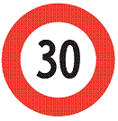

 Das Zeichen weist schwarze Zahlen auf weissem Grund und einen roten Rand auf. Es darf retroreflektierend sein. zwei- und dreirädrige sowie Klein- und Leichtmotorfahrzeuge sowie Anhänger andere Fahrzeuge Aussendurchmesser des Zeichens 10.0 cm 20.0 cm Breite des roten Randes 1.2 cm 2.5 cm Ziffern: Höhe 4.0 cm 8.0 cm Breite 2.0 cm 4.0 cm Strichbreite 0.5 cm 1.0 cm 2 Zeichen für Fahrzeuge von Gehbehinderten (Art. 92 Abs. 2) 

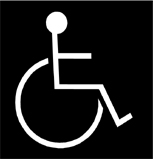

 Der Grund des Zeichens ist blau, das Symbol weiss. Seitenlänge des Quadrates 8.0 cm Höhe des Symbols 6.5 cm Breite des Symbols 6.5 cm Strichbreite 4.0 cm 3 Zeichen für Fahrzeuge von Gehörlosen (Art. 92 Abs. 2) 

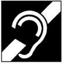

 Der Grund des quadratischen Zeichens (Seitenlänge gleich 8 cm) ist blau, das Symbol weiss. 4 Aufgehoben 5 Zeichen für Lernfahrzeuge (Art. 27 Abs. 1 VRV) Die quadratförmige Tafel ist möglichst senkrecht und gut sichtbar an der Rückseite des Fahrzeuges zu befestigen. Der Grund der Tafel ist von blauer, das "L" von weisser Farbe. Masse der L-Tafel für: vierrädrige Fahrzeuge zwei- u. dreirädrige Fzge. sowie Klein- u. Leichtmotorfzg. 

 Seitenlänge des Quadrates 16.0 cm 12.0 cm Höhe des Buchstabens 10.0 cm 8.0 cm Breite des Buchstabens 6.0 cm 5.0 cm Strichbreite 2.0 cm 1.5 cm 6 Winkkelle (Art. 90 Abs. 1) Die Anzeigetafel trägt einen weissen Pfeil auf rotem Grund; beide Farben müssen aus retroreflektierendem Material sein. 

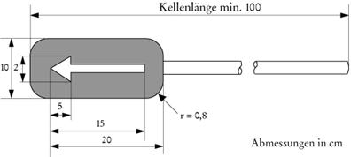

 7 Zeichen für Schülertransporte (Art. 123a Abs. 2) 

 Der Grund der quadratischen Tafel mit abgerundeten Ecken ist hellgelb (selektivgelb) oder gelb (orangenfarbig), das Symbol und der Rand sind schwarz. Das Symbol hat demjenigen des Gefahrensignals 1.23 zu entsprechen. Seitenlänge 40 cm Randbreite 2 cm 7a Beispiele von Hinweisschildern auf Gurtentragpflicht (Art. 3a Abs. 3 VRV) 

 

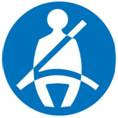

 Die Symbole sind weiss, der Grund blau. 8 Hintere Markierungstafeln für bestimmte Motorwagen (Art. 68 Abs. 3) 

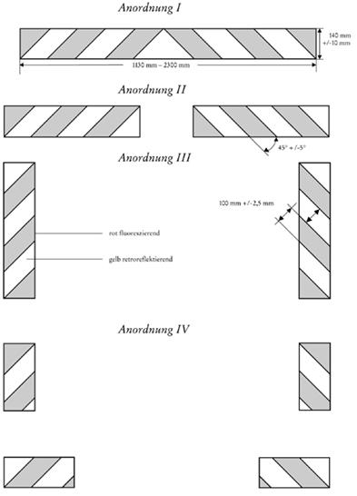

 9 Hintere Markierungstafeln für Anhänger und Sattelanhänger (Art. 68 Abs. 3) 

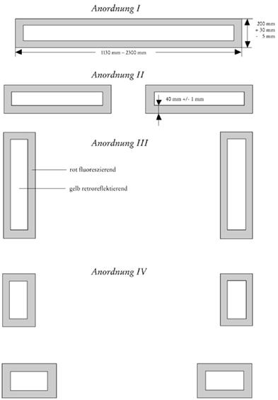

 10 Heckmarkierungstafel für Fahrzeuge mit einer Höchstgeschwindigkeit bis 45 km/h (Art. 68 Abs. 4) 

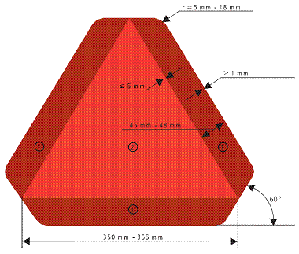

 (1) rotes retroreflektierendes Material oder prismatische Rückstrahler (Klasse 1 und Klasse 2) (2) rotes fluoreszierendes Material (Klasse 1) oder rotes retroreflektierendes Material (Klasse 2) Anbringung In der Breite: Ist nur eine Heckmarkierungstafel angebaut, so muss sich diese in der linken Fahrzeughälfte befinden oder in der Fahrzeuglängsachse. In der Höhe: Unterkante nicht weniger als 0.25 m vom Boden; Oberkante nicht mehr als 1.50 m vom Boden. Zwei Heckmarkierungstafeln sind symmetrisch zur Längsachse des Fahrzeugs in gleicher Höhe über dem Boden anzubringen. Ausnahmen: Können bei besonderen Fahrzeugen, namentlich bei Arbeitsfahrzeugen, wegen ihrer Bauart oder Verwendung die Höhenvorschriften nicht eingehalten werden, so ist/sind die Heckmarkierungstafel/n möglichst nahe an der/den vorgeschriebenen Stelle/n anzubringen. Anhang 4 (Art. 50 Abs. 2, 52 Abs. 5, 177 Abs. 3) Rauch-, Abgas- und Verdampfungsmessung 1 Rauchmessung bei Selbstzündungsmotoren 11 Volllastmessung 111 Anlässlich des Typengenehmigungsverfahrens von Motorwagen mit einem Selbstzündungsmotor ist eine Volllastmessung nach der Verordnung (EG) Nr. 715/2007, dem UNECE-Reglement Nr. 83 oder dem UNECE-Reglement Nr. 24 durchzuführen. Keine Volllastmessung ist erforderlich für Motorwagen, deren Selbstzündungsmotoren der Verordnung (EG) Nr. 595/2009, den Anforderungen der Stufe IV der Richtlinie 97/68/EG oder der Verordnung (EU) 2016/1628 entsprechen. 112 Anlässlich des Typengenehmigungsverfahrens von Traktoren, Arbeits- und Motorkarren, die mit einem Selbstzündungsmotor ausgerüstet sind, genügt eine Volllastmessung nach der Richtlinie 77/537/EWG. Keine Volllastmessung ist erforderlich für Fahrzeuge, deren Selbstzündungsmotoren den Aforderungen der Stufe IV der Richtlinie 97/68/EG oder der Verordnung (EU) 2016/1628 entsprechen. 113 Zusätzlich ist stets eine Beschleunigungsmessung nach Ziff. 12 durchzuführen. Das Resultat ist in der Typengenehmigung oder im Datenblatt oder bei nicht typengenehmigten Fahrzeugen im Fahrzeugausweis einzutragen. 114 Die Bestimmungen der Ziff. 111 bis 113 gelten auch für Fahrzeuge, welche von der Typengenehmigungspflicht befreit sind. 12 Trübungsmessung nach der Methode der freien Beschleunigung 121 Die Trübungsmessung bei freier Beschleunigung für Motorwagen hat nach Anhang IV der Richtlinie 77/537/EWG oder nach Anhang 5 des UNECE-Reglements Nr. 24 zu erfolgen. Keine Trübungsmessung ist erforderlich für Motorwagen, deren Selbstzündungsmotoren der Verordnung (EG) Nr. 595/2009, den Anforderungen der Stufe IV der Richtlinie 97/68/EG oder der Verordnung (EU) 2016/1628 entsprechen. 122 Die Trübungsmessung bei freier Beschleunigung für Motorräder, Leicht-, Klein- und dreirädrige Motorfahrzeuge hat nach der Verordnung (EU) Nr. 168/2013 und nach Anhang III der Delegierten Verordnung (EU) Nr. 134/2014 zu erfolgen. Keine Trübungsmessung ist erforderlich bei Motorschlitten. 13 Kontrolle des Auspuffrauches von Auge 131 Wird bei der Überwachung des Verkehrs an einem Fahrzeug eine länger dauernde, deutlich sichtbare Rauchbildung festgestellt, so ist eine Abgas-Nachkontrolle nach Art. 34 durchzuführen oder beim Amt für Strassenverkehr zu veranlassen. 132 Eine nur momentane Rauchbildung, z.B. beim Anlassen, beim Beschleunigen, beim Gangwechsel oder nach dem Ausschalten der Motorbremse, sowie eine leichte Rauchbildung in Höhen über 1000 m ü. M. ist unbeachtlich. 2 Abgas- und Verdampfungsmessung bei Fremdzündungs- und Selbstzündungsmotoren 21 Verfahren und Grenzwerte 211 Motorwagen mit Fremd- oder Selbstzündungsmotoren müssen, soweit sie unter den entsprechenden Anwendungsbereich fallen, den folgenden Vorschriften entsprechen: a) Verordnung (EG) Nr. 715/2007 oder UNECE-Reglement Nr. 83; b) Verordnung (EG) Nr. 595/2009 oder UNECE-Reglement Nr. 49. 211.1 Ausgenommen sind: a) Motorwagen mit einer bauartbedingten Höchstgeschwindigkeit von nicht mehr als 25 km/h; b) Arbeitsmotorwagen; c) Motorkarren; d) Traktoren; e) Raupenfahrzeuge. 211.2 Für Fahrzeuge der Klasse M 1 mit besonderer Zweckbestimmung (Verordnung (EU) 2018/858), die auf der Basis von Fahrzeugen einer anderen Klasse aufgebaut sind, genügt es, wenn sie hinsichtlich der Abgasemissionen den für das Basisfahrzeug geltenden Anforderungen entsprechen. 211a Fremd- und Selbstzündungsmotoren von Arbeitsmotorwagen sowie Arbeitsmotoren müssen der Richtlinie 97/68/EG, der Verordnung (EU) 2016/1628 oder dem UNECE-Reglement Nr. 96 entsprechen. 211a.1 Aufgehoben 211a.2 Werden Fahrzeuge der Klasse M oder N, die der Verordnung (EG) Nr. 715/2007 oder dem UNECE-Reglement Nr. 83 entsprechen, nachträglich zu Arbeitsmotorwagen umgebaut oder wird ihre Höchstgeschwindigkeit ohne Änderung an der abgasrelevanten Ausrüstung herabgesetzt, so genügt es, wenn sie hinsichtlich der Abgasemissionen den für das Basisfahrzeug geltenden Anforderungen entsprechen. 211b Fremd- und Selbstzündungsmotoren von Traktoren und Motorkarren müssen entsprechen: - der Richtlinie 97/68/EG, - der Richtlinie 2000/25/EG, - der Verordnung (EU) 2016/1628, - der Verordnung (EU) Nr. 167/2013 und der Delegierten Verordnung (EU) 2015/96, oder - dem UNECE-Reglement Nr. 96. 211b.1 Ausgenommen sind Motoren von Fahrzeugen mit einer bauartbedingten Höchstgeschwindigkeit von weniger als 6 km/h. 211c Für Selbstzündungsmotoren von Lastwagen mit einem Gesamtgewicht bis 7,50 t und einer Höchstgeschwindigkeit bis 45 km/h genügt es, wenn sie der Richtlinie 97/68/EG oder dem UNECE-Reglement Nr. 96 entsprechen. Sie müssen in diesem Fall mit einem zur Luftreinhalte-Verordnung konformen Partikelfilter oder einem bezüglich Emissionen gleichwertigen System ausgerüstet sein. 212 Motorräder, Leicht-, Klein- und dreirädrige Motorfahrzeuge mit Fremd- oder Selbstzündungsmotoren müssen der Verordnung (EU) Nr. 168/2013 und der Delegierten Verordnung (EU) Nr. 134/2014 entsprechen. Ausgenommen sind Motorschlitten. Bei nachträglichem Umbau von Leicht- und Kleinmotorfahrzeugen auf Raupen gelten hinsichtlich der Abgasemissionen die für das Basisfahrzeug geltenden Anforderungen. Der Nachweis für das Basisfahrzeug bleibt weiterhin gültig. 212a Fremd- und Selbstzündungsmotoren von Motorschlitten, Motoreinachsern und Motorhandwagen müssen der Verordnung (EU) 2016/1628 oder dem UNECE-Reglement Nr. 96 entsprechen. 213 Für Fremd- und Selbstzündungsmotoren von Motorfahrzeugen mit einem Gesamtgewicht von 0.8 t bis 12.0 t und einer bauartbedingten Höchstgeschwindigkeit bis 45 km/h genügt es, wenn sie der Verordnung (EU) 2016/1628 oder dem UNECE-Reglement Nr. 96 entsprechen. 214 Motorfahrräder mit Fremdzündungsmotoren müssen der FAV 4 entsprechen. Ausgenommen sind Motorfahrräder, für die eine Genehmigung nach den Anforderungen von Kapitel 5 der Richtlinie 97/24/EG mindestens in der Fassung der Richtlinie 2013/60/EU vorliegt oder die der Verordnung (EU) Nr. 168/2013 und der Delegierten Verordnung (EU) Nr. 134/2014 entsprechen. 215 Die Regierung kann auch andere, nicht nach den Ziff. 211 bis 214 durchgeführte Abgas- und Verdampfungsmessungen anerkennen, wenn sie nach Kriterien durchgeführt wurden, die den liechtensteinischen Vorschriften gleichwertig sind. 216 Die Ziff. 211, 211a, 211b, 211c, 212, 213 und 215 gelten auch für Fahrzeuge, die von der Typengenehmigungspflicht befreit sind. 22 Einzelprüfungen Bei Einzelprüfungen von leichten Motorwagen ist in der Regel eine Abgas-Nachkontrolle nach Art. 36 unter Verwendung typengenehmigter Messgeräte durchzuführen. 23 Kurbelgehäuse-Entlüftung 231 Gase und Dämpfe aus dem Kurbelgehäuse von Verbrennungsmotoren müssen dem Motor vollständig zur Verbrennung zurückgeführt werden. 232 Die Kontrolle erfolgt, sofern keine anderen Bestimmungen gelten, durch Augenschein. Geprüft werden die Montage und der Zustand der für die Rückführung der Gase und Dämpfe aus dem Kurbelgehäuse zur Verbrennung dienenden Einrichtungen und Teile, wie Leitungen, Schraubenanschlüsse, Deckel usw. Anhang 5 (Art. 53 Abs. 1, 177 Abs. 1) Geräuschmessung 1 Umfang 11 Verfahren und Grenzwerte 111 Motorfahrzeuge müssen hinsichtlich der Geräuschmessung die Anforderungen entsprechend ihrer Kategorien- und Klasseneinteilungen erfüllen. Das Ergebnis ist massgebend für die Zulassung der Fahrzeuge. Bei Fahrzeugen mit elektrischem Antrieb kann auf die Geräuschmessung verzichtet werden, sofern das Geräusch nicht als störend oder lästig auffällt. 111.1 Fahrzeuge der Klassen M und N müssen den folgenden Vorschriften entsprechen: a) Richtlinie 70/157/EWG; b) Verordnung (EU) Nr. 540/2014; c) UNECE-Reglement Nr. 51; oder d) UNECE-Reglement Nr. 59. 111.11 Die folgenden Fahrzeuge sind von Ziff. 111.1 ausgenommen und müssen den Anforderungen der Ziff. 111.4 genügen: a) Arbeitsmotorwagen; b) Motorkarren; c) Fahrzeuge mit einer bauartbedingten Höchstgeschwindigkeit von nicht mehr als 25 km/h. 111.12 Für Fahrzeuge der Klasse M 1 mit besonderer Zweckbestimmung (Verordnung (EU) 2018/858), die auf der Basis von Fahrzeugen einer anderen Klasse aufgebaut sind, genügt es, wenn sie hinsichtlich der Geräuschemissionen den für das Basisfahrzeug geltenden Anforderungen entsprechen. 111.2 Traktoren müssen den Anforderungen der Verordnung (EU) Nr. 167/2013 und der Delegierten Verordnung (EU) 2015/96 entsprechen. 111.3 Motorräder, Leicht-, Klein- und dreirädrige Motorfahrzeuge müssen den folgenden, für den entsprechenden Fahrzeugtyp geltenden Vorschriften entsprechen: a) Verordnung (EU) Nr. 168/2013 und Delegierte Verordnung (EU) Nr. 134/2014; oder b) UNECE-Reglement Nr. 41. 111.31 Für Fahrzeuge mit rein elektrischem Antrieb gelten die Grenzwerte nach Ziff. 37. 111.4 Alle übrigen Fahrzeuge müssen den Ziff. 3, 42 und 44 entsprechen. Ausgenommen sind: a) Motorfahrräder, für die eine Genehmigung nach den technischen Anforderungen der Verordnung (EU) Nr. 168/2013 und der Delegierten Verordnung (EU) Nr. 134/2014 vorliegt, welche die Einhaltung des massgebenden Grenzwertes nach Ziff. 37 bestätigt; b) Raupen- und eisenbereifte Fahrzeuge (z. B. Walzen) und Motoreinachser, welche die Anforderungen nach Ziff. 112 einhalten. c) Arbeitsfahrzeuge, die unter den Geltungsbereich von Anhang 1 Ziff. 11 der schweizerischen Maschinenlärmverordnung (MaLV) fallen, soweit deren Motoren durch die MaLV erfasst werden. 112 Bei Raupen- und eisenbereiften Fahrzeugen (z.B. Walzen) sowie bei Motoreinachsern genügt eine Standmessung nach Ziff. 4, deren Resultat für die Zulassung massgebend ist. Das Resultat und die Messdrehzahl sind in der Typengenehmigung oder im Datenblatt oder bei nicht typengenehmigten Fahrzeugen im Fahrzeugausweis einzutragen. 113 Ausser bei den in Ziff. 112 genannten Motorfahrzeugarten ist zusätzlich eine Standmessung nach Ziff. 4 durchzuführen. Das Resultat und die Messdrehzahl sind in der Typengenehmigung oder im Datenblatt oder bei nicht typengenehmigten Fahrzeugen im Fahrzeugausweis einzutragen. 114 Druckluftgeräusche werden nach Ziff. 4 im Stand gemessen. 115 Die Ziff. 111 bis 114 gelten auch für die Einzelprüfung vor der ersten Inverkehrsetzung von Fahrzeugen, die von der Typengenehmigungspflicht befreit sind. 12 Einzelprüfungen Bei Einzelprüfungen ist eine Standmessung nach Ziff. 4 durchzuführen. Dabei dürfen die in der Typengenehmigung oder im Datenblatt oder im Fahrzeugausweis eingetragenen Werte bei der Nahfeldmessung um höchstens 5 dB(A) und bei der "7-Meter-Messung" um höchstens 2 dB(A) überschritten werden. Eine zusätzliche Vorbeifahrtmessung kann angeordnet werden. 2 Messgeräte und Messgrössen 21 Akustische Messungen 211 Für die Messmittel, die zur Geräuschmessung verwendet werden, gelten die schweizerische Messmittelverordnung vom 15. Februar 2006 und die entsprechenden Ausführungsvorschriften des Eidgenössischen Justiz- und Polizeidepartements. 212 Die Messung erfolgt durch die Schallpegel-Bewertung mit der A-Kurve (L A ) bei der Anzeigegeschwindigkeit "schnell"; das Ergebnis wird in Dezibel (A)-Einheiten, kurz dB(A), ausgedrückt. 22 Die Geräte sind nach den Instruktionen des Herstellers oder der Herstellerin zu verwenden (insbesondere Temperaturbereich und Luftfeuchteempfindlichkeit). Sie müssen vor und nach jeder Messserie kalibriert werden. 23 Messungen der Motorendrehzahl Für die Bestimmung der Motorendrehzahl ist mindestens ein Drehzahlmesser der Klasse 2.0 nach der Norm EN 60051-1, 2017, Direkt anzeigende analoge elektrische Messgeräte und ihr Zubehör - Teil 1: Definitionen und allgemeine Anforderungen für alle Teile, zu verwenden. Im Fahrzeug vorhandene Drehzahlmesser dürfen dazu nicht verwendet werden. 24 Messgeräte Die Schallpegelmesser und akustischen Kalibratoren müssen vor ihrer Inbetriebnahme und danach alle zwei Jahre auf ihre Funktionstüchtigkeit hin überprüft werden. 3 Vorbeifahrtmessung 31 Messgelände 311 Geräuschmessungen sind auf einem freien, möglichst ebenen Platz durchzuführen. Der Platz (mindestens zwischen den Linien AA' und BB') muss einen Strassenbelag aus Beton oder Asphalt aufweisen. Er darf nicht mit Schnee bedeckt sein und kein übermässiges Reifengeräusch verursachen. Auf beiden Seiten der Fahrspur CC' muss mindestens 10.00 m Strassenbelag sein. 312 Im Umkreis von 20.00 m um das Mikrofon dürfen keine schallreflektierenden Gegenstände vorhanden sein. Grössere Hindernisse müssen mindestens 50.00 m entfernt sein. 32 Störgeräusche und Windeinfluss 321 Die Messungen müssen bei gutem, möglichst windstillem Wetter stattfinden. Am Mikrofon ist ein Windschutz anzubringen. 322 Der Umgebungsschallpegel und andere Geräusche, die nicht vom Fahrzeug stammen, sowie allfällige Windeinwirkungen müssen mindestens 10 dB(A) niedriger liegen als das Fahrgeräusch. 323 Zwischen dem Fahrzeug und den Mikrofonen und unmittelbar hinter diesen dürfen sich während der Messung keine Personen aufhalten. 33 Messbedingungen 331 Die Messungen sind am leeren, nur mit dem Fahrzeugführer oder mit der -führerin besetzten Fahrzeug und - ausgenommen bei untrennbaren Fahrzeugen - ohne Anhänger oder Sattelanhänger durchzuführen. 332 Vor Beginn der Messungen muss der Motor auf seine normalen Betriebsbedingungen gebracht werden, namentlich in bezug auf Temperaturen, Einstellungen, Zündkerzen, Vergaser und andere Teile. Bei automatisch gesteuerten Lüftern darf anlässlich der Geräuschmessung nicht in die Schaltautomatik eingegriffen werden. 333 Bei Fahrzeugen mit mehr als zwei angetriebenen Rädern ist nur die für normalen Strassenbetrieb vorgesehene Kraftübertragung einzuschalten. 334 Die Reifen müssen von einem Typ sein, der vom Hersteller oder von der Herstellerin üblicherweise auf diesem Fahrzeug montiert wird; der Reifendruck bzw. die Reifendrücke müssen den Anforderungen an ein unbeladenes Fahrzeug entsprechen. Messanordnung für die Vorbeifahrtmessung Abbildung 1 

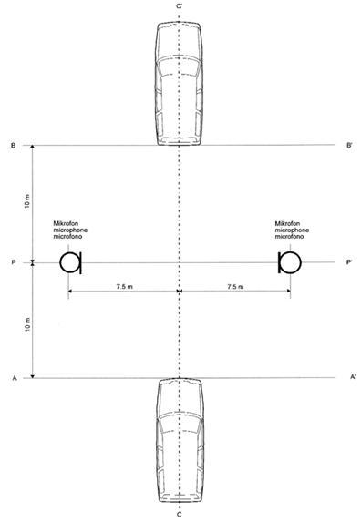

 34 Messanordnung 341 Das Mikrofon ist 1.20 m ± 0.10 m über dem Boden und in 7.50 m ± 0.20 m Abstand von der Mitte der Fahrspur CC' anzuordnen (Abb. 1). Die Achse seiner höchsten Empfindlichkeit ist waagrecht anzuordnen; sie muss senkrecht zur Bahn des Fahrzeugs verlaufen (Linie CC'). 342 Auf der Prüfstrecke sind zwei Linien AA' und BB' zu markieren, die parallel zur Linie PP' verlaufen und 10.00 m vor bzw. hinter dieser Linie liegen. Das Fahrzeug muss sich der Linie AA' mit gleichförmiger Geschwindigkeit entsprechend den Bedingungen nach Ziff. 35 nähern. Bei Erreichen der Linie AA' ist das Fahrzeug maximal zu beschleunigen (bei Fahrzeugen mit automatischem Getriebe ohne Betätigung der "Kickdown-Vorrichtung"), bis das Fahrzeugheck die Linie BB' überquert; in diesem Augenblick ist das Gaspedal bzw. der Gasdrehgriff loszulassen. Als Messergebnis gilt der höchste festgestellte Schallpegel. 343 Bei untrennbaren Fahrzeugen wird der Nachlaufteil (z.B. Sattelanhänger, Anhänger) beim Überqueren der Linie BB' nicht berücksichtigt. 35 Messmethode und Betriebszustand der Fahrzeuge 351 Arbeitsmotorwagen und Traktoren mit einer bauartbedingten Höchstgeschwindigkeit über 45 km/h. 351.1 Geschwindigkeit beim Heranfahren 351.11 Bei Motorwagen mit automatischen Getrieben, die mehrere Vorwärts-Vorwählstufen aufweisen, muss die gleichförmige Annäherungsgeschwindigkeit in der entsprechenden Vorwählstufe der niedrigeren der beiden folgenden Geschwindigkeiten entsprechen: a) Dreiviertel der bauartbedingten Höchstgeschwindigkeit (gemessen bei der höchsten Motorendrehzahl der grössten Motorennutzleistung); b) 50 km/h. 351.12 Kommt es bei der Prüfung von Motorwagen mit automatischem Getriebe und mehr als zwei getrennten Übersetzungen zu einem Zurückschalten in die kleinste Abstufung, so kann der Hersteller oder die Herstellerin sich für eines der beiden folgenden Prüfverfahren entscheiden: a) entweder wird die Geschwindigkeit des Fahrzeugs auf höchstens 60 km/h erhöht, um dieses Zurückschalten zu verhindern, oder b) die Geschwindigkeit von 50 km/h wird beibehalten, die Treibstoffzufuhr zum Motor jedoch auf höchstens 95 % der für die Vollast erforderlichen Menge begrenzt; diese Bedingung gilt als erfüllt: aa) bei Motoren mit Fremdzündung, wenn der Öffnungswinkel der Drosselklappe 90 % beträgt; bb) bei Motoren mit Selbstzündung, wenn die Bewegung der Regelstange der Einspritzpumpe auf 90 % ihres Hubes begrenzt wird. 351.13 Ist der Motorwagen mit einem automatischen Getriebe ohne manuell betätigte Vorwähleinrichtung für die Vorwärtsfahrmöglichkeiten ausgestattet, so ist das Fahrzeug mit Annäherungsgeschwindigkeiten von 30, 40 und 50 km/h zu prüfen; die Geschwindigkeit darf jedoch in keinem Fall höher als Dreiviertel der bauartbedingten Höchstgeschwindigkeit sein. Massgebend ist der dabei gemessene höchste Schallpegel. 351.2 Wahl der Abstufung beim Schaltgetriebe 351.21 Nicht automatisches, handgeschaltetes Getriebe (gilt auch für Handschaltgetriebe in Verbindung mit Wandlern). 351.211 Leichte Motorwagen, die mit einem Schaltgetriebe mit nicht mehr als vier Abstufungen (Vorwärtsfahrmöglichkeiten) ausgerüstet sind, werden in der zweiten Abstufung geprüft. 351.212 Leichte Motorwagen mit einem Getriebe, das mehr als vier Abstufungen (Vorwärtsfahrmöglichkeiten) aufweist, werden nacheinander in der zweiten und dritten Abstufung geprüft. Dabei sind lediglich diejenigen Gesamtübersetzungsverhältnisse zu berücksichtigen, die für normalen Strassenbetrieb bestimmt sind. Aus den beiden ermittelten Schallpegeln wird das arithmetische Mittel gebildet. 351.213 Schwere Motorwagen, bei denen die Anzahl Abstufungen (Vorwärtsfahrmöglichkeiten) X beträgt (einschliesslich derjenigen Abstufungen, die durch ein Zusatzgetriebe oder durch eine Achse mit mehreren Übersetzungen zustande kommen), sind nacheinander in den Abstufungen und darüber zu prüfen (entspricht nicht einer ganzen Zahl, so ist die am nächsten darüber gelegene Abstufung für die erste Messung zu wählen). Massgebend ist der dabei gemessene höchste Schallpegel. 351.214 Bei leichten Motorwagen sind allfällig vorhandene Geländegänge (Ziff. 351.215) weder für die Bestimmung der Anzahl Abstufungen noch für die Wahl der Abstufung für die Prüfung zu berücksichtigen. Bei schweren Motorwagen sind Abstufungen, die nur mit eingeschaltetem Zusatzantrieb (Ziff. 333) eingelegt werden können oder die diesen automatisch einschalten, für die Prüfung nicht zu berücksichtigen. 351.215 "Geländegänge" sind Getriebeabstufungen, die vom Fahrzeughersteller oder von der -herstellerin in seinen Unterlagen als speziell für die Verwendung im Gelände bezeichnet werden. Voraussetzung für die Anerkennung von so bezeichneten Geländegängen ist jedoch, dass das Fahrzeug - beladen auf das garantierte Gesamtgewicht - in einer Steigung von 15 % in der ersten Strassenabstufung einwandfrei anfahren kann und die in den Geländegängen erreichbare Höchstgeschwindigkeit nicht mehr als 15 km/h beträgt. Ist ein Durchschalten zwischen Gelände- und Strassenabstufungen nicht möglich, so werden die Geländegänge in jedem Fall für die Geräuschmessung nicht berücksichtigt. 351.22 Automatisches Getriebe mit manuell betätigter Vorwahl Bei der Prüfung muss sich der Vorwähler in der vom Hersteller oder von der Herstellerin für "normale" Fahrt empfohlenen Stellung befinden. 352 Aufgehoben 353 Motorfahrzeuge mit einer bauartbedingten Höchstgeschwindigkeit von nicht mehr als 45 km/h sowie Motorfahrräder Das Geräusch dieser Fahrzeuge ist zu messen, währenddem sie die Prüfstrecke zwischen den Linien AA' und BB' mit der tatsächlich erreichbaren Höchstgeschwindigkeit durchfahren; kann diese aus betriebstechnischen Gründen zwischen den Linien AA' und BB' nicht erreicht werden, so ist die Prüfstrecke mit der Geschwindigkeit zu durchfahren, welche in der nächst kleineren Getriebestufe der im Fahrbetrieb erreichbaren Höchstdrehzahl entspricht. 36 Anzahl der Messungen und Auswertung 361 Auf jeder Seite des Fahrzeugs ist mindestens je eine Messreihe mit zwei Messungen vorzunehmen. 362 Um der Ungenauigkeit der Messgeräte Rechnung zu tragen, sind die während der Messung von den Geräten abgelesenen Werte um 1 dB(A) zu verringern. 363 Die Messungen sind gültig, wenn der Unterschied zwischen den zwei aufeinanderfolgenden Messungen auf derselben Seite des Fahrzeugs nicht mehr als 2 dB(A) beträgt. 364 Massgebend für die Beurteilung des Lärms ist der höchste gemessene Schallpegel. Falls dieser Wert den für das zu prüfende Fahrzeug geltenden Grenzwert (Ziff. 37) um nicht mehr als 1 dB(A) überschreitet, ist eine zweite Messreihe mit je zwei Messungen durchzuführen. Pro Fahrzeugseite müssen von den zwei Messreihen drei der vier erhaltenen Messergebnisse innerhalb der vorgeschriebenen Grenzen liegen. 37 Grenzwerte Die nachstehenden Grenzwerte dürfen nicht überschritten werden: Fahrzeugart/Geräuschquelle Grenzwert in dB(A) 1. Motorfahrräder 66 2. Motorräder, Leicht-, Klein- und dreirädrige Motorfahrzeuge siehe Ziff. 111.3 3. Motorräder, Leicht-, Klein- und dreirädrige Motorfahrzeuge mit elektrischem Antrieb und einer Motorleistung: ≤ 4 kW 71 > 4 kW 75 4. Leichte Motorwagen, ausgenommen Fahrzeuge nach den Ziff. 8 bis 10, mit einer bauartbedingten Höchstgeschwindigkeit von über 25 km/h siehe Ziff. 111.1 5. Leichte Motorwagen, ausgenommen Fahrzeuge nach den Ziff. 8 bis 10, mit einer bauartbedingten Höchstgeschwindigkeit von höchstens 25 km/h 6. Schwere Motorwagen, ausgenommen Fahrzeuge nach den Ziff. 8 bis 10, mit einer bauartbedingten Höchstgeschwindigkeit von über 25 km/h siehe Ziff. 111.1 7. Schwere Motorwagen, ausgenommen Fahrzeuge nach den Ziff. 8 bis 10, mit einer bauartbedingten Höchstgeschwindigkeit von höchstens 25 km/h und einer Motorleistung: ≤ 75 kW 80 > 75 kW - ≤ 150 kW 82 > 150 kW 84 8. Arbeitsmotorwagen mit einer bauartbedingten Höchstgeschwindigkeit von: ≤ 30 km/h 85 > 30 - ≤ 45 km/h 86 > 45 km/h 87 9. Motorkarren mit einer Motorleistung: ≤ 150 kW 84 > 150 kW 86 10. Traktoren siehe Ziff. 111.2 4 Standmessung sowie Messung von Druckluftgeräuschen 41 Allgemeine Bestimmungen 411 Messgelände 411.1 Die Messungen sind am stehenden Fahrzeug in einer Umgebung ohne starke Störgeräusche durchzuführen. 411.2 Der Messplatz muss eben sein, einen Strassenbelag aus Beton oder Asphalt aufweisen und darf nicht mit Schnee bedeckt sein. Bei Raupenfahrzeugen, die nur auf Schnee verwendet werden, kann das Geräusch auf einem mit hartem Schnee bedeckten Platz gemessen werden. 411.3 Im Umkreis von 20.00 m um das Mikrofon dürfen keine schallreflektierenden Gegenstände vorhanden sein. Messanlagen, die wegen ihrer geometrischen Bauweise diesen Anforderungen nicht entsprechen, dürfen nur verwendet werden, wenn das EAM aufgrund einer Prüfung festgestellt hat, dass sie gleichwertigen Bedingungen entsprechen. 412 Störgeräusche und Windeinfluss 412.1 Der Umgebungsschallpegel und andere Geräusche, die nicht vom Fahrzeug stammen, sowie allfällige Windeinwirkungen, müssen mindestens um 10 dB(A) unter dem Messresultat liegen. 412.2 Am Mikrofon ist ein Windschutz anzubringen. 412.3 Ausser dem Beobachter, der das Messgerät bedient, darf sich niemand in der Messzone aufhalten. 413 Messmethode 413.1 Anzahl der Messungen 413.11 Es sind, unter Vorbehalt von Ziff. 431, mindestens zwei Messungen je Messpunkt vorzunehmen. Die Messung gilt als gesichert, wenn sich zwei aufeinanderfolgene Messungen um höchstens 1 dB(A) voneinander unterscheiden. Massgebend ist der höhere dieser zwei gemessenen Schallpegel. 413.12 Bei Druckluftgeräuschen ist der höchste gemessene Schallpegel massgebend. 413.2 Aufstellung und Vorbereitung des Fahrzeugs 413.21 Das Fahrzeug ist im Zentrum des Messplatzes aufzustellen, das Getriebe in Neutralstellung, die Kupplung eingerückt. 413.22 Vor Beginn der Messungen ist der Motor auf normale Betriebstemperaturen zu bringen. 413.23 Kühlventilatoren und andere vom Motor angetriebene Aggregate müssen während der Messung in Betrieb sein. Elektromagnetisch geschaltete Lüfter müssen für die Messungen kurzgeschlossen und Lüfter mit selbsttätig regulierender Drehzahl nach den Angaben des Fahrzeugherstellers oder der -herstellerin eingestellt sein. 42 Standmessung nach der "7-Meter-Messmethode" Für Fahrzeuge der Ziff. 111.4 und 112 richtet sich die 7-Meter-Standmessung nach den Ziff. 42 bis 422.2. Für Traktoren richtet sich diese Standmessung nach der Verordnung (EU) Nr. 167/2013 und der Delegierten Verordnung (EU) 2015/96. 421 Messanordnung für Fahrzeuge nach den Ziff. 111.4 und 112 Das Mikrofon ist in einer Höhe von 1.2 m über dem Boden und in einer Entfernung von 7 m rechtwinklig zum Fahrzeugrand in Fahrzeugmitte aufzustellen. Messanordnung Abbildung 2 

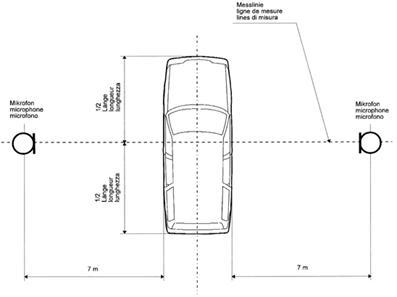

 422 Betriebszustand 422.1 Die Geräuschmessung ist, ausgenommen bei Fahrzeugen nach Ziff. 422.2, bei Dreiviertel der stabilisierten höchsten Drehzahl der grössten Motorennutzleistung durchzuführen. Ist die Messung technisch nicht möglich, ist bei der noch stabilisierbaren Drehzahl zu messen, die der vorgeschriebenen Drehzahl am nächsten liegt. 422.2 Bei Raupen- und eisenbereiften Fahrzeugen (z. B. Walzen) sowie bei Motoreinachsern ist die Geräuschmessung bei der höchsten Drehzahl der grössten Motorennutzleistung durchzuführen. 423 Grenzwerte Bei der "7-Meter-Standmessung" dürfen folgende Grenzwerte nicht überschritten werden: Fahrzeugart Grenzwert in dB(A) 1. Raupen- und eisenbereifte Fahrzeuge mit einer Motorleistung: < 150 kW 78 ≥ 150 kW 80 2. Motoreinachser 80 43 Standmessung im "Nahfeld" 431 Für Fahrzeuge der Klassen M und N, für Motorräder, ausgenommen Motorschlitten, sowie für Leicht-, Klein- und dreirädrige Motorfahrzeuge erfolgt eine Standmessung im Nahfeld. 432 Die Anforderungen an die Standmessung im Nahfeld richten sich für: a) Fahrzeuge der Klassen M und N: nach Anhang I Ziff. 5.2.3 der Richtlinie 70/157/EWG, nach der Verordnung (EU) Nr. 540/2014 oder nach dem UNECE-Reglement Nr. 51; b) Motorräder, Leicht-, Klein- und dreirädrige Motorfahrzeuge: nach der Verordnung (EU) Nr. 168/2013 und der Delegierten Verordnung (EU) Nr. 134/2014 oder nach dem UNECE-Reglement Nr. 41. Abbildungen 3-5 Aufgehoben 44 Messung von Druckluftgeräuschen 441 Messanordnung für die Druckluftmessung Das Mikrofon ist in einer Höhe von 1.20 m über dem Boden und in einer Entfernung von 7.00 m rechtwinklig vom Fahrzeugrand in Fahrzeugmitte aufzustellen. Messanordnung Abbildung 6 

 442 Betriebszustand 442.1 Die Druckluftanlage muss vor jeder Messung auf den höchsten Betriebsdruck gebracht werden; die Messung erfolgt bei abgestelltem Motor. 442.2 Die Kompressor-Abschaltgeräusche werden bei im Leerlauf arbeitendem Motor gemessen. 443 Grenzwerte Der nachstehende Grenzwert darf nicht überschritten werden Geräuschquelle Grenzwert in dB(A) Druckluftgeräusche 72 Anhang 6 (Art. 103 Abs. 3, 126 Abs. 2, 127 Abs. 5 Bst. b, 145 Abs. 2, 147 Abs. 3, 149 Abs. 2, 153 Abs. 2, 157 Abs. 3, 160 Abs. 2, 163 Abs. 2, 169, 174 Abs. 2, 178 Abs. 5, 179 Abs. 6, 189 Abs. 3, 199 Abs. 2, 201 Abs. 2, 214 Abs. 4) Bremsen; Prüfverfahren und Wirkvorschriften 1 Prüfverfahren für Fahrzeuge, die unter internationale Vorschriften fallen 11 Allgemeine Anforderungen Die für die Bremsanlagen vorgeschriebene Wirkung bezieht sich auf den Bremsweg oder die mittlere Vollverzögerung. Bei Beginn der Prüfung müssen die Reifen kalt sein. Die vorgeschriebene Bremswirkung muss erzielt werden, ohne dass die Räder blockieren, ohne dass das Fahrzeug seine Spur verlässt und ohne dass ungewöhnliche Schwingungen auftreten. Die Fahrbahn muss horizontal sein. Der Bremsweg ist der vom Fahrzeug vom Beginn der Wirkung der Bremsanlage bis zum Stillstand zurückgelegte Weg; die Ausgangsgeschwindigkeit ist die Geschwindigkeit im Augenblick, in dem die Bremsanlage zu wirken beginnt. Die mittlere Vollverzögerung ist die durchschnittliche Geschwindigkeitsminderung in m/s² auf der Strecke, die vom Einsetzen der höchsten Bremskraft am Ende der Schwellzeit bis zum Stillstand des Fahrzeugs zurückgelegt wird. Folgende Abkürzungen für Geschwindigkeiten werden verwendet: v 1 = Ausgangsgeschwindigkeit v 2 = Zielgeschwindigkeit v max = bauartbedingte Höchstgeschwindigkeit 12 Prüfung der Wirksamkeit bei kalter Bremse (Prüfung Typ 0) Für die Prüfung der Wirksamkeit bei kalter Bremse darf die an der Bremsscheibe oder aussen an der Trommel gemessene Temperatur nicht mehr als 100 °C und am Gehäuse von vollständig gekapselten Bremsen und Bremsen im Ölbad nicht mehr als 50 °C betragen. Das Fahrzeug muss in beladenem Zustand gemessen werden. Die Verteilung der Gewichte auf die Achsen muss den Angaben des Herstellers oder der Herstellerin entsprechen. Jede Prüfung ist mit unbeladenem Fahrzeug zu wiederholen. Die Prüfung ist bei der für die jeweilige Fahrzeugklasse angegebenen Geschwindigkeit vorzunehmen. Die für die jeweilige Klasse vorgeschriebene Mindestbremswirkung muss erreicht werden. 13 Prüfung des Heissbremsverhaltens der Bremse (Prüfung Typ I) 131 Vorbereitung Für die Prüfung des Heissbremsverhaltens der Betriebsbremsanlage müssen die Bremsen des beladenen Fahrzeugs mit wiederholten Bremsungen wie folgt vorkonditioniert werden: Fahrzeugklasse V 1 V 2 Intervall maximal Anzahl Zyklen M 1 80 % v max , ≤ 120 km/h ½ V 1 45s 15 M 2 80 % v max , ≤ 100 km/h ½ V 1 55s 15 N 1 80 % v max , ≤ 120 km/h ½ V 1 55s 15 M 3 , N 2 , N 3 80 % v max , ≤ 60 km/h ½ V 1 60s 20 T, C wahlweise, wenn vmax ≤ 40 km/h 80 % v max ½ V 1 0.05 V 1 60s 60s 20 18 Motorräder, Leicht-, Klein- und dreirädrige Motorfahrzeuge Vorderrad / kombinierte Bremsen 70 % v max , ≤ 100 km/h ½ V 1 1000m 10 Hinterrad 70 % v max , ≤ 80 km/h ½ V 1 1000m 10 132 Wirkprüfung Die Wirkprüfung muss sich unmittelbar anschliessen. Die Bremswirkung darf nicht unter 60 % der mit kalter Bremse ermittelten Wirkung sinken. Bezogen auf die für die kalte Bremse geltenden Wirkungsanforderungen darf sie nicht unter folgende Werte sinken: 132.1 Fahrzeuge der Klasse M 1 : 75 %; 132.2 Fahrzeuge der Klassen M 2 , M 3 , N, T und C: 80 %; 132.3 Motorräder, Leicht-, Klein- und dreirädrige Motorfahrzeuge: 65 %. 14 Prüfung der Dauerbremswirkung (Prüfung Typ II oder Typ IIA) Dauerbremsen von Traktoren und Fahrzeugen der Klassen N und M 2 müssen eine mittlere Verzögerung von mindestens 0.5 m/s² erreichen. Dauerbremsen von Gesellschaftswagen der Klasse M 3 , ausgenommen Gesellschaftswagen der Klasse I, und von Fahrzeugen der Klasse N 3 , die zum Ziehen von Anhängern der Klasse O 4 zugelassen sind, müssen eine mittlere Verzögerung von mindestens 0.6 m/s² erreichen. Bei der Prüfung muss die Getriebestufe eingelegt werden, in welcher bei der Drehzahl der grössten Motornutzleistung die erreichbare Geschwindigkeit am nächsten bei 30 km/h liegt und die Motordrehzahl den vom Hersteller vorgeschriebenen Höchstwert nicht überschreitet. Die mittlere Verzögerung ist über die Zeit und Geschwindigkeitsveränderung zu ermitteln. 15 Prüfung der Ansprech- und Schwellzeit Alle Fahrzeuge, deren Bremsanlagen mindestens teilweise auf eine Energiequelle (Druckluft, Hydraulik) angewiesen sind, müssen folgende Bedingungen erfüllen: 151 Bei einer Schnellbremsung darf die Zeitspanne zwischen dem Beginn der Bremsbetätigung und dem Zeitpunkt, in dem die Verzögerung des Fahrzeugs, die Bremskraft an der am ungünstigsten gelegenen Achse oder der Druck in dem am ungünstigsten angeordneten Radbremszylinder den für die vorgeschriebene Bremswirkung erforderlichen Wert erreicht, höchstens 0.6 Sekunden betragen. 152 Aufgehoben 153 Die Messung erfolgt anhand der Vorschriften des UNECE-Reglements Nr. 13, des UNECE-Reglements Nr. 13-H oder der Verordnung (EU) Nr. 167/2013 und der Delegierten Verordnung (EU) 2015/68. 16 Prüfung der Behälter und Energiequellen Die Behälter und Energiequellen müssen den Prüfanforderungen des UNECE-Reglements Nr. 13, des UNECE-Reglements Nr. 13-H oder der Verordnung (EU) Nr. 167/2013 und der Delegierten Verordnung (EU) 2015/68 entsprechen. 17 Prüfung der Fahrzeuge mit Auflaufbremsanlagen Die Prüfung von Fahrzeugen mit Auflaufbremsen besteht aus einem praktischen Fahrversuch zur Beurteilung des allgemeinen Bremsverhaltens (dynamische Prüfung), der Überprüfung der Auflaufeinrichtung und der Prüfung der Wirksamkeit. Die Bremswirkung richtet sich nach Ziff. 22. 18 Prüfung der automatischen Blockierverhinderer (ABV) ABV-Einrichtungen an Motorwagen und deren Anhängern müssen der Verordnung (EU) 2019/2144, dem UNECE-Reglement Nr. 13, dem UNECE-Reglement Nr. 13-H oder der Verordnung (EU) Nr. 167/2013 und der Delegierten Verordnung (EU) 2015/68 entsprechen. ABV-Einrichtungen an Motorrädern müssen der Verordnung (EU) Nr. 168/2013 und der Delegierten Verordnung (EU) Nr. 3/2014 oder dem UNECE-Reglement Nr. 78 entsprechen. 19 Umgebaute Fahrzeuge, die auf Fahrzeugen einer anderen Klasse basieren Für Fahrzeuge der Klasse M 1 mit besonderer Zweckbestimmung (Verordnung (EU) 2018/858), die auf der Basis von Fahrzeugen einer anderen Klasse aufgebaut sind, genügt es, wenn sie hinsichtlich der Bremsen den für das Basisfahrzeug geltenden Anforderungen entsprechen. 2 Wirkvorschriften für Fahrzeuge, die unter internationale Vorschriften fallen Die Wirksamkeit der Bremsen kann insbesondere auch anlässlich der Nachprüfung über die Abbremsung nach dem folgenden Verfahren ermittelt werden: Abbremsung in % = Summe der Bremskräfte an den Radumfängen × 100 Fahrzeugprüfgewicht 21 Fahrzeuge der Klassen M, N, T und C Die Bremsprüfungen nach den Ziff. 211, 212, und 214 sind mit ausgekuppeltem Motor durchzuführen. 211 Betriebsbremse Die Verzögerung muss mindestens betragen für Fahrzeuge der Klasse: m/s² v 1 max. Betätigungskraft Fuss max. Betätigungskraft Hand M 1 5.8 100 km/h 500N N 1 5.0 80 km/h 700N M 2 , M 3 ,N 2 , N 3 5.0 60 km/h 700N T,C v max >30km/h 5.0 v max 600N 400N T,C v max ≤ 30km/h 3.55 v max 600N 400N 212 Hilfsbremse Die Verzögerung muss mindestens betragen für Fahrzeuge der Klasse: m/s² v 1 max. Betätigungskraft Fuss max. Betätigungskraft Hand M 1 2.44 100 km/h 500N 500N M 2 ,M 3 2.5 60 km/h 700N 600N N 1 2.2 70 km/h 700N 600N N 2 2.2 50 km/h 700N 600N N 3 2.2 40 km/h 700N 600N T,C v max >30km/h 2.2 30 km/h 600N 400N T,C v max ≤ 30km/h 1.5 v max 600N 400N 213 Feststellbremse 213.1 Die Feststellbremsanlage muss, auch wenn sie mit einer anderen Bremsanlage kombiniert ist, das beladene Fahrzeug auf folgenden Steigungen und Gefällen im Stillstand halten können: a) 20 % bei Fahrzeugen der Klasse M 1 ; b) 18 % bei Fahrzeugen der Klassen M 2 , M 3 , N, T und C; c) 40 % bei Fahrzeugen der Klasse T4.3. 213.2 Bei Fahrzeugen, an denen ein Anhänger mitgeführt werden darf, muss die Feststellbremsanlage des Zugfahrzeuges die miteinander verbundenen Fahrzeuge auf einer Steigung oder einem Gefälle von 12 % im Stillstand halten können. 213.3 Bei Handbetätigung darf die Betätigungskraft 400 N bei den Fahrzeugen der Klasse M 1 und 600 N bei allen anderen Fahrzeugen nicht übersteigen. Bei Fussbetätigung darf die Betätigungskraft 500 N bei den Fahrzeugen der Klasse M 1 und 700 N bei allen übrigen Fahrzeugen nicht übersteigen. 213.4 Eine Feststellbremse, die mehrmals betätigt werden muss, bevor sie die vorgeschriebene Bremswirkung erreicht, kann zugelassen werden. 214 Restbremswirkung Die Restbremswirkung der Betriebsbremsanlage muss bei Ausfall eines Teils ihrer Übertragungseinrichtung, bei einer Betätigungskraft von höchstens 700 N, mindestens betragen für Fahrzeuge der Klasse: v 1 beladen m/s² leer m/s² M 2 60 km/h 1.5 1.3 M 3 60 km/h 1.5 1.5 N 1 70 km/h 1.3 1.1 N 2 50 km/h 1.3 1.1 N 3 40 km/h 1.3 1.3 T v max > 60 km/h 40 km/h 1.3 1.3 22 Fahrzeuge der Klassen O, R und S 221 Betriebsbremse Die Abbremsung muss beladen und unbeladen mindestens betragen für: Normalanhänger: 50 % Sattelanhänger: 45 % Starrdeichselanhänger und Zentralachsanhänger: 50 % Anhänger mit vmax bis 30km/h: 35 % Bei Anhängern mit Druckluftbremsen darf der Druck während der Bremsprüfung in der Bremsleitung 6.5 bar und in der Vorratsleitung 7.0 bar nicht übersteigen. Bei Anhängern mit hydraulischer Zweileitungsbremse darf der Druck während der Bremsprüfung in der Steuerleitung 115 bar nicht übersteigen und muss in der Zusatzleitung zwischen 15 und 18 bar liegen. 222 Feststellbremse Die Feststellbremsanlage des Anhängers oder Sattelanhängers muss den beladenen, vom Zugfahrzeug getrennten Anhänger oder Sattelanhänger auf einer Steigung und einem Gefälle von 18 % im Stillstand halten können. Die auf die Betätigungseinrichtung ausgeübte Kraft darf 600 N nicht übersteigen. 223 Selbsttätige Bremse Die Abbremsung der selbsttätigen Bremsanlage muss im Falle eines völligen Druckverlustes in der Vorratsleitung bei einer Prüfung des vollbeladenen Fahrzeuges mindestens 13.5 % betragen. 23 Motorräder, Leicht-, Klein- und dreirädrige Motorfahrzeuge Die Anforderungen an die Wirkung der Bremsanlagen von Motorrädern, Leicht-, Klein- und dreirädrigen Motorfahrzeugen richten sich nach der Verordnung (EU) Nr. 168/2013 und der Delegierten Verordnung (EU) Nr. 3/2014 oder nach dem UNECE-Reglement Nr. 78. Dabei wird folgende Klasseneinteilung, die nur für die Einreihung bezüglich der Bremswirkung gilt, vorgenommen: Klasse 1: Einspurige Kleinmotorräder; Klasse 2: Mehrspurige Kleinmotorräder und Leichtmotorfahrzeuge; Klasse 3: Motorräder; Klasse 4: Motorräder mit Seitenwagen; Klasse 5: Klein- und dreirädrige Motorfahrzeuge. 231 Ausgangsgeschwindigkeit Die Ausgangsgeschwindigkeit für Fahrzeuge der Klassen 1 und 2 beträgt 40 km/h. Für Fahrzeuge der Klassen 3, 4 und 5 beträgt sie 60 km/h. 232 Bremsung auf ein Rad Die Verzögerung muss bei der Bremsung mit der Vorderradbremse allein mindestens betragen für Fahrzeuge der: Klasse 1: 3.4 m/s 2 ; Klasse 2: 2.7 m/s 2 ; Klasse 3: 4.4 m/s 2 ; Klasse 4: 3.6 m/s 2 . Die Verzögerung muss bei der Bremsung mit der Hinterradbremse allein mindestens betragen für Fahrzeuge der: Klasse 1 und 2: 2.7 m/s 2 ; Klasse 3: 2.9 m/s 2 ; Klasse 4: 3.6 m/s 2 . 233 Bremsung bei teilweise kombinierten Bremsanlagen Die Verzögerung muss bei der Bremsung mit der kombinierten Bremsanlage mindestens betragen für Fahrzeuge der: Klasse 1 und 2: 4.4 m/s 2 ; Klasse 3: 5.1 m/s 2 ; Klasse 4: 5.4 m/s 2 ; Klasse 5: 5.0 m/s 2 . 234 Bremsung der zweiten Betriebsbremsanlage oder der Hilfsbremsanlage Die Verzögerung muss mindestens betragen: 2.5 m/s2. 235 Feststellbremsanlage Die Feststellbremsanlage muss, auch wenn sie mit einer anderen Bremsanlage kombiniert ist, das beladene Fahrzeug in einer Steigung und einem Gefälle von 18 % im Stillstand halten können. Bei Fahrzeugen, an denen ein Anhänger mitgeführt werden darf, muss die Feststellbremsanlage des Zugfahrzeuges die voll beladene Fahrzeugkombination in einer Steigung und einem Gefälle von 12 % im Stillstand halten können. 236 Betätigungskraft Die für die vorgeschriebene Bremsverzögerung erforderliche Betätigungskraft darf höchstens betragen: 236.1 bei von Fuss betätigten Bremsen 500 N für Fahrzeuge der Klasse 5, 350 N für die Fahrzeuge der übrigen Klassen; 236.2 bei von Hand betätigten Bremsen 200 N für alle Fahrzeuge dieser Klassen; 236.3 bei der Betätigungseinrichtung der Feststellbremsanlage: a) fussbetätigt 500 N; b) handbetätigt 400 N. 24 Aufgehoben 3 Prüfverfahren und Wirkvorschriften für Fahrzeuge, die nicht unter internationale Vorschriften fallen 31 Betriebs-, Hilfs- und Feststellbremse 311 Allgemeine Bestimmungen 311.1 Die Bremsverzögerung muss vom leeren und vom beladenen Fahrzeug auf ebener Strasse mit trockenem Hartbelag erreicht werden. Die Bremswirkung muss bei kalten Bremsen (Temperatur an den Bremstrommeln oder Bremsscheiben unter 100°C) erreicht werden. Gemessen wird die mittlere Verzögerung, die definiert ist als die durchschnittliche Geschwindigkeitsminderung in m/s² auf der Strecke, die vom Beginn der Betätigung der Bremsanlage (inklusive der Ansprech- und Schwellzeit) bis zum Stillstand des Fahrzeuges zurückgelegt wird. Kann mit einem Messgerät nur die maximale Verzögerung ermittelt werden, so muss sie mindestens 20 % höher sein als die vorgeschriebene mittlere Verzögerung. Die Wirksamkeit der Bremsen kann, insbesondere anlässlich der Nachprüfung, über die Abbremsung nach dem folgenden Verfahren ermittelt werden: Abbremsung in % = Summe der Bremskräfte an den Radumfängen × 100 Fahrzeugprüfgewicht 311.2 Prüfgeschwindigkeit Die Prüfgeschwindigkeit für die Prüfung der Betriebsbremse beträgt 50 km/h und für die Prüfung der Hilfsbremse 30 km/h. Erreicht ein Fahrzeug diese Geschwindigkeiten nicht, so ist es bei der möglichen Höchstgeschwindigkeit zu prüfen. 311.3 Betätigungskraft Die für die vorgeschriebene Bremsverzögerung erforderliche Betätigungskraft darf höchstens betragen: 311.31 bei von Fuss betätigten Bremsen 500 N für leichte Motorwagen, 700 N für die übrigen Fahrzeuge; 311.32 bei von Hand betätigten Bremsen 200 N für Fahrräder und Motorfahrräder, 400 N für leichte Motorwagen, 600 N für die übrigen Fahrzeuge. 311.4 Ansprech- und Schwellzeit Bei einer Schnellbremsung darf die Zeitspanne zwischen dem Beginn der Bremsbetätigung und dem Zeitpunkt, in dem die Verzögerung des Fahrzeugs, die Bremskraft an der am ungünstigsten gelegenen Achse oder der Druck in dem am ungünstigsten angeordneten Radbremszylinder den für die vorgeschriebene Bremswirkung erforderlichen Wert erreicht, höchstens 0.6 Sekunden betragen. 312 Arbeitsmotorwagen und Traktoren mit einer bauartbedingten Höchstgeschwindigkeit von mehr als 30 km/h Die Verzögerung beziehungsweise die Abbremsung der Betriebsbremse muss mindestens betragen: m/s² Prozent 312.1 für die Betriebsbremse 4.1 50 312.2 für die Hilfsbremse 1.8 22 312.3 Die Feststellbremse muss das Wegrollen des vollbeladenen Motorwagens in Steigungen und Gefällen bis 18 %, des vollbeladenen Anhängerzuges in Steigungen und Gefällen bis 12 % verhindern und mechanisch so gesichert werden können, dass sie sich nicht von selbst löst. 313 Motorfahrzeuge mit einer bauartbedingten Höchstgeschwindigkeit von nicht mehr als 30 km/h Die Verzögerung beziehungsweise die Abbremsung der Betriebsbremse muss mindestens betragen: m/s² Prozent 313.1 für die Betriebsbremse 2.9 35 313.2 für die Hilfsbremse 1.8 22 313.3 Die Feststellbremse muss das Wegrollen des vollbeladenen Motorwagens in Steigungen und Gefällen bis 18 %, des vollbeladenen Anhängerzuges in Steigungen und Gefällen bis 12 % verhindern und mechanisch so gesichert werden können, dass sie sich nicht von selbst löst. 313a Motorkarren, Arbeitskarren und Motoreinachser mit einer bauartbedingten Höchstgeschwindigkeit von nicht mehr als 15 km/h sowie Motorhandwagen Die Verzögerung beziehungsweise die Abbremsung der Betriebsbremse muss mindestens betragen: m/s² Prozent 313a.1 für die Betriebsbremse 1.8 22 313a.2 für die Hilfsbremse 1.3 16 314 Arbeitsanhänger, Anhänger an Zugfahrzeugen mit einer Höchstgeschwindigkeit bis 30 km/h und land- und forstwirtschaftliche Anhänger Die Verzögerung beziehungsweise die Abbremsung der Betriebsbremse muss mindestens betragen: m/s² Prozent 314.11 für Anhänger mit einer zulässigen Höchstgeschwindigkeit bis 30 km/h 2.9 35 314.12 für Anhänger mit einer zulässigen Höchstgeschwindigkeit von mehr als 30 km/h 4.1 50 314.2 Bei Anhängern mit hydraulischer Zweileitungsbremse darf der Druck während der Bremsprüfung in der Steuerleitung 115 bar nicht übersteigen und muss in der Zusatzleitung zwischen 15 und 18 bar liegen. 314.3 Bei Anhängern mit Druckluftbremsanlagen muss je nach System der Bremssteuerung unter folgenden Bedingungen mindestens die geforderte Abbremsung erreicht werden: 314.31 Bremssteuerung mit Druckabfall (CH-Bremsanlage): Der Vorratsdruck muss zwischen 5.5 und 6.0 bar liegen. Während der Bremsprüfung darf der Vorratsdruck 5.5 bar nicht übersteigen und die Bremssteuerleitung muss vollständig entleert (0 bar) sein. 314.32 Bremssteuerung mit Druckaufbau (EG-Bremsanlage): Der Druck darf während der Bremsprüfung in der Bremsleitung 6.5 bar und in der Vorratsleitung 7.0 bar nicht übersteigen. 314.4 Die Abbremsung der selbsttätigen Bremsanlage muss beim vollbeladenen Fahrzeug mindestens 13.5 % betragen. 314.5 Die Feststellbremse muss das Wegrollen des vollbeladenen Anhängers in Steigungen und Gefällen bis 18 % verhindern. Sie muss mechanisch so gesichert werden können, dass sie sich nicht von selbst löst. 315 Motorfahrräder mit einem zulässigen Gesamtgewicht bis 250 kg, motorisierte Rollstühle und Fahrräder 315.1 Die Verzögerung der Betriebsbremse muss mindestens betragen: m/s² 315.11 für beide Bremsen zusammen 3,0 315.12 für eine Bremse 2,0 315.2 Für Motorfahrräder mit bauartbedingter Höchstgeschwindigkeit bis 15 km/h, die der EN 12184 entsprechen, genügt es, wenn sie deren Bremsanforderungen erfüllen. 316 Schwere Motorfahrräder 316.1 Die Verzögerung der Betriebsbremse muss mindestens betragen: m/s² 316.11 für beide Bremsen zusammen 4,4 316.12 für eine Bremse 2,7 316.2 Prüfungen nach den Anforderungen für mehrspurige Kleinmotorräder (Anhang 6 Ziff. 23) werden ebenfalls anerkannt. 32 Heissbremswirkung Zur Ermittlung der Heissbremswirkung der Bremsen ist das Fahrzeug dreimal rasch hintereinander aus 80 km/h oder aus der Höchstgeschwindigkeit, wenn diese kleiner ist, bis zum Stillstand abzubremsen. Die Wirkprüfung muss unmittelbar anschliessen. Die Bremswirkung darf nicht unter 60 % der mit kalter Bremse ermittelten Wirkung und bezogen auf die für die kalte Bremse geltenden Wirkungsanforderungen nicht unter 72 % sinken. Die Prüfung der Heissbremswirkung ist bei Motorfahrrädern und Fahrrädern nicht erforderlich. 33 Dauerbremse Dauerbremsen müssen eine mittlere Verzögerung von mindestens 0.5 m/s² erreichen. Dabei muss die Getriebestufe eingelegt werden, in der bei der Drehzahl der grössten Motornutzleistung die erreichbare Geschwindigkeit am nächsten bei 30 km/h liegt und die Motordrehzahl den vom Hersteller oder von der Herstellerin vorgeschriebenen Höchstwert nicht überschreitet. Die mittlere Verzögerung ist über die Zeit und Geschwindigkeitsveränderung zu ermitteln. 4 Prüfanforderungen für Fahrzeuge mit Druckluftbremsanlagen, deren Bremsanlage den internationalen Vorschriften entspricht, für die aber keine Teilgenehmigung vorliegt Für diese Fahrzeuge wird die Typengenehmigung oder das Datenblatt ausgestellt, wenn sie die nachfolgenden Anforderungen erfüllen. Fahrzeuge, die von der Typengenehmigung befreit sind, können unter den gleichen Bedingungen zugelassen werden. 41 Für die Prüfung erforderliche Unterlagen Die erforderlichen Unterlagen können von den Herstellern oder Herstellerinnen der Bremskomponenten bzw. des Fahrzeuges oder von einer anerkannten Prüfstelle erstellt werden. Bei Fahrzeugen, deren Unterlagen sich auf das nicht fertig karossierte Fahrzeug beziehen, muss der Umbauer oder die Umbauerin, der oder die das Fahrzeug fertigstellt, eine Bestätigung abgeben, dass anlässlich der Fertigstellung des Fahrzeuges die Aufbaurichtlinien des Fahrzeugherstellers oder der -herstellerin berücksichtigt worden sind. 411 Für die Prüfung der Betriebsbremsanlage ist eine Bremsberechnung gemäss dem UNECE-Reglement Nr. 13 oder der Verordnung (EU) Nr. 167/2013 und der Delegierten Verordnung (EU) 2015/68 erforderlich; sie muss die nachfolgenden Unterlagen umfassen: 411.1 ein Schaltbild der Bremsanlage mit einer Stückliste der einzelnen Komponenten, alle Ausgangsdaten, den Rechengang, die Zuordnungsbänder sowie die gezeichneten Reibungsbedarfskurven; die Zusammenfassung benachbarter Achsen zu einer fiktiven Achse ist zulässig; 411.2 ein Diagramm, das die Funktion "Druck im Bremszylinder" in Abhängigkeit vom "Druck der Bremsleitung" [P zyl = f (p m )] für das beladene und das unbeladene Fahrzeug und die Funktion "Kraftabgabe des Bremszylinders" in Abhängigkeit des "Druckes im Bremszylinder" [F zyl = f (p zyl )] aufzeigt. 412 Für die Prüfung der Feststellbremsanlage ist eine Bremsberechnung gemäss dem UNECE-Reglement Nr. 13 oder der Verordnung (EU) Nr. 167/2013 und der Delegierten Verordnung (EU) 2015/68 erforderlich; sie muss die nachfolgenden Unterlagen umfassen: 412.1 alle Ausgangsdaten, den Rechengang für die Festhaltewirkung und die Überprüfung des Reibungsbedarfs; 412.2 je nach Ausführung der Feststellbremsanlage entweder die Funktion "Kraftabgabe am Ende der Gewindespindel" (FSp) in Abhängigkeit von der "eingeleiteten Handkraft" oder die "Zylinderkraft an der Kolbenstange des Federspeicherzylinders" (FB). 413 Der Nachweis über die Erfüllung der Bremsprüfungen Typ I, Typ II, Typ IIA oder Typ III muss durch Berechnungen, die mittels der dazugehörigen Prüfprotokolle der Bezugsachsen erstellt wurden, erbracht werden. 414 Die Nachweise bezüglich der Zeitmessungen (Ansprech- und Schwellzeit) und der Behälterprüfungen müssen mittels Vorlage von Prüfberichten (Messungen an entsprechender Standard-Druckluftbremsanlage oder am Fahrzeug) erbracht werden. 42 Prüfverfahren 421 Sichtprüfung Das zu prüfende Fahrzeug muss mit den in den Unterlagen aufgeführten Angaben übereinstimmen. Die vorgeschriebenen Prüfanschlüsse von 16 mm Durchmesser müssen vorhanden und die erforderlichen Schilder für den automatisch lastabhängigen Bremskraftregler (ALB-Regler) müssen nach Anhang 10 Abs. 7 des UNECE-Reglements Nr. 13 oder nach Anhang II Anlage 1 Ziff. 6 der Delegieren Verordnung (EU) 2015/68 angebracht sein. 422 Funktions- und Wirkprüfung 422.1 Die tatsächlich vorhandenen Drücke in den Bremszylindern (p zyl ) in Abhängigkeit vom Druck in der Bremsleitung (p m ) bei unbeladenem wie beladenem Fahrzeug müssen mit den Druckkennlinien der Unterlagen übereinstimmen. 422.2 Die Drücke in den Bremszylindern, die sich bei Ausfall einer Betätigungseinrichtung eines ALB-Reglers ergeben, müssen mit den Angaben in den Unterlagen übereinstimmen. 422.3 Die Restbremswirkung bei Ausfall einer Betätigungsvorrichtung eines ALB-Reglers muss bei Motorwagen mindestens der für die Hilfsbremsanlage vorgeschriebenen Wirkung entsprechen. Ist der Motorwagen zum Ziehen eines mit Druckluftbremsen ausgerüsteten Anhängers zugelassen, so muss der Druck am Kupplungskopf der Bremsleitung zwischen 6.5 und 8.5 bar betragen. Bei Anhängern muss die Restbremswirkung in Übereinstimmung mit Anhang 10 Abs. 6 des UNECE-Reglements Nr. 13 oder Anhang II Anlage 1 Ziff. 5 der Delegierten Verordnung (EU) 2015/68 mindestens 30 % der vorgeschriebenen Betriebsbremswirkung erreichen. 422.4 Die Betriebs- und Feststellbremsanlage müssen einer Wirkprüfung unterzogen werden und dabei die Anforderungen nach den Ziff. 423 und 424 erfüllen. 423 Betriebsbremse: 423.1 Die Betriebsbremsanlage muss auf einem Bremsprüfstand kontrolliert werden. Bei land- und forstwirtschaftlichen Fahrzeugen kann die Kontrolle mittels Schleppkraftmessung erfolgen, wenn sie vergleichbare Ergebnisse liefert. Die zu erreichenden Werte der Vollverzögerung richten sich für Motorwagen nach Ziff. 211 und für Anhänger nach Ziff. 221. 423.2 Die Bremskräfte der Räder der einzelnen Achsen müssen dabei symmetrisch zur Längsmittelebene des Fahrzeuges verteilt sein. 423.3 Kann das Fahrzeug konstruktionsbedingt nicht auf einem Bremsprüfstand geprüft werden, so muss die Wirkung im Strassenversuch durch die Messung der Verzögerung oder der Schleppkraft ermittelt werden. 424 Feststellbremsanlage: 424.1 Die Feststellbremsanlage muss an einer Steigung bzw. in einem Gefälle den beladenen Motorwagen oder den beladenen, vom Motorwagen abgetrennten Anhänger oder Sattelanhänger in Steigungen und Gefällen bis 18 % im Stillstand halten können. Falls am Motorwagen ein Anhänger mitgeführt werden darf, muss die Feststellbremsanlage des Motorwagens allein ohne Mitwirkung der Anhängerbremse die auf das Gesamtgewicht beladene Fahrzeugkombination in Steigungen und Gefällen bis 12 % im Stillstand halten können. 424.2 Die Betätigungskraft der Feststellbremse darf bei Motorwagen mit handbetätigter Vorrichtung 400 N, bei Motorwagen mit fussbetätigter Vorrichtung 600 N und bei Anhängern 600 N nicht übersteigen. 424.3 Bei Fahrzeugen mit Luftfederung ist die Feststellbremsanlage auch auf das Verhalten bei Druckverlust in den Luftfederbälgen zu beurteilen. 425 Fahrzeuge mit automatischem Blockierverhinderer (ABV): 425.1 Die gegebenenfalls vorhandenen Steckverbindungen zur Versorgung des ABV müssen der Norm ISO 7638-1 oder ISO 7638-2, 2003, Steckvorrichtungen für die elektrische Verbindung von Zugfahrzeugen und Anhängefahrzeugen entsprechen. 425.2 Anhänger mit ABV, die mit elektrisch nicht versorgtem ABV die Vorschriften bezüglich der Zuordnungsbänder und gegebenenfalls die Reibungskurven nicht erfüllen (z.B. Fahrzeuge ohne ALB), dürfen nur von Zugfahrzeugen gezogen werden, die mit einer Versorgungseinrichtung für Anhänger-ABV ausgerüstet sind. Diese Anhänger erhalten im Fahrzeugausweis einen entsprechenden Eintrag. 5 Zulassung von Einzelfahrzeugen 51 Herstellerbestätigung Der Hersteller oder die Herstellerin kann eine Bestätigung über die Einhaltung der Anforderungen nach dem UNECE-Reglement Nr. 13-H, dem UNECE-Reglement Nr. 13 oder der Verordnung (EU) Nr. 167/2013 und der Delegierten Verordnung (EU) 2015/68 abgeben. Das Amt für Strassenverkehr führt in diesem Fall eine Funktionskontrolle durch. Es kann weitere Prüfungen vornehmen und Unterlagen verlangen. 52 Kompositionsprüfung Bei Motorfahrzeugen mit Anhänger-Bremssteuerungen und bei Anhängern mit Bremsanlagen, die nicht internationalen Vorschriften entsprechen, kann eine Kompositionsprüfung durchgeführt und im Fahrzeugausweis ein entsprechender Eintrag vorgenommen werden. Anhang 7 (Art. 67 Abs. 2) Gefährliche Fahrzeugteile 1 Unnötige Teile 11 Frontschutzbügel an Fahrzeugen, die nicht der Verordnung (EU) 2019/2144 unterstehen (Art. 104a Abs. 3), müssen so ausgestaltet sein, dass sie bei Kollisionen, namentlich mit Fussgängern, Fussgängerinnen, Zweiradfahrern oder Zweiradfahrerinnen, keine zusätzliche Verletzungsgefahr darstellen. 12 Zierfiguren auf Bughaube und Radabdeckungen, inbegriffen abstrakte Gebilde, Halb- und Dreiviertelfiguren, sind untersagt; ausser wenn sie an geschützter Stelle angebracht sind, so dass ein Körper ungehindert darüber gleiten kann oder wenn sie auf leichten Druck hin ausweichen und so keine Verletzungsgefahr bilden. 13 Verzierungen, die sich mehr als 3 cm über die umgebende Karosseriefläche erheben, sind nur gestattet, wenn sie ebenso breit wie hoch und abgerundet sind und in der Längsrichtung eine fliessende Begrenzungslinie ohne Verkröpfungen und dergleichen aufweisen. Verzierungen, die weniger als 3 cm hoch sind, sind gestattet, wenn sie keine scharfen Schneiden, Spitzen, Haken oder Vorsprünge aufweisen. 2 Notwendige oder nützliche Teile Notwendige oder nützliche Teile müssen folgenden Anforderungen genügen: 21 Verschlüsse, Griffe und Scharniere für Türen, Motorhauben oder Kofferraumdeckel dürfen keine Spitzen, scharfe Kanten, Haken oder Vorsprünge haben; das Ende von nicht versenkten, seitlichen Türgriffen oder Verschlusshebeln muss nach innen gerichtet sein. Radverschlüsse mit Flügeln sind nur zulässig, wenn sie den Aufbau in der Umgebung des Rades seitlich nicht überragen; Flügelmutter-Zierattrappen sind unzulässig. 22 Aussenrückspiegel und ihre Träger dürfen keine Spitzen, Schneiden oder scharfen Kanten haben. Ragen sie in einer Höhe bis 2,00 m über Boden mehr als 0,10 m über die breitesten Karosserieteile vor, so müssen sie bei leichtem Druck genügend ausweichen. 23 Gepäckträger, Dachroste, Skiträger, Reklame- und Fahrzieltafeln, Kennlampen für Taxis und dergleichen dürfen, besonders in der Fahrtrichtung, keine Spitzen, Schneiden oder scharfen Kanten aufweisen. Tafeln auf den Seitenwänden müssen vorn möglichst an die Karosserie anschliessen. 24 Stossstangen und ihre Hörner dürfen keine Spitzen und scharfen Kanten haben; ihre Enden müssen möglichst an der Karosserie anliegen. 25 Aufgehoben 26 Sonnenblenden aussen über der Windschutzscheibe sind untersagt. Ausgenommen sind Sonnenblenden, deren Unterkante sich in einer Höhe von mindestens 2 m befindet; dabei muss die Sicht des Führers oder der Führerin gewährleistet sein. 27 Schlepplaschen, Schlepphaken und Halterungen für Arbeitsgeräte müssen nach vorn abgerundet sein. Wenn sie mehr als 3 cm vorstehen, sind sie wirksam abzudecken. 28 Flaggenständer und dergleichen müssen bei leichtem Druck genügend ausweichen. Antennen müssen so biegsam sein, dass bei einer Kollision keine ernsthaften Verletzungen entstehen können; ihre Spitze muss mit einem Knopf oder dergleichen abgedeckt sein. 29 Lichtschirme dürfen nicht mehr als 3 cm über den vordersten Teil des Abdeckglases vorstehen und keine scharfen Kanten aufweisen. Nachträglich angebrachte Lichtschirme aus Metall oder anderem festem Material sind untersagt. Anhang 8 (Art. 107 Abs. 3 und 139 Abs. 3) Massgebliche Innenabmessungen von Fahrzeugen, Bestimmung der Platzzahl, Berechnung des Gepäckgewichts 1 Allgemeine Bestimmungen für Motorwagen 11 Messvorschriften zur Bestimmung der Platzzahl 111 Beim Messen der Sitzplatzbreite können Fensterrahmen, kleine Vorsprünge usw., die den Sitz- bzw. Schulterraum nicht spürbar einengen, vernachlässigt werden. 112 Wird die Sitzbreite durch Armlehnen, Radschutzkasten usw., die bis auf die Sitzfläche hinunterreichen, verringert, so ist die noch benützbare Breite zu messen. 113 Die Sitzflächen selbst müssen die vorgeschriebene Breite nicht erreichen, aber so breit sein, dass namentlich der Führer oder die Führerin bequem sitzen kann und bei der Fahrzeugbedienung nicht behindert wird. Übersteigt der Abstand von der Karosseriewand bis zur Sitzfläche (bei der Mitte der Sitzseite) 0.10 m, so ist er bei der Gesamtbreite in Abzug zu bringen. 114 Sind die vorderen Sitze im Motorwagen voneinander abgetrennt (Einzelsitze), so dürfen nicht mehr Plätze eingeräumt werden, als Sitze vorhanden sind. Beträgt der Zwischenraum zwischen den Seitenmitten zweier Sitze nicht mehr als 0.05 m, so können sie als durchgehende Sitzbank angesehen werden; ausgenommen sind Einzelsitze, zwischen denen Bedienungshebel (z. B. Handbremse) angebracht sind. 115 In besonderen Fällen (vorstehende Bedienungshebel, hoher Kardan-Tunnel usw.) kann die Platzzahl herabgesetzt werden. 116 Wird bei Rücksitzen die für zwei Personen erforderliche Breite erreicht, nicht aber der Sitzabstand, so kann ein Platz bewilligt werden. 117 Für den Längsabstand sind verstellbare Sitze in der mittleren oder in der vom Fahrzeughersteller angegebenen normalen Benutzungsstellung zu messen. 2 Massgebende Abmessungen bei Motorwagen 21 Kopffreiheit Bei land- und forstwirtschaftlichen Traktoren beträgt die freie Höhe für die Mitfahrersitze, gemessen von der unbelasteten Sitzfläche bis zur Innenseite des Kabinendaches oder des Schutzrahmens, mindestens 0.70 m. 22 Sitzplatzbreite 221 Führersitz Für den Führer oder die Führerin muss in der Breite ein freier Raum von mindestens 0.65 m bei schweren Motorwagen, Kleinbussen und Schulbussen und mindestens 0.60 m bei den übrigen Motorwagen vorhanden sein. 222 Mitfahrersitze (ausgenommen bei land- und forstwirtschaftlichen Traktoren) Die Mindestsitzbreite je Mitfahrer oder Mitfahrerin beträgt, gemessen auf der Sitzfläche bei der Rückenlehne und auf Schulterhöhe (0.40-0.50 m über der Sitzfläche), für: Vordersitze Rücksitze a) leichte Motorwagen 0.38 m 0.38 m b) schwere Motorwagen (ausgenommen Gesellschaftswagen) 0.45 m 0.38 m c) Kleinbusse 0.45 m 0.40 m d) Schulbusse 0.30 m 0.30 m e) Gesellschaftswagen siehe Ziff. 331.1 und 331.2 23 Lenkradabstand Der geringste seitliche Abstand von der Mitte des Lenkrades bis zur entfernteren Wand, gemessen an der Rückenlehne des Vordersitzes auf der Höhe der Lenkradmitte, beträgt (mit Einschluss des Führers oder der Führerin) für: 2 Plätze 3 Plätze 4 Plätze a) leichte Motorwagen: 0.63 m 1.01m; b) schwere Motorwagen: 0.72 m 1.17 m 1.62 m; c) Schulbusse: 0.58 m 0.88 m 1.18 m. 24 Längsabstand der Sitze 241 Der freie Raum zwischen den Rückenlehnen zweier hintereinander befindlicher Sitze oder zwischen der Vorderseite einer Rückenlehne und einer vor dem Sitz befindlichen Wand, gemessen 0.15 m über der unbelasteten Sitzfläche, muss mindestens betragen: 241.1 bei Motorwagen mit Einschluss der Schulbusse: 0.55 m. 241.2 bei Kleinbussen: 0.60 m, 241.3 bei Gesellschaftswagen siehe Ziff. 331.5. 242 Bei zwei gegeneinander gerichteten Sitzen muss zwischen ihren Rückenlehnen ein freier Raum von mindestens 1.30 m bestehen; bei Schulbussen genügen 1.00 m. 25 Personengewichte Das für die Bestimmung der Platzzahl massgebende Personengewicht für Mitfahrer und Mitfahrerinnen beträgt 75 kg, ausgenommen bei: - Kleinbussen: 71 kg, - Kleinbussen mit Stehplätzen: 68 kg, - Personenwagen: 68 kg, - Lieferwagen: 68 kg, - Schulbussen: 40 kg, - Gesellschaftswagen siehe Ziff. 321. 26 Stehplätze bei Kleinbussen Die Grundfläche eines Stehplatzes muss mindestens 0,125 m 2 betragen. Die Bestimmung der für Stehplätze verfügbaren Fläche richtet sich nach Ziff. 332.1. 3 Besondere Bestimmungen für Gesellschaftswagen 31 Allgemeines 311 Gesellschaftswagen werden zur Berechnung ihrer Sitzplatzzahl in die folgenden Klassen eingeteilt: 311.1 Klasse I: Gesellschaftswagen mit Sitzen und Stehplätzen für mehr als 22 Fahrgäste, die die Beförderung von Fahrgästen auf Strecken mit zahlreichen Haltestellen ermöglichen. 311.2 Klasse II: Gesellschaftswagen für mehr als 22 Fahrgäste, die hauptsächlich zur Beförderung sitzender Fahrgäste gebaut und so ausgelegt sind, dass die Beförderung stehender Fahrgäste im Gang und/oder in einem Bereich, der nicht grösser ist als der Raum von zwei Sitzbänken, möglich ist. 311.3 Klasse III: Gesellschaftswagen für mehr als 22 Fahrgäste, die ausschliesslich für die Beförderung sitzender Fahrgäste gebaut sind. 311.4 Klasse A: Gesellschaftswagen für bis zu 22 Fahrgäste, die zur Beförderung stehender Fahrgäste ausgelegt sind; ein Fahrzeug dieser Klasse verfügt über Sitze und es müssen Stehplätze vorhanden sein. 311.5 Klasse B: Gesellschaftswagen für bis zu 22 Fahrgäste, die nicht zur Beförderung stehender Fahrgäste ausgelegt sind; in einem Fahrzeug dieser Klasse sind keine Stehplätze vorhanden. 312 Bei Gesellschaftswagen muss zwischen den Sitzen ein Längsgang von mindestens 0.24 m Breite vorhanden sein. Die Sitze dürfen jedoch nach der Fahrzeugmitte verschoben werden, wenn sie unbelastet leicht in ihre ursprüngliche Lage bewegt werden können. Für Fahrzeuge, die im konzessionierten Linienverkehr eingesetzt werden, müssen die Mindestmasse der Gangbreite dem UNECE-Reglement Nr. 107 entsprechen. Das Amt für Strassenverkehr kann bei betrieblicher Notwendigkeit für Schulbusse nach Art. 123a, die auch im Linienverkehr betrieben werden, eine Gangbreite von 0.24 m bewilligen. 32 Belastungen 321 Das Personengewicht (Q) beträgt für Fahrzeuge der Klassen: I und A: 68 kg; II, III und B: 71 kg. 321.1 Bei Fahrzeugen der Klassen II, III und B sind im Personengewicht 3 kg Handgepäck berücksichtigt. 321.2 Aufgehoben 322 Das Gepäckgewicht (B) muss mindestens 100 kg pro m³ Ladevolumen (V) betragen. Bei Fahrzeugen der Klassen I und A wird das Ladevolumen der nur von aussen zugänglichen Gepäckräume nicht berücksichtigt. 323 Die Belastung des auf dem Fahrzeugdach beförderten Gepäcks (BX) darf 75 kg pro m 2 Dachfläche, die für die Gepäckbeförderung ausgerüstet ist (VX), nicht übersteigen. 33 Mindestabmessungen von Sitz- und Stehplätzen 331 S itzplätze (A) Klasse I, A und B Klasse II Klasse III 333.1 Einzelsitze 331.11 Breite des Sitzpolsters 0.40 m 0.40 m 0.45 m 331.12 Breite des verfügbaren Raumes, gemessen auf einer waagrechten Ebene entlang der Rückenlehne in einer Höhe zwischen 0.27 m und 0.65 m oberhalb des unbelasteten Sitzpolsters 0.50 m 0.50 m 0.50 m Bei Fahrzeugen mit einer Breite von bis zu 2.35 m 0.40 m 0.40 m 0.40 m 331.2 Sitzbänke für zwei oder mehr Fahrgäste 331.21 Breite des Sitzpolsters 0.40 m 0.40 m 0.45 m 331.22 Breite des verfügbaren Raumes, gemessen auf einer waagrechten Ebene entlang der Rückenlehne in einer Höhe zwischen 0.27 m und 0.65 m oberhalb des unbelasteten Sitzpolsters 0.45 m 0.45 m 0.45 m Bei Fahrzeugen mit einer Breite von bis zu 2.35 m 0.40 m 0.40 m 0.40 m 331.3 Tiefe des Sitzkissens 0.35 m 0.40 m 0.40 m 331.4 Höhe des Sitzkissens Die Höhe des unbelasteten Sitzpolsters über dem Boden muss im Fussbereich des Fahrgastes so gross sein, dass der Abstand zwischen dem Boden und der waagrechten, den vorderen oberen Teil des Sitzpolsters tangierenden Ebene zwischen 0.40 m und 0.50 m beträgt. Im Bereich der Rad- und Motorraumverkleidungen darf dieser Abstand auf 0.35 m verringert sein. 331.5 Abstand zwischen den Sitzen Bei Anordnung der Sitze in gleicher Richtung muss zwischen der Vorderseite der Rückenlehne eines Sitzes und der Rückseite der Rückenlehne des vor diesem befindlichen Sitzes in jeder Höhe zwischen der Oberfläche des Sitzpolsters und einer Höhe von 0.62 m über dem Fahrzeugboden der in waagrechter Richtung gemessene Abstand mindestens betragen: Klasse I, A und B Klasse II Klasse III 0.65 m 0.68 m 0.68 m 331.6 Kopffreiheit oberhalb der Sitzplätze Oberhalb jedes Sitzplatzes muss - mit Ausnahme der Sitze der vordersten Reihe in Fahrzeugen der Klassen A und B - die freie Höhe, gemessen vom höchsten Punkt der unbelasteten Sitzfläche, mindestens 0.90 m bzw. bei doppelstöckigen Gesellschaftswagen im oberen Stock 0.85 m und über dem Teil des Fussbodens, auf dem die Füsse des sitzenden Fahrgastes ruhen, mindestens 1.35 m betragen. Von diesen Abmessungen kann im unteren Stock von doppelstöckigen Gesellschaftswagen im Bereich über oder hinter der Hinterachse um bis zu 10 % abgewichen werden. 332 Stehplätze 332.1 Die für Stehplätze verfügbare Fläche (S 1 ) in m 2 wird errechnet, indem die folgenden Flächen von der Gesamtbodenfläche eines Fahrzeuges abgezogen werden: 332.11 die Fläche des Führerraumes; 332.12 die Fläche von Stufen an Türen und die Fläche jeder Stufe mit einer Tiefe von weniger als 0.30 m; 332.13 die Fläche jedes Teils der beweglichen Teile eines Gelenkbusses, der durch Haltestangen und/oder Trennwände unzugänglich ist; 332.14 die Fläche aller Teile des Bodens, bei denen die Neigung mehr als 8 % beträgt; bei Niederflurfahrzeugen darf die Neigung bis jeweils 2 m vor und hinter der Hinterachse 12.5 % betragen; 332.15 die Flächen aller Bereiche, die für stehende Mitfahrer und Mitfahrerinnen nicht zugänglich sind, wenn alle Sitze besetzt sind; 332.16 die Fläche aller Bereiche, deren lichte Höhe über dem Fussboden weniger als 1.80 m beträgt (hierbei werden die Haltegriffe nicht berücksichtigt); 332.17 der Bereich vor der vertikalen Ebene durch die Mitte der Sitzfläche des Führersitzes (in dessen hinterster Stellung); 332.18 der Bereich von 0.30 m vor jedem Sitz bzw. 0.225 m bei doppelstöckigen Gesellschaftswagen vor den auf den Radkasten quer zur Fahrtrichtung angeordneten Sitzen; 332.19 jeder Teil der Fussbodenoberfläche, auf den kein Rechteck von 0.40 m × 0.30 m gelegt werden kann. 332.2 Aufgehoben 332.21 die Fläche aller Bereiche, ausser dem Mittelgang, in denen der Fussboden keine ebene Fläche mit einer Steigung von weniger als 6 % darstellt, oder solche Bereiche, die sich hinter der senkrechten Querebene 1.50 m vor der Mittellinie der Hinterachse befinden und in denen die Steigung mehr als 8 % beträgt; 332.22 die Flächen aller Bereiche, die für einen stehenden Fahrgast nicht zugänglich sind, wenn alle Sitze besetzt sind; 332.23 die Fläche aller Bereiche, deren lichte Höhe über dem Fussboden weniger als 1.90 m beträgt oder der Teil des Mittelganges über oder hinter der Hinterachse sowie den angrenzenden Bereichen, in denen die lichte Höhe weniger als 1.80 m beträgt; 332.24 der Bereich vor der vertikalen Ebene durch die Mitte der Polsterfläche des Führersitzes (in dessen hinterster Stellung) und durch den Mittelpunkt des auf der gegenüberliegenden Seite des Fahrzeuges angebrachten äusseren Rückspiegels; 332.3 bei Fahrzeugen der Klasse II sind alle Bereiche, die sich nicht in den Gängen befinden, zusätzlich zu der Ziffer 332.1 abzuziehen. 332.4 Grundfläche für Stehplätze (S Sp ) 332.41 Die Grundfläche eines Stehplatzes muss mindestens betragen: Klasse I und A: 0.125 m² Klasse II: 0.15 m² 34 Anzahl der Plätze 341 Die Gesamtzahl der Plätze (N) ist wie folgt zu berechnen: 

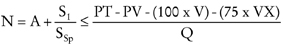

 342 N = Gesamtzahl der Plätze A = Anzahl Sitzplätze S 1 = für stehende Fahrgäste zur Verfügung stehende Fläche in m 2 SSp = Grundfläche pro Stehplatz in m 2 PT = Gesamtgewicht des Fahrzeuges PV = Leergewicht des Fahrzeuges V = Volumen des Gepäcks in m 3 VX = Fläche des Gepäcks in m 2 Q = Personengewicht in kg V = Für Gepäck zur Verfügung stehendes Volumen in m 3 VX = Für Gepäck zur Verfügung stehende Dachfläche in m 2 343 Bei Fahrzeugen der Klasse III beträgt der Wert S 1 (für stehende Fahrgäste zur Verfügung stehende Fläche) 0. da nur sitzende Fahrgäste zulässig sind. 4 Bestimmungen für Motorräder, Leicht-, Klein- und dreirädrige Motorfahrzeuge 41 Personengewichte Das für die Bestimmung der Platzzahl massgebende Personengewicht für Mitfahrer und Mitfahrerinnen beträgt bei Kleinmotorrädern nach Art. 14 Bst. b Ziff. 2, bei Leicht-, Klein- und dreirädrigen Motorfahrzeugen sowie bei Motorrädern mit Seitenwagen 65 kg. Anhang 9 (Art. 73 Abs. 5, 78 Abs. 2, 110 Abs. 1 Bst. b Ziff. 4 bis 6 und c sowie 3 Bst. c, 119 Bst. m, 148 Abs. 2, 178a Abs. 5, 179a Abs. 2 Bst. d, 180 Abs. 3, 193 Abs. 1 Bst. n bis p, 216 Abs. 3 und 4, 217 Abs. 3) Lichter, Richtungsblinker und Rückstrahler 1 Farbe 11 Die Lichter müssen folgende Farben haben: 111 Nach vorn gerichtete: Lichter: weiss oder hellgelb; Pedal- und Speichenlichter an Fahrrädern und Motorfahrrädern: gelb; Rückstrahler im allgemeinen: weiss; Pedal- und Speichenrückstrahler: gelb; Richtungsblinker und Warnblinker: gelb. 112 Rückwärts gerichtete: Bremslichter: rot; Rückfahrlichter: weiss, hellgelb oder gelb; Kontrollschildbeleuchtung: weiss; Nebelschlusslichter: rot; Pedal- und Speichenlichter an Fahrrädern und Motorfahrrädern: gelb; Pedal- und Speichenrückstrahler: gelb; Übrige Lichter und Rückstrahler: rot; Retroreflektierende Kennzeichnung von Speichen an Fahrrädern und Motorfahrrädern: weiss; Richtungsblinker und Warnblinker: rot oder gelb. 113 Seitwärts wirkende: Rückstrahler, Markierlichter sowie Warnlichter an Türen: rot oder gelb; Richtungsblinker und mitblinkende Markierlichter: gelb; Pedal- und Speichenlichter an Fahrrädern und Motorfahrrädern: gelb; Retroreflektierende Kennzeichnung von Reifen, Speichen und Felgen an Fahrrädern und Motorfahrrädern: weiss. 114 Arbeitslichter, beleuchtete Strecken- und Fahrzieltafeln: weiss, hellgelb oder gelb. 115 Kennlampen für Taxis, Pannenlampen und Notfallkennzeichen für Arztfahrzeuge, Gefahrenlichter sowie Rückstrahler von Fahrradanhängern, sofern sie nicht den Ziff. 111 und 112 entsprechen: gelb. Taxikennlampen dürfen mit Bewilligung des Amts für Strassenverkehr andere Farben (jedoch nicht rot) aufweisen, wenn dies aus Kontrollgründen erforderlich ist. 116 Blaulicht für vortrittsberechtigte Fahrzeuge: blau. 12 Farbkennwerte Die Farbe des ausgestrahlten oder reflektierten Lichtes von Einrichtungen richtet sich nach dem UNECE-Reglement Nr. 48. Für Lichtfarben der Blaulichter und der gelben Gefahrenlichter gelten die Definitionen im UNECE-Reglement Nr. 65. 2 Seitlicher Abstand und Zwischenraum 21 Bei Abblend-, Stand-, Schluss-, Nebellichtern, bei Richtungsblinkern sowie bei Rückstrahlern darf der äusserste Rand der Leuchtfläche seitlich höchstens 0.40 m von den äussersten, festen Teilen des Fahrzeugs entfernt sein. 22 Bei Markier- und Parklichtern, die wegen der Bauart oder Verwendung eines Fahrzeugs nicht an den äussersten Stellen angebracht werden können, darf der äusserste Punkt der Leuchtfläche nicht mehr als 0.40 m vom Fahrzeugrand entfernt sein. Der Abstand von 0.40 m gilt nicht für Markierlichter an land- und forstwirtschaftlichen Motorfahrzeugen. Bei Anhängern darf der äusserste Rand der Leuchtfläche der Standlichter seitlich nicht weiter als 0,15 m von den äussersten, festen Teilen des Fahrzeugs entfernt sein. 23 Der Zwischenraum zwischen den Leuchtflächen der Abblendlichter und derjenige zwischen den Leuchtflächen der Richtungsblinker muss mindestens 0.50 m betragen. Dies gilt nicht für zweirädrige Motorräder mit oder ohne Seitenwagen und Motorschlitten und für Fahrzeuge der Klassen M 1 und N 1 231 Beträgt die Fahrzeugbreite nicht mehr als 1.30 m, so muss der Zwischenraum zwischen den Leuchtflächen der Abblendlichter und derjenige zwischen den Leuchtflächen der Richtungsblinker mindestens 0.40 m betragen. Dies gilt nicht für zweirädrige Motorräder mit oder ohne Seitenwagen, Motorschlitten und für Fahrzeuge der Klassen M 1 und N 1 232 Bei zweirädrigen Motorrädern mit oder ohne Seitenwagen mit mehreren Fern- und/oder Abblendlichtern darf der Abstand zwischen den Leuchtflächen der einzelnen Lichter nicht mehr als 0.20 m betragen 24 Der Zwischenraum zwischen den Leuchtflächen der Richtungsblinker von Motorrädern muss mindestens betragen: - zwischen den vorderen Blinkern: 0,24 m; - zwischen den hinteren Blinkern: 0,18 m. 25 Für dreirädrige Kleinmotorräder, Leicht-, Klein- und dreirädrige Motorfahrzeuge gilt die Anforderung von Ziff. 21 betreffend den seitlichen Abstand der Schlusslichter nicht. Der Zwischenraum zwischen den Leuchtflächen muss jedoch bei Fahrzeugen mit zwei Hinterrädern mindestens 0.60 m betragen; bis zu einer Fahrzeugbreite von 1.30 m genügt ein Abstand von 0.40 m. 3 Anbringungshöhe 31 Der Abstand des unteren Randes der Leuchtfläche vom Boden muss wenigstens betragen: 311 bei Abblendlichtern: 0.50 m; 312 bei Stand-, Schluss-, Brems- und Markierlichtern sowie bei Richtungsblinkern: 0.35 m; bei Schluss- und Bremslichtern von Motorrädern, Leicht-, Klein- und dreirädrigen Motorfahrzeugen: 0.25 m; 313 bei Nebel- und Nebelschlusslichtern sowie Rückstrahlern: 0.25 m; 314 bei Rückfahrlichtern, ausgenommen an Fahrzeugen der Klassen M 1 und N 1 mit einer Länge bis 6 m: 0.25 m. 32 Der Abstand des oberen Randes der Leuchtfläche vom Boden darf höchstens betragen: 321 bei Abblend- und Nebellichtern: 1.20 m bei Abblend- und Nebellichtern von land- und forstwirtschaftlichen Motorfahrzeugen, wenn es die Form des Aufbaus erfordert, und bei Abblendlichtern von Geländefahrzeugen der Klasse N 3 : 1.50 m 322 bei Stand-, Schluss-, Brems- und Richtungsblinkern sowie bei seitlichen Markierlichtern: 1.50 m; wenn es die Form des Aufbaus erfordert: 2.10 m; 322.1 bei land- und forstwirtschaftlichen Motorfahrzeugen: 1.90 m; wenn es die Form des Aufbaus erfordert: 2.10 m; bei Standlichtern: 2.30 m; 322.2 bei seitlichen Richtungsblinkern: 2.30 m; 322.3 bei Standlichtern an Fahrzeugen der Klassen O 1 und O 2 : 2.10 m; 323 bei Markier-, Gefahren- und Blaulichtern: 4.00 m; 324 bei Rückstrahlern: 0.90 m; wenn es die Form des Aufbaus erfordert: 1.50 m; 324.1 Aufgehoben 325 bei Nebelschlusslichtern: 1.00 m bei Nebelschlusslichtern von Geländefahrzeugen der Klassen M und N: 1.20 m bei Nebelschlusslichtern von land- und forstwirtschaftlichen Motorfahrzeugen: 2.10 m 326 bei Rückfahrlichtern, ausgenommen an Fahrzeugen der Klassen M 1 und N 1 mit einer Länge bis 6 m: 1.20 m. 33 Kann bei besonderen Fahrzeugen, namentlich bei Arbeitsmotorwagen, wegen ihrer Bauart oder Verwendung die Höhenvorschrift nicht eingehalten werden, so sind die Lichter und Rückstrahler möglichst nahe an den vorgeschriebenen Stellen anzubringen. 34 Können bei land- und forstwirtschaftlichen Motorfahrzeugen die Vorschriften über die Anbringungshöhe und den seitlichen Abstand der Rückstrahler nicht eingehalten werden, so dürfen 4 Rückstrahler gemäss folgender Anordnung angebracht werden: 341 zwei Rückstrahler, deren oberer Rand der Leuchtfläche sich höchstens 0.90 m über dem Boden befindet und der Abstand zwischen den inneren Rändern mindestens 0.40 m beträgt und 342 zwei Rückstrahler, deren oberer Rand der Leuchtfläche sich höchstens auf einer Höhe von 2.10 m über dem Boden befindet und der äusserste Rand der Leuchtfläche seitlich höchstens 0.40 m von den breitesten Teilen der Fahrzeugkarosserie entfernt ist. 35 Das zusätzliche, nach hinten gerichtete Bremslicht muss symmetrisch zur Fahrzeuglängsachse fest angebracht sein. Der Abstand des unteren Randes der Leuchtfläche vom Boden muss wenigstens 0.85 m betragen oder sich nicht mehr als 0.15 m unter dem unteren Rand der Heckscheibe befinden. In jedem Fall muss sich der untere Rand des zusätzlichen Bremslichtes über dem oberen Rand der Leuchtfläche der vorgeschriebenen Bremslichter befinden. 4 Beleuchtungs- oder Lichtstärke 41 Fernlichter Die Fernlichter müssen bei einer Messdistanz von 25 m die Beleuchtungsstärken in LUX (Ix) gemäss nachstehender Tabelle aufweisen. Für Fernlichter an Fahrzeugen, deren Geschwindigkeit 45 km/h nicht übersteigen kann, gelten nur die Höchstwerte. Messort Motorwagen Motorräder, Leicht-, Klein- und dreirädrige Motorfahrzeuge Höchstgeschwindigkeit von: > 30 km/h ≤ 30 km/h - Zentrum des Fern- lichtbündels min. 32* min. 16* min. 8* - 1.125 m links und rechts davon min. 16* min. 8* min. 4* - 2.25 m links und rechts davon min. 4* min. 2* min. 1* - Höchstwert für alle Fernlichter eines Fahrzeugs zusammen 480 240 240 * Wert für ein Licht 42 Abblend- und Nebellichter Bei einer Messdistanz von 25 m muss die Beleuchtungsstärke der Abblend- und Nebellichter in LUX (Ix) innerhalb der Werte gemäss nachstehender Tabelle liegen. Nebellichter müssen den Mindestwert nicht erreichen. Abblendlichter an land- und forstwirtschaftlichen Traktoren sowie an Motorwagen, deren Geschwindigkeit 30 km/h nicht übersteigt, müssen wenigstens 50 Prozent des für Motorwagen vorgeschriebenen Mindestwertes erreichen. Dies gilt nicht für Motorräder, Leicht-, Klein- und dreirädrige Motorfahrzeuge. Die Höchstwerte dürfen nicht überschritten werden. Messort Motorwagen Motorräder, Leicht-, Klein- und dreirädrige Motorfahrzeuge > 30 km/h ≤ 30 km/h 0.20 m unter der Hell-Dunkel-Grenze in der Vertikalachse des Scheinwerfers und bis 2.25 m rechts und links davon (bei Lichtern amerikanischer Bauart ohne Abblendkappe: in der Mitte des Lichtflecks und bis 2.25 m rechts und links davon) min. 2* min. 1* min. 0.75* Oberhalt einer Linie, die links der Scheinwerferachse auf der Höhe des Leuchtfadens waagrecht verläuft und nach rechts um 15° ansteigt max. 1.2* max. 1.2* max. 1.2* * Wert für ein Licht 43 Stand-, Schluss-, Brems-, Markier- und Parklichter sowie Richtungsblinker Art der Vorrichtung Lichtstärke in Candela (cd) in der optischen Achse mindestens höchstens Standlichter und nach vorn gerichtete Markierlichter 4 60 Schlusslichter 1 sowie nach hinten gerichtete Markierlichter 4 12 Parklichter - nach vorne 2 60 - nach hinten 2 30 Bremslichter 1 Motorräder, Leicht-, Klein- und dreirädrige Motorfahrzeuge und ihre Anhänger 40 100 Übrige Fahrzeuge - Bremslichter mit einer Lichtstärke 60 185 - Bremslichter mit zwei Lichtstärken bei Tag 130 520 bei Nacht 30 80 - 1 zusätzliches Bremslicht 25 80 - 2 zusätzliche Bremslichter je 25 110 Richtungsblinker Motorräder, Leicht-, Klein- und dreirädrige Motorfahrzeuge - gemäss Anordnung II nach vorne 90 700 nach hinten 50 200 Übrige Fahrzeuge - vorn 175 700 - hinten - mit einer Lichtstärke 50 350 - mit zwei Lichtstärken bei Tag 175 700 bei Nacht 40 120 - seitlich - gemäss Anordnung I nach vorne 175 700 nach hinten 50 350 - gemäss Anordnung III nach vorne 175 700 nach hinten 0.3 200 - gemäss Anordnung IV 0.3 200 1 Sind Schluss- und Bremslichter gleicher Farbe in einer Vorrichtung vereinigt, so muss die Lichtstärke des Bremslichtes fünfmal grösser sein als diejenige des Schlusslichtes. 44 Rückstrahler Die Rückstrahlwerte von roten Rückstrahlern müssen mindestens den in der nachstehenden Tabelle aufgeführten Werten entsprechen. Die Werte sind in Millicandela pro LUX (mcd/Ix): Art der Rückstrahler Beobachtungswinkel 1 Rückstrahlwerte n mcd/lx bei Anleuchtungswinkel 2 von: vertikal horizontal 0° 0° ± 10° 0° ± 5° ± 20° Dreieckige Rückstrahler 450 12 200 8 150 8 Übrige Rückstrahler 300 5 200 2.8 100 2.5 1 Beobachtungswinkel ist der Winkel zwischen dem einfallenden Lichtstrahl und der Beobachtungseinrichtung. 2 Anleuchtungswinkel ist der Winkel zwischen dem einfallenden Lichtstrahl und der Achse des Rückstrahlers. 441 Die Rückstrahlwerte von gelben Rückstrahlern müssen gegenüber den roten Rückstrahlern mindestens um Faktor 2.5 höher sein. 442 Die Rückstrahlwerte von weissen Rückstrahlern müssen gegenüber den roten Rückstrahlern mindestens um Faktor 4 höher sein. 5 Anordnung und Sichtwinkel für Richtungsblinker Die Richtungsblinker sind gemäss den nachstehenden Abbildungen anzuordnen, unter Einhaltung der darin angegebenen horizontalen Sichtwinkel. Der vertikale Sichtwinkel muss bei allen Fahrzeugarten beidseits der Horizontalebene je 15° betragen. Beträgt die Anbauhöhe weniger als 0,75 m, genügt ein Sichtwinkel von 5° nach unten. Bei zusätzlichen, hoch angeordneten Richtungsblinkern genügt ein Sichtwinkel von 5° nach oben, sofern die Anbauhöhe mindestens 2,10 m beträgt. Bei Ziff. 51 Anordnung V gelten für die mitblinkenden Markierlichter die Sichtwinkel nach den Ziff. 61 und 62. Bei Fahrzeugen, bei denen die Richtungsblinker auf derselben Fahrzeugseite vorn/hinten wechselseitig aufleuchten (Art. 140 Abs. 2), darf die sichtbare leuchtende Fläche der vorderen Richtungsblinker nicht von hinten und die sichtbare leuchtende Fläche der hinteren Richtungsblinker nicht von vorne sichtbar sein. 51 Motorwagen Anordnung I 

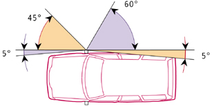

 Nur für Fahrzeuge bis 4 m Länge zulässig, die nicht den Klassen M oder N angehören Anordnung II 

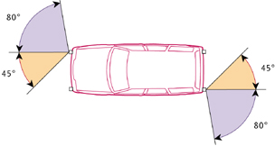

 Nur für Fahrzeuge bis 6 m Länge zulässig Anordnung III 

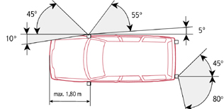

 Nur für Fahrzeuge zulässig, die nicht den Klassen M oder N angehören. Distanz der Blinker vom vorderen Fahrzeugrand höchstens 1.80 m Anordnung IV 

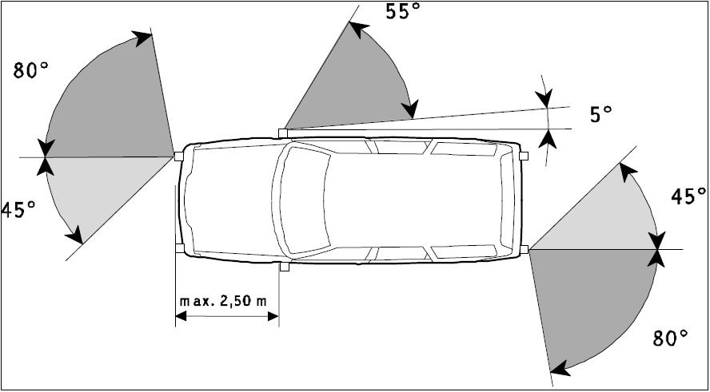

 Für alle Fahrzeuge zulässig. Distanz der seitlichen Blinker vom vorderen Fahrzeugrand höchstens 2,50 m Anordnung V 

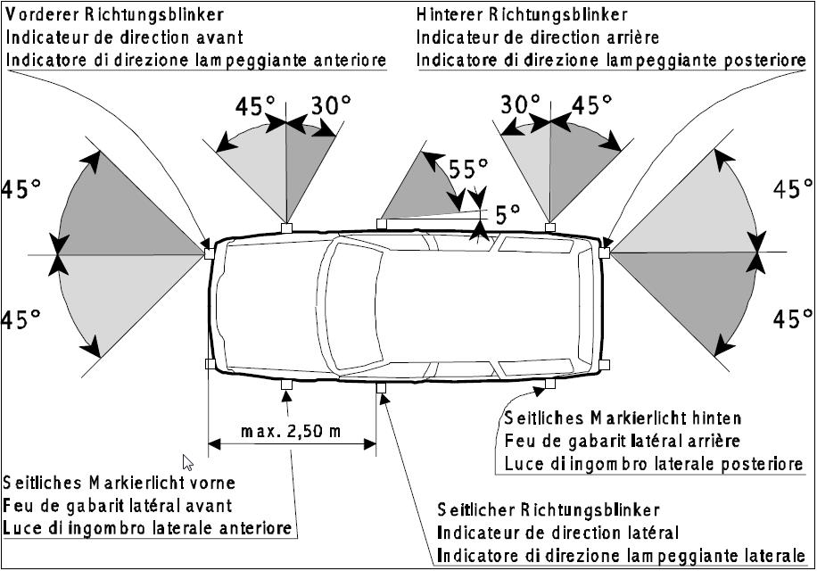

 Nur für Fahrzeuge bis 6 m Länge zulässig. Distanz der seitlichen Blinker vom vorderen Fahrzeugrand höchstens 2,50 m. Die leuchtende Fläche der mitblinkenden seitlichen Markierlichter muss mindestens je 12,5 cm 2 betragen. 52 Motorräder Anordnung I Aufgehoben Anordnung II 

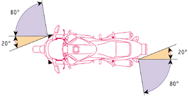

 Minimalabstand zwischen den Blinkern vorne 24 cm hinten 18 cm 53 Motorräder mit Seitenwagen 

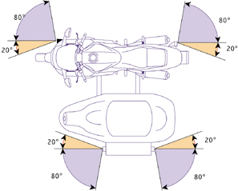

 54 Land- und forstwirtschaftliche Traktoren Anordnung I 

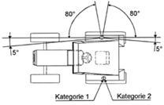

 Anordnung II 

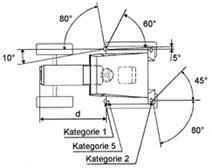

 Der Wert von 5° für den toten Winkel der Sichtbarkeit des seitlichen Zusatz-Richtungsblinkers nach hinten ist eine obere Grenze. Dieser Wert kann auf 10° erhöht werden, wenn 5° nicht eingehalten werden können. d ≤ 1.80 m Anordnung III 

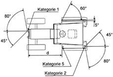

 Der Wert von 5° für den toten Winkel der Sichtbarkeit des seitlichen Zusatz-Richtungsblinkers nach hinten ist eine obere Grenze. Dieser Wert kann auf 10° erhöht werden, wenn 5° nicht eingehalten werden können. d ≤ 2.60 m Anordnung IV 

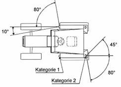

 Der Wert von 10° für die Sichtbarkeit der vorderen Richtungsblinker nach innen kann bei Fahrzeugen mit einer Breite über alles von nicht mehr als 1.40 m auf 3° verringert werden. Kategorien der Richtungsblinker Kategorie 1: für vordere Richtungsblinker Kategorie 2: für hintere Richtungsblinker Kategorie 1: für seitliche Zusatz-Richtungsblinker 55 Anhänger 

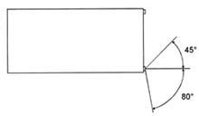

 6 Sichtwinkel für Stand-, Schluss-, Brems-, Markier-, Park- und Nebelschlusslichter 61 Bei vertikalen Sichtwinkel müssen bei allen Fahrzeugarten beidseits der Horizontalebene je 15°, bei Nebelschlusslichtern je 5°, bei Markierungslichtern 5° nach oben und 20° nach unten betragen. Für Stand-, Schluss-, Brems-, Markier- und Parklichter genügt ein Sichtwinkel von 5° nach unten, wenn die Anbauhöhe weniger als 0.75 m beträgt. Bei zusätzlichen, hoch angeordneten Schluss- und Bremslichtern genügt ein Sichtwinkel von 5° nach oben, sofern die Anbauhöhe mindestens 2.10 m beträgt. Bei seitlichen Markierlichtern, welche mit den Richtungsblinkern mitblinken, müssen die vertikalen Sichtwinkel nach unten und nach oben 10° betragen. 62 Die horizontalen Sichtwinkel müssen bei mitblinkenden seitlichen Markierlichtern der Anordnung V in Ziff. 51 entsprechen. Für vordere und hintere Markierlichter müssen sie lediglich nach aussen 80° betragen. Für die übrigen Beleuchtungsvorrichtungen richten sich die horizontalen Sichtwinkel nach folgenden Anordnungen: 63 Für Stand- und Schlusslichter 

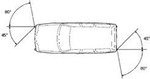

 Bei Fahrzeugen der Klassen M 1 und N 1 können die horizontalen Sichtwinkel nach aussen auf 45° reduziert werden, wenn vorne bzw. hinten ergänzende seitliche Markierlichter mit einer Leuchtfläche von mindestens je 12.5 cm 2 angebracht sind. Bei Anhängern muss der innere Sichtwinkel mindestens 5° betragen. 64 Für Bremslichter 

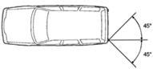

 65 Für das zusätzliche Bremslicht 

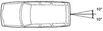

 66 Für Parklichter 

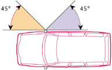

 67 Für Nebelschlusslichter 

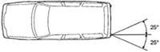

 7 Einstellung 71 Allgemeines 711 Zur Einstellung der Lichter wird eine matte, helle, mindestens 1 m breite Kontrollwand verwendet, welche eine Horizontallinie (H) und eine Vertikallinie (V) aufweist, oder ein optisches Einstellgerät, welches das auf einer 10.00 m entfernten Einstellwand entstehende Bild wiedergeben muss. 712 Das Fahrzeug, dessen Reifen den vorgeschriebenen Druck aufweisen müssen, steht auf ebener Fläche; die Vorderräder müssen geradeaus gerichtet sein. Eine allfällig automatische Nivellierung muss sich vollständig eingestellt haben. 713 Die Horizontallinie der Kontrollwand muss sich auf gleicher Höhe über dem Boden, die Vertikallinie in gleichem seitlichem Abstand von der Fahrzeuglängsachse befinden wie der Glühfaden des zu prüfenden Lichtes. 

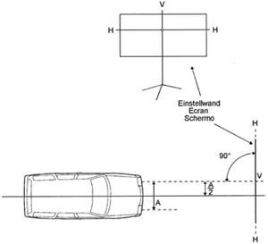

 714 Bei Fahrzeugen, deren Anbau der Beleuchtungseinrichtungen nach anerkannten internationalen Vorschriften genehmigt ist, richtet sich die Einstellung nach diesen Vorschriften. 72 Fernlichter 721 Die Einstellung der Fernlichter ist nur vorzunehmen, wenn sie sich nicht zwangsläufig aus der Einstellung des Abblendlichtes ergibt, d. h.: a) bei separaten Fernlichtern: in der Höhe und nach den Seiten; b) bei Fernlichtern, die mit symmetrischen Abblendlichtern vereinigt sind: nur nach den Seiten. 722 Die Mitte des Fernlichtbündels muss auf der Vertikallinie und, bei 7.50 m entfernter Einstellwand, 5 % tiefer liegen als die Horizontallinie. 73 Abblend- und Nebellichter 731 Belastung des Fahrzeugs und Abstand der Einstellwand richten sich nach folgender Tabelle: Distanz der Einstellwand Fahrzeugart Belastung europäische Abblendlichter und Nebellichter amerikanische Abblendlichter Personenwagen mit Verstelleinrichtung leer 5.00 m 7.50 m Personenwagen ohne Verstelleinrichtung 1 Person auf dem hinteren Sitz 5.00 m 7.50 m Gesellschaftswagen und Kleinbusse leer 5.00 m 7.50 m Liefer- und Lastwagen mit Verstelleinrichtung leer 5.00 m 7.50 m Liefer- und Lastwagen ohne Verstelleinrichtung vollbeladen 5.00 m 7.50 m leer 3.00 m 5.00 m Traktoren mit vollbeladenem Zentralanhänger 5.00 m 7.50 m in den übrigen Fällen 3.00 m 5.00 m Motorräder 1 Person je Sitz 6.00 m 9.00 m Motorfahrzeuge mit Beleuchtung bis 30 m nach Art. 119 Bst. k 3.00 m 731.1 Wegen des geringen Abstandes der Einstellwand kann die Hell-Dunkel-Grenze in der Mitte eine Wölbung aufweisen, weshalb namentlich auf den seitlichen Verlauf der Hell-Dunkel-Grenze abzustellen ist. 731.2 Bei verstellbaren Lichtern ist der obere Anschlag so zu fixieren, dass die erforderliche Neigung der Abblendlichter gewährleistet ist, wenn das Fahrzeug vorn voll und hinten nicht belastet wird. 731.3 Aus Zweckmässigkeitsgründen kann ein einheitlicher Abstand der Einstellwand gewählt werden; er darf nicht weniger als 5.00 m betragen. Die Differenz zwischen der Hell-Dunkel-Grenze und der Horizontallinie ist umzurechnen, so dass die erforderliche Neigung der Lichter gewährleistet ist. 732 Die Hell-Dunkel-Grenze der symmetrischen Abblendlichter, der Nebel- und Kurvenlichter, der waagrechte Teil der Hell-Dunkel-Grenze der asymmetrischen europäischen Abblendlichter und der obere Rand des Lichtflecks amerikanischer Abblendlichter müssen 10 % tiefer liegen als die Horizontallinie. Bei Nebellichtern, die auf einer Höhe von weniger als 1 m angebracht sind, ist auch eine Neigung des Lichtbündels von 2 % zulässig. 733 Die seitliche Einstellung erfolgt bei symmetrischen Abblendlichtern anhand des Fernlichtes. Bei asymmetrischen europäischen Abblendlichtern muss der Scheitelpunkt der Hell-Dunkel-Grenze auf der Vertikallinie liegen, bei asymmetrischen amerikanischen Abblendlichtern muss der Lichtfleck rechts auf der Vertikallinie liegen. Bei Nebel- und Kurvenlichtern muss die Mitte des Lichtbündels auf der Vertikallinie liegen. 74 Einstellbare Rückfahrlichter Die Mitte des Lichtbündels muss auf der 7.50 m entfernten Einstellwand 50 % der Höhe des Lichtfadens über den Boden unter der Horizontallinie liegen. Anhang 10 (Art. 82 Abs. 1 und 2, 86 Abs. 3, 116, 144 Abs. 3) Akustische Warn- und Alarmvorrichtungen 1 Allgemeine Bestimmungen Die obligatorischen Warnvorrichtungen müssen der Verordnung (EU) 2019/2144, der Verordnung (EU) Nr. 168/2013 und der Delegierten Verordnung (EU) Nr. 3/2014 oder dem UNECE-Reglement Nr. 28 entsprechen. Wechseltönige Zweiklanghörner von vortrittsberechtigten Fahrzeugen, wechseltönige Dreiklanghörner sowie Warnvorrichtungen für Überfallwarnanlagen müssen zusätzlich die Bestimmungen von Ziff. 3, 4 oder 5 erfüllen. 11 Überprüfung der Anforderungen Bei der Immatrikulation neuer Fahrzeuge und bei deren Nachprüfung genügt eine Messung unter folgenden Mess- und Betriebsbedingungen: 111 die Vorrichtung muss rasch ansprechen; 112 die Anforderungen der in Ziff. 1 genannten Vorschriften müssen erfüllt sein; 113 die in den Ziff. 2 bis 6 aufgeführten Schallpegel-Werte müssen im eingebauten Zustand eingehalten sein. 12 Messbedingungen Die Anforderungen an die Messgeräte, die Schallpegel-Bewertung, den Messort, die Störgeräusche und Windeinflüsse richten sich nach Anhang 5. Das Mikrofon muss sich 7.00 m vor dem Fahrzeug in einer Höhe zwischen 0.50 m und 1.50 m über dem Boden befinden. 13 Betriebsbedingungen während der Messung Elektrische Warnvorrichtungen sind bei stillstehendem Motor zu messen. Sie sind aus der vollgeladenen Batterie zu speisen. Bei Fahrzeugen ohne Batterie muss während der Messung der Motor mit etwa der Hälfte der Drehzahl der grössten Motorleistung drehen. Druckluftbetriebene Vorrichtungen sind beim gewöhnlichen Betriebsdruck zu messen. 2 Obligatorische Warnvorrichtung 21 Der Schalldruckpegel (Lautstärke) der Warnvorrichtung im eingebauten Zustand muss die nachstehenden Werte erreichen: 211 mindestens 87 dB(A), jedoch höchstens 112 dB(A) bei Motorwagen sowie bei Motorrädern, Klein- und dreirädrigen Motorfahrzeugen mit einer Motorleistung von mehr als 7 kW; 212 mindestens 80 dB(A), jedoch höchstens 112 dB(A) bei Motorfahrzeugen mit einer Höchstgeschwindigkeit von nicht mehr als 45 km/h sowie bei Motorrädern, Klein- und dreirädrigen Motorfahrzeugen mit einer Motorleistung von höchstens 7 kW; 213 mindestens 75 dB(A) jedoch höchstens 112 dB(A) bei Motorrädern und Motoreinachsern ohne Batterie sowie Kleinmotorrädern und Leichtmotorfahrzeugen. 3 Wechseltöniges Zweiklanghorn für vortrittsberechtigte Fahrzeuge 31 Die Lautstärke der einzelnen Töne muss im eingebauten Zustand mindestens 100 dB(A), jedoch höchstens 115 dB(A) betragen, im Labor (ausgebauter Zustand; Messdistanz 2 m in echofreiem Raum) mindestens 116 dB(A), jedoch höchstens 129 dB(A). 311 Die Grundfrequenzen der beiden Töne müssen bei einem subjektiven Hörvergleich zwischen 360 Hz und 630 Hz liegen und ein Verhältnis von 3 : 4 aufweisen (Abstimmtoleranz: - 3+7%). 32 Die Ablaufzeit eines ganzen Zyklus (2 hohe und 2 tiefe Töne und eine allfällige Pause) beträgt 2.5 bis 3.5 Sekunden. Bei jeder Betätigung der Vorrichtung muss der Zyklus von vorne beginnen. Eine Dauerschaltung ist gestattet. Die Töne müssen rhythmisch aufeinanderfolgen und dürfen sich nicht überschneiden. Eine Pause zwischen den Tonfolgen darf 0.8 Sekunden nicht übersteigen. 4 Wechseltöniges Dreiklanghorn 41 Die Lautstärke über den ganzen Bereich gemessen, muss im eingebauten Zustand mindestens 93 dB(A), jedoch höchstens 112 dB(A) betragen, im Labor (ausgebauter Zustand; Messdistanz 2 m in echofreiem Raum) mindestens 105 dB(A), jedoch höchstens 118 dB(A). 42 Der Dreiklang besteht aus den Tönen cis, e und a (entsprechend den Frequenzen 277 Hz, 330 Hz, 446 Hz) mit einer Toleranz von + 5 %. 5 Überfallwarnanlage 51 Die Lautstärke über den ganzen Bereich gemessen, muss im eingebauten Zustand mindestens 93 dB(A), jedoch höchstens 112 dB(A) betragen, im Labor (ausgebauter Zustand; Messdistanz 2 m in echofreiem Raum) mindestens 105 dB(A), jedoch höchstens 118 dB(A). 511 Die Grundfrequenzen der beiden Töne müssen bei einem subjektiven Hörvergleich zwischen 250 Hz und 650 Hz liegen und ein Verhältnis zwischen 1 : 1.2 und 1 : 1.8 (ideal 1 : 1.5) aufweisen. 52 Der höhere Ton und der nachfolgende Unterbruch dauern 0.8 bis 1.2 Sekunden, wovon 30 % bis 70 % auf den Ton entfallen. 6 Warnvorrichtungen für Fahrzeugalarmsysteme 61 Warnvorrichtungen, die einen Dauerton abgeben, müssen gemäss Ziff. 1 geprüft sein und ein entsprechendes Prüfzeichen aufweisen. 62 Warnvorrichtungen, die einen intermitierenden Ton abgeben, müssen mindestens den Anforderungen der Ziff. 6.1 und 6.2 des Teil I der in Ziff. 1 beschriebenen internationalen Vorschriften entsprechen. 63 Für Warnvorrichtungen, die einen auf- und abschwellenden Ton abgeben, gelten die Anforderungen des Teil I der in Ziff. 1 beschriebenen internationalen Vorschriften sinngemäss. 64 Für die Ermittlung des höchsten Schalldruckpegels (Lautstärke) gelten dieselben Bestimmungen wie für obligatorische Warnvorrichtungen (Ziff. 2). Für Warnvorrichtungen, die einen auf- und abschwellenden Ton abgeben, beträgt die Mindestlautstärke im Laborversuch (Teil I des UNECE-Reglements) 100 dB(A). Anhang 11 (Art. 80 Abs. 3) Elektromagnetische Verträglichkeit 1 Anforderungen 11 Die elektrische Anlage muss die grundlegenden Anforderungen und geltenden Normen im Bereich der elektromagnetischen Verträglichkeit erfüllen. 12 Die Anforderungen der folgenden, für die Fahrzeugart massgebenden Regelungen müssen eingehalten sein: a) Verordnung (EU) Nr. 2019/2144, b) Verordnung (EU) Nr. 168/2013 und Delegierte Verordnung (EU) Nr. 44/2014; c) Verordnung (EU) Nr. 167/2013 und Delegierte Verordnung (EU) 2015/208; oder d) UNECE-Reglement Nr. 10. 13 Soweit Ausrüstungen, die in Fahrzeugen montiert oder benutzt werden können, in dieser Verordnung nicht geregelt sind, gilt die Verordnung über die elektromagnetische Verträglichkeit von Geräten im Europäischen Wirtschaftsraum. Anhang 12 (Art. 112 Abs. 6) Anforderungen an Kamera-Monitor-Systeme 1 Technische Anforderungen 11 Die Kamera-Monitor-Systeme müssen aus mindestens zwei Seitenblick-Kameras und mindestens einem Monitor bestehen. 12 Die horizontalen Öffnungswinkel aller linken und aller rechten Seitenblick-Kameras müssen je 50 bis 70° betragen. 13 Die Bilder müssen verzögerungsfrei auf die Monitore übertragen werden. 14 Eine Fehlfunktion, Störung oder sonstige Beeinträchtigung des Systems muss für den Führer oder die Führerin leicht erkennbar sein. 15 Die Bilder der linken und der rechten Seite müssen in der Standardeinstellung gleichzeitig angezeigt werden. 151 Bei der Verwendung eines einzelnen Monitors müssen die Bilder der linken und der rechten Seite auf dem Monitor eindeutig zugeordnet sein. 16 Die Bilder müssen eine diagonale Grösse von mindestens 4.5 Zoll aufweisen. 17 Die Bilder müssen in ausreichender Auflösung dargestellt sein. 171 Ein Objekt mit einer Frontfläche von 1.80 m Höhe und 0.60 m Breite, das 70 m entfernt ist, muss auf einem Monitor-Bild erkennbar und mindestens 3 mm hoch sein. 18 Die Helligkeit der Monitore muss einstellbar sein. 181 Blendungen auf den Monitoren müssen wirksam verhindert werden. 182 Die Seitenblick-Kameras müssen auch bei grellem Sonnenlicht in der Lage sein, Bilder zu erzeugen. 2 Widerstandsfähigkeit gegen äussere Einflüsse 21 Alle Komponenten müssen gegen das Eindringen von Wasser und Staub geschützt sein. 22 Die Komponenten und ihre Einstellung sowie die Leitungsverbindungen müssen den im Betrieb auftretenden Erschütterungen standhalten. 23 Die Kamera-Monitor-Systeme müssen im Temperaturbereich zwischen -20 °C und +65 °C funktionieren. 24 Die Kameralinsen oder Deckscheiben müssen aus Materialien bestehen, die stets klar bleiben. 3 Installations- und Betriebsanleitung Eine Anleitung muss leicht verständliche und klare Angaben und Anweisungen enthalten betreffend die notwendigen Systemvoraussetzungen, die Installation, die Wartung und den Hersteller oder die Herstellerin des Systems (Art. 41 Abs. 1). 4 Nachweis der Einhaltung gleichwertiger Anforderungen 41 Kamera-Monitor-Systeme nach ISO 16505, 2015, Strassenfahrzeuge - Ergonomie und Leistungsaspekte für Kamera Monitorsysteme - Anforderungen und Prüfprozeduren, welche die Anforderungen an Einrichtungen für indirekte Sicht auf der Fahrerseite nach Klasse II des UNECE-Reglements Nr. 46 erfüllen, sind zulässig, wenn eine Installations- und Betriebsanleitung nach Ziff. 3 vorhanden ist. 42 Konformitätsbewertungen nach nationalen Normen ausländischer Staaten können anerkannt werden, wenn die Anforderungen den Vorschriften in den Ziff. 1 und 2 mindestens gleichwertig sind und eine Installations- und Betriebsanleitung nach Ziff. 3 vorhanden ist; der Nachweis der Gleichwertigkeit ist vom Gesuchsteller oder von der Gesuchstellerin zu erbringen. Übergangsbestimmungen 741.41 V über die technischen Anforderungen an Strassenfahrzeuge (VTS) Verordnung vom 12. Dezember 2000 betreffend die Abänderung der Verordnung über die technischen Anforderungen an Strassenfahrzeuge (VTS) ... II. Übergangsbestimmung In Abweichung von Art. 7 Abs. 4 kann das Gesamtgewicht von Fahrzeugen, welche der leistungsabhängigen Schwerverkehrsabgabe unterliegen und vor dem 1. Januar 1999 auf die antragstellende Person zugelassen worden sind, einmalig herabgesetzt werden. Das herabgesetzte Gesamtgewicht muss höher sein als 3 500 kg. Der Antrag auf Herabsetzung des Gesamtgewichtes hat bis zum 31. Dezember 2000 bei der Motorfahrzeugkontrolle zu erfolgen. Das Garantiegewicht wird im Fahrzeugausweis im Feld "Verfügung der Behörde" zusätzlich eingetragen. Für spätere Änderungen des Gesamtgewichtes ist Art. 7 Abs. 4 wieder anwendbar. ... Verordnung vom 12. Juni 2001 betreffend die Abänderung der Verordnung über die technischen Anforderungen an Strassenfahrzeuge (VTS) ... II. Übergangsbestimmungen 1) Die Bestimmungen des Art. 44 Abs. 3 über das Herstellerschild, des Art. 109 Abs. 4 und des Art. 192 Abs. 2 über das Anbringen der Markierlichter gelten für Fahrzeuge, die ab 1. Oktober 2001 neu typengenehmigt werden, sowie für die erstmalige Zulassung der Fahrzeuge, die ab 1. Januar 2002 eingeführt oder in Liechtenstein hergestellt werden. 2) Die Bestimmungen des Art. 45 Abs. 2 über die Lesbarkeit des hinteren Kontrollschildes bezogen auf die Längsachse gelten für die Fahrzeuge, die ab 1. Juli 2001 neu in Verkehr gesetzt werden. Für die Fahrzeuge, die vor dem 1. Juli 2001 in Verkehr gesetzt worden sind, gelten diese Bestimmungen ab 1. Dezember 2001. 3) Die Bestimmungen des Art. 95 Abs. 1 Bst. i über das zulässige Gewicht und Abs. 2 Bst. a über die Achslasten gelten für die Fahrzeuge, die ab 1. Juli 2001 neu typengenehmigt werden, sowie für die erstmalige Zulassung der Fahrzeuge, die ab 1. Dezember 2001 eingeführt oder in Liechtenstein hergestellt werden. 4) Die Bestimmungen des Art. 76 Abs. 4 über die Schaltung der Nebelschlusslichter, des Art. 106 Abs. 2 über Kopfstützen und des Art. 192 Abs. 1 Bst. a über die Standlichter an Anhängern gelten für die Fahrzeuge, die ab 1. Juli 2001 neu typengenehmigt werden, sowie für die erstmalige Zulassung der Fahrzeuge, die ab 1. Oktober 2001 eingeführt oder in Liechtenstein hergestellt werden. 5) Die Bestimmungen des Art. 101 Abs. 1 über den Restwegschreiber gelten für: a) Fahrzeuge, die ab dem 1. Juli 2001 neu in Verkehr gesetzt werden; b) die im Verkehr stehenden Fahrzeuge zum gewerbsmässigen Personentransport ab 1. Dezember 2001; c) die im Verkehr stehenden Fahrzeuge der Feuerwehr und des Rettungswesens mit Blaulicht und Wechselklanghorn ab 1. Dezember 2001. 6) Die in Art. 103 und 189 sowie in Anhang 6 aufgeführte Richtlinie Nr. 71/320/EWG betreffend der Bremsen gilt in der Fassung der Richtlinie Nr. 98/12/EG für Fahrzeuge, die ab 1. Oktober 2001 neu typengenehmigt werden, sowie für die erstmalige Zulassung der Fahrzeuge, die ab 1. Dezember 2001 eingeführt oder in Liechtenstein hergestellt werden. 7) Die Bestimmungen des Art. 106 Abs. 1 über Sicherheitsgurten gelten für: a) Fahrzeuge der Klasse M 2 mit einem Gesamtgewicht von höchstens 3.50 t, die ab 1. Juli 2001 neu typengenehmigt werden, sowie für die erstmalige Zulassung solcher Fahrzeuge, die ab 1. Oktober 2001 eingeführt oder in Liechtenstein hergestellt werden; b) übrige Fahrzeuge, die ab 1. Juli 2001 neu typengenehmigt werden, sowie für die erstmalige Zulassung solcher Fahrzeuge, die ab 1. Dezember 2001 eingeführt oder in Liechtenstein hergestellt werden. 8) Die Bestimmungen des Art. 112 Abs. 4 über Rückspiegel gelten für die Fahrzeuge, die ab 1. Juli 2001 neu in Verkehr gesetzt werden. Für die Fahrzeuge, die zwischen dem 1. Januar 1988 und dem 30. Juni 2001 neu in Verkehr gesetzt worden sind, gelten diese Bestimmungen ab 1. Dezember 2001. 9) Die Bestimmung des Art. 118a Abs. 1, betreffend die Bremslichter an landwirtschaftlichen Traktoren und der Ziff. 51 Anordnung I des Anhangs 9 (Lichter, Richtungsblinker und Rückstrahler) über die Sichtwinkel der Richtungsblinker gelten für Fahrzeuge, die ab 1. Oktober 2001 eingeführt oder hergestellt werden. 10) Die Bestimmungen des Art. 121 Abs. 2 über die Mindesthöhen der Durchgänge, des Art. 140 Abs. 1 Bst. a über das Anbringen von Standlichtern und des Art. 158 Abs. 2 über die Anforderungen an die Gurtverankerungen gelten für die Fahrzeuge, die ab 1. Dezember 2001 neu typengenehmigt werden, sowie für die erstmalige Zulassung der Fahrzeuge, die ab 1. Dezember 2001 eingeführt oder in Liechtenstein hergestellt werden. 11) Die Bestimmung des Art. 161 Abs. 1a über die Messtoleranz der Höchstgeschwindigkeit gelten für Fahrzeuge, die ab 1. Oktober 2004 neu typengenehmigt werden, sowie für die erstmalige Zulassung der Fahrzeuge, die ab 1. Oktober 2005 eingeführt oder hergestellt werden. 12) Für die Anwendung der im Anhang 1 aufgeführten internationalen Regelungen gelten - soweit in den vorliegenden Übergangsbestimmungen keine anderen Fristen vorgesehen sind - die in den jeweiligen Regelungen enthaltenen Übergangsbestimmungen, wobei für die Zulassung auf den Zeitpunkt der Einfuhr oder der Herstellung in Liechtenstein abgestellt wird. 13) Bereits in Verkehr stehende landwirtschaftliche Motorfahrzeuge, welche die Breite von 2.55 m nur wegen den montierten Breitreifen überschreiten, müssen bis zum 30. September 2001 als Ausnahmefahrzeuge zugelassen werden (Anh. 2 Ziff. 311). 14) Die Ziff. 111 Bst. b, 122 und 212 des Anhangs 4 (Rauch und Abgas) sowie die Ziff. 111.3 und 431 Bst. b bis d des Anhangs 5 (Geräusch) gelten für die Fahrzeuge, die ab 1. Dezember 2001 neu typengenehmigt werden, sowie für die erstmalige Zulassung der Fahrzeuge, die ab 1. Oktober 2003 eingeführt oder in Liechtenstein hergestellt werden. 15) Aufgehoben 16) Die Ziff. 211a des Anhangs 4 (Rauch und Abgas) gilt für Motoren, die in oder auf Fahrzeugen verwendet werden, die ab 1. Oktober 2001 neu typengenehmigt werden, sowie für die erstmalige Zulassung der Fahrzeuge, die ab 1. Dezember 2001 eingeführt oder in Liechtenstein hergestellt werden. ... Verordnung vom 9. Dezember 2003 betreffend die Abänderung der Verordnung über die technischen Anforderungen an Strassenfahrzeuge (VTS) ... II. Übergangsbestimmungen 1) Die Bestimmungen des Art. 114 Abs. 2 über die Feuerlöscher gelten für Fahrzeuge, die vor dem Inkrafttreten dieser Verordnung in Verkehr gesetzt worden sind, ab dem 1. Januar 2005. 2) Für die Anwendung der im Anhang 1 aufgeführten internationalen Regelungen gelten - soweit in den vorliegenden Übergangsbestimmungen keine anderen Fristen vorgesehen sind - die in den jeweiligen Regelungen enthaltenen Übergangsbestimmungen, wobei für die Zulassung auf den Zeitpunkt der Einfuhr oder der Herstellung in Liechtenstein oder der Schweiz abgestellt wird. ... Verordnung vom 28. September 2004 betreffend die Abänderung der Verordnung über die technischen Anforderungen an Strassenfahrzeuge (VTS) ... III. Übergangsbestimmungen 1) Die Änderung des Art. 99 Abs. 1 über die Ausrüstung mit Geschwindigkeitsbegrenzungseinrichtungen gilt für Fahrzeuge, die ab dem 1. Januar 2005 neu in Verkehr gesetzt werden. Fahrzeuge, die ab dem 1. Oktober 2001 und bis zum 31. Dezember 2004 in Verkehr gesetzt worden sind und den Grenzwerten der Richtlinie 88/77/EWG, zuletzt geändert durch die Richtlinie 2001/27/EG, entsprechen, müssen bis zur periodischen Nachprüfung, zu der sie ab dem 1. Januar 2006 aufgeboten werden, nachgerüstet sein. 2) Das in den Ziff. 111 Bst. b und 212 des Anhangs 4 (Rauch und Abgas) aufgeführte Kapitel 5 der Richtlinie 97/24/EG in der Fassung der Richtlinie 2002/51/EG gilt hinsichtlich der Grenzwerte für die zweite Stufe (Anh. I Ziff. 2.2.1.1.3) für Kleinmotorräder, die ab 1. Oktober 2002 neu typengenehmigt werden, sowie für die erstmalige Zulassung von Kleinmotorrädern, die ab 1. Juli 2004 eingeführt oder in Liechtenstein oder der Schweiz hergestellt werden. 3) Für die Anwendung der im Anhang 1 aufgeführten Regelungen gelten, unter Vorbehalt von Abs. 1 und 2, die in den jeweiligen Regelungen enthaltenen Übergangsbestimmungen, wobei für die Zulassung auf den Zeitpunkt der Einfuhr oder der Herstellung in Liechtenstein oder der Schweiz abgestellt wird. ... Verordnung vom 27. Juni 2006 betreffend die Abänderung der Verordnung über die technischen Anforderungen an Strassenfahrzeuge (VTS) ... II. Übergangsbestimmungen 1) Für Fahrzeuge, die vor dem Inkrafttreten dieser Verordnung eingeführt oder in Liechtenstein oder der Schweiz hergestellt wurden, genügt unter Vorbehalt anders lautender Bestimmungen das bisherige Recht. 2) Für Fahrzeuge, die vor dem 1. Oktober 2006 typengenehmigt werden, und für Fahrzeuge, die von der Typengenehmigung befreit sind, gilt bezüglich Art. 40 Abs. 3 über das Ausschwenkmass das bisherige Recht. 3) Für Reifen von Fahrzeugen, die vor dem 1. Oktober 1980 erstmals zum Verkehr zugelassen wurden, gilt bezüglich Art. 58 Abs. 7 über die Kennzeichnung der Reifen das bisherige Recht. Bis zum 1. Januar 2009 dürfen alle Fahrzeuge mit Reifen nach bisherigem Recht ausgerüstet sein. 4) Für Fahrzeuge, die vor dem 1. Oktober 2007 erstmals in Verkehr gesetzt werden, gilt bezüglich Art. 58 Abs. 8 über die Reifen bis zum 1. Oktober 2011 das bisherige Recht. Ab diesem Zeitpunkt dürfen Fahrzeuge, die ab dem 1. Oktober 1980 in Verkehr gesetzt worden sind, nur noch mit Reifen nach den neuen Bestimmungen neu ausgerüstet werden. 5) Für Fahrzeuge, die vor dem 1. Oktober 2006 erstmals in Verkehr gesetzt werden, gilt bezüglich Art. 81 Abs. 1 und Art. 144 Abs. 2 über die Scheibenwaschanlage sowie Art. 115 über die Diebstahlsicherung das bisherige Recht. 6) Für Fahrzeuge der Klasse N 1 gilt bezüglich Art. 97 Abs. 4 über die Ermittlung des Treibstoffverbrauchs und der CO 2 -Emissionen bis zum 1. Januar 2008 das bisherige Recht. 7) Für Fahrzeuge, die vor dem 1. Oktober 2006 typengenehmigt werden, sowie für die erstmalige Zulassung der Fahrzeuge, die vor dem 1. Oktober 2007 eingeführt oder in Liechtenstein oder der Schweiz hergestellt werden, gilt bezüglich Art. 123 Abs. 1 und 3 über die Anforderungen an Türen und Notausstiege von Gesellschaftswagen und Kleinbussen das bisherige Recht. 8) Für Fahrzeuge, die vor dem Inkrafttreten dieser Verordnung eingeführt, in Liechtenstein oder der Schweiz hergestellt oder vor diesem Zeitpunkt umgebaut wurden, gilt bezüglich Art. 133 Abs. 2 und Art. 161 Abs. 1 über die Kraftübertragung das bisherige Recht. 9) Für die Anwendung der in dieser Verordnung aufgeführten EWR-Rechtsvorschriften und ECE-Reglemente gelten, unter Vorbehalt der Abs. 2, 4, 6 und 7, die in den jeweiligen Regelungen enthaltenen Übergangsbestimmungen, wobei für die Zulassung auf den Zeitpunkt der Einfuhr oder der Herstellung in Liechtenstein oder der Schweiz abgestellt wird. ... Verordnung vom 4. Juli 2006 betreffend die Abänderung der Verordnung über die technischen Anforderungen an Strassenfahrzeuge (VTS) ... II. Übergangsbestimmungen 1) Die Bestimmungen von Art. 106 Abs. 2 und 3 über Sicherheitsgurten gelten für Fahrzeuge, die ab Inkrafttreten dieser Verordnung neu in Verkehr gesetzt oder entsprechend umgebaut werden. Für Fahrzeuge, die vor diesem Datum in Verkehr gesetzt oder umgebaut worden sind, gelten diese Bestimmungen ab dem 1. Januar 2010, ausser wenn die Fahrzeuge über nach vorne gerichtete Sitzplätze verfügen, für die keine Sicherheitsgurten vorgeschrieben sind. 2) Die Bestimmungen von Art. 117 Abs. 2 über das Höchstgeschwindigkeitszeichen gelten für Fahrzeuge, die ab Inkrafttreten dieser Verordnung neu in Verkehr gesetzt werden. Für Fahrzeuge, die vor diesem Datum in Verkehr gesetzt worden sind, gelten diese Bestimmungen ab dem 1. Januar 2009. ... Verordnung vom 20. Juli 2006 betreffend die Abänderung der Verordnung über die technischen Anforderungen an Strassenfahrzeuge (VTS) ... II. Übergangsbestimmungen 1) Für Fahrzeuge nach Art. 100 Abs. 1, die vor dem 28. Oktober 2006 erstmals in Verkehr gesetzt werden, genügt ein analoger Fahrtschreiber. 2) Einen digitalen Fahrtschreiber benötigen ab dem 28. Oktober 2006 Fahrzeuge: a) die erstmals in Verkehr gesetzt werden; b) die neu mit einem Fahrtschreiber ausgerüstet werden müssen; oder c) die vor dem 1. Januar 1996 erstmals in Verkehr gesetzt wurden und bei denen das gesamte Fahrtschreibersystem ersetzt wird. ... Verordnung vom 14. August 2007 betreffend die Abänderung der Verordnung über die technischen Anforderungen an Strassenfahrzeuge (VTS) Aufgrund von Art. 99 des Strassenverkehrsgesetzes (SVG) vom 30. Juni 1978, LGBl. 1978 Nr. 18, verordnet die Regierung: ... II. Übergangsbestimmungen 1) Fahrzeuge, die vor dem Inkrafttreten dieser Verordnung eingeführt oder in Liechtenstein oder der Schweiz hergestellt werden, müssen mindestens den Anforderungen nach bisherigem Recht genügen; vorbehalten bleiben die nachfolgenden Bestimmungen. 2) Für Fahrzeuge, die vor dem 1. Oktober 2008 erstmals zum Verkehr zugelassen werden, gilt bezüglich Art. 22 Abs. 2 Bst. c über die Aufhebung der Gleichstellung von Baustellenanhängern und Art. 202 Abs. 3 über die Betriebsbremse an Arbeitsanhängern das bisherige Recht. 3) Für Fahrzeuge, die vor dem 1. Oktober 2007 typengenehmigt werden, sowie für die erstmalige Zulassung der Fahrzeuge, die vor dem 1. Januar 2008 eingeführt oder in Liechtenstein oder der Schweiz hergestellt werden, gilt bezüglich Art. 51 Abs. 1 über die Kennzeichnung von elektrischen Antriebsmotoren das bisherige Recht. 4) Fahrzeuge können bis zum 31. Dezember 2008 statt mit einem Datenaufzeichnungsgerät nach Art. 102 mit einem Restwegschreiber nach bisherigem Recht ausgerüstet werden. Für Bau, Einbau, Prüfung, Nachprüfung und Reparatur von Restwegschreibern gilt das bisherige Recht. 5) Für Fahrzeuge ohne EG-Gesamtgenehmigung, die vor dem 1. Oktober 2007 eingeführt oder in Liechtenstein oder der Schweiz hergestellt werden, gilt bezüglich Art. 104b Abs. 1 über den Schutz beim Seitenaufprall das bisherige Recht. 6) Die in Art. 104c Abs. 1 und Art. 191 Abs. 3 aufgeführte Richtlinie 70/221/EWG betreffend den hinteren Unterfahrschutz gilt in der Fassung der Richtlinie 2006/20/EG für Fahrzeuge, die ab 11. September 2007 neu typengenehmigt werden, sowie für die erstmalige Zulassung der Fahrzeuge, die ab 11. März 2010 eingeführt oder in Liechtenstein oder der Schweiz hergestellt werden. 7) Für Fahrzeuge, die vor dem 1. Januar 2008 erstmals zum Verkehr zugelassen oder entsprechend umgebaut werden, gilt bezüglich Art. 107 Abs. 1a über quer zur Fahrtrichtung angeordnete Sitze das bisherige Recht. 8) Für Fahrzeuge, die vor dem 1. Oktober 2007 erstmals zum Verkehr zugelassen werden, gilt bezüglich Art. 112 Abs. 4 über die Rückspiegel das bisherige Recht. ... Verordnung vom 24. Juni 2008 betreffend die Abänderung der Verordnung über die technischen Anforderungen an Strassenfahrzeuge (VTS) Aufgrund von Art. 99 des Strassenverkehrsgesetzes (SVG) vom 30. Juni 1978, LGBl. 1978 Nr. 18, verordnet die Regierung: ... II. Übergangsbestimmungen 1) Für bereits im Verkehr stehende Fahrzeuge mit einer Höchstgeschwindigkeit bis 45km/h gilt bezüglich Art. 68 Abs. 4 über Heckmarkierungstafeln bis 1. Juli 2009 das bisherige Recht. 2) Für Fahrzeuge, die vor dem 1. Juli 2011 erstmals zum Verkehr zugelassen werden, gilt bezüglich Art. 69 Abs. 2 über die Kenntlichmachung das bisherige Recht. 3) Für Fahrzeuge, die vor dem 1. Juli 2007 in Verkehr gesetzt worden sind, gilt bezüglich Art. 104a Abs. 3 über Frontschutzsysteme, die als selbständige technische Einheit angebaut sind, bis zum 1. Januar 2010 das bisherige Recht. 4) Für Fahrzeuge, die vor dem 1. Januar 2000 erstmals zum Verkehr zugelassen wurden, gilt bezüglich Art. 112 Abs. 4 über die Spiegel das bisherige Recht. Für Fahrzeuge, die zwischen dem 1. Januar 2000 und dem 30. September 2007 erstmals zugelassen worden sind, gilt das bisherige Recht bis zum 31. März 2009. Danach gilt für diese Fahrzeuge bezüglich Weitwinkelspiegel auf der Beifahrerseite und Anfahr- oder Rampenspiegel das neue Recht. Verordnung vom 23. März 2010 betreffend die Abänderung der Verordnung über die technischen Anforderungen an Strassenfahrzeuge Aufgrund von Art. 99 des Strassenverkehrsgesetzes (SVG) vom 30. Juni 1978, LGBl. 1978 Nr. 18, verordnet die Regierung: ... II. Übergangsbestimmungen 1) Für landwirtschaftliche Arbeitsanhänger, die vor dem 1. Januar 2011 hergestellt werden, gilt bezüglich Art. 209 Abs. 1 und 3 über die Beleuchtung und die Richtungsblinker bis zum 1. Januar 2013 das bisherige Recht. 2) Für Schulbusse, die vor dem 1. August 2012 erstmals zugelassen oder entsprechend umgebaut werden, gilt bezüglich Art. 123a Abs. 1 über einen gleichwertigen Schutz wie nach dem ECE-Reglement Nr. 44/03 das bisherige Recht. Verordnung vom 5. Juni 2012 betreffend die Abänderung der Verordnung über die technischen Anforderungen an Strassenfahrzeuge Aufgrund von Art. 99 des Strassenverkehrsgesetzes (SVG) vom 30. Juni 1978, LGBl. 1978 Nr. 18, verordnet die Regierung: ... II. Übergangsbestimmungen 1) Für Fahrzeuge, die vor dem 1. Juli 2012 erstmals zugelassen oder entsprechend umgebaut werden, gilt bezüglich Art. 11 Abs. 2 Bst. f über die Beschränkung der Sitzplätze bis zum 1. Januar 2020 das bisherige Recht. 2) Für Fahrzeuge, die vor dem 1. Januar 2013 erstmals zugelassen oder entsprechend umgebaut werden, gilt bezüglich des Art. 66 Abs. 1a über die Befestigungsvorrichtung zur Ladungssicherung das bisherige Recht. 3) Für Fahrzeuge, die vor dem 1. Juli 2012 erstmals zugelassen oder entsprechend umgebaut werden, gilt bezüglich Art. 74 Abs. 4 über die Verstelleinrichtung und die Reinigungsanlage der Scheinwerfer das bisherige Recht. 4) Für Fahrzeuge der Klasse N1, die vor dem 24. August 2015 importiert oder in Liechtenstein oder der Schweiz hergestellt werden, gilt bezüglich Art. 103 Abs. 5 über Antiblockier- und Bremsassistenzsysteme das bisherige Recht, ausser wenn sie von einem Fahrzeug der Klasse M1 abgeleitet sind und ein Gesamtgewicht von maximal 2,5 t haben. 5) Für Fahrzeuge der Klassen M und N, die vor dem 1. August 2012 mit Kindersitzen erstmals zugelassen oder entsprechend umgebaut werden, gilt bezüglich Art. 106 Abs. 3 über einen gleichwertigen Schutz wie nach dem ECE-Reglement Nr. 44/03 das bisherige Recht. 6) Für Fahrzeuge, die von der Typengenehmigung befreit sind, sowie für Fahrzeuge, die vor dem 1. Oktober 2012 typengenehmigt werden, gilt bezüglich Art. 109 Abs. 1a über die Tagfahrlichter das bisherige Recht. 7) Für Fahrzeuge, die vor dem 1. Januar 2013 erstmals zugelassen werden, gilt bezüglich der Art. 109 Abs. 5 und 192 Abs. 6 über die Warnblinklichter an Hebebühnen das bisherige Recht. Für Fahrzeuge, die keiner Zulassung unterstehen, ist der Zeitpunkt der Herstellung massgebend. 8) Für Fahrzeuge, die vor dem 1. Januar 2013 erstmals zugelassen oder entsprechend umgebaut werden, gilt bezüglich der Art. 118 Bst. h und 119 Bst. r über die Kennzeichnung der Verbindungseinrichtungen das bisherige Recht. Für Fahrzeuge, die keiner Zulassung unterstehen, ist der Zeitpunkt der Herstellung massgebend. 9) Für Bordapotheken, die am 1. Januar 2013 bereits im Gebrauch sind, gilt bezüglich Art. 123 Abs. 6 bis zum 1. Januar 2018 das bisherige Recht. 10) Aufgehoben 11) Für Fahrzeuge, die vor dem 1. Januar 2013 erstmals zugelassen werden, gilt bezüglich Art. 140 Abs. 1 Bst. c über die Richtungsblinker das bisherige Recht. ... Verordnung vom 1. Dezember 2015 betreffend die Abänderung der Verordnung über die technischen Anforderungen an Strassenfahrzeuge Aufgrund von Art. 99 des Strassenverkehrsgesetzes (SVG) vom 30. Juni 1978, LGBl. 1978 Nr. 18, verordnet die Regierung: ... II. Übergangsbestimmung Die Bestimmungen von Art. 95 Abs. 2 über die zulässigen Achslasten von Motorwagen gelten für Fahrzeuge, die vor dem 1. Oktober 1997 erstmals in Verkehr gesetzt wurden, ab dem 1. Januar 2023. ... Verordnung vom 14. November 2017 betreffend die Abänderung der Verordnung über die technischen Anforderungen an Strassenfahrzeuge Aufgrund von Art. 99 des Strassenverkehrsgesetzes (SVG) vom 30. Juni 1978, LGBl. 1978 Nr. 18, verordnet die Regierung: ... II. Übergangsbestimmungen 1) Fahrzeuge mit Verbrennungsmotor, die bis zum 31. Dezember 2017 eingeführt oder in Liechtenstein oder der Schweiz hergestellt werden, können bezüglich Art. 14 Bst. b Ziff. 1 und 2 über die Fahrzeugeinteilung von Kleinmotorrädern sowie bezüglich Art. 15 Abs. 2 über die Fahrzeugeinteilung von Leichtmotorfahrzeugen nach bisherigem Recht erstmals zum Verkehr zugelassen werden. 2) An Fahrzeugen, die bis zum 31. Dezember 2016 erstmals zum Verkehr zugelassen wurden, kann bezüglich Art. 76 Abs. 5 Bst. d vom nach dem UNECE-Reglement Nr. 48 vorgeschriebenen Mindestabstand zwischen den Tagfahrlichtern um höchstens 20 cm abgewichen werden. Die Lichter sind jedoch möglichst nahe dem vorgeschriebenen Mindestabstand anzubringen. 3) Fahrzeuge, die bis zum 31. Dezember 2017 eingeführt oder in Liechtenstein oder der Schweiz hergestellt werden, können bezüglich Art. 106 Abs. 5 über die Pflicht zur Ausrüstung von Arbeitsmotorwagen, Traktoren und Motorkarren mit Sicherheitsgurten und bezüglich Art. 119 Bst. i über die Pflicht zur Ausrüstung von Traktoren und Motorkarren mit Sicherheitsgurten nach bisherigem Recht erstmals zum Verkehr zugelassen werden. 4) Fahrzeuge, die bis zum 31. Dezember 2017 eingeführt oder in Liechtenstein oder der Schweiz hergestellt werden, können bezüglich Art. 123 Abs. 2 über die Anforderungen an das Öffnen von Türen bei Gesellschaftswagen nach bisherigem Recht erstmals zum Verkehr zugelassen werden. 5) Leichtmotorfahrzeuge, die bis zum 31. Dezember 2017 eingeführt oder in Liechtenstein oder der Schweiz hergestellt werden, können bezüglich Art. 135 Abs. 3 über die Breite von Leichtmotorfahrzeugen mit geschlossenem Aufbau nach bisherigem Recht erstmals zum Verkehr zugelassen werden. 6) Fahrzeuge, die bis zum 31. Dezember 2017 eingeführt oder in Liechtenstein oder der Schweiz hergestellt werden, können bezüglich Art. 136 Abs. 1 über das für die Kategorieneinteilung massgebende Gewicht und bezüglich Art. 136 Abs. 1a über das Sonderzubehör nach bisherigem Recht erstmals zum Verkehr zugelassen werden. 7) Fahrzeuge, die bis zum 31. Dezember 2017 eingeführt oder in Liechtenstein oder der Schweiz hergestellt werden, können bezüglich Art. 136 Abs. 2 über die Nutzlast und bezüglich Art. 136a über die Anzahl Plätze nach bisherigem Recht erstmals zum Verkehr zugelassen werden; erfolgt die Zulassung nach neuem Recht, so muss Art. 136a erfüllt werden. 8) Fahrzeuge, die bis zum 31. Dezember 2017 eingeführt oder in Liechtenstein oder der Schweiz hergestellt werden, können bezüglich Art. 137 Abs. 3 über die unterschiedliche Geschwindigkeit kurveninnerer und kurvenäusserer Räder nach bisherigem Recht erstmals zum Verkehr zugelassen werden. 9) Fahrzeuge, die bis zum 31. Dezember 2017 eingeführt oder in Liechtenstein oder der Schweiz hergestellt werden, können bezüglich Art. 139 Abs. 3 über die Sitzgelegenheiten und bezüglich Anhang 8 Ziff. 41 über das für die Bestimmung der Platzzahl massgebende Personengewicht nach bisherigem Recht erstmals zum Verkehr zugelassen werden. 10) Fahrzeuge, die bis zum 31. Dezember 2019 eingeführt oder in Liechtenstein oder der Schweiz hergestellt werden, können bezüglich Art. 140 Abs. 3 über das automatische Einschalten des Abblendlichts nach bisherigem Recht erstmals zum Verkehr zugelassen werden. 11) An Fahrzeugen, die vor dem 1. Januar 2018 typengenehmigt werden, sowie an Fahrzeugen, die von der Typengenehmigung befreit sind und vor dem 1. Januar 2018 eingeführt oder in Liechtenstein oder der Schweiz hergestellt werden, kann bezüglich Art. 142 Abs. 1 bis zu einer Fahrzeugbreite von höchstens 1,30 m auf die Verdoppelung der Rückstrahler verzichtet werden. 12) Fahrzeuge, die bis zum 31. Dezember 2017 eingeführt oder in Liechtenstein oder der Schweiz hergestellt werden, können bezüglich Art. 145 Abs. 1a über Antiblockiersysteme oder kombinierte Bremssysteme nach bisherigem Recht erstmals zum Verkehr zugelassen werden. 13) Fahrzeuge, die bis zum 31. Dezember 2017 eingeführt oder in Liechtenstein oder der Schweiz hergestellt werden, können bezüglich Art. 145a über die Abwandlung aus Fahrzeugen höherer Motorleistung nach bisherigem Recht erstmals zum Verkehr zugelassen werden. 14) Fahrzeuge, die bis zum 31. Dezember 2017 eingeführt oder in Liechtenstein oder der Schweiz hergestellt werden, können bezüglich Art. 155 Abs. 1 über die Pflicht zur Ausrüstung von Leichtmotorfahrzeugen mit Sicherheitsgurten und Art. 158 über die Pflicht zur Ausrüstung von Klein- und dreirädrigen Motorfahrzeugen mit Sicherheitsgurten nach bisherigem Recht erstmals zum Verkehr zugelassen werden. 15) Fahrzeuge, die über eine Motorleistung von nicht mehr als 15 kW verfügen und die bis zum 31. Dezember 2017 eingeführt oder in Liechtenstein oder der Schweiz hergestellt werden, müssen die Bestimmung über die bauartbedingte Höchstgeschwindigkeit von Art. 159 nicht erfüllen, ausser wenn sie über eine Genehmigung nach Verordnung (EU) Nr. 168/2013 verfügen. 16) Fahrzeuge, die bis zum 31. Dezember 2017 eingeführt oder in Liechtenstein oder der Schweiz hergestellt werden, können bezüglich Anhang 7 Ziff. 22 über die Gefährlichkeit von Aussenrückspiegeln und deren Zurückweichen bei leichtem Druck nach bisherigem Recht erstmals zum Verkehr zugelassen werden. 17) Fahrzeuge, die vor dem 15. Januar 2017 typengenehmigt wurden, sowie Fahrzeuge, die von der Typengenehmigung befreit sind und vor dem 15. Januar 2017 eingeführt oder in Liechtenstein oder der Schweiz hergestellt wurden, können bezüglich Art. 46 Abs. 2 Bst. b über die Bestimmung der Leistung von Elektromotoren nach bisherigem Recht erstmals zum Verkehr zugelassen werden. ... Verordnung vom 19. Februar 2019 betreffend die Abänderung der Verordnung über die technischen Anforderungen an Strassenfahrzeuge ... III. Übergangsbestimmungen 1) Bezüglich Art. 100 Abs. 1 Bst. a gilt abweichend von Art. 3 Abs. 4 für die Anwendung der Übergangsbestimmungen der Verordnung (EU) Nr. 165/2014 das Datum der erstmaligen Zulassung zum Verkehr. 2) Fahrzeuge, die vor dem 15. Juni 2019 erstmals zum Verkehr zugelassen werden, können mit einem Fahrtschreiber nach bisherigem Recht ausgerüstet sein. Fahrzeuge, deren Führer und Führerinnen der ARV unterstehen, müssen jedoch ab dem 15. Juni 2034 beim Einsatz im grenzüberschreitenden Verkehr mit einem Fahrtschreiber nach Art. 100 Abs. 2 ausgerüstet sein. 3) Für Seitenblickspiegel nach Art. 112 Abs. 5, die vor dem 1. Mai 2019 angebracht worden sind, genügt eine Fläche von 300 cm 2 . 4) Gesellschaftswagen, die bis zum 1. September 2021 eingeführt oder in Liechtenstein oder der Schweiz hergestellt werden, können bezüglich Art. 123 Abs. 5 über das Brandschutzsystem nach bisherigem Recht erstmals zum Verkehr zugelassen werden. 5) Werden Anhänger der Klasse O, die vor dem 1. Mai 2019 erstmals zum Verkehr zugelassen werden, später als Arbeitsanhänger, Anhänger an Motor- und Arbeitskarren oder land- und forstwirtschaftliche Anhänger (Art. 200 bis 209) zugelassen oder in Betrieb genommen, so gilt hinsichtlich der Bremsanlagen das neue Recht. ... Verordnung vom 29. März 2022 betreffend die Abänderung der Verordnung über die technischen Anforderungen an Strassenfahrzeuge ... III. Übergangsbestimmung Motorfahrräder, die vor dem 1. April 2024 erstmals zum Verkehr zugelassen wurden, müssen den Anforderungen von Art. 178b Abs. 3 über den Geschwindigkeitsmesser ab dem 1. April 2027 entsprechen. Für Motorfahrräder, die vor dem 1. Januar 1970 erstmals in Verkehr gesetzt worden sind, ist kein Geschwindigkeitsmesser erforderlich. ... V. Inkrafttreten und Geltungsdauer 1) Diese Verordnung tritt unter Vorbehalt von Abs. 2 am 1. April 2022 in Kraft. 2) Art. 178b Abs. 3 und Ziff. III (Übergangsbestimmung) treten am 1. April 2024 in Kraft. 3) Art. 4 Bst. a, Art. 12 Abs. 2, Art. 41 Abs. 3 und Ziff. II (Änderung von Bezeichnungen) treten gleichzeitig mit dem Beschluss des Gemeinsamen EWR-Ausschusses Nr. 49/2022 vom 18. März 2022 zur Änderung von Anhang II (Technische Vorschriften, Normen, Prüfung und Zertifizierung) des EWR-Abkommens in Kraft. 4) Art. 94 Abs. 1b Bst. b gilt bis zum 31. Dezember 2035. ... Verordnung vom 8. Oktober 2024 betreffend die Abänderung der Verordnung über die technischen Anforderungen an Strassenfahrzeuge ... II. Übergangsbestimmungen 1) Für Fahrzeuge, die mit einem Erfassungsgerät für die leistungsabhängige Schwerverkehrsabgabe ausgerüstet sind, das nach vorne gerichtete gelbe Lichter aufweist, gilt bezüglich Art. 110 Abs. 2 Bst. e das bisherige Recht. Die Halterung für die Befestigung eines Erfassungsgeräts kann nach dessen Ausbau abweichend von Art. 71a Abs. 4 an der Windschutzscheibe verbleiben. 2) Für Fahrzeuge ohne EU-Gesamtgenehmigung, die vor dem Inkrafttreten dieser Verordnung eingeführt oder in Liechtenstein oder der Schweiz hergestellt werden, gilt bezüglich Art. 121 Abs. 5 über die Festigkeit des Aufbaus von Gesellschaftswagen das bisherige Recht. 3) Für Fahrzeuge ohne EU-Gesamtgenehmigung, die vor dem Inkrafttreten dieser Verordnung eingeführt oder in Liechtenstein oder der Schweiz hergestellt werden, gilt bezüglich Art. 123 Abs. 5 über den Brandschutz von Gesellschaftswagen das bisherige Recht. 4) Fahrzeuge der Klassen M1 und N1 ohne EU-Gesamtgenehmigung, die vor dem 1. Januar 2027 eingeführt oder in Liechtenstein oder der Schweiz hergestellt werden, müssen nicht mit einem System zur ereignisbezogenen Datenaufzeichnung nach Art. 102a Abs. 1 ausgerüstet sein. 5) Fahrzeuge der Klassen M1 und N1 ohne EU-Gesamtgenehmigung, die vor dem 1. Januar 2027 eingeführt oder in Liechtenstein oder der Schweiz hergestellt werden, müssen nicht mit einem Notbremsassistenzsystem, Notfall-Spurhalteassistenzsystem, Warnsystem bei Müdigkeit und nachlassender Aufmerksamkeit, Warnsystem bei nachlassender Konzentration, Reifendruck-Überwachungssystem oder Rückfahr-Assistenzsystem nach Art. 103 Abs. 5 ausgerüstet sein. 6) Fahrzeuge der Klassen M1 und N1 ohne EU-Gesamtgenehmigung, die vor dem 1. Januar 2027 eingeführt oder in Liechtenstein oder der Schweiz hergestellt werden, müssen die Anforderung betreffend den Schutz vor nicht autorisierten Softwareaktualisierungen nach Art. 103 Abs. 5 nicht erfüllen. 7) Die Anforderung betreffend den Schutz vor nicht autorisierten Softwareaktualisierungen nach Art. 103 Abs. 7 gilt nicht für Fahrzeuge ohne EU-Gesamtgenehmigung, die vor dem 7. Juli 2029 eingeführt oder in Liechtenstein oder der Schweiz hergestellt werden. 8) Fahrzeuge der Klasse M1 und davon abgeleitete Fahrzeuge der Klasse N1, die nicht über eine EU-Gesamtgenehmigung verfügen, ein Gesamtgewicht von höchstens 2.50 t aufweisen und vor dem 1. Januar 2027 eingeführt oder in Liechtenstein oder der Schweiz hergestellt werden, können bezüglich Art. 104a Abs. 2 über den Fussgängerschutz nach bisherigem Recht erstmals zum Verkehr zugelassen werden. 9) Zum Eigengebrauch importierte Fahrzeuge der Klassen M1 und N1 ohne EU-Gesamtgenehmigung, die vor dem 1. Januar 2027 eingeführt werden und über einen Nachweis über die Einhaltung kalifornischer Abgasvorschriften verfügen, die den Abgasvorschriften nach Anhang 4 Ziff. 213 mindestens gleichwertig sind, können ohne zusätzliche Prüfung der Emissionen im praktischen Fahrbetrieb im Strassenverkehr zum Verkehr zugelassen werden. 10) Für Fahrzeuge, die vor dem 1. April 2027 eingeführt oder in Liechtenstein oder der Schweiz hergestellt werden, gilt bezüglich Anhang 8 Ziff. 312 über die Gangbreite von Gesellschaftswagen das bisherige Recht. ... Verordnung vom 26. August 2025 betreffend die Abänderung der Verordnung über die technischen Anforderungen an Strassenfahrzeuge ... II. Übergangsbestimmung Motorisierte Rollstühle, die bis zum 1. Juli 2027 importiert oder in Liechtenstein oder der Schweiz hergestellt worden sind, können nach bisherigem Recht erstmals zum Verkehr zugelassen werden. ...
