Verordnung vom 18. August 1987 über die Abgasemissionen leichter Motorwagen (FAV 1) Aufgrund von Art. 7 und Art. 99 des Strassenverkehrsgesetzes vom 30. Juni 1978, LGBl. 1978 Nr. 18 , verordnet die Regierung: 1. Geltungsbereich 1.1 Diese Verordnung gilt für die Prüfung von Motorwagen (Art. 10 Abs. 1 der Verordnung vom 16. Juli 1996 über die technischen Anforderungen an Strassenfahrzeuge [VTS]), dreirädrigen Motorfahrzeugen mit einem Leergewicht von mehr als 1 000 kg (Art. 10 Abs. 1 VTS) und Kleinmotorfahrzeugen (Art. 15 Abs. 3 VTS) mit Fremdzündungs- oder Selbstzündungsmotoren hinsichtlich: a) Schadstoff- und Partikelemissionen aus dem Auspuff; b) Verdampfungsemissionen aus dem Treibstoffsystem; c) Emissionen aus dem Kurbelgehäuse. 1.2 Ausgenommen sind: - Motorwagen mit einem garantierten Gesamtgewicht von über 3 500 kg, - Motorwagen mit einer bauartbedingten Höchstgeschwindigkeit von nicht mehr als 50 km/h, - die Traktoren und Arbeitsmotorwagen. 1.3 Die dieser Verordnung unterstehenden Fahrzeuge werden in zwei Gruppen eingeteilt: 1.3.1 Gruppe I a) Fahrzeuge zum Personentransport mit höchstens neun Sitzplätzen einschliesslich Führer und einer Nutzlast von höchstens 760 kg; b) Fahrzeuge zum Sachentransport mit einer Nutzlast von höchstens 760 kg; c) Fahrzeuge nach den Bst. a und b, die sowohl zum Personen- und Sachentransport dienen. 1.3.2 Gruppe II a) Fahrzeuge zum Personentransport mit einer Nutzlast von mehr als 760 kg sowie diejenigen mit mehr als neun Sitzplätzen einschliesslich Führer; b) Fahrzeuge zum Sachentransport mit einer Nutzlast von mehr als 760 kg; c) Fahrzeuge zum Personentransport mit höchstens neun Sitzplätzen einschliesslich Führer und einer Nutzlast von höchstens 760 kg, die nachweisbar von einem Fahrzeug nach den Bst. a oder b abgeleitet sind; d) Fahrzeuge der Gruppe I, die geländegängig sind. 2. Definitionen Im Sinne dieser Verordnung bedeutet: 2.1 "Abgasemission": In die Atmosphäre ausgestossene Substanzen, die aus jeder nach dem Auspuffkollektor eines Fahrzeugmotors gelegenen Öffnung austreten. 2.2 "Abgastechnischer Fahrzeugtyp": Fahrzeuge, die identisch sind hinsichtlich Emissions- und Verdampfungs-Kontrollsystem sowie der Kraftübertragung, eingeschlossen die Gesamtübersetzungen in allen in den Fahrzyklustests verwendeten Getriebegängen. Bei den Gesamtübersetzungen - ausgedrückt als Fahrzeuggeschwindigkeit bei einer Motordrehzahl von 1 000/min - wird eine Abweichung von ± 8 % toleriert. 2.3 "Bezugsmasse": Leergewicht plus 136 kg. 2.4 "Emissions-Kontrollsystem": Kombination aller Teile, die zur Kontrolle, Steuerung und Verminderung der Abgas- und Kurbelgehäuseemissionen dienen. 2.5 "Fahrzeugtyp": Typenbezeichnung einer Baureihe durch den Fahrzeughersteller. 2.6 "Garantiertes Gesamtgewicht": Das vom Fahrzeughersteller höchstens zugelassene Gewicht. 2.7 "Gasförmige Schadstoffe": Kohlenmonoxid CO, Kohlenwasserstoffe HC (ausgedrückt als CH 1.85 ; im Leerlauf als C 6 H 14 ausgedrückt) und Stickoxide NOx (ausgedrückt als NO 2 -Äquivalent). 2.8 "Geländegängig" sind Fahrzeuge, bei denen mindestens eine Vorderachse und mindestens eine Hinterachse angetrieben sowie mindestens vier der nachfolgenden Bedingungen im Sinne der ISO-Norm 612/1978 eingehalten sind : - Rampenwinkel min. 14° - vorderer Überhangwinkel min. 28° - hinterer Überhangwinkel min. 20° - Bodenfreiheit (ohne Achsen) min. 200 mm - Bodenfreiheit unter den Achsen min. 175 mm Die Messungen erfolgen dabei am unbeladenen Fahrzeug ohne Berücksichtigung allfällig vorhandener Anbaugeräte (z. B. Seilwinde, Anhängevorrichtung usw.), wenn die gelenkten Räder parallel zur Längsmittelebene stehen und die Reifen den vom Fahrzeughersteller empfohlenen Druck aufweisen. 2.9 "Kurbelgehäuseemission": In die Atmosphäre ausgestossene Gase oder Dämpfe aus den innerhalb oder ausserhalb des Motors liegenden Räumen, die über innere oder äussere Verbindungen an den Ölsumpf angeschlossen sind. 2.10 "Leergewicht": Masse des Fahrzeugs in fahrbereitem Zustand, ohne Insassen und Ladung, aber mit der gesamten Standardausrüstung und dem Zubehör gemäss Ziff. 5.3 sowie einschliesslich der Treibstoffmasse entsprechend dem angegebenen Behälterinhalt. Bei Fahrzeugen mit spezieller Ausstattung (z. B. Sanitätsfahrzeuge, Feuerwehrfahrzeuge, Wohnmotorwagen) zählt diese nicht zum Leergewicht. Bei Fahrzeugen, die nur als Fahrgestell mit Kabine hergestellt und erst in Liechtenstein mit einer Brücke versehen werden, ist für die Bestim-mung des Leergewichts die Masse der leichtesten erhältlichen Brücke miteinzubeziehen. 2.11 "Modelljahr": Kalenderjahr, in dem nach Angabe des Fahrzeugherstellers die Mehrzahl der Fahrzeuge eines bestimmten Fahrzeugtyps hergestellt wird. Eine bestimmte Modelljahrbezeichnung kann nicht für Fahrzeuge verwendet werden, die vor dem 1. Juli des vorhergehenden Jahres oder nach dem 31. Dezember des betreffenden Jahres hergestellt worden sind. 2.12 "Motorfamilie": Basiseinheiten, in die der Fahrzeughersteller seine Produktionsreihe für die Auswahl von Prüffahrzeugen einteilt. Eine Motorfamilie kann mehrere abgastechnische Fahrzeugtypen umfassen. 2.13 "Nutzlast": Differenz zwischen garantiertem Gesamtgewicht und Leergewicht. 2.14 "Partikel": Alle festen Stoffe im Abgas, die bei einer Temperatur von max. 52°C im verdünnten Abgasstrahl mittels Filtern nach den Anforderungen des Anhangs 1 dieser Verordnung gesammelt werden. 2.15 "Prüfstelle": Stelle, die von der Typenprüfstelle beauftragt wurde, bei Nachprüfungen und Produktionsüberprüfungen an Prüffahrzeugen Emissionsprüfungen durchzuführen. 2.16 "Typenprüfstelle": Die von der Regierung bezeichnete Typenprüfstelle. 2.17 "Verdampfungsemission": Summe der in die Atmosphäre ver-dampften Kohlenwasserstoffe aus dem Treibstoffsystem. 2.18 "Verdampfungs-Kontrollsystem": Kombination aller Teile, die zur Kontrolle, Steuerung und Verminderung der Verdampfungsemissionen dienen. 2.19 "Vereitelungs-Vorrichtung": Konstruktionselement, das irgendeinen Teil des Emissions- und Verdampfungs-Kontrollsystems in Gang setzt, reguliert, verzögert oder ausser Betrieb setzt und damit die Wirksamkeit des Emissions- und Verdampfungs-Kontrollsystems, wie sie bei normalem Betrieb und Gebrauch des Fahrzeugs vorausgesetzt werden darf, herabsetzt. Ausgenommen sind Konstruktionselemente, die nachweisbar als Schutzmassnahme zur Verhinderung von Schäden an abgasrelevanten Teilen oder Systemen dienen (der Nachweis kann überprüft werden) oder wenn deren Wirksamkeit nicht über den Anlassvorgang hinausgeht. 3. Allgemeine Vorschriften 3.1 Haltbarkeit 3.1.1 Die Emissionswerte dieser Verordnung gelten für eine Fahrstrecke von 80 000 km oder eine Betriebsdauer von fünf Jahren (je nachdem, was zuerst erreicht wird). Jedes Fahrzeug muss so ausgerüstet, seine emissionsrelevanten Bauteile einschliesslich des Emissions- und Verdampfungs-Kontrollsystems so konzipiert, konstruiert, zusammengebaut und das Material und die Herstellung von solcher Qualität sein, dass es - bei normalem Betrieb, - bei ausschliesslicher Verwendung des erforderlichen Treibstoffes, - bei ordnungsgemässer Wartung nach den Herstellervorschriften - und trotz der Einwirkung von veränderlichen Grössen wie Hitze und Kälte, wiederholtem Kaltstart, Vibrationen und Ausnützung der bauartbedingten Höchstgeschwindigkeit die Vorschriften dieser Verordnung während einer Fahrstrecke von 80 000 km oder einer Betriebsdauer von fünf Jahren (je nachdem, was zuerst erreicht wird) zu erfüllen vermag. 3.1.2 Für den Nachweis der Haltbarkeit über 80 000 km bzw. fünf Jahre werden beim Abgas-Typengenehmigungsverfahren und bei der Produktionsüberprüfung Verschlechterungsfaktoren angewendet. Diese entsprechen der Veränderung der Emissionen über eine Fahrstrecke von 80 000 km und sind vom Fahrzeughersteller nach Ziff. 8.1 zu bestimmen. 3.1.3 Die Verschlechterungsfaktoren müssen - für jede Motorfamilie getrennt - für jede Abgas-Schadstoffkomponente sowie für die Partikel beim Stadt-Fahrzyklustest bestimmt werden. Zusätzlich ist für jede Motorfamilie der Verschlechterungsfaktor für die Verdampfungsemissionen zu bestimmen. Die Faktoren für die Abgasschadstoffe sind Multiplikatoren, derjenige für die Verdampfungsemissionen ein Summand. Wenn ein durch den Fahrzeughersteller nach Ziff. 8.1.1 bestimmter Verschlechterungsfaktor kleiner als Eins, für die Verdampfungsemissionen kleiner als Null ist, so gilt er für diese Verordnung als Eins bzw. Null. 3.2 Einbau von Vereitelungs-Vorrichtungen Die Abgas-Typengenehmigung für eine Motorfamilie wird nicht erteilt, wenn irgendein Fahrzeugtyp dieser Motorfamilie mit einer Vereitelungs-Vorrichtung ausgerüstet ist. 3.3 Antrag und Prüfeinrichtungen Um eine Abgas-Typengenehmigung zu erhalten, muss der Fahrzeughersteller bei der Typenprüfstelle einen Antrag entsprechend Ziff. 4 einreichen. Im Antrag muss er die technischen Daten der betreffenden Fahrzeugtypen aufführen und durch Emissionsprüfungen nachweisen, dass die Fahrzeuge den Bestimmungen dieser Verordnung entsprechen. Der Antragsteller muss für die Prüfung der Abgas- und Verdampfungs-Emissionen über geeignete Prüfeinrichtungen verfügen oder solche in Anspruch nehmen können. Die Anforderungen an diese Einrichtungen sind in den Anhängen 1 bis 3 dieser Verordnung aufgeführt. Der Typenprüfstelle steht das Recht zu, die Prüfeinrichtungen zu kontrollieren. 3.4 Vorhandensein einer Abgas-Typengenehmigung Damit ein Fahrzeugtyp zur Fahrzeug-Typenprüfung zugelassen werden kann, muss eine Abgas-Typengenehmigung für die Motorfamilie vorhanden sein, zu welcher der fragliche Fahrzeugtyp gehört. 4. Antrag für eine Abgas-Typengenehmigung 4.1 Allgemeines 4.1.1 Der Antrag für eine Abgas-Typengenehmigung muss der Typenprüfstelle in einfacher Ausfertigung zugestellt werden. 4.1.2 Der Antrag muss in deutscher, französischer, italienischer oder englischer Sprache abgefasst und von einer zur Unterschrift berechtigten Person unterzeichnet sein. 4.1.3 Zur Einreichung der notwendigen Angaben hat der Antragsteller die offiziellen Formulare der Typenprüfstelle oder eigene, im Aufbau übereinstimmende Formulare zu verwenden. 4.1.4 Der Antragsteller muss die Unterlagen und Prüfresultate, die dem Antrag zugrunde liegen, nach der Erteilung der Abgas-Typengenehmigung noch sechs Jahre lang aufbewahren. 4.1.5 Die Typenprüfstelle kann die Unterlagen und Prüfresultate einsehen und die ausgewählten Prüffahrzeuge und die Einrichtungen, die vom Gesuchsteller für die verschiedenen Emissionsprüfungen verwendet wurden, überprüfen. 4.2 Kriterien für die Einteilung in Motorfamilien 4.2.1 Die Fahrzeuge, für die ein Antrag auf Abgas-Typengenehmigung gestellt wird, müssen in Gruppen eingeteilt werden, deren Fahrzeugmotoren erwartungsgemäss gleichartige Eigenschaften hinsichtlich Schadstoff- und Partikelemissionen haben. Jede Fahrzeuggruppe mit Motoren, die gleichartige Emissionseigenschaften aufweisen, ist als gesonderte Motorfamilie zu bezeichnen. Der Fahrzeughersteller bezeichnet die Motorfamilie. Diese darf aber nur das Modelljahr einschliessen, für das ursprünglich Antrag gestellt wird. 4.2.2 Die Fahrzeuge bzw. Motoren, die in den folgenden konstruktiven Merkmalen übereinstimmen, müssen in dieselbe Motorfamilie eingeteilt werden: - Abstand von Mittelpunkt zu Mittelpunkt der Zylinderbohrungen; - Anordnung, Zahl der Zylinder und Ausführung des Zylinderblockes (z. B. luft- oder wassergekühlt, 4-Zylinder-Reihenmotor, V6-Motor usw.); - Lage der Ein- und Auslassventile (oder -öffnungen); - Luftansaugverfahren (z. B. Aufladung); - Verbrennungs- und Arbeitsverfahren; - Art des Abgasnachbehandlungssystems; - Merkmale des Katalysators (wenn vorhanden): - Art (Oxidations- oder Dreiwegkatalysator); - Volumen mit einer Toleranz von ± 15 % der aktiven Oberfläche; - Art der Gemischaufbereitung; - Art des Treibstoffsystems und Art der Speichervorrichtung für Treibstoffdämpfe (wenn vorhanden); - Grundkonstruktion des Kanisters für Treibstoffdämpfe (wenn vorhanden). 4.3 Antrag für eine neue Motorfamilie 4.3.1 Der Antrag muss folgendes enthalten: a) die Bezeichnung und Beschreibung der Fahrzeugtypen, für die der Antrag gilt; b) die voraussichtlichen Verkaufszahlen für die verschiedenen abgastechnischen Fahrzeugtypen in Liechtenstein während der Gültigkeitsdauer der Abgas-Typengenehmigung; c) die Bezeichnung und Beschreibung der für die Emissionsprüfungen und - wenn erforderlich - für den Dauerhaftigkeitstest ausgewählten Prüffahrzeuge; d) eine Bestätigung, dass die Fahrzeuge den Anforderungen der Ziff. 3.1 und 3.2 entsprechen; e) eine Beschreibung der Feststell- oder Plombiereinrichtungen an den einstellbaren Teilen der Gemischbildung und den emissionsrelevanten Bauteilen, die ein unbefugtes Eingreifen verhindern; f) Resultate der Emissionsmessungen der ausgewählten Prüffahrzeuge; g) die Angaben hinsichtlich des gewählten Verfahrens zur Bestimmung der Verschlechterungsfaktoren (vgl. Ziff. 8.1) und die Angabe derselben; h) Angaben über die für die Fahrzeuge jeder Motorfamilie notwendige minimale Einfahrdistanz, damit die emissionsrelevanten Teile stabilisiert sind, um bei den Emissionsprüfungen aussagekräftige Resultate zu erhalten; diese Angaben sind zu bestätigen; i) eine Aufstellung aller empfohlenen emissionsbezogenen Unterhaltsarbeiten, die erforderlich sind, um sicherzustellen, dass die Fahrzeuge dieser Verordnung entsprechen; k) eine Beschreibung der Schulung, die das Werkstattpersonal erhalten muss, um diese Unterhaltsarbeiten ausführen zu können, sowie der für diese Unterhaltsarbeiten erforderlichen Ausrüstung; l) eine Betriebsanleitung für die Fahrzeughalter in Liechtenstein mit einer Anleitung zur Bedienung der Fahrzeuge, die auch bei den Emissionsprüfungen zu beachten ist, sowie mit den Intervallen für die emissionsbezogenen Unterhaltsarbeiten und deren Umfang; m) eine Erklärung darüber, dass die ausgewählten Prüffahrzeuge gemäss den Bestimmungen dieser Verordnung geprüft worden sind, dass an den Prüffahrzeugen nur solche Unterhaltsarbeiten vorgenommen wurden, wie sie vom Hersteller für den betreffenden Fahrzeugtyp vorgeschrieben sind, und dass die Fahrzeuge den Bestimmungen dieser Verordnung entsprechen; n) die Kontrolldaten, Messbedingungen und Sollwerte für das Abgas-Wartungsdokument nach Art. 83a Abs. 4 BAV. Werden für Fahrzeuge mit Fremdzündungsmotoren höhere Sollwerte als 0.2 % Volumen CO oder 70 ppm HC angegeben oder werden besondere Messbedingungen verlangt, so ist dies im Antrag zu begründen. Die Begründung muss mit Resultaten von Emissionsprüfungen über eine Laufstrecke von mindestens 80 000 km dokumentiert sein; o) Anzahl der Prüffahrzeuge für die endgültige Stichprobe bei einer allfälligen Produktionsüberprüfung; sie kann von der Typenprüfstelle geändert werden (vgl. Ziff. 14.3.4.2). 4.3.2 Die Typenprüfstelle kann zusätzliche Angaben verlangen über die Prüffahrzeuge, die Prüfeinrichtungen, den verwendeten Treibstoff und - wenn durchgeführt - den Dauerhaftigkeitstest. 4.3.3 Der Fahrzeughersteller kann bei Unklarheiten vor der Einreichung eines Antrages den Rat der Typenprüfstelle einholen. 4.3.4 Der Fahrzeughersteller darf keinen Antrag für eine neue Motorfamilie einreichen, wenn für diese Motorfamilie schon eine Abgas-Typengenehmigung besteht und die konstruktiven Merkmale nach Ziff. 4.2.2 unverändert bleiben. 5. Prüffahrzeuge 5.1 Auswahl der Prüffahrzeuge Auf der Basis der Motorfamilien-Einteilung sind Prüffahrzeuge für die verschiedenen Emissionsprüfungen auszuwählen. Dabei ist wie folgt vorzugehen: 5.1.1 Erstes Prüffahrzeug: Fahrzeug des abgastechnischen Fahrzeugtyps, von dem die höchsten Abgasemissionen erwartet werden können. 5.1.2 Zweites Prüffahrzeug (nur wenn nicht alle Fahrzeuge einer Motorfamilie gleichartig): Fahrzeug des abgastechnischen Fahrzeugtyps aus der höchsten Bezugsmassenklasse. Wenn verschiedene abgastechnische Fahrzeugtypen zur gleichen Bezugsmassenklasse gehören, dann ist ein Fahrzeug des abgastechnischen Fahrzeugtyps zu wählen, der bei 80 km/h den höchsten Fahrwiderstand aufweist. Wenn dabei die Fahrwiderstände gleich sind, dann ist ein Fahrzeug mit dem grössten Motor-Hubvolumen zu wählen. Wenn auch dieses gleich ist, ist ein Fahrzeug mit dem grössten Gesamtübersetzungsver-hältnis zu wählen. Wenn nach diesem Auswahlverfahren das zweite Prüffahrzeug mit dem ersten identisch ist, kann auf das zweite Prüffahrzeug verzichtet werden. 5.1.3 Zur Bestimmung der Verdampfungsemissionen ist aus den Prüffahrzeugen nach den Ziff. 5.1.1 und 5.1.2 dasjenige auszuwählen, von dem die höchsten Verdampfungsemissionen erwartet werden können. Wenn dabei nicht dasjenige Verdampfungs-Kontrollsystem innerhalb der Motorfamilie abgedeckt ist, von dem die höchsten Verdampfungsemissionen erwartet werden, ist ein zusätzliches Prüffahrzeug mit diesem Verdampfungs-Kontrollsystem auszuwählen. 5.1.4 Nach dem Einfahren der Prüffahrzeuge sind die Emissionsprüfungen nach den Bestimmungen dieser Verordnung durchzuführen. Dabei müssen sämtliche Ergebnisse der Emissionsmessungen der Typenprüfstelle mitgeteilt werden. 5.1.5 Hinsichtlich der Prüffahrzeuge für den Dauerhaftigkeitstest vgl. Anhang 4 dieser Verordnung. 5.2 Zusätzliche Prüffahrzeuge 5.2.1 Der Fahrzeughersteller kann selber zusätzliche Prüffahrzeuge bestimmen. Die Resultate der mit diesen Fahrzeugen durchgeführten Emissionsprüfungen sind ebenfalls im Antrag für eine Abgas-Typengenehmigung anzugeben. 5.2.2 Die Typenprüfstelle kann verlangen, dass zusätzliche Fahrzeuge eines bestimmten Typs mit genau festgelegter Ausrüstung für die Prüfung ausgewählt werden. 5.2.3 Sie kann anstelle eines nach Ziff. 5.1 für die Prüfung ausgewählten Fahrzeugs ein anderes Fahrzeug der betreffenden Motorfamilie als Prüffahrzeug bestimmen. 5.3 Berechnung der Bezugsmasse Bei der Berechnung der Bezugsmasse der Prüffahrzeuge muss die Ausrüstung der Fahrzeuge wie folgt berücksichtigt werden: 5.3.1 Jedes Zubehör, das sich bei der Fahrzeug-Typenprüfung in Liechtenstein im Fahrzeug befindet, wird in der Regel als Standardausrüstung bezeichnet. 5.3.2 Wenn mehr als ein Drittel der Fahrzeuge innerhalb einer Motorfamilie voraussichtlich mit einer Zusatzausrüstung versehen wird, so muss die Masse dieser Ausrüstung bei der Berechnung der Bezugsmasse aller Prüffahrzeuge dieser Motorfamilie mitberücksichtigt werden. Zusätzliche Zubehörteile, die weniger als 1.5 kg pro Stück wiegen, müssen nicht berücksichtigt werden. 5.4 Ausrüstung und Einstellung 5.4.1 Die Ausrüstung und Einstellung der Prüffahrzeuge muss grundsätzlich den Angaben im Antrag entsprechen. 5.4.2 Die Typenprüfstelle kann in bezug auf die abgasrelevanten verstellbaren Bauteile bei den Prüffahrzeugen eine bestimmte Einstellung verlangen; bei Fremdzündungsmotoren gilt dies insbesondere für die Leerlaufdrehzahl, den CO- und HC-Gehalt im Leerlauf und die Grundeinstellung des Zündzeitpunkts. Die verlangte Einstellung muss innerhalb der vom Fahrzeughersteller angegebenen Toleranzen liegen oder innerhalb der Toleranzen, die nach Ansicht der Typenprüfstelle von den Werkstätten üblicherweise aufgrund der Einrichtungen und Arbeitsmöglichkeiten eingehalten werden können. 5.5 Resultate von anderen Prüffahrzeugen Anstelle eines nach Ziff. 5.1 ausgewählten Prüffahrzeugs kann im Einverständnis mit der Typenprüfstelle der Fahrzeughersteller die Resultate von Abgas- und/oder Verdampfungs-Emissionsprüfungen - inkl. diejenigen eines Dauerhaftigkeitstests - einreichen, die mit einem in bezug auf die Emissionen gleichen Prüffahrzeug erzielt wurden, dessen Resultate schon für einen Antrag nach Ziff. 4.3.1 oder eine Abgas-Typengenehmigung nach Ziff. 10.1 eingereicht wurden. 5.6 Nachprüfung 5.6.1 Die Typenprüfstelle kann die Prüffahrzeuge zur Nachprüfung in den eigenen oder in den von ihr bezeichneten Prüfstellen aufbieten oder die Prüfung in gegenseitigem Einvernehmen beim Fahrzeughersteller selber durchführen, wobei der Fahrzeughersteller das Personal und die Ausrüstung zur Verfügung stellen muss. Ergeben diese Prüfungen Resultate, die von den Angaben des Fahrzeugherstellers abweichen, so gelten die von der Typenprüfstelle ermittelten Werte als offizielle Prüfresultate. Bei der Nachprüfung müssen nicht alle Prüfungen durchgeführt werden. 5.6.2 Die Typenprüfstelle kann über Prüffahrzeuge oder Teile davon verfügen, um abzuklären, ob die Fahrzeuge innerhalb der Motorfamilie den Vorschriften dieser Verordnung entsprechen. 6. Emissionsprüfungen Die ausgewählten Prüffahrzeuge werden den fünf nachfolgenden Prüfungen unterzogen. Vorher müssen sie solange betrieben werden, dass ihre emissionsrelevanten Teile stabilisiert sind, um bei den Emissionsprüfungen aussagekräftige Resultate zu erhalten, im Minimum entsprechend einer Fahrstrecke von 500 km. Sie dürfen aber nicht länger als entsprechend einer Fahrstrecke von 15 000 km betrieben werden. 6.1 Stadt-Fahrzyklustest 6.1.1 Der Stadt-Fahrzyklustest dient zur Ermittlung des Ausstosses an gasförmigen Schadstoffen und bei Selbstzündungsmotoren zusätzlich der Partikelemissionen aus dem Motor. 6.1.2 Beim Stadt-Fahrzyklustest wird auf einem Fahrleistungsprüfstand mit Vorrichtungen zur Simulation von Fahrwiderstand und Schwungmasse eine Stadtfahrt mit Kalt- und Warmstart simuliert. 6.1.3 Die Prüfung wird nach dem im Anhang 1 dieser Verordnung festgelegten Vorgehen durchgeführt. 6.2 Überland-Fahrzyklustest 6.2.1 Der Überland-Fahrzyklustest wird nur für Fahrzeuge mit einer bauartbedingten Höchstgeschwindigkeit von 90 km/h und mehr durchgeführt; er dient zur Ermittlung des NOx-Ausstosses aus dem Motor bei höheren Fahrgeschwindigkeiten. 6.2.2 Der Überland-Fahrzyklustest wird anschliessend an den Stadt-Fahrzyklustest auf dem gleichen Fahrleistungsprüfstand durchgeführt, wobei mit warmem Motor eine Überlandfahrt simuliert wird. 6.2.3 Die Prüfung wird nach dem im Anhang 1 dieser Verordnung festgelegten Vorgehen durchgeführt. 6.3 Verdampfungstest 6.3.1 Bei den Fahrzeugen mit Fremdzündungsmotoren werden die HC-Verdampfungsemissionen aus dem Treibstoffsystem ermittelt (Verdampfungstest). 6.3.2 Es werden die Tankatmungsverluste vor dem Stadt-Fahrzyklustest und die Verdampfungsemissionen während des Heissabstellens und - wenn erforderlich - die Verdampfungsemissionen während des Stadt-Fahrzyklustestes gemessen. 6.3.3 Die Prüfungen werden nach dem im Anhang 1 dieser Verordnung festgelegten Vorgehen durchgeführt. 6.4 Leerlauftest 6.4.1 Der Leerlauftest wird an Fahrzeugen mit Fremdzündungsmotoren durchgeführt. Dabei wird die Konzentration an Kohlenmonoxid (CO), Kohlendioxid (CO 2 ) und Kohlenwasserstoffen (HC) im Abgas bei Leerlauf ermittelt. Der CO 2 -Gehalt dient dabei zur Korrektur der beiden anderen Werte bei einer allfälli-gen Verdünnung der Abgase. 6.4.2 Die Prüfung wird nach dem im Anhang 2 dieser Verordnung festgelegten Vorgehen durchgeführt. 6.5 Kurbelgehäusetest 6.5.1 Der Kurbelgehäusetest dient zur Messung allfälliger HC-Emissionen aus dem Kurbelgehäuse. Er wird an allen Fahrzeugen, die dieser Verordnung unterstehen, durchgeführt, mit Ausnahme der Fahrzeuge mit Zweitaktmotoren, deren Vorverdichtung im Kurbelgehäuse stattfindet. 6.5.2 Wenn der Fahrzeughersteller auf andere Weise belegen kann, dass bei den Fahrzeugen keine Emissionen aus dem Kurbelgehäuse in die Atmosphäre gelangen können, so kann er auf den Kurbelgehäusetest verzichten. 6.5.3 Eine allfällige Prüfung wird nach dem im Anhang 3 dieser Verordnung festgelegten Vorgehen durchgeführt. 7. Emissionsgrenzwerte 7.1 Schadstoff- und Partikelemissionen beim Stadt-Fahrzyklustest Der Gehalt an gasförmigen Schadstoffen und Partikeln im Abgas eines nach dem im Anhang 1 beschriebenen Stadt-Fahrzyklustest geprüften Fahrzeugs darf die folgenden Werte nicht übersteigen: 7.1.1 Fahrzeuge der Gruppe I Schadstoff in g/km A B (1.10.87) 2 (1.10.88) 2 Kohlenmonoxid (CO) 2.1 2.1 Kohlenwasserstoffe (HC) 0.25 0.25 Stickoxide (NOx) 0.62 0.62 Partikel 1 0.37 0.124 1 Nur für Selbstzündungsmotoren 2 Vgl. Ziff. 15.2 7.1.2 Fahrzeuge der Gruppe II Schadstoff in g/km A B C (1.10.88) 2 (1.10.90) 2 (1.10.92) 2 Kohlenmonoxid (CO) 6.2 6.2 6.2 Kohlenwasserstoffe (HC) 0.50 0.50 0.50 Stickoxide (NOx) 1.4 1.1 1.1 Partikel 1 0.37 0.37 0.162 1 Nur für Selbstzündungsmotoren 2 Vgl. Ziff. 15.2 7.2 Stickoxidemissionen beim Überland-Fahrzyklustest Der NOx-Ausstoss im Abgas eines nach dem im Anhang 1 beschriebenen Überland-Fahrzyklustest geprüften Fahrzeugs darf den folgenden Wert nicht übersteigen: Schadstoff in g/km Gruppe I Gruppe II Stickoxide (NOx) 0.76 1.8 7.3 Verdampfungsemissionen Die Summe der Kohlenwasserstoffemissionen bei den vorgeschriebenen Prüfungen darf bei Fahrzeugen mit Fremdzündungsmotoren, die nach dem im Anhang 1 beschriebenen Verdampfungstest geprüft worden sind, nicht mehr als 2.0 g/Test betragen. 7.4 Kohlenmonoxid und Kohlenwasserstoffe im Leerlauf Der Gehalt an Kohlenmonoxid (CO) und Kohlenwasserstoffen (HC) gemessen als Hexan-Äquivalent) der bei Leerlauf ausgestossenen und nach dem im Anhang 2 beschriebenen Leerlauftest gemessenen Abgase darf bei der vom Fahrzeughersteller angegebenen Leerlaufdrehzahl bei Fremdzündungsmotoren die folgenden Werte nicht übersteigen: Schadstoff Gruppe I Gruppe II CO in vol-% 0.50 1 1.0 1 HC in ppm 100 1 200 1 1 Messwerte korrigiert mit Verdünnungsfaktor (Anhang 2). 7.5 Kurbelgehäuseemission Aus dem Entlüftungssystem des Kurbelgehäuses dürfen keine gasförmigen Schadstoffe (Kohlenwasserstoffe) in die Atmosphäre gelangen. Eine allfällige Überprüfung ist nach dem im Anhang 3 beschriebenen Kurbelgehäusetest durchzuführen. 8. Vergleich der Prüfergebnisse mit den Emissionsgrenzwerten 8.1 Verschlechterungsfaktoren für den Stadt-Fahrzyklustest und den Verdampfungstest Bevor die offziellen Prüfresultate mit den Emissionsgrenzwerten verglichen werden dürfen, sind für den Nachweis der Haltbarkeit nach Ziff. 3.1 die Prüfresultate des Stadt-Fahrzyklustests mit Verschlechterungsfaktoren zu multiplizieren; beim Verdampfungstest dagegen ist der Verschlechterungsfaktor zum Prüfresultat zu addieren. Die Festlegung der Verschlechterungsfaktoren ist nach einer der drei in den Ziff. 8.1.1 bis 8.1.3 beschriebenen Methoden vorzunehmen, wobei die Methoden für den Stadt-Fahrzyklustest und den Verdampfungstest verschieden sein können. Die Verschlechterungsfaktoren gelten für alle Fahrzeugtypen einer Motorfamilie. Die Verschlechterungsfaktoren sind auf drei signifikante Ziffern zu runden (ISO 31/0 Anhang B2 Regel B). 8.1.1 Die Verschlechterungsfaktoren werden getrennt für alle Schadstoffkomponenten nach dem im Anhang 4 dieser Verordnung beschriebenen Dauerhaftigkeitstest ermittelt. 8.1.2 Der Fahrzeughersteller kann einen anderen Nachweis für die Ermittlung der Verschlechterungsfaktoren erbringen (z. B. basierend auf Emissionsdaten von im Verkehr befindlichen Fahrzeugen). Diese Faktoren dürfen jedoch nicht tiefer sein als die festen Verschlechterungsfaktoren nach Ziff. 8.1.3. Die Typenprüfstelle entscheidet über deren Anerkennung. 8.1.3 Es werden die folgenden festen Verschlechterungsfaktoren gewählt: Schadstoff Fremdzündungsmotor Selbstzündungsmotor Kohlenmonoxid (CO) 1.20 1.10 Kohlenwasserstoffe (HC) 1.30 1.00 Stickoxide (NOx) 1.10 1 1.00 Partikel - 1.20 HC aus Verdampfungsemissionen 0.00 - 1 Fahrzeuge mit Oxidationskatalysator: 1.00. Hat die Typenprüfstelle Grund zur Annahme, dass ein bestimmter Fahrzeugtyp höhere Verschlechterungsfaktoren aufweist, so kann sie bestimmen, dass diese festen Werte für den betreffenden Fahrzeugtyp nicht angewendet werden dürfen. 8.2 Rundung der Prüfergebnisse Die Prüfergebnisse sind auf zwei (bei den Partikeln der Kolonnen B in Ziff. 7.1 auf drei) signifikante Ziffern zu runden (ISO 31/0 Anhang B2 Regel B). Die Prüfresultate des Stadt-Fahrzyklustests sind vorher mit den Verschlechterungsfaktoren nach Ziff. 8.1 zu multiplizieren; beim Verdampfungstest ist dagegen der Verschlechterungsfaktor zum Prüfresultat zu addieren. 9. Weitere Vorschriften 9.1 Betriebs- und Unterhaltsanleitungen 9.1.1 Jedes Fahrzeug, das dieser Verordnung untersteht, muss mit einer schriftlichen Betriebsanleitung für den Fahrzeughalter versehen sein. Diese muss eine Anleitung zur Bedienung des Fahrzeugs sowie die nötigen Angaben zur Sicherstellung des richtigen Funktionierens des Emissions- und Verdampfungs-Kontrollsystems enthalten. Im weiteren müssen in der Betriebsanleitung die Intervalle für die emissionsbezogenen Unterhaltsarbeiten und deren Umfang aufgeführt sein. Die Anleitung muss in deutscher, französischer oder italienischer Sprache geschrieben und leicht verständlich sein. 9.1.2 Für jeden Fahrzeugtyp, der dieser Verordnung untersteht, muss der Fahrzeughersteller Unterhaltsanleitungen an das Motorfahrzeuggewerbe abgeben. Diese müssen in allen emissionsrelevanten Belangen mit den Angaben übereinstimmen, die der Fahrzeughersteller in seinem Antrag für eine Abgas-Typengenehmigung gemacht hat. 9.1.3 Die Typenprüfstelle kann die Abgas-Typengenehmigung verweigern, wenn die abgegebenen Anleitungen unvollständig sind, oder wenn sie Grund zur Annahme hat, dass die Anleitungen ungenügend oder unpraktikabel sind. 9.2 Treibstoff und Einfüllstutzen für benzinbetriebene Fahrzeuge 9.2.1 Die Motoren müssen so konstruiert sein, dass sie mit handelsüblichem unverbleitem Benzin dauernd zufriedenstellend funktionieren. Beim Benzineinfüllstutzen muss ein dauerhaft lesbares Schild mit der sinngemässen Aufschrift "NUR UNVERBLEITES BENZIN" wahlweise in deutscher, französischer, italienischer oder englischer Sprache angebracht sein. 9.2.2 Benzineinfüllstutzen 9.2.2.1 Der Benzineinfüllstutzen muss so beschaffen sein, dass er mit einem Zapfhahn mit einem äusseren Durchmesser der Endöffnung von 23.6 mm oder mehr nicht betankt werden kann, jedoch das Tanken mit einem Zapfhahn mit folgenden Abmessungen erlaubt: - Der Aussendurchmesser der Endöffnung darf nicht mehr als 21.3 mm betragen; - das Endstück muss aus einem mindestens 63 mm langen geraden Rohrstück bestehen. 9.2.2.2 Der Einfüllstutzen muss so beschaffen sein, dass nicht mehr als 700 cm 3 Benzin in den Tank eingefüllt werden können beim Versuch, dieses mit einem Zapfhahn mit einem äusseren Durchmesser der Endöffnung von 23.6 mm oder mehr einzufüllen. 9.2.2.3 Die Tankeinfüllreduktion muss dauerhaft und so beschaffen sein, dass ein unbefugtes Abändern nicht möglich ist. 9.3 Prüfanschluss Fahrzeuge mit Katalysatoren müssen mit einem gut zugänglichen, vor dem Katalysator angebrachten Prüfanschluss mit einem äusseren Durchmesser von 6 bis 8 mm für die Messung der Schadstoffe im Abgas ausgerüstet sein. Bei entsprechenden Fahrzeugen ohne jegliche Verstellmöglichkeit der Gemischbildung (inkl. Sauerstoffsonde) kann auf den Prüfanschluss verzichtet werden. 9.4 Verstelleinrichtungen Bei Fahrzeugen mit Fremdzündungs- und Selbstzündungsmotoren müssen die Verstelleinrichtungen an den emissionsrelevanten Bauteilen und den einstellbaren Teilen der Gemischbildungseinrichtungen plombiert werden oder nur mit Spezialwerkzeugen zugänglich sein. Dies gilt insbesondere auch für die Leerlaufgemischeinstellung bei Fremdzündungsmotoren, ausgenommen davon ist die Leerlaufdrehzahlverstellung. 9.5 Andere Treibstoffe als Benzin oder Diesel Die Vorschriften dieser Verordnung gelten auch sinngemäss für alle Fahrzeuge mit Verbrennungsmotoren, die nicht mit Benzin oder Diesel betrieben werden. 10. Abgas-Typengenehmigung 10.1 Allgemeines 10.1.1 Stellt die Typenprüfstelle aufgrund der vom Fahrzeughersteller unterbreiteten Prüfergebnisse und -angaben sowie der Ergebnisse von allfälligen zusätzlichen Prüfungen (vgl. Ziff. 10.2) fest, dass die ausgewählten Prüffahrzeuge allen Anforderungen dieser Verordnung entsprechen und dass alle verlangten technischen Angaben im Antrag unterbreitet wurden, so erteilt sie die Abgas-Typengenehmigung für die Fahrzeuge der betreffenden Motorfamilie. 10.1.2 Die Abgas-Typengenehmigung wird nur für ein Modelljahr erteilt. Die offiziellen Emissions-Messergebnisse müssen in der Abgas-Typengenehmigung aufgeführt werden. 10.1.3 Damit ein abgastechnischer Fahrzeugtyp einer Motorfamilie die Abgas-Typengenehmigung erhalten kann, müssen alle ausgewählten Prüffahrzeuge der entsprechenden Motorfamilie die Anforderungen nach Ziff. 7 erfüllen. 10.2 Nachprüfung von Prüffahrzeugen Werden Prüffahrzeuge zur Nachprüfung nach Ziff. 5.6 ausgewählt, so ist wie folgt vorzugehen: 10.2.1 Vor der ersten Prüfungsserie dürfen unter Aufsicht der Prüfstelle folgende Teile und Funktionen an den Prüffahrzeugen mit den in den Werkstätten üblichen Hilfsmitteln kontrolliert werden: a) Fremdzündungsmotoren: - Zündkerzen; - Zündzeitpunkt; - Kaltstartvorrichtung; - Leerlauf-Einstellung; - Emissions- und Verdampfungs-Kontrollsystem; b) Selbstzündungsmotoren: - untere Leerlaufdrehzahl; - Förderbeginn. Bei neuen Einstellungen sind die Sollwerte gemäss Antrag nach Ziff. 4.1 anzustreben. Offensichtliche Defekte am Fahrzeug, am Motor oder am Emissions- und Verdampfungs-Kontrollsystem können unter Aufsicht der Prüfstelle behoben werden. Ein Motorölwechsel darf nur vorgenommen werden, wenn zwischen der Prüfung beim Fahrzeughersteller und der Nachprüfung ein längerer Zeitraum für den Transport (z. B. Seetransport) liegt. Zwischen der letzten Prüfung beim Fahrzeughersteller und der Nachprüfung sollten die Prüffahrzeuge über eine möglichst kleine Distanz gefahren werden. 10.2.2 Erfüllt ein Prüffahrzeug einen oder mehrere Emissionsgrenzwerte nach Ziff. 7 nicht, so kann der Fahrzeughersteller innerhalb von vier Arbeitstagen eine zweite Prüfungsserie durchführen lassen. Vor dieser zweiten Prüfungsserie dürfen die Kontrollen und allfälligen Arbeiten gemäss Ziff. 10.2.1 unter den gleichen Bedingungen vorgenommen werden; ausgenommen ist der Motorölwechsel. Das Fahrzeug darf dabei die Räumlichkeiten der Prüfstelle nicht verlassen. 10.2.3 Besteht das Prüffahrzeug auch die zweite Prüfung nicht, so ist die erste Serie von Nachprüfungen abgeschlossen und es wird keine Abgas-Typengenehmigung ausgestellt. Der Fahrzeughersteller kann jedoch das Fahrzeug zu einer neuen Serie von Nachprüfungen gemäss den Ziff. 10.2.1 und 10.2.2 ohne Einreichung eines neuen vollständigen Antrages anmelden. Er muss dies der Typenprüfstelle innerhalb von 30 Tagen nach der zweiten Prüfung mitteilen. Das Fahrzeug muss daraufhin der Typenprüfstelle zusammen mit einem schriftlichen Bericht über alle vorgenommenen Arbeiten und mit den Ergebnissen von allfällig durchgeführten Emissionsmessungen übergeben werden. Der Bericht muss durch eine vom Fahrzeughersteller zur Unterschrift berechtigte Person unterzeichnet sein. 10.2.4 Besteht das Fahrzeug auch die zweite Serie von Nachprüfungen nicht, so hat es die Emissionsgrenzwerte dieser Verordnung endgültig nicht erfüllt. 11 Übertragung der Abgas-Typengenehmigung 11.1 Der Fahrzeughersteller kann einen Antrag auf Abgas-Typengenehmigung für eine bestimmte Motorfamilie stellen, indem er sich auf die Genehmigung für die entsprechenden Fahrzeuge des vorhergehenden Modelljahres bezieht. Ein solcher Antrag muss nach Ziff. 4.1 unterbreitet werden und die Angaben enthalten, die zum Vergleich der Fahrzeuge des neuen Modelljahres mit denjenigen des Vorjahres notwendig sind. 11.2 Die Typenprüfstelle folgt dem Antrag, wenn die folgenden Bedingungen erfüllt sind: 11.2.1 Jedes potentiell in Frage kommende Prüffahrzeug der entsprechenden Motorfamilie - ausgewählt nach den Bestimmungen von Ziff. 5.1 - muss in allen emissionsrelevanten Belangen mit einem Prüffahrzeug übereinstimmen, das für die Genehmigung des vorhergehenden Modelljahres ausgewählt und nach Ziff. 6 geprüft wurde. 11.2.2 Es dürfen keinerlei Anzeichen dafür bestehen, dass die fraglichen Fahrzeugtypen den Bestimmungen dieser Verordnung nicht entsprechen. 11.2.3 Der Antrag für eine Übertragung der Abgas-Typengenehmigung muss zwischen dem 1. April und 31. Dezember des laufenden Modelljahres eingereicht werden. Wird der Antrag nicht bis zum 31. Dezember eingereicht, ist die Abgas-Typengenehmigung nicht mehr übertragbar. 12. Änderung von genehmigten Fahrzeugen 12.1 Beabsichtigt der Fahrzeughersteller, Änderungen an genehmigten Fahrzeugen vorzunehmen, so hat er bei der Typenprüfstelle einen Antrag auf Genehmigung dieser Änderungen einzureichen. Der Antrag muss nach Ziff. 4.1 eingereicht werden und die Angaben enthalten, die zum Vergleich der geänderten Fahrzeuge mit den entsprechenden genehmigten Fahrzeugen notwendig sind. 12.2 Sind die vorgesehenen Änderungen so umfangreich, dass die geänderten Fahrzeuge nicht in dieselbe Motorfamilie eingeteilt werden können wie die genehmigten Fahrzeuge, so hat der Hersteller einen vollständigen Antrag nach Ziff. 4.3 einzureichen. Gehören nach Ansicht der Typenprüfstelle die geänderten Fahrzeuge nicht zum selben Fahrzeugtyp wie die genehmigten Fahrzeuge, so ist ein Antrag nach Ziff. 13 einzureichen. 12.3 Im Antrag nach Ziff. 12.1 muss der Fahrzeughersteller alle Änderungen angeben, die das Emissionsverhalten beeinflussen können. Dies gilt sowohl für Produktionsänderungen wie auch für Änderungen an ausgelieferten Fahrzeugen. Haben die Änderungen zur Folge, dass einzelne Angaben im eingereichten Antrag, aufgrund dessen die Abgas-Typengenehmigung erteilt wurde, nicht mehr zutreffen, so hat der Hersteller dies der Typenprüfstelle in jedem Fall mitzuteilen. 12.4 Besteht Grund zur Annahme, dass die Änderung am Fahrzeug eine Erhöhung der Emissionen bewirken kann, so müssen der Typenprüfstelle mit dem Antrag die Ergebnisse von entsprechenden Emissionsmessungen eingereicht werden. Dazu hat der Fahrzeughersteller mit einem repräsentativen Prüffahrzeug vor und nach der Änderung Emissionsmessungen durchzuführen (Vergleichsprüfung). Ist der Hersteller der Ansicht, dass die Änderung die Emissionen nicht erhöht und dass das geänderte Fahrzeug offensichtlich weiterhin dieser Verordnung entspricht, so kann er seinen Antrag ohne Emissions-Prüfresultate einreichen. In diesem Fall hat er einen begründeten technischen Bericht einzureichen. 12.5 Die Typenprüfstelle kann vom Fahrzeughersteller zusätzliche Angaben und Prüfergebnisse verlangen, um abzuklären, ob die geänderten Fahrzeuge den Bestimmungen dieser Verordnung entsprechen. Sie kann Prüfungen nach Ziff. 5.6 verlangen. 12.6 Stellt die Typenprüfstelle aufgrund der Unterlagen fest, dass die geänderten Fahrzeuge den Bestimmungen dieser Verordnung weiterhin entsprechen, so erteilt sie eine neue Abgas-Typengenehmigung, welche die geänderten Fahrzeuge einschliesst. 13. Erweiterung der Abgas-Typengenehmigung 13.1 Will ein Fahrzeughersteller die Abgas-Typengenehmigung auf zusätzliche Fahrzeugtypen, die nicht im ursprünglichen Antrag enthalten waren, erweitern, so hat er einen Antrag auf Erweiterung der Abgas-Typengenehmigung einzureichen. In diesem Fall muss er der Typenprüfstelle die gleichen Unterlagen einreichen, wie wenn die neuen Fahrzeuge im ursprünglichen Antrag eingeschlossen gewesen wären. Unterscheidet sich dabei ein neues Prüffahrzeug von den ursprünglichen Prüffahrzeugen einzig dadurch, dass es in die nächsthöhere Bezugsmassenklasse fällt, so sind keine neuen Emissionsprüfungen notwendig. 13.2 Für die Auswahl der Prüffahrzeuge ist nach Ziff. 5.1 so vorzugehen, als hätte der Antrag für die betreffende Motorfamilie die zusätzlichen Fahrzeugtypen von Anfang an eingeschlossen. Sind zusätzliche Prüfungen notwendig, so ist gleich vorzugehen, wie wenn die neuen Prüffahrzeuge in der ursprünglichen Auswahl enthalten gewesen wären. 13.3 Stellt die Typenprüfstelle nach Prüfung der eingereichten Unterlagen und allfälliger Zusatzangaben und Prüfergebnisse fest, dass der neue Fahrzeugtyp den Bestimmungen dieser Verordnung entspricht, so erteilt sie für die betreffende Motorfamilie eine neue Abgas-Typengenehmigung, welche die neuen Fahrzeuge einschliesst. 14. Übereinstimmung der Herstellung (Produktionsüberprüfung) 14.1 Allgemeines 14.1.1 Für alle Neufahrzeuge, die in Liechtenstein in den Handel gebracht werden und dieser Verordnung unterstehen, muss eine Abgas-Typengenehmigung vorliegen. Jedes dieser Fahrzeuge, das in Liechtenstein verkauft wird oder für den Verkauf vorgesehen ist, muss den Vorschriften dieser Verordnung entsprechen. Wird ein solches Fahrzeug - nachdem es je nach Verlangen der Typenprüfstelle bis zu 15 000 km gefahren worden ist - den Emissionsprüfungen nach den Anhängen 1, 2 und 3 dieser Verordnung unterzogen, so muss es die Emissionsgrenzwerte nach Ziff. 7 einhalten. Das Fahrzeug muss zudem in allen emissionsrelevanten Belangen entsprechend den Angaben im Antrag für die Abgas-Typengenehmigung ausgerüstet sein. 14.1.2 Die Typenprüfstelle führt mit Fahrzeugen, für die eine Abgas-Typengenehmigung vorliegt, Produktionsüberprüfungen nach den Kriterien der Ziff. 14.2 und 14.3 durch, um festzustellen, ob die Anforderungen nach Ziff. 14.1.1 erfüllt sind. 14.2 Prüffahrzeuge für die Produktionsüberprüfung 14.2.1 Für die Produktionsprüfung nach Ziff. 14.1.2 werden von der Typenprüfstelle neu verkaufte oder für den Verkauf vorgesehene Fahrzeuge zufällig ausgewählt. Der liechtensteinische Hersteller oder bei ausländischer Herstellung der Importeur hat die für die Produktionsüberprüfungen vorgesehenen Fahrzeuge zur Verfügung zu stellen. Er trägt die Kosten bis zum Abschluss der Produktionsüberprüfungen nach Ziff. 14.3. 14.2.2 Die ausgewählten Prüffahrzeuge müssen normal unterhalten und sachgemäss verwendet worden sein. Fahrzeuge, die als Taxi oder Mietwagen oder unter ähnlichen schwierigen Bedingungen eingesetzt wurden, dürfen nicht als Prüffahrzeuge ausgewählt werden. Fahrzeuge, die geändert oder durch einen Unfall schwer beschädigt wurden, müssen als Prüffahrzeuge zurückgewiesen werden. 14.2.3 Vor den Emissionsprüfungen müssen die ausgewählten Prüffahrzeuge solange betrieben werden, dass ihre emissionsrelevanten Teile stabilisiert sind, um bei den Prüfungen aussagekräftige Resultate zu erhalten, im Minimum entsprechend einer Fahrstrecke von 500 km. Sie dürfen aber nicht länger als entsprechend einer Fahrstrecke von 15 000 km betrieben werden. 14.2.4 Fahrzeuge, deren emissionsrelevanten Teile noch nicht stabilisiert sind, werden durch die Typenprüfstelle gefahren oder - falls dies so vereinbart wird - durch den Hersteller oder dessen Vertreter. In den beiden letzten Fällen bringt die Typenprüfstelle an allen emissionsrelevanten Teilen Siegel und Plomben an und/oder versiegelt wenn erforderlich die Motorhaube, bevor sie dem Hersteller oder dessen Vertreter das Fahrzeug überlässt. 14.2.5 An den ausgewählten Fahrzeugen dürfen nur noch von der Typenprüfstelle genehmigte und überwachte Unterhaltsarbeiten ausgeführt werden. Eine Genehmigung wird nur für Arbeiten erteilt, die nach den Unterhaltsanleitungen des Fahrzeugherstellers vorgesehen sind oder wenn offensichtliche Defekte vorliegen. 14.2.6 Vor der Durchführung der Emissionsprüfungen kann der Fahrzeughersteller die Prüffahrzeuge im Beisein von Vertretern der Prüfstelle kontrollieren. Ort und Zeitpunkt dieser Kontrolle werden von der Typenprüfstelle bestimmt. Dabei kann der Fahrzeughersteller an den Fahrzeugen die Kontrollen und Arbeiten gemäss Ziff. 10.2.1 unter den gleichen Bedingungen vornehmen. Die Kosten für die Kontrolle der Fahrzeuge durch den Fahrzeughersteller und die allfälligen Arbeiten gehen zu Lasten des Fahrzeugherstellers. Offensichtliche Defekte am Fahrzeug, am Motor oder am Emissions- und Verdampfungs-Kontrollsystem können unter Aufsicht der Typenprüfstelle behoben werden. 14.2.7 Falls der Fahrzeughersteller irgendwelche Einwände bezüglich der Auswahl eines Prüffahrzeuges vorzubringen hat, so hat er dies der Typenprüfstelle mitzuteilen, bevor die Emissionsprüfungen vorgenommen werden. Ein ausgewähltes Fahrzeug wird von der Prüfung nur dann ausgeschlossen, wenn die Typenprüfstelle zur Überzeugung gelangt, dass dieses Fahrzeug nicht repräsentativ für die in Liechtenstein angebotenen Fahrzeuge ist. Falls ein Fahrzeug von der Prüfung ausgeschlossen und gegen ein neu auszuwählendes Fahrzeug ausgetauscht werden muss, so hat dies vor Durchführung der Emissionsprüfungen zu erfolgen. 14.3 Prüfprogramm für die Produktionsüberprüfung 14.3.1 Erste Stichprobe 14.3.1.1 Für die Überprüfung des Emissionsverhaltens und der Ausrüstung wählt die Typenprüfstelle eine erste Stichprobe von drei Prüffahrzeugen der zu überprüfenden Motorfamilie aus. 14.3.1.2 Die drei Prüffahrzeuge werden, unter den gleichen Bedingungen wie für die Abgas-Typengenehmigung, nach den in den Anhängen 1, 2 und 3 festgelegten Methoden geprüft. Dabei kann jedoch die Typenprüfstelle auf einzelne Prüfungen nach Ziff. 6 verzichten (namentlich auf den Verdampfungstest). Die Prüfergebnisse werden mit den in Ziff. 7 festgelegten Emissionsgrenzwerten unter Einbezug der entsprechenden Verschlechterungsfaktoren (Ziff. 8.1) verglichen. Zusätzlich wird die emissionsrelevante Ausrüstung der Fahrzeuge überprüft, um festzustellen, ob diese mit den Angaben im Antrag für die Abgas-Typengenehmigung übereinstimmt. 14.3.1.3 Fahrzeuge der ersten Stichprobe, die einen oder mehrere der vorgeschriebenen Emissionsgrenzwerte nicht einhalten, können einer zweiten Prüfungsserie innerhalb von vier Arbeitstagen unterzogen werden. Vor der zweiten Prüfungsserie kann der Fahrzeughersteller nochmals die Kontrollen und Arbeiten gemäss Ziff. 10.2.1 unter den gleichen Bedingungen vornehmen. 14.3.1.4 Beträgt bei einer Motorfamilie die voraussichtliche Verkaufszahl für die Dauer der Gültigkeit der Abgas-Typengenehmigung weniger als: - 250 bei Fahrzeugen der Gruppe I; - 1 000 bei Fahrzeugen der Gruppe II; genügt für die erste Stichprobe vorerst die Auswahl von nur einem Prüffahrzeug. Dieses wird nach den Bestimmungen von Ziff. 14.3.1.2 überprüft. Werden dabei die Emissionsgrenzwerte nach Ziff. 7 eingehalten und stimmt die emissionsrelevante Ausrüstung mit den Angaben im Antrag für die Abgas-Typengenehmigung überein, so gilt die Produktionsüberprüfung als bestanden und auf die Überprüfung der beiden anderen Prüffahrzeuge der ersten Stichprobe wird verzichtet. 14.3.1.5 Die Typenprüfstelle gibt dem Fahrzeughersteller und dem liechtensteinischen Importeur die Resultate der Prüfungsserie der ersten Stichprobe unverzüglich bekannt. Erfordern die Prüfergebnisse vom Fahrzeughersteller Massnahmen, so wird dies in der Benachrichtigung erwähnt. 14.3.2 Vorgehen bei Nichterfüllung der ersten Stichprobe 14.3.2.1 Halten in der ersten Stichprobe eines oder mehrere der Fahrzeuge auch nach einer zweiten Prüfungsserie auch nur einen der Emissionsgrenzwerte nicht ein oder stimmt die emissionsrelevante Ausrüstung eines Fahrzeuges nicht mit den Angaben im Antrag für die Abgas-Typengenehmigung überein, so bieten sich dem Fahrzeughersteller die folgenden zwei Möglichkeiten: a) er anerkennt diese Prüfungen und verpflichtet sich, alle bereits verkauften und inskünftig zu verkaufenden fehlerhaften Fahrzeuge der betreffenden Motorfamilie instandzustellen; er hat dann die vorgesehenen Massnahmen vollumfänglich anzugeben; b) er verlangt die Durchführung weiterer Prüfungsserien anhand einer endgültigen Stichprobe von Prüffahrzeugen (vgl. Ziff. 14.3.3). 14.3.2.2 Der Fahrzeughersteller muss innert 30 Tagen seit Benachrichtigung der Typenprüfstelle melden, für welche Möglichkeit er sich entscheidet. 14.3.3 Anerkennung der Prüfungen der ersten Stichprobe Wählt der Fahrzeughersteller das in Ziff. 14.3.2.1 Bst. a festgelegte Vorgehen, so hat er der Typenprüfstelle innert 30 Tagen seit Benachrichtigung die für die Instandstellung der betroffenen Fahrzeuge vorgesehenen Massnahmen in bezug auf folgende Punkte zu erläutern: a) Bezeichnung der betroffenen Fahrzeuge; b) technische Beurteilung der Fehlerursache; c) Darstellung der Umstände, die nach Meinung des Fahrzeugherstellers für die Mängel verantwortlich sind; d) Beschreibung der vorgesehenen Behebungsmassnahmen; e) vorgesehener Zeitplan; f) Erläuterung der Qualitätskontrollen des Fahrzeugherstellers und allenfalls vorgesehene Änderungen; g) falls erforderlich, Muster der Schreiben, mit denen der Fahrzeughersteller den Fahrzeughändlern und -haltern die vorgesehenen Massnahmen bekanntzugeben gedenkt. Diese Erläuterung ist der Typenprüfstelle zuzusenden. In einem Begleitschreiben hat sich der Fahrzeughersteller zu verpflichten, die vorgeschlagenen Massnahmen vollumfänglich durchzuführen. Das Begleitschreiben muss von einer zur Unterschrift berechtigten Person unterzeichnet sein. 14.3.4 Endgültige Stichprobe 14.3.4.1 Wählt der Fahrzeughersteller das in Ziff. 14.3.2.1 Bst. b festgelegte Vorgehen, so hat er schriftlich zu erklären, dass er die Kosten für die zusätzlichen Prüfungen übernimmt. Diese Erklärung muss von einer zur Unterschrift berechtigten Person unterzeichnet sein. 14.3.4.2 Danach wählt die Typenprüfstelle eine endgültige Stichprobe von Prüffahrzeugen aus. Die Fahrzeuge werden nach dem in Ziff. 14.2 beschriebenen Vorgehen ausgewählt und für die Prüfungsserie vorbereitet. Die Grösse der Stichprobe zwischen 5 und 30 Fahrzeugen kann vom Fahrzeughersteller im Einverständnis mit der Typenprüfstelle (vgl. Ziff. 4.3.1 Bst. o) bestimmt werden. 14.3.4.3 Die ausgewählten Fahrzeuge werden nach Ziff. 14.3.1.2 geprüft. Die Typenprüfstelle gibt dem Fahrzeughersteller und dem liechtensteinischen Importeur das Ergebnis der Produktionsüberprüfung (vgl. Ziff. 14.3.4.4) und die Resultate der Prüfungsserie unverzüglich bekannt. Erfordert das Ergebnis vom Fahrzeughersteller Massnahmen, so wird dies in der Benachrichtigung ausdrücklich erwähnt. 14.3.4.4 Die Produktionsüberprüfung gilt als bestanden, wenn bei Be-rücksichtigung aller Prüffahrzeuge der Mittelwert für jede Komponente den jeweiligen in Ziff. 7 festgelegten Emissionsgrenzwert unter Einbezug der entsprechenden Verschlechterungsfaktoren (Ziff. 8.1) einhält und jedes Fahrzeug hinsichtlich der Ausrüstung der emissionsrelevanten Teile mit den Angaben im Antrag zur Abgas-Typengenehmigung übereinstimmt. 14.3.5 Massnahmen nach der endgültigen Stichprobe 14.3.5.1 Liegt ein Mittelwert über dem entsprechenden Grenzwert oder stimmt bei einem Fahrzeug die emissionsrelevante Ausrüstung nicht mit dem Antrag zur Abgas-Typengenehmigung überein, so wird unter Vorbehalt der nachfolgenden Ziff. 14.3.5.2 die Abgas-Typengenehmigung für die betreffende Motorfamilie entzogen. Das Verfahren richtet sich dabei nach Ziff. 14.3.6. 14.3.5.2 Die Abgas-Typengenehmigung wird nicht entzogen, wenn sich der Fahrzeughersteller gegenüber der Typenprüfstelle innert 30 Tagen seit Benachrichtigung in befriedigender Weise dazu verpflichtet, alle bereits verkauften und inskünftig zu verkaufenden fehlerhaften Fahrzeuge der betreffenden Motorfamilie instandzustellen, und wenn er die dazu von ihm vorgesehenen Massnahmen vollumfänglich angibt. Diese Erklärung muss alle Angaben nach Ziff. 14.3.3 enthalten. 14.3.6 Nichteinhalten der Termine, Entzug der Abgas-Typengenehmigung Wenn die Typenprüfstelle innert der in den Ziff. 14.3.2.2, 14.3.3 und 14.3.5.2 genannten Fristen keine oder nur eine unbefriedigende Antwort über die vorgesehenen Behebungsmassnahmen erhält, so wird die Abgas-Typengenehmigung für die betreffende Motorfamilie entzogen. Die Typenprüfstelle unterrichtet dabei den Fahrzeughersteller und den liechtensteinischen Importeur unverzüglich über den Entzug der Abgas-Typengenehmigung. Von diesem Zeitpunkt an werden die Typenscheine für die entsprechenden Fahrzeugtypen ungültig, und es darf keines der betroffenen Fahrzeuge mehr neu zum Verkehr zugelassen werden. Die Typenprüfstelle verpflichtet den Fahrzeughersteller, alle bereits verkauften fehlerhaften Fahrzeuge der betreffenden Motorfamilie in geeigneter Weise instandzustellen. 15. Schlussbestimmungen 15.1 Übergangsbestimmungen 15.1.1 Für Fahrzeuge der Gruppe I gelten die Bestimmungen dieser Verordnung mit den Emissionsgrenzwerten nach Ziff. 7.1.1 Kolonne A für die erstmalige Zulassung aller ab 1. Oktober 1987 eingeführten oder in Liechtenstein hergestellten Fahrzeuge. 15.1.2 Die Emissionsgrenzwerte nach Ziff. 7.1.1 Kolonne B gelten für die erstmalige Zulassung aller ab 1. Oktober 1988 eingeführten oder in Liechtenstein hergestellten Fahrzeuge der Gruppe I. 15.1.3 Für Fahrzeuge der Gruppe II gelten die Bestimmungen dieser Verordnung mit den Emissionsgrenzwerten nach Ziff. 7.1.2 Kolonne A für die erstmalige Zulassung aller ab 1. Oktober 1988 eingeführten oder in Liechtenstein hergestellten Fahrzeuge. 15.1.4 Die Emissionsgrenzwerte nach Ziff. 7.1.2 Kolonne B gelten für die erstmalige Zulassung aller ab 1. Oktober 1990 eingeführten oder in Liechtenstein hergestellten Fahrzeuge der Gruppe II. Die Emissionsgrenzwerte nach Ziff. 7.1.2 Kolonne C gelten für die erstmalige Zulassung aller ab 1. Oktober 1992 eingeführten oder in Liechtenstein hergestellten Fahrzeuge der Gruppe II. 15.1.5 Abgas-Typengenehmigungen nach dieser Verordnung können für Fahrzeuge der Gruppe I ab 1. Januar 1987 und für die Fahrzeuge der Gruppe II ab 1. Januar 1988 ausgestellt werden. 15.1.6 Für Fahrzeuge der Gruppe I können Abgas-Typengenehmigungen, die nach der Abgasverordnung (AGV) vom 14. September 1982 für das Modelljahr 1987 auf der Basis von US-Abgasgenehmigungen (oder gleichwertigen Bestimmungen) erteilt wurden, noch auf das Modelljahr 1988 unter den Bedingungen von Ziff. 11 ohne Überland-Fahrzyklustest (Ziff. 6.2) und Verdampfungstest (Ziff. 6.3) übertragen werden. 15.1.7 Für Fahrzeuge der Gruppe II mit einer Nutzlast von 1 400 kg und mehr können für die Modelljahre 1989 und 1990 Abgas-Typengenehmigungen erteilt werden, wenn die folgenden gegenüber den Ziff. 7.1.2 Kolonne A und 7.2 abweichenden Emissionsgrenzwerte eingehalten sind: - Stadt-Fahrzyklustest: Kohlenmonoxid (CO) 8.0 g/km Kohlenwasserstoffe (HC) 0.65 g/km Stickoxide (NOx) 1.8 g/km Partikel 0.48 g/km - Überland-Fahrzyklustest: Stickoxide (NOx) 2.3 g/km 15.2 Inkrafttreten Diese Verordnung tritt am Tage der Kundmachung in Kraft. Fürstliche Regierung: gez. Hans Brunhart Fürstlicher Regierungschef Anhang 1 Prüfmethode zur Bestimmung der Emission luftverunreinigender Gase und Partikel (Fahrzyklus und Verdampfungstests) 1. Einleitung Dieser Anhang beschreibt die erforderlichen Einrichtungen und das Verfahren für die Ermittlung des Ausstosses an gasförmigen Schadstoffen und Partikeln sowie der Verdampfungsemissionen gemäss den Ziff. 6.1, 6.2 und 6.3 dieser Verordnung. Der Zweck dieser Prüfungen besteht darin, die Emissionen an Kohlenmonoxid (CO), Kohlenwasserstoffen (HC), Stickoxiden (NOx) und Partikel zu bestimmen, wenn mit einem Fahrzeug die vorgeschriebenen Prüfungen durchgeführt werden. 2. Übersicht über die Prüfungen Die Abbildung 1 stellt schematisch den Prüfablauf dar für die Bestimmung der Abgas- und Verdampfungsemissionen von Fahrzeugen mit Fremdzündungsmotoren. Sind an einem Prüffahrzeug nur die Abgasemissionen zu bestimmen, so kann nach dem Prüfablauf der Abbildung 2 vorgegangen werden. Die Abbildung 3 stellt den Prüfablauf dar für die Bestimmung der Abgas- und Partikelemissionen von Fahrzeugen mit Selbstzündungsmotoren. Abbildung 1: Fremdzündungsmotoren / Prüfablauf für die Abgas- und Verdampfungsemissions-Messungen 

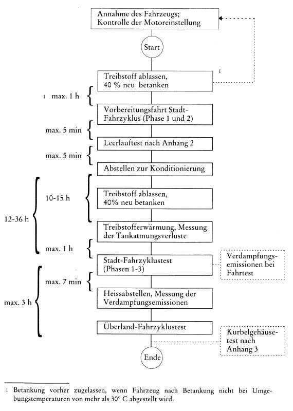

 Abbildung 2: Fremdzündungsmotoren / Prüfablauf wenn nur Abgasemissions-Messungen 

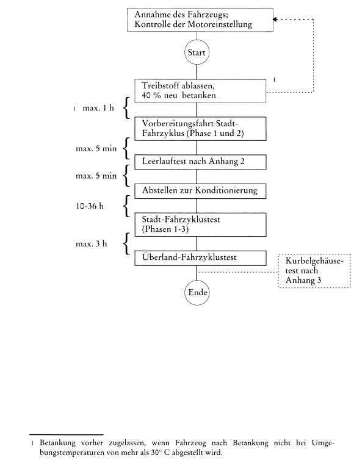

 Abbildung 3: Selbstzündungsmotoren / Prüfablauf für die Abgas- und Partikelemissions-Messungen 

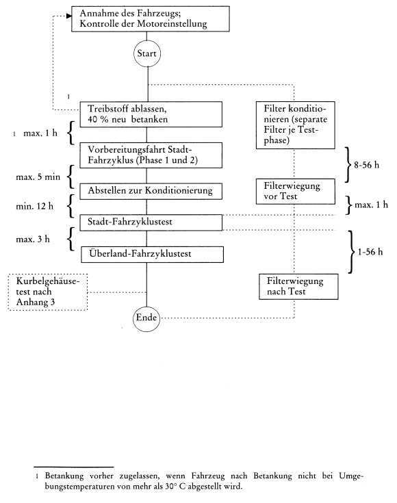

 2.1 Vorbereitung und Leerlauftest Vor der Durchführung der Emissionsmessungen sind die Prüffahrzeuge in einheitlicher Weise zu konditionieren, um die Reproduzierbarkeit der Ergebnisse sicherzustellen. Die Konditionierung besteht aus einer Vorbereitungsfahrt auf einem Fahrleistungsprüfstand mit anschliessendem Leerlauftest (ohne vorhergehendes Motorabstellen) nach den Bestimmungen des Anhangs 2 dieser Verordnung sowie einer Abstellphase bei definierter Umgebungstemperatur. 2.2 Prüfung der Abgasemissionen Die Prüfung der Abgasemissionen im Rahmen des Verfahrens zur Erteilung einer Abgas-Typengenehmigung umfasst zwei verschiedene Fahrzyklustests auf einem Fahrleistungsprüfstand, während der die Mengen luftverunreinigender Gase und Partikel ermittelt werden. Die beiden Fahrzyklustests auf dem Fahrleistungsprüfstand werden im folgenden als Stadt-Fahrzyklustest und als Überland-Fahrzyklustest bezeichnet. Die beiden Fahrzyklen sind in der Anlage 1 dieses Anhanges graphisch und tabellarisch (Fahrgeschwindigkeit in Funktion der Zeit) definiert. Nach dem Abschluss der Fahrzyklustests ist - falls erforderlich - der Kurbelgehäusetest nach den Bestimmungen des Anhangs 3 dieser Verordnung durchzuführen. 2.3 Prüfung der Verdampfungsemissionen Die Prüfung der Verdampfungsemissionen im Rahmen des Verfahrens zur Erteilung einer Abgas-Typengenehmigung wird bei Fahrzeugen mit Fremdzündungsmotoren durchgeführt. Dabei werden nach den Bestimmungen in Ziff. 6 dieses Anhangs die Tankatmungsverluste und die Verdampfungsemissionen während des Heissabstellens in einer gasdichten Messkammer, wie sie in Ziff. 4.8.1 dieses Anhangs beschrieben ist, ermittelt. Zwischen diesen beiden Prüfungen muss eine Prüfung der Abgasemissionen im Stadt-Fahrzyklustest erfolgen. Falls erforderlich, werden zusätzlich die Verdampfungsemissionen während dieses Fahrbetriebes durch Messfallen ermittelt. 3. Prüffahrzeug und Treibstoff 3.1 Prüffahrzeug 3.1.1 Das Fahrzeug ist in einwandfreiem mechanischen Zustand vorzuführen, seine Ausrüstung hat der Beschreibung im Antrag zu entsprechen. 3.1.2 Die Auspuffanlage darf kein Leck aufweisen, das die Menge des gesammelten Abgases vermindern könnte; diese Menge muss der vom Motor ausgestossenen Menge entsprechen. 3.1.3 Die Dichtigkeit des Ansaugsystems kann überprüft werden, um sicherzustellen, dass der Verbrennungsvorgang nicht durch eine ungewollte Luftzufuhr beeinflusst wird. 3.1.4 Die Einstellung des Motors muss Ziff. 5.4 dieser Verordnung entsprechen. 3.1.5 Das zu prüfende oder ein gleichwertiges Fahrzeug muss, wenn erforderlich, mit einer Vorrichtung zur Messung der charakteristischen Daten versehen sein, die nach den Bestimmungen der Ziff. 5 und der Anlage 2 dieses Anhanges für die Einstellung des Fahrleistungsprüfstandes erforderlich sind. Die Vorrichtung darf den tatsächlichen Fahrwiderstand des Fahrzeugs nicht beeinflussen. 3.1.6 Die Prüfstelle kann überprüfen, ob die Leistung des Fahrzeugs den Angaben des Fahrzeugherstellers entspricht, ob es sich für einen normalen Fahrbetrieb eignet und insbesondere ob es in kaltem und warmem Zustand gestartet werden kann. Sie kann ebenfalls überprüfen, ob die für die Schadstoffreduktion verantwortlichen Systeme über den ganzen Geschwindigkeitsbereich des Fahrzeugs im Sinne von Ziff. 3.2 dieser Verordnung im Betrieb sind. 3.2 Zusätzliche Vorrichtungen am Prüffahrzeug Vom Fahrzeughersteller sind die Prüffahrzeuge mit den folgenden Vorrichtungen auszurüsten: 3.2.1 Bei Fahrzeugen mit Fremdzündungsmotoren, bei denen ein Verdampfungstest durchzuführen ist, muss eine regelbare Vorrichtung zur Erwärmung des Treibstoffes sowie ein Temperaturfühler zur Registrierung der Temperatur des Tankinhalts angebracht werden. Der Temperaturfühler ist so anzubringen, dass bei einem Füllvolumen von ca. 40 % des Tanknennvolumens die Temperatur in der Mitte des eingefüllten Treibstoffs gemessen wird. Für die Produktionsüberprüfung sind diese Vorrichtungen nur dann einzubauen, wenn es von der Typenprüfstelle verlangt wird. 3.2.2 Damit eine vollständige Entleerung des Treibstoffs vorgenommen werden kann, ist am Fahrzeugtank eine entsprechende Vorrichtung erforderlich. 3.2.3 Fahrzeuge mit nicht abschaltbarem Allradantrieb sind für die Prüfung so vorzubereiten, dass der Antrieb des Fahrzeugs mit nur einer Achse möglich ist. 3.3 Treibstoffe Als Treibstoffe sind die im Anhang 5 dieser Verordnung definierten Referenz-Treibstoffe zu verwenden. 4. Prüfeinrichtungen 4.1 Fahrleistungsprüfstand 4.1.1 Auf dem Fahrleistungsprüfstand wird eine Strassenfahrt simuliert. Dabei werden die Fahrzeugmassen bei Beschleunigungen und Verzögerungen durch zuschaltbare Schwungscheiben an den Rollen oder durch elektrische Schwungmassensimulationen berücksichtigt. Die während der Strassenfahrt auftretenden Fahrwiderstände, bedingt durch Luft- und Rollwiderstand, werden durch eine einstellbare Leistungsbremse simuliert. Der Fahrleistungsprüfstand ist in regelmässigen Abständen zu kalibrieren. Ein Beispiel dafür ist in Anlage 2 dieses Anhanges aufgeführt. 4.1.2 Die Einstellung des Prüfstandes darf sich während der Prüfzeit nicht ändern. Es dürfen keine Schwingungen hervorgerufen werden, die am Fahrzeug feststellbar sind und dessen Normalbetrieb stören können. 4.1.3 Der Prüfstand muss mit einem Geschwindigkeitsgeber ausgerüstet sein, mit welchem dem Fahrer die momentane Fahrgeschwindigkeit des Prüffahrzeuges relativ zu der Sollgeschwindigkeit derart angezeigt wird, dass der Fahrer die Fahrkurven des Stadt- und Überland-Fahrzyklus mit der verlangten Genauigkeit nachfahren kann. 4.1.4 Die Vorrichtungen, mit denen die Schwungmasse und die Fahrwiderstände simuliert werden, müssen bei Prüfständen mit zwei Rollen von der vorderen Rolle angetrieben werden, sofern nicht beide Rollen miteinander gekoppelt sind. 4.1.5 Die Fahrzeuggeschwindigkeit muss entsprechend der Umdrehungsgeschwindigkeit der Prüfstandsrolle bestimmt werden. Sie muss bei Geschwindigkeiten über 10 km/h auf ± 1 km/h genau gemessen werden. Mit der Vorrichtung zur Geschwindigkeitsmessung muss eine Vorrichtung gekoppelt sein, mit der die auf dem Prüfstand zurückgelegte Fahrstrecke ermittelt wird. Bei einem Zweirollen-Prüfstand mit einer freien Rolle sind die Messungen an der freien Rolle vorzunehmen. 4.1.6 Die Genauigkeit, mit der beim Fahrleistungsprüfstand der Strassen-Fahrwiderstand simuliert werden kann, muss ± 5 % bei 100 und 80 km/h, ± 10 % bei 60 und 40 km/h sowie ± 15 % bei 20 km/h betragen. Unterhalb von 20 km/h darf selbst bei Ausnutzung der Toleranz der Fahrwiderstandswert nicht negativ sein. Die zu simulierenden Fahrwiderstände müssen mit einer der in Anlage 2 dieses Anhanges beschriebenen Methoden ermittelt werden. Die angezeigte Bremskraft (F i ) muss mit einer Genauigkeit von ± 5 % gemessen und abgelesen werden können. 4.1.7 Die Gesamtschwungmasse der sich drehenden Teile muss bekannt sein und innerhalb ± 20 kg der für das Prüffahrzeug äquivalenten Schwungmasse gemäss Ziff. 5.1 dieses Anhanges liegen. Bei elektrischer Simulation der Schwungmassen ist eine periodische Überprüfung durchzuführen. Es ist ein Verfahren anzuwenden, das die Bestimmung der simulierten Schwungmasse innerhalb der verlangten Toleranz ermöglicht. 4.1.8 Kühlgebläse 4.1.8.1 Während der Fahrprüfungen ist ein Kühlgebläse mit konstanter Drehzahl so aufzustellen, dass dem Fahrzeug bei geöffneter Motorhaube Kühlluft in geeigneter Weise zugeführt wird. Bei Fahrzeugen mit Frontmotor ist das Gebläse in der Regel in einem Abstand von 300 mm mitten vor dem Fahrzeug aufzustellen. Bei Fahrzeugen mit Heckmotor (oder wenn eine besondere Konstruktion die obige Anordnung unzweckmässig macht) ist das Kühlgebläse so anzuordnen, dass es ausreichend Luft zur Aufrechterhaltung der Fahrzeugkühlung liefert. 4.1.8.2 Die Gebläsekapazität soll normalerweise 2.50 m 3 /s betragen. Wenn jedoch der Fahrzeughersteller nachweisen kann, dass eine zusätzliche Kühlung erforderlich ist, um eine repräsentative Prüfung durchführen zu können, kann die Gebläsekapazität erhöht werden oder es können zusätzliche Gebläse verwendet werden, wenn dies zuvor von der Prüfstelle genehmigt wurde. Die Prüfstelle kann zusätzliche Gebläse verlangen. 4.2 Abgas- und Partikelentnahmesystem 4.2.1 Mit den in Anlage 3 dieses Anhanges beschriebenen Auf-fangvorrichtungen müssen die luftverunreinigenden Gase und Partikel in den Abgasen gemessen werden. Dabei wird das Entnahmesystem mit konstantem Volumen (CVS) verwendet. Dazu müssen die Abgase des Fahrzeugs kontinuierlich mit der Umgebungsluft unter kontrollierten Bedingungen verdünnt werden. Um die emittierten Mengen mit diesem CVS-Verfahren messen zu können, müssen zwei Bedingungen erfüllt sein: Das Gesamtvolumen der Mischung aus Abgasen und Verdünnungsluft muss gemessen und eine anteilige Probe dieses Volumens muss kontinuierlich für die Analyse aufgefangen werden. Die emittierte Partikelmenge wird bestimmt, indem aus einem anteiligen Teilstrom über die gesamte Dauer des Tests die Partikel auf geeigneten Filtern abgeschieden werden und die Menge gravimetrisch bestimmt wird (vgl. Ziff. 4.7 dieses Anhanges). Die emittierten Mengen luftverunreinigender Gase werden aus den Konzentrationen in der Probe unter Berücksichtigung der Konzentration dieser Gase in der Umgebungsluft und aus der Durchflussmenge während der Prüfdauer bestimmt. 4.2.2 Der Durchfluss durch die Geräte muss gross genug sein, um eine Wasserverdampfung unter allen bei einer Prüfung nach Anlage 3 dieses Anhanges eintretenden Bedingungen zu verhindern. 4.2.3 Abbildung 4 zeigt ein prinzipielles Schema des gesamten Entnahmesystems. In Anlage 3 dieses Anhanges werden Beispiele von Entnahmesystemen mit konstantem Volumen beschrieben, welche die Anforderungen dieses Anhanges erfüllen. Abbildung 4: Prinzipschema eines Probenahme- und Analysesystems zur Bestimmung gasförmiger Emissionen bei Fahrzeugen mit Fremdzündungsmotoren 

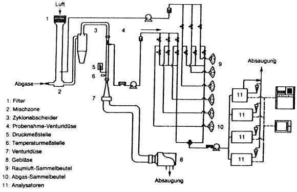

 4.2.4 Die Luft/Abgas-Mischung muss in den Entnahmesonden homogen sein. 4.2.5 Die Sonden müssen eine repräsentative Probe verdünnter Abgase entnehmen. 4.2.6 Die Entnahmevorrichtung muss gasdicht sein. Sie muss so beschaffen sein und aus solchen Werkstoffen bestehen, dass die Konzentrationen der Abgasbestandteile in den verdünnten Abgasen nicht beeinflusst werden. Beeinflusst ein Geräteteil die Konzentration eines luftverunreinigenden Gases in den verdünnten Abgasen, so muss die Probe dieses Gases vor diesem Teil entnommen werden, wenn die Beeinflussung nicht ausgeschaltet werden kann. 4.2.7 Besitzt das Prüffahrzeug ein Auspuffsystem mit mehreren Endrohren, so sind diese Rohre so nahe wie möglich beim Fahrzeug miteinander zu verbinden. 4.2.8 Veränderungen des statischen Druckes an dem (den) Endrohr(en) müssen innerhalb ± 1.25 kPa von den Veränderungen des statischen Druckes liegen, die während des Fahrzyklus auf dem Prüfstand ohne Verbindung der Entnahmevorrichtung mit dem (den) Auspuffrohr(en) gemessen wurden. Entnahmevorrichtungen, die in der Lage sind, den statischen Druck auf ± 0.25 kPa zu halten, können auf schriftlich begründetes Gesuch des Fahrzeugherstellers verwendet werden. Der Abgas- Gegendruck muss so nahe wie möglich am Ende der Auspuffanlage oder in einem Verlängerungsrohr mit gleichem Durchmesser gemessen werden. 4.2.9 Die verschiedenen Ventile zur Steuerung der Abgase müssen Schnellschaltventile sein. 4.2.10 Die Gasproben sind in genügend grossen Sammelbeuteln aufzufangen. Das Material dieser Beutel muss so beschaffen sein, dass die Zusammensetzung der Schadstoffe nicht verändert wird. 4.2.11 Die Entnahmeeinrichtungen sind in regelmässigen Abständen hinsichtlich Funktion und Dichtheit zu überprüfen. 4.3 Volumenmesseinrichtung 4.3.1 Genauigkeit der Volumenmessung Die Messung des gesamten verdünnten Abgasvolumens im CVS-System muss mit einer Genauigkeit von ± 2 % erfolgen. 4.3.2 Kalibrierung des CVS-Systems Damit die vorgeschriebene Genauigkeit für die Volumenbestimmung im CVS-System eingehalten werden kann, ist das Volumenmessgerät genügend genau und genügend oft zu kalibrieren. Anlage 4 dieses Anhanges zeigt eine Möglichkeit zur Kalibrierung, welche die Einhaltung der vorgeschriebenen Genauigkeit erlaubt. Bei diesem Verfahren wird ein dynamisches Durchflussmessgerät verwendet, das für die im CVS-System vorkommenden hohen Durchflussgeschwindigkeiten geeignet ist. 4.4 Analysegeräte 4.4.1 Allgemeine Vorschriften 4.4.1.1 Art der Analysegeräte Die Analyse der luftverunreinigenden Gase ist mit folgenden Geräten durchzuführen: - Kohlenmonoxid (CO) und Kohlendioxid (CO 2 ): Nichtdispersiver Infrarot-Absorptionsanalysator (NDIR); - Kohlenwasserstoffe(HC)-Fahrzeuge mit Fremdzündungsmotor: Flammenionisations-Detektor (FID), propankalibriert, ausgedrückt in Kohlenstoffatom-Äquivalent (C 1 ); - Kohlenwasserstoffe(HC)-Fahrzeuge mit Selbstzündungsmotor: Flammenionisations-Detektor mit Ventilen, Rohrleitungen usw. beheizt (Wandtemperatur) auf 190°C ± 10 K (HFID): propankalibriert, ausgedrückt in Kohlenstoffatom-Äquivalent (C 1 ); - Stickoxide (NOx): Chemiluminiszenz-Analysator (CLA) mit NO 2 -NO-Konverter. 4.4.1.2 Messgenauigkeit Der Messfehler darf nicht mehr als ± 3 % der Anzeige betragen, wobei der tatsächliche Wert der Kalibriergase unberücksichtigt bleibt. Die Analyse der Umgebungsluftprobe kann mit dem gleichen Analysator und mit dem gleichen Messbereich wie die entsprechende Probe der verdünnten Abgase durchgeführt werden. 4.4.1.3 Kühlfalle Vor den Analysatoren darf keine Gastrocknungsanlage verwendet werden, sofern nicht nachgewiesen wird, dass sie sich in keiner Weise auf den Schadstoffgehalt des Gasstromes auswirkt. 4.4.2 Besondere Vorschriften für Selbstzündungsmotoren 4.4.2.1 Es ist eine beheizte Entnahmeleitung im Verdünnungstunnel für die kontinuierliche Analyse der Kohlenwasserstoffe (HC) mit einem beheizten Flammenionisations-Detektor (HFID) und Registriergerät zu verwenden. Die durchschnittliche Konzentration der gemessenen HC wird durch Integration bestimmt. Während der gesamten Prüfung muss die Temperatur der Entnahmeleitung auf 190°C ± 10 K eingestellt sein. Die Leitung muss mit einem beheizten Filter mit einem 99%igem Wirkungsgrad für die Teilchen > 0.3 (m versehen sein, mit dem die Partikel aus dem für die Analyse verwendeten kontinuierlichen Gasstrom herausgefiltert werden. Die Ansprechzeit des Entnahmesystems (von der Sonde bis zum Eintritt in den Analysator) muss weniger als vier Sekunden betragen. Die Ansprechzeit des HFID sollte weniger als 1.5 Sekunden für die 90%-Anzeige betragen. 4.4.2.2 Der HFID muss mit einem System für konstanten Durchfluss versehen werden, um die Entnahme einer repräsentativen Probe zu gewährleisten, sofern nicht Durchflusschwankungen im CFV-System (Venturirohr mit kritischer Strömung - vgl. Anlage 3 dieses Anhanges) kompensiert werden. 4.4.3 Kalibrierung Jeder Analysator muss so oft wie nötig kalibriert werden. Für die in Ziff. 4.4.1 dieses Anhanges erwähnten Analysatoren ist die anzuwendende Kalibriermethode in Anlage 4 dieses Anhanges beschrieben. 4.5 Gase 4.5.1 Betriebsgase Die für den Betrieb der Geräte und für die Null-Kalibrierung verwendeten Gase müssen folgende Bedingungen erfüllen: - Stickstoff: Reinheit ≤ 1 ppm C, ≤ 1 ppm CO, ≤ 400 ppm CO 2 , ≤ 0.1 ppm NO; - synthetische Luft: Reinheit ≤ 1 ppm C, ≤ 1 ppm CO, ≤ 400 ppm CO 2 , ≤ 0.1 ppm NO; Sauerstoffgehalt zwischen 18 und 21 vol-%; - Sauerstoff: Reinheit ≥ 99.5 vol-% O 2 ; - Wasserstoff und Wasserstoffgemisch (z.B. Helium): ≤ 1 ppm C, ≤ 400 ppm CO 2 . 4.5.2 Kalibriergase Die für die Kalibrierung verwendeten Gasgemische müssen die nachstehend genannte chemische Zusammensetzung haben: - C 3 H 8 in synthetischer Luft; - CO in Stickstoff; - CO 2 in Stickstoff; - NO in Stickstoff (der NO 2 -Anteil in diesem Kalibriergas darf 5 % des NO-Gehaltes nicht überschreiten). Für die Herstellung der Kalibriergase sind Gase mit ausreichender Reinheit zu verwenden. Die Trägergase "Synthetische Luft" und "Stickstoff" haben den Anforderungen nach Ziff. 4.5.1 dieses Anhanges zu entsprechen. Die tatsächliche Konzentration eines Kalibriergases muss auf ± 2 % genau mit dem Nennwert übereinstimmen. Alle Konzentrationen sind auf das Volumen bezogen (vol-%, vol-ppm) anzugeben. Die in Anlage 4 dieses Anhanges vorgeschriebenen Konzentrationen können auch mit einem Gas-Mischdosierer durch Verdünnung mit reinem Stickstoff oder mit synthetischer Luft erzielt werden. Das Mischgerät muss so exakt sein, dass der Gehalt der verdünnten Kalibriergase auf ± 2 % genau bestimmt werden kann. 4.6 Überprüfung des Gesamtsystems Das Abgasentnahmesystem für die verdünnten Auspuffgase ist in periodischen Abständen mit einer der in Anlage 4 dieses Anhanges beschriebenen Methode zu überprüfen. Die höchstzulässige Abweichung zwischen der zugeführten und der gemessenen Gasmenge darf 5 % betragen. 4.7 Einrichtungen zur Partikelbestimmung 4.7.1 Entnahmeeinheit Die Partikel-Probenahmeeinheit, wie sie in Anlage 3 dieses Anhanges beschrieben wird, besteht aus Verdünnungstunnel, Probenahmesonde, Filtereinheit, Teilstrompumpe, Durchflussregelung und -messeinrichtung. Der Partikel-Probenahmeteilstrom wird jeweils über zwei hintereinander angeordnete Filter gezogen. Nach Abschluss der Partikelentnahme ist auf eine parallel angeordnete Filtereinheit umzuschalten. Die Entnahmesonde für den Partikel-Probengasstrom muss im Verdünnungstunnel derart angeordnet sein, dass ein repräsentativer Probengasstrom des homogenen Luft-Abgasgemisches entnommen werden kann und dass an der Entnahmestelle die Temperatur des Luft-Abgasgemisches 52°C nicht überschreitet. Die Temperatur des Probengasstromes darf über die Länge der Entnahmeleitung (Entnahmesonde bis Durchflussmessgerät) um nicht mehr als ± 3 K, der Durchfluss um nicht mehr als ± 5 % schwanken. Die Masse der während der Testphase abgeschiedenen Partikel wird durch Differenzwägung ermittelt. 4.7.2 Filter Die proportionale Massenkonzentration der Partikelemissionen ist durch eine gravimetrische Bestimmung der auf Filtern abgeschiedenen Partikel zu ermitteln. Die Nettofiltergewichte an Dieselpartikeln werden dabei als gültig anerkannt, wenn die folgenden Bedingungen eingehalten sind: 4.7.2.1 Während jeder Phase des Stadt-Fahrzyklustests werden Proben des verdünnten Abgases gleichzeitig durch paarweise angeordnete primäre Prüffilter (PPF) und sekundäre Prüffilter (SPF) geleitet. Die sekundären Prüffilter müssen dabei 75 bis 100 mm nach den primären Prüffiltern angeordnet sein. 4.7.2.2 Das Nettogewicht des an jedem primären Prüffilter und jedem sekundären Prüffilter gesammelten Partikelmaterials muss durch das in Ziff. 6.3.2.2.1 dieses Anhanges beschriebene Verfahren ermittelt werden. 4.7.2.3 Das Verhältnis der Nettogewichte ist mit folgender Formel zu berechnen: Verhältnis der Nettogewichte = Partikelmasse PPF Partikelmasse PPF + Partikelmasse SPF 4.7.2.4 Beträgt die Verhältniszahl gleich oder mehr als 0.95, dann wird den Berechnungen der Partikelemissionen nur das Nettogewicht des Primärprüffilters zugrunde gelegt. 4.7.2.5 Beträgt die Verhältniszahl weniger als 0.95, dann werden den Berechnungen der Partikelemissionen die kombinierten Nettogewichte des Sekundärprüffilters und des Primärprüffilters zugrunde gelegt. 4.7.2.6 Der Partikelfilter muss einen Durchmesser von mindestens 47 mm (37 mm Verschmutzungsfläche) haben. Es können auch Filter mit grösserem Durchmesser verwendet werden. (Filter mit grösserem Durchmesser können zweckmässiger sein, um den Druckabfall am Filter zu mildern, wenn Fahrzeuge geprüft werden, die grosse Mengen an Partikeln erzeugen.) 4.7.2.7 Die empfohlene Mindestbelastung des 47-mm-Filters beträgt 2 Milligramm. Gleichwertige Belastungen (d.h. Masse pro Verschmutzungsfläche) werden auch für grössere Filter empfohlen. 4.7.2.8 Für das Partikelsammeln sind hochwirksame mit Fluorkohlenstoff beschichtete Membran-Glasfaserfilter oder Membran-Filter auf Fluorkohlenstoffbasis zu verwenden. 4.7.3 Waage Die für das Wiegen der Filter zu verwendende Präzisionswaage muss eine Genauigkeit von ≤ 10 µg aufweisen. 4.8 Einrichtungen zur Ermittlung der Verdampfungsemissionen Das System zur Ermittlung der Verdampfungsemissionen besteht aus den nachfolgend beschriebenen Komponenten. 4.8.1 Gasdichte Kammer Durch eine gasdichte Hülle wird eine rechteckige Messkammer gebildet, in der das Prüffahrzeug steht. Der freie Zugang zum Fahrzeug muss von allen Seiten gewährleistet sein. Im verschlossenen Zustand muss die Kammer gasdicht sein gemäss Kalibrierung nach Anlage 5 dieses Anhanges. Die innere Oberfläche der Hülle muss für Kohlenwasserstoffe undurchlässig sein. Mindestens eine Fläche muss aus flexiblem undurchlässigem Material bestehen, um aus Temperaturschwankungen resultierende kleinere Druckschwankungen durch Volumenveränderungen ausgleichen zu können. Bei der Gestaltung der Wände ist eine gute Wärmeverteilung anzustreben. Wird die Kammer gekühlt, so darf die Temperatur der inneren Wandoberfläche 20°C an keiner Stelle unterschreiten. Die Raumtemperatur wird an zwei Stellen von Temperaturgebern erfasst, die so geschaltet sein müssen, dass ein Mittelwert angezeigt wird. Die Messstellen befinden sich etwa 10 cm entfernt von der vertikalen Mittellinie jeder Seitenwand in einer Höhe von 90 ± 20 cm. 4.8.2 Gebläse Durch Verwendung eines Gebläses oder mehrerer Gebläse muss erreicht werden können, dass - die HC-Konzentration in der Kammer vor einer Messung auf die Umgebungskonzentration gesenkt wird, - eine gleichmässige Temperatur und HC-Verteilung in der Kammer während der Messung erreicht wird. Das Prüffahrzeug darf dabei keiner direkten Strömung ausgesetzt werden. 4.8.3 Tankbeheizung Die Beheizung des Treibstofftankes erfolgt durch eine in der Heizleistung verstellbare Wärmequelle. Geeignet ist beispielsweise eine Heizmatte mit einer Leistung von 2 000 W. Die Einstellung der Heizleistung kann manuell oder automatisch erfolgen. Die Wärmezuführung muss gleichmässig an die Tankwandungen unterhalb des Treibstoffspiegels erfolgen. Die Vorrichtung zur Tankbeheizung muss die gleichmässige Erwärmung des Treibstoffes im Tank von 16°C um 14 K innerhalb von 60 Minuten ermöglichen. Die Treibstofftemperatur ist etwa in der Mitte des im Tank befindlichen Treibstoffvolumens zu messen. Die Temperaturen des Treibstoffes müssen während der Verdampfungsmessungen in Abständen von je 1 Minute aufgezeichnet oder gespeichert werden. Die Messgenauigkeit einschliesslich der Aufzeichnung muss ± 1.7 K betragen. Das Aufzeichnungs- oder Speicher-System muss die Zeiten mit einer Auflösung von ± 15 s und die Temperaturen mit einer Auflösung von ± 0.4 K wiedergeben können. 4.8.4 Kohlenwasserstoffanalysator Die Kohlenwasserstoffkonzentration in der Kammer wird mit Hilfe eines Flammenionisations-Detektors (FID) bestimmt. Der nicht verbrannte Teil des Probengasstromes muss in die Kammer zurückgeführt werden. Die Anforderungen an die Genauigkeit des Gerätes haben Ziff. 4.4.1.2 dieses Anhanges zu entsprechen; die Kalibrierung ist in Anlage 4 dieses Anhanges beschrieben. Der FID muss mit Vorrichtungen zur kontinuierlichen Aufzeichnung oder Speicherung der Messdaten ausgerüstet sein. 4.8.5 Kohlenwasserstoff (HC)-Sammelfallen Mit den HC-Sammelfallen - soweit diese gemäss Ziff. 6.2.2 Bst. m dieses Anhanges erforderlich sind - müssen die beim Betrieb nach dem Stadt-Fahrzyklus entstehenden Verdampfungsemissionen aufgefangen werden können. 4.9 Zusätzliche Messgeräte 4.9.1 Temperatur Die Temperaturen müssen auf ± 1.7 K genau gemessen werden, sofern nichts anderes verlangt wird. 4.9.2 Druck Der Luftdruck muss auf ± 0.1 kPa genau gemessen werden. 4.9.3 Absolute Feuchte Die absolute Feuchte (H) muss auf ± 5 % genau gemessen werden. 5. Vorbereitung der Prüfungen 5.1 Einstellung der äquivalenten Schwungmasse 5.1.1 Es wird eine mechanische Schwungmasse verwendet oder elektrisch simuliert, mit der eine Gesamtträgheit der umlaufenden Massen erzielt wird, die der Bezugsmasse des Fahrzeugs gemäss den nachstehenden Werten entspricht. Bezugsmassenklassen in kg (Bezugsmasse des Fahrzeugs Pr) Äquivalente Schwungmasse in kg Pr ≤ 480 450 480 < Pr ≤ 540 510 540 < Pr ≤ 600 570 600 < Pr ≤ 650 620 650 < Pr ≤ 710 680 710 < Pr ≤ 770 740 770 < Pr ≤ 820 800 820 < Pr ≤ 880 850 880 < Pr ≤ 940 910 940 < Pr ≤ 990 960 990 < Pr ≤ 1 050 1 020 1 050 < Pr ≤ 1 110 1 080 1 110 < Pr ≤ 1 160 1 130 1 160 < Pr ≤ 1 220 1 190 1 220 < Pr ≤ 1 280 1 250 1 280 < Pr ≤ 1 330 1 300 1 330 < Pr ≤ 1 390 1 360 1 390 < Pr ≤ 1 450 1 420 1 450 < Pr ≤ 1 500 1 470 1 500 < Pr ≤ 1 560 1 530 1 560 < Pr ≤ 1 620 1 590 1 620 < Pr ≤ 1 670 1 640 1 670 < Pr ≤ 1 730 1 700 1 730 < Pr ≤ 1 790 1 760 1 790 < Pr ≤ 1 870 1 810 1 870 < Pr ≤ 1 980 1 930 1 980 < Pr ≤ 2 100 2 040 2 100 < Pr ≤ 2 210 2 150 2 210 < Pr ≤ 2 320 2 270 2 320 < Pr ≤ 2 440 2 380 2 440 < Pr ≤ 2 610 2 490 2 610 < Pr ≤ 2 830 2 720 2 830 < Pr ≤ 2 950 5.1.2 Sind die äquivalenten Schwungmassen von 450 bis und mit 620 kg bzw. über 2 490 kg nicht verfügbar, sind die Schwungmassen 680 kg bzw. 2 490 kg zu verwenden. Wenn eine entsprechende Schwungmasse am Prüfstand nicht verfügbar ist, muss die nächsthöhere Masse verwendet werden. Dabei darf die Differenz zur Bezugsmasse des Prüffahrzeugs nicht höher als 120 kg sein. 5.2 Einstellung des Strassen-Fahrwiderstandes auf dem Prüfstand Zur Bestimmung des Strassen-Fahrwiderstandes für die Einstellung des Rollenprüfstandes ist eine der in Anlage 2 dieses Anhanges beschriebenen Methoden zu verwenden. Das tatsächlich angewendete Verfahren und die ermittelten Werte (Strassen-Fahrwiderstand, äguivalente Schwungmasse, Einstellkennwerte des Prüfstandes) sind im Antrag für eine Abgas-Typengenehmigung anzugeben. Im Einvernehmen mit der Typenprüfstelle können auch andere Verfahren angewendet werden. 5.3 Vorbereitung des Fahrzeugs 5.3.1 Nach Ankunft des Fahrzeugs im Prüffeld werden die folgenden Testvorbereitungen durchgeführt. Die Umgebungstemperatur des Vorbereitungsraumes muss zwischen 20 und 30°C liegen. a. Der/die Treibstoffbehälter wird/werden entleert und mit dem vorgeschriebenen Referenz-Treibstoff nach Anhang 5 dieser Verordnung befüllt. Die Füllmenge hat 40 % der vom Hersteller angegebenen Nennkapazität zu betragen. Die Betankung kann auch vorgängig erfolgen, sofern die in den Abbildungen 1 - 3 aufgeführten Bedingungen eingehalten sind. Das System zur Begrenzung der Verdampfungsemissionen muss sich im Normalzustand befinden, d.h. weder frisch gereinigt noch voll beladen sein. b. Innerhalb 1 Stunde nach der Betankung muss das Fahrzeug zur Vorkonditionierung auf dem Fahrleistungsprüfstand die Fahrkurve des Stadt-Fahrzyklustests (nur Phase 1 und 2) nach Anlage 1 dieses Anhanges und den Leerlauftest nach Anhang 2 dieser Verordnung absolvieren. Nach diesen Tests und vor dem Ende aller Prüfungen darf der Motor des Fahrzeugs nur für die weiteren Prüfungen in Betrieb gesetzt werden. c. Nach Ermessen der Prüfstelle oder auf Verlangen des Fahrzeugherstellers mit Zustimmung der Prüfstelle kann in Ausnahmefällen der Vorgang der Vorkonditionierung erweitert werden, wenn es zur Stabilisierung des Emissions-Kontrollsystems erforderlich ist. In dem Fall kann die Vorbereitungsfahrt jeweils nach einer Standzeit von einer Stunde in einem Raum mit einer Umgebungstemperatur zwischen 20 und 30°C bis zu dreimal wiederholt werden. Während der Standzeit ist die Motorraumabdeckung zu schliessen und das Kühlgebläse auszuschalten. d. Innerhalb von fünf Minuten nach Abschluss der Vorbereitungsfahrt und des Leerlauftests ist das Fahrzeug vom Fahrleistungsprüfstand zu nehmen und in einen Abstellraum mit einer Umgebungstemperatur zwischen 20 und 30°C zu bringen. e. Fahrzeuge mit Fremdzündungsmotoren müssen zwischen 10 und 35 Stunden im Abstellraum verbleiben, bis die Vorbereitungen zur Prüfung der Tankatmungsverluste gemäss Ziff. 6.2.2 dieses Anhanges beginnen. Innerhalb einer Stunde nach Beendigung dieses Vorganges müssen die Prüfungen zur Ermittlung der durchschnittlichen Abgasemissionen im Fahrbetrieb beginnen. Vom Beginn der Stationierung des Fahrzeugs im Abstellraum bis zum Beginn des Kaltstarts im Stadt-Fahrzyklustest müssen mindestens 12 aber nicht mehr als 36 Stunden vergehen. f. Fahrzeuge mit Selbstzündungemotoren müssen mindestens 12 Stunden im Abstellraum verbleiben, bis die Prüfungen der durchschnittlichen Abgasemissionen im Fahrbetrieb gemäss Ziff. 6.3 dieses Anhanges beginnen. 5.3.2 Der Reifendruck muss, wie bei der Vorprüfung auf der Strasse zur Ermittlung der Bremseinstellung, den Angaben des Fahrzeugherstellers entsprechen. Bei einem Zwei-Rollenprüfstand darf der Reifendruck um höchstens 50 % des vom Fahrzeughersteller empfohlenen Wertes erhöht werden. In diesem Fall ist auch die Einstellung des Fahrleistungsprüfstandes mit dem höheren Reifendruck vorzunehmen. Der tatsächlich verwendete Reifendruck muss im Prüfprotokoll angegeben werden. 6. Emissionsprüfungen 6.1 Allgemeine Vorschriften 6.1.1 Während allen Prüfungen muss die Temperatur im Prüfraum zwischen 20 und 30°C liegen. Bei der Prüfung der Abgasemissionen muss die absolute Luftfeuchte (H) im Prüfraum oder der Ansaugluft des Motors folgender Bedingung genügen: 5.5 ( H ( 12.2 gH 2 O/kg trockener Luft. Kann dieser Bereich nicht eingehalten werden, ist dies im Prüfprotokoll zu vermerken. 6.2.1 Das Fahrzeug muss während der Prüfungen annähernd ho-rizontal stehen, damit eine nicht normale Treibstoffverteilung verhindert wird. 6.2 Fahrzeuge mit Fremdzündungsmotoren 6.2.1 Allgemeines zum Prüfablauf Mindestens 10 und höchstens 35 Stunden nach der Stationierung des Fahrzeugs im Abstellraum hat die Messung der Tankatmungsverluste im Rahmen des Verdampfungstests zu beginnen. Die Tankatmung tritt auf als Folge der Temperaturänderung des Treibstoffes. Bei der Prüfung wird der Treibstoff im Tank um 14 K erwärmt. Der Verdampfungstest wird nach dem Stadt-Fahrzyklustest abgeschlossen mit der Prüfung der Verdampfung beim Heissabstellen. Die Bestimmungen für den Prüfablauf beim Verdampfungstest sind in den folgenden Ziff. 6.2.2 bis 6.2.4 dieses Anhanges festgelegt. Fahrzeuge, an denen die Verdampfungsemissionen bestimmt werden sollen, müssen auch die Grenzwerte für die Abgasemissionen einhalten. 6.2.2 Prüfung der Tankatmungsverluste a. Die Messkammer ist unmittelbar vor der Prüfung mehrere Minuten zu spülen. b. Das/die Gebläse zum Durchmischen der Kammer ist/sind einzuschalten. c. Beim FID-Kohlenwasserstoffanalysator müssen die Null- und Kalibrierpunkte unmittelbar vor der Prüfung überprüft werden. d. Der/die Treibstoffbehälter des Prüffahrzeugs wird/werden entleert und mit dem Referenzbenzin nach Anhang 5 dieser Verordnung befüllt. Das Füllvolumen muss 40 % des Tankvolumens betragen. Die Temperatur des Treibstoffes muss vor dem Einfüllen zwischen 10 und 16°C liegen. Der/die Tank(s) ist/sind zunächst unverschlossen zu lassen. e. Bei Fahrzeugen mit mehreren Tanks müssen alle Tanks wie nachfolgend beschrieben in gleicher Weise aufgeheizt werden. Die Temperaturen der Tanks müssen auf ± 1.5 K übereinstimmen. f. Das Prüffahrzeug ist mit abgestelltem Motor in die Messkammer zu bringen, Fenster und Kofferraumdeckel sind zu öffnen, Tanktemperaturfühler sind anzuschliessen und die Erwärmungsvorrichtung für den Treibstoff ist anzuschliessen. Die Temperaturen des Treibstoffes und der Raumluft sind von nun an aufzuzeichnen bzw. zu registrieren. g. Der Treibstoff kann künstlich bis auf die Temperatur des Messbeginns erwärmt werden. h. Sobald der Treibstoff mindestens 14°C erreicht hat, - ist der Tank zu schliessen, - ist das Gebläse auszuschalten, falls nicht schon früher geschehen, - ist die Messkammer gasdicht zu schliessen. i. Sobald der Treibstoff 16 °C ± 1 K erreicht hat, - ist die HC-Konzentration in der Messkammer zu messen, (Anfangswert für die Auswertung) - ist mit einer linearen, 60 ± 2 Minuten dauernden Erwärmung zu beginnen. j. Die Erwärmung hat so zu erfolgen, dass die Temperaturzunahme als lineare Funktion zur Zeit eingehalten wird. Die zulässige Abweichung von der Solltemperatur beträgt während des Erwärmungsvorgangs ± 1.5 K. k. Wenn 60 ± 2 Minuten nach der Anfangsmessung und dem Erwärmungsbeginn die Treibstofftemperatur um 14 ± 0.5 K zugenommen hat, ist die HC-Konzentration in der Kammer zu messen (Endwert für die Auswertung). l. Nach dem Öffnen der Kammer und Lösen aller Anschlüsse für den vorgenannten Messvorgang ist das Fahrzeug mit abgestelltem Motor aus der Messkammer zu entfernen und für die anschliessende Prüfung vorzubereiten. m. Eine Bestimmung der Verdampfungsemissionen im Fahrbetrieb ist nur erforderlich, wenn nach Prüfung der technischen Gegebenheiten nicht ausgeschlossen werden kann, dass derartige Emissionen im Fahrbetrieb auftreten. Die Messung im Fahrbetrieb erfolgt mittels HC-Sammelfallen, die an allen Öffnungen des Treibstoffsystems angebracht werden. Die Fallen müssen vorher gewogen worden sein. Nach Beendigung der beiden ersten Phasen (Abstellen zur 10-Minuten-Parkphase) des Stadt-Fahrzyklus, in der wie nachstehend beschrieben die Abgasemissionen geprüft werden, sind die Fallen innerhalb einer Minute abzunehmen, zu verschliessen und innerhalb einer Stunde zu wiegen. Die Verdampfungsemissionen im Fahrbetrieb ergeben sich aus der Massendifferenz der Fallen vor und nach den ersten beiden Phasen der Fahrkurve des Stadt-Fahrzyklus. n. Eine Methode zur Berechnung der Verdampfungsemissionen ist in Anlage 6 dieses Anhanges enthalten. 6.2.3 Prüfung der Abgasemissionen im Stadt-Fahrzyklus 6.2.3.1 Allgemeines Der Stadt-Fahrzyklustest wird auf dem Rollenprüfstand durchgeführt. Der Fahrgeschwindigkeitsverlauf über der Zeit ist aufzuzeichnen, um die Gültigkeit der Prüfstandsprüfungen beurteilen zu können. Die Geschwindigkeit und die zurückgelegte Strecke sind anhand der Umdrehungen derselben Prüfstandsrolle oder -welle zu messen. Die während der Sammelzeit der einzelnen Probengasmengen zurückgelegten Fahrstrecken sind getrennt zu ermitteln. Ein zusätzliches Kühlgebläse gemäss Ziff. 4.1.8 dieses Anhanges ist zu verwenden. Fahrzeuge mit Allradantrieb werden im Zweiradantrieb geprüft. Bei Fahrzeugen mit ständigem Allradantrieb sind die anderen Antriebsräder für die Prüfungen auf dem Fahrleistungsprüfstand ausser Betrieb zu setzen (vgl. Ziff. 3.2.3 dieses Anhanges). Aus dem mit Umgebungsluft verdünnten Abgas wird ein proportionaler Teilstrom entnommen und den Sammelbeuteln zugeführt. Während dem Stadt-Fahrzyklustest wird der Probengasstrom nacheinander in drei Sammelbeutel geleitet. Dabei sind in den ersten Sammelbeutel die Abgasprobe der ersten 505 Sekunden Fahrzeit (Kaltstartphase), in den zweiten Sammelbeutel die Abgasprobe der zweiten Phase (stabilisierte Phase) und in den dritten Sammelbeutel die Abgasprobe der 505 Sekunden Fahrzeit nach dem Warmstart (Warmstartphase) zu leiten. Der Inhalt der Probenbeutel wird anschliessend auf die Konzentrationen an Kohlenmonoxid, Kohlendioxid, Kohlenwasserstoffe und Stickoxide analysiert. Um den Einfluss der bereits in der Umgebungsluft bzw. nach dem Luftfilter des CVS-Systems vorhandenen gasförmigen Schadstoffe berücksichtigen zu können, werden jeweils Umgebungsluftproben in parallel geschaltene Sammelbeutel gezogen. Die Berechnung der streckenbezogenen Emissionsmengen erfolgt nach Anlage 6 dieses Anhanges. 6.2.3.2 Vorbereitungen auf die Prüffahrt a. Normalerweise ist bei der Bestimmung der Emissionen der Prüfablauf gemäss Abbildung 1 einzuhalten. In speziellen Fällen kann die Prüfstelle bei Nachprüfungen und Produktionsüberprüfungen (vgl. Ziff. 5.6 und 14 dieser Verordnung) den Verdampfungstest weggelassen. Dabei kann vor dem Stadt-Fahrzyklustest auf das Wechseln und Erwärmen des Referenztreibstoffes verzichtet werden (vgl. Abb. 2). b. Wurde der Prüfstand während den letzten 2 Stunden vor der Prüfung nicht benützt, so muss er mit einem anderen Fahrzeug als dem Prüffahrzeug - oder mit einer gleichwertigen Methode - während 15 Minuten bei einer Geschwindigkeit von 50 km/h aufgewärmt werden. c. Das Fahrzeug muss mit den Antriebsrädern ohne Anlassen des Motors auf die Rolle(n) des Fahrleistungsprüfstandes gebracht werden. d. Die Motorraumabdeckung ist zu öffnen und das Kühlgebläse in Position zu bringen. e. Mit den Proben-Umschaltventilen in Wartestellung sind die geleerten Sammelbeutel für die verdünnten Abgas- und die Umgebungsluftproben anzuschliessen. f. Die CVS-Anlage muss spätestens jetzt eingeschaltet werden, ebenso die Probenpumpen. Ein allfällig vorhandener Wärmetauscher in der CVS-Anlage muss vorhergehend auf seine Betriebstemperatur vorgeheizt worden sein. g. Die Probengasdurchflussmengen sind auf die gewünschten Werte, mindestens jedoch auf 5 l/min einzustellen. h. Das Abgasrohr ist gasdicht an das (die) Abgasendrohr(e) des Fahrzeugs anzuschliessen. i. Das Gasdurchflussmessgerät und die Umschaltventile sind so umzustellen, dass der Abgasprobenstrom in den ersten Beutel für die erste Phase sowie der Umgebungsluftprobenstrom in seinen entsprechenden Beutel gelangt. Durch Betätigung des Zündschlüssels wird unmittelbar anschliessend der Startvorgang eingeleitet. Wenn der Motor gestartet ist, ist die Zeit- und Wegmessung für den Fahrzyklus sowie das Kühlgebläse einzuschalten. 6.2.3.3 Durchfahren des Stadt-Fahrzyklus Mit dem Prüffahrzeug ist der Stadt-Fahrzyklus unter Berück-sichtigung der für diesen geltenden Bestimmungen gemäss Anlage 1 dieses Anhanges zu durchfahren. Besondere Vorschriften sind nachfolgend aufgeführt. a. Anlassen des Motors Der Motor ist mit den vorgesehenen Anlasshilfen nach den Anweisungen des Fahrzeugherstellers in der Betriebsanleitung anzulassen. Falls der Motor nicht innerhalb von 10 Sekunden nach Betätigen des Anlassers anspringt, muss der Anlassvorgang eingestellt, und die Gründe für das Nichtanspringen des Motors sind abzuklären. Dabei darf während 30 Minuten versucht werden, den Fehler zu finden und zu beheben, worauf die Prüfung fortgeführt werden kann. Während dieser Zeit der Fehlerbehebung sind die Probenahme-Umschaltventile in Wartestellung zu schalten sowie die Einheiten des CVS-Systems abzustellen oder die Entnahmevorrichtung vom Auspuffendrohr zu trennen. Wenn das Nichtanspringen des Motors auf einen Bedienungsfehler zurückzuführen ist, muss das Fahrzeug von neuem für einen Kaltstart bereitgestellt werden. Falls der Motor anspringt und dann wieder abstellt, muss der Fahrer den empfohlenen Anlassvorgang wiederholen. Springt der Motor innerhalb einer Minute nicht wieder an, so wird die Prüfung abgebrochen, um die nötigen Korrekturen vorzunehmen. Springt der Motor an, beginnt die erste Leerlaufphase von 20 Sekunden Dauer. 15 Sekunden nach dem Anspringen des Motors wird der Gang eingelegt. Die Bremsen dürfen betätigt werden, um ein allfälliges Drehen der Antriebsräder zu verhindern. b. Stehenbleiben des Motors Falls der Motor während einer Leerlaufphase abstellt, muss er sofort wieder angelassen und die Prüfung fortgeführt werden. Kann der Motor nicht rasch genug angelassen werden, so dass das Fahrzeug die nächste Beschleunigungs-phase vorschriftsgemäss ausführen kann, ist das Anzeige-gerät für das Fahrprogramm abzustellen. Es wird wieder eingeschaltet, sobald das Fahrzeug wieder in Betrieb ist. Stellt der Motor während einer anderen Betriebsart als bei Leerlauf ab, ist das Anzeigegerät für das Fahrprogramm ebenfalls abzustellen. Das Fahrzeug ist dann neu zu starten und bis zu der Geschwindigkeit zu beschleunigen, die für die Fortsetzung der Prüfung erforderlich ist. Wenn in der Betriebsanleitung ein Anlassverfahren für den warmen Motor vom Fahrzeughersteller nicht vorgeschrieben ist, dann ist der Motor (Motoren mit Startautomatik und mit manuellem Choke) anzulassen, indem das Gaspedal etwa um die Hälfte heruntergedrückt und der Motor durchgedreht wird, bis er anspringt. Soweit nötig, darf der Fahrer die Kaltstartvorrichtung, das Gaspedal usw. stärker betätigen, um ein Stehenbleiben des Motors zu verhindern. c. Ende der ersten Phase im Stadt-Fahrzyklus Mit dem Ende der Verzögerung zum Zeitpunkt 505 Sekunden nach Beginn des Stadt-Fahrzyklus endet die erste Phase des Stadt-Fahrzyklus. Von diesem Zeitpunkt an müssen der Probengasstrom und die Umgebungsluftprobe in die jeweils nachfolgenden Sammelbeutel geleitet werden. Vor dem Beginn der bei 511 Sekunden anschliessenden Beschleunigung ist der zurückgelegte Weg oder die Zahl der in der ersten Phase gemessenen Rollen- bzw. Wellenumdrehungen festzuhalten. d. Abstellen nach der zweiten Phase im Stadt-Fahrzyklus Der Motor ist zwei Sekunden nach dem Ende der letzten Verzögerung, also bei 1 369 Sekunden, abzustellen. Fünf Sekunden nachdem der Motor zu laufen aufgehört hat, sind die Proben-Umschaltventile auf Wartestellung zu schalten. Das Kühlgebläse ist sofort abzuschalten, die Motorraumabdeckung ist zu schliessen. Die CVS-Anlage ist abzuschalten oder die Entnahmevorrichtung vom Auspuffendrohr zu trennen. Der in der zweiten Phase zurückgelegte Weg oder die Anzahl der Rollen- bzw. Wellenumdrehungen ist festzuhalten. e. Vorbereitung und Durchführung der dritten Phase im Stadt-Fahrzyklus Vor der dritten Phase sind die vorbereitenden Arbeiten gemäss Ziff. 6.2.3.2 Bst. d bis i dieses Anhanges zu wiederholen; der Schritt unter Bst. i muss dabei innerhalb von 10 ± 1 Minuten nach dem Ende der Probensammlung der zweiten Phase durchgeführt werden. Nach dem Ende der Verzögerung zum Zeitpunkt 505 Sekunden nach dem Beginn der dritten Phase sind die Probenumschaltventile auf Wartestellung zu schalten. Der zurückgelegte Weg oder die Anzahl der Rollen- bzw. Wellenumdrehungen ist festzuhalten. f. Sobald wie möglich müssen jeweils die Abgas- und Umgebungsluftproben aus den einzelnen Phasen der Analysenanlage zugeführt werden, d.h. gegebenenfalls schon vor dem Abschluss des gesamten Fahrzyklus. Zwischen dem Ende der jeweiligen Sammelphase und der Ablesung der zugehörigen stabilen Analysewerte auf allen Analysatoren darf nicht mehr als 20 Minuten vergehen. g. Für Prüffahrzeuge, die der Prüfung der Verdampfungs-emissionen unterzogen werden, schliesst sich der Heissabstelltest an. Es ist weiter nach Ziff. 6.2.4 dieses Anhanges zu verfahren. 6.2.4 Prüfung der Verdampfungsemissionen beim Heissabstellen a. Vor dem Ende der Fahrt nach dem Stadt-Fahrzyklus muss die Messkammer mehrere Minuten gespült worden sein. b. Nach Beendigung des Stadt-Fahrzyklustests ist die Motor-raumabdeckung zu schliessen, und es sind alle Verbindungen vom Fahrzeug zum Prüfstand zu lösen. Das Fahrzeug ist dann unter möglichst geringer Betätigung des Gaspedals zur Messkammer zu fahren. Vor der Messkammer ist der Motor abzustellen; der Zeitpunkt der Motorabstellung ist zu notieren. Das Fahrzeug muss dann antriebslos in die Messkammer gebracht werden. c. Das/die Gebläse zum Durchmischen der Kammer muss/ müssen eingeschaltet werden, bevor das Fahrzeug in die Messkammer kommt. d. Fenster und Kofferraumdeckel des Fahrzeugs müssen geöffnet sein. e. Die Temperatur der Raumluft ist von nun an aufzuzeichnen. f. Innerhalb von zwei Minuten nach dem Abstellen des Motors und innerhalb von sieben Minuten nach dem Ende des Stadt-Fahrzyklus muss die Messkammer gasdicht verschlossen werden. g. Die HC-Konzentration in der Messkammer wird mit dem FID-Analysator gemessen und von nun an fortlaufend registriert. Der kurz nach dem Schliessen der Messkammer gemessene Wert der HC-Konzentration bildet den Anfangswert für die Auswertung nach Anlage 6 dieses Anhanges. h. Das Fahrzeug muss 60 Minuten (± 0.5 Minuten) innerhalb der Messkammer stehen. Am Ende der 60 Minuten (± 0.5 Minuten) dauernden Prüfzeit wird die HC-Konzentration in der Messkammer bestimmt. Dieser Wert bildet den Endwert für die Auswertung nach Anlage 6 dieses Anhanges. i. Die Prüfung der Verdampfungsemissionen ist damit abgeschlossen. 6.2.5 Prüfung der Abgasemissionen im Überland-Fahrzyklus 6.2.5.1 Allgemeines Es gelten sinngemäss die Bestimmungen in Ziff. 6.2.3.1 dieses Anhanges. 6.2.5.2 Durchfahren des Überland-Fahrzyklus Mit dem Prüffahrzeug ist spätestens drei Stunden nach Beendigung des Stadt-Fahrzyklustests der Überland-Fahrzyklus unter Berücksichtigung der für diesen geltenden Bestimmungen gemäss Anlage 1 dieses Anhanges zweimal zu durchfahren. Der erste Durchlauf dient der Konditionierung des Fahrzeugs; die Abgasemissionen werden lediglich im zweiten Durchlauf bestimmt. Können die max. drei Stunden Unterbruchzeit nicht eingehalten werden, ist vorgängig ein Stadt-Fahrzyklus (nur Phase 1 und 2) zu fahren. Der Ablauf der Prüfung ist wie folgt: a. Die vorbereitenden Arbeiten gemäss Ziff. 6.2.3.2 Bst. c bis i dieses Anhanges sind durchzuführen. Die ProbenUmschaltventile verbleiben in Wartestellung. Es sind lediglich je ein Beutel für das Probengas und ein Beutel für die Umgebungsluftprobe erforderlich. b. Das Fahrzeug ist gemäss den Empfehlungen des Fahrzeug-herstellers zu starten. Bezüglich des Nichtanspringens bzw. Stehenbleibens des Motors gelten die Bestimmungen in Ziff. 6.2.3.3 Bst. a und b dieses Anhanges. c. Der Überland-Fahrzyklus ist ohne Abgasmessung zum ersten Mal zu durchfahren. d. Wenn der Stillstand des Fahrzeugs am Ende des Durchlaufs des Überland-Fahrzyklus erreicht wird, stehen 17 Sekunden zur Verfügung, bis der zweite Durchlauf beginnt. e. Zwei Sekunden bevor die erste Beschleunigung im zweiten Durchlauf beginnt, müssen die Proben-Umschaltventile auf den Probengas- und den Umgebungsluftprobenbeutel geschaltet werden. f. Der Überland-Fahrzyklus ist zum zweiten Mal zu durchfahren. g. Zwei Sekunden nachdem das Fahrzeug den Stillstand am Ende des Überland-Fahrzyklus erreicht hat, sind die Umschaltventile auf Wartestellung zu schalten. Der zurückgelegte Weg des zweiten Durchlaufs oder die Anzahl der Rollen- bzw. Wellenumdrehungen ist festzuhalten. Der Motor kann abgestellt werden. h. Sobald wie möglich, jedoch spätestens innert 20 Minuten muss die Abgas- und Umgebungsluftprobe der Analysenanlage zugeführt werden. i. Die Berechnung der Menge der emittierten Luftverunreinigungen je Fahrkilometer erfolgt nach Anlage 6 dieses Anhanges. 6.3 Fahrzeuge mit Selbstzündungsmotoren 6.3.1 Allgemeines zum Prüfablauf Die Fahrzeugvorbereitung wird mit der Stationierung des Fahrzeugs bei einer Umgebungstemperatur zwischen 20 und 30°C zur Konditionierung für die Emissionsprüfungen abgeschlossen. Mindestens zwölf Stunden nach der Stationierung des Fahrzeugs hat die Prüfung der Abgasemissionen im Stadt-Fahrzyklus zu beginnen. 6.3.2 Prüfung der Abgasemissionen Es gelten die Ausführungen, die in den Ziff.n 6.2.3 und 6.2.5 dieses Anhanges für die Prüfung der Abgasemissionen von Fahrzeugen mit Fremdzündungsmotoren gemacht worden sind, mit den folgenden Ergänzungen und Abänderungen (vgl. auch Abbildung 5). 6.3.2.1 Allgemeines Das Abgas wird in einem Verdünnungstunnel mit Umgebungsluft vermischt entsprechend der Beschreibung in Anlage 3 dieses Anhanges. Zur Partikelmessung wird ein proportionaler Teilstrom über eine Sonde entnommen. Die Partikel werden aus dem Abgas-Luft-Probenstrom zur nachfolgenden Wiegung abgeschieden. Die sechs Filter sind in der Partikelprobenleitung derart angeordnet, dass sie drei parallele Filterpaare bilden, d.h. in jedem Verzweigungsteil sind zwei Filter in Richtung des Probengasstromes hintereinander geschaltet. In jeder Verzweigung müssen gleiche Strömungsverhältnisse herrschen. Schnellschaltventile sind derart anzuordnen, dass die Filterpaare nacheinander mit dem Probengasstrom beaufschlagt werden können. Die zeitliche Abfolge der Beaufschlagung entspricht der in Ziff. 6.2.3.1 dieses Anhanges beschriebenen Probenzuführung für die drei Phasen des Stadt-Fahrzyklus. Die HC-Konzentration wird im verdünnten Abgas mit einem beheizten FID (HFID) fortlaufend gemessen, registriert und integriert. Das Probengas wird über eine separate Sonde ent-nommen. Die Probeentnahme für die Sammelbeutel zum Zweck der an-schliessenden Konzentrationsmesaungen entspricht dem in Ziff. 6.2.3.1 dieses Anhanges beschriebenen Verfahren. Abbildung 5: Schema eines Probenahme-und Analysesystems zur Bestimmung gas- und partikelförmiger Emissionen bei Fahrzeugen mit Selbstzündungsmotoren 

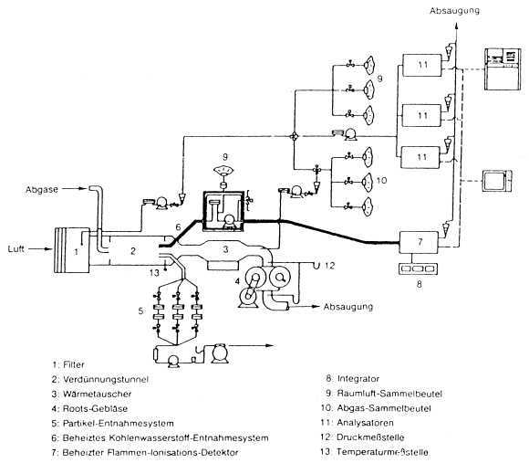

 6.3.2.2 Vorbereitungen auf die Prüffahrten Der Ablauf entspricht dem in Ziff. 6.2.3.2 dieses Anhanges für Fahrzeuge mit Fremdzündungsmotoren beschriebenen Verfahren mit folgenden Ergänzungen: zu f: Der Integrator des beheizten FID (HFID) ist einzuschalten. zu g: Der Probengasstrom für den beheizten FID (HFID) muss mindestens 2 l/min betragen. 6.3.2.2.1 Behandlung und Wiegen der Partikelfilter Mindestens acht Stunden, jedoch nicht früher als 56 Stunden vor der Prüfung ist jeder für die Prüfung vorgesehene Filter in eine offene, jedoch geschützte Petrischale zu legen und in die Wiegekammer zu bringen. In dieser ist während der ganzen Dauer, in der die Filter vorbereitet und gewogen werden, die Feuchtigkeit innerhalb von ± 10 % eines eingestellten Wertes zwischen 30 und 70 % und die Temperatur innerhalb von ± 6 K eines eingestellten Wertes zwischen 20 und 30°C zu halten. Am Ende der Stabilisierungsperiode von 8 bis 56 Stunden ist jeder Filter auf einer Waage mit einer Präzision gemäss Ziff. 4.7.3 dieses Anhanges zu wiegen. Das jeweilige Gewicht ist zu notieren; die Ablesung ist das Leergewicht. Jeder Filter ist dann in einer zugedeckten Petrischale aufzubewahren, die in der Wiegekammer bleibt, bis der Filter zur Prüfung benötigt wird. Wird ein Filter innerhalb von einer Stunde, nachdem er aus der Wiegekammer herausgenommen wurde, nicht verwendet, so ist er erneut zu wiegen. Nach der Prüfung und nachdem die Prüffilter in die Wiegekammer zurückgebracht wurden, sind sie mindestens eine Stunde lang, jedoch nicht länger als 56 Stunden, zu konditionieren. Dann ist jeder Filter ein zweites Mal zu wiegen. Dieser letztere Ablesewert ist das jeweilige Bruttogewicht des Filters; dieses Gewicht ist zu notieren. Das jeweilige Nettogewicht (die Masse der gesammelten Partikel) ist das Bruttogewicht minus dem Leergewicht. 6.3.2.3 Durchfahren des Stadt-Fahrzyklus Die Bestimmungen gemäss Ziff. 6.2.3.3 dieses Anhanges gelten mit folgenden Ergänzungen bzw. Änderungen: zu c: Vom Zeitpunkt 505 Sekunden an wird das zweite Partikelfilterpaar beaufschlagt. An der Aufzeichnungsvorrichtung für die HC-Konzentrationsmessung ist eine Markierung vorzunehmen, derzufolge die erste und zweite Phase identifiziert werden können (oder es ist auf einen zweiten Integratorzähler zu schalten). Die Integration der HC-Werte erfolgt getrennt nach den einzelnen Sammelphasen. zu d: Ebenfalls fünf Sekunden nachdem der Motor zu laufen aufgehört hat, ist die Aufzeichnung der HC-Konzentration entsprechend zu markieren sowie die Integration über die Phase 2 und der Probenstromdurchfluss durch das zweite Partikelfilterpaar zu beenden. Die bisher beaufschlagten beiden Partikelfilterpaare sind vorsichtig aus ihren jeweiligen Halterungen zu nehmen, und zum nachfolgenden Wiegen ist jeder Filter für sich in eine Petrischale zu legen, diese sind abzudecken. zu e: Die für die Durchführung und Beendigung der HC-Messung sowie der Partikelabscheidung in der Phase 3 erforderlichen Schritte sind in Anlehnung an die zu c und d beschriebenen Ergänzungen durchzuführen. zu f: Sobald wie möglich, keinesfalls jedoch später als eine Stunde nach der Beendigung der dritten Phase des Stadt-Fahrzyklus, sind die sechs Partikelprüffilter für das Wiegen zu konditionieren. 6.3.2.4 Durchfahren des Überland-Fahrzyklus Es gelten die Bestimmungen und der Ablauf nach Ziff. 6.2.5 dieses Anhanges. Eine Messung der Partikelemissionen ist nicht erforderlich. 6.4 Leerlauftest nach Anhang 2 Gemäss Abbildungen 1 und 2 ist der Leerlauftest nach der Vorbereitungsfahrt zur Vorkonditionierung nach den Bestimmungen des Anhangs 2 dieser Verordnung durchzuführen. 6.5 Kurbelgehäusetest nach Anhang 3 Ein allfälliger Kurbelgehäusetest ist im Anschluss an die Fahrzyklustests nach den Bestimmungen des Anhangs 3 dieser Verordnung durchzuführen. 7. Analyse und Emissionsbestimmung im Stadt- und Überland-Fahrzyklustest 7.1 Analyse 7.1.1 Die Analyse der in den Beuteln enthaltenen Gase ist sobald wie möglich nach Beendigung der einzelnen Phasen der Prüfung durchzuführen. Das verdünnte Abgas in den Probenbeuteln muss innerhalb von 20 Minuten nach Phasenende analysiert werden. Die erforderlichen Partikelfilter sind wenigstens 8 aber höchstens 56 Stunden in einer offenen, gegen Staubeinfall geschützten Schale vor dem Test in einer klimatisierten Kammer zu konditionieren (Temperatur, Feuchte); nach dieser Konditionierung werden die leeren Filter gewogen und bis zur Verwendung aufbewahrt. Vgl. dazu Ziff. 6.3.2.2.1 dieses Anhanges. Frühestens eine Stunde vor Beginn der Prüfung werden die Filter der Wiegekammer entnommen. Die beladenen Partikelfilter müssen spätestens eine Stunde nach dem Ende der Abgasprüfung in die Wiegekammer gebracht, dort zwischen 1 und 56 Stunden konditioniert und anschliessend gewogen werden. 7.1.2 Vor jeder Probenanalyse ist mit dem entsprechenden Nullgas für jede Abgaskomponente der jeweilige Messbereich der Analysatoren auf Anzeige "Null" einzustellen. 7.1.3 Danach sind die Analysatoren einzustellen, und zwar mit Hilfe der Kalibriergase für Nennkonzentrationen zwischen 70 und 100 % des jeweiligen Skalenendwertes. 7.1.4 Anschliessend ist eine erneute Überprüfung der Nullstellung der Analysatoren vorzunehmen. Weicht der abgelesene Wert vom Wert, der bei der nach Ziff. 7.1.2 dieses Anhanges vorgeschriebenen Einstellung erzielt wurde, um mehr als 2 % vom Skalenendwert ab, so ist der Vorgang zu wiederholen. 7.1.5 Danach können die Proben analysiert werden. 7.1.6 Nach der Analyse sind die Null- und Kalibrierpunkte mit den gleichen Gasen zu überprüfen. Falls sich bei dieser Überprüfung eine Abweichung um nicht mehr als 2 % von den Werten nach Ziff. 7.1.3 dieses Anhanges ergibt, gilt die Analyse als annehmbar. 7.1.7 Bei allen in diesem Abschnitt beschriebenen Vorgängen müssen Durchflussmengen und Drücke der verschiedenen Gase die gleichen sein wie bei der Kalibrierung der Analysatoren. 7.1.8 Die Konzentration der Kohlenwasserstoffe aus Selbst-zündungsmotoren ist am beheizten FID über die Dauer der Testphasen zu integrieren. Die emittierte Menge an Kohlen-wasserstoffen ist nach Anlage 6 dieses Anhanges zu bestimmen. 7.1.9 Die für die Konzentration der gemessenen Schadstoffe massgebenden Werte haben denjenigen zu entsprechen, die nach der Stabilisierung der Messgeräte abgelesen werden. 7.2 Bestimmung der Menge der emittierten luftverunreinigenden Gase und Partikel 7.2.1 Massgebliches Volumen Das massgebliche Volumen ist auf die Normalbedingungen 101.33 kPa und 273.2 K zu korrigieren. 7.2.2 Gesamtmasse der emittierten luftverunreinigenden Gase und Partikel Die Masse (m) der vom Fahrzeug während den Prüfungen emittierten gasförmigen Schadstoffe ist für die einzelnen Testphasen durch das Produkt aus Volumenkonzentration und dem entsprechenden Gasvolumen auf den nachstehenden Dichtewerten (d) bei Normalbedingungen zu berechnen: - für Kohlenmonoxid (CO): d = 1.25 kg/m 3 - für Kohlenwasserstoffe (CH 1.85 ): d = 0.619 kg/m 3 - für Stickoxide (NO 2 ): d = 2.05 kg/m 3 [- für Kohlendioxid (CO 2 ): d = 1.96 kg/m 3 ] Die Masse (m) der vom Fahrzeug während des Stadt-Fahrzyklustests emittierten Partikel ist für die einzelnen Testphasen aus der gewogenen Partikelmasse auf den Filterpaaren zu ermitteln. Wenn sich dabei mindestens 95% der Partikelmasse auf dem ersten Filter (Primärprüffilter) befinden, genügt es, nur die Massenbelegung des ersten Filters für die Berechnung der emittierten Partikelmasse zu verwenden (vgl. Ziff. 4.7.2 dieses Anhanges). Anlage 6 dieses Anhanges enthält die entsprechenden Berechnungsmethoden für die Bestimmung der Massen der emittierten luftverunreinigenden Gase und Partikel. Anlage 1 Fahrkurven zur Bestimmung der durchschnittlichen Emissionsmengen 1. Allgemeines Zur Ermittlung des Ausstosses an gasförmigen Schadstoffen und Partikeln hat das Prüffahrzeug auf einem Fahrleistungsprüfstand die Fahrkurven des Stadt- und Überland-Fahrzyklus zu durchfahren. Diese Fahrkurven sind graphisch und tabellarisch in den nachfolgenden Abbildungen 3 und 4 sowie in den Tabellen 1 und 2 dieser Anlage beschrieben. 2. Zulässige Abweichungen 2.1 Die Geschwindigkeitsabweichungen in jedem beliebigen Zeitpunkt der Fahrprogramme sind nach oben und unten begrenzt. Die obere Grenze liegt um 3 km/h höher als der höchste Punkt auf der Kurve innerhalb einer Sekunde zum betreffenden Zeitpunkt. Die untere Grenze liegt um 3 km/h unter dem tiefsten Punkt auf der Kurve innerhalb einer Sekunde zum betreffenden Zeitpunkt. 2.2 Die folgenden Abbildungen 1 und 2 zeigen den Bereich der zulässigen Geschwindigkeitstoleranzen für charakteristische Punkte. Die Kurve in Abbildung 1 ist bezeichnend für Abschnitte der Fahrkurve, in denen die Geschwindigkeit in einem Intervall von zwei Sekunden zu- oder abnimmt. Die Kurve in Abbildung 2 ist bezeichnend für Abschnitte der Fahrkurve, in denen die Geschwindigkeit einen Maximal- oder Minimalwert erreicht. Die Abweichungen für Geschwindigkeit und Zeit können kombiniert werden. 

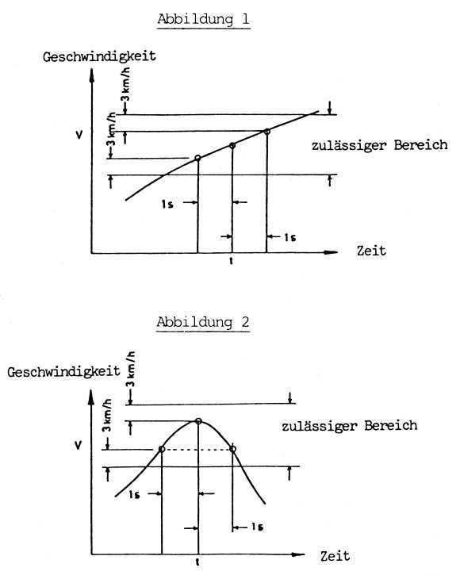

 2.3 Geschwindigkeitsabweichungen, die diese Toleranzen übersteigen, sind nur zulässig, wenn sie jeweils weniger als zwei Sekunden dauern. Geschwindigkeiten, die niedriger sind als vorgeschrieben, sind nur zulässig, falls das Fahrzeug dabei die höchste verfügbare Leistung abgibt. 2.4 Die zulässigen Toleranzen dürfen nicht dazu verwendet werden, um vorgeschriebene kleine Änderungen der Geschwindigkeiten im Fahrprogramm zu übergehen. 3. Verwendung des Getriebes 3.1 Bei den Prüfungen sind die folgenden Schaltprogramme bzw. Wählhebelstellungen anzuwenden. 3.1.1 Bei Handschaltgetrieben ist bei 24 km/h vom ersten in den zweiten, bei 40 km/h vom zweiten in den dritten, bei 64 km/h vom dritten in den vierten und bei mindestens 72 km/h vom vierten in den fünften Gang - sofern vorhanden - zu schalten. Bei Fahrzeugen mit Overdrive ist dieser wie ein fünfter Gang zu benützen. Beträgt die im ersten Gang erreichbare Höchstgeschwindigkeit weniger als 15 km/h, so ist das Getriebe so zu benützen, als ob der erste Gang nicht existierte. 3.1.2 Bei automatischen Getrieben sind die ganzen Prüfungen in der Wählhebelstellung "Drive" vorzunehmen, d.h. im grössten Gang. Wo der Fahrzeughersteller dies vorschreibt, können nach vorhergehender Genehmigung durch die Typenprüfstelle automatische Getriebe mit Gangwähler wie Handschaltgetriebe benützt werden. Können bei einem automatischen Getriebe zusätzlich mehrere Fahrprogramme gewählt werden (z.B. Normal-, Sport-, Economyprogramm usw.), so sind die Prüfungen in jedem Programm vorzunehmen; massgebend sind alle Emissionswerte. Nach vorangehender Genehmigung durch die Typenprüfstelle können Fahrprogramme, die nur für einen speziellen Einsatz (z.B. Fahren im Gelände usw.) vorgesehen sind, von den Prüfungen ausgenommen werden. 3.1.3 Nach vorangehender Genehmigung durch die Typenprüfstelle können in Spezialfällen andere als in den Ziff. 3.1.1 und 3.1.2 dieser Anlage vorgeschriebene Schaltprogramme angewendet werden. Dazu muss der Fahrzeughersteller durch Untersuchungen nachweisen, dass das von ihm vorgeschlagene Schaltprogramm den praktischen Gegebenheiten im täglichen Gebrauch dieses abgastechnischen Fahrzeugtyps besser entspricht als das vorgeschriebene Programm. Die Typenprüfstelle kann auf Kosten des Fahrzeugherstellers zusätzliche Untersuchungen verlangen, bevor sie den Nachweis als ausreichend erachtet. 3.2 Bei Fahrzeugen mit Freilauf ist dieser - sofern nichts anderes verlangt wird - nach den Angaben des Fahrzeugherstellers mitzubenützen. 3.3 Bei automatischen Getrieben sind die Leerlaufphasen mit der Wählhebelstellung "Drive" und gebremsten Rädern durchzuführen und bei Handschaltgetrieben ist im Leerlauf bei eingelegtem Gang auszukuppeln; ausgenommen ist die erste Leerlaufphase nach Ziff. 6.2.3.3 dieses Anhanges. 3.4 Beim Fahren sollen die Bewegungen des Gaspedals nur gerade so gross sein, wie dies nötig ist, um der Fahrkurve zu folgen. 3.5 Alle Beschleunigungsvorgänge sind sanft vorzunehmen. Bei Handschaltgetrieben muss der Fahrer beim Schalten das Gaspedal loslassen und den Schaltvorgang so schnell wie möglich durchführen. Falls das Fahrzeug nicht in der vorgeschriebenen Zeit beschleunigt werden kann, so ist es weiterhin mit Vollgas zu beschleunigen, bis es die in einem bestimmten Zeitpunkt laut Fahrprogramm vorgeschriebene Geschwindigkeit erreicht hat. 3.6 Verzögerungen sind mit eingelegtem Gang vorzunehmen, wobei zur Einhaltung der vorgeschriebenen Geschwindigkeit - je nach Bedarf - gebremst oder beschleunigt werden kann. Bei Handschaltgetrieben sind die Verzögerungen ohne Auskuppeln und ohne Herunterschalten vorzunehmen; wo eine Verzögerung auf Null vorgeschrieben ist, muss ausgekuppelt werden, sobald die Geschwindigkeit unter 24 km/h fällt, oder wenn der Motor zu stottern beginnt oder abzustellen droht. 3.7 Bei Handschaltgetrieben ist ein Herunterschalten bei Beginn oder während einer Beschleunigungsphase erlaubt, wenn der Motor offensichtlich stottert. Abbildung 3: Fahrkurve des Stadt-Fahrzyklus 

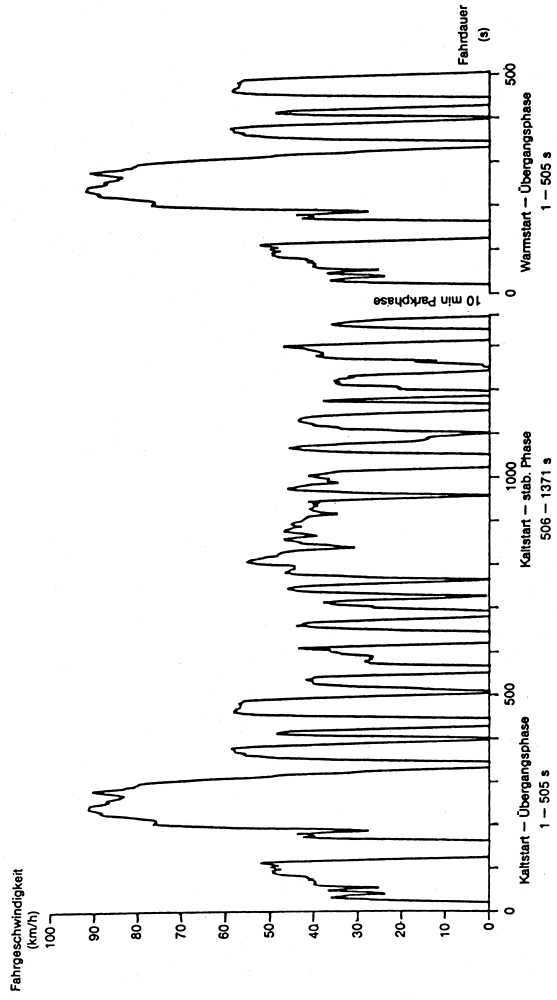

 Abbildung 4: Fahrkurve des Überland-Fahrzyklus 

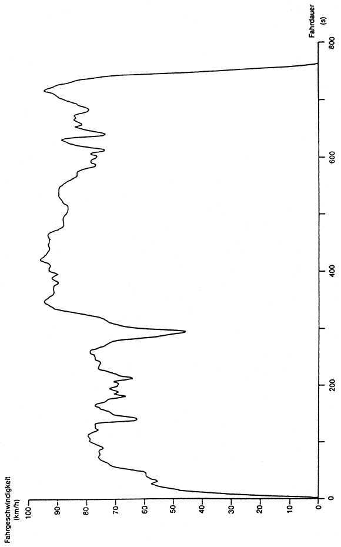

 Tabelle 1: Fahrprogramm des Stadt-Fahrzyklus Fahrdauer (t) in (s) - Fahrgeschwindigkeit (v) in (km/h) t v t v t v t v t v t v 0 0.0 20 0.0 40 24.0 60 38.9 80 41.4 100 48.8 1 0.0 21 4.8 41 24.5 61 39.6 81 42.0 101 49.4 2 0.0 22 9.5 42 24.9 62 40.1 82 43.0 102 49.7 3 0.0 23 13.8 43 25.7 63 40.2 83 44.3 103 49.9 4 0.0 24 18.5 44 27.5 64 39.6 84 46.0 104 49.7 5 0 0 25 23.0 45 30.7 65 39.4 85 47.2 105 46.9 6 0.0 26 27.2 46 34.0 66 39.8 86 48.0 106 48.0 7 0.0 27 27.8 47 36.5 67 39.9 87 48.4 107 48.1 8 0.0 28 29.1 48 36.9 68 39.8 88 48.9 108 48.6 9 0.0 29 33.3 49 36.5 69 39.6 89 49.4 109 49.4 10 0.0 30 34.9 50 36.4 70 39.6 90 49.4 110 50.2 11 0.0 31 36.0 51 34.3 71 40.4 91 49.1 111 51.2 12 0.0 32 36.2 52 30.6 72 41.2 92 48.9 112 51.8 13 0.0 33 35.6 53 27.5 73 41.4 93 48.8 113 52.1 14 0.0 34 34.6 54 25.4 74 40.9 94 48.9 114 51.8 15 0.0 35 33.6 55 25.4 75 40.1 95 49.6 115 51.0 16 0.0 36 32.8 56 28.5 76 40.2 96 48.9 116 46.0 17 0.0 37 31.9 57 31.9 77 40.9 97 48.1 117 40.7 18 0.0 38 27.4 58 34.8 78 41.8 98 47.5 118 35.4 19 0.0 39 24.0 59 37.3 79 41.8 99 48.0 119 30.1 t v t v t v t v t v t v 120 24.8 140 0.0 160 0.0 180 41.5 200 67.8 220 80.5 121 19.5 141 0.0 161 0.0 181 43.8 201 70.0 221 81.4 122 14.2 142 0.0 162 0.0 182 42.6 202 72.6 222 82.1 123 8.9 143 0.0 163 0.0 183 38.6 203 74.0 223 82.9 124 3.5 144 0.0 164 5.3 184 36.5 204 75.3 224 84.0 125 0.0 145 0.0 165 10.6 185 31.2 205 76.4 225 85.6 126 0.0 146 0.0 166 15.9 186 28.5 206 76.4 226 87.1 127 0.0 147 0.0 167 21.2 187 27.7 207 76.1 227 87.9 128 0.0 148 0.0 168 26.6 188 29.1 208 76.0 228 88.4 129 0.0 149 0.0 169 31.9 189 29.9 209 75.6 229 88.5 130 0.0 150 0.0 170 35.7 190 32.2 210 75.6 230 88.4 131 0.0 151 0.0 171 39.1 191 35.7 211 75.6 231 87.9 132 0.0 152 0.0 172 41.5 192 39.4 212 75.6 232 87.9 133 0.0 153 0.0 173 42.5 193 43.9 213 75.6 233 88.2 134 0.0 154 0.0 174 41.4 194 49.1 214 76.0 234 88.7 135 0.0 155 0.0 175 40.4 195 53.9 215 76.3 235 89.3 136 0.0 156 0.0 176 39.8 196 58.3 216 77.1 236 89.6 137 0.0 157 0.0 177 40.2 197 60.0 217 78.1 237 90.3 138 0.0 158 0.0 178 40.6 198 63.2 218 79.0 238 90.6 139 0.0 159 0.0 179 40.9 199 65.2 219 79.7 239 91.1 t v t v t v t v t v t v 240 91.2 260 87.1 280 89.5 300 79.0 320 44.3 340 0.0 241 91.2 261 86.6 281 90.1 301 78.2 321 39.9 341 0.0 242 90.9 262 85.9 282 90.1 302 77.4 322 34.6 342 0.0 243 90.9 263 85.3 283 89.8 303 76.0 323 32.3 343 0.0 244 90.9 264 84.7 284 88.8 304 74.2 324 30.7 344 0.0 245 90.9 265 83.8 285 87.7 305 72.4 325 29.8 345 0.0 246 90.9 266 84.3 286 86.3 306 70.5 326 27.4 346 0.0 247 90.9 267 83.7 287 84.5 307 68.6 327 24.9 347 1.6 248 90.6 268 83.5 288 82.9 308 66.8 328 20.1 348 6.9 249 90.3 269 83.2 289 82.9 309 64.9 329 17.4 349 12.2 250 89.8 270 82.9 290 82.9 310 62.0 330 12.9 350 17.5 251 88.7 271 83.0 291 82.2 311 59.5 331 7.6 351 22.9 252 87.9 272 83.4 292 80.6 312 56.6 332 2.3 352 27.8 253 87.2 273 83.8 293 80.5 313 54.4 333 0.0 353 32.2 254 86.9 274 84.5 294 80.6 314 52.3 334 0.0 354 36.2 255 86.4 275 85.3 295 80.5 315 50.7 335 0.0 355 38.1 256 86.3 276 86.1 296 79.8 316 49.2 336 0.0 356 40.6 257 86.7 277 86.9 297 79.7 317 49.1 337 0.0 357 42.8 258 86.9 278 88.4 298 79.7 318 48.3 338 0.0 358 45.2 259 87.1 279 89.2 299 79.7 319 46.7 339 0.0 359 48.3 t v t v t v t v t v t v 360 49.6 380 58.7 400 0.0 420 45.1 440 0.0 460 54.1 361 50.9 381 58.6 401 0.0 421 40.2 441 0.0 461 56.0 362 51.7 382 57.9 402 0.0 422 34.9 442 0.0 462 56.5 363 52.3 383 56.5 403 4.2 423 29.6 443 0.0 463 57.3 364 54.1 384 54.9 404 9.5 424 24 3 444 0.0 464 58.1 365 55.5 385 53.9 405 14.5 425 19.0 445 0.0 465 57.9 366 55.7 386 50.5 406 20.1 426 13.7 446 0.0 466 58.1 367 56.2 387 46.7 407 25.4 427 8.4 447 0.0 467 58.3 368 56.0 388 41.4 408 30.7 428 3.1 448 5.3 468 57.9 369 55.5 389 37.0 409 36.0 429 0.0 449 10.6 469 57.5 370 55.8 390 32.7 410 40.2 430 0.0 450 15.9 470 57.9 371 57.1 391 28.2 411 41.2 431 0.0 451 21.2 471 57.9 372 57.9 392 23.3 412 44.3 432 0.0 452 26.6 472 57.3 373 57.9 393 19.3 413 46.7 433 0.0 453 31.0 473 57.1 374 57.9 394 14.0 414 48.3 434 0.0 454 37.2 474 57.0 375 57.9 395 8.7 415 48.4 435 0.0 455 42.5 475 56.6 376 57.9 396 3.4 416 48.3 436 0.0 456 44.7 476 56.6 377 57.9 397 0.0 417 47.8 437 0.0 457 46.8 477 56.6 378 58.1 398 0.0 418 47.2 438 0.0 458 50.7 478 56.6 379 58.6 399 0.0 419 46.3 439 0.0 459 53.1 479 56.6 t v t v t v t v t v t v 480 56.6 500 21.2 520 25.7 540 40.6 560 0.0 580 28.5 481 56.3 501 16.6 521 28.5 541 40.2 561 0.0 581 28.2 482 56.5 502 11.6 522 30.6 542 40.2 562 0 0 582 27.4 483 56.6 503 6.4 523 32.3 543 40.2 563 0.0 583 27.2 484 57.1 504 1.6 524 33.8 544 39.3 564 0.0 584 26.7 485 56.6 505 0.0 525 35.4 545 37.2 565 0.0 585 27.4 486 56.3 506 0.0 526 37.0 546 31.9 566 0 0 586 27.5 487 56.3 507 0.0 527 38.3 547 26.6 567 0.0 587 27.4 488 56.3 508 0.0 528 39.4 548 21.2 568 0.0 588 26.7 489 56.0 509 0.0 529 40.1 549 15.9 569 5.3 589 26.6 490 55.7 510 0.0 530 40.2 550 10.6 570 10.6 590 26.6 491 55.8 511 1.9 531 40.2 551 5.3 571 15.9 591 26.7 492 53.9 512 5.6 532 40.2 552 0.0 572 20.9 592 27.4 493 51.5 513 8.9 533 40.2 553 0.0 573 23.5 593 28.3 494 48.4 514 10.5 534 40.2 554 0.0 574 25.7 594 29.8 495 45.1 515 13.7 535 40.2 555 0.0 575 27.4 595 30.9 496 41.0 516 15.4 536 41.2 556 0.0 576 27.4 596 32.5 497 36.2 517 16.9 537 41.5 557 0.0 577 21.4 597 33.8 498 31.9 518 19.2 538 41.8 558 0.0 578 28.2 598 34.0 499 26.6 519 22.5 539 41.2 559 0.0 579 28.5 599 34.1 t v t v t v t v t v t v 600 34.8 620 0.0 640 0.0 660 41.2 680 0.0 700 21.7 601 35.4 621 0.0 641 0.0 661 41.8 681 0.0 701 23.5 602 36.0 622 0.0 642 0.0 662 43.9 682 0.0 702 26.4 603 36.2 623 0.0 643 0.0 663 43.1 683 0.0 703 26.9 604 36.2 624 0.0 644 0.0 664 42.3 684 0.0 704 26.6 605 36.2 625 0.0 645 0.0 665 42.5 685 0.0 705 26.6 606 36.5 626 0.0 646 3.2 666 42.6 686 0.0 706 29.3 607 38.1 627 0.0 647 7.2 667 42.6 687 0.0 707 30.9 608 40.4 628 0.0 648 12.6 668 41.8 688 0.0 708 32.3 609 41.8 629 0.0 649 16.4 669 41.0 689 0.0 709 34.6 610 42.6 630 0 0 650 20.1 670 38.0 690 0.0 710 36.2 611 43.5 631 0.0 651 22.5 671 34.4 691 0.0 711 36.2 612 42.0 632 0.0 652 24.6 672 29.8 692 0.0 712 35.6 613 36.7 633 0.0 653 28.2 673 26.4 693 0.0 713 36.5 614 31.4 634 0.0 654 31.5 674 23.3 694 2.3 714 37.5 615 26.1 635 0.0 655 33.8 675 18.7 695 5.3 715 37.8 616 20.8 636 0.0 656 35.7 676 14.0 696 7.1 716 36.2 617 15.4 637 0.0 657 37.5 677 9.3 697 10.5 717 34.8 618 10.1 638 0.0 658 39.4 678 5.6 698 14.8 718 33.0 619 4.8 639 0.0 659 40.7 679 3.2 699 18.2 719 29.0 t v t v t v t v t v t v 720 24.1 740 41.0 760 15.1 780 44.3 800 45.1 820 50.9 721 19.3 741 42.6 761 10.0 781 45.1 801 45.9 821 50.7 722 14.5 742 43.6 762 4.8 782 45.5 802 48.3 822 49.2 723 10.0 743 44.4 763 2.4 783 46.5 803 49.9 823 48.3 724 7.2 744 44.9 764 2.4 784 46.5 804 51.5 824 48.1 725 4.8 745 45.5 765 0.8 785 46.5 805 53.1 825 48.1 726 3.4 746 46.0 766 0.0 786 46.3 806 53.1 826 48.1 727 0.8 747 46.0 767 4.8 787 45.9 807 54.1 827 48.1 728 0.8 748 45.5 768 10.1 788 45.5 808 54.7 828 47.6 729 5.1 749 45.4 769 15.4 789 45.5 809 55.2 829 47.5 730 10.5 750 45.1 770 20.8 790 45.5 810 55.0 830 47.5 731 15.4 751 44.3 771 25.4 791 45.4 811 54.7 831 47.2 732 20.1 752 43.1 772 28.2 792 44.4 812 54.7 832 46.5 733 22.5 753 41.0 773 29.6 793 44.3 813 54.6 833 45.4 734 25.7 754 37.8 774 31.4 794 44.3 814 54.1 834 44.6 735 29.0 755 34.6 775 33.3 795 44.3 815 53.3 835 43.5 736 31.5 756 30.6 776 35.4 796 44.3 816 53.1 836 41.0 737 34.6 757 26.6 777 37.3 797 44.3 817 52.3 837 38.1 738 37.2 758 24.0 778 40.2 798 44.3 818 51.5 838 35.4 739 39.4 759 20.1 779 42.6 799 44.4 819 51.3 839 33.0 t v t v t v t v t v t v 840 30.9 860 46.7 880 46.8 900 43.3 920 36.4 940 40.2 841 30.9 861 46.8 881 46.7 901 42.8 921 37.7 941 39.6 842 32.3 862 46.7 882 46.5 902 42.6 922 38.6 942 39.6 843 33.6 863 45.2 883 45.9 903 42.6 923 38.9 943 38.8 844 34.4 864 44.3 884 45.2 904 42.6 924 39.3 944 39.4 845 35.4 865 43.5 885 45.1 905 42.3 925 40.1 945 40.4 846 36.4 866 41.5 886 45.1 906 42.2 926 40.4 946 41.2 847 37.3 867 40.2 887 44.4 907 42.2 927 40.6 947 40.4 848 38.6 868 39.4 888 43.8 908 41.7 928 40.7 948 38.6 849 40.2 869 39.9 889 42.8 909 41.2 929 41.0 949 35.4 850 41.8 870 40.4 890 43.5 910 41.2 930 40.6 950 32.3 851 42.8 871 41.0 891 44.3 911 41.7 931 40.2 951 27.2 852 42.8 872 41.4 892 44.7 912 41.5 932 40.3 952 21.9 853 43.1 873 42.2 893 45.1 913 41.0 933 40.2 953 16.6 854 43.5 874 43.3 894 44.7 914 39.6 934 39.8 954 11.3 855 43.8 875 44.3 895 45.1 915 37.8 935 39.4 955 6.0 856 44.7 876 44.7 896 45.1 916 35.7 936 39.1 956 0.6 857 45.2 877 45.7 897 45.1 917 34.8 937 39.1 957 0.0 858 46.3 878 46.7 898 44.6 918 34.8 938 39.4 958 0.0 859 46.5 879 47.0 899 44.1 919 34.9 939 40.2 959 0.0 t v t v t v t v t v t v 960 3.2 980 44.3 1000 37.8 1020 12.2 1040 0.0 1060 32.2 961 8.5 981 43.8 1001 38.6 1021 6.9 1041 0.0 1061 35.1 962 13.8 982 43.1 1002 39.6 1022 1.6 1042 0.0 1062 37.0 963 19.2 983 42.6 1003 39.9 1023 0.0 1043 0.0 1063 38.6 964 24.5 984 41.8 1004 40.4 1024 0.0 1044 0.0 1064 39.9 965 28.2 985 41.4 1005 41.0 1025 0.0 1045 0.0 1065 41.2 966 29.9 986 40.6 1006 41.2 1026 0.0 1046 0.0 1066 42.6 967 32.2 987 38.6 1007 41.0 1027 0.0 1047 0.0 1067 43.1 968 34.0 988 35.4 1008 40.2 1028 0.0 1048 0.0 1068 44.1 969 35.4 989 34.6 1009 38.8 1029 0.0 1049 0.0 1069 44.9 970 37.0 990 34.6 1010 38.1 1030 0.0 1050 0.0 1070 45.5 971 39.4 991 35.1 1011 37.3 1031 0.0 1051 0.0 1071 45.1 972 42.3 992 36.2 1012 36.9 1032 0.0 1052 0.0 1072 44.3 973 44.3 993 37.0 1013 36.2 1033 0.0 1053 1.9 1073 43.5 974 45.2 994 36.7 1014 35.4 1034 0.0 1054 6.4 1074 43.5 975 45.7 995 36.7 1015 34.8 1035 0.0 1055 11.7 1075 42.3 976 45.9 996 37.0 1016 33.0 1036 0.0 1056 17.1 1076 39.4 977 45.9 997 36.5 1017 28.2 1037 0.0 1057 22.4 1077 36.2 978 45.9 998 36.5 1018 22.9 1038 0.0 1058 27.4 1078 34.6 979 44.6 999 36.5 1019 17.5 1039 0.0 1059 29.8 1079 33.2 t v t v t v t v t v t v 1080 29.0 1100 0.0 1120 38.3 1140 41.8 1160 0.0 1180 32.2 1081 24.1 1101 0.2 1121 39.4 1141 41.0 1161 0.0 1181 26.9 1082 19.8 1102 1.0 1122 40.2 1142 39.6 1162 0.0 1182 21.6 1083 17.9 1103 2.6 1123 40.1 1143 37.8 1163 0.0 1183 16.3 1084 17.1 1104 5.8 1124 39.9 1144 34.6 1164 0.0 1184 10.9 1085 16.1 1105 11.1 1125 40.2 1145 32.2 1165 0.0 1185 5.6 1086 15.3 1106 16.1 1126 40.9 1146 28.2 1166 0.0 1186 0.3 1087 14.6 1107 20.6 1127 41.5 1147 25.7 1167 0.0 1187 0.0 1088 14.0 1108 22.5 1128 41.8 1148 22.5 1168 0.0 1188 0.0 1089 13.8 1109 23.3 1129 42.5 1149 17.2 1169 3.4 1189 0.0 1090 14.2 1110 25.7 1130 42.8 1150 11.9 1170 8.7 1190 0.0 1091 14.5 1111 29.1 1131 43.3 1151 6.6 1171 14.0 1191 0.0 1092 14.0 1112 32.2 1132 43.5 1152 1.3 1172 19.3 1192 0.0 1093 13.8 1113 33.6 1133 43.5 1153 0.0 1173 24.6 1193 0.0 1094 12.9 1114 34.1 1134 43.5 1154 0.0 1174 29.9 1194 0.0 1095 11.3 1115 34.3 1135 43.3 1155 0.0 1175 34.0 1195 0.0 1096 8.0 1116 34.4 1136 43.1 1156 0.0 1176 37.0 1196 0.0 1097 6.8 1117 34.9 1137 43.1 1157 0.0 1177 37.8 1197 0.3 1098 4.2 1118 36.2 1138 42.6 1158 0.0 1178 37.0 1198 2.4 1099 1.6 1119 37.0 1139 42.5 1159 0.0 1179 36.2 1199 5.6 t v t v t v t v t v t v 1200 10.5 1220 34.6 1240 9.7 1260 8.0 1280 39.4 1300 45.5 1201 15.8 1221 35.1 1241 6.4 1261 10.1 1281 38.6 1301 46.7 1202 19.3 1222 35.4 1242 4.0 1262 12.9 1282 37.8 1302 46.8 1203 20.8 1223 35.2 1243 1.1 1263 16.1 1283 37.8 1303 46.7 1204 20.9 1224 34.9 1244 0.0 1264 16.9 1284 37.8 1304 45.1 1205 20.3 1225 34.6 1245 0.0 1265 15.3 1285 37.8 1305 39.8 1206 20.6 1226 34.6 1246 0.0 1266 13.7 1286 37.8 1306 34.4 1207 21.1 1227 34.4 1247 0.0 1267 12.2 1287 37.8 1307 29.1 1208 21.1 1228 32.3 1248 0.0 1268 14.2 1288 38.6 1308 23.8 1209 22.5 1229 31.4 1249 0.0 1269 17.7 1289 38.8 1309 18.5 1210 24.9 1230 30.9 1250 0.0 1270 22.5 1290 39.4 1310 13.2 1211 27.4 1231 31.5 1251 0.0 1271 27.4 1291 39.8 1311 7.9 1212 29.9 1232 31.9 1252 1.6 1272 31.4 1292 40.2 1312 2.6 1213 31.7 1233 32.2 1253 1.6 1273 33.8 1293 40.9 1313 0.0 1214 33.8 1234 31.4 1254 1.6 1274 35.1 1294 41.2 1314 0.0 1215 34.6 1235 28.2 1255 1.6 1275 35.7 1295 41.4 1315 0.0 1216 35.1 1236 24.9 1256 1.6 1276 37.0 1296 41.8 1316 0.0 1217 35.1 1237 20.9 1257 2.6 1277 38.0 1297 42.2 1317 0.0 1218 34.6 1238 16.1 1258 4.8 1278 38.8 1298 43.5 1318 0.0 1219 34.1 1239 12.9 1259 6.4 1279 39.4 1299 44.7 1319 0.0 t v t v t v t v t v t v 1320 0.0 1340 13.0 1360 26.6 1321 0.0 1341 18.3 1361 24.9 1322 0.0 1342 21.2 1362 22.5 1323 0.0 1343 24.3 1363 17.7 1324 0.0 1344 27.0 1364 12.9 1325 0.0 1345 29.5 1365 8.4 1326 0.0 1346 31.4 1366 4.0 1327 0.0 1347 32.7 1367 0.0 1328 0.0 1348 34.3 1368 0.0 1329 0.0 1349 35.2 1369 0.0 1330 0.0 1350 35.6 1370 0.0 1331 0.0 1351 36.0 1371 0.0 1332 0.0 1352 35.4 1333 0.0 1353 34.8 1334 0.0 1354 34.0 1335 0.0 1355 33.0 1336 0.0 1356 32.2 1337 0.0 1357 31.5 1338 2.4 1358 29.8 1339 7.7 1359 28.2 Tabelle 2: Fahrprogramm des Überland-Fahrzyklus Fahrdauer (t) in (s) - Fahrgeschwindigkeit (v) in (km/h) t v t v t v t v t v t v 0 0.0 20 52.9 40 59.3 60 71.6 80 75.4 100 78.0 1 0.0 21 53.9 41 59.5 61 72.0 81 75.4 101 78.5 2 0.0 22 54.8 42 59.5 62 72.2 82 75.6 102 79.0 3 3.2 23 55.6 43 59.5 63 72.4 83 75.7 103 79.1 4 7.8 24 56.1 44 59.5 64 72.5 84 75.7 104 79.0 5 13.0 25 56.4 45 59.5 65 73.0 85 75.9 105 79.0 6 18.1 26 57.4 46 59.5 66 73.5 86 75 7 106 78.8 7 23.3 27 57.7 47 59.6 67 74.0 87 75.6 107 78.8 8 27.8 28 57.6 48 60.0 68 74.4 88 75.4 108 79.0 9 31.5 29 56.7 49 60.4 69 74.8 89 74.8 109 79.1 10 35.0 30 56.1 50 62.1 70 75.3 90 74.4 110 79.3 11 38.6 31 55.5 51 63.2 71 75.4 91 74.3 111 79.4 12 41.5 32 55.6 52 64.3 72 75.6 92 74.4 112 79.6 13 43.6 33 55.9 53 65.4 73 75.7 93 74.8 113 79.6 14 46.0 34 56.4 54 66.6 74 75.9 94 75.4 114 79.6 15 48.1 35 57.4 55 67.8 75 76.1 95 75.7 115 79.4 16 48.2 36 58.0 56 69.0 76 75.9 96 76.2 116 79.0 17 49.3 37 58.2 57 69.9 77 75.7 97 76.7 117 78.6 18 50.6 38 58.7 58 70.7 78 75.6 98 77.2 118 78.1 19 51.8 39 59.0 59 71.2 79 75.4 99 77.5 119 77.8 t v t v t v t v t v t v 120 77.3 140 63.0 160 75.3 180 69.3 200 69.8 220 69.3 121 76.7 141 62.7 161 75.4 181 67.8 201 69.5 221 69.5 122 76.2 142 62.7 162 75.6 182 66.7 202 69.5 222 69.8 123 76.1 143 62.9 163 75.7 183 66.7 203 69.3 223 70.6 124 76.4 144 63.5 164 76.5 184 67.7 204 69.1 224 71.2 125 76.9 145 64.5 165 77.0 185 69.0 205 69.1 225 71.9 126 77.0 146 65.9 166 77.2 186 69.9 206 69.3 226 72.5 127 77.2 147 67.5 167 77.2 187 70.6 207 69.8 227 73.0 128 77.0 148 69.3 168 77.0 188 70.1 208 70.6 228 73.6 129 77.0 149 70.3 169 76.9 189 69.6 209 70.7 229 74.8 130 77.0 150 70.9 170 76.1 190 69.1 210 69.9 230 75.4 131 77.2 151 71.2 171 75.1 191 69.3 211 68.5 231 75.9 132 77.2 152 71.4 172 74.3 192 69.8 212 66.7 232 76.2 133 77.2 153 71.7 173 73.8 193 70.6 213 65.4 233 76.1 134 77.0 154 71.9 174 73.5 194 71.2 214 64.3 234 76.1 135 76.1 155 72.2 175 73.2 195 71.7 215 64.3 235 75.9 136 74.0 156 72.7 176 73.0 196 72.2 216 64.8 236 75.9 137 69.6 157 73.5 177 72.8 197 72.0 217 65.9 237 75.9 138 66.2 158 73.8 178 72.4 198 71.4 218 67.5 238 75.7 139 63.5 159 74.4 179 70.7 199 70.6 219 68.7 239 75.6 t v t v t v t v t v t v 240 75.6 260 79.0 280 71.1 300 53.7 320 74.8 340 92.1 241 75.4 261 79.0 281 69.9 301 57.2 321 75.3 341 92.6 242 75.3 262 79.0 282 68.8 302 60.3 322 75.7 342 93.0 243 75.4 263 79.0 283 67.5 303 62.9 323 76.7 343 93.3 244 75.6 264 78.8 284 64.5 304 64.6 324 77.7 344 93.4 245 75.9 265 78.6 285 62.1 305 66.1 325 78.8 345 93.9 246 76.4 266 77.5 286 60.3 306 67.2 326 79.9 346 94.4 247 77.0 267 76.7 287 57.6 307 68.2 327 80.9 347 94.6 248 77.2 268 76.4 288 55.8 308 68.8 328 82.0 348 94.7 249 77.2 269 75.9 289 54.7 309 69.6 329 83.1 349 94.9 250 77.2 270 75.1 290 53.5 310 70.4 330 84.3 350 94.9 251 77.2 271 74.3 291 52.2 311 71.2 331 85.4 351 94.7 252 77.2 272 74.0 292 51.0 312 71.9 332 86.5 352 94.6 253 77.3 273 73.6 293 49.2 313 72.4 333 87.6 353 94.2 254 77.5 274 73.3 294 47.6 314 72.7 334 88.8 354 93.9 255 77.5 275 73.0 295 46.3 315 73.0 335 89.7 355 93.6 256 77.3 276 72.7 296 46.1 316 73.2 336 90.7 356 93.4 257 78.1 277 72.4 297 46.0 317 73.6 337 91.5 357 93.3 258 78.6 278 71.9 298 47.4 318 74.0 338 91.7 358 93.1 259 79.0 279 71.6 299 50.5 319 74.1 339 91.8 359 92.6 t v t v t v t v t v t v 360 92.3 380 90.4 400 91.8 420 95.5 440 93.1 460 93.3 361 92.0 381 90.1 401 92.5 421 96.2 441 93.1 461 93.4 362 91.8 382 90.1 402 93.0 422 96.3 442 93.1 462 93.4 363 91.7 383 90.1 403 93.3 423 96.3 443 93.1 463 93.6 364 91.7 384 90.2 404 93.3 424 96.2 444 93.1 464 93.8 365 91.5 385 90.7 405 93.3 425 95.8 445 93.3 465 93.8 366 91.5 386 91.2 406 93.3 426 95.5 446 93.4 466 93.8 367 91.5 387 91.5 407 93.3 427 95.2 447 93.4 467 93.6 368 91.7 388 91.8 400 93.3 428 95.0 448 93.6 468 93.4 369 91.7 389 92.1 409 93.1 429 94.9 449 93.6 469 93.3 370 91.7 390 92.3 410 93.0 430 94.7 450 93 6 470 93.0 371 91.7 391 92.3 411 92.8 431 94.4 451 93.4 471 92.5 372 91.7 392 92.0 412 92.8 432 94.2 452 93.3 472 91.8 373 91.7 393 91.7 413 93.0 433 94.1 453 93.3 473 91.7 374 91.7 394 91.5 414 93.1 434 93.9 454 93.3 474 91.0 375 91.7 395 91.0 415 93.3 435 93.9 455 93.3 475 90.2 376 91.7 396 90.5 416 93.4 436 93.8 456 93.3 476 90.1 377 91.5 397 90.2 417 93.9 437 93.6 457 93.3 477 89.7 378 91.3 398 90.7 418 94.7 438 93.4 458 93.1 478 89.2 379 90.9 399 91.2 419 95.0 439 93.3 459 93.1 479 88.6 t v t v t v t v t v t v 480 88.6 500 88.0 520 88.1 540 90.1 560 87.0 580 82.2 481 88.4 501 87.8 521 88.3 541 90.1 561 86.5 581 81.5 482 88.3 502 87.5 522 88.4 542 90.1 562 85.9 582 80.9 483 88.3 503 87.3 523 88.6 543 90.1 563 85.7 583 80.2 484 88.3 504 87.3 524 88.8 544 90.1 564 85.4 584 79.3 485 88.3 505 87.2 525 88.8 545 90.1 565 85.1 585 78.3 486 88.3 506 87.0 526 88.9 546 90.1 566 84.6 586 77.5 487 88.3 507 87.0 527 89.1 547 89.9 567 84.3 587 77.3 488 88.4 508 87.0 528 89.2 548 89.9 568 83.9 588 77.2 489 88.4 509 86.8 529 89.4 549 89.9 569 83.6 589 77.2 490 88.4 510 86.8 530 89.6 550 89.7 570 83.6 590 77.3 491 88.4 511 86.8 531 89.7 551 89.4 571 83.6 591 77.8 492 88 4 512 86.8 532 89.9 552 89.1 572 83.6 592 78.6 493 88.4 513 86.8 533 90.1 553 88.8 573 83.6 593 78.8 494 88.6 514 86.8 534 90.1 554 88.6 574 83.8 594 79.0 495 88.6 515 86.8 535 90.1 555 88.4 575 83.6 595 79.0 496 88.4 516 86.8 536 90.1 556 88.3 576 83 6 596 78.8 497 88.3 517 87.0 537 90.1 557 87.8 577 83.5 597 78.8 498 88.3 518 87.2 538 90.1 558 87.5 578 83.0 598 78.6 499 88.1 519 87.6 539 90.1 559 87.2 579 82.7 599 78.1 t v t v t v t v t v t v 600 77.7 620 79.9 640 74.8 660 82.0 680 81.2 700 87.2 601 77.2 621 81.4 641 74.3 661 82.2 681 80.6 701 87.6 602 77.0 622 82.8 642 74.0 662 82.7 682 80.1 702 88.1 603 76.9 623 83 9 643 74.0 663 83.1 683 79.9 703 88.4 604 76.7 624 84.7 644 74.4 664 83.6 684 79.8 704 89.2 605 77.0 625 85.2 645 75.3 665 83.9 665 79.6 705 89.9 606 77.7 626 86 2 646 76.4 666 84.4 686 79 6 706 90.2 607 78.8 627 86.8 647 77.5 667 84.9 687 79.9 707 90.2 608 79.0 628 87.0 648 78.5 668 84.7 688 80.4 708 90.7 609 78.8 629 87.5 649 79.6 669 84.6 689 80.7 709 90.9 610 78.6 630 88.0 650 80.7 670 84.1 690 81.4 710 91.2 611 77.2 631 88.6 651 81.5 671 84.1 691 82.2 711 91.5 612 75.7 632 89.1 652 82.2 672 84.3 692 83.0 712 91.7 613 74.3 633 89.1 653 83.1 673 84.4 693 83.5 713 92.1 614 74.1 634 88.4 654 83.9 674 84.7 694 83.6 714 92.8 615 74.1 635 87.6 655 84.4 675 84.7 695 83.8 715 93.6 616 74.3 636 86.2 656 83.8 676 84.3 696 84.3 716 94.6 617 75.4 637 84.4 657 83.0 677 83.8 697 85.1 717 95.0 618 76.9 638 80.7 658 82.2 678 83.1 698 85.7 718 95.2 619 78.8 639 77.5 659 82.0 679 82.2 699 86.4 719 95.0 t v t v t v t v t v t v 720 94.6 730 87.8 740 78.0 750 43.1 760 5.3 721 94.1 731 87.0 741 76.5 751 39.4 761 3.2 722 93.4 732 86.4 742 75.3 752 34.5 762 1.1 723 92.8 733 85.5 743 73.3 753 31.3 763 0.0 724 92.1 734 85 1 744 71.1 754 27.9 764 0.0 725 91.8 735 84.4 745 68.3 755 24.2 765 0.0 726 91.3 736 83.6 746 63.0 756 19.9 727 90.9 737 82.5 747 57.7 757 15.6 728 90.4 738 81.2 748 52.4 758 11.2 729 89.2 739 79.6 749 47.1 759 8.0 Anlage 2 Einstellung des Fahrleistungsprüfstandes 1. Methode für die Kalibrierung 1.1 Allgemeines Dieses Kapitel beschreibt eine Methode zur Bestimmung der Gesamtbremskraft F a (aufgenommene Leistung) eines Fahrleistungsprüfstandes. Diese umfasst die Reibungsverluste des Prüfstandes und die durch die Bremseinrichtung aufgenommene Leistung. Dazu wird der Prüfstand mit einer über der höchsten Prüfgeschwindigkeit liegenden Geschwindigkeit betrieben. Danach ist die für den Antrieb des Prüfstandes verwendete Vorrichtung vom Prüfstand zu trennen; die Umlaufgeschwindigkeit der angetriebenen Rollen nimmt ab. Dabei bleiben die unterschiedlichen Reibungsverluste bei beladenen und unbeladenen Rollen sowie der Reibungsverlust der hinteren freien Rolle - wenn vorhanden - unberücksichtigt. 1.2 Kalibrierung des Bremskraftanzeigers (angegeben als F i ) in Abhängigkeit der Gesamtbremskraft (F a ) Der Bremskraftanzeiger ist wenn möglich bei 100, 80, 60, 40 und 20 km/h zu kalibrieren. Vorhergehend ist der Geschwindigkeitsanzeiger zu kalibrieren (Toleranz vgl. Ziff. 4.1.5 dieses Anhanges). Das Vorgehen für die Kalibrierung bei 80 km/h ist nachfolgend beschrieben. Dieses Vorgehen ist für die anderen Geschwindigkeiten zu wiederholen, wobei die Ausgangs- und Endgeschwindigkeiten entsprechend anzupassen sind. Die Umlaufgeschwindigkeit der Rolle ist zu messen, sofern dies noch nicht erfolgt ist. Dazu kann ein fünftes Rad, ein Drehzahlmesser oder eine andere Vorrichtung verwendet werden. Ein Fahrzeug ist auf den Prüfstand zu stellen oder dieser ist mit einer anderen Methode anzutreiben. Es ist ein Schwungrad oder eine andere Vorrichtung zur Simulation der Schwungmasse für die entsprechende Bezugsmassenklasse zu verwenden. Der Prüfstand ist auf eine Geschwindigkeit von 80 km/h zu bringen. Die angezeigte Bremskraft ist festzuhalten (F i ). Die Geschwindigkeit ist auf mindestens 97 km/h zu erhöhen. Die für den Antrieb des Prüfstandes verwendete Einrichtung ist zu lösen. Die Zeit, in welcher der Prüfstand von 88 km/h auf 72 km/h verzögert wird, ist festzuhalten. Die Bremseinstellung ist auf einen anderen Wert einzustellen. Die obgenannten Vorgänge sind genügend oft zu wiederholen, bis der Leistungsbereich unter Strassenbedingungen abgedeckt ist. Die Gesamtbremskraft (F a ) ist mit folgender Formel zu berechnen: 

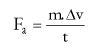

 dabei bedeuten: F a : Gesamtbremskraft in N m : äquivalente Schwungmasse in kg (bei nicht verbundenen Rollen bleibt die Schwungmasse der freien Rolle unberücksichtigt) v 1 : Ausgangsgeschwindigkeit in m/s (88 km/h = 24.44 m/s) v 2 : Endgeschwindigkeit in m/s (72 km/h = 20.00 m/s) Δv : v 1 - v 2 in m/s t : von der Rolle benötigte Zeit in Sekunden, um von 88 km/h auf 72 km/h zu gelangen. Beispiel eines Diagramms mit Angabe der angezeigten Bremskraft (F i ) bei 80 km/h in bezug auf die Gesamtbremskraft (F a ) bei 80 km/h: 

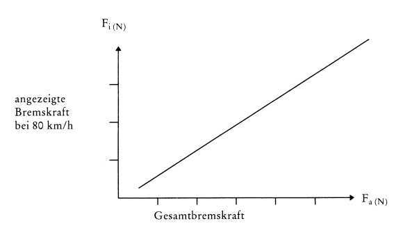

 2. Methoden für die Bestimmung des Strassen-Fahrwiderstandes und für die Einstellung des Fahrleistungsprüfstandes 2.1 Zweck der Methoden Der Zweck der nachfolgend beschriebenen Methoden besteht darin, den Strassen-Fahrwiderstand eines Fahrzeugs bei gleichförmigen Geschwindigkeiten auf der Strasse zu messen oder als Alternative zu berechnen und diesen Fahrwiderstand auf einem Fahrleistungsprüfstand gemäss den Bestimmungen von Ziff. 4.1.6 dieses Anhanges zu simulieren. Die Prüfstelle kann andere Methoden zur Bestimmung des Strassen-Fahrwiderstandes anerkennen. 2.2 Beschreibung der Strasse Die Strasse muss eben und lang genug sein, um die nachfolgenden Messungen vornehmen zu können. Die Neigung muss auf ± 0.1 % konstant sein und darf 1.5 % nicht überschreiten. 2.3 Meteorologische Bedingungen Die durchschnittliche Windgeschwindigkeit darf 3 m/s nicht überschreiten; Windböen müssen unter 5 m/s, Querwinde zur Strasse unter 2 m/s liegen. Die Windgeschwindigkeit ist 0.7 m über Boden zu messen. Die Strasse muss trocken sein. Die Luftdichte soll während der Messung um nicht mehr als ± 7.5 % von den Referenzbedingungen p = 100 kPa und T = 293 K abweichen. Die Umgebungstemperatur soll zwischen 5 und 35°C (278 - 308 K) liegen. 2.4 Vorbereitung des Fahrzeugs 2.4.1 Einfahren Das Fahrzeug muss nach den Bestimmungen von Ziff. 6 dieser Verordnung eingefahren sein; die Einstellung hat Ziff. 5.4.1 dieser Verordnung zu entsprechen. Die Reifen müssen zusammen mit dem Fahrzeug eingefahren sein, müssen jedoch noch über eine Profiltiefe von mindestens 50 % der ursprünglichen Profiltiefe verfügen. 2.4.2 Überprüfungen Die folgenden Teile und Einstellungen sollen nach den Herstellerangaben überprüft werden: - Räder, Höhen- und Seitenschlag der Felgen, Reifen (Marke, Typ, Reifendruck), Vorderachsgeometrie; - Einstellung der Bremsen (Freigängigkeit), Schmierung der Vorder- und Hinterachse; - Aufhängung, Federung, Horizontallage des Fahrzeugs usw. 2.4.3 Vorbereitung für die Messung Das Fahrzeug ist auf die Bezugsmasse zu beladen. Die Horizontallage des Fahrzeugs ist dann erreicht, wenn der Schwerpunkt der Ladung in der Mitte einer durch die beiden Punkte "R" der äusseren Vordersitze gebildeten Geraden liegt. Im Falle von Strassenversuchen sind die Seitenfenster zu schliessen. Allfällige Lüftungs und Scheinwerferklappen usw. müssen in Ruhestellung sein, ausgenommen die Prüfstelle verlangt etwas anderes. Das Fahrzeug muss sauber sein. Unmittelbar vor der Messung muss das Fahrzeug in geeigneter Weise auf normale Betriebstemperatur gebracht werden. 2.5 Methoden 2.5.1 Methode der Änderung des Fahrwiderstandes bei Verzögerung im Freilauf 2.5.1.1 Auf der Strasse 2.5.1.1.1 Messgeräte und Genauigkeit Die Zeit ist auf 0.1 Sekunden genau zu messen. Die Geschwindigkeit ist auf 2 % genau zu messen. 2.5.1.1.2 Prüfverfahren 2.5.1.1.2.1 Die Messgeschwindigkeiten zur Bestimmung des Strassen-Fahrwiderstandes sind 100, 80, 60, 40 und 20 km/h. 2.5.1.1.2.2 Das Fahrzeug ist auf eine Geschwindigkeit zu beschleunigen, die 10 km/h höher liegt als die gewählte Messgeschwindigkeit v. 2.5.1.1.2.3 Der Getriebewählhebel ist in die Stellung "Neutral" zu bringen. 2.5.1.1.2.4 Zu messen ist die Verzögerungszeit t 1 des Fahrzeugs von der Geschwindigkeit v 1 zur Geschwindigkeit v 2 mit Δv ( 10 km/h (2.778 m/s). 2.5.1.1.2.5 Die gleiche Prüfung ist in entgegengesetzter Richtung durchzuführen; dies ergibt t 2 . 2.5.1.1.2.6 Der Durchschnitt τ ist aus t 1 und t 2 zu berechnen. 2.5.1.1.2.7 Diese Verzögerungsmessung ist mindestens fünfmal in jede Richtung zu wiederholen und daraus die Durchschnittszeit τ m für jede Geschwindigkeitsspanne zu berechnen. τ m mit der Standardabweichung (s) ist zu notieren. 2.5.1.1.2.8 Der Fahrwiderstand (F r ) bei der Messgeschwindigkeit v ist mit folgender Formel zu berechnen: 

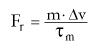

 dabei bedeuten: F r : Fahrwiderstand in N m : Bezugsmasse in kg Δv : Geschwindigkeitsunterschied in m/s τ m : Durchschnittszeit in s. und/oder die entsprechenden Werte für den Fahrwiderstand F r und die Geschwindigkeit (v) sind mit der Hilfe der Methode der kleinsten Quadrate mit einer parabolischen Kurve zu verbinden: F r = f 0 + f 1 v 2 dabei bedeuten: F r : Fahrwiderstand in N v : Geschwindigkeit in km/h f 0 , f 1 : Koeffizienten Diese Kurve ist die Fahrwiderstandskurve, die auf dem Fahrleistungsprüfstand simuliert werden muss. 2.5.1.1.9 Im Prüfbericht sind der errechnete Strassen-Fahrwiderstand (F r in N) und/oder die Faktoren f 0 und f 1 aufzuführen. 2.5.1.2 Auf dem Prüfstand 2.5.1.2.1 Messgeräte und Genauigkeit Die Geräte haben die Genauigkeit gemäss Ziff. 2.5.1.1.1 dieser Anlage zu erfüllen. 2.5.1.2.2 Prüfverfahren 2.5.1.2.2.1 Das Fahrzeug ist auf den Prüfstand zu stellen. 2.5.1.2.2.2 Der Reifendruck (kalt) der Antriebsräder ist so anzupassen, wie dies der Betrieb auf dem Prüfstand verlangt. 2.5.1.2.2.3 Die äquivalente Schwungmasse des Prüfstandes ist gemäss Ziff. 5.1.1 dieses Anhanges einzustellen. 2.5.1.2.2.4 Fahrzeug und Prüfstand sind in geeigneter Weise auf Betriebstemperatur zu bringen. 2.5.1.2.2.5 Es ist gleich vorzugehen wie in den Ziff. 2.5.1.1.2.1 bis 2.5.1.1.2.4 dieser Anlage; in der Formel unter Ziff. 2.5.1.1.2.8 dieser Anlage wird m durch I ersetzt, wobei I die äquivalente Schwungmasse des Prüfstandes in kg ist. 2.5.1.2.2.6 Zur Simulation des Fahrwiderstandes ist der Prüfstand anhand der Auslaufzeiten bei 100, 80, 60, 40 und 20 km/h mit einer Genauigkeit gemäss Ziff. 4.1.6 dieses Anhanges einzustellen. Im Falle eines Prüfstandes, der aufgrund der mechanischen Schwungmassen nur bis 100 km/h betrieben werden darf, kann auf die Einstellung bei 100 km/h verzichtet werden. 2.5.1.2.2.7 Bei einem Prüfstand mit festgelegter Leistungsaufnahme-Kennlinie ist die Einstellung bei 80 km/h vorzunehmen. 2.5.1.2.2.8 Im Prüfbericht ist als Referenzwert die Bremseinstellung bei 80 km/h als Gesamtbremskraft (F a ) aufzuführen. 2.5.2 Methode der Drehmomentmessung bei konstanter Geschwindigkeit 2.5.2.1 Auf der Strasse 2.5.2.1.1 Messgeräte und Genauigkeit Das Drehmoment ist mit einem entsprechenden Messgerät auf 2 % genau zu messen. Die Geschwindigkeit ist auf 2 % genau zu messen. 2.5.2.1.2 Prüfverfahren 2.5.2.1.2.1 Das Fahrzeug ist auf die gewählte konstante Geschwindigkeit v zu beschleunigen. 2.5.2.1.2.2 Das Drehmoment M t und die Geschwindigkeit sind während mindestens 10 Sekunden aufzuzeichnen. 2.5.2.1.2.3 Die Veränderungen des Drehmoments M t und der Geschwindigkeit in Abhängigkeit der Zeit dürfen in jeder Sekunde der Aufzeichnungszeit 5 % nicht überschreiten. 2.5.2.1.2.4 Das Drehmoment Mt 1 ist das durchschnittliche Drehmoment, ermittelt nach folgender Formel: 

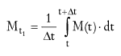

 2.5.2.1.2.5 Die gleiche Messung ist in entgegengesetzter Richtung durchzuführen; dies ergibt Mt 2 2.5.2.1.2.6 Der Durchschnitt M t ist aus Mt 1 und Mt 2 zu berechnen. 2.5.2.1.2.7 Die für jede Geschwindigkeit (v) erhaltenen Werte für das Drehmoment auf der Strasse (in Nm) ist zu notieren und/oder die entsprechenden Werte für das Drehmoment (M t ) und die Geschwindigkeit (v) sind mit Hilfe der Methode der kleinsten Quadrate mit einer parabolischen Kurve zu verbinden: 

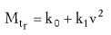

 dabei bedeuten: M t r : Drehmoment auf der Strasse in Nm v : Geschwindigkeit in km/h k 0 , k 1 : Koeffizienten Diese Kurve ergibt die entsprechenden Werte für das Drehmoment und die Geschwindigkeit, die auf dem Fahrleistungsprüfstand simuliert werden muss. 2.5.2.1.2.8 Im Prüfbericht sind die errechneten Drehmomente auf der Strasse (in Nm) und/oder die Faktoren k 0 und k 1 aufzuführen. 2.5.2.2 Auf dem Prüfstand 2.5.2.2.1 Messgeräte und Genauigkeit Es sind die gleichen Geräte zu verwenden wie bei der Messung auf der Strasse. 2.5.2.2.2 Prüfverfahren 2.5.2.2.2.1 Es ist gleich vorzugehen wie in den Ziff. 2.5.1.2.2.1 bis 2.5.1.2.2.4 dieser Anlage. 2.5.2.2.2.2 Es ist gleich vorzugehen wie in Ziff. 2.5.2.1.2.1 dieser Anlage. 2.5.2.2.2.3 Zur Simulation der von der Drehmoment-Geschwindigkeits-Kurve abgelesenen Drehmomentwerte nach Ziff. 2.5.2.1.2.7 dieser Anlage ist der Prüfstand bei 100, 80, 60, 40 und 20 km/h mit einer Genauigkeit gemäss Ziff. 4.1.6 dieses Anhanges einzustellen. Im Falle eines Prüfstandes, der aufgrund der mechanischen Schwungmassen nur bis 100 km/h betrieben werden darf, kann auf die Einstellung bei 100 km/h verzichtet werden. 2.5.2.2.2.3 Bei einem Prüfstand mit festgelegter Leistungsaufnahme-Kennlinie ist die Einstellung bei 80 km/h vorzunehmen. 2.5.2.2.2.4 Im Prüfbericht ist als Referenzwert die Bremseinstellung bei 80 km/h als Gesamtbremskraft (F a ) aufzuführen. 2.5.3 Alternativmethode 2.5.3.1 Anwendung Mit Einwilligung der Prüfstelle kann für den Fahrwiderstand (F r ) des Fahrzeugs ein gleichwertiger Einheitswert, berechnet nach folgender Formel, angenommen werden: F r = f (am + b) dabei bedeuten: F r : zu simulierender Fahrwiderstand in N m : äquivalente Schwungmasse des Prüfstandes in kg a,b : von der Geschwindigkeit abhängige Koeffizienten gemäss der folgenden Tabelle f : von der Fahrzeuggruppe abhängiger Koeffizient (1.1 für Gruppe I; 1.3 für Gruppe II) v (km/h) a b 100 0.231 181 80 0.194 116 60 0.165 65 40 0.144 28 20 0.131 7 2.5.3.2 Auf dem Prüfstand 2.5.3.2.1 Auslaufzeiten Die folgenden Tabellen 1 und 2 enthalten die Auslaufzeiten, die mit Hilfe obgenannter Formel und Koeffizienten berechnet wurden. Beide Tabellen enthalten auch die Koeffizienten f 0 und f 1 zur Formel F r = f 0 + f 1 v 2 , wo der Fahrwiderstand als Funktion zur Geschwindigkeit dargestellt wird. Diese Koeffizienten sind mit Hilfe der Tabellenwerte in Ziff. 2.5.3.1 dieser Anlage errechnet worden. Tabelle 1: Auslaufzeiten und Koeffizienten für Fahrzeuge der Gruppe I (Koeffizient f = 1.1) Äquivalente Schwungmasse Auslaufzeit in s Koeffizienten in kg 105 95 85 75 65 55 45 35 25 15 f 0 f 1 450 4.0 5.6 8.1 12.1 17.1 63.0 0.0250 510 4.3 6.0 8.6 12.5 17.5 71.4 0.0257 570 4.6 6.4 9.0 13.0 17.6 79.8 0.0264 620 4.8 6.7 9.3 13.3 17.7 86.8 0.0271 680 5.1 6.9 9.7 13.5 17.8 95.2 0.0277 740 5.3 7.2 9.9 13.8 17.9 104 0.0283 800 5.5 7.5 10.2 14.1 18.1 112 0.0291 850 5.7 7.6 10.4 14.2 18.2 119 0.0296 910 5.9 7.9 10.6 14.4 18.2 127 0.0303 960 6.0 8.0 10.8 14.5 18.3 134 0.0309 1020 6.2 8.2 11.0 14.7 18.3 143 0.0315 1080 6.3 8.4 11.2 14.8 18.3 151 0.0322 1130 6.5 8.5 11.3 14.9 18.4 158 0.0328 1190 6.6 8.7 11.4 15.0 18.5 167 0.0335 1250 6.7 8.8 11.6 15.1 18.5 175 0.0342 1300 6.8 8.9 11.7 15.2 18.5 182 0.0347 1360 6.9 9.0 11.8 15.3 18.5 190 0.0354 1420 7.0 9.2 11.9 15.4 18.6 199 0.0361 1470 7.1 9,3 12.0 15.5 18.6 206 0.0367 1530 7.2 9.4 12.1 15.5 18.6 214 0.0373 1590 7.3 9.5 12.3 15.6 18.6 223 0.0380 1640 7.4 9.6 12.3 15.7 18.7 230 0.0386 1700 7.5 9.6 12.4 15.7 18.7 238 0.0392 1760 7.6 9.7 12.5 15.8 18.7 246 0.0400 1810 7.6 9.8 12.5 15.8 18.7 253 0.0405 1930 7.8 9.9 12.7 15.9 18.7 270 0.0419 2040 7.9 10.1 12.8 16.0 18.8 286 0,0432 2150 8.0 10.2 12.9 16.0 18.8 301 0.0444 2270 8.1 10.3 13.0 16.1 18.8 318 0.0458 2380 8.2 10.4 13.1 16.2 18.8 323 0.0470 2490 8.3 10.5 13.2 16.2 18.8 349 0.0483 Tabelle 2: Auslaufzeiten und Koeffizienten für Fahrzeuge der Gruppe II (Koeffizient f = 1.3) Äquivalente Schwungmasse Auslaufzeit in s Koeffizienten in kg 105 95 85 75 65 55 45 35 25 15 f 0 f 1 450 3.4 4.7 6.9 10.2 14.5 74.5 0.0295 510 3.6 5.1 7.3 10.6 14.8 84.4 0.0304 570 3.9 5.4 7.6 11.0 14,9 94.3 0.0312 620 4.1 5.7 7.9 11.3 15.0 103 0.0320 680 4.3 5.8 8.2 11.4 15.1 113 0.0327 740 4.5 6.1 8.4 11.7 15.2 123 0.0334 800 4.7 6.3 8.6 11.9 15.3 132 0.0343 850 4.8 6.4 8.8 12.0 15.4 141 0.0350 910 5.0 6.7 9.0 12.2 15.4 150 0.0358 960 5.1 6.8 9.1 12.3 15.5 158 0.0365 1020 5.2 6.9 9.3 12.4 15.5 169 0.0372 1080 5.3 7.1 9.5 12.5 15.5 179 0.0381 1130 5.5 7.2 9.6 12.6 15.6 187 0.0388 1190 5.6 7.3 9.6 12.7 15.6 197 0.0396 1250 5.7 7.4 9.8 12.8 15.7 207 0.0404 1300 5.8 7.5 9.9 12.9 15.7 215 0.0410 1360 5.8 7.6 10.0 12.9 15.7 225 0.0418 1420 5.9 7.8 10.1 13.0 15.7 235 0.0427 1470 6.0 7.9 10.2 13.1 15.7 243 0.0434 1530 6.1 8.0 10.2 13.1 15.7 253 0.0441 1590 6.2 8.0 10.4 13.2 15.7 263 0.0449 1640 6.3 8.1 10.4 13.3 15.8 271 0.0456 1700 6.3 8.1 10.5 13.3 15.8 281 0.0463 1760 6.4 8.2 10.6 13.4 15.8 291 0.0473 1810 6.4 8.3 10.6 13.4 15.8 299 0.0479 1930 6.5 8.4 10.7 13.5 15.8 319 0.0495 2040 6.7 8.5 10.8 13.5 15.9 338 0.0511 2150 6.8 8.6 10.9 13.5 15.9 356 0.0525 2270 6.9 8.7 11.0 13.6 15.9 376 0.0541 2380 6.9 8.8 11.1 13.7 15.9 394 0.0555 2490 7.0 8.9 11.2 13.7 15.9 412 0.0571 2.5.3.2.2 Messgeräte und Genauigkeit Die Geräte haben die Genauigkeit gemäss Ziff. 2.5.1.1.1 dieser Anlage zu erfüllen. 2.5.3.2.3. Prüfverfahren 2.5.3.2.3.1 Das Fahrzeug ist auf den Prüfstand zu stellen. 2.5.3.2.3.2 Der Reifendruck (kalt) der Antriebsräder ist so anzupassen, wie dies der Betrieb auf dem Prüfstand verlangt. 2.5.3.2.3.3 Die äquivalente Schwungmasse des Prüfstandes ist gemäss Ziff. 5.1.1 dieses Anhanges einzustellen. 2.5.3.2.3.4 Fahrzeug und Prüfstand sind in geeigneter Weise auf Betriebstemperatur zu bringen. 2.5.3.2.3.5 Die Messgeschwindigkeiten, bei denen der Prüfstand zur Simulation des Fahrwiderstandes eingestellt werden muss, sind 100, 80, 60, 40 und 20 km/h. Bei einem Prüfstand mit festgelegter Leistungsaufnahme-Kennlinie ist die Einstellung bei 80 km/h vorzunehmen. 2.5.3.2.3.6 Der Prüfstand ist auf einen angenäherten Wert oder auf einen Erfahrungswert einzustellen. 2.5.3.2.3.7 Das Fahrzeug ist auf eine Geschwindigkeit zu beschleunigen, die 10 km/h höher liegt, als die gewählte Messgeschwindigkeit v. 2.5.3.2.3.8 Der Getriebewahlhebel ist in die Stellung "Neutral" zu bringen. Der Motor darf nicht abgestellt werden. 2.5.3.2.3.9 Zu messen ist die Verzögerungszeit des Fahrzeugs von der Geschwindigkeit v + 5.0 km/h bis v - 5.0 km/h. 2.5.3.2.3.10 Der Prüfstand ist so einzustellen, dass die Verzögerungszeit bei der gewählten Geschwindigkeit innerhalb der folgenden Toleranzbreite liegt: Toleranzbreite für die Verzögerungszeit bei - 100 und 80 km/h : ±5 % - 60 und 40 km/h : ± 10 % - 20 km/h : ± 15 % Die Toleranzbreite ist proportional zur verlangten Genauigkeit nach Ziff. 4.1.6 dieses Anhanges, mit welcher der Strassen-Fahrwiderstand auf dem Prüfstand zu simulieren ist. Im Falle eines Prüfstandes, der aufgrund der mechanischen Schwungmassen nur bis 100 km/h betrieben werden darf, kann auf die Einstellung bei 100 km/h verzichtet werden. 2.5.3.2.3.11 Das Verfahren nach den Ziff. 2.5.3.2.3.6 bis 2.5.3.2.3.10 dieser Anlage ist für die Geschwindigkeiten 100, 80, 60, 40 und 20 km/h durchzuführen. Anlage 3 Beschreibung der Gas- und Partikelentnahmesysteme 1. Einleitung Es gibt mehrere Typen von Entnahmesystemen, welche die Vorschriften nach Ziff. 4.2 dieses Anhanges erfüllen können. Andere Entnahmesysteme können verwendet werden, wenn sie den wesentlichen Kriterien für Entnahmesysteme mit variabler Verdünnung genügen.Der Fahrzeughersteller muss im Antrag für eine Abgas-Typengenehmigung das Entnahmesystem angeben, das für die Prüfung verwendet wurde. 2. Kriterien für das System mit variabler Verdünnung beim Messen gas- und partikelförmiger Luftverunreinigungen im Abgas 2.1 Anwendungsbereich Angabe der Funktionsmerkmale eines Abgasentnahmesystems, das zur Messung der tatsächlichen Mengen emittierter gas- und partikelförmiger Luftverunreinigungen aus Fahrzeugabgasen nach den Bestimmungen dieser Verordnung verwendet wird. Das Entnahmesystem mit variabler Verdünnung zur Bestimmung der Massenemissionen muss drei Bedingungen erfüllen: - Die Abgase des Fahrzeugs müssen fortlaufend unter festgelegten Bedingungen mit Umgebungsluft verdünnt werden. - Das Gesamtvolumen des Gemisches aus Abgasen und Verdünnungsluft muss genau gemessen werden. - Es ist fortlaufend ein Teilstrom aus verdünntem Abgas und Verdünnungsluft für Analysenzwecke zu entnehmen. Die Menge der gasförmigen Luftverunreinigungen wird nach den anteilmässigen Probenkonzentrationen und den während der Prüfdauer gemessenen Gesamtvolumen bestimmt. Die Probenkonzentrationen werden entsprechend dem Gehalt gasförmiger Luftverunreinigungen der Umgebungsluft korrigiert. 2.2 Erläuterungen des Verfahrens Die Abbildung 4 im Anhang 1 zeigt eine schematische Darstellung des Entnahmesystems. 2.2.1 Die Abgase des Fahrzeugs sind mit genügend Umgebungsluft so zu verdünnen, dass im Entnahme- und Messsystem kein Kondenswasser auftritt. 2.2.2 Das Abgasentnahmesystem muss so konzipiert sein, dass die mittleren volumetrischen CO 2 -, CO-, HC- und NOx-Konzentrationen, die in den während der Prüfung emittierten Abgasen enthalten sind, gemessen werden können. 2.2.3 Das Abgas-Luft-Gemisch muss an den Entnahmesonden homogen sein. 2.2.4 An den Sonden muss eine repräsentative Probe der verdünnten Abgase entnommen werden können. 2.2.5 Das Gerät muss die Messung des Gesamtvolumens der verdünnten Abgase des zu prüfenden Fahrzeugs ermöglichen. 2.2.6 Das Entnahmesystem muss gasdicht sein. Bauart und Werkstoff des Entnahmesystems müssen eine Beeinflussung der Konzentration der Luftverunreinigungen im verdünnten Abgas verhindern. Falls die Konzentration einer gasförmigen Luftverunreinigung oder der Partikel in dem verdünnten Gas durch ein Teil des Entnahmesystems (Wärmetauscher, Zyklon-Abscheider, Gebläse usw.) verändert wird, so muss diese Luftverunreinigung vor diesem Teil entnommen werden, falls dieser Fehler nicht anders behoben werden kann. 2.2.7 Hat das zu prüfende Fahrzeug mehrere Auspuffrohre, so sind diese durch ein Sammelrohr so nahe wie möglich am Fahrzeug zu verbinden. 2.2.8 Die Gasproben sind in ausreichend grossen Entnahmebeuteln aufzufangen, damit die Gasentnahme während der Entnahmezeit nicht beeinträchtigt wird. Die Beutel müssen aus einem Material bestehen, das die Konzentrationen der gasförmigen Luftverunreinigungen in den Abgasen nicht beeinflusst (vgl. Ziff. 2.3.4.4 dieser Anlage). 2.2.9 Das Entnahmesystem mit variabler Verdünnung muss so beschaffen sein, dass das Abgas ohne wesentliche Auswirkungen auf den Gegendruck im Auspuffendrohr entnommen werden kann (vgl. Ziff. 2.3.1 dieser Anlage). 2.3 Besondere Vorschriften 2.3.1 Einrichtungen zur Abgasentnahme und -verdünnung Das Verbindungsrohr zwischen dem (den) Auspuffrohr(en) und der Mischkammer muss möglichst kurz sein; es darf in keinem Fall - den statischen Druck an den Endrohren des Prüffahrzeugs um mehr als ± 0.75 kPa bei 50 km/h oder ± 1.25 kPa während der gesamten Prüfdauer gegenüber dem statischen Druck, der ohne Verbindungsrohr am Auspuffendrohr gemessen wurde, verändern. Der Druck muss im Endrohr oder in einem Verlängerungsrohr mit gleichem Durchmesser gemessen werden, und zwar möglichst am äussersten Ende; - die Art der Abgase verändern oder beeinflussen. Es ist eine Mischkammer vorzusehen, in der die Abgase des Fahrzeugs und die Verdünnungsluft so zusammengeführt werden, dass an der Probeentnahmestelle ein homogenes Gemisch vorliegt. In diesem Bereich darf die Homogenität des Gemisches um höchstens ± 2 % vom Mittelwert aus mindestens fünf gleichmässig über den Durchmesser des Gasstromes verteilten Punkten abweichen. Der Druck in der Mischkammer darf vom Luftdruck um höchstens ± 0.25 kPa abweichen, um die Auswirkung auf die Bedingungen an den Endrohren möglichst gering zu halten und den Druckabfall in einer Konditionierungseinrichtung für die Verdünnungsluft zu begrenzen. 2.3.2 Hauptdurchsatzpumpe Die Förderkapazität der Pumpe muss ausreichend sein, um eine Wasserkondensation zu verhindern. Dies kann im allgemeinen dadurch sichergestellt werden, dass die mittlere CO 2 -Konzentration der verdünnten Abgase im Probebeutel auf einem Wert von weniger als 3.0 vol-% gehalten wird. 2.3.3 Volumenmessung Das Volumenmessgerät muss eine Kalibriergenauigkeit von ± 2 % unter allen Betriebsbedingungen beibehalten. Kann das Gerät Temperaturschwankungen des verdünnten Abgasgemisches am Messpunkt nicht ausgleichen, so muss ein Wärmetauscher benutzt werden, um die Temperatur auf ± 6 K der vorgesehenen Betriebstemperatur zu halten. Falls erforderlich, kann zum Schutz des Volumenmessgerätes ein Zyklon-Abscheider vorgesehen werden. Ein Temperaturfühler ist unmittelbar vor dem Volumenmessgerät anzubringen. Das Temperaturmessgerät muss eine Genauigkeit von ± 1 K und eine Ansprechzeit von 0.1 s bei 62 % einer Temperaturänderung (gemessen in Silikonöl) haben. Druckmessungen während der Prüfung müssen eine Genauigkeit von ± 0.4 kPa aufweisen. Die Messung des Druckes, bezogen auf den Luftdruck, ist vor und - falls erforderlich - hinter dem Durchflussmessgerät vorzunehmen. 2.3.4 Gasentnahme 2.3.4.1 Verdünntes Abgas Die Probe des verdünnten Abgases ist vor der Hauptdurchsatzpumpe, jedoch nach der Konditionierungseinrichtung (sofern vorhanden) zu entnehmen. Der Durchfluss darf um nicht mehr als ± 2 % vom Mittelwert abweichen. Die Durchflussmenge muss mindestens 5 l/min und darf höchstens 0.2 % der Durchflussmenge des verdünnten Abgases betragen. 2.3.4.2 Verdünnungsluft Eine Probe der Verdünnungsluft ist bei konstantem Durchfluss in unmittelbarer Nähe der Umgebungsluft (nach dem Filter, wenn vorhanden) zu entnehmen. Die Probe der Verdünnungsluft darf nicht durch Abgase aus der Mischzone verunreinigt werden. Die Durchflussmenge der Verdünnungsluftprobe muss ungefähr derjenigen des verdünnten Abgases (( 5 l/min) entsprechen. 2.3.4.3 Entnahmeverfahren Die bei der Entnahme verwendeten Werkstoffe müssen so beschaffen sein, dass die Konzentration der gasförmigen Luftverunreinigungen nicht verändert wird. Es können Filter zum Abscheiden von Partikeln aus der Probe vorgesehen werden. Mit Hilfe von Pumpen sind die Proben in die Sammelbeutel zu fördern. Zur Gewährleistung der erforderlichen Durchflussmenge der Probe sind Durchflussregler und -messer zu verwenden. Zwischen den Dreiweg-Ventilen und den Sammelbeuteln können gasdichte Schnellkupplungen verwendet werden, die auf der Beutelseite automatisch abschliessen. Es können auch andere Verbindungen zur Weiterleitung der Proben zum Analysengerät benutzt werden (z.B. Dreiweg-Absperrhähne). Bei den verschiedenen Ventilen zur Weiterleitung der Gasproben sind Schnellschalt- und Schnellregelventile zu verwenden. 2.3.4.4 Aufbewahrung der Proben Die Gasproben sind in ausreichend grossen Probenbeuteln (ca. 150 l) aufzufangen, um die Durchflussmenge der Proben nicht zu verringern. Diese Beutel müssen aus einem Material hergestellt sein, das die Konzentration der Gasprobe innerhalb von 20 Minuten nach Ende der Probeentnahme um nicht mehr als ± 2 % verändert. 2.4 Zusätzliche Entnahmeeinrichtung zur Prüfung von Fahrzeugen mit Selbstzündungsmotoren Abweichend zur Gasentnahme bei Fahrzeugen mit Fremdzündungsmotoren befinden sich die Probenahmestellen zur Entnahme der Kohlenwasserstoff- und Partikelproben in einem Verdünnungstunnel. Zur Verminderung von Wärmeverlusten im Abgas vom Auspuffendrohr bis zum Eintritt in den Verdünnungstunnel darf die hierfür verwendete Rohrleitung höchstens 3.6 m bzw. 6.1 m, falls thermisch isoliert, lang sein. Ihr Innendurchmesser darf höchstens 105 mm betragen. Im Verdünnungstunnel, einem geraden aus elektrisch leitendem Material bestehenden Rohr, müssen turbulente Strömungsverhältnisse herrschen (Reynoldszahlen > 4 000), damit das verdünnte Abgas an den Entnahmestellen homogen und die Entnahme repräsentativer Gas- und Partikelproben gewährleistet ist. Der Verdünnungstunnel muss einen Durchmesser von mindestens 200 mm haben. Das System muss geerdet sein. Das Partikel-Probenahmesystem besteht aus einer Entnahmesonde im Verdünnungstunnel, drei Filtereinheiten, bestehend aus jeweils zwei hintereinander angeordneten Filtern, auf die der Probengasstrom einer Testphase umgeschaltet werden kann. Die Partikelentnahmesonde muss folgendermassen beschaffen sein: - sie muss in Nähe der Tunnelmittellinie, ungefähr zehn Tunneldurchmesser stromabwärts vom Abgaseintritt eingebaut sein und einen Innendurchmesser von mindestens 12 mm haben; - der Abstand von der Probenahmespitze bis zum Filterhalter muss mindestens fünf Sondendurchmesser, jedoch höchstens 1 020 mm betragen. Die Messeinheit des Probengasstromes besteht aus Pumpen, Gasmengenreglern und Durchflussmessgeräten. Das Kohlenwasserstoff-Probenahmesystem besteht aus be-heizter Entnahmesonde, -leitung, -filter und -pumpe. Die Entnahmesonde muss im gleichen Abstand vom Abgaseintritt wie die Partikelentnahmesonde so eingebaut sein, dass eine gegenseitige Beeinflussung der Probenahmen vermieden wird. Sie muss einen Mindestinnendurchmesser von 4.5 mm haben. Alle beheizten Teile müssen durch das Heizsystem auf einer Temperatur von 190°C ± 10 K gehalten werden. Ist ein Ausgleich der Durchflussschwankungen nicht möglich, so sind Wärmetauscher und ein Temperaturregler nach Ziff. 2.3.3 dieser Anlage erforderlich, um einen konstanten Durchfluss durch das System und somit die Proportionalität des Durchflusses der Probe sicherzustellen. 3. Beschreibung der Systeme 3.1 Entnahmesystem mit variabler Verdünnung und Verdrängerpumpe (PDP-CVS-System) 3.1.1 Das Entnahmesystem mit konstantem Volumen und Verdrängerpumpe (PDP-CVS) erfüllt die in Ziff. 4.2 dieses Anhanges aufgeführten Bedingungen, indem die durch die Pumpe fliessende Gasmenge bei konstanter Temperatur und konstantem Druck ermittelt wird. Zur Messung des Gesamtvolumens wird die Zahl der Umdrehungen der kalibrierten Verdrängerpumpe gezählt. Das Probengas erhält man durch Entnahme bei konstanter Durchflussmenge mit einer Pumpe, einem Durchflussmesser und einem Durchflussregelventil. Die Abbildung 4 im Anhang 1 zeigt das Schema eines solchen Entnahmesystems. Da gültige Ergebnisse mit unterschiedlichen Versuchsanordnungen erzielt werden können, braucht die Anlage nicht ganz genau dem Schema zu entsprechen. Es können zusätzliche Teile verwendet werden, wie z.B. Instrumente, Ventile, Magnetventile und Schalter, um zusätzliche Daten zu erhalten und die Funktionen der einzelnen Teile der Anlage zu koordinieren. Zur Sammeleinrichtung gehören: 1. Ein Filter (1) für die Verdünnungsluft, der - soweit erforderlich - vorgeheizt werden kann. Dieser Filter besteht aus einer Aktivkohleschicht zwischen zwei Lagen Papier; er dient zur Senkung und Stabilisierung der Kohlenwasserstoffkonzentration der umgebenden Emissionen in der Verdünnungsluft. 2. Eine Mischkammer (2), in der Abgase und Luft homogen gemischt werden. 3. Ein Wärmetauscher (3), dessen Kapazität gross genug ist, um während der gesamten Prüfdauer die Temperatur des Abgas-Luft-Gemisches, das unmittelbar vor der Verdrängerpumpe gemessen wird, innerhalb von ± 6 K der vorgesehenen Temperatur zu halten. Dieses Gerät darf den Gehalt gasförmiger Luftverunreinigungen der später für die Analyse entnommenen verdünnten Abgase nicht verändern. 4. Ein Temperaturregler zum Vorheizen des Wärmetauschers vor der Prüfung und zur Einhaltung der Temperatur während der Prüfung innerhalb von 6 K der vorgesehenen Temperatur. 5. Eine Verdrängerpumpe (PDP) (4) zur Weiterleitung einer konstanten Durchflussmenge des Abgas-Luft-Gemisches. Die Kapazität der Pumpe muss gross genug sein, um eine Wasserkondensation in der Anlage unter allen Bedingungen zu vermeiden, die sich bei einer Prüfung einstellen kann. Dazu wird normalerweise eine Verdrängerpumpe verwendet, mit - einer Kapazität, die der doppelten maximalen Abgasdurchflussmenge entspricht, die bei den Beschleunigungsphasen der Fahrkurven erzeugt wird oder die - ausreicht, um die mittlere CO 2 -Konzentration der verdünnten Abgase im Entnahmebeutel unterhalb von 3.0 vol-% zu halten. 6. Ein Temperaturmessgerät (Genauigkeit ± 1 K), das unmittelbar vor der Verdrängerpumpe angebracht wird. Mit diesem Gerät muss die Temperatur des verdünnten Abgasgemisches während der Prüfung kontinuierlich überwacht werden können. 7. Ein Druckmesser (12) (Genauigkeit ± 0.4 kPa), der direkt vor der Verdrängerpumpe angebracht wird und das Druckgefälle zwischen dem Gasgemisch und der Umgebungsluft aufzeichnet. 8. Ein weiterer Druckmesser (12) (Genauigkeit ± 0.4 kPa), der so angebracht wird, dass die Druckdifferenz zwischen Ein- und Auslass der Pumpe aufgezeichnet wird. 9. Entnahmesonden, mit denen konstante Proben der Verdünnungsluft und des verdünnten Abgas-Luft-Gemisches entnommen werden können. 10. Filter (5) zum Abscheiden von Partikeln aus den für die Analyse entnommenen Gasen. 11. Pumpen zur Entnahme einer konstanten Durchflussmenge der Verdünnungsluft sowie des verdünnten Abgas-Luft-Gemisches während der Prüfung. 12. Durchflussregler, welche die Durchflussmenge bei der Gasentnahme während der Prüfung durch die Entnahmesonden konstant halten; diese Durchflussmenge muss so gross sein, dass am Ende der Prüfung Proben von ausreichender Grösse für die Analyse (( 5 l/min) verfügbar sind. 13. Durchflussmesser zur Einstellung und Überwachung einer konstanten Gasprobenmenge während der Prüfung. 14. Schnellschaltventile zur Weiterleitung der konstanten Gasprobenmenge entweder in die Entnahmebeutel oder in die Atmosphäre. 15. Gasdichte Schnellkupplungen zwischen den Schnellschaltventilen und den Entnahmebeuteln. Die jeweilige Kupplung muss auf der Beutelseite automatisch abschliessen. Es können auch andere Mittel verwendet werden, um die Probe in den Analysator zu bringen (z.B. Dreiweg-Absperrhähne). 16. Beutel (9, 10) zum Auffangen der Proben verdünnter Abgase und der Verdünnungsluft während der Prüfung. Sie müssen gross genug sein, um den Gasprobendurchfluss nicht zu verringern. Sie müssen aus einem Material hergestellt sein, das weder die Messungen selbst noch die chemische Zusammensetzung der Gasproben beeinflusst (beispielsweise Polyethen/Polyamid- oder Polyfluorkohlenstoff-Verbundfolien). 17. Ein Digitalzähler zur Aufzeichnung der Zahl der Umdrehungen der Verdrängerpumpe während der Prüfung. 3.1.2 Zusätzliche Einrichtungen für die Prüfung von Fahrzeugen mit Selbstzündungsmotoren Für die Prüfung der Fahrzeuge mit Selbstzündungsmotoren sind die in Abbildung 5 im Anhang 1 dargestellten Einrichtungen zu verwenden: Verdünnungstunnel Beheiztes Kohlenwasserstoff-Probenahmesystem mit - Entnahmesonde im Verdünnungstunnel - Filter - Entnahmeleitung - Mehrwegventil - Pumpe, Durchflussmessgeräte, Durchflussregler - Flammenionisations-Detektor (HFID) - Integrations- und Aufzeichnungsgeräte für die momentanen Kohlenwasserstoffkonzentrationen - Schnellkupplung für die Analyse der Probe der Umgebungsluft mit dem HFID Partikel-Probenahmesystem mit - Entnahmesonde im Verdünnungstunnel - Filtereinheit, bestehend aus zwei hintereinander angeordneten Filtereinheiten; Umschaltvorrichtung für weitere parallel angeordnete Filterpaare - Entnahmeleitung - Pumpen, Durchflussregler, Durchflussmessgeräte 3.2 Verdünnungssystem mit Venturi-Rohr und kritischer Strömung (CFV-CVS-System) 3.2.1 Die Verwendung eines Venturi-Rohrs mit kritischer Strömung im Rahmen des Entnahmeverfahrens mit konstantem Volumen basiert auf den Grundsätzen der Strömungslehre unter den Bedingungen der kritischen Strömung. Die Durchflussmenge am Venturi-Rohr (7) wird während der gesamten Prüfung fortlaufend überwacht, berechnet und integriert. Die Verwendung eines weiteren Probenahme-Venturi-Rohrs (4) gewährleistet die proportionale Entnahme der Gasproben. Da Druck und Temperatur am Eintritt beider Venturi-Rohre gleich sind, ist das Volumen der Gasentnahme proportional zum Gesamtvolumen des erzeugten Gemisches aus verdünnten Abgasen. Das System erfüllt somit die in diesem Anhang festgelegten Bedingungen. Die Abbildung 4 im Anhang 1 zeigt das Schema eines solchen Entnahmesystems. Da gültige Ergebnisse mit unterschiedlichen Versuchsanordnungen erzielt werden können, braucht die Anlage nicht ganz genau dem Schema zu entsprechen. Es können zusätzliche Teile verwendet werden, wie z.B. Instrumente, Ventile, Magnetventile und Schalter, um zusätzliche Daten zu erhalten und die Funktionen der einzelnen Teile der Anlage zu koordinieren. Zur Sammeleinrichtung gehören: 1. Ein Filter (1) für die Verdünnungsluft, der - soweit erforderlich - vorbeheizt werden kann. Dieser Filter besteht aus einer Aktivkohleschicht zwischen zwei Lagen Papier; er dient zur Senkung und Stabilisierung der Kohlenwasserstoffkonzentration der angesaugten Verdünnungsluft. 2. Eine Mischkammer (2), in der Abgase und Luft homogen gemischt werden. 3. Ein Zyklon-Abscheider (3) zum Abscheiden von Partikeln. 4. Entnahmesonden, mit denen Proben der Verdünnungsluft und der verdünnten Abgase entnommen werden können. 5. Ein Entnahme-Venturi-Rohr (4) mit kritischer Strömung, mit dem anteilmässige Proben verdünnter Abgase an der Entnahmesonde entnommen werden können. 6. Filter zum Abscheiden von Partikeln aus den für die Analyse entommenen Gasen. 7. Pumpen zum Sammeln eines Teils der Luft und der verdünnten Abgase in den Beuteln während der Prüfung. 8. Durchflussregler, um die Durchflussmenge bei der Gasentnahme während der Prüfung durch die Entnahmesonde konstant zu halten. Diese Durchflussmenge muss so gross sein, dass am Ende der Prüfung Proben von ausreichender Grösse für die Analyse verfügbar sind (( 5 l/min). 9. Durchflussmesser zur Einstellung und Überwachung der Durchflussmenge während der Prüfung. 10. Schnellschaltventile zur Weiterleitung der konstanten Gasprobenmenge entweder in die Entnahmebeutel oder in die Atmosphäre. 11. Gasdichte Schnellkupplungen zwischen den Schnellschaltventilen und den Entnahmebeuteln. Die Kupplung muss auf der Beutelseite automatisch abschliessen. Es können auch andere Mittel verwendet werden, um die Probe in den Analysator zu bringen (z.B. Dreiweg-Absperrhähne). 12. Beutel (9, 10) zum Auffangen der Proben verdünnter Abgase und Verdünnungsluft während der Prüfung. Die Beutel müssen gross genug sein, um den Gasprobendurchfluss nicht zu verringern. Sie müssen aus einem Material hergestellt sein, das weder die Messungen selbst noch die chemische Zusammensetzung der Gasproben beeinflusst (z.B. Polyethen/Polyamid- oder Polyfluorkohlenstoff-Verbundfolien). 13. Ein Druckmesser (5) mit einer Genauigkeit von ± 0.4 kPa. 14. Ein Temperaturmessgerät (6) mit einer Genauigkeit von ± 1 K und einer Ansprechzeit von 0.1 Sekunden bei 62 % einer Temperaturänderung (gemessen in Silikonöl). 15. Ein Venturi-Rohr mit kritischer Messströmung (7) zur Messung der Durchflussmenge der verdünnten Abgase. 16. Ein Gebläse (8) mit ausreichender Leistung, um das gesamte Volumen der verdünnten Gase anzusaugen. Das Entnahmesystem CFV-CVS muss eine ausreichend grosse Kapazität haben, damit eine Wasserkondensation im Gerät unter allen Bedingungen vermieden wird, die sich bei einer Prüfung einstellen können. Dazu wird normalerweise ein Gebläse verwendet mit einer Kapazität, die der doppelten der maximalen Abgasdurchflussmenge entspricht, die bei den Beschleunigungsphasen der Fahrkurve erzeugt wird oder die ausreicht, um die mittlere CO 2 -Konzentration der verdünnten Abgase im Entnahmebeutel unterhalb von 3.0 vol-% zu halten. 3.2.2 Zusätzliche Einrichtungen für die Prüfung von Fahrzeugen mit Selbstzündungsmotoren Für die Prüfung der Fahrzeuge mit Selbstzündungsmotoren sind die in Abbildung 5 im Anhang 1 dargestellten Einrichtungen zu verwenden (vgl. Ziff. 3.1.2 dieser Anlage). Ist ein Ausgleich der Durchflussschwankungen nicht möglich, so sind ein Wärmetauscher (3) und ein Temperaturregler erforderlich, um einen konstanten Durchfluss durch das Probenahme-Venturi-Rohr und somit die Proportionalität des Durchflusses durch die Entnahmesonde sicherzustellen. 4. Ermittlung der Massenemissionen Der CO-, CO 2 -, NOx- und HC-Massenausstoss während der verschiedenen Testphasen des Stadt- und Überland-Fahrzyklus wird bestimmt, indem deren mittlere volumetrische Konzentrationen der in Beuteln gesammelten verdünnten Abgase gemessen werden. Der HC-Massenausstoss von Fahrzeugen mit Selbstzündungsmotoren wird demgegenüber mit einem kontinuierlich registrierenden beheizten Flammenionisationsdetektor bestimmt. Die mittlere volumetrische Konzentration wird durch Integration über die Dauer der Testphasen ermittelt (vgl. Ziff. 7.1.8 im Anhang 1). Die kontinuierliche Messung der CO-, CO 2 - und NOx-Konzentrationen des verdünnten Abgases kann gleichermassen zur Bestimmung des Massenausstosses während der einzelnen Testphasen herangezogen werden, sofern der dabei ermittelte Massenausstoss von den in den Beuteln ermittelten Werten um nicht mehr als ± 3 % abweicht. Anlage 4 Kalibrierverfahren für die Geräte 1. Erstellung der Kalibrierkurve des Analysators Jeder normalerweise verwendete Messbereich muss nach Ziff. 4.4.3 dieses Anhanges nach dem nachstehend festgelegten Verfahren kalibriert werden. Die Kalibrierkurve wird durch mindestens fünf Kalibrierpunkte festgelegt, die in möglichst gleichem Abstand anzuordnen sind. Die Nennkonzentration des Prüfgases der höchsten Konzentration muss mindestens 80 % des Skalenendwertes betragen. Die Kalibrierkurve wird nach der Methode der "kleinsten Quadrate" berechnet. Ist der resultierende Grad des Polynoms grösser als 3, so muss die Zahl der Kalibrierpunkte zumindest so gross wie der Grad dieses Polynoms plus 2 sein. Die Kalibrierkurve darf um nicht mehr als 2 % vom Nennwert eines jeden Kalibriergases abweichen. Der Chemilumineszens-Analysator muss in der Stellung "NOx" kalibriert werden. Es können auch andere Verfahren (Rechner, elektronische Messbereichsumschaltung usw.) angewendet werden, wenn der Prüfstelle zufriedenstellend nachgewiesen wird, dass sie eine gleichwertige Genauigkeit bieten. 1.1 Verlauf der Kalibrierung Anhand des Verlaufs der Kalibrierkurve und der Kalibrierpunkte kann die einwandfreie Durchführung der Kalibrierung überprüft werden. Es sind die verschiedenen Kennwerte des Analysators anzugeben, insbesondere: - die Skaleneinteilung - die Empfindlichkeit - der Nullpunkt - der Zeitpunkt der Kalibrierung. 1.2 Überprüfung der Kalibrierkurve Jeder normalerweise verwendete Messbereich muss vor jeder Analyse wie folgt überprüft werden: Die Kalibrierung wird mit einem Nullgas und einem Prüfgas überprüft, dessen Nennwert in etwa der verdünnten Abgaszusammensetzung entspricht. Beträgt für die beiden betreffenden Punkte die Differenz zwischen dem theoretischen Wert und dem bei der Überprüfung erzielten Wert nicht mehr als ± 5 % des Skalenwertes, so dürfen die Einstellkennwerte neu justiert werden. Andernfalls muss eine neue Kalibrierkurve nach Ziff. 1 dieser Anlage erstellt werden. Nach der Überprüfung werden das Nullgas und das gleiche Prüfgas für eine erneute Überprüfung verwendet. Die Analyse ist gültig, wenn die Differenz zwischen beiden Messungen weniger als 2 % beträgt. 2. Überprüfung der Wirksamkeit des Nox-Konverters Es ist die Wirksamkeit des Konverters für die Umwandlung von NO 2 in NO zu überprüfen. Diese Überprüfung kann mit einem Ozonisator entsprechend dem Prüfungsaufbau nach Abbildung 1 dieser Anlage und dem nachstehend beschriebenen Verfahren durchgeführt werden. Der Analysator wird in dem am häufigsten verwendeten Messbereich nach den Anweisungen des Herstellers mit dem Nullgas und Kalibriergas (letzteres muss einen NO-Gehalt aufweisen, der etwa 80 % des Skalenendwertes entspricht, die NO 2 -Konzentration im Gasgemisch darf nicht mehr als 5 % der NO-Konzentration betragen) kalibriert. Der NOx-Analysator muss auf NO-Betrieb eingestellt werden, so dass das Kalibriergas nicht in den Konverter gelangt. Die angezeigte Konzentration ist aufzuzeichnen. Durch ein T-Verbindungsstück wird dem Gasstrom kontinuierlich Sauerstoff oder synthetische Luft zugeführt, bis die angezeigte Konzentration etwa 10 % geringer ist als die angezeigte Kalibrierkonzentration. Abbildung 1: Schaltschema für NO2-NO-Konverterprüfung 

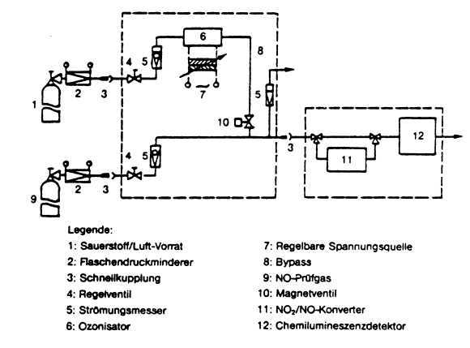

 Die angezeigte Konzentration (c) ist aufzuzeichnen. Während dieses ganzen Vorgangs muss der Ozonisator ausgeschaltet sein. Anschliessend wird der Ozonisator eingeschaltet und so eingeregelt, dass die angezeigte NO-Konzentration auf 20 % (Minimum 10 %) der angegebenen Kalibrierkonzentration sinkt. Die angezeigte Konzentration (d) ist aufzuzeichnen. Der Analysator wird dann auf den Betriebszustand NOx geschaltet und das Gasgemisch bestehend aus NO, NO 2 , O 2 und N 2 strömt nur durch den Konverter. Die angezeigte Konzentration (a) ist aufzuzeichnen. Danach wird der Ozonisator ausgeschaltet. Das Gasgemisch strömt durch den Konverter in den Messteil. Die angezeigte Konzentration (b) ist aufzuzeichnen. Bei noch immer ausgeschaltetem Ozonisator wird auch die Zufuhr von Sauerstoff und synthetischer Luft unterbrochen. Der vom Analysator angezeigte NOx-Wert darf dann den Kalibrierwert um nicht mehr als 5 % übersteigen. Der Wirkungsgrad η des NO 2 -NO-Konverters wird wie folgt berechnet: 

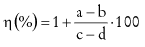

 Der so erhaltene Wert darf nicht kleiner als 95 % sein. Der Wirkungsgrad ist so oft als notwendig zu überprüfen. 3. Kalibrierung des Entnahmesystems mit konstantem Volumen (CVS-System) Das CVS-System wird mit einem Präzisionsdurchflussmesser und einem Durchflussregler kalibriert. Der Durchfluss im System wird bei verschiedenen Druckwerten gemessen, ebenso werden die Regelkennwerte des Systems ermittelt; danach wird das Verhältnis zwischen letzteren und den Durchflüssen ermittelt. Es können mehrere Typen von Durchflussmessern verwendet werden (z.B. kalibriertes Venturi-Rohr, Laminar-Durchflussmesser, kalibrierter Flügelraddurchflussmesser), vorausgesetzt, es handelt sich um ein dynamisches Messgerät und die Vorschriften nach Ziff. 3.1 dieser Anlage werden erfüllt. In den folgenden Absätzen wird die Kalibrierung von PDP- und CFV-Entnahmegeräten mit Laminar-Durchflussmesser beschrieben. Die Genauigkeit der Laminar-Durchflussmesser ist ausreichend, um die Gültigkeit der Kalibrierung bei ausreichender Zahl von Messungen überprüfen zu können (Abbildung 2 dieser Anlage). 3.1 Kalibrierung der Verdrängerpumpe (PDP) 3.1.1 Kalibrierverfahren Bei dem nachstehend festgelegten Kalibrierverfahren werden Geräte, Versuchsanordnung und verschiedene Kennwerte beschrieben, die für die Ermittlung des Durchsatzes der Pumpe im CVS-System gemessen werden müssen. Alle Kennwerte der Pumpe werden gleichzeitig mit den Kennwerten des Durchflussmessers gemessen, der mit der Pumpe in Reihe geschaltet ist. Danach kann die Kurve des berechneten Durchflusses (ausgedrückt in m 3 /min am Pumpeneinlass bei absolutem Druck und absoluter Temperatur) als Korrelationsfunktion aufgezeichnet werden, die einer bestimmten Kombination von Pumpenkennwerten entspricht. Die Lineargleichung, die das Verhältnis zwischen dem Pumpendurchsatz und der Korrelationsfunktion ausdrückt, wird sodann aufgestellt. Hat die Pumpe des CVS-Systems mehrere Übersetzungsverhältnisse, so muss jede verwendete Übersetzung kalibriert werden. Dieses Kalibrierverfahren beruht auf der Messung der absoluten Werte der Pumpen- und Durchflussmesserkennwerte, die an jedem Punkt in Beziehung zum Durchfluss stehen. Drei Bedingungen müssen eingehalten werden, damit Genauigkeit und Vollständigkeit der Kalibrierkurve garantiert sind: - Die Pumpendrücke müssen an den Anschlussstellen der Pumpe selbst gemessen werden und nicht an den äusseren Rohrleitungen, die am Pumpenein- und -auslass angeschlossen sind. Die Druckanschlüsse am oberen und unteren Punkt der vorderen Antriebsplatte sind den tatsächlichen Drücken ausgesetzt, die im Pumpeninnenraum vorhanden sind und so die absoluten Druckdifferenzen widerspiegeln; - während des Kalibrierens muss eine konstante Temperatur aufrechterhalten werden. Der Laminar-Durchflussmesser ist gegen Schwankungen der Einlasstemperatur empfindlich, die eine Streuung der gemessenen Werte verursachen. Temperaturschwankungen von ± 1 K sind zulässig, sofern sie allmählich innerhalb eines Zeitraumes von mehreren Minuten auftreten; - alle Anschlussrohrleitungen zwischen dem Durchflussmesser und der CVS-Pumpe müssen dicht sein. Bei der Prüfung zur Bestimmung der Abgasemissionen kann durch Messung dieser Pumpenkennwerte der Durchfluss aus Kalibriergleichung berechnet werden. Abbildung 2: Schematische Darstellung einer Kalibriervorrichtung für CVS-Geräte 

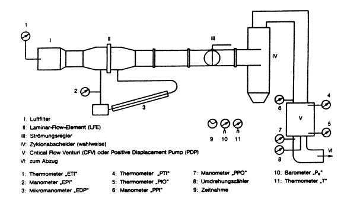

 Abbildung 2 dieser Anlage zeigt ein Beispiel für eine Kalibriervorrichtung. Änderungen sind zulässig, sofern sie von der Prüfstelle gleichwertig anerkannt werden. Bei Verwendung der in Abbildung 2 dieser Anlage beschriebenen Einrichtung müssen folgende Daten den angegebenen Genauigkeitstoleranzen genügen: Luftdruck (korrigiert) (P B ) ± 0.03 kPa Umgebungstemperatur (T) ± 0.3 K Lufttemperatur am LFE-Eintritt (ETI) ± 0.15 K Unterdruck vor LFE (EPI) ± 0.01 kPa Druckabfall durch LFE-Düse (EDP) ± 0.001 kPa Lufttemperatur am Einlass der PDP-CVS-Pumpe (PTI) ± 0.3 K Lufttemperatur am Auslass der PCP-CVS-Pumpe (PTO) ± 0.3 K Unterdruck am Einlass der CVS-Pumpe (PPI) ± 0.22 kPa Druckhöhe am Auslass der CVS-Pumpe (PPO) ± 0.22 kPa Pumpendrehzahl während der Prüfung ± 1 Umdrehung Dauer der Prüfung (t) (bei mind. 120 s) ± 0.05 s Ist der Aufbau nach Abbildung 2 dieser Anlage durchgeführt, so ist das Durchflussregelventil voll zu öffnen. Die PDP-CVS-Pumpe muss 20 Minuten in Betrieb sein, bevor die Kalibrierung beginnt. Das Durchflussregelventil wird teilweise geschlossen, damit der Unterdruck am Pumpeneinlass höher wird (ca. 1 kPa) und auf diese Weise mindestens eine Zahl von sechs Messpunkten für die gesamte Kalibrierung verfügbar ist. Das System muss sich innerhalb von drei Minuten stabilisieren, danach sind die Messungen zu wiederholen. 3.1.2 Analyse der Ergebnisse Die Luftdurchflussmenge Q s an jedem Prüfpunkt wird nach den Angaben des Herstellers aus den Messwerten des Durchflussmessers in m 3 /min ermittelt (Normalbedingungen). Die Luftdurchflussmenge wird dann auf den Pumpendurchsatz V o in m 3 je Umdrehung bei absoluter Temperatur und absolutem Druck am Pumpeneinlass umgerechnet. 

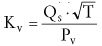

 hierbei bedeuten: V o : Pumpendurchflussmenge bei T p und P p in m 3 /Umdrehung Q s : Luftdurchflussmenge bei 101.33 kPa und 273.2 k in m 3 /Minute Tp : Temperatur am Pumpeneinlass in K P p : absoluter Druck am Pumpeneinlass in kPa n : Pumpendrehzahl in min ~1 Zur Kompensierung der gegenseitigen Beeinflussung der Druckschwankungen mit der Pumpendrehzahl und den Rückströmverlusten der Pumpe wird die Korrelationsfunktion (x o ) zwischen der Pumpendrehzahl (n), der Druckdifferenz zwischen Ein- und Auslass der Pumpe und dem absoluten Druck am Pumpenauslass mit folgender Formel berechnet: 

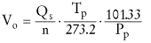

 hierbei bedeuten: x o : Korrelationsfunktion ΔP p : Druckdifferenz zwischen Pumpeneinlass und Pumpenauslass (kPa) P e : absoluter Druck am Pumpenauslass (PPO + P B ) in kPa Mit der Methode der kleinsten Quadrate wird eine lineare Angleichung vorgenommen, um nachstehende Kalibriergleichungen zu erhalten: V o = D o - M(x o ) n = A - B(Δp) D o , M, A und B sind Konstanten für die Steigung der Geraden und für die Achsabschnitte (Ordinaten). Hat das CVS-System mehrere Übersetzungen, so muss für jede Übersetzung eine Kalibrierung vorgenommen werden. Die für diese Übersetzung erzielten Kalibrierkurven müssen in etwa parallel sein, und die Ordinatenwerte D 0 müssen grösser werden, wenn der Durchsatzbereich der Pumpe kleiner wird. Bei sorgfältiger Kalibrierung müssen die mit Hilfe der Gleichung berechneten Werte innerhalb von ± 0.5 % des gemessenen Wertes V 0 liegen. Die Werte M sollten je nach Pumpe verschieden sein. Die Kalibrierung muss bei Inbetriebnahme der Pumpe und nach jeder grösseren Wartung vorgenommen werden. Kalibrierung des Venturi-Rohres mit kritischer Strömung (CFV) Bei der Kalibrierung des CFV-Venturi-Rohres bezieht man sich auf die Durchflussgleichung für ein Venturi-Rohr mit kritischer Strömung: 

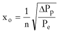

 dabei bedeuten: Q s : Durchflussmenge K v : Kalibrierkoeffizient P : absoluter Druck in kPa T : absolute Temperatur in K Die Gasdurchflussmenge ist eine Funktion des Eintrittsdruckes und der Eintrittstemperatur. Das nachstehend beschriebene Kalibrierverfahren ermittelt den Wert des Kalibrierkoeffizienten bei gemessenen Werten für Druck, Temperatur und Luftdurchsatz. Bei der Kalibrierung der elektronischen Geräte des CFV-Venturi-Rohres ist das vom Hersteller empfohlene Verfahren anzuwenden. Bei den Messungen für die Kalibrierung des Durchflusses des Venturi-Rohres mit kritischer Strömung müssen die nachstehend genannten Parameter den angegebenen Genauigkeitstoleranzen genügen: Luftdruck (korrigiert) (P B ) ± 0.03 kPa Lufttemperatur am LFE-Eintritt (ETI) ± 0.15 K Unterdruck vor LFE (EPI) ± 0.01 kPa Druckabfall durch LFE-Düse (EDP) ± 0.001 kPa Luftdurchflussmenge (Q s ) ± 0.5 % Unterdruck am CFV-Eintritt (PPI) ± 0.02 kPa Temperatur am Venturi-Rohr-Eintritt (T v ) ± 0.2 K Die Geräte sind entsprechend Abbildung 2 dieser Anlage aufzubauen und auf Dichtheit zu überprüfen. Jede undichte Stelle zwischen Durchflussmessgerät und Venturi-Rohr mit kritischer Strömung würde die Genauigkeit der Kalibrierung stark beeinträchtigen. Das Durchflussregelventil ist voll zu öffnen, das Gebläse ist einzuschalten und das System muss stabilisiert werden. Es sind die von allen Geräten angezeigten Werte aufzuzeichnen. Die Einstellung des Durchflussregelventils ist zu verändern, und es sind mindestens acht Messungen im kritischen Durchflussbereich des Venturi-Rohres durchzuführen. Die bei der Kalibrierung aufgezeichneten Messwerte sind für die nachstehenden Berechnungen zu verwenden. Die Luftdurchflussmenge Qs an jedem Messpunkt ist aus den Messwerten des Durchflussmessers nach dem vom Hersteller angegebenen Verfahren zu bestimmen.Es sind die Werte des Kalibrierkoeffizienten K v für jeden Messpunkt zu berechnen: 

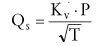

 dabei bedeuten: Q s : Durchflussmenge in m 3 /min bei 273.2 K und 101.33 kPa T v : Temperatur am Eintritt des Venturi-Rohrs in K P v : absoluter Druck am Eintritt des Venturi-Rohres in kPa Es ist eine Kurve K v in Abhängigkeit vom Druck am Eintritt des Venturi-Rohres aufzunehmen. Bei Schallgeschwindigkeit ist K v fast konstant. Fällt der Druck (d.h. bei wachsendem Unterdruck), nimmt K v oberhalb eines bestimmten Eingangs-Unterdrucks ab. Die hieraus resultierenden Veränderungen von K v sind nicht zu berücksichtigen. Bei einer Mindestanzahl von acht Messpunkten im kritischen Bereich sind der Mittelwert von K v und die Standardabweichung zu berechnen. Beträgt die Standardabweichung des Mittelwertes von K v mehr als 0.3 %, so müssen Korrekturmassnahmen getroffen werden. 4. Überprüfung des Gesamtsystems Zur Überprüfung der Übereinstimmung mit den Vorschriften in Ziff. 3 dieser Anlage wird die Gesamtgenauigkeit des CVS-Entnahmesystems und der Analysengeräte ermittelt, indem eine bekannte Menge eines luftverunreinigenden Gases in das System eingeführt wird, wenn dieses wie für eine normale Prüfung in Betrieb ist; danach wird die Analyse durchgeführt und die Masse der Schadstoffe nach den Formeln der Anlage berechnet, wobei jedoch als Propandichte der Wert von 1,967 kg/m 3 unter Normalbedingungen zugrundegelegt wird. Nachstehend werden zwei ausreichend genaue Verfahren beschrieben. 4.1 Messung eines konstanten Durchflusses eines reinen Gases (CO oder C 3 H 8 ) mit einer Messblende für kritische Strömung Durch eine kalibrierte Messblende für kritische Strömung wird eine bekannte Menge reinen Gases (CO oder C 3 H 8 ) in das CVS-System eingeführt. Ist der Eintrittsdruck gross genug, so ist die von der Messblende eingestellte Durchflussmenge unabhängig vom Austrittsdruck der Messblende (Bedingungen für kritische Strömung). Das CVS-System wird wie für eine Prüfung der Abgasemissionen 5 - 10 Minuten lang betrieben. Die in einem Beutel aufgefangenen Gase werden mit einem normalen Gerät analysiert und die erzielten Ergebnisse mit der bereits bekannten Konzentration der Gasproben verglichen. Übersteigen die festgestellten Abweichungen 5 %, so ist die Ursache festzustellen und zu beseitigen. 4.2 Überprüfung des CVS-Systems durch gravimetrische Bestimmung eines reinen Gases (CO oder C 3 H 8 ) Die Überprüfung des CVS-Systems mit dem gravimetrischen Verfahren ist wie folgt durchzuführen: Es ist eine kleine mit Kohlenmonoxid oder Propan gefüllte Flasche zu verwenden, deren Masse auf ± 0.01 g zu ermitteln ist. Danach wird das CVS-System 5 - 10 Minuten lang wie für eine normale Prüfung zur Bestimmung der Abgasemissionen betrieben, wobei CO oder Propan in das System eingeführt wird. Die eingeführte Menge reinen Gases wird durch Messung der Massendifferenz der Flasche ermittelt. Danach werden die in einem normalerweise für die Abgasanalyse verwendeten Beutel aufgefangenen Gase analysiert. Die Ergebnisse werden sodann mit den zuvor berechneten Konzentrationswerten verglichen. Übersteigen die festgestellten Abweichungen 5 %, so ist die Ursache festzustellen und zu beseitigen. Anlage 5 Kalibrierung der Messkammer für die Verdampfungsemissionen 1. Kalibrierung der gasdichten Kammer zur Ermittlung der Verdampfungsemissionen Der Vorgang der Kalibrierung besteht aus drei Abschnitten: - Bestimmung des Kammervolumens - Bestimmung der Hintergrundkonzentration in der Kammer - Prüfung der Kammer auf Dichtheit. 1.1 Bestimmung des Kammervolumens Vor der Inbetriebnahme muss das Kammervolumen wie folgt bestimmt werden: - Sorgfältiges Ausmessen der inneren Länge, Weite und Höhe der Kammer (unter Beachtung der Unregelmässigkeiten) zur Berechnung des inneren Volumens. - Überprüfung des Kammervolumens nach Ziff. 1.3 dieser Anlage. Falls die daraus berechnete Propanmasse nicht mit der Genauigkeit von mindestens 2 % mit der zudosierten Masse übereinstimmt, ist das Kammervolumen zu korrigieren. 1.2 Bestimmung der Hintergrundkonzentration in der Kammer Vor der Inbetriebnahme und danach mindestens einmal jährlich sowie nach jeder Massnahme, die die Stabilität der Hintergrundkonzentration beeinflussen könnte, ist wie folgt zu verfahren. Die HC-Messungen sind mit dem in Ziff. 4.8.2 dieses Anhanges spezifizierten FID durchzuführen. Durchlüften der Kammer mit Umgebungsluft, bis sich eine konstante HC-Konzentration eingestellt hat. Inbetriebnahme der (des) für die Durchmischung des Kammervolumens erforderlichen Gebläse(s). Verschliessen der Kammer. Messung und Aufzeichnung der Temperatur, des Drucks und der HC-Konzentration in der Kammer. Dies sind die Ausgangswerte für die Berechnung der Hintergrundkonzentration. Der Kammerinhalt soll vier Stunden fortlaufend ohne Entnahme eines Probengasstromes durchmischt werden. Wiederholung der Messungen. Dies sind die Endwerte für die Berechnung der Hintergrundkonzentration der Messkammer. Die Differenz beider Werte muss kleiner als 0.4 g sein. Liegen die Werte darüber, müssen die Störeinflüsse beseitigt werden. 1.3 Prüfung der Kammer auf Dichtheit Vor der Inbetriebnahme der Kammer und danach mindestens einmal monatlich muss die Kammer wie folgt auf Dichtheit überprüft werden: Durchlüften der Kammer mit Umgebungsluft, bis sich eine konstante HC-Konzentration in der Kammer eingestellt hat. Inbetriebnahme der (des) für die Durchmischung des Kammervolumens vorgesehenen Gebläse(s). Verschliessen der Kammer. Messung und Aufzeichnung der Werte für die Temperatur, den Druck und die HC-Konzentration in der Kammer. Dies sind die Eingangswerte für die Rechnung zur Kammerkalibrierung. Einbringen einer auf mindestens 0.5 % genau bestimmten Menge reinen Propans. Die Propanmenge kann durch Volumenstrommessung oder durch Wiegen ermittelt werden. Nach mindestens fünf Minuten Durchmischung werden HC-Konzentration, Temperatur und Druck in der Kammer gemessen und aufgezeichnet. Dies sind die Endwerte für die Rechnung zur Kammerkalibrierung und gleichzeitig die Ausgangswerte für die Rechnungen zur Prüfung der Dichtheit der Kammer. Der Kammerinhalt soll vier Stunden ohne Entnahme eines Probengasstromes durchmischt werden. Messung und Aufzeichnung der Werte für die Temperatur, den Druck und die HC-Konzentration in der Kammer. Dies sind die Endwerte für die Rechnung zur Prüfung der Dichtheit der Kammer. Die berechnete Endmenge darf um nicht mehr als 4 % von der berechneten Anfangsmenge abweichen. 2. Berechnung der Änderung der Kohlenwasserstoffmenge Mit dem in Ziff. 1 dieser Anlage beschriebenen Verfahren lässt sich die zeitliche Änderung der Kohlenwasserstoffmenge in der Prüfkammer wie folgt berechnen: 

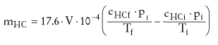

 dabei bedeuten: m HC : zeitliche Änderung der Kohlenwasserstoffmenge in der Prüfkammer in g c HC : gemessene Kohlenwasserstoffkonzentration in der Prüfkammer in ppmC 1 -Äquivalente i : Eingangswert f : Endwert p : Druck in kPa T : Temperatur in der Kammer in K V : Kammervolumen in m 3 Anlage 6 Berechnung der emittierten Mengen gas- und partikelförmiger Luftverunreinigungen 1. Berechnung der Abgasmengen 1.1 Die während der Prüfung im Stadt-Fahrzyklus emittierten Massen gas- und partikelförmiger luftverunreinigender Stoffe werden mit nachfolgender Gleichung berechnet: 

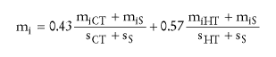

 dabei bedeuten: m i : während des Stadt-Fahrzyklus emittierte Menge der Komponente i in gfkm m iCT : während des Stadt-Fahrzyklus in der Phase 1 emittierte Menge der Komponente i in g m iHT : während des Stadt-Fahrzyklus in der Phase 3 emittierte Menge der Komponente i in g m iS : während des Stadt-Fahrzyklus in der Phase 2 emittierte Menge der Komponente i in g s CT : während des Stadt-Fahrzyklus gemessene Fahrstrecke der Phase 1 in km s HT : während des Stadt-Fahrzyklus gemessene Fahrstrecke der Phase 3 in km s S : während des Stadt-Fahrzyklus gemessene Fahrstrecke der Phase 2 in km Die während der Prüfung im Überland-Fahrzyklus emittierten Massen gasförmiger Luftverunreinigungen werden mit nachstehender Gleichung berechnet: 

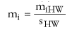

 dabei bedeuten: m i : während des Überland-Fahrzyklus emittierte Menge der Komponente i in g/km m iHW : während des Überland-Fahrzyklus emittierte Menge der Komponente in g s HW : während des Überland-Fahrzyklus gemessene Fahrstrecke in km Die in den einzelnen Testphasen emittierten Massen luftverunreinigender Gase werden nach folgender Gleichung berechnet: m i = V mix ·ξ i ·c i ·10 -6 ·k H dabei bedeuten: m i : emittierte Menge der gasförmigen Luftverunreinigung i in g/Testphase V mix : Volumen der verdünnten Abgase korrigiert auf Normalbedingungen (273.2 K, 101.33 kPa) in l/Testphase ξ i : rel. Dichte der gasförmigen Luftverunreinigung unter Normalbedingungen (273.2 K, 101.33 kPa) k H : Feuchtigkeitskorrekturfaktor für die Berechnung der emittierten Stickoxidmengen (bei HC und CO keine Feuchtekorrektur zulässig) c i : Konzentration der gasförmigen Luftverunreinigung in den verdünnten Abgasen, ausgedrückt in vol-ppm und korrigiert mit deren Konzentration in der Verdünnungsluft 1.2 Volumenbestimmungen 1.2.1 Berechnung des Volumens bei einem Entnahmesystem mit Venturi-Rohr zur Messung des konstanten Durchflusses Es sind Kennwerte, mit denen das Volumen des Durchflusses ermittelt werden kann, kontinuierlich aufzuzeichnen; das Gesamtvolumen während der Prüfdauer ist daraus zu berechnen. 1.2.2 Berechnung des Volumens bei einem Entnahmesystem mit Verdrängerpumpe Das bei den Entnahmesystemen mit Verdrängerpumpe gemessene Volumen der verdünnten Abgase ist mit folgender Formel zu berechnen: V = V o ·N dabei bedeuten: V : Volumen der verdünnten Abgase (vor der Korrektur) in l/Testphase V o : von der Verdrängerpumpe gefördertes Gasvolumen unter Prüfbedingungen in l/Umdrehung N : Zahl der Umdrehungen der Pumpe während der Prüfung 1.2.3 Korrektur des Volumens der verdünnten Abgase auf Normalbedingungen Das Volumen der verdünnten Abgase wird durch folgende Formel auf Normalbedingungen korrigiert: 

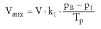

 dabei bedeuten: k 1 : 

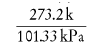

 = 2.6961 (K · kPa -1 ) p B : Luftdruck im Prüfraum in kPa p 1 : Druckdifferenz zwischen dem Unterdruck am Einlass der Verdrängerpumpe und dem Umgebungsdruck in kPa; T p : Mittlere Temperatur in K der verdünnten Abgase beim Eintritt in die Verdrängerpumpe während der Prüfung 1.3 Berechnung der korrigierten Konzentration luftverunreinigender Gase im Auffangbeutel 

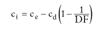

 dabei bedeuten: c i : Konzentration des luftverunreinigenden Gases i in den verdünnten Abgasen, ausgedrückt in vol-ppm und korrigiert mit dessen Konzentration in der Verdünnungsluft c e : Gemessene Konzentration des luftverunreinigenden Gases i in den verdünnten Abgasen, ausgedrückt in vol-ppm c d : Gemessene Konzentration des luftverunreinigenden Gases i in der Verdünnungsluft, ausgedrückt in vol-ppm DF : Verdünnungsfaktor Der Verdünnungsfaktor wird wie folgt berechnet: 

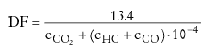

 dabei bedeuten: 

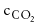

 : CO 2 -Konzentration in den verdünnten Abgasen im Auffangbeutel, ausgedrückt in Volumenprozent c HC : HC-Konzentration in den verdünnten Abgasen im Auffangbeutel, ausgedrückt in vol-ppm Kohlenstoffäquivalent c CO : CO-Konzentration in den verdünnten Abgasen im Auffangbeutel, ausgedrückt in vol-ppm 1.4 Berechnung des Feuchtekorrekturfaktors für NO Um die Auswirkungen der Feuchte auf die für die Stickoxide erzielten Ergebnisse zu korrigieren, ist folgende Formel anzuwenden: 

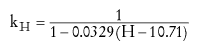

 wobei 

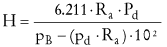

 In diesen Formeln bedeuten: H : Absolute Feuchte, ausgedrückt in Gramm Wasser pro Kilogramm trockener Luft R a : Relative Feuchte der Umgebungsluft, ausgedrückt in Prozent p d : Sättigungsdampfdruck bei Umgebungstemperatur, ausgedrückt in kPa p B : Luftdruck im Prüfraum, ausgedrückt in kPa 1.5 Bestimmung der mittleren HC-Konzentrationen bei Selbstzündungsmotoren Zur Bestimmung der Masse der HC-Emissionen für Dieselmotoren wird die mittlere HC-Konzentration mit Hilfe folgender Formel berechnet: 

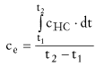

 dabei bedeuten: 

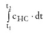

 : Integral der vom beheizten HFID-Analysator während der Prüfzeit (t 2 -t 1 ) aufgezeichneten Werte c e : HC-Konzentration, gemessen in den verdünnten Abgasen in vol-ppm c e : ersetzt direkt c HC in allen entsprechenden Gleichungen 2. Berechnung der Verdampfungsemissionen Mit der nachfolgenden Gleichung werden die emittierten Kohlenwasserstoffmengen berechnet, die mit den in den Ziff. 6.2.2 und 6.2.4 dieses Anhanges beschriebenen Prüfungen der Tankatmungsverluste und Verdampfungsemissionen beim Heissabstellen ermittelt wurden: 

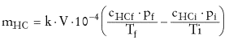

 dabei bedeuten: m HC : zeitliche Änderung der Kohlenwasserstoffmenge in der Prüfkammer in g c HC : gemessene Kohlenwasserstoffkonzentration in der Prüfkammer in vol-ppm C 1 -Äquivalente V : Kammervolumen abzüglich des Fahrzeugvolumens (geöffnete Fenster, geöffneter Kofferraum); wurde das Fahrzeugvolumen nicht bestimmt, ist ein Volumen von 1.42 m 3 zu verwenden k : 1.2 (12 + H/C) H/C-Verhältnis der Kohlenwasserstoffe für Tankatmungsverluste = 2.33 H/C-Verhältnis der Kohlenwasserstoffe für Heissabstellphase = 2.20 i : Eingangswert f : Endwert p : Druck in kPa T : Temperatur in der Kammer in K Die gesamten Verdampfungsemissionen in g/Test ergeben sich durch Addition der - Tankatmungsverluste - Emissionen während des Heissabstellens - Emissionen während des Fahrzeugbetriebes (sofern gemessen). Anhang 2 Prüfmethode zur Bestimmung der Kohlenmonoxid- und Kohlenwasserstoff-Konzentrationen im Leerlauf (Leerlauftest) 1. Einleitung Dieser Anhang beschreibt das Verfahren für die Prüfung des Kohlenmonoxid- und Kohlenwasserstoffgehalts im Abgas bei Leerlaufdrehzahl bei Fahrzeugen mit Fremdzündungsmotoren nach Ziff. 6.4 dieser Verordnung. Die gemessenen Gehalte an Kohlenmonoxid und Kohlenwasserstoffen werden mit einem durch gleichzeitige Messung des Kohlendioxidgehaltes bestimmten Verdünnungsfaktor korrigiert (Ziff. 6 dieses Anhanges). 2. Prüffahrzeug und Treibstoff 2.1 Einstellung des Leerlaufs Die Einstellung des Leerlaufs muss Ziff. 5.4.1 dieser Verordnung entsprechen. Die Verstelleinrichtungen für das Leerlaufgemisch dürfen nur mit nichthandelsüblichen Spezialwerkzeugen zugänglich oder müssen plombiert sein (vgl. Ziff. 9.4 dieser Verordnung). Die Leerlaufdrehzahl-Einstellorgane können frei zugänglich sein. 2.2 Treibstoff Als Treibstoff ist der im Anhang 5 dieser Verordnung definierte Referenz-Treibstoff zu verwenden. 3. Messgeräte 3.1 Analysengeräte Die Analyse der Schadstoffe hat mit nicht-dispersiven Infrarot-Absorptionsgeräten (NDIR) für - Kohlenmonoxid (CO) - Kohlendioxid (CO 2 ) - Kohlenwasserstoffe (HC), ausgedrückt als Hexan-Äquivalent ( C 6 H 14 ) zu erfolgen. Die Analysatoren haben einen Messbereich aufzuweisen, der für die Messung im Bereich der Grenzwerte ausreichend ist. Die Messfehler dürfen nicht mehr als ± 3 % der Anzeige betragen, wobei der tatsächliche Wert der Kalibriergase unberücksichtigt bleibt. Die Anzeige hat für CO und CO 2 in der Einheit "vol-%", für HC in der Einheit "vol-ppm" zu erfolgen. 3.1.1 Kalibrierung Die Analysatoren sind so oft als notwendig zu kalibrieren. Im Anhang 1 Anlage 4 dieser Verordnung wird das Kalibrierverfahren beschrieben. 3.1.2 Gase Für die Einstellung des Nullpunktes der Analysatoren kann verwendet werden: - Umgebungsluft, sofern sie nicht mehr als 800 ppm CO 2 , 20 ppm CO und 3 ppm HC (als C 6 H 14 -Äquivalente) enthält, oder - gereinigter Stickstoff N 2 , wie auch für die Gasgemische verwendet (Reinheit ( 1 ppm C, ( 1 ppm CO, ( 400 ppm CO 2 , ( 1 ppm NO) Für die Einstellung des Kalibrierpunktes sind die folgenden Kalibriergasgemische zu verwenden: - CO und gereinigter Stickstoff - CO 2 und gereinigter Stickstoff - C 6 H 14 und gereinigter Stickstoff oder C 3 H 8 und gereinigter Stickstoff, sofern für den entsprechenden Kohlenwasserstoffanalysator der Propan/Hexan-Umwandlungsfaktor bekannt ist. Gasgemische, die alle drei Kalibrierkomponenten enthalten, können ebenfalls verwendet werden. Die tatsächliche Konzentration der Kalibriergase muss auf ± 2 % genau mit dem Nennwert übereinstimmen. Die Analysendaten der Gasgemische sind in Volumeneinheiten (vol-%, vol-ppm) anzugeben. 3.2 Drehzahlmessgerät Für die Messung der Motordrehzahl im Leerlauf ist ein Messgerät mit einer Genauigkeit von ± 2 % der Anzeige zu verwenden. Bei digital anzeigenden Geräten kann die letzte Ziffer eine Null sein (z.B. 740 min -1 ). 4. Durchführung der Prüfung 4.1 Die Messung ist sofort anschliessend an den Stadt-Fahrzyklus (nur Phase 1 und 2) der Vorbereitungsfahrt (Anhang 1 Ziff. 5.4.1 Bst. b dieser Verordnung) durchzuführen. Wiederholungsmessungen können nach einem erneuten Konditionieren des Fahrzeuges vorgenommen werden. Dieses Konditionieren besteht jeweils aus einer 60 Sekunden dauernden Fahrt mit einer Geschwindigkeit von 50 km/h. Die Messungen können auch unabhängig von den in Anhang 1 dieser Verordnung aufgeführten Prüfungen vorgenommen werden. In diesem Fall hat das Konditionieren des vorher warmgefahrenen Fahrzeuges zu erfolgen, indem dieses die ersten 505 Sekunden des Stadt-Fahrzyklus nach Anhang 1 Anlage 1 dieser Verordnung zurücklegt. 4.2 Für die Messungen dürfen keine Eingriffe bei den die Abgasemission beeinflussenden Bauteilen vorgenommen werden (z.B. Ausserbetriebsetzung Luftpumpe, Kurbelgehäuseentlüftung usw.). Bei temperaturgesteuerten, zuschaltbaren Lüftern für die Motorkühlung ist die Messung dann vorzunehmen, wenn der Lüfter abgeschaltet ist, ausser wenn der Hersteller die Messung mit zugeschaltetem Lüfter ausdrücklich verlangt (Angaben im Abgas-Wartungsdokument nach Art. 83a Abs. 3 BAV). 4.3 Bei Fahrzeugen mit Handschaltgetriebe oder mit halbautomatischem Getriebe ist bei leerlaufendem Getriebe und eingekuppeltem Motor zu prüfen. 4.4 Bei Fahrzeugen mit automatischem Getriebe ist bei der Stellung "Neutral" oder "Parken" des Gangwählers zu prüfen. 5. Gasentnahme und Analyse 5.1 Die Sonde für die Gasentnahme muss zur Vermeidung einer Verdünnung mindestens 60 cm in das Auspuffrohr oder in eine dicht angeschlossene Verlängerung eingeführt werden. Sind mehrere Auspuffenden vorhanden, so sind entweder die Ausgänge zu einem gemeinsamen Rohr zusammenzuschliessen oder die Messung in jedem von ihnen auszuführen. Ist das Fahrzeug an einem CVS-Sammelsystem angeschlossen, so ist die Sonde in das Verbindungsrohr so nahe am Auspuff wie möglich einzuführen, um eine Verdünnung zu vermeiden. 5.2 Vor der Probenahme wird der Nullpunkt der Analysatoren mit Umgebungsluft oder Stickstoff eingestellt. Dann wird der Kalibrierpunkt mit den in Ziff. 3.1.2 dieses Anhanges definierten Gasgemischen eingestellt, deren Nennkonzentration zwischen 70 und 100 % des Skalenendwertes liegen. Anschliessend wird zur Kontrolle der Nullpunkt erneut überprüft. 5.3 Die Ablesung der Motordrehzahl und der Analysenwerte hat dann zu erfolgen, wenn die Anzeigen konstant sind. Dabei sind die Mittelwerte über eine Messzeit von mindestens 20 Sekunden zu ermitteln. 6. Korrektur der Messwerte 6.1 Bestimmung des Verdünnungsfaktors f D : 

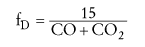

 (Messwerte CO und CO 2 in vol-%) 6.2 Korrigierte Messwerte: CO korr = f D · CO-Messwert (vol-%) HC korr = f D · HC-Messwert (ppm) Eine Korrektur der gemessenen Werte entfällt, wenn die Summe von CO und CO 2 mindestens 15 beträgt. Die korrigierten Messwerte für CO und HC sind auf zwei signifikante Ziffern zu runden (ISO 31/0 Anhang B2 Regel B). Die Leerlaufdrehzahl ist als ganze Zahl in min -1 anzugeben, wobei die letzte Ziffer eine Null sein muss. Anhang 3 Prüfmethode zur Bestimmung der Emissionen aus dem Kurbelgehäuse (Kurbelgehäusetest) 1. Einleitung Dieser Anhang beschreibt das Verfahren für die Prüfung der Emissionen aus dem Kurbelgehäuse nach Ziff. 6.5 dieser Verordnung. 2. Prüfbedingungen 2.1 Die Einstellung des Motors muss Ziff. 5.4.1 dieser Verordnung entsprechen. 2.2 Zu messen ist unter folgenden drei Betriebsbedingungen für den Motor: Bedingung Nr. Fahrzeuggeschwindigkeit km/h Bremseinstellung am Fahrleistungsprüfstand Gesamtbremskraft (Fa) in N 1 Leerlauf - 2 50 ± 2 150 3 50 ± 2 250 2.3 Während der Betriebsbedingung Nr. 1 richtet sich die Ganghebelstellung nach Ziff. 4.3 und 4.4 des Anhanges 2 dieser Verordnung. Für die Betriebsbedingungen Nr. 2 und 3 muss bei Fahrzeugen mit Handschaltgetriebe oder halbautomatischem Getriebe derjenige Gang verwendet werden, der im Stadt-Fahrzyklus nach Anhang 1 Anlage 1 dieser Verodnung beim Punkt 110 Sekunden eingelegt ist. Bei Fahrzeugen mit automatischem Getriebe muss sich dabei der Gangwähler in der Stellung "Drive" befinden. 3. Prüfmethode 3.1 Unter den Betriebsbedingungen nach Ziff. 2.2 dieses Anhanges wird das zuverlässige Funktionieren des Kurbelgehäuse-Entlüftungssystems überprüft. 4. Methode zur Überprüfung des Kurbelgehäuse-Entlüftungssystems 4.1 Die Öffnungen am Motor sind so zu belassen, wie vorgefunden. 4.2 Der Druck am Kurbelgehäuse muss an geeigneter Stelle gemessen werden (z.B. mit einem Schrägrohr-Manometer an der Öffnung des Ölmessstabes). 4.3 Das Fahrzeug entspricht den Vorschriften, falls der Druck im Kurbelgehäuse - gemessen unter den Betriebsbedingungen nach Ziff. 2.2 dieses Anhanges - nicht höher ist als der Umgebungs-Luftdruck zum Zeitpunkt des Messvorgangs. 4.4 Die am Fahrleistungsprüfstand angezeigte Fahrzeuggeschwindigkeit ist auf ± 2 km/h genau zu messen. 4.5 Der Druck im Kurbelgehäuse ist auf ± 0.01 kPa genau zu messen. 4.6 Falls bei einer Betriebsbedingung nach Ziff. 2.2 dieses Anhanges der festgestellte Druck im Kurbelgehäuse höher liegt als der Umgebungs-Luftdruck, muss eine ergänzende Prüfung nach folgender Ziff. 5 durchgeführt werden. 5. Ergänzende Prüfmethode 5.1 Die Öffnungen am Motor sind so zu belassen, wie vorgefunden. 5.2 An einer Öffnung gemäss Ziff. 4.2 dieser Anlage ist ein für die Kurbelgehäusegase undurchlässiger, weicher Beutel mit einem Fassungsvermögen von etwa fünf Litern anzubringen. Dieser Beutel muss vor jeder Messung leer sein. 5.3 Der Beutel ist vor jeder Messung zu verschliessen. Bei jeder der in Ziff. 2.2 dieses Anhanges festgelegten Betriebsbedingungen ist er für die Dauer von fünf Minuten mit dem Kurbelgehäuse zu verbinden. 5.4 Das Fahrzeug entspricht den Vorschriften, wenn bei keiner der in Ziff. 2.2 dieses Anhanges festgelegten Betriebsbedingungen eine sichtbare Füllung des Beutels eintritt. 5.5 Hinweis Ist der Motor so konstruiert, dass die Prüfungen nach den Ziff. 5.2 - 5.4 dieses Anhanges nicht möglich sind, so sind die Messungen mit folgenden Änderungen durchzuführen: Vor der Prüfung sind alle Öffnungen zu verschliessen, die nicht der Rückführung der Gase dienen. Der Beutel ist an eine geeignete Abzweigung, die keinen zusätzlichen Druckverlust hervorrufen darf, an der Rückführung des Kurbelgehäuse-Entlüftungssystems, unmittelbar am Anschluss der Rückführung zum Motor, anzuschliessen. Die folgende Abbildung illustriert die ergänzende Prüfmethode. Kurbelgehäuse-Test - ergänzende Prüfmethode 

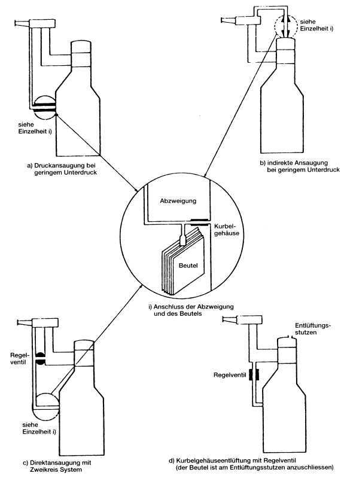

 Anhang 4 Methode zur Bestimmung der Verschlechterungsfaktoren (Dauerhaftigkeitstest) 1. Einleitung Dieser Anhang beschreibt das Verfahren zur Bestimmung der Verschlechterungsfaktoren nach den Ziff. 3.1 und 8.1 dieser Verordnung. 2. Verschlechterungsfaktoren 2.1 Die Verschlechterungsfaktoren eines bestimmten abgastechnischen Fahrzeugtyps bzw. Verdampfungs-Kontrollsystems entsprechen in bezug auf die Emission gasförmiger Schadstoffe bzw. Verdampfungsemission dem Quotienten - berechnet nach den Bestimmungen von Ziff. 7.1 und 7.2 dieses Anhanges - zwischen den Abgas- und Verdampfungsemissionen nach 80 000 km, die das Fahrzeug nach einem speziellen Fahrprogramm im Dauerhaftigkeitstest zurückgelegt hat, und nach 6 400 km. 2.2 Die anlässlich dem Dauerhaftigkeitstest ermittelten Verschlechterungsfaktoren müssen für jeden Schadstoff einzeln bestimmt werden, und zwar für Kohlenwasserstoffe, Kohlenmonoxid, Stickoxide und die Partikel. 3. Prüffahrzeuge 3.1 Der Fahrzeughersteller hat ein repräsentatives Prüffahrzeug aus jeder Motorfamilie für den Dauerhaftigkeitstest auszuwählen. Dieses ist von der Typenprüfstelle zu genehmigen. Wenn sie findet, dass ein einziges Prüffahrzeug nicht für alle abgastechnischen Fahrzeugtypen einer Motorfamilie repräsentativ ist, bestimmt sie ein zweites Prüffahrzeug. Jedes Prüffahrzeug, das für die Versuchsreihe einer Motorfamilie ausgewählt wurde, muss gemäss dem Programm in Ziff. 5 dieses Anhanges 80 000 km zurücklegen. 3.2 Bevor der Fahrzeughersteller mit den Dauerhaftigkeitstests beginnen kann, muss die Typenprüfstelle der Wahl der Prüffahrzeuge zustimmen. Der Antrag für die Prüfungen ist der Typenprüfstelle mindestens fünf Monate vor dem Gesuch um eine Abgas-Typengenehmigung der betreffenden Motorfamilie zu unterbreiten. Gemeinsam mit dem Antrag müssen die Einzelheiten entsprechend den Formularen der Typenprüfstelle eingereicht werden. 3.3 Die Ausrüstung des Prüffahrzeugs hat während der ganzen Prüfung mit den Angaben im Antrag übereinzustimmen. 4. Treib- und Schmierstoffe Während des Fahrbetriebs muss handelsüblicher Treibstoff verwendet werden; seine Spezifikation muss typisch für den in der Schweiz erhältlichen Treibstoff (Benzin mit einem Bleigehalt zwischen 5 und 13 mg, Diesel) sein. Die Spezifikation ist anzugeben. Dem Treibstoff dürfen keine Zusätze beigegeben werden. Während den Abgasmessungen muss der verwendete Treibstoff den Bestimmungen des Anhanges 5 entsprechen. Für den Betrieb des Fahrzeugs muss dauernd handelsübliches Öl verwendet werden. 5. Fahrbetrieb und Prüfungen 5.1 Der Fahrbetrieb ist auf einer von der Typenprüfstelle genehmigten Rundstrecke oder auf einem im Freien liegenden Fahrleistungsprüfstand, der nach den Erfordernissen für die Abgasprüfungen eingestellt ist, durchzuführen. Das Fahren mit Beschleunigungen, Verzögerungen und Anhalten ist in Übereinstimmung mit dem Fahrprogramm in Abbildung 1 durchzuführen. Während der ersten neun Runden (bzw. Zyklen) muss in jeder Runde viermal angehalten werden, mit einem Leerlaufbetrieb von jeweils 15 Sekunden. Es ist normal zu beschleunigen und zu verzögern. Zudem ist in jeder Runde fünfmal zu verzögern - von der Rundengeschwindigkeit auf 32 km/h - und wieder leicht zu beschleunigen bis auf die Rundengeschwindigkeit. Die 10. Runde wird mit einer konstanten Geschwindigkeit von 89 km/h gefahren. Die 11. Runde beginnt mit einer Beschleunigung mit Vollgas aus dem Stillstand auf 113 km/h. Auf halber Strecke erfolgt eine Normalbremsung bis zum Stillstand mit einer anschliessenden Leerlaufphase von 15 Sekunden, gefolgt von einer zweiten Beschleunigung mit Vollgas. 5.2 Im Neuzustand und nach jeweils 10 000 ± 400 km sind während des Dauerhaftigkeitstests Abgas- und Verdampfungsprüfungen gemäss Anhang 1 durchzuführen (Abgasprüfungen nur nach dem Stadt-Fahrzyklustest). 5.3 Aufgehoben Abbildung 1: Programm für den Fahrbetrieb 

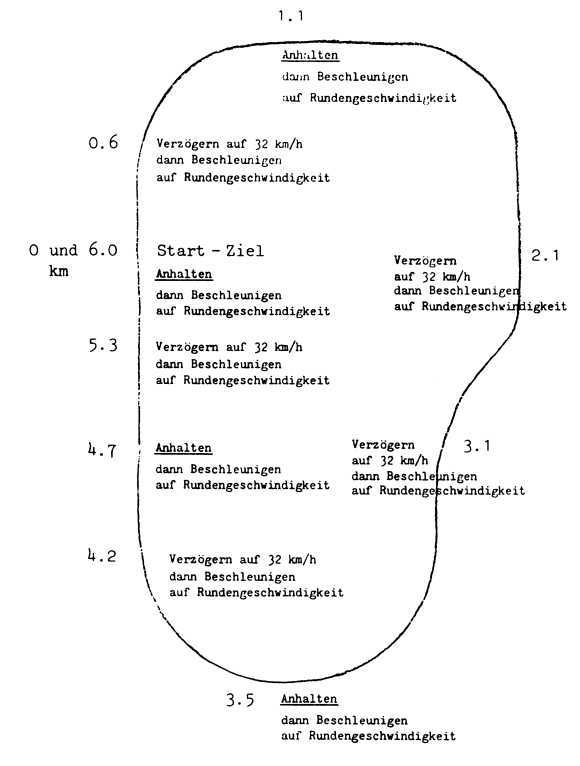

 Das Programm besteht grundsätzlich aus 11 Runden à 6 km; die maximale Rundengeschwindigkeit für jede Runde ist in folgender Tabelle angegeben. Runde max. Geschwindigkeit in km/h Runde max. Geschwindigkeit in km/h 1 64 7 56 2 48 8 72 3 64 9 56 4 64 10 89 5 56 11 113 6 48 5.4 Wenn der Fahrzeughersteller einmal mit einem bestimmten Prüffahrzeug den Dauerhaftigkeitstest begonnen hat, so muss er diesen in der Regel bis zu einem Kilometerstand von 80 000 km fortführen. 5.5 Die Typenprüfstelle kann zu jedem Zeitpunkt des Prüfprogramms die Prüffahrzeuge und die Abgasprüfstellen inspizieren und den Prüfungen beiwohnen; sie kann dabei die Prüfunterlagen und die Fahrprotokolle kopieren. 6. Wartung der Prüffahrzeuge 6.1 Die Wartung der emissionsrelevanten und emissionsmindernden Bauteile während des Dauerhaftigkeitstests müssen mit den Empfehlungen des Fahrzeugherstellers übereinstimmen. Die Wartungsarbeiten dürfen jedoch den vom Fahrzeughersteller in der Unterhaltsanleitung aufgeführten Umfang nicht überschreiten und nicht in kürzeren Intervallen durchgeführt werden. 6.2 Jede während des Dauerhaftigkeitstests durchgeführte ausserplanmässige Wartung ist der Typenprüfstelle sofort mitzuteilen. Diese entscheidet innerhalb von sieben Tagen, ob der Test fortgeführt werden darf. 6.3 In den vom Fahrzeughersteller vorgeschriebenen Zeitabständen ist das Wechseln von Motor- und Getriebeöl sowie der Öl-, Treibstoff- und Luftfilter zulässig. 7. Berechnungen 7.1 Verschlechterungsfaktoren für den Stadt-Fahrzyklustest 7.1.1 Nach Beendigung des Dauerhaftigkeitstests sind alle Ergebnisse der Abgasmessungen nach dem Stadt-Fahrzyklustest zusammenzustellen. 7.1.2 Mit Hilfe der Methode der kleinsten Fehlerquadrate wird für jeden Schadstoff getrennt die Regressionsgerade berechnet; diese Funktion dient zur Berechnung der Emissionswerte bei 80 000 km und 6 400 km. Der Quotient der Emission bei 80 000 km und 6 400 km ist der Verschlechterungsfaktor. Liegt der Quotient unter 1.00, so wird der Verschlechterungsfaktor mit 1.00 festgesetzt. Der Verschlechterungsfaktor ist auf drei signifikante Ziffern zu runden (ISO 31/0 Anhang B2 Regel B). 7.2 Verschlechterungsfaktor für den Verdampfungstest 7.2.1 Nach Beendigung des Dauerhaftigkeitstests sind alle Ergebnisse der Verdampfungsmessungen zusammenzustellen. Mit Hilfe der Methode der kleinsten Fehlerquadrate wird die Regressionsgerade berechnet; diese Funktion dient zur Berechnung der Emissionswerte bei 80 000 km und 6 400 km. 7.2.2 Der Verschlechterungsfaktor für die Verdampfungsemissionen berechnet sich durch Subtraktion der Verdampfungsemissionen bei 6 400 km von denen bei 80 000 km. Ist die Differenz kleiner als 0.00 (d.h. negativ), so wird der Verschlechterungsfaktor mit 0.00 festgesetzt. Der Verschlechterungsfaktor ist auf drei signifikante Ziffern zu runden (ISO 31/0 Anhang B2 Regel B). 8. Schlussbericht Die nach obigen Angaben erhaltenen Resultate sind der Typenprüfstelle mit der Versicherung einzureichen, dass die Prüfungen unter Einhaltung dieser Vorschriften vorgenommen und dass nur ausdrücklich erlaubte Unterhalts- und Wartungsarbeiten vorgenommen worden sind. Anhang 5 Technische Beschreibung der Referenztreibstoffe 1. Referenz-Treibstoff für die Prüfung der Fahrzeuge mit Fremdzündungsmotoren Referenz-Treibstoff CEC RF-08-A-85 Typ: unverbleites Referenzbenzin Grenzwerte und Einheiten ASTM- min. max. Verfahren ROZ 95.0 D 2699 MOZ 85.0 D 2700 Dichte bei 15°C 0.748 0.762 D 1298 Dampfdruck (nach Reid) 0.56 bar 0.64 bar D 323 Siedeverlauf - Siedebeginn 24°C 40°C D 86 - 10 Volumenprozent- Destillat 42°C 58°C D 86 - 50 Volumenprozent- Destillat 90°C 110°C D 86 - 90 Volumenprozent- Destillat 155°C 180°C D 86 - Siedeende 190°C 215°C D 86 Rückstand 2 % D 86 Analyse der Kohlenwasserstoffe - Alkene 20 vol-% D 1319 - Aromaten (einschliesslich 5 vol-% max. Benzol*) 45 vol-% D 1319 *D 3606/ D 2267 - Alkane Rest D 1319 Verhältnis Kohlenstoff/ Wasserstoff Verhältnis angeben Oxidationsbeständigkeit 480 Min. D 525 Abdampfrückstand 4 mg/100 ml D 381 Schwefelgehalt 0.04 Masse % D 1266/ D 2622/ D 2785 Grenzwerte und Einheiten ASTM- min. max. Verfahren Kupferkorrosion bei 50°C 1 D 130 Bleigehalt 0.005 g/l D 3237 Phosphorgehalt 0.0013 g/l D 3231 Zusatz von sauerstoffhaltigen Komponenten verboten 2. Referenz-Treibstoff für die Prüfung der Fahrzeuge mit Selbstzündungsmotoren Referenz-Treibstoff CEC RF-03-A-80 Typ: Dieseltreibstoff Grenzwerte und Einheiten ASTM- min. max. Verfahren Dichte bei 15°C 0.835 0.845 1298 Cetane-Zahl 51 57 976 Siedeverlauf 50 vol-% 245°C 90 vol-% 320°C 340°C Siedeende 370°C Viskosität bei 40°C 2.5 cSt (mm 2 /s) 3.5 445 Schwefelgehalt 0.20 % Masse 0.50 1266, 2622 oder 2785 Flammpunkt 55°C 93 Kaltfilterverschlusspunkt -3°C CEN Entwurf EN116 oder IP309 Conradson Kohlenstoffanteil für 10 % Rückstand 0.20 % Masse 189 Aschegehalt 0.01 % Masse 482 Wassergehalt 0.05 % Masse 95 oder 1744 Kupferlamellenkorrosion bei 100°C 1 130 Neutralisation (Säurezahl) 0.20 mg KOH/g 974 Inhaltsverzeichnis Verordnung Seite 1. Geltungsbereich 1 2. Definitionen 2 3. Allgemeine Vorschriften 5 4. Antrag für eine Abgas-Typengenehmigung 6 5. Prüffahrzeuge 9 6. Emissionsprüfungen 12 7. Emissionsgrenzwerte 14 8. Vergleich der Prüfergebnisse mit den Emissionsgrenzwerten 16 9. Weitere Vorschriften 17 10. Abgas-Typengenehmigung 19 11. Übertragung der Abgas-Typengenehmigung 21 12. Änderung von genehmigten Fahrzeugen 21 13. Erweiterung der Abgas-Typengenehmigung 22 14. Übereinstimmung der Herstellung (Produktionsüberprüfung) 23 15. Schlussbestimmungen 29 Anhänge Anhang 1: Prüfmethode zur Bestimmung der Emission luftverunreinigender Gase und Partikel (Fahrzyklus- und Verdampfungstests) mit sechs Anlagen 31 Anhang 2: Prüfmethode zur Bestimmung der Kohlenmonoxid- und Kohlenwasserstoff-Konzentrationen im Leerlauf (Leerlauftest) 126 Anhang 3: Prüfmethode zur Bestimmung der Emissionen aus dem Kurbelgehäuse (Kurbelgehäusetest) 130 Anhang 4: Methode zur Bestimmung der Verschlechterungsfaktoren (Dauerhaftigkeitstest) 134 Anhang 5: Technische Beschreibung der Referenz-Treibstoffe 140
