Verordnung vom 18. August 1987 über die Abgasemissionen von Motorrädern (FAV 3) Aufgrund von Art. 7 und 99 des Strassenverkehrsgesetzes vom 30. Juni 1978, LGBl. 1978 Nr. 18 , verordnet die Regierung: 1. Geltungsbereich 1.1 Diese Verordnung gilt für die Abgasemissionen gasförmiger Schadstoffe der folgenden Fahrzeugarten mit Fremdzündungsmotor: a) Motorräder (inkl. Kleinmotorräder); b) Leichtmotorfahrzeuge (Art. 15 Abs. 2 der Verordnung vom 16. Juli 1996 über die technischen Anforderungen an Strassenfahrzeuge [VTS]); c) dreirädrige Motorfahrzeuge mit einem Leergewicht von höchstens 1000 kg. 1.2 Ausgenommen sind Raupenfahrzeuge. 2. Definitionen Im Sinne dieser Verordnung bedeuten: 2.1 "Abgasemission": Die aus der Auspuffanlage eines Fahrzeugmotors in die Atmosphäre ausgestossenen gasförmigen Schadstoffe. 2.2 "Abgas-Typengenehmigung": Die von der Typenprüfstelle aufgrund dieser Verordnung erteilte Genehmigung eines Fahrzeugtyps hinsichtlich der Emission gasförmiger Schadstoffe. 2.3 "Bezugsmasse": Leergewicht des betriebsbereiten, unbesetzten Fahrzeugs in serienmässiger Ausführung, inbegriffen Zubehör, mit mindestens zu 90 Prozent seines Fassungsvermögens gefülltem Treibstoffbehälter sowie einer einheitlichen Zusatzlast von 75 kg. 2.4 "Fahrzeugtyp": Typenbezeichnung einer Baureihe durch den Fahrzeughersteller, deren Fahrzeuge untereinander keine wesentlichen Unterschiede aufweisen, namentlich hinsichtlich der abgasrelevanten Teile des Motors und des Fahrzeugs sowie der von der Bezugsmasse abhängigen äquivalenten Schwungmasse nach Anhang 1 Ziff. 5.2 dieser Verordnung. 2.5 "Gasförmige Schadstoffe": Kohlenmonoxid CO, Kohlenwasserstoffe HC (ausgedrückt als CH 1.85 ) und Stickoxide NOx (ausgedrückt als NO 2 -Äquivalent). 2.6 "Prüfstelle": Die von der Typenprüfstelle beauftragte oder ermächtigte Prüfstelle zur Durchführung von Emissionsmessungen an Prüffahrzeugen und von Produktionsüberprüfungen. 2.7 "Typenprüfstelle": Die von der Regierung bezeichnete Typenprüfstelle. 3. Allgemeine Vorschriften 3.1 Haltbarkeit Alle Teile des Fahrzeugs und des Motors, die einen Einfluss auf die Emission gasförmiger Schadstoffe haben können, müssen so beschaffen und eingebaut sein, dass das Fahrzeug bei betriebsüblicher Beanspruchung und trotz der Einwirkung von Hitze, Kälte und Erschütterungen den Vorschriften dieser Verordnung entspricht. 3.2 Betrieb mit unverbleitem Treibstoff Die Fahrzeugmotoren müssen so konstruiert sein, dass sie mit handelsüblichem unverbleitem Treibstoff dauernd und zufriedenstellend funktionieren. Motoren mit Gemischschmierung müssen ausserdem für die Beimischung von höchstens zwei Prozent synthetischem Öl zum Treibstoff geeignet sein. 3.3 Vorhandensein einer Abgas-Typengenehmigung 3.3.1 Damit ein Motorrad zur Typenprüfung oder zur Einzelprüfung vor der ersten Inverkehrsetzung zugelassen werden kann, muss eine Abgas-Typengenehmigung für den betreffenden Fahrzeugtyp vorhanden sein. 3.3.2 Um eine Abgas-Typengenehmigung zu erhalten, muss der Fahrzeughersteller bei der Typenprüfstelle einen Antrag nach Ziff. 4 einreichen. 3.4 Durchführung der Abgasprüfungen 3.4.1 Die Abgasprüfungen nach Ziff. 5 dieser Verordnung werden bei der liechtensteinischen Prüfstelle oder im Einverständnis mit der Typenprüfstelle beim Fahrzeughersteller oder bei einer anerkannten ausländischen Prüfstelle durchgeführt. 3.4.2 Werden die Abgasprüfungen beim Fahrzeughersteller oder bei einer ausländischen Prüfstelle durchgeführt, so müssen geeignete Prüfeinrichtungen vorhanden sein, die den Anforderungen der Anhänge 1 und 2 dieser Verordnung entsprechen und ordnungsgemäss ausgerüstet und unterhalten sind. Die Typenprüfstelle kann die Prüfeinrichtungen mit dem Einverständnis der ausländischen Behörden kontrollieren. Ist diese Kontrolle nicht möglich oder entspricht ihr Ergebnis den Anforderungen dieser Verordnung nicht, so kann die Typenprüfstelle für die entsprechenden Fahrzeuge Nachprüfungen bei einer von ihr bezeichneten Abgasprüfstelle anordnen. 3.5 Erteilung einer Abgas-Typengenehmigung Die Typenprüfstelle erteilt die Abgas-Typengenehmigung, wenn sie aufgrund der vom Antragsteller unterbreiteten Prüfergebnisse sowie der Ergebnisse allfälliger zusätzlicher Nachprüfungen der Prüffahrzeuge feststellt, dass der Fahrzeugtyp allen Anforderungen dieser Verordnung entspricht und alle verlangten technischen Angaben im Antrag vorhanden sind. 4. Antrag für eine Abgas-Typengenehmigung 4.1 Der Antrag für eine Abgas-Typengenehmigung muss der Typenprüfstelle in einfacher Ausfertigung zugestellt werden. 4.2 Der Antrag muss in deutscher, französischer, italienischer oder englischer Sprache abgefasst und von einer zur Unterschrift berechtigten Person unterzeichnet sein. 4.3 Dem Antrag sind eine Beschreibung des Fahrzeugtyps, die technischen Daten und Einstellmerkmale des Motors und der Auspuffanlage sowie die Resultate der nach Ziff. 5 dieser Verordnung durchgeführten Emissionsmessungen beizufügen. 4.4 Zur Einreichung der notwendigen Angaben hat der Antragsteller die offiziellen Formulare der Typenprüfstelle oder eigene, im Aufbau übereinstimmende Formulare zu verwenden. 5. Emissionsprüfungen und Grenzwerte 5.1 Das für die Emissionsprüfungen vorgesehene Fahrzeug muss in allen Teilen der im Antrag für eine Abgas-Typengenehmigung beschriebenen Ausführung und Motoreinstellung entsprechen. Das Fahrzeug ist den beiden in den nachstehenden Ziff. 5.2 und 5.3 beschriebenen Emissionsmessungen zu unterziehen. Bei Fahrzeugen mit 4-Takt-Motoren ist ausserdem eine Kontrolle der Kurbelgehäuse-Entlüftung nach Ziff. 5.4 vorzunehmen. 5.2 Prüfung Typ I (Fahrzyklustest) 5.2.1 Das Fahrzeug ist auf einen Fahrleistungsprüfstand zu bringen, der mit Bremse und Schwungmasse ausgerüstet ist. Die Prüfung dauert insgesamt 780 Sekunden und umfasst vier Messzyklen, die ohne Unterbrechung durchzuführen sind. Jeder Zyklus muss 15 Prüfungsabschnitte enthalten (Leerlauf, Beschleunigung, konstante Geschwindigkeit, Verzögerung usw.). Während der Prüfung sind die Auspuffgase mit Luft zu verdünnen, um einen konstanten Volumenstrom des Gemisches zu erhalten. Während der ganzen Prüfung sind aus dem so erhaltenen Gemisch Proben mit konstant bleibender Durchflussmenge zu entnehmen und in einem Beutel für die anschliessende Bestimmung der Konzentrationen (Mittelwerte der Prüfung) von Kohlenmonoxid, unverbrannten Kohlenwasserstoffen, Stickoxiden und Kohlendioxid aufzufangen. 5.2.2 Die Prüfung ist nach dem in Anhang 1 beschriebenen Verfahren durchzuführen. Für die Sammlung und Analyse der Abgase sind die dort vorgeschriebenen Methoden anzuwenden. 5.2.3 Unter Vorbehalt von Ziff. 5.2.5 wird die Prüfung dreimal durchgeführt. Die bei jeder Prüfung ermittelten Mengen an Kohlenmonoxid, Kohlenwasserstoffen und Stickoxiden dürfen die in den nachstehenden Tabellen angegebenen Grenzwerte nicht übersteigen: Schadstoffe Grenzwerte L in g/km Motorräder mit 4-Takt-Motor Motorräder mit 2-Takt-Motor Kohlenmonoxid 13.0 8.0 Kohlenwasserstoffe 3.0 3.0 Stickoxide 0.30 0.10 5.2.4 Bei jedem der in Ziff. 5.2.3 genannten Schadstoffe darf jedoch eines der drei gemessenen Ergebnisse den vorstehend für das Bezugsfahrzeug zulässigen Grenzwert um nicht mehr als zehn Prozent überschreiten, falls das arithmetische Mittel der drei Ergebnisse unter dem zulässigen Grenzwert liegt. Werden die zulässigen Grenzwerte bei mehreren Schadstoffen überschritten, so dürfen diese Überschreitungen sowohl bei ein und derselben Prüfung als auch bei verschiedenen Prüfungen auftreten. 5.2.5 Die Zahl der in Ziff. 5.2.3 vorgeschriebenen Prüfungen wird unter den nachstehend festgelegten Bedingungen verringert; dabei bezeichnet V 1 , das Ergebnis der ersten Prüfung und V 2 das Ergebnis der zweiten Prüfung für jeden in Ziff. 5.2.3 genannten Schadstoff. 5.2.5.1 Es wird nur eine einzige Prüfung durchgeführt, falls bei den genannten Schadstoffen V 1 ≤0.70 L ist. 5.2.5.2 Es werden nur zwei Prüfungen durchgeführt, falls bei den genannten Schadstoffen V 1 ≤0.85 L, jedoch bei mindestens einem der Schadstoffe V 1 > 0.70 L ist. Überdies muss bei jedem der genannten Schadstoffe V 2 den Bedingungen V 1 +V 2 < 1.70 L und V 2 < L genügen. 5.3 Prüfung Typ II (Leerlauftest) 5.3.1 Die Prüfung ist nach dem im Anhang 2 dieser Verordnung beschriebenen Verfahren durchzuführen. 5.3.2 Der Gehalt an Kohlenmonoxid (CO korr ) der bei Leerlauf emittierten Abgase darf bei keiner Einstellmöglichkeit der Gemischaufbereitungsanlage 2.5 vol-% übersteigen. 5.4 Kontrolle der Kurbelgehäuse-Entlüftung 5.4.1 Die Gase und Dämpfe aus dem Kurbelgehäuse müssen dem Motor vollständig zur Verbrennung zurückgeführt werden. 5.4.2 Die Kontrolle erfolgt durch Augenschein. Geprüft werden die Montage und der Zustand der für die Rückführung der Gase und Dämpfe aus dem Kurbelgehäuse in den Verbrennungsraum dienenden Einrichtungen und Teile, wie Leitungen, Schraubenanschlüsse, Deckel usw. 6. Änderung des Fahrzeugtyps 6.1 Jede Änderung des Fahrzeugtyps ist der Typenprüfstelle mitzuteilen. 6.2 Diese kann, auf Kosten des Fahrzeugherstellers, neue Abgasprüfungen nach Ziff. 5 anordnen, wenn sie Grund zur Annahme hat, dass die vorgenommene Änderung die Schadstoffemissionen ungünstig beeinflusst. 7. Ausdehnung der Abgas-Typengenehmigung 7.1 Fahrzeugtypen mit verschiedenen Bezugsmassen Die Abgas-Typengenehmigung darf auf Fahrzeugtypen, die sich vom genehmigten Typ nur durch die Bezugsmasse unterscheiden, ausgedehnt werden, sofern die Bezugsmasse des Fahrzeugtyps, für den die Ausdehnung der Abgas-Typengenehmigung beantragt wird, lediglich zur Anwendung der zwei nach oben oder nach unten am nächsten gelegenen Schwungmasseäquivalenten führt. 7.2 Fahrzeugtypen mit verschiedenen Gesamtübersetzungen 7.2.1 Die für einen Fahrzeugtyp erteilte Abgas-Typengenehmigung darf unter den nachstehenden Bedingungen auf solche Fahrzeugtypen ausgedehnt werden, die sich von dem genehmigten Typ lediglich durch die Gesamtübersetzung unterscheiden: 7.2.1.1 Für jede Übersetzung, die bei der Prüfung des Typs I benützt wird, ist das Verhältnis 

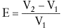

 zu vermitteln; hierbei bedeuten V 1 und V 2 die einer Motordrehzahl von 1000/min zugeordnete Geschwindigkeit des genehmigten Fahrzeugtyps bzw. des Fahrzeugtyps, für den die Ausdehnung beantragt wird. 7.2.2 Falls für jede Übersetzung das Verhältnis E ≤8 Prozent ist, so wird die Ausdehnung ohne Wiederholung der Prüfungen des Typs I genehmigt. 7.2.3 Ist für mindestens eine Übersetzung, die bei der Prüfung des Typs benützt wird, das Verhältnis E > 8 Prozent und für jede Übersetzung das Verhältnis E ≤13 Prozent, so sind die Prüfungen des Typs I zu wiederholen. 7.3 Fahrzeugtypen mit verschiedenen Bezugsmassen und verschiedenen Gesamtübersetzungen Die für einen Fahrzeugtyp erteilte Abgas-Typengenehmigung darf auf Fahrzeugtypen, die sich vom genehmigten Typ nur durch die Bezugsmasse und durch die Gesamtübersetzungen unterscheiden, ausgedehnt werden, wenn die Vorschriften nach den Ziff. 7.1 und 7.2 eingehalten sind. 8. Übereinstimmung der Herstellung (Produktionsüberprüfung) 8.1 Alle Fahrzeuge einer typengenehmigten Ausführung, die in Liechtenstein in den Handel gebracht bzw. neu in Verkehr gesetzt werden, müssen mit dem abgasgenehmigten Typ übereinstimmen, namentlich hinsichtlich der Bauteile, die auf die Emission gasförmiger Schadstoffe aus dem Motor einen Einfluss haben. 8.2 Die Typenprüfstelle führt mit Fahrzeugen, für die eine Abgas-Typengenehmigung vorliegt, in von ihr bestimmten Zeitabständen Produktionsüberprüfungen durch. Sie führt diese anhand der Angaben im Antrag für die Abgas-Typengenehmigung durch und/oder ordnet Emissionsprüfungen nach Ziff. 5 an. 8.3 Der Fahrzeughersteller hat die für die Produktionsüberprüfung vorgesehenen Fahrzeuge zur Verfügung zu stellen und trägt sämtliche Kosten bis zu deren Abschluss. 8.4 Die Typenprüfstelle gibt dem Fahrzeughersteller die Resultate der Überprüfungen unverzüglich bekannt. Erfordern die Prüfergebnisse vom Fahrzeughersteller verbindliche Massnahmen, so wird dies in der Benachrichtigung erwähnt. 8.5 Erste Stichprobe 8.5.1 Für die erste Stichprobe wird ein Fahrzeug von der Typenprüfstelle aus der Serie ausgewählt und den nach Ziff. 8.2 angeordneten Prüfungen unterzogen. 8.5.2 Werden bei der ersten Stichprobe alle Emissionsgrenzwerte nach Ziff. 5.2.3 und 5.3.2 eingehalten und stimmt die emissionsrelevante Ausrüstung mit den Angaben im Antrag für die Abgas-Typengenehmigung überein, so gilt die Produktionsüberprüfung als bestanden. 8.5.3 Werden bei der ersten Stichprobe nicht alle Emissionsgrenzwerte eingehalten oder stimmt die emissionsrelevante Ausrüstung nicht mit den Angaben im Antrag für die Abgas-Typengenehmigung überein, so hat sich der Fahrzeughersteller innert 30 Tagen seit Benachrichtigung durch die Typenprüfstelle für eine der beiden folgenden Möglichkeiten zu entscheiden: a) Er verpflichtet sich, alle bereits verkauften und inskünftig zu verkaufenden fehlerhaften Fahrzeuge auf seine Kosten instandzustellen. Die hierbei zu treffenden Massnahmen und deren zeitliche Durchführung sind mit der Typenprüfstelle schriftlich zu vereinbaren; b) Er verlangt die Durchführung weiterer Prüfungen anhand einer endgültigen Stichprobe nach Ziff. 8.6. 8.6 Endgültige Stichprobe 8.6.1 Die Typenprüfstelle legt nach Rücksprache mit dem Fahrzeughersteller den Umfang der endgültigen Stichprobe (max. 19 Fahrzeuge) fest und wählt aus der Serie die zu prüfenden Fahrzeuge aus, worunter auch das ursprünglich geprüfte Fahrzeug sein muss. Mit Ausnahme des letzteren sind die ausgewählten Fahrzeuge den von der Typenprüfstelle nach Ziff. 8.2 angeordneten Emissionsmessungen zu unterziehen. Für jeden gasförmigen Schadstoff ist das arithmetische Mittel 

 der aus der Stichprobe ermittelten Ergebnisse sowie die Standardabweichung S der Stichprobe zu bestimmen. 8.6.2 Die Produktionsüberprüfung gilt als bestanden, wenn die emissionsrelevante Ausrüstung aller geprüften Fahrzeuge mit den Angaben im Antrag für die Abgas-Typengenehmigung übereinstimmt und die folgende Bedingung erfüllt ist: 

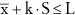

 L: Zulässiger Grenzwert nach Ziff. 5.2.3 und 5.3.2 für jeden untersuchten gasförmigen Schadstoff 

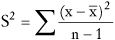

 , wobei x ein beliebiges der n Einzelergebnisse ist k: statistischer Faktor, der von n abhängt und in der folgenden Tabelle angegeben ist: n 2 3 4 5 6 7 8 9 10 k 0.973 0.613 0.489 0.421 0.376 0.342 0.317 0.297 0.279 n 11 12 13 14 15 16 17 18 19 k 0.265 0.253 0.242 0.233 0.224 0.216 0.210 0.203 0.198 8.6.3 Ist die Produktionsüberprüfung nicht bestanden, so wird, unter Vorbehalt von Ziff. 8.6.4, die Abgas-Typengenehmigung entzogen. Das Verfahren richtet sich nach Ziff. 9. 8.6.4 Die Abgas-Typengenehmigung wird nicht entzogen, wenn sich der Fahrzeughersteller gegenüber der Typenprüfstelle innert 30 Tagen seit Benachrichtigung dazu verpflichtet, alle bereits verkauften und inskünftig zu verkaufenden Fahrzeuge auf seine Kosten instandzustellen. Die hierbei zu treffenden Massnahmen und deren zeitliche Durchführung sind mit der Typenprüfstelle schriftlich zu vereinbaren. 9. Entzug der Abgas-Typengenehmigung 9.1 Im Falle von Ziff. 8.6.3 oder wenn der Fahrzeughersteller seinen Verpflichtungen nach Ziff. 8.5.3 oder 8.6.4 in zeitlicher oder materieller Hinsicht nicht nachkommt und keine befriedigende Begründung darüber abgibt, so wird die Abgas-Typengenehmigung für den betreffenden Fahrzeugtyp entzogen. 9.2 Die Typenprüfstelle unterrichtet den Fahrzeughersteller unverzüglich über den Entzug der Abgas-Typengenehmigung. Von diesem Zeitpunkt an werden die Typenscheine für die entsprechenden Fahrzeugtypen ungültig, und es darf keines der betroffenen Fahrzeuge mehr in den Handel gebracht und neu zum Verkehr zugelassen werden. Die Typenprüfstelle verpflichtet den Hersteller, alle bereits verkauften fehlerhaften Fahrzeuge in geeigneter Weise instandzustellen. 10. Schlussbestimmungen 10.1 Übergangsbestimmungen 10.1.1 Die Bestimmungen dieser Verordnung gelten für die erstmalige Zulassung aller ab 1. Oktober 1987 eingeführten oder in Liechtenstein hergestellten Fahrzeuge. 10.1.2 Abgas-Typengenehmigungen können ab Inkrafttreten dieser Verordnung ausgestellt werden. 10.2 Inkrafttreten Diese Verordnung tritt am Tage der Kundmachung in Kraft. Fürstliche Regierung: gez. Hans Brunhart Fürstlicher Regierungschef Anhang 1 Verfahren zur Durchführung der Emissionsprüfung Typ I (Fahrzyklustest) 1. Einleitung Dieser Anhang beschreibt das Verfahren für die Emissionsprüfung Typ I (Fahrzyklustest) nach Ziffer 5.2 dieser Verordnung. 2. Fahrzyklus auf dem Fahrleistungsprüfstand 2.1 Beschreibung des Zyklus Auf dem Fahrleistungsprüfstand ist der Zyklus zu fahren, der in der folgenden Tabelle und in der Anlage 1 dieses Anhanges beschrieben ist. 2.2 Allgemeine Vorschriften für die Durchführung des Fahrzyklus Um einen Zyklus durchzuführen, der sich dem theoretischen Fahrzyklus im Rahmen der vorgeschriebenen Grenzen nähert, ist in Vorversuchszyklen die günstigste Art der Betätigung des Gasdrehgriffes und erforderlichenfalls des Bremshebels zu ermitteln. Fahrzyklus auf dem Fahrleistungsprüfstand 

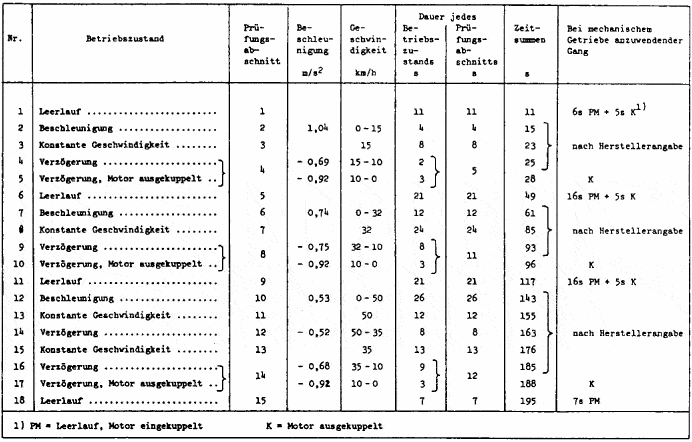

 2.3 Verwendung des Getriebes 2.3.1 Das Getriebe ist wie folgt zu schalten: 2.3.1.1 Bei konstanter Geschwindigkeit muss die Motordrehzahl zwischen 50 und 90 % der Höchstleistungs-Drehzahl liegen. Wird diese Drehzahl in zwei oder mehr Gängen erreicht, ist zur Prüfung des Motorrades der höchste Gang einzulegen. Während der Beschleunigung ist derjenige Gang einzulegen, der die vom Zyklus geforderte Beschleunigung zulässt. Spätestens beim Erreichen einer Drehzahl entsprechend 110 % der Höchstleistungs-Drehzahl ist in den höheren Gang zu schalten. Während der Verzögerung ist in den kleineren Gang zu schalten, kurz bevor der Motor seine Leerlaufdrehzahl erreicht, spätestens jedoch bei der Drehzahl, die 30 % der Höchstleistungs-Drehzahl entspricht. 2.3.2 Motorräder mit automatischem Getriebe sind in der höchsten Fahrstufe (Drive) zu prüfen. Der Gasdrehgriff ist so zu betätigen, dass möglichst konstante Beschleunigungen erzielt werden, die es dem Getriebe ermöglichen, die verschiedenen Gänge in der normalen Folge einzuschalten. Es gelten die Toleranzen nach Ziffer 2.4 dieses Anhanges. 2.4 Toleranzen 2.4.1 Während aller Prüfungsabschnitte des Zyklus sind Abweichungen um ± 1 km/h von der theoretischen Geschwindigkeit zulässig. Beim Übergang von einem Prüfungsabschnitt zum anderen sind höhere als die vorgeschriebenen Geschwindigkeitstoleranzen zulässig, sofern die Dauer der festgestellten Abweichungen jeweils 0.5 Sekunden nicht überschreitet, unter Vorbehalt der Vorschriften nach Ziffer 6.5.2 und Ziffer 6.6.3 dieses Anhanges. 2.4.2 Die Zeittoleranzen betragen ± 1.0 Sekunden. 2.4.3 Die Toleranzen für Geschwindigkeit und Zeit sind nach den Angaben der Anlage 1 dieses Anhangs zusammenzufassen. 2.4.4 Bei der Messung der während des Zyklus gefahrenen Strecke ist eine Toleranz von ± 2 % zulässig. 3. Fahrzeug und Treibstoff 3.1 Prüffahrzeug 3.1.1 Das Fahrzeug ist in einwandfreiem Betriebszustand vorzuführen. Es muss eingefahren sein und vor der Prüfung mindestens 1000 km zurückgelegt haben. Die Prüfstelle kann entscheiden, ob ein Fahrzeug, das vor der Prüfung weniger als 1000 km zurückgelegt hat, zugelassen wird. 3.1.2 Die Auspuffanlage darf keine Lecks aufweisen, die zu einer Verringerung der Menge der gesammelten Gase führen können; diese Menge muss der aus dem Motor austretenden Abgasmenge entsprechen. 3.1.3 Die Dichtheit des Ansaugsystems soll überprüft werden, um sicherzustellen, dass der Verbrennungsvorgang nicht durch eine ungewollte Luftzufuhr geändert wird. 3.1.4 Der Motor und die Betätigungsvorrichtungen müssen nach den Angaben des Herstellers eingestellt sein. 3.1.5 Die Prüfstelle darf prüfen, ob das Leistungsverhalten des Fahrzeugs den Angaben des Herstellers entspricht, ob es für üblichen Gebrauch und vor allem, ob es zum Kalt- und Warmstart geeignet ist. 3.2 Treibstoff Als Treibstoff ist der im Anhang 3 dieser Verordnung definierte Referenttreibstoff zu verwenden. Wird der Motor durch ein Treibstoff-Öl-Gemisch geschmiert, so ist dem Referenttreibstoff ein Oel beizumischen, dessen Qualität den Empfehlungen des Herstellers entspricht. 4. Prüfeinrichtungen 4.1 Fahrleistungsprüfstand Die wichtigsten Merkmale des Prüfstandes sind folgende: - Einrollenprüfstand, jedes angetriebene Rad berührt die Rolle - Durchmesser der Rolle: ≥400 mm - Ermittlung des Diagramms der aufgenommenen Leistung: Der Prüfstand soll ermöglichen, die während der Fahrt auf ebener Fahrbahn und annähernder Windstille vom Motor abgegebene Leistung bei einer Geschwindigkeit ab 12 km/h mit einer Genauigkeit von ± 15 % darzustellen. Ist dies nicht möglich, so ist die von der Bremse und von den inneren Reibungen des Prüfstandes aufgenommene Leistung (P A ) nach den Vorschriften in Anlage 4 dieses Anhanges zu ermitteln. - Ist dies nicht möglich, ist die von der Bremse und von den inneren Reibungen des Prüfstandes aufgenommene Leistung wie folgt zu ermitteln: P A = KV 3 ± 5 % von KV 3 ± 5 % P v50 ohne dass das Ergebnis negativ wird. - Ausgangsschwungmasse: 100 kg - Zusätzliche Schwungmassen: von 10 zu 10 kg 4.1.1 Die tatsächlich zurückgelegte Strecke ist mit einem Drehzahl-Zählwerk mit Nullrückstellung an der Rolle zu ermitteln. 4.2 Einrichtungen für die Gas-Probeentnahmen und für die Volumenmessung 4.2.1 Die Anlagen 2 und 3 dieses Anhanges zeigen schematische Darstellungen von Einrichtungen zum Auffangen, zur Verdünnung, zur Probeentnahme und zur Messung des Volumens der Auspuffgase während der Prüfung. 4.2.2 In den nachfolgenden Absätzen sind die einzelnen Teile der Prüfeinrichtungen beschrieben; für jeden Teil sind die Bezeichnungen angegeben, wie sie in den Zeichnungen der Anlagen 2 und 3 dieses Anhanges enthalten sind. Andere Prüfeinrichtungen sind ebenfalls zulässig, sofern sie nach Auffassung der Prüfstelle gleichwertige Resultate ergeben. 4.2.2.1 Eine Einrichtung zum Auffangen aller bei der Prüfung emittierten Abgase; in der Regel ist dies eine offene Einrichtung, um an den Auspufföffnungen den atmosphärischen Druck aufrecht zu erhalten. Ein geschlossenes System darf verwendet werden, sofern die Gegendruckbedingungen (≤± 0.9 kPa) eingehalten sind. Beim Auffangen der Gase darf keine Kondensation entstehen, die die Art der Gase bei Prüftemperatur wesentlich ändert. 4.2.2.2 Eine Verbindungsleitung (Tu) zwischen dieser Einrichtung und der Probeentnahme-Einrichtung. Diese Leitung und die Gasauffangeinrichtung müssen aus rostfreiem Stahl oder einem anderen Material bestehen, das die Zusammensetzung der aufgefangenen Gase nicht beeinflusst und ausreichend temperaturbeständig ist. 4.2.2.3 Ein Wärmetauscher (Sc), der die Temperaturänderung der verdünnten Gase am Pumpeneintritt während der Prüfdauer auf ( 5° C begrenzt. Dieser Wärmetauscher (Sc) muss ein Vorheizsystem aufweisen, das den Wärmetauscher (Sc) vor Prüfbeginn auf seine Betriebstemperatur (Toleranz ± 5° C) bringen kann. 4.2.2.4 Eine Verdrängerpumpe P zum Absaugen der verdünnten Abgase muss von einem Motor angetrieben werden, der mehrere, konstante Drehzahlen aufweist. Die Förderkapazität muss genügend hoch sein, um das Ansaugen der gesamten Abgasmenge sicherzustellen. Eine Einrichtung mit einem Venturirohr für kritische Strömung darf ebenfalls verwendet werden. 4.2.2.5 Ein Temperaturschreiber für die verdünnten Gase am Pumpeneintritt. 4.2.2.6 Eine am Eintritt der Gasauffangeinrichtung ausserhalb angebrachte Sonde S 2, um während der Prüfdauer mittels einer Pumpe, eines Filters und eines Durchflussmessers einen konstanten Teilstrom der Verdünnungsluft aufzufangen. 4.2.2.7 Eine gegen die Strömungsrichtung des verdünnten Gases gerichtete Sonde S 3 vor der Verdrängerpumpe, um während der Prüfdauer mittels einer Pumpe, eines Filters und eines Durchflussmessers einen konstanten Teilstrom des Abgas-Luft-Gemisches aufzufangen. Die Durchflussmenge in den beiden vorgenannten Probeentnahme-Systemen muss wenigstens 150 l/h betragen. 4.2.2.8 Zwei nach den Sonden S 2 und S 3 angeordnete Filter F 2 und F 3, um Feststoffteilchen aus dem in den Auffangbeutel geleiteten Gemisch auszuscheiden. Die Filter dürfen die Konzentration der Bestandteile der Probe nicht verändern. 4.2.2.9 Zwei Pumpen P2 und P3 zur Entnahme der Proben mit Hilfe der Sonden S 2 und S 3 und zum Füllen der Auffangbeutel Sa und Sb. 4.2.2.10 Zwei mit den Pumpen P 2 und P 3 in Reihe geschaltete handbetätigte Durchflussregler V 2 und V 3 zur Regelung der Menge des in die Auffangbeutel geleiteten Abgas-Luft-Gemisches. 4.2.2.11 Zwei in Reihe geschaltete Durchflussmesser R 2 und R 3 in der Messanordnung Sonde - Filter - Pumpe - Durchflussregler - Auffangbeutel (S 2 - F 2 - P 2 - V 2 - Sa bzw. S 3 - F 3 - P 3 - V 3 - Sb), die jederzeit eine Ablesung der Probemengen ermöglichen. 4.2.2.12 Auffangbeutel für die Verdünnungsluft und für das Abgas-Luft-Gemisch, die dicht und genügend gross bemessen sein müssen, dass das normale Einströmen der Probe nicht behindert ist. Sie müssen beutelseitig einen automatischen Verschluss haben und sich schnell und gut abdichtend an der Probeentnahmeanlage wie auch am Versuchsende an der Analyseanlage befestigen lassen. 4.2.2.13 Zwei Differenzdruck-Manometer g 1 und g 2, die wie folgt angeordnet sind: g 1: vor der Verdrängerpumpe P zur Bestimmung des Unterdruckes des Abgas-Verdünnungsluft-Gemisches; g 2: vor und nach der Verdrängerpumpe P zur Kontrolle des Druckanstieges im Gasstrom. 4.2.2.14 Ein Drehzahl-Zählwerk CT zur Messung der Umdrehungen der Verdrängerpumpe P. 4.2.2.15 Dreiwegventile in den oben genannten Probeentnahmeanlagen, um die Probegasströme während der Prüfung nach aussen in die Absaugung bzw. in die Auffangbeutel zu leiten. Die Ventile müssen Schnellschaltventile sein. Sie müssen aus Werkstoffen bestehen, die die Zusammensetzung der Gase nicht beeinflussen; darüber hinaus müssen ihre Durchflussquerschnitte und Formen so ausgelegt sein, dass die Füllverluste so gering wie technisch möglich bleiben. 4.3 Analysegeräte 4.3.1 Bestimmung der Kohlenwasserstoffkonzentration Die Konzentration an unverbrannten Kohlenwasserstoffen (HC) in den während der Prüfungen in den Auffangbeuteln SA und SB gesammelten Proben ist mit Hilfe eines Flammenionisations-Analysegerätes zu ermitteln. 4.3.2 Bestimmung der Konzentration an CO und CO2 4.3.2.1 Die Konzentration an Kohlenmonoxid CO und Kohlendioxid CO2 in den während der Prüfungen in den Auffangbeuteln SA und SB gesammelten Proben ist mit Hilfe von nichtdispersiven Infrarot-Analysegeräten zu ermitteln. 4.3.3 Bestimmung der Stickoxidkonzentration 4.3.3.1 Die Konzentration an Stickoxiden NOx in den während der Prüfungen in den Auffangbeuteln SA und SB gesammelten Proben ist mit Hilfe eines Chemilumineszenz-Analysegerätes zu ermitteln. 4.4 Genauigkeit der Geräte und der Messungen 4.4.1 Die Bremse ist durch eine besondere Prüfung zu eichen. Deshalb wird die Genauigkeit des Rollenprüfstandes nicht angegeben. Die Gesamtträgheit der umlaufenden Massen einschliesslich der Rolle und des Bremsrotors (vgl. Ziff. 5.2 dieses Anhanges) ist auf ± 2 % genau anzugeben. 4.4.2 Die Fahrzeuggeschwindigkeit ist aus der Drehzahl der mit den Schwungrädern der Bremse verbundenen Rolle zu messen. Sie muss auf ( 2 km/h genau im Bereich 0 - 10 km/h und auf ± 1 km/h genau oberhalb 10 km/h gemessen werden können. 4.4.3 Die Temperatur nach Ziffer 4.2.2.5 dieses Anhanges muss auf ( 1° C genau gemessen werden können. Die Temperatur nach Ziffer 6.1.1 dieses Anhanges muss auf ± 2° C genau gemessen werden können. 4.4.4 Der atmosphärische Druck muss auf ± 0.1 kPa genau gemessen werden können. 4.4.5 Der Unterdruck des Abgas-Luft-Gemisches beim Eintritt in die Verdrängerpumpe P 1 (vgl. Ziff. 4.2.2.13 dieses Anhanges) muss auf ± 0.4 kPa genau gemessen werden können. Der Druckunterschied des Abgas-Luft-Gemisches vor und nach der Verdrängerpumpe P (vgl. Ziff. 4.2.2.13 dieses Anhanges) muss auf ( 0.4 kPa genau gemessen werden können. 4.4.6 Das von der Verdrängerpumpe P während einer ganzen Umdrehung geförderte Volumen und die Fördermenge bei der kleinstmöglichen Pumpendrehzahl gemäss Anzeige des Drehzahl-Zählwerkes CT müssen ermöglichen, das während der Prüfung von der Verdrängerpumpe P geförderte Gesamtvolumen des Abgas-Verdünnungsluft-Gemisches auf ± 2 % genau zu ermitteln. 4.4.7 Die Analysegeräte müssen einen Messbereich haben, der mit der geforderten Messgenauigkeit von ± 3 % der einzelnen Bestandteile vereinbar ist, wobei die Genauigkeit der verwendeten Eichgase unberücksichtigt bleibt. Das Flammenionisations-Analysegerät zur Messung der HC-Konzentration muss in weniger als 1 Sekunde 90 % des Skalenendwertes erreichen. 4.4.8 Die Konzentration der Eichgase darf um nicht mehr als ± 2 % vom Bezugswert jedes einzelnen Gases abweichen. Zur Verdünnung ist für Kohlenmonoxid und Stickoxide gereinigter Stickstoff und für Kohlenwasserstoffe synthetische Luft zu verwenden. 5. Vorbereitung der Prüfung 5.1 Einstellung der Bremse des Prüfstandes 5.1.1 Die Bremse ist so einzustellen, dass ihre Leistung dem Betrieb des Fahrzeugs bei einer Geschwindigkeit innerhalb von 45 und 55 km/h in der Ebene entspricht. 5.1.2 Die Bremse ist wie folgt einzustellen: 5.1.2.1 In das Betätigungssystem der Gemischzufuhr ist ein verstellbarer Anschlag einzubauen, der die Höchstgeschwindigkeit auf einen Wert zwischen 45 und 55 km/h begrenzt. Die Geschwindigkeit des Fahrzeugs ist unter Benützung des Anschlags mit Hilfe eines Präzisions-Geschwindigkeitsmessers oder aufgrund einer Zeitmessung in beiden Richtungen über eine bestimmte Strecke, die eben und trocken sein muss, zu ermitteln. Die Messungen, die wenigstens dreimal in beiden Richtungen durchzuführen sind, müssen auf einer wenigstens 200 m langen horizontalen Strecke mit einem genügend langen Anlauf erfolgen. Es ist die Durchschnittsgeschwindigkeit zu ermitteln. 5.1.2.2 Andere Methoden zur Messung der für den Antrieb des Fahrzeugs erforderlichen Leistung (wie z.B. Messung des Drehmomentes an der Kraftübertragung, Messung der Verzögerung während des Ausrollens usw.) sind ebenfalls zulässig. 5.1.2.3 Das Fahrzeug ist dann auf den Fahrleistungsprüfstand zu stellen; die Bremse ist so einzustellen, dass die gleiche Geschwindigkeit erzielt wird wie bei der Prüfung auf der Strasse (Betätigung der Gemischzufuhr am fixierten Anschlag und gleiche Getriebestufe). Diese Bremseinstellung ist während der ganzen Prüfdauer beizubehalten. Nach der Bremseinstellung ist der Anschlag der Betätigung der Gemischzufuhr zu entfernen. 5.1.2.4 Die Einstellung der Bremse aufgrund eines Strassenversuches darf nur erfolgen, wenn zwischen der Strasse und dem Raum mit dem Fahrleistungsprüfstand der Luftdruck um nicht mehr als ± 1.3 kPa und die Luft-Temperatur um nicht mehr als ± 8°C voneinander abweichen. 5.1.3 Ist die vorstehende Methode nicht anwendbar, wird der Prüfstand nach den in der Tabelle von Ziffer 5.2 dieses Anhanges aufgeführten Werten eingestellt. Diese Werte geben die Leistung als Funktion der Bezugsmasse bei einer Geschwindigkeit von 50 km/h an. Diese Leistung wird nach der in der Anlage 4 dieses Anhanges angegebenen Methode bestimmt. 5.2 Anpassung der äquivalenten Schwungmasse an die translatorisch bewegten Massen des Fahrzeugs 5.2.1 Es sind Schwungräder zu verwenden, mit denen eine Gesamtträgheit der umlaufenden Massen erzielt wird, die der Bezugsmasse des Fahrzeugs nach folgender Tabelle entspricht: Bezugsmasse Äquivalente Schwungmassen Aufgenommene Leistung (kg) (kg) (kW) R ≤105 100 0.88 105 < R ≤115 110 0.90 115 < R ≤125 120 0.91 125 < R ≤135 130 0.93 135 < R ≤150 140 0.94 150 < R ≤165 150 0.96 165 < R ≤185 170 0.99 185 < R ≤205 190 1.02 205 < R ≤225 210 1.05 225 < R ≤245 230 1.09 245 < R ≤270 260 1.14 270 < R ≤300 280 1.17 300 < R ≤330 310 1.21 330 < R ≤360 340 1.26 360 < R ≤395 380 1.33 395 < R ≤435 410 1.37 435 < R 450 1.44 5.2.2 Bei Motorrädern mit festverbundenen Seitenwagen bezieht sich die Bezugsmasse auf das komplette Fahrzeug. 5.3 Vorbereitung des Fahrzeugs 5.3.1 Vor der Prüfung ist das Fahrzeug einer Temperatur zwischen 20 und 30°C auszusetzen. Nachdem der Motor 40 Sekunden lang im Leerlauf betrieben wurde, sind vor dem Auffangen der Abgase zwei vollständige Zyklen zu fahren. 5.3.2 Der Reifendruck muss wie beim vorangegangenen Strassenversuch zur Einstellung der Bremse den Angaben des Herstellers entsprechen. Ist der Durchmesser der Rollen kleiner als 50 cm, so ist der Reifendruck zur Schonung der Reifen um 30 bis 50 % zu erhöhen. 5.3.3 Das Gewicht auf dem Antriebsrad muss gleich gross sein wie bei normalem Betrieb des Fahrzeuges mit einem 75 kg schweren Fahrer. 5.4 Einstellung der Geräte für die Analyse Mit Hilfe eines Durchflussmessers und des an jeder Gasflasche vorhandenen Druckminderventils muss in das Analysegerät eine Gasmenge mit einem Druck strömen, bei dem das Analysegerät einwandfrei arbeitet. Das Gerät ist so einzustellen, dass es den auf der Flasche mit dem Eichgas angegebenen Wert als konstanten Wert anzeigt. Ausgehend von der Einstellung, die mit der Flasche mit dem höchsten Gehalt erzielt wurde, ist für das Gerät eine Fehlerkurve in Abhängigkeit des Gehalts der verschiedenen verwendeten Eichgasflaschen zu erstellen. Flammenionisations-Analysegeräte sind periodisch jeden Monat wenigstens einmal mit Gemischen aus Luft/Propan oder Luft/Hexan mit einem Kohlenwasserstoff-Nenngehalt von 50 und 90 % des Messbereichs zu eichen. Bei nichtdispersiven Infrarot-Analysegeräten sind für diese periodische Eichung Gemische aus Stickstoff/CO und Stickstoff/CO 2 mit einem Nenngehalt von 10, 40, 60, 85 und 90 % des Messbereiches zu verwenden. Für die Eichung der NOx Chemilumineszenz-Analysatoren sind Gemische aus Stickstoff/Stickstoffmonoxid NO mit einem Nenngehalt von 50 und 90 % des Messbereiches zu verwenden. Vor jeder Prüfreihe sind für alle drei Arten von Analysegeräten Kontrolleichungen vorzunehmen; die dabei verwendeten Gemische müssen einen Gehalt an zu prüfenden Gasen haben, der 80 % des Messbereiches entspricht. Eine Einrichtung zur Verdünnung der 100 %-igen Eichgase auf den geforderten Gehalt darf verwendet werden. 6. Durchführung der Prüfungen auf dem Prüfstand 6.1 Besondere Vorschriften für die Durchführung des Fahrzyklus 6.1.1 Die Temperatur des Prüfraums muss während der gesamten Prüfung zwischen 20 und 30°C betragen und möglichst der Temperatur des Raumes entsprechen, in dem das Fahrzeug konditioniert wurde. 6.1.2 Das Fahrzeug muss während der Prüfung etwa horizontal stehen, damit eine nicht normale Treibstoffverteilung verhindert wird. 6.1.3 Am Schluss der ersten 40 Sekunden dauernden I.eerlaufperiode (vgl. Ziff. 6.2.2 dieses Anhanges) ist das Fahrzeug einem Luftstrom von veränderlicher Geschwindigkeit auszusetzen. Danach folgen zwei vollständige Fahrzyklen, während deren kein Gas aufgefangen wird. Das Kühlgebläse muss eine von der Geschwindigkeit des Prüfstandes abhängige Regeleinrichtung haben, welche bewirkt, dass die lineare Luftaustrittsgeschwindigkeit im Bereich von 10 bis 50 km/h bis auf 10 % der Rollengeschwindigkeit entspricht. Bei Rollengeschwindigkeiten unter 10 km/h darf die Luftgeschwindigkeit gleich Null sein. Die Austrittsöffnung des Kühlgebläses muss folgende Merkmale aufweisen: - Fläche wenigstens 0.4 m 2 ; - Höhe der Unterkante über dem Boden zwischen 0.15 und 0.20 m; - Abstand von der Fahrzeugvorderkante 0.30 bis 0.45 m. 6.1.4 Zur Beurteilung der Brauchbarkeit der gefahrenen Zyklen ist die Geschwindigkeit als Funktion der Zeit während der Prüfung aufzuzeichnen. 6.1.5 Die Aufzeichnung der Kühlwassertemperatur sowie der Öltemperatur im Ölsumpf ist freigestellt. 6.2 Anlassen des Motors 6.2.1 Nach den Vorarbeiten an den Einrichtungen zum Auffangen, Verdünnen, Analysieren und Messen der Gase (vgl. Ziff. 7.1 dieses Anhanges) ist der Motor nach den Angaben des Herstellers zu starten. 6.2.2 Der Motor ist im Leerlauf höchstens 40 Sekunden lang zu betreiben. Der Beginn des ersten Messzyklus muss mit dem Beginn der Probeentnahme und der Drehzahlmessung an der Pumpe zusammenfallen. 6.3 Betätigung der manuellen Starthilfe Die Starthilfe muss so schnell wie möglich ausgeschaltet werden, und zwar grundsätzlich vor Beginn der Beschleunigung von 0 auf 50 km/h. Ist dies nicht einzuhalten, so muss der Zeitpunkt der tatsächlichen Ausschaltung angegeben werden. Die Einstellung der Starthilfe muss den Angaben des Herstellers entsprechen. 6.4 Leerlauf 6.4.1 Handschaltgetriebe: 6.4.1.1 Während der Leerlaufzeiten muss der Motor mit dem Getriebe in Leerlaufstellung eingekuppelt sein. 6.4.1.2 Um die Beschleunigungen zur Einhaltung des normalen Fahrzyklus zu ermöglichen, muss der erste Gang des Fahrzeugs fünf Sekunden vor der Beschleunigung, die dem Leerlauf folgt, bei ausgekuppeltem Motor eingelegt werden . 6.4.1.3 Die erste Leerlaufzeit zu Beginn des Zyklus umfasst sechs Sekunden Leerlauf bei eingekuppeltem Motor, Getriebe in Leerlaufstellung und fünf Sekunden bei ausgekuppeltem Motor, Getriebe im ersten Gang. 6.4.1.4 Die Leerlaufzeiten innerhalb eines jeden Zyklus müssen jeweils 16 Sekunden bei Getriebe in Leerlaufstellung und fünf Sekunden im ersten Gang bei ausgekuppeltem Motor betragen. 6.4.1.5 Die Zeit des letzten Leerlaufzyklus muss sieben Sekunden bei eingekuppeltem Motor, Getriebe in Leerlaufstellung, betragen. 6.4.2 Halbautomatische Getriebe: Es gelten die Angaben des Herstellers für Stadtfahrt; fehlen solche Angaben, so gelten die Vorschriften für Handschaltgetriebe. 6.4.3 Automatische Getriebe: Der Gangwähler ist während der gesamten Prüfung nicht zu bedienen, ausser wenn gegenteilige Angaben des Herstellers bestehen. In diesem Falle ist das Verfahren für Handschaltgetriebe anzuwenden. 6.5 Beschleunigungen 6.5.1 Die Beschleunigungen sind so auszuführen, dass während der gesamten Dauer des Betriebszustandes eine möglichst konstante Beschleunigung erzielt wird. 6.5.2 Genügt das Beschleunigungsvermögen des Motorrades nicht, um die Beschleunigungsabschnitte mit den vorgeschriebenen Toleranzen einzuhalten, so ist das Motorrad mit ganz aufgedrehtem Gasdrehgriff auf die vorgeschriebene Geschwindigkeit zu bringen und danach der Fahrzyklus normal weiterzufahren. 6.6 Verzögerungen 6.6.1 Alle Verzögerungen sind durch vollständiges Schliessen des Gasdrehgriffes bei eingekuppeltem Motor herbeizuführen. Bei einer Geschwindigkeit von 10 km/h ist auszukuppeln. 6.6.2 Ist die Verzögerung länger als die in dem entsprechenden Prüfungsabschnitt vorgesehene Zeit, so sind zur Einhaltung des Zyklus die Fahrzeugbremsen zu benützen. 6.6.3 Ist die Verzögerung kürzer als die für den betreffenden Prüfungsabschnitt vorgesehene Zeit, so ist die Übereinstimmung mit dem theoretischen Zyklus durch Einlegen einer Zeit konstanter Geschwindigkeit oder einer Leerlaufperiode im Anschluss an die nächste Zeit konstanter Geschwindigkeit oder an die nächste Leerlaufzeit wieder herzustellen. In diesem Fall gilt Ziffer 2.4.3 dieses Anhanges nicht. 6.6.4 Am Ende der Verzögerungszeit (Stillstand des Fahrzeugs auf den Rollen) ist das Getriebe in Leerlaufstellung zu bringen und der Motor einzukuppeln. 6.7 Konstante Geschwindigkeiten 6.7.1 Beim Übergang von der Beschleunigung in die nächsthöhere konstante Geschwindigkeit ist "Pumpen" oder Schliessen des Drosselschiebers zu vermeiden. 6.7.2 Während der Phasen mit konstanter Geschwindigkeit ist der Gasdrehgriff möglichst unverändert festzuhalten. 7. Durchführung der Gasentnahme, der Gasanalyse und der Volumenmessung 7.1 Vorarbeiten vor dem Anlassen des Fahrzeugs 7.1.1 Die Auffangbeutel SA und SB sind zu entleeren und zu schliessen. 7.1.2 Die Verdrängerpumpe P ist einzuschalten ohne das Drehzahl-Zählwerk in Gang zu setzen. 7.1.3 Die Pumpen P 2 und P 3 für die Probeentnahmen sind einzuschalten, während die Dreiwegventile in Richtung Abblasen zur Aussenluft eingestellt sind. Die Entnahmemenge wird mittels der Durchflussregler V 2 und V 3 eingestellt. 7.1.4 Die Anzeigegeräte für die Temperatur T und für die Drücke g 1 und g 2 sind einzuschalten. 7.1.5 Das Pumpen-Drehzahl-Zählwerk CT und das Drehzahl-Zählwerk der Rollen sind auf Null zu stellen. 7.2 Beginn der Gasentnahme und der Volumenmessung 7.2.1 Nach den ersten 40 Sekunden Leerlaufzeit und den beiden Vorbereitungs-Zyklen (Zeitpunkt für den Beginn des ersten Fahrzyklus) sind genau gleichzeitig die in den Ziffern 7.2.2 bis 7.2.5 dieses Anhanges genannten Arbeitsgänge durchzuführen. 7.2.2 Die Dreiwegventile, welche bisher zur Aussenluft abbliesen, sind umzuschalten zum Auffangen der von den Sonden S 2 und S 3 fortlaufend entnommenen Proben in den Auffangbeuteln SA und SB. 7.2.3 Der Zeitpunkt des Prüfbeginns ist auf den Schrieben des mit den Anzeigegeräten für die Temperatur T und für die Differenzdrücke g 1 und g 2 verbundenen Registriergerätes anzugeben. 7.2.4 Das Drehzahl-Zählwerk CT der Verdrängerpumpe P ist in Gang zu setzen. 7.2.5 Das Kühlgebläse nach Ziffer 6.1.3 dieses Anhanges ist einzuschalten. 7.3 Ende der Gasentnahme und der Volumenmessung 7.3.1 Am Ende des vierten Fahrzyklus sind genau gleichzeitig die in den Ziffern 7.3.2 bis 7.3.5 dieses Anhanges genannten Arbeitsgänge durchzuführen. 7.3.2 Die Dreiwegventile sind umzuschalten, um die Auffangbeutel SA und SB zu schliessen und die von den Pumpen P 2 und P 3 durch die Sonden S 2 und S 3 angesaugten Gase zur Aussenluft abzublasen. 7.3.3 Der Zeitpunkt des Prüfendes ist auf den Schrieben des Registriergerätes anzugeben (vgl. Ziff. 7.2.3 dieses Anhanges). 7.3.4 Das Drehzahl-Zählwerk CT der Verdrängerpumpe P ist auszuschalten. 7.3.5 Das Kühlgebläse nach Ziffer 6.1.3 dieses Anhanges ist auszuschalten. 7.4 Analyse der in den Beuteln enthaltenen Proben So schnell wie möglich, auf keinen Fall später als 20 Minuten nach Prüfende, ist mit der Analyse zu beginnen und zu bestimmen: - die Konzentration an Kohlenwasserstoffen, Kohlenmonoxid, Stickoxiden und Kohlendioxid in der Verdünnungaluft im Auffangbeutel SB; - die Konzentration an Kohlenwasserstoffen, Kohlenmonoxid, Stickoxiden und Kohlendioxid in den verdünnten Abgasen im Auffangbeutel SA. 7.5 Bestimmung der zurückgelegten Distanz Die tatsächlich zurückgelegte Strecke S wird errechnet durch Multiplikation der am Drehzahl-Zählwerk (vgl. Ziff. 4.1.1 dieses Anhanges) abgelesenen Anzahl der Umdrehungen mit dem Umfang der Rolle. Diese Strecke ist in km anzugeben. 8. Bestimmung der Menge der emittierten gasförmigen Schadstoffe 8.1 Die Masse der während der Prüfung emittierten Kohlenmonoxide ist nach folgender Formel zu ermitteln: 

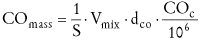

 8.1.1 CO mass die während der Prüfung emittierte Masse Kohlenmonoxid in g/km; 8.1.2 S die in Ziffer 7.5 dieses Anhanges definierte Strecke; 8.1.3 dco die spezifische Dichte des Kohlenmonoxids bei 273.2 K und 101.33 kPa: 1.250 kg/m3; 8.1.4 CO c der Volumenanteil an Kohlenmonoxid im verdünnten Abgas-Luft-Gemisch in ppm, korrigiert unter Berücksichtigung des Schadstoffanteils in der Verdünnungsluft: 

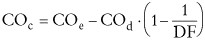

 dabei bedeuten: 8.1.4.1 CO e die Konzentration an Kohlenmonoxid in ppm des im Auffangbeutel SA enthaltenen Abgas-Luft-Gemisches; 8.1.4.2 COd die Konzentration an Kohlenmonoxid in ppm der im Auffangbeutel SB enthaltenen Verdünnungsluft; 8.1.4.3 DF der in Ziffer 8.4 dieses Anhanges definierte Verdünnungsfaktor; 8.1.5 V mix das Gesamtvolumen des Abgas-Luft-Gemisches in m 3 /Prüfung, reduziert auf die Bezugswerte 273.2 K und 101.33 kPa 

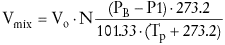

 dabei bedeuten: 8.1.5.1 V o das von der Verdrängerpumpe P während einer Umdrehung geförderte Gas in m3. Dieses Volumen ist abhängig von den Druckunterschieden zwischen dem Ein- und Austritt der Pumpe; 8.1.5.2 N die Anzahl der Umdrehungen der Verdrängerpumpe P während der vier Messzyklen; 8.1.5.3 PB der Umgebungsluftdruck in kPa; 8.1.5.4 P1 der Mittelwert des während der vier Messzyklen am Eintritt der Verdrängerpumpe P vorhandenen Unterdruckes in kPa: 8.1.5.5 Tp die während der vier Fahrzyklen am Eintritt der Verdrängerpumpe P gemessene mittlere Temperatur des verdünnten Abgas-Luft-Gemisches. 8.2 Die Masse der während der Prüfung vom Auspuff des Fahrzeuges emittierten unverbrannten Kohlenwasserstoffe ist wie folgt zu berechnen: 

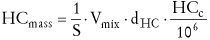

 dabei bedeuten: 8.2.1 HC mass die während der Prüfung emittierte Masse Kohlenwasserstoffe in g/km; 8.2.2 S die in Ziffer 7.5 dieses Anhanges definierte Strecke; 8.2.3 dHC die spezifische Dichte der Kohlenwasserstoffe bei einem mittleren Kohlenstoff/Wasserstoff-Verhältnis 1:1.85, 273.2 K und 101.33 kPa:0.619 kg/m 3 ; 8.2.4 HC c die Konzentration der Kohlenwasserstoffe im verdünnten Abgas-Luft-Gemisch in ppm, ausgedrückt als Kohlenstoff-Äquivalent (z.B. der Gehalt an Propan multipliziert mit 3) korrigiert durch die Grundkonzentration: 

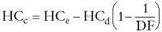

 dabei bedeuten: 8.2.4.1 HC e die Konzentration an Kohlenwasserstoffen in ppm, ausgedrückt als Kohlenstoff-Äquivalent des im Auffangbeutel SA enthaltenen Abgas-Luft-Gemisches; 8.2.4.2 HCd die Konzentration der Kohlenwasserstoffe in ppm, ausgedrückt als Kohlenstoff-Äquivalent der im Auffangbeutel SB gesammelten Verdünnungsluft; 8.2.4.3 DF der in Ziffer 8.4 dieses Anhanges definierte Verdünnungsfaktor. 8.2.5 V mix das verdünnte Gesamtabgasvolumen (vgl. Ziff. 8.1.5 dieses Anhanges). 8.3 Die Masse der während der Prüfung vom Auspuff des Fahrzeugs emittierten Stickoxide ist wie folgt zu berechnen: 

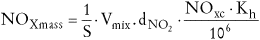

 dabei bedeuten: 8.3.1 NO Xmass die während der Prüfung emittierte Masse der Stickoxide in g/km; 8.3.2 S die in Ziffer 7.5 dieses Anhanges definierte Strecke; 8.3.3 dNO2 die spezifische Dichte der Stickoxide im Abgas, ausgedrückt als Stickstoffdioxid, bei 273.2 K und 101.33 kPa:2.05 kg/m3; 8.3.4 NO xc die Konzentration der Stickoxide im verdünnten Abgas-Luft-Gemisch in ppm, korrigiert durch die Grundkonzentration: 

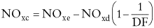

 dabei bedeuten: 8.3.4.1 NO xe die Konzentration der Stickoxide in ppm des im Auffangbeutel SA gesammelten verdünnten Abgas-Luft-Gemisches; 8.3.4.2 NO xd die Konzentration der Stickoxide in ppm der im Auffangbeutel SB enthaltenen Verdünnungsluft; 8.3.4.3 DF der in Ziffer 8.4 dieses Anhanges definierte Verdünnungsfaktor. 8.3.5 K H der Korrekturfaktor für die Feuchtigkeit 

 dabei bedeuten: 8.3.5.1 H die absolute Feuchtigkeit in Gramm Wasser je Kilogramm trockener Luft: 

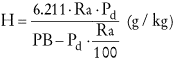

 dabei bedeuten: 8.3.5.1.1 Ra die relative Feuchte der Umgebungsluft in %; 8.3.5.1.2 Pd der Druck des gesättigten Wasserdampfes bei Prüftemperatur in kPa; 8.3.5.1.3 PB der atmosphärische Druck in kPa. 8.4 DF ist der Verdünnungsfaktor nach folgender Formel: 

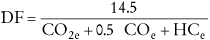

 8.4.1 CO e , CO 2e und HC e sind die Konzentrationen an Kohlenmonoxid, Kohlendioxid und Kohlenwasserstoffen des im Auffangbeutel SA enthaltenen verdünnten Abgas-Luft-Gemisches in %. Anlage 1 Fahrzyklus für Benzinmotoren bei Prüfung Typ I 

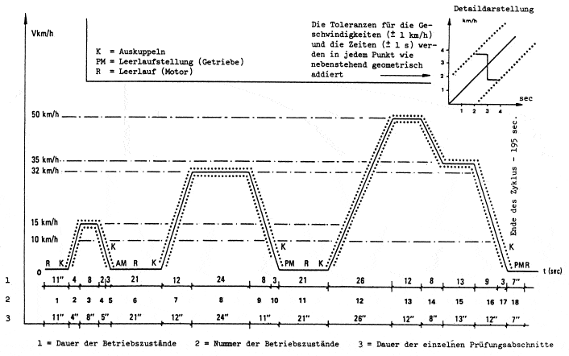

 Anlage 2 Beispiel einer Einrichtung für die Gas-Probeentnahme und für die Volumenmessung 

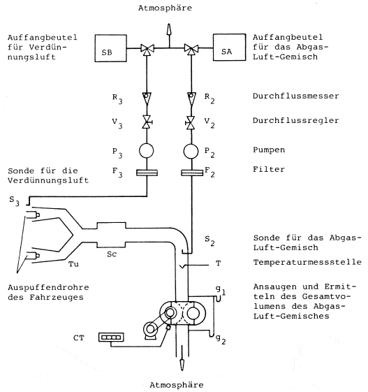

 Anlage 3 Beispiel einer Einrichtung für die Gas-Probeentnahme und für die Volumenmessung 

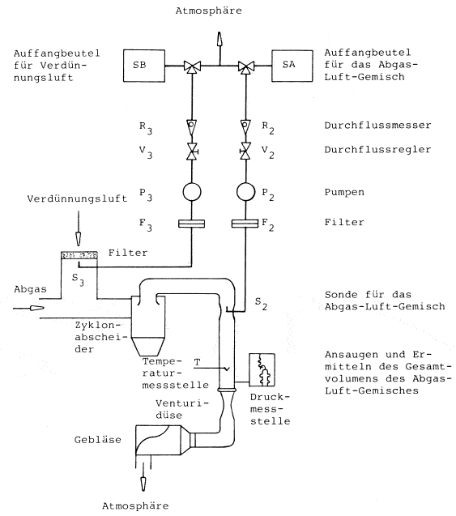

 Anlage 4 Methode zur Bestimmung der vom Fahrleistungsprüfstand für Motorräder aufgenommenen Leistung entsprechend einer Strassenfahrt Diese Anlage beschreibt das Verfahren zur Festlegung der vom Fahrleistungsprüfstand aufzunehmenden Leistung entsprechend der Strassenfahrt. Die aufgenommene Leistung umfasst die Reibungsverluste des Prüfstandes und die durch die Bremseinrichtung des Prüfstandes aufgenommene Leistung. Der Prüfstand wird zunächst mit einer über der Prüfgeschwindigkeit liegenden Geschwindigkeit betrieben. Die für den Antrieb des Prüfstandes verwendete Vorrichtung ist danach vom Prüfstand zu trennen, und die Umlaufgeschwindigkeit der Rollen (Rolle) nimmt ab. Die kinetische Energie der Anlage wird durch die Leistungsaufnahme und durch die Reibungsverluste des Prüfstandes vernichtet. Diese Methode vernachlässigt die durch die Masse der rotierenden Teile des Fahrzeuges verursachten und unterschiedlichen inneren Reibungen der Rollen. Der Zeitunterschied zwischen dem Stillstehen der hinteren freien Rolle und der angetriebenen Rolle kann bei Prüfständen mit zwei Rollen vernachlässigt werden. Es ist wie folgt vorzugehen: 1. Umlaufgeschwindigkeit der Rolle messen, sofern dies noch nicht erfolgt ist. Dazu kann ein fünftes Rad, ein Drehzahlmesser oder eine andere Einrichtung verwendet werden. 2. Fahrzeug auf den Prüfstand stellen oder eine andere Methode zum Antreiben desselben anwenden. 3. Schwungmasse oder ein anderes System zur Simulierung derselben zuschalten, entsprechend der Gewichtskategorie der am häufigsten auf dem Prüfstand geprüften Fahrzeuge. 4. Prüfstand auf eine Geschwindigkeit von 50 km/h bringen. 5. Aufgenommene Leistung festhalten. 6. Prüfstand auf eine Geschwindigkeit von 60 km/h bringen. 7. Die für den Antrieb des Prüfstandes verwendete Einrichtung lösen. 8. Zeit festhalten, welche der Prüfstand benötigt, um von einer Geschwindigkeit von 55 km/h auf eine solche von 45 km/h zu gelangen. 9. Vorrichtung zur Leistungsaufnahme auf einen anderen Bereich einstellen. 10. Vorstehende Arbeitsgänge 4-9 genügend oft wiederholen, um die auf der Strasse vorkommenden Leistungsbereiche zu erfassen. 11. Aufgenommene Leistung aus folgender Formel berechnen: 

 dabei bedeuten: P A = Leistung in kW M 1 = äquivalente Schwungmasse in kg V 1 = Anfangsgeschwindigkeit in m/s (55 km/h = 15.28 m/s) V 2 = Endgeschwindigkeit in m/s (45 km/h =12.50 m/s) t = von den Rollen benötigte Zeit in Sekunden, um von 55 auf 45 km/h zu gelangen. 12. Diagramm mit Angabe der vom Prüfstand aufgenommenen Leistung in bezug auf die angezeigte Leistung bei 50 km/h entsprechend dem vorerwähnten Prüfungsabschnitt 4. 

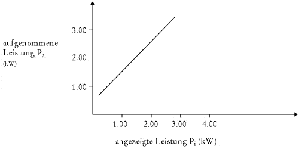

 Anhang 2 Verfahren zur Durchführung der Emissionsprüfung Typ II (Leerlauftest) 1. Einleitung Dieser Anhang beschreibt das Verfahren für die Emissionsprüfung Typ II nach Ziffer 5.3 dieser Verordnung. 2. Messvorschriften 2.1 Als Treibstoff ist der im Anhang 3 dieser Verordnung definierte Bezugstreibstoff zu verwenden. 2.2 Der Volumenanteil an Kohlenmonoxid und unverbrannten Kohlenwasserstoffen ist unmittelbar nach der Prüfung I bei leerlaufendem Motor zu messen. 2.3 Bei Fahrzeugen mit Handschaltgetriebe oder mit halbautomatischem Getriebe ist bei leerlaufendem Getriebe und eingekuppeltem Motor zu prüfen. 2.4 Bei Fahrzeugen mit automatischem Getriebe ist bei Stellung "Neutral" oder "Parken" des Gangwählers zu prüfen. 2.5 Einstellmöglichkeit der Gemischaufbereitungsanlage 2.5.1 Der Leerlauftest ist im folgenden Drehzahlbereich durchzuführen: 2.5.1.1 nach unten begrenzt durch den höheren der beiden folgenden Werte: - die niedrigstmögliche Motordrehzahl im Leerlauf; - die niedrigste vom Hersteller zugelassene Leerlaufdrehzahl abzüglich 100 min -1 ; 2.5.1.2 nach oben begrenzt durch den niedrigsten der drei folgenden Werte: - die höchste Motordrehzahl, die durch Einwirkung auf die Leerlaufeinstelleinrichtung zu erreichen ist; - die höchste vom Hersteller zugelassene Leerlaufdrehzahl zuzüglich 250 min -1 ; - die Einschaltdrehzahl bei automatischen Kupplungen. 2.5.2 Innerhalb des Drehzahlbereichs nach Ziff. 2.5.1 dieses Anhanges sind alle Einstelleinrichtungen, die einen Einfluss auf die Zusammensetzung des Leerlaufgemisches ausüben, in jeder möglichen Stellung zu prüfen, sofern sie nicht plombiert sind oder nur mit Spezialwerkzeug betätigt werden können. 2.5.3 Leerlaufeinstellungen, die keinen einwandfreien Betrieb des Motors gestatten, sind als Messpunkte nicht zu berücksichtigen. Bei Motoren mit mehreren Vergasern sind alle Vergaser gleich einzustellen. 3. Gasentnahme 3.1 Das Auspuffende ist mit einer genügend abdichtenden Verlängerung zu versehen, damit die Gas-Entnahmesonde wenigstens 60 cm weit in das Auspuffrohr eingeführt werden kann; dabei darf der Gegendruck nicht um mehr als 125 mm WS ansteigen und das Betriebsverhalten des Fahrzeugs nicht gestört werden. Die Form der Verlängerung darf an der Entnahmesonde keine wesentliche Verdünnung der Abgase bewirken. Besitzt das Fahrzeug mehrere Auspuffendrohre, so sind diese entweder zu einem gemeinsamen Rohr zusammenzuführen oder die Kohlenmonoxid-Messung ist in jedem von ihnen auszuführen, wobei als Messergebnis der arithmetische Mittelwert gilt. 3.2 Der Gehalt an CO (CCO) und CO2 (CCO2) ist nach Ablesung des Messinstrumentes oder des Registriergerätes unter Verwendung der entsprechenden Eichkurven zu ermitteln. 3.3 Der korrigierte Gehalt an Kohlenmonoxid beträgt bei Zweitaktmotoren: 

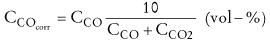

 3.4 Der korrigierte Gehalt an Kohlenmonoxid beträgt bei Viertaktmotoren: 

 3.5 Die nach den Formeln in den Ziffern 3.3 oder 3.4 dieses Anhanges ermittelte Konzentration an C CO (nach Ziff. 3.2 dieses Anhanges) braucht nicht korrigiert zu werden, wenn die Summe der gemessenen Konzentrationen ( C CO + C CO2 ) - bei Zweitaktmotoren mindestens 10, - bei Viertaktmotoren mindestens 15 beträgt. Anhang 3 Technische Beschreibung des Referenz-Treibstoffs Referenz Treibstoff CEC RF 08-A-85, Typ: Superbenzin, unverbleit Grenzwerte und Einheiten ASTM- min. max. Verfahren ROZ 95.0 D 2699 MOZ 85.0 D 2700 Dichte bei 15°C 0.748 0.762 D 1298 Dampfdruck (nach Reid) 0.56 bar 0.64 bar D 323 Siedeverlauf - Siedebeginn 24°C 40°C D 86 - 10 Volumenprozent-Destillat 42°C 58°C D 86 - 50 Volumenprozent-Destillat 90°C 110°C D 86 - 90 Volumenprozent-Destillat 155°C 180°C D 86 - Siedeende 190°C 215°C D 86 Rückstand 2 % D 86 Analyse der Kohlenwasserstoffe - Alkene 20 vol-% D 1319 - Aromaten (einschliesslich 5 vol % max. Benzol*) 45 vol-% *D 3606/ D 2267 - Alkane Rest D 1319 Verhältnis Kohlenstoff/ Wasserstoff ist anzugeben Oxidationsbeständigkeit 480 Min. D 525 Abdampfrückstand 4 mg/100 ml D 381 Schwefelgehalt 0.04 Masse % D 1266/ D 2622/ D 2785 Kupferkorrosion bei 50° 1 D 130 Bleigehalt 0.005 g/l D 3237 Phosphorgehalt 0.0013 g/l D 3231 *Zusatz von sauerstoffhaltigen Komponenten verboten Inhaltsverzeichnis Verordnung Seite 1. Geltungsbereich 1 2. Definitionen 1 3. Allgemeine Vorschriften 2 4. Antrag für eine Abgas-Typengenehmigung 3 5. Emissionsprüfungen und Grenzwerte 4 6. Änderung des Fahrzeugtyps 6 7. Ausdehnung der Abgas-Typengenehmigung 6 8. Übereinstimmung der Herstellung (Produktionsüberprüfung) 7 9. Entzug der Abgas-Typengenehmigung 9 10. Schlussbestimmungen 10 Anhänge Anhang 1: Verfahren zur Durchführung der Emissionsprüfung Typ I (Fahrzyklustest) mit 4 Anlagen 11 Anhang 2: Verfahren zur Durchführung der Emissionsprüfung Typ II (Leerlauftest) 35 Anhang 3: Beschreibung des Referenz-Treibstoffs 38
