Verordnung vom 18. August 1987 über die Abgasemissionen von Motorfahrrädern (FAV 4) Aufgrund von Art. 7 und 99 des Strassenverkehrsgesetzes vom 30. Juni 1978, LGBl. 1978 Nr. 18 , verordnet die Regierung: 1. Geltungsbereich 1.1 Diese Verordnung gilt für die Prüfung von Motorfahrrädern (Art. 18 der Verordnung vom 16. Juli 1996 über die technischen Anforderungen an Strassenfahrzeuge [VTS]) mit Fremdzündungsmotoren hinsichtlich der Emission gasförmiger Schadstoffe. 2. Definitionen Im Sinne dieser Verordnung bedeuten: 2.1 "Abgasemission": Die aus der Auspuffanlage eines Fahrzeugmotors in die Atmosphäre ausgestossenen gasförmigen Schadstoffe. 2.2 "Abgas-Typengenehmigung": Die von der Typenprüfstelle aufgrund dieser Verordnung erteilte Genehmigung eines Fahrzeugtyps hinsichtlich der Emission gasförmiger Schadstoffe. 2.3 "Bezugsmasse": Leergewicht des betriebsbereiten, unbesetzten Fahrzeugs in serienmässiger Ausführung, inbegriffen Zubehör, mit mindestens zu 90 Prozent seines Fassungsvermögens gefülltem Treibstoffbehälter sowie einer einheitlichen Zusatzlast von 75 kg. 2.4 "Fahrzeugtyp": Typenbezeichnung einer Baureihe durch den Fahrzeughersteller, deren Fahrzeuge untereinander keine wesentlichen Unterschiede aufweisen, namentlich hinsichtlich der abgasrelevanten Teile des Motors und des Fahrzeugs sowie der von der Bezugsmasse abhängigen äquivalenten Schwungmasse nach Anhang 1 Ziff. 5.2 dieser Verordnung. 2.5 "Gasförmige Schadstoffe": Kohlenmonoxid CO, Kohlenwasserstoffe HC (ausgedrückt als CH 1,85 ) und Stickoxide NOx (ausgedrückt als NO 2 -Äquivalent). 2.6 "Prüfstelle": Die von der Typenprüfstelle beauftragte oder ermächtigte Prüfstelle zur Durchführung von Emissionsmessungen an Prüffahrzeugen und von Produktionsüberprüfungen. 2.7 "Typenprüfstelle": Die von der Regierung bezeichnete Typenprüfstelle. 3. Allgemeine Vorschriften 3.1 Haltbarkeit Alle Teile des Fahrzeugs und des Motors, die einen Einfluss auf die Emission gasförmiger Schadstoffe haben können, müssen so beschaffen und eingebaut sein, dass das Fahrzeug bei betriebsüblicher Beanspruchung und trotz der Einwirkung von Hitze, Kälte und Erschütterungen den Vorschriften dieser Verordnung entspricht. 3.2 Betrieb mit unverbleitem Treibstoff Die Fahrzeugmotoren müssen so konstruiert sein, dass sie mit handelsüblichem unverbleitem Treibstoff dauernd und zufriedenstellend funktionieren. Motoren mit Gemischschmierung müssen ausserdem für die Beimischung von höchstens zwei Prozent synthetischem Öl zum Treibstoff geeignet sein. 3.3 Vorhandensein einer Abgas-Typengenehmigung 3.3.1 Damit ein Motorfahrrad zur Typenprüfung zugelassen werden kann, muss eine Abgas-Typengenehmigung für den betreffenden Fahrzeugtyp vorhanden sein. 3.3.2 Um eine Abgas-Typengenehmigung zu erhalten, muss der Fahrzeughersteller bei der Typenprüfstelle einen Antrag nach Ziff. 4 einreichen. 3.4 Durchführung der Abgasprüfungen 3.4.1 Die Abgasprüfungen nach Ziff. 5 dieser Verordnung werden bei der liechtensteinischen Prüfstelle oder im Einverständnis mit der Typenprüfstelle beim Fahrzeughersteller oder bei einer anerkannten ausländischen Prüfstelle durchgeführt. 3.4.2 Werden die Abgasprüfungen beim Fahrzeughersteller oder bei einer ausländischen Prüfstelle durchgeführt, so müssen geeignete Prüfeinrichtungen vorhanden sein, die den Anforderungen der Anhänge 1 und 2 dieser Verordnung entsprechen und ordnungsgemäss ausgerüstet und unterhalten sind. Die Typenprüfstelle kann die Prüfeinrichtungen mit dem Einverständnis der ausländischen Behörden kontrollieren. Ist diese Kontrolle nicht möglich oder entspricht ihr Ergebnis den Anforderungen dieser Verordnung nicht, so kann die Typenprüfstelle für die entsprechenden Fahrzeuge Nachprüfungen bei einer von ihr bezeichneten Abgasprüfstelle anordnen. 3.5 Erteilung einer Abgas-Typengenehmigung Die Typenprüfstelle erteilt die Abgas-Typengenehmigung, wenn sie aufgrund der vom Antragsteller unterbreiteten Prüfergebnisse sowie der Ergebnisse allfälliger zusätzlicher Nachprüfungen der Prüffahrzeuge feststellt, dass der Fahrzeugtyp allen Anforderungen dieser Verordnung entspricht und alle verlangten technischen Angaben im Antrag vorhanden sind. 4. Antrag für eine Abgas-Typengenehmigung 4.1 Der Antrag für eine Abgas-Typengenehmigung muss der Typenprüfstelle in einfacher Ausfertigung zugestellt werden. 4.2 Der Antrag muss in deutscher, französischer, italienischer oder englischer Sprache abgefasst und von einer zur Unterschrift berechtigten Person unterzeichnet sein. 4.3 Dem Antrag sind eine Beschreibung des Fahrzeugtyps, die technischen Daten und Einstellmerkmale des Motors und der Auspuffanlage sowie die Resultate der nach Ziff. 5 dieser Verordnung durchgeführten Emissionsmessungen beizufügen. 4.4 Zur Einreichung der notwendigen Angaben hat der Antragsteller die offiziellen Formulare der Typenprüfstelle oder eigene, im Aufbau übereinstimmende Formulare zu verwenden. 5. Emissionsprüfungen und Grenzwerte 5.1 Das für die Emissionsprüfungen vorgesehene Fahrzeug muss in allen Teilen der im Antrag für eine Abgas-Typengenehmigung beschriebenen Ausführung und Motoreinstellung entsprechen. Das Fahrzeug ist den beiden in den nachstehenden Ziff. 5.2 und 5.3 beschriebenen Emissionsmessungen zu unterziehen. Bei Fahrzeugen mit 4-Takt-Motoren ist ausserdem eine Kontrolle der Kurbelgehäuse-Entlüftung nach Ziff. 5.4 vorzunehmen. 5.2 Prüfung Typ I (Fahrzyklustest) 5.2.1 Das Fahrzeug ist auf einen Fahrleistungsprüfstand zu bringen, der mit Bremse und Schwungmasse ausgerüstet ist. Die Prüfung dauert insgesamt 448 Sekunden und umfasst vier Messzyklen, die ohne Unterbrechung durchzuführen sind. Jeder Zyklus muss sieben Prüfungsabschnitte enthalten (Leerlauf, Beschleunigung, konstante Geschwindigkeit, Verzögerung usw.). Während der Prüfung sind die Auspuffgase mit Luft zu verdünnen, um einen konstanten Volumenstrom des Gemisches zu erhalten. Während der ganzen Prüfung sind aus dem so erhaltenen Gemisch Proben mit konstant bleibender Durchflussmenge zu entnehmen und in einem Beutel für die anschliessende Bestimmung der Konzentrationen (Mittelwerte der Prüfung) von Kohlenmonoxid, unverbrannten Kohlenwasserstoffen und Stickoxiden aufzufangen. 5.2.2 Die Prüfung ist nach dem in Anhang 1 beschriebenen Verfahren durchzuführen. Für die Sammlung und Analyse der Abgase sind die dort vorgeschriebenen Methoden anzuwenden. 5.2.3 Unter Vorbehalt von Ziff. 5.2.5 wird die Prüfung dreimal durchgeführt. Die bei jeder Prüfung ermittelten Mengen an Kohlenmonoxid, Kohlenwasserstoffen und Stickoxiden dürfen die in der nachstehenden Tabelle angegebenen Grenzwerte nicht übersteigen: Schadstoffe Grenzwerte L in g/km Kohlenmonoxid 0.50 Kohlenwasserstoffe 0.50 Stickoxide 0.10 5.2.4 Bei jedem der in Ziff. 5.2.3 genannten Schadstoffe darf jedoch eines der drei gemessenen Ergebnisse den vorstehend für das Bezugsfahrzeug zulässigen Grenzwert um nicht mehr als zehn Prozent überschreiten, falls das arithmetische Mittel der drei Ergebnisse unter dem zulässigen Grenzwert liegt. Werden die zulässigen Grenzwerte bei mehreren Schadstoffen überschritten, so dürfen diese Überschreitungen sowohl bei ein und derselben Prüfung als auch bei verschiedenen Prüfungen auftreten. 5.2.5 Die Zahl der in Ziff. 5.2.3 vorgeschriebenen Prüfungen wird unter den nachstehend festgelegten Bedingungen verringert; dabei bezeichnet V 1 das Ergebnis der ersten Prüfung und V 2 das Ergebnis der zweiten Prüfung jedes der in Ziff. 5.2.3 genannten Schadstoffe. 5.2.5.1 Es wird nur eine einzige Prüfung durchgeführt, falls bei den genannten Schadstoffen V 1 ≤ 0,70 L ist. 5.2.5.2 Es werden nur zwei Prüfungen durchgeführt, falls bei den genannten Schadstoffen V 1 ≤ 0,85 L, jedoch bei mindestens einem der Schadstoffe V 1 > 0,70 L ist. Überdies muss bei jedem der genannten Schadstoffe V 2 den Bedingungen V 1 + V 2 < 1,70 L und V 2 < L genügen. 5.3 Prüfung Typ II (Leerlauftest) 5.3.1 Die Prüfung ist nach dem im Anhang 2 dieser Verordnung beschriebenen Verfahren durchzuführen. 5.3.2 Der Gehalt an Kohlenmonoxid und an Kohlenwasserstoffen der bei Leerlauf emittierten Auspuffgase darf je 0,10 g pro Minute nicht übersteigen. 5.4 Kontrolle der Kurbelgehäuse-Entlüftung 5.4.1 Die Gase und Dämpfe aus dem Kurbelgehäuse müssen dem Motor vollständig zur Verbrennung zurückgeführt werden. 5.4.2 Die Kontrolle erfolgt durch Augenschein. Geprüft werden die Montage und der Zustand der für die Rückführung der Gase und Dämpfe aus dem Kurbelgehäuse in den Verbrennungsraum dienenden Einrichtungen und Teile, wie Leitungen, Schraubenanschlüsse, Deckel usw. 6. Änderung des Fahrzeugtyps 6.1 Jede Änderung des Fahrzeugtyps ist der Typenprüfstelle mitzuteilen. 6.2 Diese kann, auf Kosten des Fahrzeugherstellers, neue Abgasprüfungen nach Ziff. 5 anordnen, wenn sie Grund zur Annahme hat, dass die vorgenommene Änderung die Schadstoffemissionen ungünstig beeinflusst. 7. Ausdehnung der Abgas-Typengenehmigung 7.1 Fahrzeugtypen mit verschiedenen Bezugsmassen Die Abgas-Typengenehmigung darf auf Fahrzeugtypen, die sich vom genehmigten Typ nur durch die Bezugsmasse unterscheiden, ausgedehnt werden, sofern die Bezugsmasse des Fahrzeugtyps, für den die Ausdehnung der Abgas-Typengenehmigung beantragt wird, lediglich zur Anwendung der nach unten am nächsten gelegenen Schwungmasseäquivalenten führt. 7.2 Fahrzeugtypen mit verschiedenen Gesamtübersetzungen 7.2.1 Die für einen Fahrzeugtyp erteilte Abgas-Typengenehmigung darf unter den nachstehenden Bedingungen auf solche Fahrzeugtypen ausgedehnt werden, die sich von dem genehmigten Typ lediglich durch die Gesamtübersetzung unterscheiden: 7.2.1.1 Für jede Übersetzung, die bei der Prüfung des Typs I benützt wird, ist das Verhältnis 

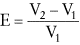

 zu ermitteln; hierbei bedeuten V 1 und V 2 die einer Motordrehzahl von 1000/min zugeordnete Geschwindigkeit des genehmigten Fahrzeugtyps bzw. des Fahrzeugtyps, für den die Ausdehnung beantragt wird. 7.2.2 Falls für jede Übersetzung das Verhältnis E ≤ 8 Prozent ist, so wird die Ausdehnung ohne Wiederholung der Prüfungen des Typs I genehmigt. 7.2.3 Ist für mindestens eine Übersetzung, die bei der Prüfung des Typs I benutzt wird, das Verhältnis E > 8 Prozent und für jede Übersetzung das Verhältnis E ≤ 13 Prozent, so sind die Prüfungen des Typs I zu wiederholen. 7.3 Fahrzeugtypen mit verschiedenen Bezugsmassen und verschiedenen Gesamtübersetzungen Die für einen Fahrzeugtyp erteilte Abgas-Typengenehmigung darf auf Fahrzeugtypen, die sich vom genehmigten Typ nur durch die Bezugsmasse und durch die Gesamtübersetzungen unterscheiden, ausgedehnt werden, wenn die Vorschriften nach den Ziff. 7.1 und 7.2 eingehalten sind. 8. Übereinstimmung der Herstellung (Produktionsüberprüfung) 8.1 Alle Fahrzeuge einer typengenehmigten Ausführung, die in Liechtenstein in den Handel gebracht bzw. neu in Verkehr gesetzt werden, müssen mit dem abgasgenehmigten Typ übereinstimmen, namentlich hinsichtlich der Bauteile, die auf die Emission gasförmiger Schadstoffe aus dem Motor einen Einfluss haben. 8.2 Die Typenprüfstelle führt mit Fahrzeugen, für die eine Abgasgenehmigung vorliegt, in von ihr zu bestimmenden Zeitabständen Produktionsüberprüfungen durch. Sie führt diese anhand der Angaben im Antrag für die Abgas-Typengenehmigung durch und/oder ordnet Emissionsprüfungen nach Ziff. 5 an. 8.3 Der Fahrzeughersteller hat die für die Produktionsüberprüfung vorgesehenen Fahrzeuge zur Verfügung zu stellen und trägt sämtliche Kosten bis zu deren Abschluss. 8.4 Die Typenprüfstelle gibt dem Fahrzeughersteller die Resultate der Überprüfungen unverzüglich bekannt. Erfordern die Prüfergebnisse vom Fahrzeughersteller verbindliche Massnahmen, so wird dies in der Benachrichtigung erwähnt. 8.5 Erste Stichprobe 8.5.1 Für die erste Stichprobe wird ein Fahrzeug von der Typenprüfstelle aus der Serie ausgewählt und den nach Ziff. 8.2 angeordneten Prüfungen unterzogen. 8.5.2 Werden bei der ersten Stichprobe alle Emissionsgrenzwerte nach Ziff. 5.2.3 und 5.3.2 eingehalten und stimmt die emissionsrelevante Ausrüstung mit den Angaben im Antrag für die Abgas-Typengenehmigung überein, so gilt die Produktionsüberprüfung als bestanden. 8.5.3 Werden bei der ersten Stichprobe nicht alle Emissionsgrenzwerte eingehalten oder stimmt die emissionsrelevante Ausrüstung nicht mit den Angaben im Antrag für die Abgas-Typengenehmigung überein, so hat sich der Fahrzeughersteller innert 30 Tagen seit Benachrichtigung durch die Typenprüfstelle für eine der beiden folgenden Möglichkeiten zu entscheiden: a) Er verpflichtet sich, alle bereits verkauften und inskünftig zu verkaufenden fehlerhaften Fahrzeuge auf seine Kosten instandzustellen. Die hierbei zu treffenden Massnahmen und deren zeitliche Durchführung sind mit der Typenprüfstelle schriftlich zu vereinbaren. b) Er verlangt die Durchführung weiterer Prüfungen anhand einer endgültigen Stichprobe nach Ziff. 8.6. 8.6 Endgültige Stichprobe 8.6.1 Die Typenprüfstelle legt nach Rücksprache mit dem Fahrzeughersteller den Umfang der endgültigen Stichprobe (max. 19 Fahrzeuge) fest und wählt aus der Serie die zu prüfenden Fahrzeuge aus, worunter auch das ursprünglich geprüfte Fahrzeug sein muss. Mit Ausnahme des letzteren sind die ausgewählten Fahrzeuge den von der Typenprüfstelle nach Ziff. 8.2 angeordneten Emissionsmessungen zu unterziehen. Für jeden gasförmigen Schadstoff ist das arithmetische Mittel 

 der aus der Stichprobe ermittelten Ergebnisse sowie die Standardabweichung S der Stichprobe zu bestimmen. 8.6.2 Die Produktionsüberprüfung gilt als bestanden, wenn die emissionsrelevante Ausrüstung aller geprüften Fahrzeuge mit den Angaben im Antrag für die Abgas-Typengenehmigung übereinstimmt und die folgende Bedingung erfüllt ist: 

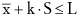

 L: zulässiger Grenzwert nach Ziff. 5.2.3 und 5.3.2 für jeden untersuchten gasförmigen Schadstoff S 2 = 

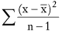

 , wobei x ein beliebiges der n Einzelergebnisse ist k: statistischer Faktor, der von n abhängt und in der folgenden Tabelle angegeben ist: n 2 3 4 5 6 7 8 9 10 k 0.973 0.613 0.489 0.421 0.376 0.342 0.317 0.297 0.279 n 11 12 13 14 15 16 17 18 19 k 0.265 0.253 0.242 0.233 0.224 0.216 0.210 0.203 0.198 8.6.3 Ist die Produktionsüberprüfung nicht bestanden, so wird, unter Vorbehalt von Ziff. 8.6.4, die Abgas-Typengenehmigung entzogen. Das Verfahren richtet sich nach Ziff. 9. 8.6.4 Die Abgas-Typengenehmigung wird nicht entzogen, wenn sich der Fahrzeughersteller gegenüber der Typenprüfstelle innert 30 Tagen seit Benachrichtigung dazu verpflichtet, alle bereits verkauften und inskünftig zu verkaufenden Fahrzeuge, auf seine Kosten, instandzustellen. Die hierbei zu treffenden Massnahmen und deren zeitliche Durchführung sind mit der Typenprüfstelle schriftlich zu vereinbaren. 9. Entzug der Abgas-Typengenehmigung 9.1 Im Falle von Ziff. 8.6.3 oder wenn der Fahrzeughersteller seinen Verpflichtungen nach Ziff. 8.5.3 oder 8.6.4 in zeitlicher oder materieller Hinsicht nicht nachkommt und keine befriedigende Begründung abgibt, so wird die Abgas-Typengenehmigung für den betreffenden Fahrzeugtyp entzogen. 9.2 Die Typenprüfstelle unterrichtet den Fahrzeughersteller unverzüglich über den Entzug der Abgas-Typengenehmigung. Von diesem Zeitpunkt an werden die Typenscheine für die entsprechenden Fahrzeugtypen ungültig, und es darf keines der betroffenen Fahrzeuge mehr in den Handel gebracht und neu zum Verkehr zugelassen werden. Die Typenprüfstelle verpflichtet den Hersteller, alle bereits verkauften fehlerhaften Fahrzeuge in geeigneter Weise instandzustellen. 10. Schlussbestimmungen 10.1 Übergangsbestimmungen 10.1.1 Die Bestimmungen dieser Verordnung gelten für die erstmalige Zulassung aller ab 1. Oktober 1988 eingeführten oder in Liechtenstein hergestellten Fahrzeuge. 10.1.2 Abgas-Typengenehmigungen können ab Inkrafttreten dieser Verordnung ausgestellt werden. 10.2 Inkrafttreten Diese Verordnung tritt am Tage der Kundmachung in Kraft. Fürstliche Regierung: gez. Hans Brunhart Fürstlicher Regierungschef Anhang 1 Verfahren zur Durchführung der Emissionsprüfung Typ I (Fahrzyklustest) 1. Einleitung Dieser Anhang beschreibt das Verfahren für die Emissionsprüfung Typ I (Fahrzyklustest) nach Ziffer 5.2 dieser Verordnung. 2. Fahrzyklus auf dem Fahrleistungsprüfstand Beschreibung des Zyklus Auf dem Fahrleistungsprüfstand ist der Zyklus zu fahren, der in der folgenden Tabelle und in der Anlage 1 beschrieben ist. Nr. Betriebszustand Beschleunigung (m/s 2 ) Geschwindigkeit (km/h) Dauer (s) Gesamt zeit (s) 1 Leerlauf - - 8 8 2 Beschleunigung Vollgas 0 - max. 57 - 3 Konstante Geschwindigkeit Vollgas max. 57 - 4 Verzögerung - 0.56 max. - 20 57 65 5 Konstante Geschwindigkeit - 20 36 101 6 Verzögerung - 0.93 20 - 0 6 107 7 Leerlauf - - 5 112 2.2 Allgemeine Vorschriften für die Durchführung des Fahrzyklus Wenn nötig ist in Vorversuchszyklen die günstigste Art der Betätigung des Gasdrehgriffes und des Bremshebels zu ermitteln. 2.3 Toleranzen 2.3.1 Während aller Prüfungsabschnitte des Zyklus sind Abweichungen um ( 1 km/h von der theoretischen Geschwindigkeit zulässig. Beim Übergang von einem Prüfungsabschnitt zum anderen sind Abweichungen von den vorgeschriebenen Toleranzen zulässig, sofern deren Dauer jeweils 0.5 Sekunden nicht überschreitet. Verzögert das Fahrzeug ohne Einsatz der Bremsen schneller als vorgesehen, so ist nach Ziffer 6.2.5.3 dieses Anhanges vorzugehen. 2.3.2 Zeittoleranzen von ( 0,5 Sekunden, bezogen auf die theoretischen Zeiten, sind zulässig. 2.3.3 Die Toleranzen für Geschwindigkeit und Zeit sind nach den Angaben der Anlage 1 dieses Anhanges zusammenzufassen. 3. Fahrzeug und Treibstoff 3.1 Prüffahrzeug 3.1.1 Das Fahrzeug ist in gutem mechanischem Zustand vorzuführen. Es muss eingefahren sein und vor der Prüfung mindestens 250 km zurückgelegt haben. 3.1.2 Die Auspuffanlage darf keine Lecks aufweisen, die zu einer Verringerung der Menge der gesammelten Gase führen können; diese Menge muss der aus dem Motor austretenden Abgasmenge entsprechen. 3.1.3 Die Dichtheit des Ansaugsystems soll überprüft werden, um sicherzustellen, dass der Verbrennungsvorgang nicht durch eine ungewollte Luftzufuhr geändert wird. 3.1.4 Der Motor und die Betätigungseinrichtungen müssen nach Herstellerangabe eingestellt sein. 3.2 Treibstoff Als Treibstoff ist der im Anhang 3 dieser Verordnung definierte Referenztreibstoff zu verwenden. Wird der Motor durch ein Treibstoff-Öl-Gemisch geschmiert, so ist dem Referenztreibstoff ein Öl beizumischen, dessen Qualität den Empfehlungen des Herstellers entspricht. 4. Prüfeinrichtungen 4.1 Fahrleistungsprüfstand Die wichtigsten Merkmale des Prüfstandes sind folgende: - Einrollenprüfstand, jedes angetriebene Rad berührt die Rolle - Durchmesser der Rolle: ≥ 400 mm - Ermittlung des Diagramms der aufgenommenen Leistung: Der Prüfstand soll ermöglichen, die während einer Fahrt auf ebener Fahrbahn und bei annähernder Windstille vom Motor abgegebene Leistung bei einer Geschwindigkeit ab 12 km/h mit einer Genauigkeit von ± 15 % darzustellen. Ist dies nicht möglich, so ist die von den Bremsen und von den inneren Reibungen des Prüfstandes aufgenommene Leistung (P A ) wie folgt zu ermitteln: - für eine Geschwindigkeit von 0 < V ≤ 12 km/h: 0 ≤ P A ≤ kV 3 12 + 5 % kV 3 12 + 5 % P V50 - für eine Geschwindigkeit von V >12 km/h: P A = kV 3 ± 5 % kV 3 ± 5 % P V50 ohne dass das Ergebnis negativ wird. (Das Kalibrierungsverfahren muss den Vorschriften der Anlage 4 dieses Anhanges entsprechen.) - Ausgangsschwungmasse: 100 kg - zusätzliche Schwungmassen : von 10 zu 10 kg - Die Rolle ist mit einem Drehzahl-Zählwerk mit Null-rückstellung zur Messung der tatsächlich zurückgelegten Strecke auszurüsten. 4.2 Einrichtung zum Auffangen der Gase Die Gasauffangeinrichtung besteht aus den nachstehend genannten Bestandteilen (vgl. Anlagen 2 und 3 dieses Anhanges): 4.2.1 Einer Einrichtung zum Auffangen aller bei der Prüfung emittierten Abgase, wobei der atmosphärische Druck an der oder den Auspuffgasöffnungen des Fahrzeugs aufrecht erhalten bleibt. 4.2.2 Einer Rohrleitung zur Verbindung der Gasauffangeinrichtungen und des Abgasentnahmesystems. Diese Leitung und die Auffangeinrichtung müssen aus rostfreiem Stahl oder einem anderen Material bestehen, das die Zusammensetzung des aufgefangenen Gases nicht beeinflusst und ausreichend temperaturbeständig ist. 4.2.3 Einer Einrichtung, die die verdünnten Gase absaugt. Diese Einrichtung muss eine konstante und ausreichende Förderleistung gewährleisten, um das Ansaugen der gesamten Abgasmenge sicherzustellen. 4.2.4 Einer am Eintritt der Gasauffangeinrichtung ausserhalb angebrachten Sonde S3, um während der Prüfdauer mittels einer Pumpe, eines Filters und eines Durchflussreglers einen konstanten Teilstrom der Verdünnungsluft aufzufangen. 4.2.5 Einer gegen die Strömungsrichtung des verdünnten Gases gerichteten Sonde S2, um während der Prüfdauer erforderlichenfalls mittels eines Filters, eines Durchflussreglers und einer Pumpe einen konstanten Teilstrom des Abgas-Luft-Gemisches aufzufangen. Die Durchflussmenge in den beiden vorgenannten Probeentnahme-Systemen muss wenigstens 150 l/h betragen. 4.2.6 Dreiwegventile in den obengenannten Probeentnahmekreisläufen, um die Probegasströme während der Prüfdauer entweder nach aussen oder in die jeweiligen Auffangbeutel zu leiten. 4.2.7 Die Verdünnungsluft und das Abgas-Luft-Gemisch werden in gasdichten Auffangbeuteln gesammelt, die gegenüber den betreffenden Schadstoffen inert und genügend gross sein müssen, um das normale Einströmen der Probe nicht zu behindern. Diese Auffangheutel müssen einen automatischen Verschluss haben und sich schnell und gut abdichtend an der Probeentnahmeanlage oder bei Versuchsende an der Analyseanlage befestigen lassen. 4.3 Analysegeräte 4.3.1 Als Entnahmesonde darf das Entnahmerohr, das zu den Auffangbeuteln führt, oder das Ablassrohr der Beutel verwendet werden. Diese Sonde muss aus rostfreiem Stahl oder aus einem Material bestehen, das die Zusammensetzung der Gase nicht beeinflusst. Die Entnahmesonde und das Verbindungsrohr zum Analysegerät müssen Umgebungstemperatur haben. 4.3.2 Bei den Analysegeräten muss es sich um folgende Typen handeln: - nichtdispersive Infrarot-Analysegeräte für Kohlenmonoxid; - Flammenionisations-Analysegeräte für Kohlenwasserstoffe; - Chemilumineszenz-Analysegeräte für Stickoxide. 4.4 Genauigkeit der Geräte und der Messungen 4.4.1 Die Bremse ist durch eine besondere Prüfung zu eichen (vgl. Ziff. 5.1 dieses Anhanges). Deshalb wird die Genauigkeit des Rollenprüfstandes nicht angegeben. Die Gesamtträgheit der umlaufenden Massen einschliesslich der Rolle und des Bremsenrotors (vgl. Ziff. 4.1 dieses Anhanges) ist auf ± 5 kg genau zu messen. 4.4.2 Die vom Fahrzeug zurückgelegte Strecke ist aus den Rollenumdrehungen zu ermitteln; die Bestimmung muss auf ± 10 m genau vorgenommen werden. 4.4.3 Die Geschwindigkeit des Fahrzeugs ist aus der Drehzahl der Rolle zu ermitteln; die Bestimmung muss für Geschwindigkeiten oberhalb 10 km/h auf ± 1 km/h genau vorgenommen werden. 4.4.4 Die Umgebungstemperatur muss auf ± 2°C genau gemessen werden. 4.4.5 Der atmosphärische Druck muss auf ± 0.1 kPa genau gemessen werden. 4.4.6 Die relative Feuchtigkeit der Umgebungsluft muss auf ± 5 % genau gemessen werden. 4.4.7 Die zur Messung des Gehalts der verschiedenen Schadstoffe geforderte Genauigkeit muss ± 3 % betragen, wobei die Genauigkeit der Eichgase unberücksichtigt bleibt. Die Gesamtansprechzeit des Analysekreislaufs muss unter einer Minute liegen. 4.4.8 Die Konzentration der Eichgase darf um nicht mehr als ± 2 % vom Bezugswert jedes einzelnen Gases abweichen. Zur Verdünnung ist für Kohlenmonoxid und Stickoxide gereinigter Stickstoff und für Kohlenwasserstoffe (Propan) synthetische Luft zu verwenden. 4.4.9 Die Geschwindigkeit des Kühlluftstroms muss auf ± 5 km/h genau gemessen werden. 4.4.10 Die für die Dauer der Zyklen und die Gasentnahmevorgänge zulässige Toleranz beträgt ± 1 Sekunde. Diese Zeiten sind mit einer Genauigkeit von 0.1 Sekunden zu messen. 4.4.11 Die Gesamtmenge der verdünnten Gase muss auf ± 3 % genau gemessen werden. 4.4.12 Die gesamte Durchflussmenge und die Entnahmemenge müssen auf ± 5 % genau konstant bleiben. 5. Vorbereitung der Prüfung 5.1 Einstellung der Bremse des Prüfstandes Die Bremse ist so einzustellen, dass die Geschwindigkeit des Fahrzeugs auf dem Prüfstand bei Vollgas der erreichbaren Höchstgeschwindigkeit des Fahrzeugs mit einer Toleranz von ± 1 km/h entspricht. Diese auf der Strasse erreichbare Höchstgeschwindigkeit darf um nicht mehr als ± 2 km/h von der vom Hersteller angegebenen bauartbedingten Höchstgeschwindigkeit abweichen. Verfügt das Fahrzeug über eine Regeleinrichtung für die Höchstgeschwindigkeit auf der Strasse, so ist die Wirkung dieser Einrichtung zu berücksichtigen. 5.2 Anpassung der äquivalenten Schwungmasse an die translatorisch bewegten Massen des Fahrzeugs Das Schwungrad oder die Schwungräder sind so einzustellen, dass eine Gesamtträgheit der umlaufenden Massen erzielt wird, die der Bezugsmasse des Fahrzeugs entsprechend den in der folgenden Tabelle angegebenen Grenzwerten entspricht: Bezugsmasse des Fahrzeugs Äquivalente Schwungmassen P (kg) (kg) P ≤ 105 100 105 < P ≤ 115 110 115 < P ≤ 125 120 125 < P ≤ 135 130 135 < P ≤ 145 140 145 < P ≤ 165 150 165 < P ≤ 185 170 185 < P ≤ 205 190 205 < P ≤ 225 210 5.3 Kühlung des Fahrzeugs 5.3.1 Während der Dauer der Prüfung ist ein Zusatzgebläse so vor dem Fahrzeug aufzustellen, dass sein Kühlluftstrom auf den Motor gerichtet ist. Die Geschwindigkeit des Luftstroms muss 25 ± 5 km/h betragen. Die Austrittsöffnung des Gebläses muss einen Querschnitt von mindestens 0.2 m 2 haben; ihre Ebene muss rechtwinklig zur Längsachse des Fahrzeugs verlaufen und sich in einer Entfernung zwischen 30 und 45 cm vor dem Vorderrad des Fahrzeugs befinden. Die Messeinrichtung für die lineare Luftaustrittsgeschwindigkeit ist im Abstand von 20 cm von der Luftaustrittsöffnung in der Mitte des Luftstroms anzuordnen. Die Luftgeschwindigkeit soll möglichst über den gesamten Austrittsquerschnitt konstant sein. 5.3.2 Die Kühlung des Fahrzeugs kann auch durch ein anderes, im folgenden beschriebenes Verfahren sichergestellt werden. Auf das Fahrzeug wird ein Luftstrom von veränderlicher Geschwindigkeit gerichtet. Der Ventilator muss so geregelt werden, dass die lineare Luftaustrittsgeschwindigkeit im Betriebsbereich zwischen 10 und 50 km/h auf ± 5 km/h genau der jeweiligen Geschwindigkeit der Rolle entspricht. Bei Geschwindigkeiten der Rolle unter 10 km/h darf die Luftgeschwindigkeit Null sein. Die Austrittsöffnung des Gebläses muss einen Querschnitt von mindestens 0.2 m 2 haben und ihre Unterkante muss sich zwischen 15 und 20 cm über dem Boden befinden. Die Ebene der Austrittsöffnung muss rechtwinklig zur Längsachse des Fahrzeugs verlaufen und sich in einer Entfernung zwischen 30 und 45 cm vor dem Vorderrad des Fahrzeugs befinden. 5.4 Vorbereitung des Fahrzeugs 5.4.1 Unmittelbar vor Beginn des ersten Prüfzyklus sind zur Anwärmung des Motors mit dem Fahrzeug vier aufeinanderfolgende Fahrzyklen von jeweils 112 Sekunden durchzuführen. 5.4.2 Der Reifendruck muss dem vom Hersteller des Fahrzeugs für den normalen Einsatz auf der Strasse empfohlenen Wert entsprechen. Ist jedoch der Durchmesser der Rolle kleiner als 50 cm, so kann der Reifendruck um 30 bis 50 % erhöht werden. 5.4.3 Gewicht auf dem Antriebsrad: Das Gewicht auf dem Antriebsrad muss auf ( 3 kg genau dem Gewicht eines im normalen Betrieb auf der Strasse eingesetzten Fahrzeugs mit einem 75 kg schweren, in aufrechter Haltung sitzenden Fahrer entsprechen. 5.5 Prüfung des Gegendrucks 5.5.1 Bei den Vorversuchen ist nachzuprüfen, dass der von der Entnahmeeinrichtung erzeugte Gegendruck um nicht mehr als ± 0,75 kPa vom atmosphärischen Druck abweicht. 5.6 Einstellung der Geräte für die Analyse 5.6.1 Eichung der Analysegeräte Mit Hilfe eines Durchflussmessers und des an jeder Gasflasche vorhandenen Druckminderventils muss in das Analysegerät eine Gasmenge mit einem Druck strömen, bei dem das Analysegerät einwandfrei arbeitet. Das Gerät ist so einzustellen, dass es den auf der Flasche mit dem Eichgas angegebenen Wert als konstanten Wert anzeigt. Ausgehend von der Einstellung, die mit der Flasche mit dem höchsten Gehalt erzielt wurde, ist für das Gerät eine Fehlerkurve in Abhängigkeit des Gehalts der verschiedenen verwendeten Eichgasflaschen zu erstellen. 5.6.2 Gesamtansprechzeit der Geräte Das Gas der Flasche mit dem höchsten Gehalt muss in das Ende der Entnahmesonde einströmen. Dabei muss der Anzeigewert, der dem grössten Ausschlag entspricht, in weniger als eine Minute erreicht werden. Wird dieser Wert nicht erreicht, so ist der Analysekreislauf systematisch auf Leckstellen zu untersuchen. 6. Durchführung der Prüfungen auf dem Prüfstand 6.1 Besondere Vorschriften für die Durchführung des Fahrzyklus 6.1.1 Die Temperatur des Prüfraums muss während der gesamten Prüfung zwischen 20 und 30°C betragen. 6.1.2 Die Stellung des Fahrzeugs muss möglichst horizontal sein, um eine nicht normale Treibstoff- oder Ölverteilung zu vermeiden. 6.1.3 Zur Beurteilung der Brauchbarkeit der gefahrenen Zyklen ist die Geschwindigkeit als Funktion der Zeit während der Prüfung aufzuzeichnen. 6.2 Anlassen des Motors 6.2.1 Nach den Vorarbeiten an den Einrichtungen zum Auffangen, Verdünnen, Analysieren und Messen der Gase (vgl. Ziff. 7.1 dieses Anhanges) ist der Motor nach den Angaben des Herstellers zu starten. 6.2.2 Der Beginn des ersten Messzyklus muss mit dem Beginn der Probeentnahme und der Messung der durch die Ansaugpumpe strömenden Gasmenge zusammenfallen. 6.2.3 Beschleunigungen Nach Ende der Leerlaufphase ist eine Beschleunigungsphase durchzuführen, wobei der Gasdrehgriff soweit aufzudrehen ist, dass die Höchstgeschwindigkeit in kürzester Zeit erreicht wird. 6.2.4 Konstante Geschwindigkeit Die Phase konstanter Höchstgeschwindigkeit wird unter Beibehaltung der Vollgasstellung des Gasdrehgriffs bis zur folgenden Verzögerungsphase durchgeführt. Während der Phase der konstanten Geschwindigkeit von 20 km/h ist der Gasdrehgriff möglichst unverändert festzuhalten. 6.2.5 Verzögerungen 6.2.5.1 Alle Verzögerungen sind durch vollständiges Schliessen des Gasdrehgriffs bei eingekuppeltem Motor herbeizuführen. 6.2.5.2 Ist die Verzögerung geringer als die im entsprechenden Prüfungsabschnitt vorgesehene, so sind zur Einhaltung des Zyklus die Fahrzeugbremsen zu benützen. 6.2.5.3 Ist die Verzögerung stärker als die im entsprechenden Prüfungsabschnitt vorgesehene, so ist die Übereinstimmung mit dem theoretischen Zyklus durch Einlegen einer Zeit konstanter Geschwindigkeit oder einer Leerlaufperiode im Anschluss an die nächste Zeit konstanter Geschwindigkeit oder an die nächste Leerlaufzeit wieder herzustellen. In diesem Fall gilt Ziff. 2.4.3 dieses Anhanges nicht. 7. Durchführung der Gasentnahme und der Gasanalyse 7.1 Gasentnahme 7.1.1 Die Gasentnahme muss, wie in Ziff 6.2.2 dieses Anhanges angegeben, mit Beginn der Prüfung erfolgen. 7.1.2 Nach Beendigung der Füllung sind die Beutel luftdicht zu verschliessen. 7.1.3 Am Ende des letzten Zyklus ist das Sammelsystem der verdünnten Auspuffgase und der Verdünnungsluft zu schliessen, und die vom Motor erzeugten Gase sind in die Atmosphäre abzuleiten. 7.2 Analyse 7.2.1 Die in jedem Beutel enthaltenen Gase sind so schnell wie möglich und auf keinen Fall später als 20 Minuten nach dem Beginn der Füllung der Beutel zu analysieren. 7.2.2 Verbleibt die Entnahmesonde nicht in den Beuteln, so muss vermieden werden, dass bei der Einführung der Sonde Luft in die Beutel gelangt oder bei dem Herausziehen der Sonde Gase aus dem Beutel entweichen. 7.2.3 Innerhalb einer Minute nach Anschliessen des Beutels muss das Analysegerät einen stabilen Wert anzeigen. 7.2.4 Die Konzentration an Kohlenwasserstoffen (HC), Kohlen-monoxid (CO) und Stickoxiden (NOx) in den Proben des verdünnten Abgas-Luft-Gemisches und in den Auffangbeuteln für die Verdünnungsluft wird mit geeichten Messgeräten bestimmt oder registriert. 8. Bestimmung der Menge der emittierten gasförmigen Schadstoffe 8.1 Die Masse des während der Prüfung emittierten Kohlenmonoxids ist nach folgender Formel zu ermitteln: 

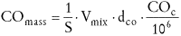

 dabei bedeuten: 8.1.1 CO mass die während der Prüfung emittierte Masse Kohlenmonoxid in g/km; 8.1.2 S die tatsächlich zurückgelegte Strecke, errechnet durch Multiplikation der am Drehzahl-Zählwerk abgelesenen Anzahl der Umdrehungen mit dem Umfang der Rolle. Diese Strecke ist in Kilometern anzugeben; 8.1.3 d co die spezifische Dichte des Kohlenmonoxids bei 273.2 K und 101.33 kPa: 1.250 kg/m 3 ; 8.1.4 CO c der Volumenanteil an Kohlenmonoxid im verdünnten Abgas-Luft-Gemisch in ppm, korrigiert unter Berücksichtigung des Schadstoffanteils in der Verdünnungsluft: 

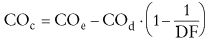

 dabei bedeuten: 8.1.4.1 CO e die Konzentration von Kohlenmonoxid in ppm des im Auffangbeutel SA gesammelten, verdünnten Abgas-Luft-Gemisches; 8.1.4.2 CO d die Konzentration von Kohlenmonoxid in ppm der im Auffangbeutel SB gesammelten Verdünnungsluft; 8.1.4.3 DF der in Ziffer 8.4 dieses Anhanges definierte Verdünnungsfaktor. 8.1.5 V mix das verdünnte Gesamtvolumen des Abgas-Luft-Gemisches in m 3 /Prüfung, reduziert auf die Bezugswerte 273.2 K und 101.33 kPa 

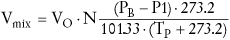

 dabei bedeuten: 8.1.5.1 V O das von der Verdrängerpumpe P während einer Umdrehung geförderte Gas in m 3 . Dieses Volumen ist abhängig von den Druckunterschieden zwischen dem Ein- und Austritt der Pumpe; 8.1.5.2 N die Anzahl der Umdrehungen der Verdrängerpumpe P während der vier Messzyklen; 8.1.5.3 P B der Umgebungsdruck in kPa; 8.1.5.4 P1 der Mittelwert des während der vier Messzyklen am Eintritt der Verdrängerpumpe P vorhandenen Unterdruckes in kPa; 8.1.5.5 T P die während der vier Messzyklen am Eintritt der Verdrängerpumpe P gemessene mittlere Temperatur des verdünnten Abgas-Luft-Gemisches. 8.2. Die Masse der während der Prüfung emittierten unverbrannten Kohlenwasserstoffe ist wie folgt zu berechnen: 

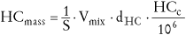

 dabei bedeuten: 8.2.1 HC mass die während der Prüfung emittierte Masse Kohlenwasserstoffe in g/km; 8.2.2 S die in Ziffer 8.1.2 dieses Anhanges definierte Strecke; 8.2.3 d HC die spezifische Dichte der Kohlenwasserstoffe bei einem mittleren Kohlenstoff/Wasserstoff-Verhältnis 1 : 1.85, 273.2 K und 101.33 kPa : 0.619 kg/m 3 ; 8.2.4 HC c die Konzentration an Kohlenwasserstoffen im verdünnten Abgas-Luft-Gemisch in ppm, ausgedrückt als KohlenstoffÄquivalent (z.B. der Gehalt an Propan multipliziert mit 3), korrigiert durch die Grundkonzentration: 

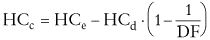

 dabei bedeuten: 8.2.4.1 HC e die Konzentration an Kohlenwasserstoffen in ppm, ausge-drückt als Kohlenstoff-Äquivalent des im Auffangbeutel SA gesammelten verdünnten Abgas-Luft-Gemisches; 8.2.4.2 HC d die Konzentration an Kohlenwasserstoffen in ppm, ausgedrückt als Kohlenstoff-Äquivalent der im Auffangbeutel SB gesammelten Verdünnungsluft; 8.2.4.3 DF der in Ziffer 8.4 dieses Anhanges definierte Verdünnungsfaktor. 8.2.5 V mix das verdünnte Gesamtabgasvolumen (vgl. Ziff. 8.1.5 dieses Anhanges). 8.3 Die Masse der während der Prüfung emittierten Stickoxide ist wie folgt zu berechnen: 

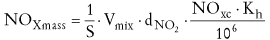

 dabei bedeuten: 8.3.1 NO Xmass die während der Prüfung emittierte Masse der Stickoxide in g/km; 8.3.2 S die in Ziffer 8.1.2 dieses Anhanges definierte Strecke; 8.3.3 dNO 2 die spezifische Dichte der Stickoxide im Abgas, ausgedrückt als Stickstoffdioxid, bei 273.2 K und 101.33 kPa : 2.053 kg/m 3 : 8.3.4 NO xc die Konzentration an Stickoxiden im Abgas-Luft-Gemisch in ppm, korrigiert durch die Grundkonzentration: 

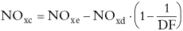

 dabei bedeuten: 8.3.4.1 NO xe die Konzentration an Stickoxiden in ppm des im Auffangbeutel SA gesammelten verdünnten Abgas-Luft-Gemisches; 8.3.4.2 NO xd die Konzentration an Stickoxiden in ppm der im Auffangbeutel SB enthaltenen Verdünnungsluft; 8.3.4.3 DF der in Ziffer 8.4 dieses Anhanges definierte Verdünnungsfaktor. 8.3.5 K H der Korrekturfaktor für die Feuchtigkeit: 

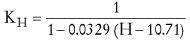

 dabei bedeuten: 8.3.5.1 H die absolute Feuchtigkeit in Gramm Wasser je Kilogramm trockener Luft: 

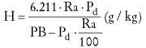

 dabei bedeuten: 8.3.5.1.1 Ra die relative Feuchte der Umgebungsluft in %; 8.3.5.1.2 P d der Druck des gesättigten Wasserdampfes bei Prüftemperatur in kPa; 8.3.5.1.3 PB der atmosphärische Druck in kPa. 8.4 DF der Verdünnungsfaktor nach folgender Formel: 

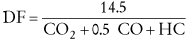

 8.4.1 CO e , CO 2e und HC e sind die Konzentrationen an Kohlenmonoxid, Kohlendioxid und Kohlenwasserstoffen des im Auffangbeutel SA enthaltenen verdünnten Abgas-Luft- Gemisches in %. 9. Darstellung der Ergebnisse Die Ergebnisse werden in Gramm pro Kilometer (g/km) ausgedrückt: HC in g/km = HC mass/ S CO in g/km = CO mass /S NOx in g/km = NOx mass/ S dabei bedeuten: CO mass : siehe Definition in Ziffer 8.1 dieses Anhanges HC mass : siehe Definition in Ziffer 8.2 dieses Anhanges NOx mass : siehe Definition in Ziffer 8.3 dieses Anhanges S: vom Fahrzeug während der Prüfung tatsächlich zurückgelegte Strecke. Anlage 1 Fahrzyklus bei Prüfung Typ 1 

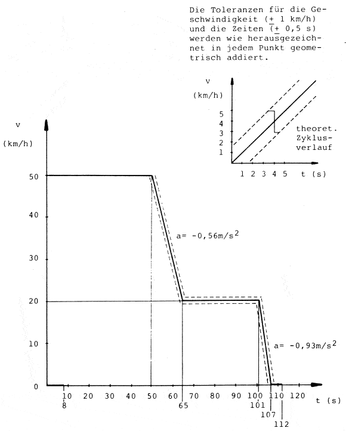

 Anlage 2 Beispiel Nr. 1 einer Einrichtung für die Gas-Probeentnahme und für die Volumenmessung 

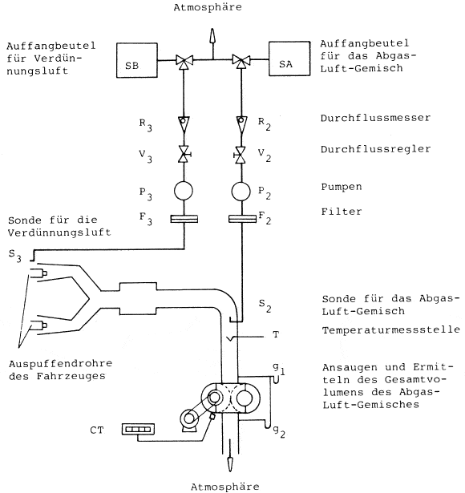

 Anlage 3 Beispiel Nr. 2 einer Einrichtung für die Gas-Probeentnahme und für die Volumenmessung 

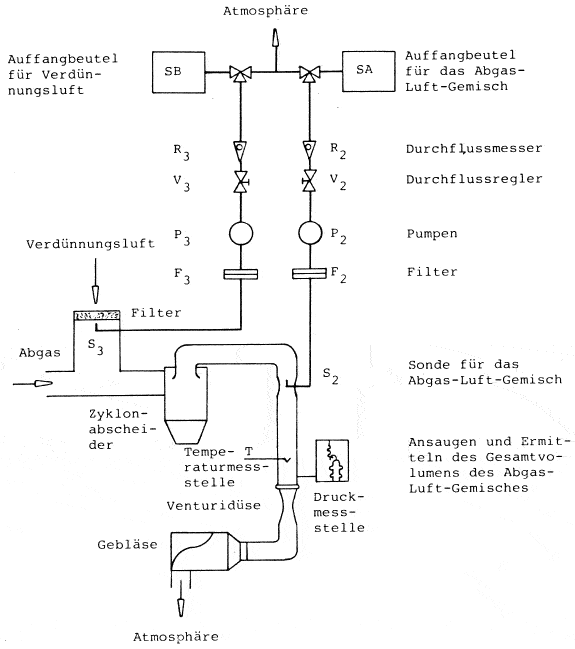

 Anlage 4 Methode zur Eichung des Fahrleistungsprüfstandes 1. Gegenstand Diese Anlage beschreibt das Verfahren, das anzuwenden ist, um zu prüfen, ob die Kurve der vom Fahrleistungsprüfstand aufzunehmenden Leistung nach Ziffer 4.1 dieses Anhanges geforderten Leistungskurve (Diagramm) entspricht. Die aufgenommene Leistung umfasst die Bremsverluste und die von der Bremse aufgenommene Leistung. Die Reibungsverluste zwischen Reifen und Rolle werden nicht erfasst. 2. Verfahrensprinzip Dieses Verfahren erlaubt die Berechnung des Leistungsverlustes durch Messung der Verzögerungszeit der Rolle. Die kinetische Energie der Anlage wird durch die Bremse und die Reibungsverluste des Rollenprüfstandes vernichtet. Dieses Verfahren lässt die durch das Gewicht des Fahrzeugs verursachten unterschiedlichen inneren Reibungen der Rolle unberücksichtigt. 3. Verfahren 3.1 Zuschalten des Systems zur Simulierung der Schwungmasse entsprechend der Masse des jeweils zu prüfenden Fahrzeugs. 3.2 Einstellen der Bremse nach Ziffer 5.1 dieses Anhanges. 3.3 Rolle auf die Geschwindigkeit v + 10 km/h bringen. 3.4 Lösen der für den Antrieb der Rolle verwendeten Einrichtung; unbehinderte Verzögerung der Rolle ermöglichen. 3.5 Festhalten der Zeit, die die Rolle benötigt, um von der Geschwindigkeit v + 0.1 v zur Geschwindigkeit v - 0.1 v zu gelangen. 3.6 Aufgenommene Leistung mittels folgender Formel berechnen: 

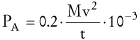

 dabei bedeuten: P A die vom Rollenprüfstand aufgenommene Leistung in kW; M die äquivalente Schwungmasse in kg; v die in obenstehender Ziffer 3.3 genannte Prüfgeschwindigkeit in m/s; t die von der Rolle benötigte Zeit in Sekunden, um von v + 0.1 v zu v - 0.1 v zu gelangen. 3.7 Die vorstehenden Schritte nach den Ziffern 3.3 bis 3.6 in Abständen von jeweils 10 km/h wiederholen, um den Geschwindigkeitsbereich von 10 bis 50 km/h zu erfassen. 3.8 Darstellung der Kurve für die aufgenommene Leistung in Abhängigkeit von der Geschwindigkeit. 3.9 Nachprüfung, ob die Kurve innerhalb der angegebenen Toleranz nach Ziffer 4.1 dieses Anhanges liegt. 

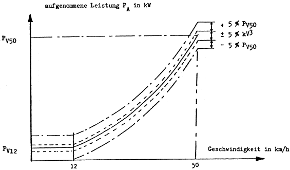

 Anhang 2 Verfahren zur Durchführung der Emissionsprüfung Typ II (Leerlauftest) 1. Einleitung Dieser Anhang beschreibt das Verfahren für die Emissionsprüfung Typ II nach Ziffer 5.3 dieser Verordnung. 2. Messvorschriften 2.1 Als Treibstoff ist der in Anhang 1 Ziffer 3.2 dieser Verordnung vorgeschriebene Treibstoff zu verwenden. 2.2 Für die zu verwendenden Schmiermittel gelten gleichfalls die Vorschriften nach Ziffer 3.2 des Anhanges 1. 2.3 Die emittierten Mengen an Kohlenmonoxid und Kohlenwasserstoffen sind unmittelbar nach der Prüfung Typ I gemäss Anhang 1 dieser Verordnung bei leerlaufendem Motor nach Stabilisierung der Anzeige zu bestimmen. 2.4 Bei Fahrzeugen mit automatischem Getriebe muss das angetriebene Rad stillstehen. 2.5 Die Leerlaufdrehzahl des Motors muss entsprechend den Angaben des Herstellers eingestellt sein. 3. Entnahme und Analyse der Auspuffgase 3.1 Die Schaltventile sind in die Stellung für die direkte Analyse des Abgas-Luft-Gemisches und der Verdünnungsluft zu bringen. 3.2 Innerhalb einer Minute muss das Analysegerät einen konstanten Wert anzeigen. 3.3 Die Konzentration an HC und CO in den Proben des Abgas-Luft-Gemisches und in der Verdünnungsluft wird mit geeichten Messgeräten bestimmt oder registriert. 4. Bestimmung der Menge der emittierten gasförmigen Schadstoffe 4.1 Die Masse des während der Prüfung emittierten Kohlenmonoxids ist nach folgender Formel zu ermitteln: 

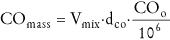

 dabei bedeuten: 4.1.1 CO mass die während der Prüfung emittierte Masse Kohlenmonoxid in g/min; 4.1.2 d co die spezifische Dichte des Kohlenmonoxids bei 273.2 K und 101.33 kPa : 1.250 kg/m 3 ; 4.1.3 CO c der Volumenanteil an Kohlenmonoxid im verdünnten Abgas-Luft-Gemisch in ppm, korrigiert unter Berücksichtigung des Schadstoffanteils in der Verdünnungsluft: 

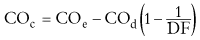

 dabei bedeuten: 4.1.3.1 CO e die Konzentration an Kohlenmonoxid in ppm des im Auffangbeutel SA enthaltenen verdünnten Abgas-Luft-Gemisches; 4.1.3.2 CO d die Konzentration an Kohlenmonoxid in ppm der im Auffangbeutel SB enthaltenen Verdünnungsluft; 4.1.3.3 DF der in Ziffer 4.3 dieses Anhanges definierte Verdünnungsfaktor; 4.1.4 V mix das verdünnte Gesamtvolumen des Abgas-Luft-Gemisches in m 3 /min reduziert auf die Bezugswerte 273.2 K und 101.33 kPa 

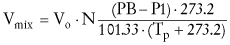

 dabei bedeuten: 4.1.4.1 V o das von der Verdrängerpumpe P während einer Umdrehung geförderte Gas in m 3 . Dieses Volumen ist abhängig vom Druckunterschied zwischen dem Ein- und Austritt der Pumpe; 4.1.4.2 N die Anzahl der Umdrehungen pro Minute der Verdränger-pumpe P während der Leerlaufprüfung; 4.1.4.3 PB der Umgebungsdruck in kPa; 4.1.4.4 P1 der Mittelwert des während der Prüfung am Eintritt der Verdrängerpumpe P entstehenden Unterdruckes in kPa; 4.1.4.5 T P die während der Prüfung am Eintritt der Verdrängerpumpe P gemessene mittlere Temperatur des Abgas-Luft-Gemisches. 4.2 Die Masse der während der Prüfung emittierten unverbrannten Kohlenwasserstoffe ist wie folgt zu berechnen: 

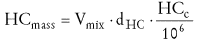

 dabei bedeuten: 4.2.1 HC mass die während der Prüfung emittierte Masse Kohlenwasserstoffe in g/min; 4.2.2 d HC die spezifische Dichte der Kohlenwasserstoffe bei einem mittleren Kohlenstoff/Wasserstoff-Verhältnis 1 : 1.85, bei 273.2 k und 101.33 kPa : 0.619 kg/m 3 ; 4.2.3 HC c die Konzentration an Kohlenwasserstoffen im Abgas-Luft-Gemisch in ppm, ausgedrückt als Kohlenstoff-Äquivalent (z.B. der Gehalt an Propan multipliziert mit 3), korrigiert durch die Grundkonzentration: 

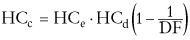

 dabei bedeuten: 4.2.3.1 HC e die Konzentration an Kohlenwasserstoffen in ppm, ausge-drückt als Kohlenstoff-Äquivalent des Abgas-Luft-Gemisches; 4.2.3.2 HC d die Konzentration an Kohlenwasserstoffen in ppm, ausgedrückt als Kohlenstoff-Äquivalent der Verdünnungsluft; 4.2.3.3 DF der in Ziffer 4.3 dieses Anhanges definierte Verdünnungsfaktor. 4.2.4 V mix das Gesamtvolumen (vgl. Ziff. 4.1.4 dieses Anhanges). 4.3 DF der Verdünnungsfaktor: 

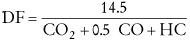

 4.3.1 CO, CO 2 und HC sind Konzentrationen an Kohlenmonoxid, Kohlendioxid und Kohlenwasserstoffen (Kohlenwasserstoff-Äquivalent) des verdünnten Abgas-Luft-Gemisches in %. Anhang 3 Technische Beschreibung des Referenz-Treibstoffs Referenz-Treibstoff CEC RF 08-A-85, Typ: Superbenzin, unverbleit Grenzwerte und Einheiten ASTM- min. max. Verfahren ROZ 95.0 D 2699 MOZ 85.0 D 2700 Dichte bei 15°C 0.748 0.762 D 1298 Dampfdruck (nach Reid) 0.56 bar 0.64 bar D 323 Siedeverlauf - Siedebeginn 24°C 40°C D 86 - 10 Volumenprozent- Destillat 42°C 58°C D 86 - 50 Volumenprozent- Destillat 90°C 110°C D 86 - 90 Volumenprozent- Destillat 155°C 180°C D 86 - Siedeende 190°C 215°C D 86 Rückstand 2 % D 86 Analyse der Kohlenwasserstoffe - Alkene 20 vol-% D 1319 - Aromaten (einschliesslich 5 vol-% max. Benzol*) 45 vol-% *D 3606/ D 2267 - Alkane Rest D 1319 Verhältnis Kohlenstoff/ Wasserstoff ist anzugeben Oxidationsbeständigkeit 480 Min. D 525 Abdampfrückstand 4 mg/100 ml D 381 Schwefelgehalt 0.04 Masse % D 1266/ D 2622/ D 2785 Kupferkorrosion bei 50°C 1 D 130 Bleigehalt 0.005 g/l D 3237 Phosphorgehalt 0.0013 g/l D 3231 * Zusatz von sauerstoffhaltigen Komponenten verboten Inhaltsverzeichnis Verordnung Seite 1. Geltungsbereich 1 2. Definitionen 1 3. Allgemeine Vorschriften 2 4. Antrag für eine Abgas-Typengenehmigung 3 5. Emissionsprüfungen und Grenzwerte 4 6. Änderung des Fahrzeugtyps 6 7. Ausdehnung der Abgas-Typengenehmigung 6 8. Übereinstimmung der Herstellung (Produktionsüberprüfung) 7 9. Entzug der Abgas-Typengenehmigung 9 10. Schlussbestimmungen 10 Anhänge Anhang 1: Verfahren zur Durchführung der Emissionsprüfung Typ I (Fahrzyklus) mit 4 Anlagen 11 Anhang 2: Verfahren zur Durchführung der Emissionsprüfung Typ II (Leerlauftest) 30 Anhang 3: Beschreibung des Referenz-Treibstoffs 33
