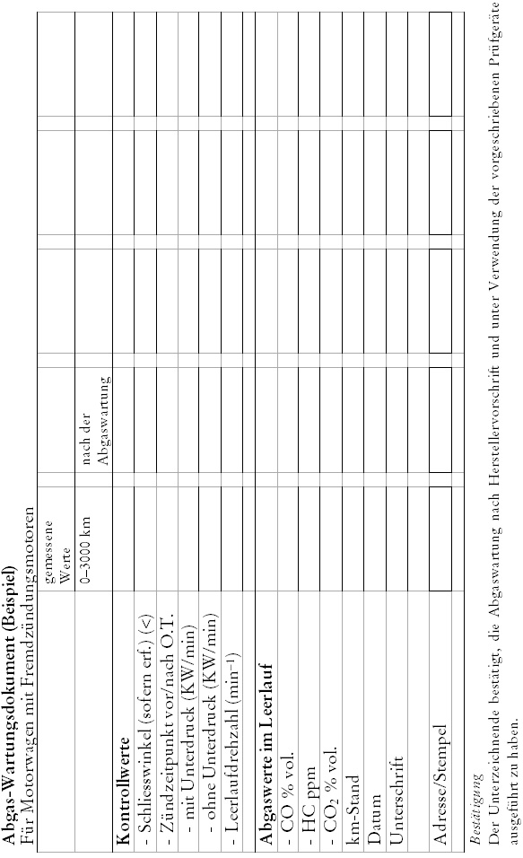
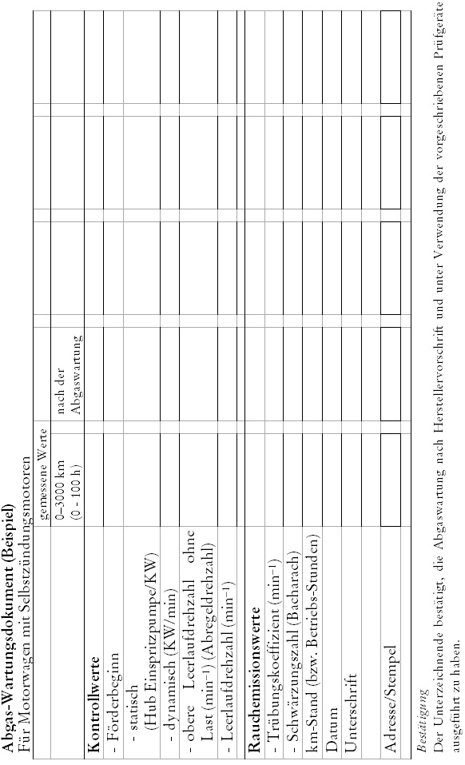

Verordnung vom 9. Dezember 2003 über die Wartung und Nachkontrolle von Motorwagen betreffend Abgas- und Rauchemissionen Aufgrund von Art. 99 des Strassenverkehrsgesetzes vom 30. Juni 1978, LGBl. 1978 Nr. 18, verordnet die Regierung: 1 Gemeinsame Bestimmungen 1.1 Messgeräte 1.1.1 Es dürfen nur die unter den Ziff. 2.4, 3.2 und 3a beschriebenen Messgeräte verwendet werden. 1.1.2 Der Betrieb, der die Abgaswartung durchführt, muss kein eigenes Abgasmessgerät besitzen. Er muss jedoch dessen Verfügbarkeit glaubhaft machen können. 1.1.3 Aufgehoben 1.2 Abgas-Wartungsdokument 1.2.1 Inhalt und Form Das Abgas-Wartungsdokument muss mindestens die im Anhang aufgeführten Rubriken und Angaben in deutsch, französisch und italienisch enthalten. In der formalen Gestaltung sind die Herausgeber frei; das Abgas-Wartungsdokument kann als Einheit im Serviceheft integriert sein. Die besonderen Bestimmungen für Katalysator-Fahrzeuge gelten nur, wenn im Abgas-Wartungsdokument die entsprechende Bestätigung vorhanden ist. 1.2.2 Beschaffung 1.2.2.1 Für bereits im Verkehr stehende Fahrzeuge hat der Fahrzeughalter oder die Fahrzeughalterin das Abgas-Wartungsdokument bei einem liechtensteinischen oder schweizerischen Vertreter der entsprechenden Fahrzeugmarke zu beschaffen und die Eintragung der Kontrolldaten, Messbedingungen und Sollwerte vornehmen zu lassen. 1.2.2.2 Die Hersteller und Importeure sind verpflichtet, den Markenvertretern rechtzeitig die entsprechenden Wartungsdokumente und die einzutragenden Daten zur Verfügung zu stellen. 1.2.3 Abgabe bei Fehlen der Importeure oder Markenvertreter; von der Typengenehmigung befreite Fahrzeuge 1.2.3.1 Für Fahrzeuge, für die in Liechtenstein oder der Schweiz kein Inhaber einer Typengenehmigung oder kein Markenvertreter besteht, kann das Wartungsdokument beispielsweise bei den unten aufgeführten Organisationen bezogen werden. Das Wartungsdokument ist nach den vorhandenen technischen Daten auszufüllen. Sind diese nicht vorhanden, so werden für leichte Motorwagen mit Fremdzündungsmotor die Richtwerte nach Ziff. 2.3 als Sollwerte eingetragen, für Motorwagen mit Selbstzündungsmotor werden die Sollwerte nach Ziff. 3.3 ermittelt. Transportmotorwagen: auto-schweiz Vereinigung Schweizerischer Automobil- Importeure, Postfach 47, 3000 Bern 22 Baumaschinen und nicht für die Land- und Forstwirtschaft bestimmte Arbeitsmotorwagen: Verband der Schweizerischen Baumaschinenwirtschaft (VSBM), Postfach 656, 4010 Basel Land- und forstwirtschaftliche Motorfahrzeuge: Schweizerischer Landmaschinen-Verband (SLV), Postfach 106, 3000 Bern 6 1.2.3.2 Für Fahrzeuge, die von der Typengenehmigung befreit sind, ist das Abgas-Wartungsdokument bei einem liechtensteinischen oder schweizerischen Vertreter der entsprechenden Fahrzeugmarke oder gemäss Ziff. 1.2.3.1 zu beschaffen. 1.2.3.3 Für Fahrzeuge, die von der Typengenehmigung befreit sind, und für die der Importeur die Übereinstimmung mit dem in der Schweiz genehmigten Fahrzeugtyp bestätigt, kann dieser das Abgas-Wartungsdokument ausstellen. Die Angaben für den entsprechenden genehmigten Fahrzeugtyp sind massgebend. 1.2.4 Umgebaute Fahrzeuge 1.2.4.1 Für Fahrzeuge, bei denen an abgasrelevanten Bauteilen geprüfte und im Fahrzeugausweis eingetragene Änderungen vorgenommen wurden, hat der Umbauer die entsprechenden Sollwerte anzugeben. Wenn diese nicht mehr verfügbar sind, gelten für leichte Motorwagen mit Fremdzündungsmotor die Richtwerte nach Ziff. 2.3 als Sollwerte, für Motorwagen mit Selbstzündungsmotor die Sollwerte nach Ziff. 3.3. 1.2.4.2 Werden anlässlich der Abgaswartung nicht geprüfte und nicht im Fahrzeugausweis eingetragene Änderungen an abgasrelevanten Teilen festgestellt, darf die Abgaswartung nicht bestätigt werden. Es ist nachträglich der Nachweis über die Einhaltung der Abgasvorschriften zu erbringen. 1.2.5 Bestätigung Nach jeder Abgaswartung ist das Wartungsdokument von derjenigen Person, welche die Abgaswartung durchgeführt hat, oder von einer verantwortlichen Person des entsprechenden Betriebes auszufüllen und zu unterzeichnen. 1.2.6 Aufbewahrung der Messresultate Die vom Messgerät ausgedruckten Resultate für die verschiedenen Messungen (Leerlauf, erhöhter Leerlauf, freie Beschleunigung) oder der Filterstreifen (bei Geräten ohne Drucker) müssen im Betrieb, der die Wartung durchgeführt hat, bis zur Durchführung einer erneuten Wartung, höchstens jedoch einen Monat über die kategoriespezifische Frist, aufbewahrt und während dieser Zeit dem jeweiligen Fahrzeug zugeordnet werden können. 1.2.7 Verlorenes oder vollgeschriebenes Abgas-Wartungsdokument 1.2.7.1 Ist das Abgas-Wartungsdokument nicht mehr vorhanden oder vollgeschrieben, hat der Halter oder die Halterin beim Markenvertreter bzw. bei den unter Ziff. 1.2.3 genannten Organisationen ein neues Dokument mit den notwendigen Eintragungen zu beziehen. 1.2.7.2 Vollgeschriebene Wartungsdokumente können nach Anheften oder Ankleben von Zusatzblättern, welche die gleichen Rubriken wie das Wartungsdokument enthalten, weiterverwendet werden. 1.2.8 Bestimmen eines Katalysator-Fahrzeuges 1.2.8.1 Ein Katalysator-Fahrzeug im Sinne dieser Verordnung verfügt über einen Dreiweg-, Zweiweg- oder Nachrüst-Abgaskatalysator. 1.2.8.2 Für bereits im Verkehr stehende Fahrzeuge bestätigt der Importeur oder der Markenvertreter durch Stempel und Unterschrift mit dem Eintrag "Katalysator-Fahrzeug" in das Abgas-Wartungsdokument, dass das betreffende Fahrzeug mit einem Abgaskatalysator ausgerüstet ist. 1.2.8.3 Für Fahrzeuge, für die in Liechtenstein oder der Schweiz kein Importeur oder Markenvertreter besteht, kann die für die Abgaswartung verantwortliche Person desjenigen Betriebes, in dem üblicherweise die Abgaswartung durchgeführt wird, die Bestätigung nach Ziff. 1.2.8.2 vornehmen. 1.2.9 Aufgehoben 1.2.9.1 Aufgehoben 1.2.9.2 Aufgehoben 1.2.9.3 Aufgehoben 1.3 Kleber 1.3.1 Abgabe Nach durchgeführter Abgaswartung wird ein Kleber abgegeben, der mit Jahr und Monat den Termin anzeigt, bis zu welchem die nächste Wartung durchgeführt sein muss. 1.3.2 Anbringung Der Kleber soll an der Heckscheibe oder an einer linken Seitenscheibe des gewarteten Fahrzeuges, bei Fahrzeugen ohne Heck- und Seitenscheiben im Bereich des Armaturenbrettes angebracht werden. 1.4 Fahrzeuge mit Tagesausweis oder Kollektiv-Fahrzeugausweis und Fahrzeuge, die für den Export bestimmt sind 1.4.1 Bei Fahrzeugen, die mit Tagesausweis und Tagesschildern oder Kollektiv-Fahrzeugausweis und Händlerschildern verkehren, muss die Abgaswartung nicht durchgeführt sein und das Abgas-Wartungsdokument nicht mitgeführt werden. Dies gilt nicht bei der amtlichen Zulassungsprüfung oder einer amtlichen Nachprüfung. 1.4.2 Fahrzeuge, die in Liechtenstein oder der Schweiz erworben oder ausgeliefert werden und für den Export bestimmt sind und für höchstens drei Monate provisorisch zugelassen werden, benötigen kein Abgas-Wartungsdokument. Eine Abgas-Nachkontrolle vor der ersten Inverkehrsetzung oder eine Abgaswartung ist nicht erforderlich. 1.5 Abgas-Nachkontrollen Bei Abgas-Nachkontrollen von Fahrzeugen ohne OBD-System sind die Sollwerte und Messbedingungen nach dem Abgas-Wartungsdokument - für die Messung bei erhöhter Leerlaufdrehzahl die entsprechenden, unter Ziff. 2.1.2 aufgeführten Bedingungen - massgebend. Bei Abgas-Nachkontrollen an Fahrzeugen mit OBD-System ist die Funktion der Fehlerfunktionsanzeige und der Fehlerspeicher auf allenfalls gespeicherte Fehlercodes zu überprüfen. 1.5.1 Abgas-Nachkontrolle vor der ersten Inverkehrsetzung Vor der ersten Inverkehrsetzung ist eine Abgas-Nachkontrolle nach Art. 36 VTS durchzuführen. Können dabei die Sollwerte nicht eingehalten werden, so ist diese Nachkontrolle innerhalb von 3000 km oder innerhalb von 100 Betriebsstunden bei Fahrzeugen ohne Kilometerzähler, spätestens jedoch ein Jahr nach der ersten Inverkehrsetzung, durchzuführen. Die gemessenen Werte sind im Abgas-Wartungsdokument in der Rubrik "0-3000 km" oder "0-100 h" einzutragen. 1.5.2 Abgas-Nachkontrollen durch das Amt für Strassenverkehr und die Landespolizei Sind bei Abgas-Nachkontrollen durch das Amt für Strassenverkehr und die Landespolizei die Sollwerte (inkl. Toleranzen) oder die unten aufgeführten Bedingungen nicht eingehalten, so ist nach Art. 36 Abs. 3 VTS eine erneute Abgaswartung und Nachkontrolle anzuordnen. Der Fahrzeughalter oder die Fahrzeughalterin untersteht dabei keiner Strafdrohung, wenn das Fahrzeug termingerecht gewartet wurde. Eine erneute Abgaswartung und Abgas-Nachkontrolle ist anzuordnen, wenn die Abgaswartung nicht korrekt vorgenommen wurde oder wenn Defekte oder Mängel an der abgasrelevanten Ausrüstung vorliegen. Werden die massgebenden Werte erheblich unter- oder überschritten, so kann für die Beurteilung auf ein vereinfachtes Verfahren abgestellt werden. Bei Fahrzeugen mit Fremdzündungsmotor und OBD-System ist nebst der Überprüfung der Fehlerfunktionsanzeige und des Fehlerspeichers eine Messung der Abgasemissionen nach Ziff. 2.1.2 vorzunehmen. Liegen keine Angaben vor, darf der Wert für die CO-Emission 0.2 % vol nicht überschreiten. Bei Fahrzeugen mit Selbstzündungsmotor und OBD-System ist nebst der Überprüfung der Fehlerfunktionsanzeige und des Fehlerspeichers eine Messung der Rauchemission nach Ziff. 3.2.2 vorzunehmen. Der Trübungskoeffizient darf den auf der Genehmigungsplakette am Motor, auf der Typengenehmigung oder im Fahrzeugausweis eingetragenen Wert nicht überschreiten. Bei Fahrzeugen mit vorgeschriebenem Partikelfilter ist mindestens eine Messung der Partikelanzahlkonzentration nach Ziff. 3a vorzunehmen. Als Fahrzeuge mit vorgeschriebenem Partikelfilter gelten Fahrzeuge, für die in den Abgasvorschriften nach Art. 52 Abs. 5 VTS ein Grenzwert für die Partikelanzahl festgelegt ist. 2 Bestimmungen für Fahrzeuge mit Fremdzündungsmotoren 2.1 Zu wartende Fahrzeugteile 2.1.1 Bei der Abgaswartung sind nach den Herstellerangaben mindestens die folgenden Teile zu prüfen, einzustellen und, wenn notwendig, instand zu stellen oder zu ersetzen: - Luftfilter; - Gemischaufbereitungssystem; - Auspuffsystem; - Emissionskontrollsystem (z. B. Kaltstartvorrichtung, Vorrichtung für Abgasrückführung, Lufteinblasevorrichtung, Katalysator und Lambdasonde); - Zündung (wenn vorhanden, Unterbrecher, dynamischer und statischer Zündzeitpunkt); - Kurbelgehäuse-Entlüftung; - Verdampfungskontrollsystem. Ausserdem ist die Leerlaufdrehzahl zu prüfen, einzustellen und zu messen. Abschliessend sind die Emissionswerte (CO, CO 2 und HC) im Leerlauf nach den Messbedingungen des Herstellers zu messen. Die im Abgas-Wartungsdokument eingetragenen Sollwerte müssen eingehalten sein. 2.1.2 Bei Fahrzeugen mit geregeltem Dreiweg-Katalysator ist zusätzlich eine Messung der Abgasemissionen bei erhöhter Leerlaufdrehzahl nach Herstellerangaben (min. 2000 min-1) vorzunehmen. Wenn im Wartungsdokument keine anderen Angaben für diese Messung eingetragen sind, ist der Motor vor der Messung während 20 bis 30 Sekunden bei der erhöhten Leerlaufdrehzahl laufen zu lassen. Wo der Hersteller keine anderen Werte angibt, ist die Messung bei einer Drehzahl von 2500 min-1 ± 100 min-1 vorzunehmen; für CO und HC gelten die gleichen Sollwerte wie im Leerlauf. Die Resultate dieser Messung müssen nicht im Wartungsdokument eingetragen werden, wenn keine entsprechende Rubrik vorhanden ist. Erfolgt die Messung bei erhöhter Leerlaufdrehzahl unmittelbar nach der Messung im Leerlauf, so ist kein elektrischer Referenzabgleich des Abgasmessgerätes notwendig. 2.1.3 Aufgehoben 2.2 Sollwerte Im Wartungsdokument sind die vom Fahrzeughersteller angegebenen, bei betriebsbereitem Fahrzeug am Auspuffrohrende zu messenden Sollwerte einzutragen. Besondere Messbedingungen (z. B. Unterbrechung der Kurbelgehäuseentlüftung usw.) sind im Wartungsdokument aufzuführen. 2.3 Richtwerte 2.3.1 Fehlen einzelne oder alle Herstellerangaben, so sind für die betreffenden Rubriken die folgenden Richtwerte als Sollwerte einzutragen: - Leerlaufdrehzahl: max. 1000 min-1; - erhöhter Leerlauf: 2500 min-1 ± 100 min-1; - Abgaswerte im Leerlauf: Fahrzeugzulassung CO (% vol) HC (ppm) CO 2 (% vol) 1. Januar 1976 - 30. September 1980 ≤3.5 ≤500 ≥11.5 1. Oktober 1980 - 30. September 1982 ≤3.0 ≤400 ≥12.0 1. Oktober 1982 - 30. September 1986 ≤2.5 1 ≤300 2 ≥12.0 1 1. Oktober 1986 - 30. September 1987/ 1988 ≤1.0 ≤200 ≥12.0 3 ab 1. Oktober 1987 (Fahrzeuge nach FAV 1 Gr. I sowie Fahrzeuge der Klasse M 1 bis 2500 kg Gesamtgewicht, Fahrzeuge der Klasse N 1 bis 1225 kg Leergewicht und Fahrzeuge der Klasse M 2 ) ≤0.5 ≤100 ≥12.0 3 ab 1. Oktober 1988 (Fahrzeuge nach FAV 1 Gr. II sowie die übrigen Fahrzeuge) ≤1.0 ≤200 ≥12.0 3 1 Fahrzeuge mit sekundärer Luftzufuhr (z. B. Luftpumpe, "Pulsair"): CO ≤1.5 % vol, CO 2 = 4–12 % vol. 2 Fahrzeuge mit einem Hubraum über 2500 cm 3 : HC ≤400 ppm. 3 Fahrzeuge mit sekundärer Luftzufuhr: CO 2 = 4–12 % vol. 2.3.2 Höhere Sollwerte können in besonderen Einzelfällen von der auto-schweiz (s. Ziff. 1.2.3.1) eingetragen werden (z.B. bei Fahrzeugen, die vom Nachweis über die Einhaltung der Abgasvorschriften befreit sind, oder wenn der Nachweis erbracht wird, dass die massgebenden Abgasvorschriften trotzdem eingehalten sind). 2.4 Abgasmessmittel 2.4.1 Es dürfen nur Messmittel verwendet werden, die nach der schweizerischen Verordnung vom 19. März 2006 über Abgasmessmittel für Verbrennungsmotoren zugelassen und geeicht sind. 2.4.2 Reparierte Messmittel sind nach der schweizerischen Messmittelverordnung vom 15. Februar 2006 der zuständigen Stelle zur Nacheichung am Einsatzort zu übergeben. 2.5 Fahrzeuge mit Zweitakt-Motoren 2.5.1 Bei Fahrzeugen mit Zweitakt-Motoren, die nicht der FAV 1 oder späteren Abgasvorschriften unterstehen, kann auf die Messung der Emissionswerte (CO, CO 2 und HC) im Leerlauf verzichtet werden. Zur Durchführung der Abgaswartung sind bei solchen Fahrzeugen auch Personen und Betriebe befugt, die nicht über Abgasmessgeräte verfügen, sofern die übrigen Voraussetzungen erfüllt sind. 2.5.2 Im Wartungsdokument dieser Fahrzeuge müssen keine Messbedingungen und Sollwerte eingetragen werden; es genügt der Hinweis "Zweitakt-Motor; keine Messung". Die Messbedingungen und Richtwerte nach Ziff. 2.3 sind nicht anwendbar. 2.6 Bivalente Fahrzeuge 2.6.1 Bei Fahrzeugen, die alternativ mit unterschiedlichen Treibstoffen (z. B. mit Benzin oder Gas) betrieben werden können, ist die Abgaswartung für jede Betriebsart durchzuführen. 2.6.2 Das Wartungsdokument dieser Fahrzeuge muss die vorgeschriebenen Angaben für jede Betriebsart enthalten. Es ist auch zulässig, für jede Betriebsart ein separates Wartungsdokument zu verwenden. 3 Bestimmungen für Fahrzeuge mit Selbstzündungsmotoren 3.1 Umfang der Wartung Bei der Abgaswartung sind nach den Herstellerangaben mindestens die folgenden Arbeiten auszuführen: - eine Sichtprüfung von Ansaug-/Aufladesystem (inkl. Luftfilter), Einspritzanlage und Auspuffanlage auf Zustand und Dichtheit; - die Kontrolle auf Vorhandensein bzw. Unversehrtheit der im Wartungsdokument eingetragenen Plombierungen und Versiegelungen; - die Kontrolle von Förderbeginn, Volllastanschlag und, falls vorhanden, anderen Einstelleinrichtungen der Einspritzpumpe; - die Kontrolle der Einspritzdüsen (falls erforderlich); - die Kontrolle der Leerlaufdrehzahl und der oberen Leerlaufdrehzahl ohne Last (Abregeldrehzahl); - die Prüfung auf Zustand und Funktion von Zusatzeinrichtungen wie Abgasrückführung oder Partikelfilter und - - der dazugehörenden Regeleinrichtungen; - die erforderlichen Einstellungen, Instandstellungen und allenfalls den Ersatz defekter Teile; - eine abschliessende Messung der Rauchemissionen bei freier Beschleunigung entsprechend dem in Ziffer 3.2 beschriebenen Verfahren; der im Abgas-Wartungsdokument eingetragene Sollwert darf nicht überschritten werden. 3.1.1 Aufgehoben 3.1.2 Aufgehoben 3.2 Messung der Rauchemissionen 3.2.1 Allgemeine Messbedingungen 3.2.1.1 Der Motor muss nach den Angaben des Herstellers eingestellt sein und normale Betriebstemperatur aufweisen. 3.2.1.2 Die Messung erfolgt am stehenden Fahrzeug, das Getriebe in Neutralstellung. Es muss handelsüblicher Treibstoff ohne rauchmindernde Zusätze verwendet werden. 3.2.1.3 Die Auspuffanlage darf weder ein Leck noch eine Vorrichtung aufweisen, das oder die eine Verdünnung der Abgase zur Folge hat. Verfügt ein Fahrzeug über mehrere Auspuffendrohre, ist an jedem eine Messreihe vorzunehmen. Massgebend ist die Messreihe mit dem höchsten Resultat. 3.2.1.4 Bei Motoren mit zu- und abschaltbarer Aufladung hat die Rauchentnahme ohne und mit Aufladung zu erfolgen. Das festzuhaltende Messergebnis ist das höhere der beiden Messreihen. 3.2.2 Messung nach der Trübungsmethode Werden die Rauchemissionen bei freier Beschleunigung als Trübungskoeffizient k (m-1) gemessen, so ist nach den gleichwertigen Anforderungen des Anhanges 5 des ECE-Reglements Nr. 24, des Anhanges 4 der Richtlinie Nr. 72/306 des Rates vom 2. August 1972 zur Angleichung der Rechtsvorschriften der Mitgliedstaaten über Massnahmen gegen die Emission verunreinigender Stoffe aus Dieselmotoren zum Antrieb von Fahrzeugen oder des Anhanges 4 der Richtlinie Nr. 77/537 des Rates vom 28. Juni 1977 zur Angleichung der Rechtsvorschriften der Mitgliedstaaten über Massnahmen gegen die Emission verunreinigender Stoffe aus Dieselmotoren zum Antrieb von land- oder forstwirtschaftlichen Zugmaschinen auf Rädern zu verfahren. 3.2.2.1 Messgeräte 3.2.2.1.1 Es dürfen nur Messgeräte verwendet werden, die nach der schweizerischen Verordnung vom 19. März 2006 über Abgasmessmittel für Verbrennungsmotoren zugelassen und geeicht sind. 3.2.2.1.2 Reparierte Messmittel sind nach der schweizerischen Messmittelverordnung vom 15. Februar 2006 der zuständigen Stelle zur Nacheichung am Einsatzort zu übergeben. 3.2.2.1.3 Aufgehoben 3.2.2.2 Durchführung der Messung 3.2.2.2.1 Das Messgerät ist nach der Betriebsanleitung des Geräteherstellers zu handhaben. 3.2.2.2.2 Bei Leerlauf des Motors ist das Gaspedal schnell und stossfrei niederzutreten. Sobald die obere Leerlaufdrehzahl ohne Last (Abregeldrehzahl) erreicht ist, wird das Gaspedal losgelassen, bis der Motor wieder den Leerlauf erreicht hat und das Messgerät wieder messbereit ist. Die Werte, die während des Leerlaufs des Motors auftreten, sind nicht zu berücksichtigen. 3.2.3 Messung nach der Filtermethode (Bacharach) 3.2.3.1 Messgeräte 3.2.3.1.1 Es ist die Bosch-Integrier-Filterpumpe EFAW 65 B, Pumpeninhalt 330 cm³, Filterfläche 1.1 cm² (Durchmesser 12 mm), Saugzeit 6-8 Sekunden, angeschlossen an eine Bosch-Sonde mit Sondenschlauch, Innendurchmesser 4 mm, Länge 6 m zu verwenden. Die Auswertung hat mit der Bacharach-Russbildskala oder mit dem Bosch-Auswertegerät ETD 020.51 zu erfolgen. 3.2.3.1.2 Der Unterhalt und die Kontrolle des Gerätes erfolgen nach der Gebrauchsanweisung des Herstellers und nach den Vorschriften des metas. 3.2.3.1.3 Das Amt für Strassenverkehr kann in Absprache mit dem metas andere Geräte anerkennen, wenn sie gleichwertige Resultate erbringen. 3.2.3.2 Durchführung der Messung 3.2.3.2.1 Das Messgerät ist nach der Betriebsanleitung des Geräteherstellers zu handhaben. 3.2.3.2.2 Als Vorbereitung muss der Motor mindestens dreimal rasch hintereinander auf seine obere Leerlaufdrehzahl ohne Last (Abregeldrehzahl) beschleunigt werden. Anschliessend ist die Messung durchzuführen, indem das Gaspedal so schnell als möglich niedergetreten und gleichzeitig das Messgerät ausgelöst wird. Nach Erreichen der oberen Leerlaufdrehzahl ohne Last (Abregeldrehzahl) ist das Gaspedal sofort in die Leerlaufstellung zurückzubringen. 3.2.3.3 Anzahl der Messungen Es sind soviele Messungen vorzunehmen, bis drei aufeinanderfolgende Schwärzungsbilder nicht um mehr als eine halbe Bacharach-Einheit voneinander abweichen; massgebend ist das dunkelste dieser drei Schwärzungsbilder. 3.3 Sollwerte 3.3.1 Im Wartungsdokument ist der in der Typengenehmigung (bei nicht typengenehmigten Fahrzeugen im Fahrzeugausweis) vermerkte Referenzwert plus eine Toleranz als Sollwert für die Rauchemission bei freier Beschleunigung einzutragen: Trübungskoeffizient k ≤ 1 m-1; Toleranz = 0.3 m-1 Trübungskoeffizient k >1 m-1; Toleranz = k x 0.3 Schwärzungszahl; Toleranz = 1 Bacharach 3.3.2 Bei neuen, nicht typengenehmigten Fahrzeugen, für welche die unter Ziff. 1.2.3 aufgeführten Organisationen das Wartungsdokument ausstellen, werden die Sollwerte bei der ersten Inverkehrsetzung durch das Amt für Strassenverkehr eingetragen. Dabei ist derjenige Wert für die freie Beschleunigung einzutragen (mit entsprechender Toleranz), der gleichzeitig mit der für die Zulassung massgeblichen Vollastmessung ermittelt wurde. 3.3.3 Wurde anlässlich der Typengenehmigung die Schwärzungszahl (Bacharach) ermittelt, kann der Hersteller oder der Importeur den Trübungskoeffizienten für die freie Beschleunigung gemäss den Anforderungen des ECE-Reglements Nr. 24 oder der Richtlinie Nr. 72/306 des Rates vom 2. August 1972 oder - für Traktoren, Arbeitskarren und Motorkarren - der Richtlinie Nr. 77/537 des Rates vom 28. Juni 1977 zusätzlich als Sollwert angeben. Existieren keine Importeure oder Hersteller mehr oder können diese die Werte nicht angeben, so kann nach einer Wartung mit einer Bacharach-Messung, bei der der gemessene Wert mindestens 1 Bacharach unter dem im Wartungsdokument eingetragenen Sollwert liegt, der gemessene Trübungskoeffizient plus Toleranz nach Ziff. 3.3.1 als zusätzlicher Sollwert ins Wartungsdokument eingetragen werden. 3.3.4 Sind im Wartungsdokument beide Werte vorhanden, kann bei einer Wartung oder Nachkontrolle beliebig nach der einen der beiden Methoden gemessen werden; der entsprechende Sollwert muss dabei eingehalten werden. 3.3.5 Wurde kein Referenzwert nach der Methode der freien Beschleunigung ermittelt, so ist im Wartungsdokument ein Sollwert von 0.3 m -1 einzutragen. 3.4 Höheneinfluss 3.4.1 Bei Messungen in Höhenlagen bis 600 m ü.M. bleibt der nach Ziff. 3.2 ermittelte Wert unkorrigiert. 3.4.2 Erfolgen die Messungen in grösseren Höhen, sind zur Berücksichtigung des Höheneinflusses bei Fahrzeugen ohne Druckkorrektur je 0.25 m-1 bzw. 0.5 Bacharach pro 400 m grössere Höhe von dem nach Ziff. 3.2 ermittelten Wert abzuziehen. 3.4.3 Im Wartungsdokument ist der korrigierte Wert einzutragen. 3a Bestimmungen für Fahrzeuge mit vorgeschriebenem Partikelfilter 3a.1 Messgeräte 3a.1.1 Für die Messung der Partikelanzahlkonzentration dürfen nur Messmittel verwendet werden, die nach der schweizerischen Verordnung vom 19. März 2006 über Abgasmessmittel für Verbrennungsmotoren zugelassen und geeicht sind. 3a.1.2 Reparierte Messmittel sind nach der schweizerischen Messmittelverordnung vom 15. Februar 2006 der zuständigen Stelle zur Nacheichung zu übergeben. 3a.2 Messung der Partikelanzahlkonzentration 3a.2.1 Allgemeine Messbedingungen 3a.2.1.1 Der Motor muss nach den Angaben des Herstellers gewartet und eingestellt sein und die vom Hersteller angegebene Betriebstemperatur aufweisen. 3a.2.1.2 Die Messung erfolgt am stehenden Fahrzeug, das Getriebe in Neutralstellung. Es muss handelsüblicher Treibstoff ohne Zusätze verwendet werden. 3a.2.1.3 Die Auspuffanlage darf weder ein Leck noch eine Vorrichtung aufweisen, das oder die eine Verdünnung der Abgase zur Folge hat. Verfügt ein Fahrzeug über mehrere Auspuffendrohre, so ist an jedem eine Messreihe vorzunehmen. Massgebend ist die Messreihe mit dem höchsten Resultat. 3a.2.1.4 Die Messung erfolgt in der Regel am Auspuffende. Wenn die Messung dort nicht möglich ist, so ist sie an einer Stelle durchzuführen, an der die folgenden Kriterien erfüllt sind: - Die Abgaszusammensetzung ist für die Emissionen repräsentativ. - Die Schadstoffverteilung ist über den Messquerschnitt homogen. - Die Entnahmesonde wird in Fortsetzung des Strömungsverlaufs mittig in das Abgasrohr gehalten. 3a.2.1.5 Die Entnahmesonde ist in der Regel ca. 50 mm in das Abgasrohr einzuführen. Die Positionierung der Entnahmesonde im Abgasrohr darf keine Verdünnung der Abgase zur Folge haben. 3a.2.2 Durchführung der Messung 3a.2.2.1 Die Partikelanzahlkonzentration wird bei Fahrzeugen der Klassen M und N bei 2 000 Umdrehungen/min gemessen. Bei allen anderen Strassenfahrzeugen wird im oberen Leerlauf ohne Last (Abregeldrehzahl) des Motors gemessen (massgebender Betriebspunkt). Wenn die Abregeldrehzahl im Stand nicht erreicht werden kann, ist bei einer wiederholbaren Drehzahl ohne Last, zwischen Leerlaufdrehzahl und Abregeldrehzahl, zu messen. Wenn weder die Abregeldrehzahl noch eine wiederholbare Drehzahl ohne Last erreicht werden kann, so ist eine Messung unter Last, zum Beispiel durch Erbringen einer hydraulischen Leistung, zulässig, sofern der eingestellte Betriebspunkt wiederholbar und reproduzierbar ist. Die gewählte Drehzahl und allenfalls die Last sind entsprechend zu notieren. 3a.2.2.2 Die Messung der Partikelanzahlkonzentration ist durchzuführen, sobald der eingestellte Betriebspunkt konstant ist. Es sind drei Messungen durchzuführen, die vom Messmittel selbständig ausgelöst werden. 3a.2.3 Messresultat 3a.2.3.1 Als Messresultat gilt der arithmetische Mittelwert der offiziellen Messung nach Anhang 4 Ziff. 7.2 der schweizerischen Verordnung vom 19. März 2006 über Abgasmessmittel für Verbrennungsmotoren. Vom angezeigten Messwert darf kein Abzug gemacht werden. 3a.3 Sollwert 3a.3.1 Das Messresultat darf den Sollwert von 2,5 × 10 5 Partikel/cm³ (250 000 Partikel/cm³) nicht überschreiten. 3a.3.2 Vereinfachtes Verfahren Der Sollwert nach Ziff. 3a.3.1 gilt als eingehalten, wenn eine vereinfachte Messung im unteren Leerlauf ohne Last nicht mehr als 1 × 10 5 Partikel/cm³ (100 000 Partikel/cm³) ergibt. 4 Aufhebung bisherigen Rechts Die Verordnung vom 16. Februar 1994 über Abgasmessgeräte für Verbrennungsmotoren (VAMV), LGBl. 1994 Nr. 12, wird aufgehoben. 5 Inkrafttreten Diese Verordnung tritt am Tage der Kundmachung in Kraft. Fürstliche Regierung: gez. Rita Kieber-Beck Regierungschef-Stellvertreterin Anhang (Ziff. 1.2.1) Inhalt des Abgas-Wartungsdokuments (Mindestanforderungen) Das Abgas-Wartungsdokument muss die Rubriken und Angaben in den Sprachen deutsch, französisch und italienisch enthalten. I. Titelblatt In den Sprachen deutsch, französisch und italienisch muss der Titel wie folgt lauten: - Abgas-Wartungsdokument - Fiche d'entretien du système antipollution - Documento sulla manutenzione relativa ai gas di scarico Weitere Angaben können aufgeführt werden. II. Gesetzliche Vorschriften Der für das zutreffende Fahrzeug massgebende Text von Art. 57a bis 57c der Verkehrsregelnverordnung (VRV) muss aufgeführt werden. III. Herstellerangaben 1. Fahrzeugdaten Marke Fahrzeugtyp Fahrgestell-Nr. Motor-Kennzeichen 2. Messbedingungen bei Motorwagen mit Fremdzündungsmotoren* * je nach Motorart 3. Kontrollwerte Sollwert des Herstellers - Schliesswinkel (sofern erforderlich) (<) - Zündzeitpunkt vor/nach O.T. - mit Unterdruck (KW/min) - ohne Unterdruck (KW/min) - Leerlaufdrehzahl (min -1 ) 4. Abgaswerte im Leerlauf - CO % vol (von bis): - HC ppm (kleiner als): - CO 2 % vol (grösser als): bei Motorwagen mit Selbstzündungsmotoren* 3. Kontrollwerte - Förderbeginn - statisch (Hub Einspritzpumpe/KW) - dynamisch (KW/min) - Leerlaufdrehzahl (min -1 ) - obere Leerlaufdrehzahl ohne Last (min -1 ) (Abregeldrehzahl) 4. Rauchemissionswerte - Trübungskoeffizient (m -1 ) (maximal) - Schwärzungszahl (Bacharach) (maximal) 5. Plomben und Versiegelungen * je nach Motorart 

 

