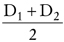

Verordnung vom 15. Oktober 1985 über Sicherheitsvorschriften für Rohrleitungsanlagen Aufgrund von Art. 38 des Rohrleitungsgesetzes vom 3. Juli 1985 (Gesetz über Rohrleitungsanlagen zur Beförderung flüssiger oder gasförmiger Brenn- oder Treibstoffe), LGBl. 1985 Nr. 60 , verordnet die Regierung: I. Einleitung Art. 1 Begriffe 1) In der vorliegenden Verordnung werden Rohrleitungsanlagen für flüssige Stoffe als Ölleitungen und Rohrleitungsanlagen für gasförmige Stoffe als Gasleitungen bezeichnet. Rohrleitungsanlagen, die zum Transport von verflüssigtem Gas dienen, gelten als Gasleitungen. 2) Als Nebenanlagen im Sinne dieser Verordnung gelten Pump-, Kompressoren-, Mess-, Abnahme-, Verteil-, Druckreduzier-, Speicher- und ähnliche Stationen. 3) Alle Druckangaben sind als Überdruck zu verstehen. 4) Wo nichts anderes bestimmt ist, beziehen sich Distanzangaben auf den äusseren Rand der betreffenden Objekte und die Rohrachse. Art. 2 Geltungsbereich 1) Diese Verordnung gilt für Projektierung, Bau, Betrieb und Unterhalt aller dem Gesetz unterstehenden Rohrleitungsanlagen. 2) Für Gasleitungen mit einem höchstmöglichen Betriebsdruck (Berechnungsdruck) bis zu 0.5 MPa (5 bar) gelten nur die Art. 3 (Regeln der Technik), 4 (Berücksichtigung anderer Interessen), 7 (Organisation), 68 (Strafbestimmungen) und 69 (Aufsicht, Kontrolle). Für Gasleitungen, die nach dieser Bestimmung erstellt wurden, ist eine spätere Druckerhöhung über 0.5 MPa (5 bar) unzulässig. Art. 3 Regeln der Technik 1) Die Rohrleitungsanlagen sind nach den Regeln der Technik von fachkundigen Personen zu projektieren, zu erstellen, zu betreiben und zu unterhalten, so dass keine Beeinträchtigung der Umgebung entsteht. 2) Als Regeln der Technik gelten namentlich: a) die Richtlinien des Eidgenössischen Rohrleitungsinspektorates (Rohrleitungsinspektorat) für Planung und Bau von Rohrleitungsanlagen zur Beförderung flüssiger und gasförmiger Brenn- oder Treibstoffe; b) die Richtlinien der Eidgenössischen Korrosionskommission für Projektierung, Ausführung und Betrieb des kathodischen Schutzes von Rohrleitungen; c) die Richtlinien der Eidgenössischen Korrosionskommission zum Schutz gegen Korrosion durch Streuströme von Gleichstromanlagen; d) die Richtlinien des Schweizerischen Vereins des Gas- und Wasserfaches zur Gasodorierung; e) die liechtensteinischen Vermessungsvorschriften; f) die Richtlinien des Eidgenössischen Starkstrominspektorates über Schutzmassnahmen in Nebenanlagen von Rohrleitungen; g) die Richtlinien des Eidgenössischen Starkstrominspektorates über Schutzmassnahmen bei Annäherung von Starkstromanlagen an Rohrleitungsanlagen. 3) Als Regeln der Technik für Gasleitungen mit einem höchstmöglichen Betriebsdruck (Berechnungsdruck) bis 0.5 MPa (5 bar) gelten namentlich: a) die Richtlinien des Schweizerischen Vereins des Gas- und Wasserfaches für Bau, Unterhalt und Betrieb von Gashauptleitungen und Nebenanlagen; b) die in Abs. 2 Bst. b bis g genannten Richtlinien. Art. 4 Berücksichtigung anderer Interessen 1) Bei Projektierung, Bau und Betrieb der Rohrleitungsanlage ist auf andere gesetzlich geschützte Interessen Rücksicht zu nehmen, wie Natur- und Landschaftsschutz, Meliorationen, Gewässerschutz, Forstwesen, Fischerei, Wasserbau, elektrische Anlagen, Eisenbahnen, Zivilschutz, Arbeitnehmerschutz, Brandschutz. 2) Mit den für die Wahrung dieser Interessen zuständigen Behörden ist rechtzeitig Kontakt aufzunehmen. 3) Die bereits im Boden befindlichen und geplanten anderen Leitungen und Anlagen sind durch Fühlungnahme mit den zuständigen Behörden und Inhabern solcher Anlagen zu erheben und zu berücksichtigen. Art. 5 Abweichungen 1) Die Aufsichtsbehörde kann, wenn die Umstände es erfordern, Abweichungen von den Vorschriften dieser Verordnung anordnen, um Gefahren für Personen, Sachen und wichtige Rechtsgüter abzuwenden. 2) Sie kann ausnahmsweise Abweichungen bewilligen, wenn die örtlichen Umstände es erlauben oder neue technische Erkenntnisse es ermöglichen und der angestrebte Grad an Sicherheit gewährleistet bleibt. Art. 6 Aufsicht 1) Über die technischen Anforderungen an Projektierung, Bau und Betrieb einer der Aufsicht der Regierung unterstehenden Rohrleitungsanlage haben sich die Rohrleitungsinhaber mit der von der Regierung beauftragten Kontrollstelle zu verständigen. Vorbehalten bleiben die Bau- und Betriebsbewilligung. 2) Kommt keine Einigung zustande, trifft die Aufsichtsbehörde die nötigen Verfügungen. Art. 7 Organisation Die Rohrleitungsinhaber treffen die nötigen Vorkehren hinsichtlich Organisation, Personal und Material, damit die Sicherheit der Rohrleitungsanlage und ihres Betriebes jederzeit aufrechterhalten bleibt. II. Projektierung 1. Trassee Art. 8 Allgemeine Trasseebestimmung 1) Geologisch unstabile Gebiete, Bereiche von Sprengobjekten und andere Gebiete mit besonderen Gefahren sind nach Möglichkeit zu meiden. 2) Die Verlegung von Ölleitungen im Bereich von nutzbaren Grundwasservorkommen ist auf das Unumgängliche zu beschränken. 3) Die Verlegung von Ölleitungen in den Schutzzonen um Wasserfassungen, in Grundwasserschutzarealen und, unter Vorbehalt der Fluss- und Bachkreuzungen, in Oberflächengewässern ist untersagt. 4) Die Verlegung von Gasleitungen in Oberflächengewässern ist, unter Vorbehalt der Fluss- und Bachkreuzungen, auf das Unumgängliche zu beschränken. 5) Die Verlegung von Rohrleitungen im Wald und in Meliorationsgebieten ist soweit als möglich zu vermeiden. 6) Soweit die gerade Linienführung nicht in unzumutbarer Weise behindert wird, ist die Rohrleitung entlang von dauernden Bewirtschaftungsgrenzen, wie Waldrändern, zu verlegen. 7) Entstehen bei den Projektierungsarbeiten aufgrund der Bestimmungen dieser Verordnung widersprechende Zielsetzungen, so sind diese vor Einreichen des Gesuches mit der Aufsichtsbehörde im Hinblick auf die Erteilung von Ausnahmebewilligungen zu erörtern. Art. 9 Verlegung 1) Die Rohrleitung ist in der Regel in den Boden zu verlegen. Die Überdeckung soll, vom Rohrscheitel aus gemessen, mindestens einen, höchstens aber vier Meter betragen; sie ist den örtlichen Verhältnissen und möglichen Temperaturschwankungen anzupassen. Bepflanzungen sind umgebungsgerecht anzulegen. 2) Rohrleitungsabschnitte, die nicht kathodisch geschützt werden können (Art. 25), sind oberirdisch zu verlegen. 3) In Abschnitten, in denen ein Erkennen von Lecks an Ölleitungen besonders wichtig ist, kann die Aufsichtsbehörde eine oberirdische Verlegung verlangen. Art. 10 Sicherheitsabstände im allgemeinen 1) Zwischen der Rohrleitung und anderen Anlagen sind die für den sicheren Bau und Betrieb der Rohrleitungsanlage und der anderen Anlagen nötigen Abstände einzuhalten. 2) Zwischen der Rohrleitung einerseits, Fundamenten oder stammbildenden Pflanzen andererseits ist ein Mindestabstand von 2 m (lichte Weite) einzuhalten. 3) Gegenüber erdverlegten Leitungen sind folgende Abstände (lichte Weiten) einzuhalten: a) bei Parallelführung, je nach Durchmesser der Leitungen, Bauablauf und Verlegeverfahren 2 bis 5 m. In Ausnahmefällen kann in bebauten Gebieten mit grosser Leitungsdichte dieser Abstand auf den Wert 

 reduziert werden, wobei D 1 und D 2 die Rohrdurchmesser der parallelführenden Leitungen bedeuten. Der Abstand ist mit der von der Regierung bezeichneten Kontrollstelle generell oder fallweise festzulegen. b) bei Kreuzungen mit Wasser-, Abwasser- und sonstigen metallischen und nichtmetallischen Leitungen 30 cm, mit Schwachstromkabelleitungen 50 cm. Solche Leitungen sind wenn möglich zu unterfahren. Art. 11 Bauzonen 1) Bestehende und geplante Bauzonen sind zu umfahren. Dabei sind folgende Abstände von den Baulinien einzuhalten: a) bei Rohrleitungen mit einem bewilligten Betriebsdruck von mehr als 2.5 MPa (25 bar): 10 m; b) bei Rohrleitungen mit einem bewilligten Betriebsdruck bis zu 2.5 MPa (25 bar): 5 m. 2) Ausgenommen sind Rohrleitungen für die Versorgung solcher Gebiete; ihr Betriebsdruck soll jedoch nicht mehr als 2.5 MPa (25 bar) betragen. Art. 12 Sicherheitsabstände zu Gebäuden und Plätzen 1) Zwischen der Rohrleitung einerseits, Gebäuden und Plätzen andererseits, sind folgende Sicherheitsabstände einzuhalten: a) zu Gebäuden ohne Personenbelegung: 2 m (lichte Weite); b) zu Gebäuden mit Personenbelegung: 10 m (lichte Weite); c) zu Plätzen mit häufigen grossen Menschenansammlungen: 10 m (lichte Weite); d) zu schutzwürdigen Baudenkmälern: 10 m (lichte Weite). 2) Bei Rohrleitungen mit einem Betriebsdruck bis 2.5 MPa (25 bar) können die Sicherheitsabstände nach den Bst. b und c auf die Hälfte herabgesetzt werden. Art. 13 Sicherheitsabstände zu Strassen Bei Parallelführung zu verkehrsreichen Strassen ist, gemessen vom Fahrspurrand, ein Abstand von 5 m einzuhalten. Jedenfalls ist zum Böschungsfuss bei Dämmen und zur Böschungskrone bei Einschnitten ein Abstand von 2 m einzuhalten. Art. 14 Sicherheitsabstände zu Eisenbahnen 1) Bei Parallelführung zu Eisenbahnen ist, gemessen ab nächster Schiene, ein Sicherheitsabstand von 10 m einzuhalten. Jedenfalls ist zum Böschungsfuss bei Dämmen und zur Böschungskrone bei Einschnitten ein Abstand von 2 m einzuhalten. 2) Bei Kreuzungen ist zwischen Rohrleitung bzw. Mantelrohr und dem Geleise ein Abstand von 2 m vorzusehen. 3) Weitergehende Anforderungen, gestützt auf die Eisenbahngesetzgebung, bleiben vorbehalten. Art. 15 Rohrleitungsstollen Der Abstand von Portalen und Fenstern von Rohrleitungsstollen zu Eisenbahnen, verkehrsreichen Strassen, Staudämmen und Staumauern und ähnlichen Objekten sowie Bauzonen soll in der Regel mindestens 100 m betragen. Art. 16 Sicherheitsabstände zu Starkstromanlagen Zwischen der Rohrleitungsanlage und den nachgenannten elektrischen Starkstromanlagen, einschliesslich Erdungen, Fundamente, Anker und allenfalls Umzäunungen, sind folgende Abstände einzuhalten: a) Kraftwerke, Unterwerke, Hochspannungs-Schaltanlagen: 50 m; b) Transformatorenstationen, Kleingeneratorenanlagen bis 1 000 kVA: 10 m; c) Maste von Hochspannungs-Freileitungen mit höchstmöglichem Erdschlussstrom bis 5 kA: 3 m, bei Erdschlussströmen über 5 kA ist der Abstand für jedes zusätzliche kA um 0,5 m zu erhöhen; d) Maste von Niederspannungs-Freileitungen: 3 m. Art. 17 Sicherheitsabstände bei Annäherungen und Parallelführungen mit Starkstromanlagen 1) Bei Annäherungen und Parallelführungen von Rohrleitungsanlagen und Starkstromleitungen sind folgende Abstände einzuhalten: a) Weitspannleitungen (Spannweiten über 50 m), gemessen von der senkrechten Projektion des äussersten Leiters: 10 m; b) Regelleitungen (Spannweiten bis zu 50 m), gemessen von der senkrechten Projektion des äussersten Leiters: 3 m; c) Kabel: 3 m, wobei mit Schutzmassnahmen dieser Abstand bis auf 0,5 m herabgesetzt werden kann. 2) Zwischen oberirdischen Nebenanlagen und Starkstromfreileitungen ist, gemessen von der senkrechten Projektion des äussersten Leiters bzw. den äussersten Mastteilen, ein Abstand von 10 m, bei Ausbläsern und Molchschleusen ein solcher von 30 m einzuhalten. Art. 18 Kreuzungen mit Starkstromleitungen 1) Kreuzungen mit Hochspannungsfreileitungen sind nur bei unterirdischer Verlegung der Rohrleitung zulässig. 2) Bei Kreuzungen zwischen Kabeln und Rohrleitungen sind eine Erdschicht von 50 cm und Schutzmassnahmen vorzusehen. Art. 19 Schutzzone um Nebenanlagen 1) Um Nebenanlagen und Installationen ist eine Schutzzone vorzusehen, die von Gebäuden, öffentlichen Verkehrswegen und von die Brandbekämpfung behindernden Objekten und Pflanzen freizuhalten ist, und zwar um: a) Pump- und Kompressorenstationen: 50 m; b) andere Nebenanlagen: 30 m; c) Ausbläser und Molchschleusen: 30 m; d) oberirdische Behälter und Tankanlagen, die der Speicherung dienen: 10 m. 2) Nicht unter Abs. 1 fallen: a) Nebenanlagen von Gasleitungen, die für eine Stundenleistung von nicht mehr als 20 000 kW ausgelegt sind und sich im Freien oder in Gehäusen von nicht mehr als 40 m 3 Rauminhalt befinden; b) einzelne Streckenschieber. Für diese Anlagen und Installationen gelten die für die Rohrleitung vorgeschriebenen Sicherheitsabstände. 3) Wird die Umgebung durch geeignete Massnahmen wie Tiefer- oder Höherlegung der Nebenanlage oder Installation, Wall oder Mauer, ausreichend gegen Explosions- und Brandwirkung geschützt, kann die Aufsichtsbehörde Ausnahmen von der Freihaltung der Schutzzone bewilligen. 2. Rohrleitung Art. 20 Werkstoffe, Herstellungsverfahren 1) Werkstoffe für Rohre, Formstücke, Armaturen und andere Rohrleitungsteile müssen sich hinsichtlich Festigkeit, Alterungs- und Korrosionsbeständigkeit, Feuersicherheit und Verbindungsfähigkeit für die vorgesehene Verwendung eignen. Sie dürfen nicht zu Sprödbruch neigen. 2) Für die Herstellung der Anlageteile sind in der Regel genormte Rohrleitungsstähle vorzusehen. Andere Werkstoffe, z. B. Kunststoffe, oder nichtgenormte Stähle dürfen nur verwendet werden, wenn ihre Eignung für die vorgesehene Verwendung eigens nachgewiesen wird. 3) Die Wahl des Werkstoffes und seine zulässigen chemischen und mechanisch-technologischen Eigenschaften sowie die Herstellungsart der aus diesem Werkstoff anzufertigenden Rohre, Formstücke, Armaturen und anderen Rohrleitungsteile sind mit der von der Regierung bezeichneten Kontrollstelle abzusprechen. Art. 21 Dimensionierung 1) Die Berechnung der Wanddicke von Rohren, Formstücken, Armaturen und anderen Rohrleitungsteilen erfolgt in Berücksichtigung von inneren und äusseren Kräften nach den Regeln der Technik. 2) Für die Ermittlung der äusseren Kräfte sind insbesondere an kritischen Stellen die mechanischen Einflüsse des Bodens auf die Rohrleitung sowie mögliche Temperaturschwankungen zu berücksichtigen. 3) Zur Ermittlung des höchstmöglichen Druckes (Berechnungsdruckes) sind sämtliche in der Praxis möglichen statischen und dynamischen Betriebszustände unter Berücksichtigung der besonderen Eigenschaften des beförderten Gutes zu berechnen. Bei Ölleitungen sind die Druckverhältnisse der möglichen stationären und instationären Betriebszustände in Druckprofilen darzustellen. 4) Die Rohrleitung und ihre Nebenanlagen sind im Einvernehmen mit der von der Regierung bezeichneten Kontrollstelle zu dimensionieren und zu berechnen. Art. 22 Werkprüfung 1) Rohre, Formstücke, Armaturen und andere Rohrleitungsteile sowie die Rohrumhüllung sind im Herstellerwerk daraufhin zu prüfen, ob sie den gestellten Anforderungen entsprechen. 2) Art, Umfang und Verfahren der Werkprüfung sind mit der von der Regierung bezeichneten Kontrollstelle abzusprechen. 3) Über die Durchführung der Prüfungen und ihre Ergebnisse sind der von der Regierung bezeichneten Kontrollstelle Prüfzeugnisse vorzulegen. Art. 23 Tankanlagen und Behälter Für die Erstellung von Tankanlagen von Ölleitungen und von Druckbehältern von Öl- und Gasleitungen sind die bautechnischen Vorschriften der technischen Tankvorschriften anzuwenden. 3. Schutzmassnahmen Art. 24 Korrosionsschutz 1) Die Rohrleitung ist gegen Korrosionseinflüsse aller Art zu schützen. 2) Bei erdverlegten Rohrleitungen besteht dieser Schutz aus einer äusseren, elektrisch isolierenden, dauernd haftenden und dichten Rohrumhüllung sowie aus einer kathodischen Schutzanlage (Art. 25). 3) Oberirdisch verlegte Rohrleitungen sind mit einem Schutzanstrich zu versehen. 4) Die Korrosion von innen her ist durch geeignete Massnahmen zu überwachen und nach Möglichkeit zu verhindern. 5) Die Materialien und Einrichtungen, die für den Korrosionsschutz vorgesehen sind, sowie die jeweiligen Applikationsverfahren sind im Einvernehmen mit der von der Regierung bezeichneten Kontrollstelle zu bestimmen. Folgende Eigenschaften sind nachzuweisen: a) Eignung der Materialien, Einrichtungen und Applikationsverfahren für den vorgesehenen Zweck; b) Betriebssicherheit der Korrosionseinrichtungen; c) Unschädlichkeit der Materialien und Einrichtungen für die Umgebung. Art. 25 Kathodische Schutzanlage 1) Um das einwandfreie Funktionieren des kathodischen Schutzes sicherzustellen, ist die Rohrleitung, sofern keine zwingenden Gründe entgegenstehen, auf ihrer ganzen Ausdehnung als ein elektrisch ununterbrochener guter Leiter auszubilden. Sie ist an den Enden durch Isolierstücke von den Nebenanlagen zu trennen. 2) Bei der Wahl des Standortes von Anodenanlagen sind die zu Erdungseinrichtungen von Starkstromanlagen verlangten Sicherheitsabstände einzuhalten. Die Anodenstandorte sind so zu wählen, dass andere erdverlegte Leitungen nicht unzulässig beeinflusst werden. Art. 26 Erdung von Nebenanlagen Die isolierten und nicht mit der Rohrleitungsanlage elektrisch verbundenen Nebenanlagen sind für sich zu erden. Die elektrische Auftrennung zwischen der Rohrleitung und der Nebenanlage ist derart zu bemessen, dass sie den durch elektrische Beeinflussung auftretenden Spannungen standhält. Art. 27 Schutz vor mechanischer Einwirkung 1) Wo die Leitung besonderen Gefahren ausgesetzt ist, wie bei häufigem Überfahren mit schweren Lasten, Vibrationen, Steinschlag, ist sie gegen diese Einwirkungen zu schützen. 2) In Gebieten mit Senkungs- und Rutschgefahr sind bauliche Schutzmassnahmen zu treffen, wobei wenn nötig zur Überwachung des Geländes messtechnische Vorkehren zu treffen sind (Art. 59 Abs. 4). Art. 28 Schutz vor Deformationen 1) Oberirdisch verlegte Rohrleitungen sind durch geeignete Massnahmen gegen unzulässige Deformationen und Wärmespannungen zu schützen. 2) Zur Aufnahme von Dilatationsbewegungen dürfen keine Stopfbüchsen verwendet werden. Art. 29 Überdrucksicherung Bei Pump- und Kompressorenstationen sind zur Vermeidung von unzulässigen Überdrücken Sicherheitseinrichtungen vorzusehen. Art. 30 Systeme verschiedener Drücke Beim Übergang auf Rohrleitungssysteme mit geringeren Betriebsdrücken ist zu verhindern, dass sich der Druck des höheren nachteilig auf das niedrigere Drucksystem auswirkt. Art. 31 Verhinderung der Kondensatbildung Bei Gasleitungen sind wenn nötig Einrichtungen vorzusehen, die den Taupunkt des Gases soweit absenken, dass in der Rohrleitung keine Kondensate entstehen. Art. 32 Zusammentreffen mit anderen Anlagen Bei Kreuzungen oder einem sonstigen Zusammentreffen mit anderen Anlagen, wie Eisenbahnen, Strassen, anderen Rohrleitungen, Kanalisationen, Kabeln, Freileitungen, sind an der Rohrleitungsanlage bzw. an den anderen Anlagen die nötigen Schutzvorkehrungen zu treffen. Art. 33 Sicherung der Nebenanlagen Oberirdische Nebenanlagen sind gegen unbefugtes Eindringen und gegen unbefugte Eingriffe von aussen zu sichern und mit Warntafeln zu versehen. Nötigenfalls sind die Anlagen in geeigneter Weise zu umzäunen. Art. 34 Leckerkennung bei Ölleitungen Bei Ölleitungen sind Einrichtungen vorzusehen, die ein möglichst rasches Erkennen von drohenden oder bestehenden Lecks ermöglichen, z. B. Mengenvergleichsverfahren, Wanddickenbestimmung durch Magnetmolch oder Ultraschallmolch. Art. 35 Rückhaltemassnahmen bei Ölleitungen An besonders gefährdeten Stellen bei Ölleitungen kann die Aufsichtsbehörde Massnahmen verlangen, die verhindern, dass bei Leckwerden der Inhalt der Rohrleitung oder der Inhalt bestimmter Abschnitte der Rohrleitung in die Umgebung gelangt. Art. 36 Lecksicherung bei Nebenanlagen von Ölleitungen 1) Nebenanlagen von Ölleitungen einschliesslich Absperrorgane und Molchschleusen sind in richtig dimensionierten, dichten, standfesten, öl- und witterungsbeständigen Rückhaltebecken zu erstellen. 2) Nicht überdachte Becken sind mit einer nicht automatisch arbeitenden Entwässerungseinrichtung zu versehen, wobei die Entwässerung über den Rand der Becken zu erfolgen hat. 3) Die Rückhaltebecken sind nach den einschlägigen Vorschriften über die Zuleitung von Abwässern in Gewässer zu entwässern. Art. 37 Brand- und Explosionsschutz 1) Gebäude für Nebenanlagen sind aus nicht brennbarem Material in leichter Bauweise, insbesondere mit leichtem Dach, auszuführen. Sie müssen ausreichend ventiliert und mit geeigneten Feuerlöscheinrichtungen versehen werden. 2) Bei einer möglichen Blockierung des Fluchtweges sind mindestens zwei sich diametral gegenüberliegende Ausgänge mit sich nach aussen öffnenden Türen vorzusehen, deren Abstände von irgendeinem Punkt innerhalb des Gebäudes in der Regel nicht grösser als 20 m sein dürfen. 3) Kompressorenstationen für Gasleitungen sind so auszulegen, dass im Falle eines Brandes sämtliche Rohrleitungen durch Abblasen des Gases druckfrei gemacht werden können. Lage und Höhe der Abblaseeinrichtungen sind so zu wählen, dass ein sicheres Abblasen gewährleistet ist. 4) Die Nebenanlagen müssen durch die üblichen Feuerwehrfahrzeuge auf verfestigten Wegen oder Strassen leicht erreichbar sein. 5) In den explosionsgefährdeten Zonen von Nebenanlagen sind die elektrischen Anlagen explosionsgeschützt auszuführen. Diese Zonen sind im Einvernehmen mit der von der Regierung bezeichneten Kontrollstelle festzulegen. 4. Absperrorgane Art. 38 Grundsatz Damit die Rohrleitungsanlage innert kürzester Frist ganz oder abschnittweise stillgelegt werden kann, sind Absperrorgane einzubauen. Art. 39 Anforderungen 1) Die Wahl der Absperrorgane ist im Einvernehmen mit der von der Regierung bezeichneten Kontrollstelle zu treffen. 2) Die Absperrorgane und ihre Anschweiss-Enden haben den gleichen Sicherheitsanforderungen zu genügen wie das Leitungsrohr. 3) Die Antriebe der Absperrorgane müssen jederzeit leicht zugänglich sein und über Grund betätigt werden können. 4) Bei Gasleitungen müssen die zwischen Absperrorganen liegenden Leitungsstrecken im Notfall gefahrlos druckfrei gemacht werden können. Zu diesem Zweck sind an geeigneten Stellen Ausbläser vorzusehen. Art. 40 Anwendung 1) Die Zahl der Absperrorgane ist möglichst niedrig zu halten. 2) Absperrorgane sind vorzusehen: a) am Anfang von Zweigleitungen und in der Regel unmittelbar nach den Abzweigungen in der Hauptleitung; b) in einer Entfernung von 10 bis 100 m vor und nach Nebenanlagen; c) als motorisierte Streckenschieber in Abständen von höchstens 20 km, abhängig von den örtlichen Verhältnissen; d) bei permanenten Sprengobjekten. 3) In Ölleitungen sind zum Schutz von nutzbaren Grundwasservorkommen entsprechend der Topographie zusätzliche Absperrorgane einzubauen. 4) Die Aufsichtsbehörde ist befugt, Standorte von Absperrorganen anzuordnen oder abzulehnen. Art. 41 Motorisierung Die für die Sicherheit wichtigen Absperrorgane sind mit Motorantrieb auszurüsten. 5. Überwachungsmassnahmen Art. 42 Überwachungseinrichtungen 1) Nebenanlagen mit für den Betrieb massgeblichen Organen, wie Kompressoren, Pumpen, Druckreglern, sind mit registrierenden Messgeräten, Alarmeinrichtungen und Steuereinrichtungen zu versehen. 2) Die Überwachungseinrichtungen sind, soweit betrieblich zulässig, derart zu automatisieren, dass bei ausserordentlichen Druckveränderungen, Förderverlusten oder anderen Betriebsstörungen Alarmgabe und Stillegung des betreffenden Rohrleitungsabschnittes oder der ganzen Anlage erfolgt. 3) Gestattet der Betrieb die Stillegung nicht, sind Massnahmen zu treffen, die eine gefahrlose Weiterführung des Betriebes ermöglichen. Art. 43 Fernmeldeanlage Sind Nebenanlagen mit Überwachungseinrichtungen unbemannt, so sind die Messwerte und Alarme in eine bemannte Leitstelle zu übertragen. Art. 44 Fernsteuerungsanlage 1) Wichtige Organe von Nebenanlagen, wie Kompressoren, Pumpen, Absperrorgane, müssen, sofern sie nicht an Ort und Stelle überwacht werden, ferngesteuert werden können. 2) Motorangetriebene Absperrorgane (Art. 40 Abs. 2 Bst. c, Art. 41) sind mit Fernsteuerung zu versehen. 3) Die Fernsteuerungseinrichtungen sind gegen Fehlbedienung gegenseitig zu verriegeln. Art. 45 Betriebssicherheit 1) Die Überwachungs-, Fernmelde- und Fernsteuerungseinrichtungen und die daran angeschlossenen Organe müssen bei Unterbruch der externen Energiezufuhr sicher funktionieren. 2) Sie sind mit Rückmeldung der selbsttätigen Überwachung ihrer Wirksamkeit zu versehen. 3) Die Überwachungseinrichtungen, Fernmelde- und Fernsteuerungsanlagen sind gegen störende äussere Beeinflussung so einzurichten, dass die Betriebssicherheit und Steuerbarkeit der Rohrleitungsanlage nicht beeinträchtigt werden. III. Bau Art. 46 Einbetten der Rohrleitung 1) Zum Einbetten der Rohrleitung sind Materialien zu verwenden, die die Rohrleitung und deren Isolation nicht beschädigen. 2) Die Rohrleitung darf nicht mit korrosiven Stoffen eingedeckt werden. Bei nachträglichen Geländeaufschüttungen ist die Ablagerung von korrosivem Material (Kehricht, Schlacken usw.) über der Leitung untersagt. 3) Um in Gefällen das Ausschwemmen des im Graben vorhandenen Füllmaterials zu verhindern, sind in kurzen Abständen Wasserfangschirme einzubauen. 4) Im Rohrgraben sind nicht näher als 40 cm über dem Rohrscheitel Warnbänder mit Hinweis auf die Leitung und den Rohrleitungsinhaber einzulegen. Art. 47 Einmessen der Leitung Die Rohrleitungsanlage ist durch ausgewiesene Vermessungsfachleute in Landeskoordinaten einzumessen und in einem Leitungskataster in Grundriss und Höhenlage festzuhalten (Art. 3 Abs. 2 Bst. e). Art. 48 Markierung 1) Die Rohrleitung ist im Gelände so zu markieren, dass ihr Verlauf sicher verfolgt werden kann. 2) Die Markierungen dürfen Dritte in der Ausübung ihrer Aufgabe nicht behindern. 3) Zahl, Lage und Art der Markierungen richten sich nach den örtlichen Verhältnissen. 4) Bei besonderen Objekten, z. B. Bahnkreuzungen, ist die Lage der Rohrleitung genau zu markieren. Art. 49 Feldprüfungen 1) Vor, während und nach dem Bau der Rohrleitungsanlage sind die nötigen Prüfungen durchzuführen. 2) Im Einvernehmen mit der von der Regierung bezeichneten Kontrollstelle sind zu bestimmen: a) Schweissverfahren, b) Art und Umfang der zerstörenden und zerstörungsfreien Schweissnahtprüfung, c) Verlegeverfahren, d) Art der Prüfung der Rohrumhüllung, e) Rohreinbettung, f) Rohrabstützung bei oberirdischer Verlegung, g) Felsschutzmassnahmen, h) Grabeneindeckung, i) Anbringen der Messkabel für den kathodischen Schutz an der Rohrleitung. 3) Schweisser dürfen ihre Arbeiten nur verrichten, wenn sie ihre Befähigung zur Ausführung der vorgesehenen Schweissarbeiten nachgewiesen haben. Die von der Regierung bezeichnete Kontrollstelle einigt sich mit der Rohrverlegungsunternehmung über die zum Einsatz gelangenden Schweisser. 4) Es ist im Einvernehmen mit der von der Regierung bezeichneten Kontrollstelle ein Schweissbuch zu führen. Dieses ist der von der Regierung bezeichneten Kontrollstelle nach Abschluss der Arbeiten unverzüglich abzuliefern. Art. 50 Wiederinstandstellung 1) Das für die Verlegung in Anspruch genommene Terrain ist sobald tunlich nach Abschluss der Bauarbeiten wieder instandzustellen. Dabei ist soweit als möglich der ursprüngliche Zustand einschliesslich Bodenfruchtbarkeit wieder herzustellen. 2) An Stellen, wo zum vornherein mit Schwierigkeiten für die Wiederinstandstellung zu rechnen ist, ist der Wiederinstandstellungsvorgang vorher mit den Betroffenen und den interessierten Behörden abzusprechen. Art. 51 Hauptdruckprüfung 1) Die Hauptdruckprüfung im Rahmen der Abnahmeprüfung (Art. 15 der Rohrleitungsverordnung) hat nach Anordnung und unter Leitung der von der Regierung bezeichneten Kontrollstelle zu erfolgen. 2) Sie ist in der Regel als Wasserdruckprüfung durchzuführen. Wenn die Umstände es erfordern, kann sie mit Zustimmung der von der Regierung bezeichneten Kontrollstelle durch eine Prüfung mit Luft oder inertem Gas ersetzt werden. 3) Die Druckprüfung ist so durchzuführen, dass keine Korrosion oder Eisbildung entsteht. 4) Der Prüfdruck beträgt bei der Wasserdruckprüfung mindestens das 1.3fache des Berechnungsdruckes. Der maximale Prüfdruck ist jedoch so zu begrenzen, dass die rechnerische, zusammengesetzte Spannung im Rohr 90% der garantierten Streckgrenze des Werkstoffes an der am stärksten beanspruchten Stelle nicht überschreiten kann. 5) Bei Druckprüfung mit Luft oder inertem Gas wird der Prüfdruck von der von der Regierung bezeichneten Kontrollstelle festgelegt. Art. 52 Funktionsprüfung Nach Anordnung und unter Leitung der von der Regierung bezeichneten Kontrollstelle ist ein Probelauf zu fahren, um alle Teile der Rohrleitungsanlage einer Funktionsprüfung zu unterziehen. IV. Betrieb und Unterhalt 1. Allgemeines Art. 53 Grundsatz Die Rohrleitungsanlage ist stets in betriebsbereitem und betriebssicherem Zustand zu halten. Art. 54 Reparaturen 1) Werden Defekte festgestellt, sind diese unverzüglich unter Mitteilung an die von der Regierung bezeichnete Kontrollstelle zu beheben. 2) Für Reparaturen und Änderungen der Rohrleitungsanlage gelten die gleichen technischen und verfahrensmässigen Anforderungen wie für den Bau der Rohrleitungsanlage. 3) Reparaturen dürfen den Sicherheitsgrad der Rohrleitung nicht vermindern. Art. 55 Entleerung 1) Austretende flüssige Stoffe, wie Entleerungsreste aus der Rohrleitung oder aus Abscheidern, Schmieröl und Sperröl von Kompressoren und Pumpen usw., dürfen nicht in die Kanalisation, in ober- oder unterirdische Gewässer oder in natürliche Feuchtgebiete gelangen, sondern sind zu verwerten oder allenfalls nach spezieller Vorbehandlung zu beseitigen. 2) Die Deponie- und Vernichtungsstellen für aus Rohrleitungen ausgetretene Stoffe sind vom Amt für Umweltschutz zuzuweisen. Dieses verfügt auch die notwendige Vorbehandlung. Art. 56 Odorierung 1) Unter Normalbedingungen geruchlose und unsichtbare Stoffe sind in der Regel zu odorieren. 2) Die Odorierungsmittel dürfen nicht korrosionsgefährdend sein. Art. 57 Stillegung 1) Stillgelegte Rohrleitungsteile sind zu entfernen oder so zu reinigen, dass sie Personen, Sachen und wichtige Rechtsgüter nicht gefährden. Das Gelände ist dem gewachsenen Boden anzugleichen und standortsgemäss zu bepflanzen. 2) Stillgelegte, nicht von der noch im Betrieb befindlichen Anlage abgetrennte Teile der Rohrleitungsanlage sind mit inhibiertem Wasser oder inertem Gas zu füllen. 2. Betriebskontrollen Art. 58 Grundsatz Die Betriebsbereitschaft und der Zustand der Rohrleitung, der Nebenanlagen, Absperrorgane, des kathodischen Schutzes, der Überwachungseinrichtungen und der Fernmelde- und Fernsteuereinrichtung sind regelmässig zu kontrollieren. Soweit es der Betrieb erlaubt, ist deren Betriebsbereitschaft durch Betätigung und Messungen zu überprüfen. Art. 59 Trasseekontrolle 1) Alle zwei Wochen sind Kontrollgänge mit Sichtkontrolle des Trassees einschliesslich Nebenanlagen und baulichen Schutzmassnahmen usw. durchzuführen. 2) Es ist darüber zu wachen, dass die Rohrleitung jederzeit ohne grösseren Aufwand zugänglich ist. 3) Schäden am Trassee, wie Ausspülungen, Überlagerungen, Überwachsungen, sind unverzüglich zu beheben. 4) Terrain und bauliche Schutzmassnahmen in Gebieten von Senkungs- und Rutschgefahr sind regelmässig durch Messungen auf allfällige Verschiebungen hin zu kontrollieren (Art. 27). Die Ergebnisse sind der von der Regierung bezeichneten Kontrollstelle ohne Verzug bekanntzugeben. Werden gefährliche Verschiebungen festgestellt, sind die nötigen Schutz- und Sanierungsmassnahmen zu treffen. Art. 60 Rohrleitung 1) Ölleitungen sind zur Feststellung, ob sie dicht sind, in der Regel jährlich nach Anordnung und unter Leitung der von der Regierung bezeichneten Kontrollstelle einer Dichtheitsprüfung mit Transportgut zu unterziehen. Der Prüfdruck ist mit der von der Regierung bezeichneten Kontrollstelle abzusprechen. 2) Mit Zustimmung der von der Regierung bezeichneten Kontrollstelle kann die Dichtheitsprüfung durch andere Massnahmen ersetzt werden, sofern diese eine gleichwertige Kontrolle der Dichtheit ergeben. Art. 61 Tankanlagen und Behälter 1) Tankanlagen von Ölleitungen sind von Unternehmen, die im Besitz einer Bewilligung sind, nach den einschlägigen Vorschriften zu revidieren. Der Revisionsbericht ist der von der Regierung bezeichneten Kontrollstelle zuzustellen. 2) Druckbehälter von Öl- und Gasleitungen sind mindestens alle acht Jahre einer Innenprüfung zu unterziehen. Art. 62 Kathodischer Korrosionsschutz 1) Das einwandfreie Funktionieren der Speisegleichrichter für den kathodischen Schutz und der Drainagen ist durch Messung des Schutzstromes sowie der Ein- und Ausschaltpotentiale monatlich zu überprüfen. 2) Das Rohrpotential ist an allen Potentialmessstellen zu bestimmen: a) gemessen als Ein- und Ausschaltpotential alle sechs Monate; b) gemessen als Ein- und Ausschaltpotential mit Registrierung von mindestens zehn Einausschaltzyklen einmal im Jahr. 3) Die Messung der Schutzstromverteilung sowie die Kontrolle der festeingebauten Referenzelektroden bei ausgeschaltetem Schutzstrom ist einmal im Jahr vorzunehmen. 4) Die Ergebnisse dieser Prüfungen sind der von der Regierung bezeichneten Kontrollstelle bekanntzugeben. Die Messung der Ein- und Ausschaltpotentiale ist in Potentialprofilen darzustellen. 3. Schadenbehebungsdienst Art. 63 Einsatzmannschaften 1) Zum Aufspüren und Beheben von Schadenfällen an Rohrleitungsanlagen sind entsprechend ausgerüstete und mit den nötigen Fahrzeugen versehene Einsatzmannschaften zu bilden. 2) Die Einsatzmannschaften müssen jederzeit einsatzbereit sein und mit einer zentralen Leitstelle in Verbindung treten können. 3) Die Leitstellen sind ununterbrochen besetzt zu halten. 4) Den Einsatzmannschaften ist Fachpersonal für Reparaturen anzugliedern. Art. 64 Werkzeugmagazine 1) An für die Rohrleitung zentral gelegenen Orten, in der Regel in den Betriebszentralen, sind Magazine einzurichten, insbesondere für: a) Maschinen und Material für Aushubarbeiten, b) Reparatur- und Ersatzmaterial, c) Rohre, Formstücke und Armaturen, d) Rettungs- und Sanitätsmaterial, e) Vorrichtungen zur Auffindung und Abdichtung von Leckstellen, f) Vorrichtungen zum Abbohren und Absaugen von in den Grund ausgetretenen Flüssigkeiten und deren Abtransport, g) Vorrichtungen zur kurzfristigen Entleerung von Rohrleitungsteilen, h) Mittel zur Feuerbekämpfung, i) Ölbindemittel. 2) Das Material muss so gelagert werden, dass es ohne Verzug greifbar ist und innert nützlicher Frist an die Schadenstelle transportiert werden kann. 3) Vereinbarungen mit Dritten, wie Gas- und Wasserwerken, Baufirmen sowie Beteiligungen an Gruppenmagazinen zusammen mit anderen Unternehmungen, sind zulässig, sofern gleiche Sicherheit und Alarmbereitschaft wie bei Eigenmagazinen besteht. 4) Das Material in den Magazinen ist sorgfältig zu unterhalten. Art. 65 Feuer-und Ölwehren Zur Verhütung und Bekämpfung von Bränden an Rohrleitungsanlagen und zur Beseitigung von Ölaustritten ist mit den zuständigen Feuer- und Ölwehrorganen eine zweckmässige Zusammenarbeit zu vereinbaren. Art. 66 Einsatzdienst 1) Werden Leckstellen festgestellt, so sind die von der Regierung bezeichnete Kontrollstelle und die Alarmstelle unverzüglich zu benachrichtigen. 2) Die der Leckstelle benachbarten Absperrorgane sind, ohne die Rohrleitungsanlage zu gefährden, so zu betätigen, dass die austretende Stoffmenge möglichst klein bleibt. 3) Die Leckstelle ist abzudichten, und es sind die erforderlichen Sanierungsmassnahmen (wie Eindämmen von austretenden Flüssigkeiten und deren Entfernung aus dem Boden, dem Grundwasser und Oberflächengewässern, Ventilieren von gasgefüllten Räumen) einzuleiten und die Störungsursachen zu beheben. Art. 67 Einsatzübungen Zur Einübung der Einsatzmannschaften sind jährlich Alarmübungen durchzuführen, durch welche sie sukzessive in die möglichen Schadenfälle eingeführt werden. V. Strafbestimmungen Art. 68 Strafbestimmungen Nach Art. 35 des Gesetzes wird bestraft, wer a) als Inhaber einer Rohrleitungsanlage, als Projektverfasser, Inhaber der Bauleitung oder Unternehmer einer Vorschrift dieser Verordnung oder einer anerkannten Regel der Technik zuwiderhandelt und dadurch einen Zustand schafft, der geeignet ist, Leben oder Gesundheit von Personen, fremde Sachen von erheblichem Wert oder andere wichtige Rechtsgüter zu gefährden; b) wer unbefugt Markierungssignale der Rohrleitung (Art. 48) beschädigt, entfernt oder verändert. VI. Schlussbestimmungen Art. 69 Aufsicht, Kontrolle Aufsichtsbehörde ist das Amt für Volkswirtschaft. Als Kontrollstellen werden das Eidgenössische Rohrleitungsinspektorat (ERI) und das Technische Inspektorat (TISG) des Schweizerischen Vereins des Gas- und Wasserfaches (SVGW) eingesetzt. Art. 70 Inkrafttreten Diese Verordnung tritt am Tage der Kundmachung in Kraft. Fürstliche Regierung: gez. Hans Brunhart Fürstlicher Regierungschef
