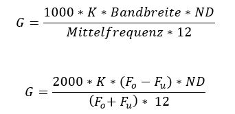

Verordnung vom 14. Januar 2025 über die Erhebung von Gebühren und Verwaltungskosten nach dem Kommunikationsgesetz (KomG-Gebührenverordnung; KomG-GebV) Aufgrund von Art. 74 Abs. 3, Art. 75 Abs. 5 und Art. 94 des Gesetzes vom 5. April 2023 über die elektronische Kommunikation (Kommunikationsgesetz; KomG), LGBl. 2023 Nr. 216, verordnet die Regierung: I. Allgemeine Bestimmungen Art. 1 Gegenstand und Zweck 1) Diese Verordnung regelt die Erhebung von Gebühren (Verwaltungs- und Nutzungsgebühren) sowie Verwaltungskosten durch das Amt für Kommunikation als Regulierungsbehörde. 2) Sie dient zudem der Umsetzung der Richtlinie (EU) 2018/1972 über den europäischen Kodex für die elektronische Kommunikation . 3) Die gültige Fassung der in Abs. 2 genannten EWR-Rechtsvorschrift ergibt sich aus der Kundmachung der Beschlüsse des Gemeinsamen EWR-Ausschusses im Liechtensteinischen Landesgesetzblatt nach Art. 3 Bst. k des Kundmachungsgesetzes. Art. 2 Bezeichnungen Unter den in dieser Verordnung verwendeten Personenbezeichnungen sind alle Personen unabhängig ihres Geschlechts zu verstehen, sofern sich die Personenbezeichnungen nicht ausdrücklich auf ein bestimmtes Geschlecht beziehen. II. Gebühren und Verwaltungskosten A. Erhebung Art. 3 Grundsatz 1) Gebühren werden in einer objektiven, verhältnismässigen, transparenten und nichtdiskriminierenden Weise auferlegt. Die Verwaltungskosten sind ihrem Zweck angemessen und auf ein Mindestmass zu reduzieren. 2) Gebühren können einmalig oder wiederkehrend sein. Art. 4 Gebührenpflicht 1) Gebührenpflichtig ist, wer gestützt auf das Gesetz und die dazu erlassenen Verordnungen eine Entscheidung, Verfügung oder sonstige Verwaltungstätigkeit der Regulierungsbehörde beantragt oder veranlasst. 2) Haben mehrere Personen gemeinsam eine oder mehrere Entscheidungen, Verfügungen oder sonstige Verwaltungstätigkeiten beantragt oder veranlasst, so sind sie solidarisch gebührenpflichtig. 3) Von der Pflicht zur Entrichtung von Gebühren sowie Verwaltungskosten ausgenommen sind die Gerichte und Verwaltungsbehörden des Landes. Art. 5 Beginn und Ende der Gebührenpflicht 1) Die Pflicht zur Entrichtung einmaliger Gebühren entsteht im Zeitpunkt: a) der Entscheidung oder Verfügung der Regulierungsbehörde; b) der Veranlassung einer Verwaltungstätigkeit der Regulierungsbehörde; oder c) der Ausübung einer Tätigkeit durch einen Anbieter. 2) Die Pflicht zur Entrichtung wiederkehrender Gebühren entsteht, sofern nichts anderes festgelegt wurde, mit Beginn des Monats, in dem: a) die Regulierungsbehörde eine Verwaltungstätigkeit betreffend einen Anbieter vornimmt; b) ein Anbieter eine gebührenpflichtige Tätigkeit aufnimmt; c) das Nutzungsrecht an Funkfrequenzen, Nummerierungsressourcen und Kommunikationsparametern und die Rechte für die Installation von zur Bereitstellung elektronischer Kommunikationsnetze genutzten Einrichtungen auf, über oder unter öffentlichem oder privatem Grundbesitz eingeräumt werden. 3) Die Pflicht zur Entrichtung wiederkehrender Gebühren endet am Ende des Monats, in dem: a) die Regulierungsbehörde die Verwaltungstätigkeit betreffend einen Anbieter beendet; b) ein Anbieter die gebührenpflichtige Tätigkeit einstellt; c) das Nutzungsrecht an Funkfrequenzen, Nummerierungsressourcen und Kommunikationsparametern und die Rechte für die Installation von zur Bereitstellung elektronischer Kommunikationsnetze genutzten Einrichtungen auf, über oder unter öffentlichem oder privatem Grundbesitz erlöschen. Art. 6 Gebührenbemessung 1) Die Gebühren werden festgesetzt: a) nach den Gebührensätzen gemäss dem Anhang; b) in den übrigen Fällen nach Aufwand. 2) Für die Berechnung des Aufwands beträgt der Stundensatz 250 Franken. Art. 7 Gebührenzuschlag Für Verwaltungstätigkeiten von aussergewöhnlichem Umfang, besonderer Schwierigkeit oder Dringlichkeit kann ein Zuschlag von bis zu 50 % der ordentlichen Gebühren erhoben werden. B. Rechnungsstellung Art. 8 Grundsatz 1) Einmalige Verwaltungsgebühren sowie Verwaltungskosten werden zusammen mit der Entscheidung oder Verfügung oder mit der Mitteilung über die veranlasste Verwaltungstätigkeit der Regulierungsbehörde in Rechnung gestellt. 2) Wiederkehrende Gebühren werden in der Regel jährlich für das laufende Kalenderjahr in Rechnung gestellt. 3) Verwaltungskosten und Gebührenzuschläge sind gesondert auszuweisen und zu begründen. Art. 9 Rechnungsstellende Behörde Die Rechnungsstellung erfolgt im Auftrag der Regulierungsbehörde durch das Amt für Finanzen. Art. 10 Fälligkeit Ist in der Rechnungsstellung nichts anderes bestimmt, sind Gebühren und Verwaltungskosten innert 30 Tagen ab dem Datum der Rechnungsstellung zur Zahlung fällig. Art. 11 Zahlung Gebühren und Verwaltungskosten sind an das Amt für Finanzen zu entrichten. Art. 12 Nachforderung und Rückerstattung Sind Gebühren oder Verwaltungskosten nicht oder zu Unrecht in Rechnung gestellt oder ist deren Höhe falsch berechnet worden, ist der Fehlbetrag nachzufordern oder zurückzuerstatten. C. Zwangsmittel Art. 13 Verzug Kommt der Gebühren- oder Kostenschuldner seiner Zahlungspflicht nicht oder nicht fristgerechnet nach, wird er schriftlich durch das Amt für Finanzen zu einer Zahlung binnen 14 Tagen aufgefordert. Bleibt der Gebühren- oder Kostenschuldner trotz dieser Mahnung säumig, wird eine zweite Mahnung binnen 14 Tagen zugestellt. Das Amt für Finanzen ist berechtigt, die gesetzlichen Verzugszinsen geltend zu machen. Art. 14 Untersagung der Tätigkeit 1) Ist der Gebühren- oder Kostenschuldner trotz Mahnung säumig, kann die Regulierungsbehörde dem Anbieter die Tätigkeit ganz oder teilweise untersagen oder einzelne oder alle Nutzungsrechte vorübergehend entziehen oder dauerhaft widerrufen. 2) Die Untersagung der Tätigkeit befreit nicht von der Zahlungspflicht. Art. 15 Verjährung Gebühren- und Verwaltungskostenforderungen sowie Rückerstattungsansprüche verjähren innert fünf Jahren. Die Verjährung beginnt mit der Fälligkeit der Forderung oder mit der Entstehung des Rückerstattungsanspruchs. III. Schlussbestimmungen Art. 16 Aufhebung bisherigen Rechts Die Verordnung vom 13. April 2004 über die Erhebung von Verwaltungs- und Nutzungsgebühren nach dem Kommunikationsgesetz (KomG-Gebührenverordnung; KomG-GebV), LGBl. 2004 Nr. 99, in der geltenden Fassung, wird aufgehoben. Art. 17 Inkrafttreten Diese Verordnung tritt gleichzeitig mit dem Beschluss des Gemeinsamen EWR-Ausschusses Nr. 275/2021 vom 24. September 2021 zur Änderung von Anhang XI (Elektronische Kommunikation, audiovisuelle Dienste und Informationsgesellschaft) des EWR-Abkommens in Kraft. Fürstliche Regierung: gez. Dr. Daniel Risch Fürstlicher Regierungschef Anhang (Art. 6) Gebühren und Verwaltungskosten A. Allgemeines 1. Sofern nicht ausdrücklich etwas anderes bestimmt ist, werden für folgende Tätigkeiten aufwandsabhängige Verwaltungsgebühren erhoben: 1.1 Erlass einer Entscheidung oder Verfügung; 1.2 Durchführung von Durchsuchungen; 1.3 Durchsetzung von Bestimmungen des anwendbaren Rechts im Einzelfall; 1.4 Aufwendungen im Zusammenhang mit der internationalen Funkfrequenzkoordination; 1.5 sonstige Verwaltungstätigkeiten der Regulierungsbehörde im Einzelfall. 2. Für die Einleitung und Durchführung von Schlichtungsverfahren werden Gebühren nach Massgabe der Verordnung über die Aufgaben und Befugnisse der Regulierungsbehörde im Bereich der elektronischen Kommunikation erhoben. 3. Für das Erstellen einer Meldebestätigung nach Art. 19 Abs. 3 des Gesetzes wird eine Gebühr von 250 Franken erhoben. B. Gebühren für Kommunikationsparameter Für Nutzungsrechte an Kommunikationsparameter nach der Kommunikationsparameterverordnung werden folgende Nutzungs- und Verwaltungsgebühren pro Kommunikationsparameter erhoben: Kommunikationsparameter Verwaltungsgebühr für die Zuteilung, in Franken Nutzungsgebühr pro Jahr, in Franken IIN 1 250 350 ISPC 1 250 950 NSPC 1 250 350 MNC 1 250 350 C. Gebühren für Nummerierungsressourcen 1. Für Nutzungsrechte an Nummerierungsressourcen nach der Nummerierungsressourcenverordnung werden folgende Verwaltungs- und Nutzungsgebühren pro Rufnummernblock erhoben: Führende Ziffer(n) Anzahl pro Rufnummernblock Verwaltungsgebühr für die Zuteilung, in Franken Nutzungsgebühr pro Jahr und dekadisch zusammenhängendem Rufnummernblock, in Franken 1 und 97 1 1 250 625 800 100 1 250 625 2, 3 und 7 10 000 1 250 625 6 100 000 1 250 1 000 1 000 000 1 250 8 000 2. Folgende Nummerierungsressourcen sind von der Gebührenpflicht ausgenommen: 2.1 Notrufdienste; 2.2 Vermittlungs- und Transkriptionsdienste; 2.3 international harmonisierte Dienste. D. Gebühren für Funkfrequenzen - Allgemeine Funkdienste 1. Die Gebühren für allgemeine Funkdienste nach der Funkfrequenzverordnung berechnen sich nach Massgabe folgender Gebührenübersicht: Gebührentabelle Allgemeine Funkdienste Verwaltungsgebühr einmalig, in Franken Verwaltungsgebühr jährlich, in Franken Nutzungsgebühr jährlich, in Franken 1.1 Frequenznutzungsrechte von kurzer Dauer 1.1.1 Frequenznutzungsrechte mit einer Dauer von maximal 30 Tagen nach Aufwand - 50 % der Jahresgebühr 1.1.2 Frequenznutzungsrechte mit einer Dauer von mehr als 30 Tagen nach Aufwand - 100 % der Jahresgebühr 1.2 Gebühren für die Zuteilung und Nutzung von Funkfrequenzen 1.2.1 Amateurfunk - Zuteilung Rufzeichen 150 - - - Verwaltung Rufzeichen - 90 - 1.2.2 Mobiler Landfunk (insb. "Betriebsfunk") und Flugfunk - Zuteilung Frequenznutzungsrecht nach Aufwand - - - Verwaltungsgebühren pro zugeteilte Bandbreite von 12.5 kHz: - für ortsfeste Funkanlagen - 360 - - für nicht ortsfeste Funkanlagen - 90 - - Frequenznutzungsrecht Der Bandbreitenfaktor berechnet sich, indem die Bandbreite durch 12.5 kHz geteilt und auf die nächste ganze Zahl aufgerundet wird. Bei Mehrkanalanlagen ergibt sich die Bandbreite aus der Summe der einzelnen Kanäle. Der Raumfaktor bestimmt sich wie folgt: 1-10 Geräte: Raumfaktor 0.2; 11-30 Geräte: Raumfaktor 0.7; mehr als 30 Geräte: Raumfaktor 1.0. - - Frequenzgrundpreis x Bandbreitenfaktor x Raumfaktor - Frequenzgrundpreis - - 180 - Betriebsfunkanlagen von Behörden und Organisationen mit Rettungs- und Sicherheitsaufgaben (BORS) nach Aufwand gebührenfrei gebührenfrei 1.2.3 Funkvorführung/Funktionskontrolle - Zuteilung Frequenznutzungsrecht nach Aufwand - - - Frequenznutzungsrecht - - 180 1.2.4 Funkversuche - Zuteilung Frequenznutzungsrecht nach Aufwand - - - Frequenznutzungsrecht - - 1 200 1.2.5 Satellite News Gathering (SNG) - Zuteilung Frequenznutzungsrecht nach Aufwand - - - Verwaltungsgebühren für permanente Zuteilungen - 1 000 - 1.2.6 Sonstige Funkfrequenzen - Zuteilung Frequenznutzungsrecht nach Aufwand - - - Frequenznutzungsrecht - - nach Ziff. 2 2. Für andere Funkfrequenznutzungen werden, soweit nicht etwas anderes bestimmt ist, die jährlichen Nutzungsgebühren auf Grundlage der nachfolgenden Formel ermittelt: 

 Die Parameter dieser Formel haben folgende Bedeutung: G: jährliche Nutzungsgebühr (in Franken); K: Kostenfaktor (K = 1 000 Franken); F o : oberes Ende des genutzten/zugeteilten Frequenzbereiches in Hz; F u : unteres Ende des genutzten/zugeteilten Frequenzbereiches in Hz; ND: jährliche Nutzungsdauer (Monate). Der Formel zufolge sinkt die Höhe der Nutzungsgebühr mit zunehmender Frequenzhöhe stetig. Die Gebührenhöhe für Funkfrequenzen innerhalb eines oder mehrerer, im Frequenzzuweisungsplan für eine bestimmte Anwendung ausgeschiedenen Frequenzbänder wird ausgeglichen. Aus diesem Grund stellen nach der angeführten Formel berechnete Ergebnisse lediglich Richtwerte dar. Abweichende Regelungen gelten jeweils für das ganze Frequenzband, das betroffen ist. E. Gebühren für bestimme Rundfunk- und Mobilfunkdienste 1. Für Nutzungsrechte an Frequenzbereichen für terrestrische Rundfunkdienste nach der Funkfrequenzverordnung wird folgende Nutzungsgebühr pro Kanal erhoben: Frequenzbereich in MHz Kanalgrösse Nutzungsgebühr pro Jahr in Franken UKW 87.5 - 108 100 kHz 500 DAB 174 - 230 1.75 MHz 5 000 2. Für Nutzungsrechte an Frequenzbereichen für öffentliche Mobilfunkdienste werden folgende Gebühren erhoben: 2.1 eine jährliche Verwaltungsgebühr in Höhe von 25 000 Franken je Betreiber; und 2.2 eine jährliche Nutzungsgebühr pro Block in nachstehender Höhe: Frequenzbereich in MHz Blockgrösse Nutzungsgebühr pro Jahr in Franken 700 FDD 2 x 5 MHz 13 400 700 SDL 1 x 5 MHz 6 700 800 FDD 2 x 5 MHz 12 100 900 FDD 2 x 5 MHz 10 900 1 400 SDL 1 x 5 MHz 3 400 1 800 FDD 2 x 5 MHz 5 600 2 100 FDD 2 x 5 MHz 4 900 2 100 TDD 1 x 5 MHz 2 600 2 600 FDD 2 x 5 MHz 2 500 2 600 TDD 1 x 5 MHz 1 900 3 400 - 3 800 TDD 1 x 10 MHz 2 800 3. Für Nutzungsrechte an Frequenzbereichen für mobile Bahnfunkdienste (GSM-R) wird folgende Nutzungsgebühr pro Kanal erhoben: Frequenzbereich in MHz Kanalgrösse Nutzungsgebühr pro Jahr in Franken 900 GSM-R 2 x 200 kHz 500 F. Gebühren für Universaldienstanbieter Von jedem Universaldienstanbieter ist eine einmalige Verwaltungsgebühr für die Bezeichnung und eine jährliche Verwaltungsgebühr für die Erbringung des Universaldienstes einzuheben. Die einmalige Verwaltungsgebühr ist von der Regulierungsbehörde unter Berücksichtigung des Umfanges ihrer Tätigkeiten im Zusammenhang mit der Bezeichnung und Regulierung des Universaldienstanbieters festzusetzen und darf 25 000 Franken nicht überschreiten. Die jährliche Verwaltungsgebühr ist mit 5 000 Franken festzusetzen. G. Gebühren und Verwaltungskosten im Zusammenhang mit Low Earth Orbit (LEO)-Satelliten-Netzwerken 1. Für die Nutzung von liechtensteinischen Orbit- und Frequenznutzungsrechten, die für den Betrieb von LEO-Satelliten-Netzwerken zugeteilt werden, wird pro betriebsbereitem Satelliten eine Nutzungsgebühr in Höhe von 10 000 Franken pro Jahr ab dem Start des jeweiligen Satelliten erhoben. 2. Der Zuteilungsinhaber hat neben seinen eigenen Kosten sämtliche Aufwände im Zusammenhang mit dem Aufbau, Ausbau und Betrieb des Satellitensystems zu tragen. Dazu zählen insbesondere: 2.1 sämtliche Aufwendungen der Regulierungsbehörde nach Art. 6 Abs. 1 Bst. b und Abs. 2; 2.2 Kosten der internationalen Fernmeldeunion (ITU); 2.3 Verwaltungskosten. H. Gebühren und Verwaltungskosten für Satellitennetze Die Gebühren für die Funkfrequenzen für Satellitennetze berechnen sich nach Massgabe folgender Gebührenübersicht: Gebührentabelle Funkfrequenzen für Satellitennetze Verwaltungsgebühr einmalig, in Franken Verwaltungsgebühr jährlich, in Franken Nutzungsgebühr jährlich, in Franken - Zuteilung Frequenznutzungsrecht nach Aufwand - - - Verwaltung und technische Kontrolle des Frequenzspektrums und der Orbitalpositionen von Satelliten - 1 000 - - Nutzungsrecht - - 1 000
