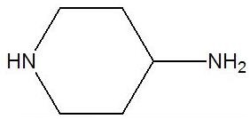
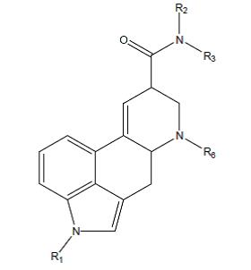
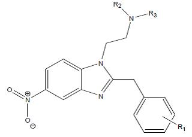
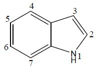
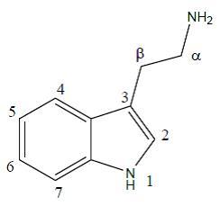
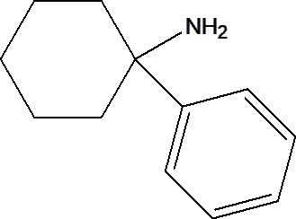
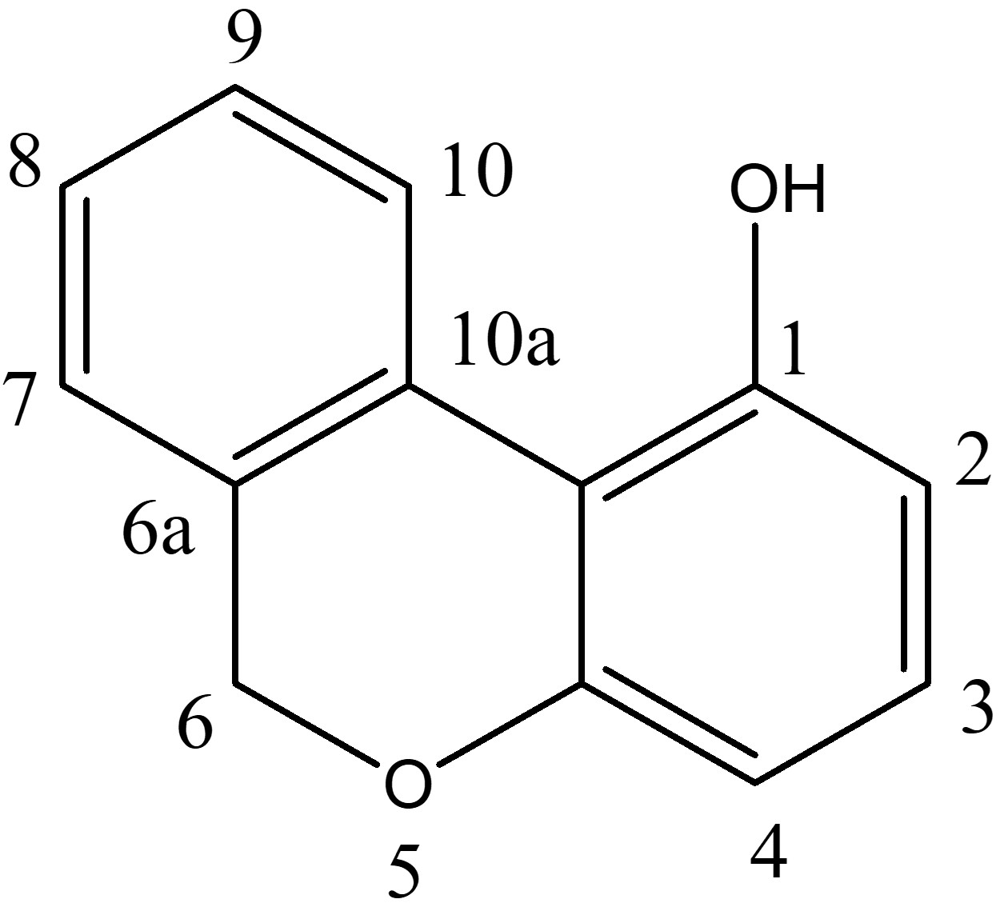
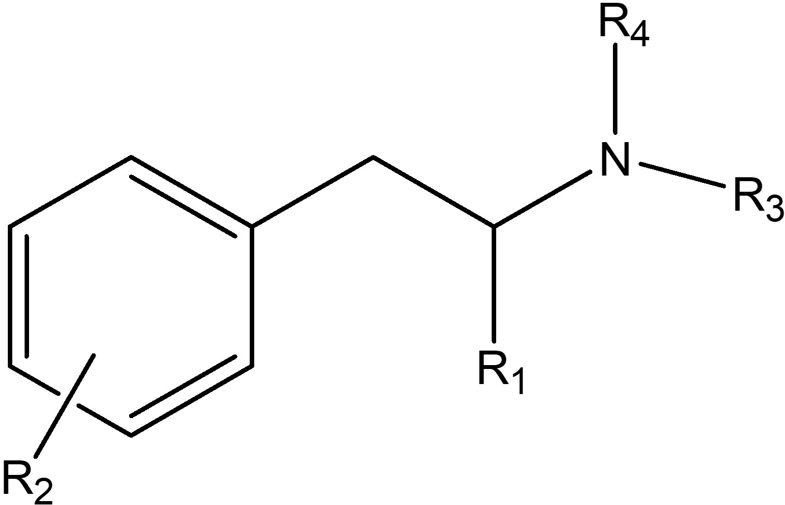
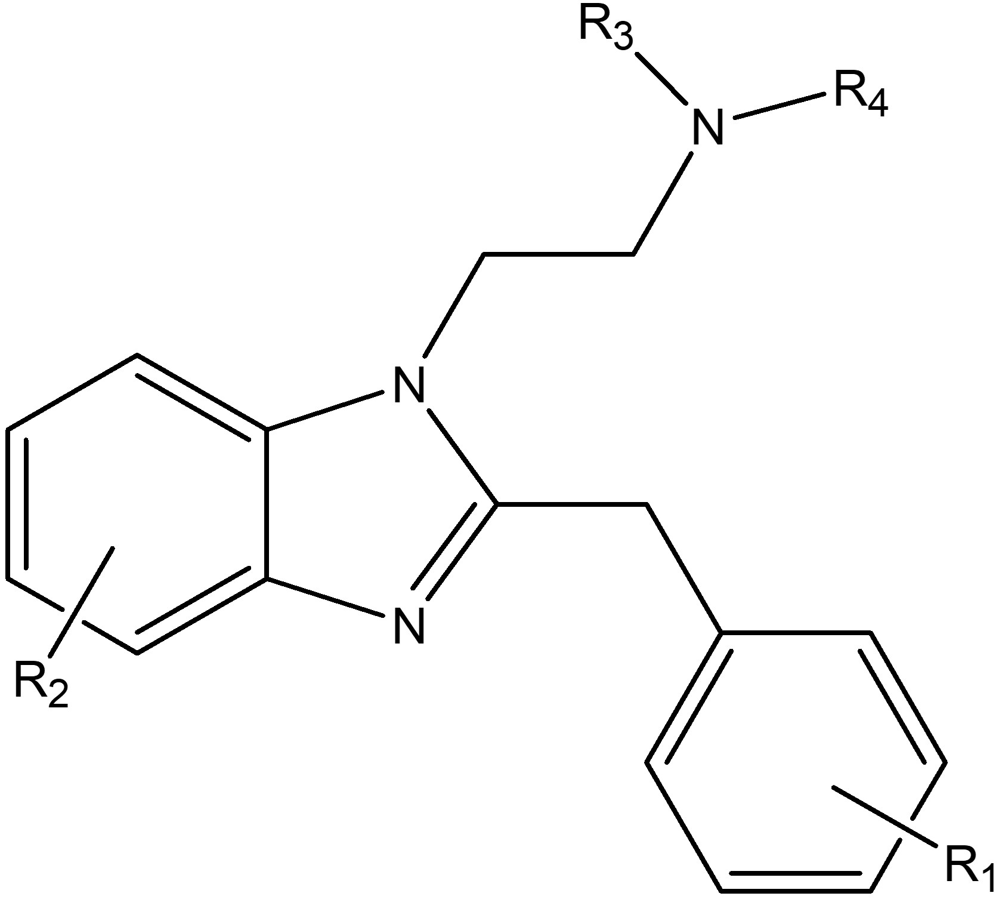
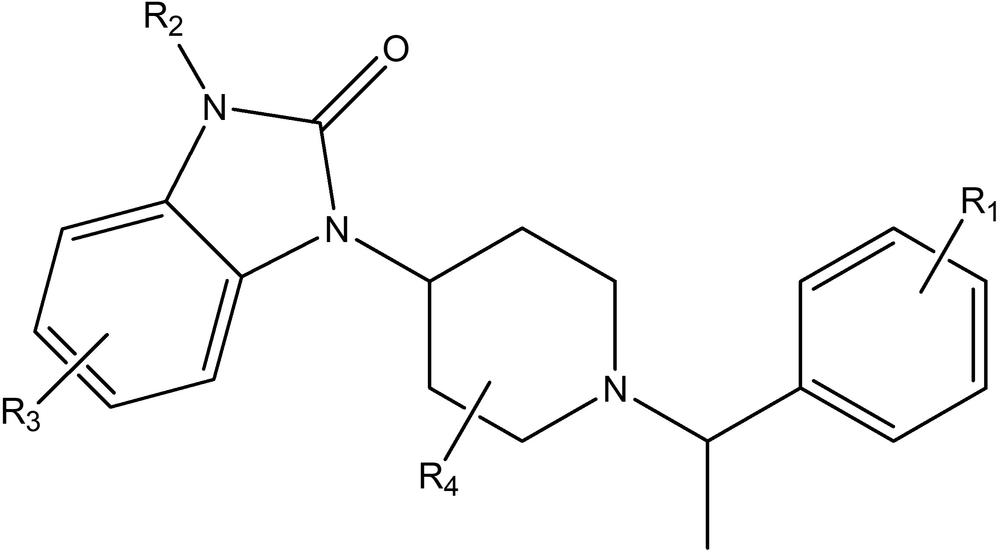

Verordnung vom 28. April 2015 über die Betäubungsmittel und die psychotropen Stoffe (Betäubungsmittelverordnung; BMV) Aufgrund von Art. 2a, 2c Abs. 1 und 2, Art. 3 Abs. 2, Art. 5 Abs. 3, Art. 7 Abs. 1a und Art. 18 Abs. 4 des Gesetzes vom 20. April 1983 über die Betäubungsmittel und die psychotropen Stoffe (Betäubungsmittelgesetz; BMG), LGBl. 1983 Nr. 38, in der geltenden Fassung, verordnet die Regierung: I. Allgemeine Bestimmungen A. Gegenstand, Geltungsbereich und Begriffe Art. 1 Gegenstand und Geltungsbereich 1) Diese Verordnung regelt die Bewilligung und die Kontrolle von Betäubungsmitteln, psychotropen Stoffen, Vorläuferstoffen und Hilfschemikalien nach Art. 2 BMG sowie von Rohmaterialien und Erzeugnissen mit betäubungsmittelähnlicher Wirkung nach Art. 5 BMG. 2) Sie legt zudem die Grundsätze für den Handel mit kontrollierten Substanzen fest. 3) Sie ist auch auf Personen und Unternehmen mit Sitz in Liechtenstein anwendbar, die mit kontrollierten Substanzen im Ausland handeln. 4) Für Betäubungsmittel, die als Heilmittel verwendet werden, gelten die Bestimmungen der Heilmittelgesetzgebung. Die Bestimmungen dieser Verordnung sind anwendbar, soweit die Heilmittelgesetzgebung keine oder eine weniger weitgehende Regelung trifft. 5) Vorbehalten bleiben die aufgrund des Zollvertrages in Liechtenstein anwendbaren schweizerischen Rechtsvorschriften. Art. 2 Begriffe und Bezeichnungen 1) Im Sinne dieser Verordnung gelten als: a) Handel: entgeltliche Vermittlung von kontrollierten Substanzen an berechtigte Personen, einschliesslich Tätigkeiten der Mäkler sowie Agenten; b) Herstellung: sämtliche Arbeitsgänge vom Gewinnen, Anfertigen, Zubereiten, Be- oder Verarbeiten, Reinigen und Umwandeln bis zum Verpacken, Lagern und Ausliefern des Endprodukts sowie die Qualitätskontrollen und die Freigabe; c) Medizinalpersonen: Ärzte, Zahnärzte, Tierärzte und Apotheker; d) Unternehmen: Firma im Sinne des BMG; e) Verschreiben: das Ausstellen eines Rezepts für Patienten oder Tierhalter, damit diese Arzneimittel mit kontrollierten Substanzen beziehen dürfen. Dieser Begriff entspricht dem Begriff "verordnen" im BMG; f) kontrollierte Substanzen: Betäubungsmittel, psychotrope Stoffe, Vorläuferstoffe und Hilfschemikalien nach Art. 2 BMG sowie Rohmaterialien und Erzeugnisse mit vermuteter betäubungsmittelähnlicher Wirkung nach Art. 5 BMG; g) Betäubungsmittel, psychotrope Stoffe, Rohmaterialien und Erzeugnisse mit vermuteter betäubungsmittelähnlicher Wirkung nach Art. 2 und 5 BMG: 1. die in den Verzeichnissen in den Anhängen 1 bis 6 aufgeführten Stoffe; 2. die Salze, Ester, Ether, Carbamate und Stereoisomere der Stoffe nach Ziff. 1; 3. die Salze, Ester, Ether und Carbamate der Stereoisomere nach Ziff. 2; 4. Präparate, die Stoffe nach Ziff. 1 bis 3 enthalten; h) Vorläuferstoffe und Hilfschemikalien nach Art. 2 BMG: 1. die in den Verzeichnissen in den Anhängen 7 und 8 aufgeführten Stoffe; 2. die Salze und Stereoisomere der Vorläuferstoffe in Anhang 7; 3. die Salze der Stereoisomere nach Ziff. 2; 4. Mischungen, die Substanzen nach Ziff. 1 bis 3 enthalten; i) Zielland: die im Verzeichnis g genannten Länder. 2) Unter den in dieser Verordnung verwendeten Personenbezeichnungen sind alle Personen unabhängig ihres Geschlechts zu verstehen, sofern sich die Personenbezeichnungen nicht ausdrücklich auf ein bestimmtes Geschlecht beziehen. B. Verzeichnisse der kontrollierten Substanzen Art. 3 Verzeichnisse 1) Die kontrollierten Substanzen werden folgenden Verzeichnissen zugeordnet: a) Verzeichnis a: kontrollierte Substanzen, die allen Kontrollmassnahmen unterstellt sind; b) Verzeichnis b: kontrollierte Substanzen, die teilweise von den Kontrollmassnahmen ausgenommen sind; c) Verzeichnis c: kontrollierte Substanzen, die in Präparaten in reduzierten Konzentrationen enthalten sein dürfen und teilweise von den Kontrollmassnahmen ausgenommen sind; d) Verzeichnis d: verbotene kontrollierte Substanzen; e) Verzeichnis e: Rohmaterialien und Erzeugnisse mit vermuteter betäubungsmittelähnlicher Wirkung nach Art. 5 Abs. 1 BMG, die den Kontrollmassnahmen der Betäubungsmittel des Verzeichnisses a unterstellt sind; f) Verzeichnis f: Vorläuferstoffe unter Angabe der jeweiligen Menge, die eine Kontrolle nach dieser Verordnung notwendig macht; g) Verzeichnis g: Hilfschemikalien unter Angabe der Zielländer und der jeweiligen Menge, die eine Kontrolle nach dieser Verordnung notwendig macht. 2) Die Verzeichnisse nach Abs. 1 sind wie folgt in den Anhängen aufgeführt: a) die Verzeichnisse a bis d mit den kontrollierten Substanzen nach Abs. 1 Bst. a bis d in den Anhängen 1 bis 5; b) das Verzeichnis e mit den Rohmaterialien und Erzeugnissen mit vermuteter betäubungsmittelähnlicher Wirkung nach Abs. 1 Bst. e in Anhang 6; c) das Verzeichnis f mit den Vorläuferstoffen nach Abs. 1 Bst. f in Anhang 7; d) das Verzeichnis g mit den Hilfschemikalien nach Abs. 1 Bst. g in Anhang 8. 3) Wird eine in einem Anhang aufgeführte Substanz ganz oder teilweise von Kontrollmassnahmen ausgenommen (Art. 2c Abs. 2 BMG), so gilt die Ausnahme auch für ihre Verbindungen. Die Ausnahme gilt auch für Präparate, die diese Substanz enthalten, sofern sie keine weiteren kontrollierten Substanzen enthalten. 4) Kontrollierte Substanzen der Verzeichnisse a, b und d werden neben ihrem Namen mit ihrer weltweit geltenden Handelsnummer (Global Trade Identification Number, GTIN) aufgenommen. Art. 4 Mohnstroh Der Handel mit Mohnstroh (Mohnkapseln, Mohnköpfe, Mohnstängel) im Inland bedarf keiner Bewilligung. Art. 5 Cannabissamen Cannabissamen nach Anhang 4 der schweizerischen Sortenverordnung (SR 916.151.6) und dem gemeinsamen Sortenkatalog der Europäischen Union sind von den Bestimmungen für kontrollierte Substanzen ausgenommen. Art. 6 Vorläuferstoffe 1) Wer in einem Kalenderjahr weniger als 10 Gramm eines Vorläuferstoffes im Verzeichnis f in Anhang 7, ausgenommen Lysergsäure, verwendet, braucht diesen Stoff nicht kontrollieren zu lassen. Die Kontrolle der Jahresmenge obliegt dem Bewilligungsinhaber. 2) Werden für Vorläuferstoffe Synonyme oder Fantasienamen verwendet, so muss zusätzlich die Registernummer für Chemikalien nach "Chemical Abstract Services" (CAS-Nummer) angegeben werden. Art. 7 Hilfschemikalien 1) Die Hilfschemikalien im Verzeichnis g in Anhang 8 unterstehen der Kontrolle je nach Zielland und Gesamtausfuhrmenge. 2) Bei jedem Stoff werden die Gesamtausfuhrmenge pro Kalenderjahr und Zielland, sowie die Zielländer aufgeführt, für welche die Ausfuhr bewilligt werden muss. Die Kontrolle der Jahresmenge obliegt dem Ausführenden. C. Ausnahmen Art. 8 Ausnahmen vom Geltungsbereich und von einzelnen Bestimmungen 1) Die Bestimmungen dieser Verordnung sind nicht anwendbar auf: a) homöopathische Präparate, die zwar kontrollierte Substanzen enthalten, deren Verdünnung aber mehr als D8/C4 beträgt; b) Vorläuferstoffe und Hilfschemikalien in pharmazeutischen Präparaten oder Mischungen, die nicht auf einfache Art aus diesen zurückgewonnen werden können. 2) Der Bezug und die Verwendung kleiner Mengen von kontrollierten Substanzen zu analytischen Zwecken durch Behörden oder durch von ihnen direkt Beauftragte sind von dieser Verordnung ausgenommen. 3) Der Bezug und die Verwendung von kontrollierten Substanzen in Lösung und in einer Konzentration bis 1 mg pro 1 ml zu analytischen Zwecken sind vom VI. Kapitel (Kontrolle) dieser Verordnung ausgenommen. 4) Für Hilfschemikalien ist nur Art. 10 anwendbar. Art. 9 Ausnahmebewilligungen für den Umgang mit kontrollierten Substanzen des Verzeichnisses d 1) Das Amt für Gesundheit kann Ausnahmebewilligungen für den Umgang mit kontrollierten Substanzen des Verzeichnisses d erteilen an eine Person, die: a) verbotene Betäubungsmittel anbauen, herstellen oder in Verkehr bringen will (Art. 6 Abs. 4 BMG); b) mit verbotenen Betäubungsmitteln wissenschaftliche Forschung betreiben will; c) Arzneimittel mit verbotenen Betäubungsmitteln entwickeln will; d) verbotene Betäubungsmittel beschränkt medizinisch einsetzen will; e) ein zugelassenes Arzneimittel mit verbotenen Betäubungsmitteln anders als für die zugelassene Indikation anwenden will. 2) Folgende Nachweise sind erforderlich: a) für die Bewilligung nach Abs. 1 Bst. a: 1. personenbezogene Daten des Gesuchstellers; 2. Verwendungszweck der Betäubungsmittel; und 3. Menge und Bezugsort der Betäubungsmittel; b) für die Bewilligung nach Abs. 1 Bst. b der Nachweis, dass die Voraussetzungen der guten Laborpraxis eingehalten werden; c) für die Bewilligung nach Abs. 1 Bst. c der Nachweis, dass die Bestimmungen der schweizerischen Arzneimittelbewilligungsverordnung, des schweizerischen Humanforschungsgesetzes sowie der schweizerischen Verordnung über klinische Versuche eingehalten werden; d) für die Bewilligung nach Abs. 1 Bst. d und e eine schriftliche Erklärung des Patienten, wonach er mit der Anwendung einverstanden ist. 3) Das Amt für Gesundheit kontrolliert die Inhaber von Ausnahmebewilligungen für verbotene Betäubungsmittel (Art. 8 Abs. 4 BMG). 4) Vorbehalten bleibt die Erteilung einer Ausnahmebewilligung durch die zuständige schweizerische Behörde. D. Sorgfaltspflicht Art. 10 1) Wer kontrollierte Substanzen anbaut, herstellt, abgibt oder mit ihnen Handel treibt, hat sich bei jeder Weitergabe zu vergewissern, dass der Empfänger berechtigt ist, diese zu beziehen. 2) Das Amt für Gesundheit sowie die Berufs- oder Branchenverbände informieren die zur Herstellung und Abgabe von oder zum Handel mit kontrollierten Substanzen berechtigten Personen über die Umstände möglicher Missbräuche und beraten sie bei der Abklärung einzelner Verdachtsmomente. 3) Erwecken Umstände den Verdacht eines Missbrauchs, so treffen die verantwortlichen Personen, gegebenenfalls zusammen mit dem betroffenen Berufs- oder Branchenverband oder der verschreibenden Medizinalperson, die notwendigen Abklärungen und benachrichtigen umgehend das Amt für Gesundheit. In einem solchen Fall darf die kontrollierte Substanz nur weitergegeben werden, wenn die Untersuchungen durch das Amt für Gesundheit den Verdacht als unbegründet erscheinen lassen. 4) Bei begründetem Verdacht eines wesentlichen Missbrauchs informiert das Amt für Gesundheit unverzüglich die Staatsanwaltschaft. II. Betriebs- und Anbaubewilligung A. Allgemeine Bestimmungen Art. 11 Bewilligungspflicht 1) Wer kontrollierte Substanzen, ausgenommen Hilfschemikalien, herstellen, beziehen, vermitteln, abgeben oder mit diesen Handel treiben will, benötigt vorgängig eine Betriebsbewilligung des Amtes für Gesundheit. 2) Wer Pflanzen oder Pilze, die kontrollierte Substanzen enthalten, anbauen will, benötigt eine Anbaubewilligung des Amtes für Gesundheit. 3) Medizinalpersonen benötigen für die Anwendung von Betäubungsmitteln neben ihrer Berufsausübungsbewilligung keine zusätzliche Betriebsbewilligung. 4) Apotheken benötigen für die einzelfallweise Vermittlung von Arzneimitteln mit kontrollierten Substanzen keine Betriebsbewilligung. Bei mehr als neun Vermittlungen pro Kalenderjahr ist eine Betriebsbewilligung erforderlich. Art. 12 Voraussetzungen 1) Eine Betriebsbewilligung wird erteilt, wenn die gesuchstellende Person oder das gesuchstellende Unternehmen: a) im Handelsregister eingetragen ist; b) die Lagerung der kontrollierten Substanzen nach Art. 38 gewährleistet; und c) eine für kontrollierte Substanzen verantwortliche Person bezeichnet, die für die Einhaltung der betäubungsmittelrechtlichen Bestimmungen verantwortlich ist. 2) Die Bewilligungen für betäubungsmittelgestützte Behandlungen richten sich nach Art. 33 ff. Art. 13 Anforderungen an die verantwortliche Person 1) Die verantwortliche Person muss: a) eine Medizinalperson sein oder über einen naturwissenschaftlichen Hochschulabschluss verfügen; b) mit dem Gesuchsteller in einem schriftlichen Vertrag die Verantwortlichkeit und Präsenzpflicht regeln, sofern sie nicht selber Gesuchstellerin ist; und c) ihre fachliche Tätigkeit weisungsunabhängig ausüben können. 2) Das Amt für Gesundheit kann Personen als verantwortliche Personen zulassen, die über gleichwertige, an ausländischen Hochschulen erworbene Diplome der genannten Berufe und nachweislich über die nötigen Fachkenntnisse verfügen. 3) Ist die Betriebsbewilligung auf kontrollierte Substanzen des Verzeichnisses f (Vorläuferstoffe) begrenzt, so können Personen vom Amt für Gesundheit als verantwortliche Person zugelassen werden, die über ein Diplom einer Fachhochschule oder einer höheren Fachschule im Bereich der Naturwissenschaften und nachweislich über die nötigen Fachkenntnisse verfügen. Art. 14 Anbaubewilligung 1) Wer Pflanzen oder Pilze, die kontrollierte Substanzen enthalten, anbauen will, erhält eine Anbaubewilligung, wenn sie oder er: a) über eine Betriebsbewilligung verfügt; oder b) im Auftrag eines Inhabers einer Betriebsbewilligung handelt. 2) Die gesuchstellende Person muss zudem nachweisen, dass ein System vorhanden ist, das ausreichenden Schutz gegen Diebstahl bietet. 3) Der Vertrag nach Abs. 1 Bst. b muss schriftlich abgefasst sein und genaue Angaben über Art und Menge des Anbaus sowie die Verpflichtung des Auftraggebers enthalten, die ganze Ernte der beauftragten Person zu übernehmen. 4) Erfolgt der Anbau direkt durch Personen oder Unternehmen, die über eine Betriebsbewilligung des Amtes für Gesundheit verfügen, so kann diese Tätigkeit in der Betriebsbewilligung erwähnt werden. B. Gesuch Art. 15 Bewilligungsgesuch 1) Im Gesuch für eine Bewilligung sind folgende Angaben zu machen: a) Name und Vorname beziehungsweise Firma gemäss Handelsregister, wenn es sich um eine juristische Person handelt, sowie Name, Vorname, Geburtsdatum und Funktion der für die kontrollierten Substanzen verantwortlichen Person; b) Wohn- oder Geschäftssitz und Betriebsstandorte (Adressen); c) Auflistung der nachgesuchten kontrollierten Substanzen; d) Art der Tätigkeit, um deren Bewilligung nachgesucht wird; e) allfälliger Anbau- und Lagerstandort. 2) Dem Bewilligungsgesuch sind folgende Ausweise beizulegen: a) aktueller und vollständiger Handelsregisterauszug; b) Strafregisterauszug der verantwortlichen Person, der nicht älter als sechs Monate ist; c) Berufsabschlussdiplome und den beruflichen Werdegang der verantwortlichen Person. C. Wirkung und Geltungsdauer Art. 16 Wirkung der Betriebsbewilligung Die Betriebsbewilligung ermächtigt deren Inhaber zur Abgabe und zur Vermittlung kontrollierter Substanzen an: a) Personen und Unternehmen, die eine Bewilligung nach Art. 3 Abs. 1 BMG oder eine Ausnahmebewilligung nach Art. 6 Abs. 4 BMG besitzen; b) verantwortliche Leiter einer Apotheke oder einer Spitalapotheke; c) die verantwortliche Person von Spitälern, die eine Bewilligung nach Art. 12 Abs. 1 BMG besitzen; d) Medizinalpersonen, die zum Umgang mit kontrollierten Stoffen berechtigt sind; e) die verantwortliche Person von wissenschaftlichen Instituten, die eine Bewilligung nach Art. 12 Abs. 2 BMG besitzen. Art. 17 Umfang 1) Die Betriebs- und die Anbaubewilligung lautet auf den Namen des Gesuchstellers und der verantwortlichen Person. 2) Die Betriebsbewilligung gilt für die in der Bewilligung aufgeführten einzelnen kontrollierten Substanzen oder Verzeichnisse nach Art. 3. Art. 18 Geltungsdauer 1) Eine Bewilligung gilt höchstens fünf Jahre. 2) Sie kann auf Antrag für jeweils weitere fünf Jahre erneuert werden. Das Erneuerungsgesuch muss spätestens sechs Monate vor Ablauf der Bewilligungsdauer eingereicht werden. 3) Vor der Erteilung und vor der Erneuerung einer Bewilligung kann eine Inspektion durchgeführt werden. 4) Das Amt für Gesundheit kann in begründeten Fällen eine kürzere Geltungsdauer vorsehen. D. Änderungen, Erlöschen und Entzug Art. 19 Meldung von Änderungen Der Inhaber einer Betriebs- oder Anbaubewilligung hat dem Amt für Gesundheit jede Änderung der Bewilligungsvoraussetzungen sofort zu melden. Art. 20 Entzug 1) Das Amt für Gesundheit entzieht die Bewilligung vorübergehend oder dauernd, wenn: a) der Bewilligungsinhaber oder die verantwortliche Person vorsätzlich oder wiederholt fahrlässig gegen das BMG oder die dazu gehörenden Verordnungen verstossen hat; b) der Bewilligungsinhaber dies verlangt. 2) Es kann die Bewilligung jederzeit gestützt auf Art. 4 BMG entziehen. Art. 21 Vorgehen bei Erlöschen oder Entzug 1) Beim Erlöschen oder beim Entzug einer Bewilligung überwacht das Amt für Gesundheit die Einstellung der Tätigkeiten im Zusammenhang mit angebauten oder gelagerten kontrollierten Substanzen, deren Weitergabe an Inhaber einer Betriebsbewilligung und ordnet nötigenfalls die Vernichtung der kontrollierten Substanzen an. 2) Vorbehalten bleibt die gerichtliche Verfügung über die Einziehung der Betäubungsmittel. Art. 22 Sistierung Bei laufenden Untersuchungen gegen einen Gesuchsteller wegen Widerhandlungen gegen Bestimmungen dieser Verordnung kann das Amt für Gesundheit die Bewilligungen bis zur abschliessenden Beurteilung sistieren. III. Bezug und Verwendung von Betäubungsmitteln durch Medizinalpersonen, Spitäler und Institute A. Ärzte, Tierärzte und Zahnärzte Art. 23 Erwerb von Arzneimitteln mit kontrollierten Substanzen 1) Ärzte, Zahnärzte und Tierärzte, die ihren Beruf in eigener fachlicher Verantwortung ausüben, können Arzneimittel mit kontrollierten Substanzen von einer Apotheke oder von Personen und Unternehmen mit einer Betriebsbewilligung beziehen. Für die einzelfallweise Vermittlung von Arzneimitteln mit kontrollierten Substanzen gilt Art. 11 Abs. 4. 2) Sie müssen ihre Bestellung mit der "Global Location Number" (GLN) und ihrem Stempel versehen. 3) Sie müssen Arzneimittel mit kontrollierten Substanzen des Verzeichnisses d schriftlich bestellen. 4) Sie tragen die Verantwortung für die korrekte Aufbewahrung und haben den Verbrauch zu dokumentieren. Art. 24 Beschränkungen 1) Ärzte, Zahnärzte und Tierärzte, die den Beruf nicht in eigener fachlicher Verantwortung ausüben, dürfen Arzneimittel mit kontrollierten Substanzen nur im Rahmen der Befugnisse ihrer Anstellung und unter Aufsicht eines befugten Berufskollegen (Art. 7 Abs. 1 BMG) beziehen und verwenden. 2) Für Ärzte und Tierärzte gilt diese Einschränkung auch für die Verschreibung. Art. 25 Verschreibung für Patienten 1) Ärzte dürfen Arzneimittel mit kontrollierten Substanzen nur für Patienten verschreiben, die sie selber untersucht haben. 2) Für die Verschreibung kontrollierter Substanzen der Verzeichnisse a und d ist das eigens dafür vorgesehene Betäubungsmittelrezept zu verwenden. 3) Für die Verschreibung von Arzneimitteln mit kontrollierten Substanzen der Verzeichnisse b und c reicht ein einfaches Rezept. Art. 26 Betäubungsmittelrezept 1) Das Betäubungsmittelrezept muss enthalten: a) Name, Adresse, Unterschrift und Stempel des verschreibenden Arztes; b) Name, Vorname, Geburtsdatum und Adresse des Patienten; c) Ausstellungsdatum; d) Bezeichnung des Arzneimittels mit kontrollierten Substanzen, seine Darreichungsform und Dosierung; e) Menge; f) Anwendungsanweisung. 2) Das Betäubungsmittelrezept ist einen Monat gültig. 3) Die verschriebene Menge darf nicht über den Bedarf für die Behandlung während eines Monats hinausgehen. Wenn es die Umstände rechtfertigen, kann eine Menge verschrieben werden, die für die Behandlung während höchstens drei Monaten ausreicht. Der verschreibende Arzt hat in diesem Fall die genaue Dauer der laufenden Behandlung auf dem Rezept anzugeben. 4) Das Betäubungsmittelrezept ist vom verschreibenden Arzt zu unterschreiben, und eine Kopie davon ist in der Krankengeschichte des Patienten aufzubewahren. 5) Das Amt für Gesundheit stellt die amtlichen Formulare für Betäubungsmittelrezepte gegen Entgelt den verschreibungsbefugten Ärzten zur Verfügung. Art. 27 Einfaches Rezept Die verschriebene Menge darf nicht über den Bedarf für die Behandlung während eines Monats hinausgehen. Wenn es die Umstände rechtfertigen, kann eine Menge verschrieben werden, die für die Behandlung während höchstens sechs Monaten ausreicht. Der verschreibende Arzt hat in diesem Fall die genaue Dauer der Behandlung auf dem Rezept anzugeben. Art. 28 Meldepflicht bei der Verschreibung von zugelassenen Arzneimitteln mit kontrollierten Substanzen 1) In der Meldung nach Art. 9 Abs. 1a BMG sind anzugeben: a) die Bezeichnung des Arzneimittels; b) die Menge; c) die Dosierung; d) die Indikation. 2) Von dieser Meldepflicht ausgenommen sind Verschreibungen und Anwendungen im Rahmen von freigegebenen klinischen Versuchen nach der Heilmittelgesetzgebung. Art. 29 Verschreibung und Abgabe für Tiere 1) Tierärzte dürfen Arzneimittel mit kontrollierten Substanzen nur für Tiere verschreiben, die sie selber untersucht haben. 2) Für ambulant behandelte Tiere dürfen Arzneimittel mit kontrollierten Substanzen der Verzeichnisse a und d nur auf dem Betäubungsmittelrezept verschrieben werden. 3) In der Meldung nach Art. 9 Abs. 1a BMG sind anzugeben: a) die Bezeichnung des Arzneimittels; b) die Menge; c) die Dosierung; d) die Anzahl behandelter Tiere; e) die Indikation. 4) Das Amt für Gesundheit stellt die amtlichen Formulare für Betäubungsmittelrezepte gegen Entgelt den verschreibungsbefugten Tierärzten zur Verfügung. B. Apotheker Art. 30 Bezug und Abgabe 1) Die verantwortlichen Apotheker einer Apotheke oder einer Spitalapotheke dürfen kontrollierte Substanzen nur von Personen und Unternehmen mit einer Betriebsbewilligung und nur mit einer schriftlichen Bestellung beziehen. 2) Die Apotheker einer Apotheke können Arzneimittel mit kontrollierten Substanzen auf Rezept folgender Personen abgeben: a) einer Medizinalperson, die befugt ist, Arzneimittel mit kontrollierten Substanzen zu verschreiben; b) einer zur Grenzpraxis berechtigten ausländischen Medizinalperson, die befugt ist, kontrollierte Substanzen zu verwenden und zu verschreiben (Art. 8 Abs. 2 BMG). 3) Soweit der verschreibende Arzt oder Tierarzt nichts anderes vermerkt, ist die Wiederholung des Bezugs von Arzneimitteln mit kontrollierten Substanzen der Verzeichnisse a und d nicht erlaubt. 4) Der Teilbezug verschriebener Arzneimittel mit kontrollierten Substanzen der Verzeichnisse b und c ist während der Geltungsdauer des Rezepts möglich. Die abgegebene Menge und die Abgabestelle sind auf dem Rezept anzugeben. Art. 31 Notfälle 1) In Notfällen und wenn es unmöglich ist, eine ärztliche Verschreibung zu erlangen, darf der verantwortliche Apotheker ausnahmsweise ohne Verschreibung die kleinste im Handel erhältliche Packung eines Arzneimittels mit kontrollierten Substanzen abgeben. 2) Er hat bei Arzneimitteln mit kontrollierten Substanzen der Verzeichnisse a und b sowie bei zugelassenen Arzneimitteln mit kontrollierten Substanzen des Verzeichnisses d ein Protokoll über den Namen und die Adresse des Empfängers sowie über den Grund der Abgabe aufzunehmen. Das Protokoll ist innert fünf Tagen dem Amt für Gesundheit zuzustellen. Der behandelnde Arzt ist gleichzeitig zu informieren. C. Spitäler und Institute Art. 32 Grundsatz 1) Spitäler und wissenschaftliche Institute, die zum Bezug und zur Verwendung von kontrollierten Substanzen berechtigt sind, können diese von einem Unternehmen, einer Apotheke oder einer dazu ermächtigten Spitalapotheke mit einer schriftlichen Bestellung beziehen. 2) Sie benennen eine für die kontrollierten Substanzen verantwortliche Person und betrauen diese mit folgenden Aufgaben: a) Bestellung; b) interne Organisation; c) Aufbewahrung; d) Ausgabe; e) Kontrolle. IV. Besondere Bestimmungen für die betäubungsmittelgestützte Behandlung Art. 33 Bewilligungspflicht Die Verschreibung, Abgabe und Verabreichung von Betäubungsmitteln im Rahmen einer ärztlichen Behandlung betäubungsmittelabhängiger Personen (betäubungsmittelgestützte Behandlung) ist bewilligungspflichtig. Art. 34 Erteilung, Entzug und Erlöschen der Bewilligung 1) Das Amt für Gesundheit erteilt auf Antrag des behandelnden Arztes die Bewilligung für die betäubungsmittelgestützte Behandlung, wenn: a) die Opioidabhängigkeit des Patienten feststeht; b) der behandelnde Arzt über eine Bewilligung zur eigenverantwortlichen Ausübung des ärztlichen Berufes nach dem Ärztegesetz verfügt; c) der Patient über die möglichen Risiken und Rahmenbedingungen der Behandlung einschliesslich möglicher Nebenwirkungen aufgeklärt wurde; d) der Patient sich mit den Rahmenbedingungen der Behandlung nachweislich einverstanden erklärt hat; e) zwischen dem behandelnden Arzt und dem Patienten ein schriftlicher Behandlungsvertrag abgeschlossen wurde; und f) sich der Patient bei keinem anderen Arzt in einer betäubungsmittelgestützten Behandlung befindet. 2) Der Antrag muss innert drei Tagen nach Behandlungsbeginn beim Amt für Gesundheit eingegangen sein und hat zu enthalten: a) Angaben zum Nachweis der Voraussetzungen nach Abs. 1; b) die Personalien des Patienten; c) den Behandlungsbeginn; d) die Bezeichnung des Betäubungsmittels, das im Rahmen der Substitutionstherapie zur Anwendung gelangt, mit Angaben zu Darreichungsform, Dosierung und Abgabeort; e) die Angabe, ob Minderjährige im Haushalt des Patienten leben; f) die Angabe, ob zusätzlich psychotrope Substanzen eingenommen werden; und g) die Angabe, ob beim Patienten die Fahreignung gegeben ist. 3) Das Amt für Gesundheit entzieht die Bewilligung nach Abs. 1, wenn: a) die Voraussetzungen für deren Erteilung nicht mehr erfüllt sind; b) der Arzt oder der Patient vorsätzlich oder wiederholt fahrlässig gegen die Betäubungsmittelgesetzgebung verstossen hat; oder c) der Patient in schwerwiegender Weise gegen den Behandlungsvertrag nach Abs. 1 Bst. e verstossen hat. 4) Die Bewilligung nach Abs. 1 erlischt: a) mit der Meldung der Beendigung oder des Abbruchs der Behandlung; b) mit schriftlich erklärtem Verzicht des Arztes. Art. 35 Qualitätssicherung und Ausschluss 1) Zur Qualitätssicherung von Behandlungen und aus Gründen der Behandlungssicherheit erlässt die Regierung nähere Rahmenbedingungen in Form von Richtlinien über die betäubungsmittelgestützte Behandlung. 2) Das Amt für Gesundheit kann Ärzte und Patienten, die wiederholt oder in schwerwiegender Weise gegen die Richtlinien nach Abs. 1 verstossen haben, von der betäubungsmittelgestützten Behandlung ausschliessen. Art. 36 Meldepflichten und Verzeichnis 1) Der behandelnde Arzt hat dem Amt für Gesundheit zu melden: a) jährlich den Verlauf der betäubungsmittelgestützten Behandlung; b) innert zwei Wochen die Beendigung oder den Abbruch der betäubungsmittelgestützten Behandlung; c) den Verzicht auf die künftige Durchführung von betäubungsmittelgestützten Behandlungen; d) Änderungen der für die Bewilligung nach Art. 34 massgeblichen Verhältnisse. 2) Das Amt für Gesundheit führt ein Verzeichnis der Bewilligungen nach Art. 34 und der Meldungen nach Abs. 1, aus dem Ärzten und Apothekern Auskunft gegeben werden darf, sofern medizinische Gründe es erfordern. Art. 37 Aufgehoben V. Aufbewahrung und Bezeichnung der Betäubungsmittel Art. 38 Aufbewahrung 1) Kontrollierte Substanzen der Verzeichnisse a, d und e müssen vor Diebstahl gesichert aufbewahrt werden. 2) Kontrollierte Substanzen der Verzeichnisse b, c und f sind so aufzubewahren, dass Unbefugte keinen Zugang haben. Art. 39 Bezeichnung und Etikettierung 1) Kontrollierte Substanzen aus den Verzeichnissen a und d dürfen im Inland nur unter Angabe der gemeinsamen internationalen Bezeichnung (Denominatio communis internationalis, DCI) oder des Markennamens in den Handel gebracht werden. 2) Sie müssen im internationalen Handel mit der DCI-Bezeichnung oder, wenn keine solche vorliegt, mit dem Namen bezeichnet werden, der in den von Liechtenstein ratifizierten internationalen Abkommen verwendet wird. 3) Die Beschriftung der Arzneimittel mit kontrollierten Substanzen richtet sich nach den heilmittelrechtlichen Bestimmungen. In den Patienteninformationen sind Angaben über die Vorsichtsmassregeln und die Warnvermerke aufzuführen, die für die Sicherheit der Patienten notwendig sind. 4) Die für den Handel im Inland bestimmten Packungen verwendungsfertiger Arzneimittel mit kontrollierten Substanzen des Verzeichnisses a und zugelassener Arzneimittel mit kontrollierten Substanzen des Verzeichnisses d sind mit einer Vignette zu versehen. Diese wird von der zuständigen schweizerischen Behörde zur Verfügung gestellt. Anstelle der Vignette kann auch ein Aufdruck angebracht werden, der der Vignette in allen Teilen entspricht. Art. 40 Werbung und Information 1) Die Publikumswerbung für kontrollierte Substanzen ist verboten. 2) Ein gegenüber Medizinalpersonen angepriesenes Arzneimittel mit kontrollierten Substanzen ist ausdrücklich und gut sichtbar als ein der Kontrolle nach dem BMG unterliegendes Arzneimittel zu bezeichnen. 3) Für Arzneimittel mit kontrollierten Substanzen der Verzeichnisse a, b und d dürfen keine Musterpackungen abgegeben werden. VI. Kontrolle A. Dokumentationspflicht Art. 41 Buchführung 1) Die Buchführung nach Art. 17 BMG muss für jede kontrollierte Substanz folgende Angaben enthalten: a) Anbau von kontrollierten Substanzen: 1. Art der angebauten Stoffe; 2. Umfang der Anbaufläche; 3. Art und Menge der gewonnenen kontrollierten Substanz; b) Herstellung: 1. Lager am Jahresanfang; 2. Einfuhr; 3. Kauf im Inland; 4. Herstellung; 5. Ausfuhr; 6. Verkauf im Inland; 7. Fabrikation aus kontrollierten Substanzen (Bezeichnung, Angabe der Base oder des Salzes), auch wenn das Endprodukt nicht mehr der Kontrolle unterliegt; 8. Versuche; 9. Verluste; 10. Entsorgung; 11. Lager am Jahresende; c) Handel: 1. Lager am Jahresanfang; 2. Einfuhr; 3. Kauf im Inland; 4. Ausfuhr; 5. Verkauf im Inland; 6. Verluste; 7. Entsorgung; 8. Lager am Jahresende; d) internationaler Handel ohne Durchfuhr durch Liechtenstein, für jede Transaktion: 1. Datum; 2. Name und Adresse des Lieferanten; 3. Name und Adresse des Empfängers; 4. Produktebezeichnung; 5. Mengen; 6. Kopien der Ein- und Ausfuhrbewilligungen der betroffenen Länder. 2) Die Buchführung über Hilfschemikalien umfasst nur die in Zielländer exportierten Mengen. 3) Stimmt das Datum auf dem Lieferschein nicht mit demjenigen des Empfangs der kontrollierten Substanzen überein, so ist in der Buchführung ausschliesslich das auf dem Lieferschein aufgeführte Datum zu übernehmen. Art. 42 Jahresabschluss 1) Die Buchführung muss auf Ende Jahr abgeschlossen und innert Monatsfrist dem Amt für Gesundheit eingereicht werden. Das Amt für Gesundheit stellt die entsprechenden Formulare zur Verfügung. 2) Auf Verlangen sind dem Amt für Gesundheit detaillierte Auskünfte über die Angaben nach Abs. 1 zu erteilen. Art. 43 Auskunftspflicht Auf Verlangen des Amtes für Gesundheit müssen Inhaber einer Betriebsbewilligung Auskünfte über die Lieferungen erteilen. B. Melde- und Belegpflicht für kontrollierte Substanzen Art. 44 Meldepflicht 1) Im Inlandverkehr müssen die Personen und Unternehmen mit einer Betriebs- oder Anbaubewilligung nach Art. 3 BMG oder einer Ausnahmebewilligung nach Art. 6 Abs. 4 BMG in folgenden Fällen jeden Ausgang von kontrollierten Substanzen der Verzeichnisse a, b, d und e dem Amt für Gesundheit melden: a) die Lieferung von kontrollierten Substanzen an Empfänger im Inland; b) die Rücksendung von kontrollierten Substanzen und Arzneimitteln mit kontrollierten Substanzen an den Lieferanten; 2) Die Meldung hat bis zum 15. Tag des der Lieferung oder der Sendung folgenden Monats zu erfolgen. 3) Rücksendungen von kontrollierten Substanzen durch Medizinalpersonen, Apotheken, Spitäler und wissenschaftliche Institute an eine Person oder ein Unternehmen nach Art. 3 BMG müssen vom Empfänger der kontrollierten Substanzen dem Amt für Gesundheit gemeldet werden. 4) Für jede kontrollierte Substanz sowie für jedes Arzneimittel mit kontrollierten Substanzen (Darreichungsform, Dosierung und Packungsgrösse) ist eine gesonderte Meldung zu erstellen. 5) Das Amt für Gesundheit kann spezifische Lieferungen von der Meldepflicht vorübergehend oder dauerhaft entbinden, wenn die Kontrolle auf eine andere Art und Weise sichergestellt werden kann. Art. 45 Inhalt und Form der Meldung 1) Die Meldung muss folgende Angaben enthalten: a) die Bezeichnung, die GLN (Global Location Number) und den Sitz beziehungsweise den Wohnsitz des Lieferanten; b) die Bezeichnung, die GLN und den Sitz beziehungsweise den Wohnsitz des Empfängers; c) das Datum des Ausgangs beziehungsweise der Ausbuchung der kontrollierten Substanz; d) die Bezeichnung der gelieferten oder ausgebuchten kontrollierten Substanzen und deren GTIN; e) die genaue Menge in Gewicht oder Einheiten. 2) Die Meldung von magistralen Präparaten, die kontrollierte Substanzen enthalten, muss die GTIN der kontrollierten Substanz enthalten und die Angabe, wie oft die Menge, der die GTIN entspricht, im Präparat enthalten sind. Art. 46 Belege 1) Der Lieferant von kontrollierten Substanzen der Verzeichnisse a, b, d, e und f muss die Lieferung mit einem Lieferschein versenden. 2) Rücksendungen zur Vernichtung von kontrollierten Substanzen der Verzeichnisse a, d und e sind ebenfalls mit einem Lieferschein zu versehen. 3) Die Belege, Daten und Dateiträger über die Verschreibung und den Verkehr mit kontrollierten Substanzen sind zehn Jahre lang aufzubewahren. Art. 47 Apotheken 1) Verantwortliche Leiter einer Apotheke oder einer Spitalapotheke müssen den Bezug und die Abgabe von kontrollierten Substanzen jederzeit belegen können. 2) Die Bezüge sind durch die Lieferscheine (Art. 46) zu belegen. 3) Die Abgabe ist mit Ausnahme der Arzneimittel mit kontrollierten Substanzen der Verzeichnisse b und c durch die Betäubungsmittelrezepte zu belegen. 4) Apotheken müssen über jede kontrollierte Substanz und über jedes Arzneimittel mit kontrollierten Substanzen, unter Berücksichtigung der unterschiedlichen Dosierung und Darreichungsform, nach Art. 41 Buch führen. Davon ausgenommen sind Arzneimittel mit kontrollierten Substanzen des Verzeichnisses c. Art. 48 Arzt-, Zahnarzt- und Tierarztpraxen 1) Die für eine Arzt-, Zahnarzt- oder Tierarztpraxis zuständige Medizinalperson trägt die Verantwortung für den korrekten Bezug von Arzneimitteln mit kontrollierten Stoffen. 2) Sie ist verpflichtet, über die Verwendung der von ihr als Vorrat bestellten Arzneimittel mit kontrollierten Substanzen Buch zu führen. 3) Ist sie nach der Heilmittelgesetzgebung zur Selbstdispensation von Arzneimitteln befugt, so untersteht sie zusätzlich den Bestimmungen für Apotheken (Art. 47). Art. 49 Verantwortliche Person 1) Die verantwortliche Person eines Spitals muss den Bezug und die Verwendung von kontrollierten Substanzen in der Spitalapotheke sowie in allen Einheiten, welche kontrollierte Substanzen verwenden, jederzeit belegen können. 2) Die verantwortliche Person eines wissenschaftlichen Instituts muss den Bezug und die Verwendung von kontrollierten Substanzen jederzeit belegen können. VII. Vollzug A. Organisation und Durchführung Art. 50 Vollzugsbehörden 1) Der Vollzug dieser Verordnung obliegt: a) der Regierung; b) dem Amt für Gesundheit. 2) Die Zuständigkeit der Strafverfolgungsbehörden im Rahmen eines Strafverfahrens nach der Strafprozessordnung bleibt unberührt. Art. 51 Regierung 1) Die Regierung vollzieht diese Verordnung in Bezug auf Rohmaterialien und Erzeugnisse mit vermuteter betäubungsmittelähnlicher Wirkung des Verzeichnisses e. 2) Erscheinen Rohmaterialien und Erzeugnisse mit vermuteter betäubungsmittelähnlicher Wirkung neu auf dem Markt oder besteht der Verdacht, dass bekannte Rohmaterialien und Erzeugnisse betäubungsmittelähnliche Wirkung haben, so werden sie ohne Verzug in das Verzeichnis e aufgenommen. Art. 52 Amt für Gesundheit 1) Das Amt für Gesundheit vollzieht diese Verordnung, soweit nicht ausdrücklich eine andere Behörde zuständig ist. 2) Ihm obliegen insbesondere: a) die Erteilung von Ausnahmebewilligungen für den Umgang mit kontrollierten Substanzen des Verzeichnisses d (Art. 9); b) die Überwachung der Sorgfaltspflichten (Art. 10); c) die Erteilung und der Entzug von Betriebs- und Anbaubewilligungen (Art. 11 ff.); d) die Zurverfügungstellung von amtlichen Formularen für Betäubungsmittelrezepte (Art. 26 und 29); e) die Erteilung und der Entzug von Bewilligungen für die betäubungsmittelgestützte Behandlung (Art. 33 ff.); f) der Ausschluss von Ärzten und Patienten von der betäubungsmittelgestützten Behandlung (Art. 35 Abs. 2); f bis ) die Führung des Verzeichnisses nach Art. 36 Abs. 2; g) die Kontrolle über die Betäubungsmittel (Art. 41 ff. und 54); h) die Veröffentlichung der Listen der zum Umgang mit kontrollierten Substanzen Berechtigten (Art. 53); i) die Entsorgung kontrollierter Substanzen (Art. 55); k) die Zusammenarbeit mit anderen Behörden (Art. 56 f.). Art. 53 Listen der zum Umgang mit kontrollierten Substanzen Berechtigten Das Amt für Gesundheit veröffentlicht Listen der folgenden zum Umgang mit kontrollierten Substanzen Berechtigten: a) Unternehmen und Personen im Sinne von Art. 3 Abs. 1 BMG sowie Vermittler; b) Apotheken; c) Ärzte, Zahnärzte und Tierärzte mit der Angabe, ob sie zur Selbstdispensation befugt sind; d) Spitäler; e) wissenschaftliche Institute; f) nationale oder internationale Organisationen; g) grenzüberschreitend tätige Rettungsdienste; h) Behörden. Art. 54 Kontrollen 1) Das Amt für Gesundheit kann bei Verdacht auf Unregelmässigkeiten besondere Kontrollen durchführen. 2) Es kontrolliert in Zusammenarbeit mit Swissmedic und dem Bundesamt für Zoll und Grenzsicherheit die Einhaltung der Bestimmungen über die Ein-, Aus- und Durchfuhr von kontrollierten Substanzen. 3) Zu Analysezwecken kann es unentgeltlich Muster von Substanzen entnehmen, die der Kontrolle unterliegen könnten. Es stellt dem Eigentümer eine Quittung aus. 4) Es ist jederzeit befugt, die unter Zollüberwachung stehenden kontrollierten Substanzen zu kontrollieren und bei Unstimmigkeiten Massnahmen zu verfügen. 5) Mit der Kontrolle beauftragte Personen dürfen nicht gleichzeitig eine Tätigkeit als verantwortliche Person im Sinne von Art. 12 Abs. 1 Bst. c ausüben. Art. 55 Entsorgung von kontrollierten Substanzen 1) Veränderte, verfallene, nicht mehr verwendete oder beschlagnahmte kontrollierte Substanzen sind auf geeignete Weise zu entsorgen. Die Entsorgung ist durch das Amt für Gesundheit zu überwachen. Bei der Entsorgung der kontrollierten Substanzen der Verzeichnisse b, c, f und g muss die Rückverfolgung gewährleistet sein. 2) Die Kosten für die Entsorgung gehen zulasten des Bewilligungsinhabers, des Eigentümers oder des Besitzers. B. Zusammenarbeit Art. 56 Grundsatz Die für den Vollzug dieser Verordnung zuständigen Behörden sorgen für die gegenseitige Offenlegung der Daten, die im Rahmen der Bewilligungen und Kontrollen notwendig sind. Art. 57 Zusammenarbeit zwischen dem Amt für Gesundheit und der Landespolizei 1) Das Amt für Gesundheit erteilt der Landespolizei die Auskünfte, die diese zur Erfüllung ihrer Aufgaben im Rahmen der Bekämpfung des illegalen Verkehrs mit kontrollierten Substanzen benötigt. 2) Die Landespolizei informiert das Amt für Gesundheit über Feststellungen und Beobachtungen im Zusammenhang mit dem BMG. C. Gebühren Art. 58 Grundsatz Auf die Einhebung von Gebühren findet die Heil- und Betäubungsmittel-Gebührenverordnung Anwendung. VIII. Strafbestimmungen Art. 59 Übertretungen Nach Art. 26 BMG wird bestraft, wer vorsätzlich oder fahrlässig: a) gegen die Meldepflicht nach Art. 28 Abs. 1 verstösst; b) gegen die Meldepflicht nach Art. 29 Abs. 3 verstösst; c) als verantwortlicher Apotheker ohne Notfall nach Art. 31 ein Arzneimittel mit kontrollierten Substanzen der Verzeichnisse a, b oder d abgibt; d) als verantwortlicher Apotheker ein Arzneimittel mit kontrollierten Substanzen der Verzeichnisse a, b oder d notfallmässig abgegeben und eine der folgenden Handlungen unterlassen hat: 1. Aufnahme eines Protokolls über den Namen und die Adresse des Empfängers sowie über den Grund der Abgabe; 2. Zustellung dieses Protokolls innert fünf Tagen an das Amt für Gesundheit; 3. Information des behandelnden Arztes gleichzeitig mit der Zustellung des Protokolls an das Amt für Gesundheit (Art. 31 Abs. 2); e) gegen die Meldepflicht nach Art. 36 Abs. 1 verstösst. IX. Übergangs- und Schlussbestimmungen Art. 60 Aufhebung bisherigen Rechts Es werden aufgehoben: a) Verordnung vom 14. Februar 1984 zum Betäubungsmittelgesetz, LGBl. 1984 Nr. 19; b) Verordnung vom 20. Dezember 2011 über die Abänderung der Verordnung zum Betäubungsmittelgesetz, LGBl. 2011 Nr. 588; c) Kundmachung vom 17. Januar 2012 über die Berichtigung des Landesgesetzblattes 2011 Nr. 588, LGBl. 2012 Nr. 9; d) Verordnung vom 18. Februar 2003 über die Betäubungsmittel und psychotropen Stoffe (BPSV), LGBl. 2003 Nr. 81; e) Verordnung vom 20. Dezember 2011 betreffend die Abänderung der Verordnung über die Betäubungsmittel und psychotropen Stoffe, LGBl. 2011 Nr. 592. Art. 61 Übergangsbestimmung Die bei Inkrafttreten dieser Verordnung bestehenden Bewilligungen bleiben bis zum Ablauf ihrer Geltungsdauer aufrecht. Art. 62 Inkrafttreten Diese Verordnung tritt am Tag nach der Kundmachung in Kraft. Fürstliche Regierung: gez. Adrian Hasler Fürstlicher Regierungschef Anhang 1 (Art. 3) Gesamtverzeichnis der kontrollierten Substanzen der Verzeichnisse a bis d Bezeichnung GTIN Verzeichnis AB-CHMINACA, N-[1-(Aminocarbonyl)-2-methylpropyl]-1-(cyclohexylmethyl)-1H-indazol-3-carboxamid 7611746941224 d AB-FUBINACA , N-[1-(Aminocarbonyl)-2-methylpropyl]-1-[(4-fluorphenyl)methyl]-1H-indazol-3-carboxamid, N-[1-Amino-3-methyl-1-oxobutan-2-yl]-1-[(4-fluorphenyl)methyl]-1H-indazol-3-carboxamid 7611746964346 d AB-PINACA, N-[1-(Aminocarbonyl)-2-methylpropyl]-1-pentyl-1H-indazolyl-3-carboxamid 7611746941248 d Acetorphin 7611746000006 a Acetyldihydrocodein 7611746001003 a Acetylfentanyl , N-[1-(2-phenylethyl)-4-piperidyl]-N-phenylacetamid 7611746960522 d Acetylmethadol [(±)-Isomer] 7611746002000 a Acetyl-alpha-methylfentanyl 7611746240006 a Acrylfentanyl, Acryloylfentanyl, N-(1-Phenethylpiperidin-4-yl)-N-phenylacrylamid 7611746941194 d ADB-BUTINACA N-[1-(aminocarbonyl)-2,2-dimethylpropyl]-1-butyl-1H-indazol-3-carboxamid 7611746946465 d ADB-CHMINACA (MAB-CHMINACA) , N-[1-(Aminocarbonyl)-2,2-dimethylpropyl]-1-(cyclohexylmethyl)-1H-indazol-3-carboxamid, N-[1-Amino-3,3-dimethyl-1-oxobutan-2-yl]-1-(cyclohexylmethyl)-1H-indazol-3-carboxamid 7611746943273 d ADB-FUBINACA , N-[1-(Aminocarbonyl)-2,2-dimethylpropyl]-1-[(4-fluorphenyl)methyl]-1H-indazol-3-carboxamid, N-[1-Amino-3,3-dimethyl-1-oxobutan-2-yl]-1-[(4-fluorphenyl)methyl]-1H-indazol-3-carboxamid 7611746941699 d AH-7921 , 3,4-Dichlor-N-[(1-dimethylamino) cyclohexylmethyl]benzamid 7611746960867 d Alfentanil 7611746003007 a Allobarbital 7611746164005 b Allylprodin 7611746004004 a Alphacetylmethadol [(+)-Isomer] 7611746005001 a Alphameprodin 7611746006008 a Alphamethadol 7611746007005 a alpha-PHP, alpha-Pyrrolidinohexanophenon , 1-Phenyl-2-(pyrrolidin-1-yl)hexan-1-on 7611746943396 d alpha-PiHP 4-methyl-1-phenyl-2-(pyrrolidin-1-yl)pentan-1-on 7611746946625 d Alphaprodin [(±)-Isomer; cis] 7611746008002 a alpha-Pyrrolidinovalerophenon , alpha-Pyrrolidinopentiophenon, alpha-PVP 7611746958123 d Alprazolam 7611746165002 b AM-2201 , [1-(5-Fluorpentyl)-indol-3-yl]-(naphthalen-1-yl)methanon 7611746960690 d 5F-AMB-PINACA (5F-AMB, 5F-MMB-PINACA) , 2-{[1-(5-Fluorpentyl)-1H-indazol-3-yl]formamido}-3-methylmethylbutanoat, Methyl-2-{[1-(5-fluorpentyl)-1H-indazol-3-carbonyl]amino}-3-methylbutanoat 7611746943211 d Amfepramon 7611746167006 b Amineptin 7611746250005 a 3-(2-Aminobutyl)-indol siehe unter Etryptamin 7611746227007 d 2-Amino-1-(2,5-dimethoxy-4-methyl)-phenyl-propan siehe unter 2,5-Dimethoxy-4-methylamphetamin 7611746133001 d cis-2-Amino-4-methyl-phenyl-2-oxazolin siehe unter 4-Methylaminorex 7611746999379 d 2-Aminopropiophenon siehe unter Cathinon 7611746134008 d Aminorex 7611746225003 b Amobarbital 7611746166009 b Amphetamin [(±)-Isomer] 7611746118008 a Anileridin 7611746009009 a 5F-APINACA, 5F-AKB48 ; N-(Adamantan-1-yl)-1-(5-fluorpentyl)-1H-indazol-3-carboxamid 7611746958055 d Barbexaclon siehe unter Phenobarbital (-)-Propylhexedrin (1:1) 7611746168010 b Barbital 7611746168003 b Benzethidin 7611746010005 a 1-(benzo[d][1,3]dioxol-5-yl)-2-(pyrrolidin-1-yl)pentan-1-on siehe unter 3,4-Methylenedioxypyrovaleron 7611746990970 d Benzphetamin 7611746169000 b Benzylmorphin 7611746011002 a Benzylpiperazin 7611746269007 a Betacetylmethadol 7611746012009 a Betameprodin 7611746013006 a Betamethadol 7611746014003 a Betaprodin 7611746015000 a Bezitramid 7611746016007 a Brolamfetamin siehe unter 4-Brom-2,5-dimethoxyamphetamin 7611746137009 d Bromazepam 7611746170006 b Bromazolam 8-Brom-1-methyl-6-phenyl-4H-[1,2,4]triazol[4,3-a][1,4]benzodiazepin 7611746946762 b 4-Brom-2,5-dimethoxyamphetamin (DOB) [(±)-Isomer] 7611746137009 d 4-Brom-2,5-dimethoxyphenylethylamin (2C-B) 7611746350002 d Brorphin 1-[1-[1-(4-Bromphenyl)ethyl]-piperidin-4-yl]-1,3-dihydro-2H-imidazol-2-on 7611746013464 d Brotizolam 7611746226000 b Buprenorphin 7611746017004 a Butalbital 7611746171003 b Butobarbital 7611746239000 b Butonitazen N,N-Diethyl-2-[(4-butoxyphenyl)methyl]-5-nitro-1H-benzimidazol-1-ethanamin 7611746946786 d 1-Butyl-3-(1-Naphthoyl)indol siehe unter JWH-073 7611746990901 d Butylon siehe unter 2-Methylamino-1-(3,4-methylenedioxyphenyl)butan-1-on 7611746990994 d Butyrfentanyl , Butanoylfentanyl, N-Phenyl-N-(1-(2-phenylethyl)-4-piperidinyl)-butanamid 7611746958673 d Camazepam 7611746172000 b Cannabis Hanfpflanzen oder Teile davon, welche einen durchschnittlichen Gesamt-THC-Gehalt von mindestens 1,0 Prozent aufweisen und sämtliche Gegenstände und Präparate, welche einen Gesamt-THC-Gehalt von mindestens 1,0 Prozent aufweisen oder aus Hanf mit einem Gesamt-THC-Gehalt von mindestens 1,0 Prozent hergestellt werden. 7611746999522 d Cannabisextrakt siehe unter Cannabis 7611746999515 d Cannabisharz (Haschisch) 7611746999508 d Cannabisöl siehe unter Cannabis 7611746999485 d Cannabissamen für Cannabispflanzen mit einem Gesamt-THC-Gehalt von mindestens 1,0 Prozent. 7611746999522 d Cannabisstecklinge für Cannabispflanzen mit einem Gesamt-THC-Gehalt von mindestens 1,0 Prozent. 7611746999522 d Cannabistinktur siehe unter Cannabis 7611746999492 d Carfentanyl 7611746958161 a Catha edulis, Blätter (Blätter der Kath-Pflanze) 7611746999270 d Cathin [(+)-Norpseudoephedrin] 7611746173007 b Cathinon 7611746134008 d 2C-B siehe unter 4-Brom-2,5-dimethoxyphenylethylamin 7611746350002 d Cetobemidon siehe unter Ketobemidon 7611746058007 a Chlordiazepoxid 7611746174004 b 3-Chlormethcathinon (3-CMC) 1-(3-Chlorphenyl)-2-(methylamino)propan-1-on 7611746946175 d 1-(2-Chlorphenyl)piperazin siehe unter o-Chlorphenyl-piperazin 7611746991045 d 1-(3-Chlorphenyl)piperazin siehe unter m-Chlorphenyl-piperazin 7611746991038 d 1-(4-Chlorphenyl)piperazin siehe unter p-Chlorphenyl-piperazin 7611746991021 d m-Chlorphenylpiperazin (m-CPP) 7611746991038 d o-Chlorphenylpiperazin (o-CPP) 7611746991045 d p-Chlorphenylpiperazin (p-CPP) 7611746991021 d 2C-I siehe unter 2,5-Dimethoxy-4-iodo-phenethylamin 7611746137023 d Clobazam 7611746175001 b Clonazepam 7611746176008 b Clonazolam 6-(2-Chlorphenyl)-1-methyl-8-nitro-4H-s-triazol-(4,3-a)-(1,4)-benzodiazepin 7611746957850 b Clonitazen 7611746019008 a Clorazepat 7611746224006 b Clotiazepam 7611746177005 b Cloxazolam 7611746178002 b 4-CMC, (4-Chlormethcathinon, Clephedrone) , 1-(4-Chlorphenyl)-2-(methylamino)propan-1-on 7611746943372 d Cocablätter 7611746999478 a Cocaextrakte ausgenommen sind Cocaextrakte, deren Gehalt an Cocain, Ecgonin oder andere Ecgonin-Alkaloide insgesamt 1,25 ppm oder 1,25 Milligramm pro Liter oder pro Kilogramm nicht übersteigt. 7611746999461 a Cocain 7611746021001 a Cocatinkturen 7611746999454 a Codein (unter Vorbehalt der Bestimmungen, die für codeinhaltige Präparate anwendbar sind) 7611746022008 a Codeinhaltige Präparate sind von der Kontrolle teilweise ausgenommen, wenn sie einen oder mehrere andere Bestandteile (Wirk- oder Hilfsstoff) und als Base berechnet je Einnahme-Einheit nicht mehr als 100 mg Codein oder in nicht abgeteilter Form höchstens 2,5 % Codein enthalten. Die Einteilung dieser Präparate in Abgabekategorien erfolgt durch das Schweizerische Heilmittelinstitut (siehe Art. 22 der schweizerischen Arzneimittelverordnung). c Codein-N-Oxid 7611746023005 a Codoxim 7611746024002 a Conocybe siehe unter Halluzinogene Pilze 7611746370000 d CP 47,497, 3-[4-(1,1-Dimethylheptyl)-2hydroxyphenyl]-cyclohexanol 7611746990963 d CP 47,497-C6-Homologes, 3-[4-(1,1-Dimethylhexyl)-2-hydroxyphenyl]-cyclohexanol 7611746990956 d CP 47,497-C8-Homologes, 3-[4-(1,1-Dimethyloctyl)-2-hydroxyphenyl]-cyclohexanol 7611746990949 d CP 47,497-C9-Homologes, 3-[4-(1,1-Dimethylnonyl)-2-hydroxyphenyl]-cyclohexanol 7611746990932 d m-CPP siehe unter m-Chlorphenylpiperazin 7611746991038 d o-CPP siehe unter o-Chlorphenylpiperazin 7611746991045 d p-CPP siehe unter p-Chlorphenylpiperazin 7611746991021 d Crotonylfentanyl , N-Phenyl-N-[1-(2-phenylethyl)piperidin-4-yl]but-2-enamide 7611746943242 d 2C-T-2 siehe unter 4-Ethylthio-2,5-dimethoxyphenethylamin 7611746137016 d 2C-T-7 siehe unter 2,5-Dimethoxy-4-(n)-propylthiophenethylamin 7611746138013 d CUMYL-4CN-BINACA , 1-(4-Cyanobutyl)-N-(2-phenylpropan-2-yl)indazol-3-carboxamid 7611746943266 d Cumyl-Pegaclon 5-Pentyl-2-(2-phenylpropan-2-yl)-2,5-dihydro-1H-pyrido[4,3-b]indol-1-on 7611746013624 d Cyclobarbital 7611746179009 b Cyclopropylfentanyl , N-Phenyl-N-[1-(2-phenylethyl)piperidin-4-yl]cyclopropancarboxamid 7611746943297 d Delorazepam 7611746180005 b Desomorphin 7611746025009 a DET siehe unter N,N-Diethyltryptamin 7611746135005 d Dexamfetamin siehe unter Dexamphetamin 7611746119005 a Dexamphetamin [(+)-Isomer] 7611746119005 a Dextromoramid 7611746026006 a Dextropropoxyphen (unter Vorbehalt der Bestimmungen, die für dextropropoxyphenhaltige Präparate anwendbar sind) 7611746027003 a Dextropropoxyphenhaltige Präparate sind von der Kontrolle teilweise ausgenommen, wenn sie zur oralen Anwendung bestimmt sind und die Dosis als Base berechnet je Einnahme-Einheit nicht mehr als 135 mg Dextropropoxyphen beträgt oder die Konzentration in nicht abgeteilter Form 2,5 % Dextropropoxyphen nicht übersteigt. Sie dürfen keine anderen Betäubungsmittel oder psychotropen Stoffe enthalten. Die Einteilung dieser Präparate in Abgabekategorien erfolgt durch das Schweizerische Heilmittelinstitut (siehe Art. 22 der schweizerischen Arzneimittelverordnung). c Diacetylmorphin siehe unter Heroin 7611746050001 d Diamorphin siehe unter Heroin 7611746050001 d Diampromid 7611746029007 a Diazepam 7611746181002 b Diclazepam 7-Chlor-5-(2-chlorphenyl)-1,3-dihydro-1-methyl-2H-1,4-benzodiazepin-2-on 7611746013600 b Didehydro-9,10-N,N-diethyl-methyl-6-ergolin-carboxamid-8β siehe unter Lysergsäurediethylamid 7611746143000 d 3-(2-Diethylaminoethyl)-indol siehe unter N,N-Diethyltryptamin 7611746135005 d N,N-Diethyllysergamid siehe unter Lysergsäurediethylamid 7611746143000 d Diethylpropion siehe unter Amfepramon 7611746167006 b Diethylthiambuten 7611746312000 a N,N-Diethyltryptamin (DET) 7611746135005 d Difenoxin (unter Vorbehalt der Bestimmungen, die für difenoxinhaltige Präparate anwendbar sind) 7611746031000 a Difenoxinhaltige Präparate sind von der Kontrolle teilweise ausgenommen, wenn sie als Base berechnet je Abgabe-Einheit höchstens 0,5 mg Difenoxin und eine mindesten 5 % der Difenoxin-Menge entsprechende Menge Atropinsulfat enthalten. Die Einteilung dieser Präparate in Abgabekategorien erfolgt durch das Schweizerische Heilmittelinstitut (siehe Art. 22 der schweizerischen Arzneimittelverordnung). c Dihydrocodein (unter Vorbehalt der Bestimmungen, die für dihydrocodeinhaltige Präparate anwendbar sind) 7611746032007 a Dihydrocodeinhaltige Präparate sind von der Kontrolle teilweise ausgenommen, wenn sie einen oder mehrere andere Bestandteile (Wirk- oder Hilfsstoff) und als Base berechnet je Einnahme-Einheit nicht mehr als 100 mg Dihydrocodein oder in nicht abgeteilter Form höchstens 2,5 % Dihydrocodein enthalten. Die Einteilung dieser Präparate in Abgabekategorien erfolgt durch das Schweizerische Heilmittelinstitut (siehe Art. 22 der schweizerischen Arzneimittelverordnung). c Dihydrocodeinon siehe unter Hydrocodon 7611746051008 a Dihydroetorphin 7611746260004 a Dihydromorphin 7611746033004 a Dihydromorphinon siehe unter Hydromorphon 7611746053002 a Dimenoxadol 7611746034001 a Dimepheptanol 7611746035008 a 2,5-Dimethoxyamphetamin (DMA) 7611746136002 d 2,5-Dimethoxy-4-ethylamphetamin (DOET) [(±)-Isomer] 7611746138006 d 2,5-Dimethoxy-4-iodo-phenethylamin (2C-I) 7611746137023 d 2,5-Dimethoxy-4-methylamphetamin (DOM, STP) [(±)-Isomer] 7611746133001 d 2,5-Dimethoxy-4-(n)-propylthiophenethylamin (2C-T-7) 7611746138013 d 6-Dimethylamino-4,4-diphenyl-3-heptanon siehe unter Methadon 7611746064008 a 3-(2-Dimethylaminoethyl)-indol siehe unter N,N-Dimethyltryptamin 7611746297000 d 3-(2-Dimethylaminoethyl)-indol-4-ol siehe unter Psilocin 7611746151005 d 3-(2-Dimethylaminoethyl)-indol-4-yl-dihydrogenphosphat siehe unter Psilocybin 7611746152002 d 5-(1,1-Dimethylheptyl)-2-[3-hydroxycyclohexyl]-phenol siehe unter CP 47,497 7611746990963 d 3-[4-(1,1-Dimethylheptyl)-2-hydroxyphenyl]-cyclohexanol siehe unter CP 47,497 7611746990963 d Dimethylheptyltetrahydrocannabinol (DMHP) 7611746141006 d 5-(1,1-Dimethylhexyl)-2-[3-hydroxycyclohexyl]-phenol siehe unter CP 47,497-C6-Homologes 7611746990956 d 3-[4-(1,1-Dimethylhexyl)-2-hydroxyphenyl]-cyclohexanol siehe unter CP 47,497-C6-Homologes 7611746990956 d 5-(1,1-Dimethylnonyl)-2-[3-hydroxy-cyclohexyl]-phenol siehe unter CP 47,497-C9-Homologes 7611746990932 d 3-[4-(1,1-Dimethylnonyl)-2-hydroxyphenyl]-cyclohexanol siehe unter CP 47,497-C9-Homologes 7611746990932 d 5-(1,1-Dimethyloctyl)-2-[3-hydroxy-cyclohexyl]-phenol siehe unter CP 47,497-C8-Homologes 7611746990949 d 3-[4-(1,1-Dimethyloctyl)-2-hydroxyphenyl]-cyclohexanol siehe unter CP 47,497-C8-Homologes 7611746990949 d Dimethylthiambuten 7611746030003 a N,N-Dimethyltryptamin (DMT) 7611746297000 d Dioxaphetylbutyrat 7611746037002 a Dipentylon 1-(1,3-Benzodioxol-5-yl)-2-(dimethylamino)pentan-1-on N,N-Dimethylpentylon 7611746946946 d Diphenidin 1-(1,2-Diphenylethyl)piperidin 7611746013938 d Diphenoxylat 7611746038009 a Dipipanon 7611746039006 a DMA siehe unter 2,5-Dimethoxyamphetamin 7611746136002 d DMHP siehe unter Dimethylheptyltetrahydrocannabinol 7611746141006 d DMT siehe unter N,N-Dimethyltryptamin 7611746297000 d DOB siehe unter 4-Brom-2,5-dimethoxyamphetamin 7611746137009 d DOC , 1-(4-Chlor-2,5-dimethoxyphenyl)propan-2-amin, 2,5-Dimethoxy-4-chloramphetamin, 4-Chlor-2,5-DMA 7611746943228 d DOET siehe unter 2,5-Dimethoxy-4-ethylamphetamin 7611746138006 d DOM (STP) siehe unter 2,5-Dimethoxy-4-methylamphetamin 7611746133001 d Dronabinol siehe unter (-)-trans-delta-9-Tetrahydrocannabinol 7611746155010 d Drotebanol 7611746040002 a Ecgonin und seine Ester und Derivate, die in Ecgonin oder Cocain verwandelt werden können 7611746041009 a Ephedron siehe unter Methcathinon 7611746331001 d Estazolam 7611746182009 b Etazen 2-[(4-Ethoxyphenyl)methyl]-N,N-diethyl-1H-benzimidazole-1-ethanamin 7611746947103 d Ethchlorvynol 7611746183006 b Ethinamat 7611746184003 b N-Ethylamphetamin siehe unter Etilamfetamin 7611746186007 b Ethyl-Loflazepat 7611746185000 b N-Ethyl-MDA siehe unter N-Ethyl-3,4-methylendioxyamphetamin 7611746132004 d N-Ethyl-3,4-methylendioxyamphetamin (MDE, MDEA) [(±)-Isomer] 7611746132004 d alpha-Ethyl-N-methyl-3,4-methylendioxyamphetamin (MBDB) 7611746976806 d Ethylmethylthiambuten 7611746042006 a Ethylmorphin (unter Vorbehalt der Bestimmungen, die für ethylmorphinhaltige Präparate anwendbar sind) 7611746043003 a Ethylmorphinhaltige Präparate sind von der Kontrolle teilweise ausgenommen, wenn sie einen oder mehrere andere Bestandteile (Wirk- oder Hilfsstoff) und als Base berechnet je Einnahme-Einheit nicht mehr als 100 mg Ethylmorphin oder in nicht abgeteilter Form höchstens 2,5 % Ethylmorphin enthalten. Die Einteilung dieser Präparate in Abgabekategorien erfolgt durch das Schweizerische Heilmittelinstitut (siehe Art. 22 der schweizerischen Arzneimittelverordnung). c Ethylon , 1-(2H-1,3-benzodioxol-5-yl)-2-(ethylamino)propan-1-on 7611746958086 d Ethylphenidat , Ethyl-2-phenyl-2-(piperidin-2-yl)acetat 7611746965169 d N-Ethyl-1-phenyl-cyclohexylamin siehe unter Eticyclidin 7611746140009 d 4-Ethylthio-2,5-dimethoxyphenethylamin (2C-T-2) 7611746137016 d Eticyclidin (PCE) 7611746140009 d Etilamfetamin [(+)-Isomer] 7611746186007 b Etizolam 7611746965459 b Etonitazen 7611746044000 a Etonitazepyn 2-[(4-Ethoxyphenyl)methyl]-5-nitro-1-(2-pyrrolidin-1-ylethyl)-1H-benzoimidazol 7611746947264 d Etorphin 7611746045007 a Etoxeridin 7611746046004 a Etryptamin 7611746227007 d Eutylon 1-(1,3-Benzodioxol-5-yl)-2-(ethylamino)butan-1-on 7611746946199 d Fencamfamin 7611746187004 b Fenetyllin 7611746120001 a Fenproporex 7611746188001 b Fentanyl 7611746047001 a Flualprazolam , 8-Chlor-6-(2-fluorphenyl)-1-methyl-4H-[1,2,4]triazol[4,3-a][1,4]benzodiazepine 7611746943402 d Flubromazolam 8-Brom-6-(2-fluorphenyl)-1-methyl-4H-[1,2,4]triazol[4,3-a][1,4]benzodiazepin 7611746013617 b Fludiazepam 7611746189008 b Flunitrazepam 7611746190004 b 4-Fluorbutyrylfentanyl, Parafluorbutyrylfentanyl , N-(4-Fluorphenyl)-N-[1-(2-phenylethyl)piperidin-4-yl]butanamid 7611746943327 d 2-Fluordeschlorketamin 2-(2-Fluorphenyl)-2-(methylamino)cyclohexan-1-on 2-Fluorketamin 7611746947424 d 2-Fluorfentanyl, Ortho-fluorfentanyl , N-(2-Fluorphenyl)-N-[1-(2-phenylethyl)piperidin-4-yl]propanamid 7611746943310 d 4 -Fluorisobutyrfentanyl, N-(4-Fluorphenyl)-N-(1-phenethylpiperidin-4-yl)isobutyramid 7611746941200 d 4-Fluoroamphetamin 7611746991052 d p-Fluorofentanyl 7611746048008 a 1-(4-Fluorophenyl)propan-2-amin siehe unter 4-Fluoroamphetamin 7611746991052 d Flurazepam 7611746191001 b 5F-MDMB-PINACA, 5F-ADB, Methyl-2-[1-(5-fluorpentyl)-1H-indazol-3-carboxamid]-3,3-dimethylbutanoat 7611746941231 d 5F-PB22, Chinolin-8-yl-[1-(5-fluorpentyl)-1H-indol-3-yl]-carboxylat, Chinolin-8-yl-[1-(5-fluorpentyl)-1H-indol]-3-carboxylat 7611746941262 d FUB-AMB (MMB-FUBINACA, AMB-FUBINACA) , Methyl-2-(1-[(4-fluorphenyl)methyl]-1H-indazol-3-carbonylamino)-3-methylbutanoat 7611746943280 d Furanylfentanyl, N-Phenyl-N-[1-(2-phenylethyl)piperidin-4-yl]furan-2-carboxamid 7611746941187 d Furethidin 7611746049005 a GHB siehe unter 4-Hydroxybuttersäure 7611746400004 a Glutethimid 7611746192008 b Halazepam 7611746193005 b Halluzinogene Pilze der Gattungen Conocybe, Panaeolus, Psilocybe und Stropharia 7611746370000 d Haloxazolam 7611746194002 b Hanf siehe unter Cannabis 7611746999522 d Haschisch siehe unter Cannabisharz 7611746999508 d Heroin (Diacetylmorphin / Diamorphin) 7611746050001 d 1-Hexyl-3-(1-Naphthoyl)indol siehe unter JWH-019 7611746990918 d Hydrocodon 7611746051008 a Hydromorphinol 7611746052005 a Hydromorphon 7611746053002 a 4-Hydroxybuttersäure von der Kontrolle ausgenommen ist der Ester Gamma-butyrolacton (GBL) wenn er industriell eingesetzt wird. Der private Gebrauch des Esters Gammabutyrolacton (GBL) ist nicht von der Kontrolle ausgenommen. 7611746400004 a 1-Hydroxy-3-(1,2-dimethylheptyl)-7,8,9,10-tetrahydro-6,6,9-trimethyl-6H-dibenzo[b,d]pyran siehe unter Dimethylheptyltetrahydrocannabinol 7611746141006 d beta-Hydroxyfentanyl 7611746054009 a 1-Hydroxy-3-n-hexyl-7,8,9,10-tetrahydro-6,6,9-trimethyl-6H-benzo[b,d]pyran siehe unter Parahexyl 7611746149002 d N-Hydroxy-MDA siehe unter N-Hydroxy-3,4-methylendioxyamphetamin 7611746142003 d N-Hydroxy-3,4-methylendioxyamphetamin (N-Hydroxy-MDA) 7611746142003 d beta-Hydroxy-3-methylfentanyl 7611746055006 a 7-Hydroxymitragynin 7611746958147 a Hydroxypethidin 7611746056003 a Ibogain 7611746235002 d Isomethadon 7611746057000 a Isotonitazen N,N-diethyl-2-(2-(4-isopropoxybenzyl)-5-nitro-1H-benzo[d]imidazol-1-yl)ethan-1-amin 7611746948322 d JWH-018, 1-Pentyl-3-(1-Naphthoyl)indol 7611746990925 d JWH-019, 1-Hexyl-3-(1-Naphthoyl)indol 7611746990918 d JWH-073, 1-Butyl-3-(1-Naphthoyl)indol 7611746990901 d JWH-250, 1-Pentyl-3-(2-Methoxyphenylacetyl)indol 7611746990895 d Ketamin Von der Kontrolle ausgenommen sind zur Injektion vorgesehene verwendungsfertige Arzneimittel für Berechtigte zum Umgang mit kontrollierten Substanzen des Verzeichnisses b. 7611746941163 b Ketazolam 7611746195009 b Ketobemidon 7611746058007 a Kokablätter siehe unter Cocablätter 7611746999478 a Kokaextrakte siehe unter Cocaextrakte 7611746999461 a Kokain siehe unter Cocain 7611746021001 a Kokatinkturen siehe unter Cocatinkturen 7611746999454 a LAAM siehe unter Levacetylmethadol 7611746236009 a Lefetamin (SPA) 7611746196006 b Levacetylmethadol [(-)-Isomer] (LAAM) 7611746236009 a Levamphetamin [(-)-Isomer] 7611746197003 a Levomethamphetamin 7611746290001 a Levomethadon 7611746979845 a Levomethorphan Dextromethorphan untersteht nicht der Kontrolle 7611746059004 a Levomoramid 7611746060000 a Levophenacylmorphan 7611746061007 a Levorphanol Dextrorphan untersteht nicht der Kontrolle 7611746062004 a Lisdexamphetamin 7611764965442 a Loflazepat-Ethyl siehe unter Ethyl-Loflazepat 7611746185000 b Lophophora williamsii siehe unter Peyotl 7611746371007 d Loprazolam 7611746198000 b Lorazepam 7611746228004 b Lormetazepam 7611746200000 b LSD siehe unter Lysergsäurediethylamid 7611746143000 d LSD-25 siehe unter Lysergsäurediethylamid 7611746143000 d Lysergid siehe unter Lysergsäurediethylamid 7611746143000 d Lysergsäurediethylamid (LSD-25) 7611746143000 d Mazindol 7611746201007 b MBDB siehe unter alpha-Ethyl-N-methyl-3,4-methylendioxyamphetamin 7611746976806 d MDA siehe unter 3,4-Methylendioxyamphetamin 7611746459002 d MDE siehe unter N-Ethyl-3,4-methylendioxyamphetamin 7611746132004 d MDEA siehe unter N-Ethyl-3,4-methylendioxyamphetamin 7611746132004 d MDMA siehe unter 3,4-Methylendioxymethamphetamin 7611746148005 d 4F-MDMB-BINACA (4F-MDMB-BUTINACA) , Methyl-2-{[1-(4-fluorbutyl)-1H-indazol-3-carbonyl]amino}-3,3-dimethylbutanoat 7611746943365 d MDMB-CHMICA , Methyl N-{[1-(cyclohexylmethyl)-1H-indol-3-yl]carbonyl}-3-methyl-L-valinat 7611746958062 d 5F-MDMB-PICA (5F-MDMB-2201) , Methyl-2-{[1-(5-fluorpentyl)-1H-indol-3-carbonyl]amino}-3,3-dimethylbutanoat 7611746943204 d MDMB-4en-PINACA Methyl-2-[1-(pent-4-en-1-yl)-1H-indazol-3-carboxamido]-3,3-dimethylbutanoat 7611746013785 d MDPV siehe unter 3,4-Methylenedioxypyrovaleron 7611746990970 d 4-MEC , 4-Methylethcathinon, 2-Ethylamino-1-(4-methylphenyl)propan-1-on 7611746958093 d Mecloqualon 7611746126003 a Medazepam 7611746202004 b Mefenorex [(±)-Isomer] 7611746203001 b Mephedron siehe unter 4-Methylmethcathinon 7611746991007 d Meprobamat 7611746204008 b Meskalin 7611746144007 d Mesocarb 7611746229001 b Metamfetamin siehe unter Methamphetamin 7611746121008 a Metazocin 7611746063001 a Methadol siehe unter Dimepheptanol 7611746035008 a Methadon [(±)-Isomer] 7611746064008 a Methadon-Zwischenprodukt 7611746064008 a Methamphetamin [(±)-Isomer] 7611746121008 a Methaqualon 7611746127000 a Methcathinon (Ephedron) [(±-Isomer) 7611746331001 d Methiopropamin, MPA , N-Methyl-1-(thiophen-2-yl)propan-2-amin 7611746965145 d Methoxetamin , 2-(3-Methoxyphenyl)-2-(ethylamino) cyclohexanon 7611746964728 d Methoxyacetylfentanyl , 2-Methoxy-N-phenyl-N-[1-(2-phenylethyl)piperidin-4-yl]acetamid 7611746943303 d para-Methoxyamphetamin siehe unter Paramethoxyamphetamin (PMA) 7611746150008 d 5-Methoxy-3,4-methylendioxyamphetamin (MMDA) 7611746145004 d 3-Methoxyphencyclidin 1-[1-(3-Methoxyphenyl)cyclohexyl]-piperidin, 3-MeO-PCP 7611746013921 d 2-(2-Methoxyphenyl)-1-(1-pentylindol-3-yl)ethanon siehe unter JWH-250 7611746990895 d 2-Methylamino-1-(3,4-methylenedioxyphenyl)butan-1-on (Butylon) 7611746990994 d 2-(Methylamino)-1-phenylpropan-1-on siehe unter Methcathinon 7611746331001 d 4-Methylaminorex 7611746999379 d 2-Methyl-AP-237 1-{2-Methyl-4-[(2E)-3-phenylprop-2-en-1-yl]piperazin-1-yl}butan-1-on 7611746947585 d N-Methyl-1-(1,3-benzodioxol-5-yl)-2- butylamin siehe unter alpha-Ethyl-N-methyl-3,4-methylendioxyamphetamin 7611746976806 d Methyldesorphin 7611746066002 a Methyldihydromorphin 7611746067009 a 3,4-Methylendioxyamphetamin (MDA) [(±)-Isomer] 7611746459002 d 3,4-Methylendioxymethamphetamin (MDMA) [(±)-Isomer] 7611746148005 d 3,4-Methylenedioxymethcathinon (Methylon) 7611746990987 d (3,4-Methylenedioxyphenyl)-2-methylaminopropan-1-on siehe unter 3,4-Methylenedioxymethcathinon 7611746990987 d 3,4-Methylenedioxypyrovaleron (MDPV) 7611746990970 d alpha-Methylfentanyl 7611746068006 a 3-Methylfentanyl 7611746997795 a 3-Methylmethcathinon 2-(Methylamino)-1-(3-methylphenyl)propan-1-on 7611746946144 d 4-Methylmethcathinon (Mephedron) 7611746991007 d Methylon siehe unter 3,4-Methylenedioxymethcathinon 7611746990987 d Methylphenidat 7611746122005 a Methylphenobarbital 7611746199007 b 1-(4-Methylphenyl)-2-methylaminopropan-1-on siehe unter 4-Methylmethcathinon 7611746991007 d 1-Methyl-4-phenyl-4-propionoxypiperidin (MPPP) 7611746070009 a 4-Methylthioamphetamin (4-MTA) 7611746354000 d alpha-Methylthiofentanyl 7611746071006 a 3-Methylthiofentanyl 7611746072003 a Methyprylon 7611746206002 b Metonitazen N,N-Diethyl-2-(2-(4-methoxybenzyl)-5-nitro-1H-benzo[d]imidazol-1-yl)ethan-1-amin 7611746948483 d Metopon 7611746073000 a Midazolam 7611746207009 b Mitragynin 7611746958154 a MMDA siehe unter 5-Methoxy-3,4-methylendioxyamphetamin 7611746145004 d Mohnstroh zur Herstellung von Betäubungsmitteln 7611746074007 a Mohnstrohkonzentrat Mohnstrohkonzentrat ist das Produkt, das bei der Behandlung von Mohnstroh zum Zwecke der Konzentration seiner Alkaloide erhalten wurde, soweit dieses Produkt in den Handel gebracht wird. 7611746075004 a Moramid-Zwischenprodukt 7611746076001 a Morpheridin 7611746077008 a Morphin 7611746078005 a Morphinmethobromid und andere Morphinabkömmlinge mit fünfwertigem Stickstoff 7611746079002 a Morphin-N-oxid 7611746080008 a MPPP siehe unter 1-Methyl-4-phenyl-4-propionoxypiperidin 7611746070009 a 4-MTA siehe unter 4-Methylthioamphetamin 7611746354000 d MT-45 , 1-Cyclohexyl-4-(1,2-diphenylethyl) piperazin 7611746958130 d Muscimol 5-(Aminomethyl)-1,2-oxazol-3-ol Von der Kontrolle ausgenommen ist die industrielle und die wissenschaftliche Verwendung. Der private Gebrauch ist nicht von der Kontrolle ausgenommen. 7611746949305 a Myrophin 7611746081005 a (Naphtalen-1-yl)(1-butyl-1H-indol-3-yl)methanon siehe unter JWH-073 7611746990901 d (Naphtalen-1-yl)(1-hexyl-1H-indol-3-yl)methanon siehe unter JWH-019 7611746990918 d (Naphtalen-1-yl)(1-pentyl-1H-indol-3-yl)methanon siehe unter JWH-018 7611746990925 d 25B-NBOMe , 2-(4-Brom-2,5-dimethoxyphenyl)-N-(2-methoxybenzyl)ethylamin 7611746964520 d 25C-NBOMe , 2-(4-Chlor-2,5-dimethoxyphenyl)-N-(2-methoxybenzyl)ethylamin 7611746963899 d 25I-NBOMe , 2-(4-Iod-2,5-dimethoxyphenyl) -N-(2-methoxybenzyl)ethylamin 7611746958468 d N-Ethylnorhexedron, N-Ethylhexedron , 2-(Ethylamino)-1-phenylhexan-1-on 7611746943389 d N-Ethylnorpentylone (Ephylone) , 1-(2H-1,3-Benzodioxol-5-yl)-2-(ethylamino)pentan-1-on 7611746943259 d Nicocodin 7611746082002 a Nicodicodin 7611746083009 a Nicomorphin 7611746084006 a Nimetazepam 7611746208006 b Nitrazepam 7611746209003 b Noracymethadol 7611746085003 a Norcodein 7611746086000 a Nordazepam 7611746210009 b Norlevorphanol 7611746087007 a Normethadon 7611746088004 a Normorphin 7611746089001 a Norpipanon 7611746090007 a (+)-Norpseudoephedrin , siehe unter Cathin 7611746173007 b (±)-Norpseudoephedrin 7611746173014 b Ocfentanil, N-(2-Fluorphenyl)-2-methoxy-N-[1-(2-phenylethyl)piperidin-4-yl]acetamid 7611746941170 d Opial (Salzsaure Alkaloide des Opiums) 7611746997931 a Opii Crocata Tinctura 1 % Morphin siehe unter Opiumtinktur Safranhaltig 1 % Morphin 7611746091905 a Opii Extractum Sicc 20 % Morphin siehe unter Opium Trockenextrakt 20 % Morphin 7611746157908 a Opii Pulvis Normatus 10 % Morphin siehe unter Opiumpulver 10 % Morphin 7611746078302 a Opii Tinctura Normata 1 % Morphin siehe unter Opiumtinktur eingestellt 1 % Morphin 7611746158905 a Opium Trockenextrakt 20 % Morphin 7611746157908 a Opium/Rohopium (unter Vorbehalt der Bestimmungen, die für opiumhaltige Präparate anwendbar sind) 7611746160007 a Opiumhaltige Präparate sind von der Kontrolle teilweise ausgenommen, wenn sie höchstens 0,2 % Morphin als Morphinbase berechnet sowie einen oder mehrere andere Bestandteile (Wirk- oder Hilfsstoff) in der Weise enthalten, dass Morphin nicht in einem für die öffentliche Gesundheit eine Gefahr darstellenden Umfang oder auf einfache Art zurückgewonnen und auch seine Präparate nicht in einem solchen Umfang verwendet werden können. Die Einteilung dieser Präparate in Abgabekategorien erfolgt durch das das Schweizerische Heilmittelinstitut (siehe Art. 22 der schweizerischen Arzneimittelverordnung). c Opiumpulver eingestellt 10 % Morphin 7611746078302 a Opiumtinktur eingestellt 1 % Morphin 7611746158905 a Opiumtinktur safranhaltig 1 % Morphin 7611746091905 a Oripavin 7611746270003 a Oxazepam 7611746211006 b Oxazolam 7611746212003 b Oxycodon 7611746092001 a Oxymorphon 7611746093008 a Panaeolus siehe unter Halluzinogene Pilze 7611746370000 d Para-fluorofentanyl siehe unter p-Fluorofentanyl 7611746048008 a Parahexyl (Synhexyl) 7611746149002 d Paramethoxyamphetamin (PMA) 7611746150008 d Paramethoxymethamphetamin (PMMA) 7611746150015 d para-Methyl-4-methylaminorex , 4,4‘-DMAR 7611746958116 d PCE siehe unter Eticyclidin 7611746140009 d PCP siehe unter Phencyclidin 7611746124009 a PCPY siehe unter Rolicyclidin 7611746153009 d Pemolin 7611746123002 b Pentazocin [(±)-Isomer; cis] 7611746094005 a Pentedron , 2-(Methylamino)-1-phenylpentan-1-on 7611746958079 d Pentobarbital 7611746213000 b 1-Pentyl-3-(2-methoxyphenylacetyl)indol siehe unter JWH-250 7611746990895 d 1-Pentyl-3-(1-Naphthoyl)indol siehe unter JWH-018 7611746990925 d PEPAP siehe unter 1-(2-Phenethyl)-4-phenyl-4-acetoxypiperidin 7611746100003 a Pethidin 7611746095002 a Pethidin-Zwischenprodukt A 7611746096009 a Pethidin-Zwischenprodukt B 7611746976011 a Pethidin-Zwischenprodukt C 7611746976172 a Peyotl (Lophophora williamsii) 7611746371007 d Phenadoxon 7611746097006 a Phenampromid 7611746098003 a Phenazepam 7611746965435 b Phenazocin 7611746099000 a Phencyclidin (PCP) 7611746124009 a Phendimetrazin [(±)-Isomer; trans] 7611746205012 b Phenmetrazin 7611746125006 a Phenobarbital 7611746214007 b Phenobarbital (-)-Propylhexedrin (1:1) (Barbexaclon) 7611746168010 b Phenomorphan 7611746101000 a Phenoperidin 7611746102007 a Phentermin 7611746215004 b 1-(1-Phenyl-cyclohexyl)-pyrrolidin siehe unter Rolicyclidin 7611746153009 d 1-(2-Phenylethyl)-4-phenyl-4-acetoxypiperidin (PEPAP) 7611746100003 a Pholcodin (unter Vorbehalt der Bestimmungen, die für pholcodinhaltige Präparate anwendbar sind) 7611746103004 a Pholcodinhaltige Präparate sind von der Kontrolle teilweise ausgenommen, wenn sie einen oder mehrere andere Bestandteile (Wirk- oder Hilfsstoff) und als Base berechnet je Einnahme-Einheit nicht mehr als 100 mg Pholcodin oder in nicht abgeteilter Form höchstens 2,5 % Pholcodin enthalten. Die Einteilung dieser Präparate in Abgabekategorien erfolgt durch das Schweizerische Heilmittelinstitut (siehe Art. 22 der schweizerischen Arzneimittelverordnung). c PHP siehe unter Rolicyclidin 7611746153009 d Piminodin 7611746104001 a Pinazepam 7611746216001 b Pipradol 7611746217008 b Piritramid 7611746105008 a PMA siehe unter Paramethoxyamphetamin 7611746150008 d PMMA siehe unter Paramethoxymethamphetamin 7611746150015 d Prazepam 7611746218005 b Proheptazin 7611746106005 a Properidin 7611746107002 a Propiram 7611746108009 a Protonitazen N,N-Diethyl-5-nitro-2-[(4-propoxyphenyl)methyl]-1H-benzimidazol-1-ethanamin 7611746947745 d Psilocin 7611746151005 d Psilocybe siehe unter Halluzinogene Pilze 7611746370000 d Psilocybin 7611746152002 d Pyrahexyl siehe unter Parahexyl 7611746149002 d Pyrovaleron 7611746219002 b Racemethorphan Dextromethorphan untersteht nicht der Kontrolle 7611746109006 a Racemoramid 7611746110002 a Racemorphan Dextrorphan untersteht nicht der Kontrolle 7611746111009 a Rauchopium und die bei seiner Herstellung oder seinem Gebrauch entstehenden Rückstände 7611746131007 d Remifentanil 7611746340003 a Remimazolam 7611746013761 b Rolicyclidin (PHP, PCPY) 7611746153009 d Salvia divinorum 7611746271000 d Salvinorin A 7611746965428 d San Pedro (Trichocereus pachanoi) 7611746372004 d Secbutabarbital 7611746231004 b Secobarbital 7611746128137 b SPA siehe unter Lefetamin 7611746196006 b STP (DOM) siehe unter 2,5-Dimethoxy-4-methylamphetamin 7611746133001 d Stropharia siehe unter Halluzinogene Pilze 7611746370000 d Sufentanil 7611746112006 a Synhexyl siehe unter Parahexyl 7611746149002 d Tapentadol 7611746990888 a TCP siehe unter Tenocyclidin 7611746154006 d Temazepam 7611746220008 b Tenamfetamin siehe unter 3,4-Methylendioxyamphetamin 7611746459002 d Tenocyclidine (TCP) 7611746154006 d Tetrabamat 7611746998358 b (-)-trans-delta-9-Tetrahydrocannabinol (Dronabinol, [-]-trans-Δ9-THC 7611746155010 d Tetrahydrocannabinol (THC), alle Isomere und deren stereochemische Varianten ausser (-)-trans-Δ9-THC 7611746155003 d Tetrahydrofuranylfentanyl, N-(1-Phenethylpiperidin-4-yl)-N-phenyltetrahydrofuran-2-carboxamid 7611746941217 d Tetrazepam 7611746221005 b TFMPP siehe unter Trifluoromethylphenylpiperazin 7611746991014 d Thebacon 7611746113003 a Thebain 7611746114000 a 1-[1-(2-Thienyl)-cyclohexyl]-piperidin siehe unter Tenocyclidin 7611746154006 d Thiofentanyl 7611746115007 a Tilidin [(±)-Isomer; trans] 7611746116004 a TMA siehe unter 3,4,5-Trimethoxyamphetamin 7611746156000 d TMA-2 siehe unter 2,4,5-Trimethoxyamphetamin 7611746136019 d Tramadol Von der Kontrolle ausgenommen sind verwendungsfertige Arzneimittel. Unternehmen mit einer Betriebsbewilligung zum Umgang mit kontrollierten Substanzen des Verzeichnisses b sind für die Herstellung und den eigenen, anschliessenden Inlandhandel oder Export von der Kontrolle ausgenommen. 7611746013778 b Triazolam 7611746222002 b Trichocereus pachanoi siehe unter San Pedro 7611746372004 d Trifluoromethylphenylpiperazin (TFMPP) 7611746991014 d 1-(3-Trifluoromethylphenyl)piperazin siehe unter Trifluoromethylphenylpiperazin 7611746991014 d Trimeperidin 7611746117001 a 3,4,5-Trimethoxyamphetamin (TMA) 7611746156000 d 2,4,5-Trimethoxyamphetamin (TMA-2) 7611746136019 d 1-(3,4,5-Trimethoxyphenyl)-2-aminoethan siehe unter Meskalin 7611746144007 d U-47700 , 3,4-Dichlor-N-(2-dimethylamino-cyclohexyl)-N-methylbenzamid 7611746958109 d UR-144, ( 1-Pentyl-1H-indol-3-yl)(2,2,3,3-tetramethylcyclopropyl)methanon 7611746941255 d Valerylfentanyl , N-Phenyl-N-[1-(2-phenylethyl)piperidin-4-yl]pentanamid 7611746943235 d Vinylbital 7611746223009 b XLR-11 ; [1-(5-Fluorpentyl)-1H-indol-3-yl] (2,2,3,3-tetramethylcyclopropyl)methanon 7611746960737 d Zipeprol 7611746232001 a Zolpidem 7611746360001 b Anhang 2 (Art. 3) Verzeichnis a Bezeichnung GTIN Verzeichnis Acetorphin 7611746000006 a Acetyldihydrocodein 7611746001003 a Acetylmethadol [(±)-Isomer] 7611746002000 a Acetyl-alpha-methylfentanyl 7611746240006 a Alfentanil 7611746003007 a Allylprodin 7611746004004 a Alphacetylmethadol [(+)-Isomer] 7611746005001 a Alphameprodin 7611746006008 a Alphamethadol 7611746007005 a Alphaprodin [(±)-Isomer; cis] 7611746008002 a Amineptin 7611746250005 a Amphetamin [(±)-Isomer] 7611746118008 a Anileridin 7611746009009 a Benzethidin 7611746010005 a Benzylmorphin 7611746011002 a Benzylpiperazin 7611746269007 a Betacetylmethadol 7611746012009 a Betameprodin 7611746013006 a Betamethadol 7611746014003 a Betaprodin 7611746015000 a Bezitramid 7611746016007 a Buprenorphin 7611746017004 a Carfentanyl 7611746958161 a Cetobemidon siehe unter Ketobemidon 7611746058007 a Clonitazen 7611746019008 a Cocablätter 7611746999478 a Cocaextrakte ausgenommen sind Cocaextrakte, deren Gehalt an Cocain, Ecgonin oder andere Ecgonin-Alkaloide insgesamt 1,25 ppm oder 1,25 Milligramm pro Liter oder pro Kilogramm nicht übersteigt. 7611746999461 a Cocain 7611746021001 a Cocatinkturen 7611746999454 a Codein (unter Vorbehalt der Bestimmungen, die für codeinhaltige Präparate anwendbar sind) 7611746022008 a Codein-N-Oxid 7611746023005 a Codoxim 7611746024002 a Desomorphin 7611746025009 a Dexamfetamin siehe unter Dexamphetamin 7611746119005 a Dexamphetamin [(+)-Isomer] 7611746119005 a Dextromoramid 7611746026006 a Dextropropoxyphen (unter Vorbehalt der Bestimmungen, die für dextropropoxyphenhaltige Präparate anwendbar sind) 7611746027003 a Diampromid 7611746029007 a Diethylthiambuten 7611746312000 a Difenoxin (unter Vorbehalt der Bestimmungen, die für difenoxinhaltige Präparate anwendbar sind) 7611746031000 a Dihydrocodein (unter Vorbehalt der Bestimmungen, die für dihydrocodeinhaltige Präparate anwendbar sind) 7611746032007 a Dihydrocodeinon siehe unter Hydrocodon 7611746051008 a Dihydroetorphin 7611746260004 a Dihydromorphin 7611746033004 a Dihydromorphinon siehe unter Hydromorphon 7611746053002 a Dimenoxadol 7611746034001 a Dimepheptanol 7611746035008 a 6-Dimethylamino-4,4-diphenyl-3-heptanon siehe unter Methadon 7611746064008 a Dimethylthiambuten 7611746030003 a Dioxaphetylbutyrat 7611746037002 a Diphenoxylat 7611746038009 a Dipipanon 7611746039006 a Drotebanol 7611746040002 a Ecgonin und seine Ester und Derivate, die in Ecgonin oder Cocain verwandelt werden können 7611746041009 a Ethylmethylthiambuten 7611746042006 a Ethylmorphin (unter Vorbehalt der Bestimmungen, die für ethylmorphinhaltige Präparate anwendbar sind) 7611746043003 a Etonitazen 7611746044000 a Etorphin 7611746045007 a Etoxeridin 7611746046004 a Fenetyllin 7611746120001 a Fentanyl 7611746047001 a p-Fluorofentanyl 7611746048008 a Furethidin 7611746049005 a GHB siehe unter 4-Hydroxybuttersäure 7611746400004 a Hydrocodon 7611746051008 a Hydromorphinol 7611746052005 a Hydromorphon 7611746053002 a 4-Hydroxybuttersäure von der Kontrolle ausgenommen ist der Ester Gamma-butyrolacton (GBL) wenn er industriell eingesetzt wird. Der private Gebrauch des Esters Gammabutyrolacton (GBL) ist nicht von der Kontrolle ausgenommen. 7611746400004 a 7-Hydroxymitragynin 7611746958147 a beta-Hydroxyfentanyl 7611746054009 a beta-Hydroxy-3-methylfentanyl 7611746055006 a Hydroxypethidin 7611746056003 a Isomethadon 7611746057000 a Ketobemidon 7611746058007 a Kokablätter siehe unter Cocablätter 7611746999478 a Kokaextrakte siehe unter Cocaextrakte 7611746999461 a Kokain siehe unter Cocain 7611746021001 a Kokatinkturen siehe unter Cocatinkturen 7611746999454 a LAAM siehe unter Levacetylmethadol 7611746236009 a Levacetylmethadol [(-)-Isomer] (LAAM) 7611746236009 a Levamphetamin [(-)-Isomer] 7611746197003 a Levomethamphetamin 7611746290001 a Levomethadon 7611746979845 a Levomethorphan Dextromethorphan untersteht nicht der Kontrolle 7611746059004 a Levomoramid 7611746060000 a Levophenacylmorphan 7611746061007 a Levorphanol Dextrorphan untersteht nicht der Kontrolle 7611746062004 a Lisdexamphetamin 7611764965442 a Mecloqualon 7611746126003 a Metamfetamin siehe unter Methamphetamin 7611746121008 a Metazocin 7611746063001 a Methadol siehe unter Dimepheptanol 7611746035008 a Methadon [(±)-Isomer] 7611746064008 a Methadon-Zwischenprodukt 7611746064008 a Methamphetamin [(±)-Isomer] 7611746121008 a Methaqualon 7611746127000 a Methyldesorphin 7611746066002 a Methyldihydromorphin 7611746067009 a alpha-Methylfentanyl 7611746068006 a 3-Methylfentanyl 7611746997795 a Methylphenidat 7611746122005 a 1-Methyl-4-phenyl-4-propionoxypiperidin (MPPP) 7611746070009 a alpha-Methylthiofentanyl 7611746071006 a 3-Methylthiofentanyl 7611746072003 a Metopon 7611746073000 a Mitragynin 7611746958154 a Mohnstroh zur Herstellung von Betäubungsmitteln 7611746074007 a Mohnstrohkonzentrat Mohnstrohkonzentrat ist das Produkt, das bei der Behandlung von Mohnstroh zum Zwecke der Konzentration seiner Alkaloide erhalten wurde, soweit dieses Produkt in den Handel gebracht wird. 7611746075004 a Moramid-Zwischenprodukt 7611746076001 a Morpheridin 7611746077008 a Morphin 7611746078005 a Morphinmethobromid und andere Morphinabkömmlinge mit fünfwertigem Stickstoff 7611746079002 a Morphin-N-oxid 7611746080008 a MPPP siehe unter 1-Methyl-4-phenyl-4-propionoxypiperidin 7611746070009 a Muscimol 5-(Aminomethyl)-1,2-oxazol-3-ol Von der Kontrolle ausgenommen ist die industrielle und die wissenschaftliche Verwendung. Der private Gebrauch ist nicht von der Kontrolle ausgenommen. 7611746949305 a Myrophin 7611746081005 a Nicocodin 7611746082002 a Nicodicodin 7611746083009 a Nicomorphin 7611746084006 a Noracymethadol 7611746085003 a Norcodein 7611746086000 a Norlevorphanol 7611746087007 a Normethadon 7611746088004 a Normorphin 7611746089001 a Norpipanon 7611746090007 a Opial (Salzsaure Alkaloide des Opiums) 7611746997931 a Opii Crocata Tinctura 1 % Morphin siehe unter Opiumtinktur Safranhaltig 1 % Morphin 7611746091905 a Opii Extractum Sicc 20 % Morphin siehe unter Opium Trockenextrakt 20 % Morphin 7611746157908 a Opii Pulvis Normatus 10 % Morphin siehe unter Opiumpulver eingestellt 10 % Morphin 7611746078302 a Opii Tinctura Normata 1 % Morphin siehe unter Opiumtinktur eingestellt 1 % Morphin 7611746158905 a Opium Trockenextrakt 20 % Morphin 7611746157908 a Opium/Rohopium (unter Vorbehalt der Bestimmungen, die für opiumhaltige Präparat e anwendbar sind) 7611746160007 a Opiumpulver eingestellt 10 % Morphin 7611746078302 a Opiumtinktur eingestellt 1 % Morphin 7611746158905 a Opiumtinktur safranhaltig 1 % Morphin 7611746091905 a Oripavin 7611746270003 a Oxycodon 7611746092001 a Oxymorphon 7611746093008 a Para-fluorofentanyl siehe unter p-Fluorofentanyl 7611746048008 a PCP siehe unter Phencyclidin 7611746124009 a Pentazocin [(±)-Isomer; cis] 7611746094005 a PEPAP siehe unter 1-(2-Phenethyl)-4-phenyl-4-acetoxypiperidin 7611746100003 a Pethidin 7611746095002 a Pethidin-Zwischenprodukt A 7611746096009 a Pethidin-Zwischenprodukt B 7611746976011 a Pethidin-Zwischenprodukt C 7611746976172 a Phenadoxon 7611746097006 a Phenampromid 7611746098003 a Phenazocin 7611746099000 a Phencyclidin (PCP) 7611746124009 a Phenmetrazin 7611746125006 a Phenomorphan 7611746101000 a Phenoperidin 7611746102007 a 1-(2-Phenylethyl)-4-phenyl-4-acetoxypiperidin (PEPAP) 7611746100003 a Pholcodin (unter Vorbehalt der Bestimmungen, die für pholcodinhaltige Präparate anwendbar sind) 7611746103004 a Piminodin 7611746104001 a Piritramid 7611746105008 a Proheptazin 7611746106005 a Properidin 7611746107002 a Propiram 7611746108009 a Racemethorphan Dextromethorphan untersteht nicht der Kontrolle 7611746109006 a Racemoramid 7611746110002 a Racemorphan Dextrorphan untersteht nicht der Kontrolle 7611746111009 a Remifentanil 7611746340003 a Sufentanil 7611746112006 a Tapentadol 7611746990888 a Thebacon 7611746113003 a Thebain 7611746114000 a Thiofentanyl 7611746115007 a Tilidin [(±)-Isomer; trans] 7611746116004 a Trimeperidin 7611746117001 a Zipeprol 7611746232001 a Anhang 3 (Art. 3) Verzeichnis b Bezeichnung GTIN Verzeichnis Allobarbital 7611746164005 b Alprazolam 7611746165002 b Amfepramon 7611746167006 b Aminorex 7611746225003 b Amobarbital 7611746166009 b Barbexaclon siehe unter Phenobarbital (-)-Propylhexedrin (1:1) 7611746168010 b Barbital 7611746168003 b Benzphetamin 7611746169000 b Bromazepam 7611746170006 b Bromazolam 8-Brom-1-methyl-6-phenyl-4H-[1,2,4]triazol[4,3-a][1,4]benzodiazepin 7611746946762 b Brotizolam 7611746226000 b Butalbital 7611746171003 b Butobarbital 7611746239000 b Camazepam 7611746172000 b Cathin [(+)-Norpseudoephedrin] 7611746173007 b Chlordiazepoxid 7611746174004 b Clobazam 7611746175001 b Clonazepam 7611746176008 b Clonazolam 6-(2-Chlorphenyl)-1-methyl-8-nitro-4H-s-triazol-(4,3-a)-(1,4)-benzodiazepin 7611746957850 b Clorazepat 7611746224006 b Clotiazepam 7611746177005 b Cloxazolam 7611746178002 b Cyclobarbital 7611746179009 b Delorazepam 7611746180005 b Diazepam 7611746181002 b Diclazepam 7-Chlor-5-(2-chlorphenyl)-1,3-dihydro-1-methyl-2H-1,4-benzodiazepin-2-on 7611746013600 b Diethylpropion siehe unter Amfepramon 7611746167006 b Estazolam 7611746182009 b Ethchlorvynol 7611746183006 b Ethinamat 7611746184003 b Etizolam 7611746965459 b N-Ethylamphetamin siehe unter Etilamfetamin 7611746186007 b Ethyl-Loflazepat 7611746185000 b Etilamfetamin [(+)-Isomer] 7611746186007 b Fencamfamin 7611746187004 b Fenproporex 7611746188001 b Flubromazolam 8-Brom-6-(2-fluorphenyl)-1-methyl-4H-[1,2,4]triazol[4,3-a][1,4]benzodiazepin 7611746013617 b Fludiazepam 7611746189008 b Flunitrazepam 7611746190004 b Flurazepam 7611746191001 b Glutethimid 7611746192008 b Halazepam 7611746193005 b Haloxazolam 7611746194002 b Ketamin Von der Kontrolle ausgenommen sind zur Injektion vorgesehene verwendungsfertige Arzneimittel für Berechtigte zum Umgang mit kontrollierten Substanzen des Verzeichnisses b. 7611746941163 b Ketazolam 7611746195009 b Lefetamin (SPA) 7611746196006 b Loflazepat-Ethyl siehe unter Ethyl-Loflazepat 7611746185000 b Loprazolam 7611746198000 b Lorazepam 7611746228004 b Lormetazepam 7611746200000 b Mazindol 7611746201007 b Medazepam 7611746202004 b Mefenorex [(±)-Isomer] 7611746203001 b Meprobamat 7611746204008 b Mesocarb 7611746229001 b Methylphenobarbital 7611746199007 b Methyprylon 7611746206002 b Midazolam 7611746207009 b Nimetazepam 7611746208006 b Nitrazepam 7611746209003 b Nordazepam 7611746210009 b (+)-Norpseudoephedrin , siehe unter Cathin 7611746173007 b (±)-Norpseudoephedrin 7611746173014 b Oxazepam 7611746211006 b Oxazolam 7611746212003 b Pemolin 7611746123002 b Pentobarbital 7611746213000 b Phenazepam 7611746965435 b Phendimetrazin [(±)-Isomer; trans] 7611746205012 b Phenobarbital 7611746214007 b Phenobarbital (-)-Propylhexedrin (1:1) (Barbexaclon) 7611746168010 b Phentermin 7611746215004 b Pinazepam 7611746216001 b Pipradol 7611746217008 b Prazepam 7611746218005 b Pyrovaleron 7611746219002 b Remimazolam 7611746013761 b Secbutabarbital 7611746231004 b Secobarbital 7611746128137 b SPA siehe unter Lefetamin 7611746196006 b Temazepam 7611746220008 b Tetrabamat 7611746998358 b Tetrazepam 7611746221005 b Tramadol Von der Kontrolle ausgenommen sind verwendungsfertige Arzneimittel. Unternehmen mit einer Betriebsbewilligung zum Umgang mit kontrollierten Substanzen des Verzeichnisses b sind für die Herstellung und den eigenen, anschliessenden Inlandhandel oder Export von der Kontrolle ausgenommen. 7611746013778 b Triazolam 7611746222002 b Vinylbital 7611746223009 b Zolpidem 7611746360001 b Anhang 4 (Art. 3) Verzeichnis c Bezeichnung GTIN Verzeichnis Codeinhaltige Präparate sind von der Kontrolle teilweise ausgenommen, wenn sie einen oder mehrere andere Bestandteile (Wirk- oder Hilfsstoff) und als Base berechnet je Einnahme-Einheit nicht mehr als 100 mg Codein oder in nicht abgeteilter Form höchstens 2,5 % Codein enthalten. Die Einteilung dieser Präparate in Abgabekategorien erfolgt durch das Schweizerische Heilmittelinstitut (siehe Art. 22 der schweizerischen Arzneimittelverordnung). c Dextropropoxyphenhaltige Präparate sind von der Kontrolle teilweise ausgenommen, wenn sie zur oralen Anwendung bestimmt sind und die Dosis als Base berechnet je Einnahme-Einheit nicht mehr als 135 mg Dextropropoxyphen beträgt oder die Konzentration in nicht abgeteilter Form 2,5 % Dextropropoxyphen nicht übersteigt. Sie dürfen keine anderen Betäubungsmittel oder psychotropen Stoffe enthalten. Die Einteilung dieser Präparate in Abgabekategorien erfolgt durch das Schweizerische Heilmittelinstitut (siehe Art. 22 der schweizerischen Arzneimittelverordnung). c Difenoxinhaltige Präparate sind von der Kontrolle teilweise ausgenommen, wenn sie als Base berechnet je Abgabe-Einheit höchstens 0,5 mg Difenoxin und eine mindestens 5 % der Difenoxin-Menge entsprechende Menge Atropinsulfat enthalten. Die Einteilung dieser Präparate in Abgabekategorien erfolgt durch das Schweizerische Heilmittelinstitut (siehe Art. 22 der schweizerischen Arzneimittelverordnung). c Dihydrocodeinhaltige Präparate sind von der Kontrolle teilweise ausgenommen, wenn sie einen oder mehrere andere Bestandteile (Wirk- oder Hilfsstoff) und als Base berechnet je Einnahme-Einheit nicht mehr als 100 mg Dihydrocodein oder in nicht abgeteilter Form höchstens 2,5 % Dihydrocodein enthalten. Die Einteilung dieser Präparate in Abgabekategorien erfolgt durch das Schweizerische Heilmittelinstitut (siehe Art. 22 der schweizerischen Arzneimittelverordnung). c Ethylmorphinhaltige Präparate sind von der Kontrolle teilweise ausgenommen, wenn sie einen oder mehrere andere Bestandteile (Wirk- oder Hilfsstoff) und als Base berechnet je Einnahme-Einheit nicht mehr als 100 mg Ethylmorphin oder in nicht abgeteilter Form höchstens 2,5 % Ethylmorphin enthalten. Die Einteilung dieser Präparate in Abgabekategorien erfolgt durch das Schweizerische Heilmittelinstitut (siehe Art. 22 der schweizerischen Arzneimittelverordnung). c Opiumhaltige Präparate sind von der Kontrolle teilweise ausgenommen, wenn sie höchstens 0,2 % Morphin als Morphinbase berechnet sowie einen oder mehrere andere Bestandteile (Wirk- oder Hilfsstoff) in der Weise enthalten, dass Morphin nicht in einem für die öffentliche Gesundheit eine Gefahr darstellenden Umfang oder auf einfache Art zurückgewonnen und auch seine Präparate nicht in einem solchen Umfang verwendet werden können. Die Einteilung dieser Präparate in Abgabekategorien erfolgt durch das Schweizerische Heilmittelinstitut (siehe Art. 22 der schweizerischen Arzneimittelverordnung). c Pholcodinhaltige Präparate sind von der Kontrolle teilweise ausgenommen, wenn sie einen oder mehrere andere Bestandteile (Wirk- oder Hilfsstoff) und als Base berechnet je Einnahme-Einheit nicht mehr als 100 mg Pholcodin oder in nicht abgeteilter Form höchstens 2,5 % Pholcodin enthalten. Die Einteilung dieser Präparate in Abgabekategorien erfolgt durch das Schweizerische Heilmittelinstitut (siehe Art. 22 der schweizerischen Arzneimittelverordnung). c Anhang 5 (Art. 3) Verzeichnis d Bezeichnung GTIN Verzeichnis AB-CHMINACA , N-[1-(Aminocarbonyl)-2-methylpropyl]-1-(cyclohexylmethyl)-1H-indazol-3-carboxamid 7611746941224 d AB-FUBINACA , N-[1-(Aminocarbonyl)-2-methylpropyl]-1-[(4-fluorphenyl)methyl]-1H-indazol-3-carboxamid, N-[1-Amino-3-methyl-1-oxobutan-2-yl]-1-[(4-fluorphenyl)methyl]-1H-indazol-3-carboxamid 7611746964346 d AB-PINACA, N-[1-(Aminocarbonyl)-2-methylpropyl]-1-pentyl-1H-indazolyl-3-carboxamid 7611746941248 d Acetylfentanyl , N-[1-(2-phenylethyl)-4-piperidyl]-N-phenylacetamid 7611746960522 d Acrylfentanyl , Acryloylfentanyl, N-(1-Phenethylpiperidin-4-yl)-N-phenylacrylamid 7611746941194 d ADB-BUTINACA N-[1-(aminocarbonyl)-2,2-dimethylpropyl]-1-butyl-1H-indazol-3-carboxamid 7611746946465 d ADB-CHMINACA (MAB-CHMINACA) , N-[1-(Aminocarbonyl)-2,2-dimethylpropyl]-1-(cyclohexylmethyl)-1H-indazol-3-carboxamid, N-[1-Amino-3,3-dimethyl-1-oxobutan-2-yl]-1-(cyclohexylmethyl)-1H-indazol-3-carboxamid 7611746943273 d ADB-FUBINACA , N-[1-(Aminocarbonyl)-2,2-dimethylpropyl]-1-[(4-fluorphenyl)methyl]-1H-indazol-3-carboxamid, N-[1-Amino-3,3-dimethyl-1-oxobutan-2-yl]-1-[(4-fluorphenyl)methyl]-1H-indazol-3-carboxamid 7611746941699 d AH-7921 , 3,4-Dichlor-N-[(1-dimethylamino) cyclohexylmethyl]benzamid 7611746960867 d alpha-PHP, alpha-Pyrrolidinohexanophenon , 1-Phenyl-2-(pyrrolidin-1-yl)hexan-1-on 7611746943396 d alpha-PiHP 4-methyl-1-phenyl-2-(pyrrolidin-1-yl)pentan-1-on 7611746946625 d alpha-Pyrrolidinovalerophenon , alpha-Pyrrolidinopentiophenon, alpha-PVP 7611746958123 d AM-2201 , [1-(5-Fluorpentyl)-indol-3-yl]-(naphthalen-1-yl)methanon 7611746960690 d 5F-AMB-PINACA (5F-AMB, 5F-MMB-PINACA) , 2-{[1-(5-Fluorpentyl)-1H-indazol-3-yl]formamido}-3-methylmethylbutanoat, Methyl-2-{[1-(5-fluorpentyl)-1H-indazol-3-carbonyl]amino}-3-methylbutanoat 7611746943211 d 3-(2-Aminobutyl)-indol siehe unter Etryptamin 7611746227007 d 2-Amino-1-(2,5-dimethoxy-4-methyl)-phenyl-propan siehe unter 2,5-Dimethoxy-4-methylamphetamin 7611746133001 d cis-2-Amino-4-methyl-phenyl-2-oxazolin siehe unter 4-Methylaminorex 7611746999379 d 2-Aminopropiophenon siehe unter Cathinon 7611746134008 d 5F-APINACA, 5F-AKB48 ; N-(Adamantan-1-yl)-1-(5-fluorpentyl)-1H-indazol-3-carboxamid 7611746958055 d 1-(benzo[d][1,3]dioxol-5-yl)-2-(pyrrolidin-1-yl)pentan-1-on siehe unter 3,4-Methylenedioxypyrovaleron 7611746990970 d Brolamfetamin siehe unter 4-Brom-2,5-dimethoxyamphetamin 7611746137009 d 4-Brom-2,5-dimethoxyamphetamin (DOB) [(±)-Isomer] 7611746137009 d 4-Brom-2,5-dimethoxyphenylethylamin (2C-B) 7611746350002 d Brorphin 1-[1-[1-(4-Bromphenyl)ethyl]-piperidin-4-yl]-1,3-dihydro-2H-imidazol-2-on 7611746013464 d Butonitazen N,N-Diethyl-2-[(4-butoxyphenyl)methyl]-5-nitro-1H-benzimidazol-1-ethanamin 7611746946786 d 1-Butyl-3-(1-Naphthoyl)indol siehe unter JWH-073 7611746990901 d Butylon siehe unter 2-Methylamino-1-(3,4-methylenedioxyphenyl)butan-1-on 7611746990994 d Butyrfentanyl , Butanoylfentanyl, N-Phenyl-N-(1-(2-Phenylethyl)-4-piperidinyl)-butanamid 7611746958673 d Cannabis Hanfpflanzen oder Teile davon, welche einen durchschnittlichen Gesamt-THC-Gehalt von mindestens 1,0 Prozent aufweisen und sämtliche Gegenstände und Präparate, welche einen Gesamt-THC-Gehalt von mindestens 1,0 Prozent aufweisen oder aus Hanf mit einem Gesamt-THC-Gehalt von mindestens 1,0 Prozent hergestellt werden. 7611746999522 d Cannabisextrakt siehe unter Cannabis 7611746999515 d Cannabisharz (Haschisch) 7611746999508 d Cannabisöl siehe unter Cannabis 7611746999485 d Cannabissamen für Cannabispflanzen mit einem Gesamt-THC-Gehalt von mindestens 1,0 Prozent. 7611746999522 d Cannabisstecklinge für Cannabispflanzen mit einem Gesamt-THC-Gehalt von mindestens 1,0 Prozent. 7611746999522 d Cannabistinktur siehe unter Cannabis 7611746999492 d Catha edulis, Blätter (Blätter der Kath-Pflanze) 7611746999270 d Cathinon 7611746134008 d 2C-B siehe unter 4-Brom-2,5-dimethoxyphenylethylamin 7611746350002 d 3-Chlormethcathinon (3-CMC) 1-(3-Chlorphenyl)-2-(methylamino)propan-1-on 7611746946175 d 1-(2-Chlorphenyl)piperazin siehe unter o-Chlorphenyl-piperazin 7611746991045 d 1-(3-Chlorphenyl)piperazin siehe unter m-Chlorphenyl-piperazin 7611746991038 d 1-(4-Chlorphenyl)piperazin siehe unter p-Chlorphenyl-piperazin 7611746991021 d m-Chlorphenylpiperazin (m-CPP) 7611746991038 d o-Chlorphenylpiperazin (o-CPP) 7611746991045 d p-Chlorphenylpiperazin (p-CPP) 7611746991021 d 2C-I siehe unter 2,5-Dimethoxy-4-iodo-phenethylamin 7611746137023 d 4-CMC, (4-Chlormethcathinon, Clephedrone) , 1-(4-Chlorphenyl)-2-(methylamino)propan-1-on 7611746943372 d Conocybe siehe unter Halluzinogene Pilze 7611746370000 d CP 47,497, 3-[4-(1,1-Dimethylheptyl)-2hydroxyphenyl]-cyclohexanol 7611746990963 d CP 47,497-C6-Homologes, 3-[4-(1,1-Dimethylhexyl)-2-hydroxyphenyl]-cyclohexanol 7611746990956 d CP 47,497-C8-Homologes, 3-[4-(1,1-Dimethyloctyl)-2-hydroxyphenyl]-cyclohexanol 7611746990949 d CP 47,497-C9-Homologes, 3-[4-(1,1-Dimethylnonyl)-2-hydroxyphenyl]-cyclohexanol 7611746990932 d m-CPP siehe unter m-Chlorphenylpiperazin 7611746991038 d o-CPP siehe unter o-Chlorphenylpiperazin 7611746991045 d p-CPP siehe unter p-Chlorphenylpiperazin 7611746991021 d Crotonylfentanyl , N-Phenyl-N-[1-(2-phenylethyl)piperidin-4-yl]but-2-enamide 7611746943242 d 2C-T-2 siehe unter 4-Ethylthio-2,5-dimethoxyphenethylamin 7611746137016 d 2C-T-7 siehe unter 2,5-Dimethoxy-4-(n)-propylthiophenethylamin 7611746138013 d CUMYL-4CN-BINACA , 1-(4-Cyanobutyl)-N-(2-phenylpropan-2-yl)indazol-3-carboxamid 7611746943266 d Cumyl-Pegaclon 5-Pentyl-2-(2-phenylpropan-2-yl)-2,5-dihydro-1H-pyrido[4,3-b]indol-1-on 7611746013624 d Cyclopropylfentanyl , N-Phenyl-N-[1-(2-phenylethyl)piperidin-4-yl]cyclopropancarboxamid 7611746943297 d DET siehe unter N,N-Diethyltryptamin 7611746135005 d Diacetylmorphin siehe unter Heroin 7611746050001 d Diamorphin siehe unter Heroin 7611746050001 d Didehydro-9,10-N,N-diethyl-methyl-6-ergolin-carboxamid-8β siehe unter Lysergsäurediethylamid 7611746143000 d 3-(2-Diethylaminoethyl)-indol siehe unter N,N-Diethyltryptamin 7611746135005 d N,N-Diethyllysergamid siehe unter Lysergsäurediethylamid 7611746143000 d N,N-Diethyltryptamin (DET) 7611746135005 d 2,5-Dimethoxyamphetamin (DMA) 7611746136002 d 2,5-Dimethoxy-4-ethylamphetamin (DOET) [(±)-Isomer] 7611746138006 d 2,5-Dimethoxy-4-iodo-phenethylamin (2C-I) 7611746137023 d 2,5-Dimethoxy-4-methylamphetamin (DOM, STP) [(±)-Isomer] 7611746133001 d 2 ,5-Dimethoxy-4-(n)-propylthiophenethylamin (2C-T-7) 7611746138013 d 3-(2-Dimethylaminoethyl)-indol siehe unter N,N-Dimethyltryptamin 7611746297000 d 3-(2-Dimethylaminoethyl)-indol-4-ol siehe unter Psilocin 7611746151005 d 3-(2-Dimethylaminoethyl)-indol-4-yl-dihydrogenphosphat siehe unter Psilocybin 7611746152002 d 5-(1,1-Dimethylheptyl)-2-[3-hydroxycyclohexyl]-phenol siehe unter CP 47,497 7611746990963 d 3-[4-(1,1-Dimethylheptyl)-2-hydroxyphenyl]-cyclohexanol siehe unter CP 47,497 7611746990963 d Dimethylheptyltetrahydrocannabinol (DMHP) 7611746141006 d 5-(1,1-Dimethylhexyl)-2-[3-hydroxycyclohexyl]-phenol siehe unter CP 47,497-C6-Homologes 7611746990956 d 3-[4-(1,1-Dimethylhexyl)-2-hydroxyphenyl]-cyclohexanol siehe unter CP 47,497-C6-Homologes 7611746990956 d 5-(1,1-Dimethylnonyl)-2-[3-hydroxy-cyclohexyl]-phenol siehe unter CP 47,497-C9-Homologes 7611746990932 d 3-[4-(1,1-Dimethylnonyl)-2-hydroxyphenyl]-cyclohexanol siehe unter CP 47,497-C9-Homologes 7611746990932 d 5-(1,1-Dimethyloctyl)-2-[3-hydroxy-cyclohexyl]-phenol siehe unter CP 47,497-C8-Homologes 7611746990949 d 3-[4-(1,1-Dimethyloctyl)-2-hydroxyphenyl]-cyclohexanol siehe unter CP 47,497-C8-Homologes 7611746990949 d N,N-Dimethyltryptamin (DMT) 7611746297000 d Dipentylon 1-(1,3-Benzodioxol-5-yl)-2-(dimethylamino)pentan-1-on N,N-Dimethylpentylon 7611746946946 d Diphenidin 1-(1,2-Diphenylethyl)piperidin 7611746013938 d DMA siehe unter 2,5-Dimethoxyamphetamin 7611746136002 d DMHP siehe unter Dimethylheptyltetrahydrocannabinol 7611746141006 d DMT siehe unter N,N-Dimethyltryptamin 7611746297000 d DOB siehe unter 4-Brom-2,5-dimethoxyamphetamin 7611746137009 d DOC , 1-(4-Chlor-2,5-dimethoxyphenyl)propan-2-amin, 2,5-Dimethoxy-4-chloramphetamin, 4-Chlor-2,5-DMA 7611746943228 d DOET siehe unter 2,5-Dimethoxy-4-ethylamphetamin 7611746138006 d DOM (STP) siehe unter 2,5-Dimethoxy-4-methylamphetamin 7611746133001 d Dronabinol siehe unter (-)-trans-delta-9-Tetrahydrocannabinol 7611746155010 d Ephedron siehe unter Methcathinon 7611746331001 d Etazen 2-[(4-Ethoxyphenyl)methyl]-N,N-diethyl-1H-benzimidazole-1-ethanamin 7611746947103 d N-Ethyl-MDA siehe unter N-Ethyl-3,4-methylendioxyamphetamin 7611746132004 d N-Ethyl-3,4-methylendioxyamphetamin (MDE, MDEA) [(±)-Isomer] 7611746132004 d alpha-Ethyl-N-methyl-3,4-methylendioxyamphetamin (MBDB) 7611746976806 d N-Ethylnorhexedron, N-Ethylhexedron , 2-(Ethylamino)-1-phenylhexan-1-on 7611746943389 d N-Ethylnorpentylone (Ephylone) , 1-(2H-1,3-Benzodioxol-5-yl)-2-(ethylamino)pentan-1-on 7611746943259 d Ethylon , 1-(2H-1,3-benzodioxol-5-yl)-2-(ethylamino)propan-1-on 7611746958086 d Ethylphenidat , Ethyl-2-phenyl-2-(piperidin-2-yl)acetat 7611746965169 d N-Ethyl-1-phenyl-cyclohexylamin siehe unter Eticyclidin 7611746140009 d 4-Ethylthio-2,5-dimethoxyphenethylamin (2C-T-2) 7611746137016 d Eticyclidin (PCE) 7611746140009 d Etonitazepyn 2-[(4-Ethoxyphenyl)methyl]-5-nitro-1-(2-pyrrolidin-1-ylethyl)-1H-benzoimidazol 7611746947264 d Etryptamin 7611746227007 d Eutylon 1-(1,3-Benzodioxol-5-yl)-2-(ethylamino)butan-1-on 7611746946199 d Flualprazolam , 8-Chlor-6-(2-fluorphenyl)-1-methyl-4H-[1,2,4]triazol[4,3-a][1,4]benzodiazepine 7611746943402 d 4-Fluorbutyrylfentanyl, Parafluorbutyrylfentanyl , N-(4-Fluorphenyl)-N-[1-(2-phenylethyl)piperidin-4-yl]butanamid 7611746943327 d 2- Fluordeschlorketamin 2-(2-Fluorphenyl)-2-(methylamino)cyclohexan-1-on 2-Fluorketamin 7611746947424 d 2-Fluorfentanyl, Ortho-fluorfentanyl , N-(2-Fluorphenyl)-N-[1-(2-phenylethyl)piperidin-4-yl]propanamid 7611746943310 d 4 -Fluorisobutyrfentanyl, N-(4-Fluorphenyl)-N-(1-phenethylpiperidin-4-yl)isobutyramid 7611746941200 d 4-Fluoroamphetamin 7611746991052 d 1-(4-Fluorophenyl)propan-2-amin siehe unter 4-Fluoroamphetamin 7611746991052 d 5F-MDMB-PINACA, 5F-ADB, Methyl-2-[1-(5-fluorpentyl)-1H-indazol-3-carboxamid]-3,3-dimethylbutanoat 7611746941231 d 5F-PB22, Chinolin-8-yl-[1-(5-fluorpentyl)-1H-indol-3-yl]-carboxylat, Chinolin-8-yl-[1-(5-fluorpentyl)-1H-indol]-3-carboxylat 7611746941262 d FUB-AMB (MMB-FUBINACA, AMB-FUBINACA) , Methyl-2-(1-[(4-fluorphenyl)methyl]-1H-indazol-3-carbonylamino)-3-methylbutanoat 7611746943280 d Furanylfentanyl, N-Phenyl-N-[1-(2-phenylethyl)piperidin-4-yl]furan-2-carboxamid 7611746941187 d Halluzinogene Pilze der Gattungen Conocybe, Panaeolus, Psilocybe und Stropharia 7611746370000 d Hanf siehe unter Cannabis 7611746999522 d Haschisch siehe unter Cannabisharz 7611746999508 d Heroin (Diacetylmorphin / Diamorphin) 7611746050001 d 1-Hexyl-3-(1-Naphthoyl)indol siehe unter JWH-019 7611746990918 d 1-Hydroxy-3-(1,2-dimethylheptyl)-7,8,9,10-tetrahydro-6,6,9-trimethyl-6H-dibenzo[b,d]pyran siehe unter Dimethylheptyltetrahydrocannabinol 7611746141006 d 1-Hydroxy-3-n-hexyl-7,8,9,10-tetrahydro-6,6,9-trimethyl-6H-benzo[b,d]pyran siehe unter Parahexyl 7611746149002 d N-Hydroxy-MDA siehe unter N-Hydroxy-3,4-methylendioxyamphetamin 7611746142003 d N-Hydroxy-3,4-methylendioxyamphetamin (N-Hydroxy-MDA) 7611746142003 d Ibogain 7611746235002 d Isotonitazen N,N-diethyl-2-(2-(4-isopropoxybenzyl)-5-nitro-1H-benzo[d]imidazol-1-yl)ethan-1-amin 7611746948322 d JWH-018, 1-Pentyl-3-(1-Naphthoyl)indol 7611746990925 d JWH-019, 1-Hexyl-3-(1-Naphthoyl)indol 7611746990918 d JWH-073, 1-Butyl-3-(1-Naphthoyl)indol 7611746990901 d JWH-250, 1-Pentyl-3-(2-Methoxyphenylacetyl)indol 7611746990895 d Lophophora williamsii siehe unter Peyotl 7611746371007 d LSD siehe unter Lysergsäurediethylamid 7611746143000 d LSD-25 siehe unter Lysergsäurediethylamid 7611746143000 d Lysergid siehe unter Lysergsäurediethylamid 7611746143000 d Lysergsäurediethylamid (LSD-25) 7611746143000 d MBDB siehe unter alpha-Ethyl-N-methyl-3,4-methylendioxyamphetamin 7611746976806 d MDA siehe unter 3,4-Methylendioxyamphetamin 7611746459002 d MDE siehe unter N-Ethyl-3,4-methylendioxyamphetamin 7611746132004 d MDEA siehe unter N-Ethyl-3,4-methylendioxyamphetamin 7611746132004 d MDMA siehe unter 3,4-Methylendioxymethamphetamin 7611746148005 d 4F-MDMB-BINACA (4F-MDMB-BUTINACA) , Methyl-2-{[1-(4-fluorbutyl)-1H-indazol-3-carbonyl]amino}-3,3-dimethylbutanoat 7611746943365 d MDMB-CHMICA , Methyl N-{[1-(cyclohexylmethyl)-1H-indol-3-yl]carbonyl}-3-methyl-L-valinat 7611746958062 d 5F-MDMB-PICA (5F-MDMB-2201) , Methyl-2-{[1-(5-fluorpentyl)-1H-indol-3-carbonyl]amino}-3,3-dimethylbutanoat 7611746943204 d MDMB-4en-PINACA Methyl-2-[1-(pent-4-en-1-yl)-1H-indazol-3-carboxamido]-3,3-dimethylbutanoat 7611746013785 d MDPV siehe unter 3,4-Methylenedioxypyrovaleron 7611746990970 d 4-MEC , 4-Methylethcathinon, 2-Ethylamino-1-(4-methylphenyl)propan-1-on 7611746958093 d Mephedron siehe unter 4-Methylmethcathinon 7611746991007 d Meskalin 7611746144007 d Methcathinon (Ephedron) [(±-Isomer) 7611746331001 d Methiopropamin, MPA , N-Methyl-1-(thiophen-2-yl)propan-2-amin 7611746965145 d Methoxetamin , 2-(3-Methoxyphenyl)-2-(ethylamino) cyclohexanon 7611746964728 d Methoxyacetylfentanyl , 2-Methoxy-N-phenyl-N-[1-(2-phenylethyl)piperidin-4-yl]acetamid 7611746943303 d para-Methoxyamphetamin siehe unter Paramethoxyamphetamin (PMA) 7611746150008 d 5-Methoxy-3,4-methylendioxyamphetamin (MMDA) 7611746145004 d 3-Methoxyphencyclidin 1-[1-(3-Methoxyphenyl)cyclohexyl]-piperidin, 3-MeO-PCP 7611746013921 d 2-(2-Methoxyphenyl)-1-(1-pentylindol-3-yl)ethanon siehe unter JWH-250 7611746990895 d 2-Methylamino-1-(3,4- methylenedioxyphenyl)butan-1-on (Butylon) 7611746990994 d 2-(Methylamino)-1-phenylpropan-1-on siehe unter Methcathinon 7611746331001 d 4-Methylaminorex 7611746999379 d 2-Methyl-AP-237 1-{2-Methyl-4-[(2E)-3-phenylprop-2-en-1-yl]piperazin-1-yl}butan-1-on 7611746947585 d N-Methyl-1-(1,3-benzodioxol-5-yl)-2-butylamin siehe unter alpha-Ethyl-N-methyl-3,4-methylendioxyamphetamin 7611746976806 d 3,4-Methylendioxyamphetamin (MDA) [(±)-Isomer] 7611746459002 d 3,4-Methylendioxymethamphetamin (MDMA) [(±)-Isomer] 7611746148005 d 3,4-Methylenedioxymethcathinon (Methylon) 7611746990987 d (3,4-Methylenedioxyphenyl)-2-methylaminopropan-1-on siehe unter 3,4-Methylenedioxymethcathinon 7611746990987 d 3,4-Methylenedioxypyrovaleron (MDPV) 7611746990970 d 3-Methylmethcathinon 2-(Methylamino)-1-(3-methylphenyl)propan-1-on 7611746946144 d 4-Methylmethcathinon (Mephedron) 7611746991007 d para-Methyl-4-methylaminorex , 4,4'-DMAR 7611746958116 d Methylon siehe unter 3,4-Methylenedioxymethcathinon 7611746990987 d 1-(4-Methylphenyl)-2-methylaminopropan-1-on siehe unter 4-Methylmethcathinon 7611746991007 d 4-Methylthioamphetamin (4-MTA) 7611746354000 d Metonitazen N,N-Diethyl-2-(2-(4-methoxybenzyl)-5-nitro-1H-benzo[d]imidazol-1-yl)ethan-1-amin 7611746948483 d MMDA siehe unter 5-Methoxy-3,4-methylendioxyamphetamin 7611746145004 d MT-45 , 1-Cyclohexyl-4-(1,2-diphenylethyl) piperazin 7611746958130 d 4-MTA siehe unter 4-Methylthioamphetamin 7611746354000 d (Naphtalen-1-yl)(1-butyl-1H-indol-3-yl)methanon siehe unter JWH-073 7611746990901 d (Naphtalen-1-yl)(1-hexyl-1H-indol-3-yl)methanon siehe unter JWH-019 7611746990918 d (Naphtalen-1-yl)(1-pentyl-1H-indol-3-yl)methanon siehe unter JWH-018 7611746990925 d 25B-NBOMe , 2-(4-Brom-2,5-dimethoxyphenyl)-N-(2-methoxybenzyl)ethylamin 7611746964520 d 25C-NBOMe , 2-(4-Chlor-2,5-dimethoxyphenyl)-N-(2-methoxybenzyl)ethylamin 7611746963899 d 25I-NBOMe , 2-(4-Iod-2,5-dimethoxyphenyl) -N-(2-methoxybenzyl)ethylamin 7611746958468 d Ocfentanil , N-(2-Fluorphenyl)-2-methoxy-N-[1-(2-phenylethyl)piperidin-4-yl]acetamid 7611746941170 d Panaeolus siehe unter Halluzinogene Pilze 7611746370000 d Parahexyl (Synhexyl) 7611746149002 d Paramethoxyamphetamin (PMA) 7611746150008 d Paramethoxymethamphetamin (PMMA) 7611746150015 d PCE siehe unter Eticyclidin 7611746140009 d PCPY siehe unter Rolicyclidin 7611746153009 d Pentedron , 2-(Methylamino)-1-phenylpentan-1-on 7611746958079 d 1-Pentyl-3-(2-methoxyphenylacetyl)indol siehe unter JWH-250 7611746990895 d 1-Pentyl-3-(1-Naphthoyl)indol siehe unter JWH-018 7611746990925 d Peyotl (Lophophora williamsii) 7611746371007 d 1-(1-Phenyl-cyclohexyl)-pyrrolidin siehe unter Rolicyclidin 7611746153009 d PHP siehe unter Rolicyclidin 7611746153009 d PMA siehe unter Paramethoxyamphetamin 7611746150008 d PMMA siehe unter Paramethoxymethamphetamin 7611746150015 d Protonitazen N,N-Diethyl-5-nitro-2-[(4-propoxyphenyl)methyl]-1H-benzimidazol-1-ethanamin 7611746947745 d Psilocin 7611746151005 d Psilocybe siehe unter Halluzinogene Pilze 7611746370000 d Psilocybin 7611746152002 d Pyrahexyl siehe unter Parahexyl 7611746149002 d Rauchopium und die bei seiner Herstellung oder seinem Gebrauch entstehenden Rückstände 7611746131007 d Rolicyclidin (PHP, PCPY) 7611746153009 d Salvia divinorum 7611746271000 d Salvinorin A 7611746965428 d San Pedro (Trichocereus pachanoi) 7611746372004 d STP (DOM) siehe unter 2,5-Dimethoxy-4-methylamphetamin 7611746133001 d Stropharia siehe unter Halluzinogene Pilze 7611746370000 d Synhexyl siehe unter Parahexyl 7611746149002 d TCP siehe unter Tenocyclidin 7611746154006 d Tenamfetamin siehe unter 3,4-Methylendioxyamphetamin 7611746459002 d Tenocyclidine (TCP) 7611746154006 d (-)-trans-delta-9-Tetrahydrocannabinol (Dronabinol, [-]-trans-Δ9-THC 7611746155010 d Tetrahydrocannabinol (THC), alle Isomere und deren stereochemische Varianten ausser (-)-trans-Δ9-THC 7611746155003 d Tetrahydrofuranylfentanyl, N-(1-Phenethylpiperidin-4-yl)-N-phenyltetrahydrofuran-2-carboxamid 7611746941217 d TFMPP siehe unter Trifluoromethylphenylpiperazin 7611746991014 d 1-[1-(2-Thienyl)-cyclohexyl]-piperidin siehe unter Tenocyclidin 7611746154006 d TMA siehe unter 3,4,5-Trimethoxyamphetamin 7611746156000 d TMA-2 siehe unter 2,4,5-Trimethoxyamphetamin 7611746136019 d Trichocereus pachanoi siehe unter San Pedro 7611746372004 d Trifluoromethylphenylpiperazin (TFMPP) 7611746991014 d 1-(3-Trifluoromethylphenyl)piperazin siehe unter Trifluoromethylphenylpiperazin 7611746991014 d 3,4,5-Trimethoxyamphetamin (TMA) 7611746156000 d 2,4,5-Trimethoxyamphetamin (TMA-2) 7611746136019 d 1-(3,4,5-Trimethoxyphenyl)-2-aminoethan siehe unter Meskalin 7611746144007 d U-47700 , 3,4-Dichlor-N-(2-dimethylamino-cyclohexyl)-N-methylbenzamid 7611746958109 d UR-144, (1-Pentyl-1H-indol-3-yl)(2,2,3,3-tetramethylcyclopropyl)methanon 7611746941255 d Valerylfentanyl , N-Phenyl-N-[1-(2-phenylethyl)piperidin-4-yl]pentanamid 7611746943235 d XLR-11 ; [1-(5-Fluorpentyl)-1H-indol-3-yl] (2,2,3,3-tetramethylcyclopropyl)methanon 7611746960737 d Anhang 6 (Art. 3) Verzeichnis e: Rohmaterialien und Erzeugnisse mit vermuteter betäubungsmittelähnlicher Wirkung Nummer Bezeichnung 1 Cathinone Jede Substanz (ausgenommen Bupropion, Cathinon, Amfepramon, Pyrovaleron oder kontrollierte Substanzen der Verzeichnisse a, b, d, f und g), deren Struktur abgeleitet wird von 2-Amino-1-phenyl-1-propanon durch Modifikation auf eine oder mehrere der folgenden Arten: - durch Substitution im Phenylring mit Alkyl-, Alkoxy-, Alkylendioxy-, Halogenalkyl- oder Halogenid-Substituenten in irgendeinem Ausmass, unabhängig davon, ob diese im Phenylring durch einen oder mehrere andere univalente Substituenten weiter substituiert werden; - durch Substitution an der Position 3 mit einem Alkyl-Substituenten; - durch Substitution am Stickstoffatom mit Alkyl- oder Dialkylgruppen oder durch Einschluss des Stickstoffatoms in eine zyklische Struktur. Cathinone sind von der Kontrolle nach den Kapiteln V und VI dieser Verordnung ausgenommen, wenn sie von Unternehmen mit einer Betriebsbewilligung für den Umgang mit kontrollierten Substanzen des Verzeichnisses e industriell eingesetzt werden. Für Substanzmengen bis zu 100 g benötigen diese Unternehmen keine Ein- oder Ausfuhrbewilligung. 2 Naphthylpyrovalerone Jede Substanz (ausgenommen kontrollierte Substanzen der Verzeichnisse a, b, d, f und g), deren Struktur abgeleitet wird von 2-Aminopropan-1-on durch Substitution an der Position 1 mit irgendeinem monozyklischen oder kondensierten polyzyklischen Ringsystem (ausgenommen einem Phenylring oder einem Alkylendioxyphenyl-Ringsystem), unabhängig davon, ob die Verbindung durch eine der folgenden Arten modifiziert wird: - durch Substitution im Ringsystem mit Alkyl-, Alkoxy-, Halogenalkyl- oder Halogenid-Substituenten in irgendeinem Ausmass, unabhängig davon, ob diese im Ringsystem durch einen oder mehrere andere univalente Substituenten weiter substituiert werden; - durch Substitution an der Position 3 mit einem Alkyl-Substituenten; - durch Substitution am 2-Amino-Stickstoffatom mit Alkyl- oder Dialkylgruppen oder durch Einschluss des 2-Amino-Stickstoffatoms in eine zyklische Struktur. Naphthylpyrovalerone sind von der Kontrolle nach den Kapiteln V und VI dieser Verordnung ausgenommen, wenn sie von Unternehmen mit einer Betriebsbewilligung für den Umgang mit kontrollierten Substanzen des Verzeichnisses e industriell eingesetzt werden. Für Substanzmengen bis zu 100 g benötigen diese Unternehmen keine Ein- oder Ausfuhrbewilligung. 3 Aufgehoben 4 Naphthoylpyrrole Jede Substanz (ausgenommen kontrollierte Substanzen der Verzeichnisse a, b, d, f und g), deren Struktur abgeleitet wird von 3-(1-Naphthoyl)pyrrol durch Substitution am Stickstoffatom des Pyrrolrings mit Alkyl-, Alkenyl-, Cycloalkylmethyl-, Cycloalkylethyl- oder 2-(4-Morpholinyl)ethyl-Substituenten, unabhängig von weiteren Substitutionen am Pyrrolring in irgendeinem Ausmass oder von weiteren Substitutionen am Naphthylring in irgendeinem Ausmass. Naphthoylpyrrole sind von der Kontrolle nach den Kapiteln V und VI dieser Verordnung ausgenommen, wenn sie von Unternehmen mit einer Betriebsbewilligung für den Umgang mit kontrollierten Substanzen des Verzeichnisses e industriell eingesetzt werden. Für Substanzmengen bis zu 100 g benötigen diese Unternehmen keine Ein- oder Ausfuhrbewilligung. 5 Naphthylmethylindene Jede Substanz (ausgenommen kontrollierte Substanzen der Verzeichnisse a, b, d, f und g), deren Struktur abgeleitet wird von 1-(1-Naphthylmethyl)inden durch Substitution an der Position 3 des Indenrings mit Alkyl-, Alkenyl-, Cycloalkylmethyl-, Cycloalkylethyl- oder 2-(4-Morpholinyl)ethyl-Substituenten, unabhängig von weiteren Substitutionen am Indenring in irgendeinem Ausmass oder von weiteren Substitutionen am Naphthylring in irgendeinem Ausmass. Naphthylmethylindene sind von der Kontrolle nach den Kapiteln V und VI dieser Verordnung ausgenommen, wenn sie von Unternehmen mit einer Betriebsbewilligung für den Umgang mit kontrollierten Substanzen des Verzeichnisses e industriell eingesetzt werden. Für Substanzmengen bis zu 100 g benötigen diese Unternehmen keine Ein- oder Ausfuhrbewilligung. 6 Aufgehoben 7 Cyclohexylphenole Jede Substanz (ausgenommen kontrollierte Substanzen der Verzeichnisse a, b, d, f und g), deren Struktur abgeleitet wird von 2-(3-Hydroxycyclohexyl)phenol durch Substitution an der Position 5 des Phenolrings mit Alkyl-, Alkenyl-, Cycloalkylmethyl-, Cycloalkylethyl- oder 2-(4-Morpholinyl)ethyl-Substituenten, unabhängig von weiteren Substitutionen am Cyclohexylring in irgendeinem Ausmass. Cyclohexylphenole sind von der Kontrolle nach den Kapiteln V und VI dieser Verordnung ausgenommen, wenn sie von Unternehmen mit einer Betriebsbewilligung für den Umgang mit kontrollierten Substanzen des Verzeichnisses e industriell eingesetzt werden. Für Substanzmengen bis zu 100 g benötigen diese Unternehmen keine Ein- oder Ausfuhrbewilligung. 8 2C-E 2,5-Dimethoxy-4-ethylphenethylamin 2-(2,5-Dimethoxy-4-ethylphenyl)ethanamin 9 2C-D 2,5-Dimethoxy-4-methylphenethylamin 2-(2,5-Dimethoxy-4-methylphenyl)ethanamin 10 2C-P 2,5-Dimethoxy-4-propylphenethylamin 2-(2,5-Dimethoxy-4-propylphenyl)ethanamin 11 3,4-DHA 3,4-Dihydroxyamphetamin (alpha-Methyldopamin) 4-(2-Aminopropyl)benzol-1,2-diol 12 2-FA 2-Fluoramphetamin 1-(2-Fluorphenyl)propan-2-amin 13 3-FA 3-Fluoramphetamin 1-(3-Fluorphenyl)propan-2-amin 14 2-FMA 2-Fluormethamphetamin 1-(2-Fluorphenyl)-N-methylpropan-2-amin 15 3-FMA 3-Fluormethamphetamin 1-(3-Fluorphenyl)-N-methylpropan-2-amin 16 4-FMA 4-Fluormethamphetamin 1-(4-Fluorphenyl)-N-methylpropan-2-amin 17 Ethcathinon 2-Ethylamino-1-phenyl-propan-1-on 18 Buphedron 2-(Methylamino)-1-phenylbutan-1-on 19 Aufgehoben 20 3,4-DMMC 3,4-Dimethylmethcathinon 1-(3,4-Dimethylphenyl)-2-(methylamino)propan-1-on 21 2-FMC 2-Fluormethcathinon 1-(2-Fluorphenyl)-2-(methylamino)propan-1-on 22 3-FMC 3-Fluormethcathinon 1-(3-Fluorphenyl)-2-(methylamino)propan-1-on 23 4-FMC 4-Fluormethcathinon (Flephedron) 1-(4-Fluorphenyl)-2-(methylamino)propan-1-on 24 Aufgehoben 25 Pentylon bk-MBDP 1-(1,3-benzodioxol-5-yl)-2-(methylamino)pentan-1-one 26 4-Methylbuphedron 4-MeMABP 2-(Methylamino)-1-(4-methylphenyl)butan-1-on 27 Pyrrolidinopropiophenon alpha-PPP 1-Phenyl-2-(1-pyrrolidinyl)-1-propanon 28 Pyrrolidinobutiophenon alpha-PBP 1-Phenyl-2-(1-pyrrolidinyl)-1-butanon 29 Aufgehoben 30 Methylendioxypyrrolidinobutiophenon MDPBP 1-(3,4-Methylenedioxyphenyl)-2-(1-pyrrolidinyl)-1-butanon 31 Naphyron O-2482 1-Naphthalen-2-yl-2-pyrrolidin-1-ylpentan-1-on 32 N-Benzyl-3,4-methylendioxycathinon 33 2-Benzylamino-1-(3,4-methylendioxyphenyl)-butan-1-on 34 Methyl-pyrrolidinopropiophenon 4-methyl-alpha-pyrrolidinopropiophenon 35 JWH-015 (2-Methyl-1-propyl-1H-indol-3-yl)-1-naphthalenylmethanon 36 JWH-051 6,6-Dimethyl-3-(2-methyloctan-2-yl)-6a,7,10,10a-tetrahydrobenzo[c]chromen-9-yl)methanol 37 JWH-081 4-Methoxynaphthalen- 1-yl- (1-pentylindol- 3-yl)methanon 38 JWH-122 3-[(4-Methylnaphthalen-1-yl)carbonyl]-1-pentyl-1H-indol 39 JWH-133 3-(1,1-Dimethylbutyl)-6a,7,10,10a-tetrahydro -6,6,9-trimethyl-dibenzo[b,d]pyran 40 JWH-200 (1-(2-Morpholin-4-ylethyl)indol-3-yl)-naphthalen-1-ylmethanon 41 JWH-203 2-(2-Chlorophenyl)-1-(1-pentylindol-3-yl)ethanon 42 JWH-210 4-Ethylnaphthalen-1-yl-(1-pentylindol-3-yl)methanon 43 JWH-307 (5-(2-Fluorphenyl)-1-pentylpyrrol-3-yl)-naphthalen-1-ylmethanon 44 RCS-4 1-pentyl-3-(4-methoxybenzoyl)indol 2-(4-Methoxyphenyl)-1-(1-pentyl-indol-3-yl)methanon 45 AM-694 1-[(5-Fluorpentyl)-indol-3-yl]-(2-iodophenyl)methanon 46 Aufgehoben 47 RCS-8 1-(2-Cyclohexylethyl)-3-(2-methoxyphenylacetyl)indol 48 Methylendioxyaminoindan MDAI 5,6-methylenedioxy-2-aminoindan 49 5-Iodaminoindan 5-IAI 5-iodo-2-aminoindan 50 2-Aminoindan 2-AI 2-aminoindan Von der Kontrolle ausgenommen ist die industrielle Verwendung. Der private Gebrauch ist nicht von der Kontrolle ausgenommen. 51 5-(2-Aminopropyl)benzofuran 5-APB 52 6-(2-Aminopropyl)benzofuran 6-APB 53 p-FPP Parafluorphenylpiperazin 1-(4-Fluorphenyl)piperazin 54 m-FPP Metafluorphenylpiperazin 1-(3-Fluorphenyl)piperazin 55 o-FPP Orthofluorphenylpiperazin 1-(2-Fluorphenyl)piperazin 56 Aufgehoben 57 Aufgehoben 58 Diphenylprolinol D2PM Diphenyl(pyrrolidin-2-yl)methanol 59 6,7-Methylendioxy-aminotetralin MDAT 5,6,7,8-Tetrahydrobenzo[f][1,3]benzodioxol-6-amin 60 2C-C 4-Chlor-2,5-dimethoxyphenethylamin 1-(4-Chlor-2,5-dimethoxyphenyl)-2-aminoethan 61 Aufgehoben 62 Aufgehoben 63 AM-1220 [1-[(1-Methylpiperidin-2-yl)methyl]-1H-indol-3-yl]-(naphthalen-1-yl)methanon (1-[(1-Methyl-2-piperidinyl)methyl]-1H-indol-3-yl)-1-naphthylmethanon 64 AM-1248 1-[(N-Methylpiperidin-2-yl)methyl]-3-(adamant-1-oyl)indol 65 AM-2232 1-(4-Cyanobutyl)-3-(1-naphthoyl)indol 66 AM-2233 1-[(N-methylpiperidin-2-yl)methyl]-3-(2-iodbenzoyl)indol 67 AB-001 1-Pentyl-3-(1-adamantoyl)indol 68 MAM-2201 [1-(5-Fluorpentyl)-1H-indol-3-yl](4-methyl-1-naphthyl)methanon 69 A-796,260 1-(2-Morpholin-4-ylethyl)-1H-indol-3-yl]-(2,2,3,3-tetramethylcyclopropyl)methanon 70 A-836,339 N-[3-(2-methoxyethyl)-4,5-dimethyl-1,3-thiazol-2-ylidene]-2,2,3,3-tetramethylcyclopropane-1-carboxamid 71 AKB-48 N-(Adamant-1-yl)-1-pentyl-1H-indazol-3-carboxamid 72 CB-13 1-Naphthyl[4-(pentyloxy)-1-naphthalenyl]methanon 73 Aufgehoben 74 STS-135 1-(5-Fluorpentyl)-N-tricyclo[3.3.1.13,7]dec-1-yl-1H-indol-3-carboxamid 75 Aufgehoben 76 URB-597 [3-(3-Carbamoylphenyl)phenyl] N-cyclohexylcarbamat 77 URB-754 6-Methyl-2-[(4-methylphenyl)amino]-1-benzoxazin-4-on 78 4-Acetoxy-N,N-diallyltryptamin 4-AcO-DALT 3-[2-(Diprop-2-en-1-ylamino)ethyl]-1H-indol-4-yl acetat 79 4-Acetoxy-N,N-diethyltryptamin 4-AcO-DET 3-(2-Diethylaminoethyl)-1H-indol-4-yl acetat 80 4-Acetoxy-N,N-diisopropyltryptamin 4-AcO-DIPT 3-[2-[bis(1-Methylethyl)amino]ethyl]-1H-Indol-4-ol acetat 81 4-Acetoxy-N,N-dipropyltryptamin 4-AcO-DPT 82 4-Hydroxy-N-methyl-N-ethyltryptamin 4-HO-MET 3-(2-(Ethyl(methyl)amino)ethyl)-1H-indol-4-ol 83 4-Hydroxy-N-methyl-N-isopropyltryptamin 4-HO-MIPT 3-(2-[Isopropyl(methyl)amino]ethyl)-1H-indol-4-ol 84 4-Methoxy-N-methyl-N-isopropyltryptamin 4-MeO-MiPT N-[2-(4-Methoxy-1H-indol-3-yl)ethyl]-N-methylpropan-2-amin 85 5-Methoxy-N-methyl-N-isopropyltryptamin 5-MeO-MiPT N-[2-(5-Methoxy-1H-indol-3-yl)ethyl]-N-methylpropan-2-amin 86 5-Methoxy-N,N-diisopropyltryptamin 5-MeO-DiPT 3-[2-(Diisopropylamino)ethyl]-5-methoxyindol 87 5-Methoxy-N,N-dimethyltryptamin 5-MeO-DMT 5-Methoxy-N,N-dimethyl-1H-indol-3-ethanamin 88 5-Methoxy-N,N-diallyltryptamin 5-MeO-DALT 5-Methoxy-N,N-di-2-propen-1-yl-1H-indol-3-ethanamin 89 Camfetamin N-Methyl-3-phenyl-3-norbornan-2-amin 90 Aufgehoben 91 4-Fluortropacocain pFBT (8-Methyl-8-azabicyclo[3.2.1]octan-3-yl)-4-fluorbenzoat 92 3-Fluortropacocain mFBT (8-Methyl-8-azabicyclo[3.2.1]octan-3-yl)-3-fluorbenzoat 93 2-Fluortropacocain oFBT (8-Methyl-8-azabicyclo[3.2.1]octan-3-yl)-2-fluorbenzoat 94 m-Methoxyethylamphetamin N-Ethyl-1-(3-methoxyphenyl)propan-2-amin 95 o-Methoxyethylamphetamin N-Ethyl-1-(2-methoxyphenyl)propan-2-amin 96 4-Methylamphetamin 4-MA 1-(4-Methylphenyl)propan-2-amin 97 3-Methylamphetamin 3-MA 1-(3-Methylphenyl)propan-2-amin 98 Methylbenzylpiperazin MBZP 1-Benzyl-4-methylpiperazin 99 5-(2-Aminopropyl)-2,3-dihydrobenzofuran 5-APDB 1-(2,3-Dihydro-1-benzofuran-5-yl)propan-2-amin 100 6-(2-Aminopropyl)-2,3-dihydrobenzofuran 6-APDB 1-(2,3-Dihydro-1-benzofuran-6-yl)propan-2-amin 101 JWH 018 adamantyl carboxamide APICA 1-Pentyl-N-tricyclo[3.3.1.13,7]dec-1-yl-1H-indole-3-carboxamid 102 4-Chlorophenylisobutylamin 4-CAB 1-(4-Chlorphenyl)butan-2-amin 103 4-Methoxyphencyclidin 4-MeO-PCP 1-[1-(4-Methoxyphenyl)cyclohexyl]-piperidin 104 Aufgehoben 105 Indanylaminopropan IAP 1-(2,3-Dihydro-1H-inden-5-yl)propan-2-amin 106 PB22 Chinolin-8-yl-[1-pentyl-1H-indol-3-yl]-carboxylat Chinolin-8-yl-[1-pentyl-1H-indol]-3-carboxylat 107 BB22 Chinolin-8-yl-[1-(cyclohexylmethyl)-1H-indol-3-yl]-carboxylat Chinolin-8-yl-[1-(cyclohexylmethyl)-1H-indol]-3-carboxylat 108 Aufgehoben 109 Aufgehoben 110 Aufgehoben 111 25D-NBOMe 2-(4-Methyl-2,5-dimethoxyphenyl)-N-(2-methoxybenzyl)ethylamin 4-Methyl-2,5-dimethoxy)-N-(2-methoxybenzyl)phenethylamin 112 4-Bromamphetamin para-Bromamphetamin 1-(4-Bromphenyl)propyl-2-amin 113 3-Bromamphetamin meta-Bromamphetamin 1-(3-Bromphenyl)propyl-2-amin 114 2-Bromamphetamin ortho-Bromamphetamin 1-(2-Bromphenyl)propyl-2-amin 115 W-15 4-Chlor-N-(1-phenethylpiperidin-2-yliden)phenylsulfonamid 116 HU-210 1,1-Dimethylheptyl-11-hydroxytetrahydrocannabinol 117 WIN-55,212-2 [2,3-Dihydro-5-methyl-3-(4-morpholinylmethyl)pyrrolyl[1,2,3-de]-1,4-benzoxazin-6-yl]-1-napthalinylmethanon 118 Aufgehoben 119 Aufgehoben 120 Aufgehoben 121 5-MAPB 5-(N-Methyl-2-aminopropyl)benzofuran 1-(Benzofuran-5-yl)-N-methylpropan-2-amin 122 6-MAPB 6-(N-Methyl-2-aminopropyl)benzofuran 1-(Benzofuran-6-yl)-N-methylpropan-2-amin 123 5-EAPB 5-(N-Ethyl-2-aminopropyl)benzofuran 1-(Benzofuran-5-yl)-N-ethylpropan-2-amin 124 6-EAPB 6-(N-Ethyl-2-aminopropyl)benzofuran 125 4-HO-DET 3-(2-Diethylaminoethyl)-1H-indol-4-ol 4-Hydroxy-N,N-diethyltryptamin 126 RH-34 3-[2-(2-Methoxybenzylamino)ethyl]-1H-chinazolin-2,4-dion 127 N-Ethyl-norKetamin NEK 2-(2-Chlorphenyl)- 2-(ethylamino)cyclohexan-1-on 128 3,4-Dichlormethylphenidat 3,4-CTMP Methyl-2-(3,4-dichlorphenyl)-2-(piperidin-2-yl)acetat 129 5-IT 5-(2-Aminopropyl)indol 130 Aufgehoben 131 Aufgehoben 132 NM2AI N-Methyl-2-aminoindan N-Methyl-2-indanamin 133 Nitracain 3-Diethylamino-2,2-dimethylpropyl-4-nitrobenzoat Von der Kontrolle ausgenommen ist die industrielle Verwendung in Forschung und Entwicklung. Der private Gebrauch ist nicht von der Kontrolle ausgenommen. 134 Aufgehoben 135 Pyrazolam 8-Brom-1-methyl-6-(2-pyridinyl)-4H-[1,2,4]triazol[4,3-a][1,4]benzo-diazepin Von der Kontrolle ausgenommen ist die industrielle Verwendung in Forschung und Entwicklung. Der private Gebrauch ist nicht von der Kontrolle ausgenommen. 136 Flubromazepam 7-Brom-5-(2-fluorphenyl)-1,3-dihydro-2H-1,4-benzodiazepin-2-on Von der Kontrolle ausgenommen ist die industrielle Verwendung in Forschung und Entwicklung. Der private Gebrauch ist nicht von der Kontrolle ausgenommen. 137 bk-2C-B 2-Amino-1-(4-brom-2,5-dimethoxyphenyl)ethanon 138 Aufgehoben 139 Methoxphenidin 1-[1-(2-Methoxyphenyl)-2-phenylethyl]piperidin 140 EAM-2201 (4-Ethyl-1-naphthalinyl)[1-(5-fluorpentyl)-1H-indol-3-yl]methanon 3-(4-Ethyl-1-naphthoyl)-1-(5-fluorpentyl)-1H-indol 141 FUB-PB-22 Chinolin-8-yl-1-(4-fluorbenzyl)-1H-indol-3-carboxylat 142 THJ-2201 (1-(5-Fluorpentyl)-1H-indazol-3-yl)(1-naphthalinyl)methanon 1-(5-Fluorpentyl)-3-(1-naphthoyl)-1H-indazol 143 25I-NBF N-(2-Fluorbenzyl)-4-iod-2,5-dimethoxyphenethylamin 2-(2,5-Dimethoxyphenyl-4-iod)-N-(2-fluorbenzyl)ethylamin 144 25C-NBF 4-Chlor-N-(2-fluorbenzyl)-2,5-dimethoxyphenethylamin 2-(4-Chlor-2,5-dimethoxyphenyl)-N-(2-fluorbenzyl)ethylamin 145 25B-NBF 4-Brom-N-(2-fluorbenzyl)-2,5-dimethoxyphenethylamin 2-(4-Brom-2,5-dimethoxyphenyl)-N-(2-fluorbenzyl)ethylamin 146 BOD β,2,5-Trimethoxy-4-methylphenethylamin 2-(2,5-Dimethoxy-4-methylphenyl)-(2-methoxy)ethylamin 147 Escalin 4-Ethoxy-3,5-dimethoxyphenethylamin 2-(4-Ethoxy-3,5-dimethoxyphenyl)ethylamin 148 Allylescalin 3,5-Dimethoxy-4-(2-propenyloxy)phenethylamin 2-[3,5-Dimethoxy-4-(2-propenyloxyphenyl)]ethylamin 149 Methallylescalin 3,5-Dimethoxy-4-(2-methyl-2-propenyloxy)phenethylamin 2-[3,5-Dimethoxy-4-(2-methyl-2-propenyloxyphenyl)]ethylamin 150 25N-NBOMe 2,5-Dimethoxy-4-nitro-N-(2-methoxybenzyl)phenethylamin 2-(2,5-Dimethoxyphenyl-4-nitro)-N-(2-methoxybenzyl)ethylamin 151 25E-NBOMe 4-Ethyl-2,5-dimethoxy-N-(2-methoxybenzyl)phenethylamin 2-(4-Ethyl-2,5-dimethoxyphenyl)-N-(2-methoxybenzyl)ethylamin 152 25C-NBOH 4-Chlor-2,5-dimethoxy-N-(2-hydroxybenzyl)phenethylamin 2-(4-Chlor-2,5-dimethoxyphenyl)-N-(2-hydroxybenzyl)ethylamin 153 25I-NBOH 4-Iod-2,5-dimethoxy-N-(2-hydroxybenzyl)phenethylamin 2-(4-Iod-2,5-dimethoxyphenyl)-N-(2-hydroxybenzyl)ethylamin 154 bk-2C-C 2-Amino-1-(4-chlor-2,5-dimethoxyphenyl)ethanon 155 bk-2C-I 2-Amino-1-(4-iod-2,5-dimethoxyphenyl)ethanon 156 bk-2C-D 2-Amino-1-(2,5-dimethoxy-4-methylphenyl)ethanon 157 bk-2C-E 2-Amino-1-(4-ethyl-2,5-dimethoxyphenyl)ethanon 158 bk-2C-P 2-Amino-1-(2,5-dimethoxy-4-propylphenyl)ethanon 159 bk-2C-i 2-Amino-1-(4-isopropyl-2,5-dimethoxyphenyl)ethanon 160 Alpha-Methyltryptamin AMT 1-(Indol-3-yl)propan-2-amin 161 alpha-PPT alpha-Pyrrolidinopropiothiophenon 2-(1-Pyrrolidinyl)-1-(2-thienyl)-1-propanon 162 alpha-PBT alpha-Pyrrolidinobutiothiophenon 2-(1-Pyrrolidinyl)-1-(2-thienyl)-1-butanon 163 alpha-PVT alpha-Pyrrolidinopentiothiophenon 2-(1-Pyrrolidinyl)-1-(2-thienyl)-1-pentanon 164 1P-LSD 1-Propionyl-lysergsäurediethylamid 9,10-Didehydro-N,N-diethyl-6-methyl-1-propionylergolin-8-carboxamid 165 ETH-LAD N-Ethyl-nor-lysergsäurediethylamid 9,10-Didehydro-N,N,6-triethyl-ergolin-8-carboxamid 166 PRO-LAD N-Propyl-nor-lysergsäurediethylamid 9,10-Didehydro-N,N-diethyl-6-propylergolin-8-carboxamid 167 AL-LAD N-Allyl-nor-lysergsäurediethylamid 9,10-Didehydro-N,N,diethyl-6-(2-propenyl)-ergolin-8-carboxamid 168 LSZ Lysergsäure-2,4-dimethylazetidid 1[(9,10-Didehydro-6-methylergolin-8-yl)-carbonyl]-2,4-dimethylazetidin 169 2-MAPB 2-(N-Methyl-2-aminopropyl)benzofuran N,a-Dimethyl-2-benzofuranethanamin 170 Aufgehoben 171 Aufgehoben 172 MDMB-CHMINACA Methyl-2-(1-(cyclohexylmethyl)-1H-indazol-3-carboxamido)-3,3-dimethylbutanoat 173 Aufgehoben 174 EG-018 3-(1-Naphthoyl)-1-pentylcarbazol 175 Deschloretizolam 2-Ethyl-9-methyl-4-phenyl-6H-thien[3,2-f][1,2,4]triazol[4,3-a][1,4]diazepin Von der Kontrolle ausgenommen ist die industrielle Verwendung in Forschung und Entwicklung. Der private Gebrauch ist nicht von der Kontrolle ausgenommen. 176 Aufgehoben 177 Fladrafinil 2-{[Bis(4-fluorphenyl)methyl]sulfinyl}-N-hydroxyacetamid Von der Kontrolle ausgenommen ist die industrielle Verwendung in Forschung und Entwicklung. Der private Gebrauch ist nicht von der Kontrolle ausgenommen. 178 HDMP-28 Methylnaphthidat Methyl-2-naphthyl-2-piperidinylacetat 179 Aufgehoben 180 Aufgehoben 181 3-Fluorphenmetrazin 3-FPM 2-(3-Fluorphenyl)-3-methylmorpholin 182 Aufgehoben 183 5F-MN-18 1-(5-Fluorpentyl)-N-1-naphthalenyl-1H-indazol-3-carboxamid 184 Aufgehoben 185 MAM-2201 (N-Chlorpentyl-Analog) (1-(5-Chlorpentyl)-1H-indol-3-yl)(4-methylnaphthalen-1-yl)methanon JWH-122 (N-Chlorpentyl-Analog) 186 NM-2201 (1-(5-Fluorpentyl)-1H-indol-3-yl)(naphthalen-1-yl)methanon CBL-2201 187 5F-CUMYL-PINACA N-Cumyl-1-(5-fluorpentyl)-1H-indazol-3-carboxamid CUMYL-5F-PINACA 188 MMB-CHMICA Methyl-2-[1-(cyclohexylmethyl)-1H-indol-3-carboxamid]-3-methylbutanoat 189 5F-AB-PINACA N-[1-(Aminocarbonyl)-2-methylpropyl]-1-(5-fluorpentyl)-1H-indazole-3-carboxamid 190 FUB-AKB48 N-(adamantan-1-yl)-1-[(4-fluorphenyl)methyl]-1H-indazol-3-carboxamid FUB-APINACA 191 Aufgehoben 192 MO-CHMINACA 1-Methoxy-3,3-dimethyl-1-oxobutan-2-yl 1-(cyclohexylmethyl)-1H-indazol-3-carboxylat MDMB-CHMINAC MO-AMB 193 MDMB-PCZCA Methyl-9-pentyl-9H-carbazol-3-ylcarbonylamino)-3,3-dimethylbutanoat 194 MDMB-CHMCZCA Methyl-2-(9-(cyclohexylmethyl)-9H-carbazol-3-ylcarbonylamino)-3,3-dimethylbutanoat 195 Ethylnaphthidat Ethyl-2-(naphthalen-2-yl)-2-(piperidin-2-yl)acetat HDEP-28 196 4-Fluormethylphenidat Methyl-2-(4-fluorphenyl)-2-(piperidin-2-yl)acetat 4F-MPH 197 Propylphenidat Propyl-2-phenyl-2-(piperidin-2-yl)acetat PPH 198 Isopropylphenidat Propan-2-yl-2-phenyl-2-(piperidin-2-yl)acetat IPH 199 4-Methylmethylphenidat Methyl-2-(4-methylphenyl)-2-(piperidin-2-yl)acetate 4-MeTMP 4-MMPH 200 3-MeO-PCMO 4-[1-(3-Methoxyphenyl)cyclohexyl]morpholin 201 Aufgehoben 202 Aufgehoben 203 Nifoxipam 5-(2-Fluorphenyl)-3-hydroxy-7-nitro-1,3-dihydro-2H-1,4-benzodiazepin-2-on Von der Kontrolle ausgenommen ist die industrielle und die wissenschaftliche Verwendung. Der private Gebrauch ist nicht von der Kontrolle ausgenommen. 204 Aufgehoben 205 Ephenidin N-Ethyl-1,2-diphenylethylamin 206 Mephenmetrazin 3-Methyl-2-(4-methylphenyl)morpholin 4-MPM 4-Methylphenmetrazin 207 Mexedron 3-Methoxy-2-(methylamino)-1-(4-methylphenyl)propan-1-on 208 Deschlor-N-ethylnorketamin 2-Ethylamino-2-phenylcyclohexanon O-PCE 209 Methamnetamin N-Methyl-1-(2-naphthyl)propan-2-amin MNA 210 Deschlorketamin 2-Phenyl-(2-Methylamino)-cyclohexanon DXE 211 Phenetrazin 3-Ethyl-2-phenylmorpholin 212 Aufgehoben 213 1P-ETH-LAD N-Ethyl-nor-1-propionyllysergsäurediethylamid 1P-ETH-LSD 214 5-MeO-DiBF [2-(5-Methoxy-1-benzofuran-3-yl)ethyl]bis(propan-2-yl)amin 215 N-Benzylmephedron 1-(4-Methylphenyl)-2-(benzylmethylamino)propan-1-on 216 Aufgehoben 217 5B-APINACA 5B-AKB48 N-(1-Adamantyl)-[1-(5-brompentyl)-1H-indazol-3-yl]-carboxamid 218 5C-APINACA 5C-AKB48 N-(1-Adamantyl)-[1-(5-chlorpentyl)-1H-indazol-3-yl]-carboxamid 219 Aufgehoben 220 THJ-018 1-Naphthyl-(1-pentyl-1H-indazol-3-yl)methanon 221 5F-APP-PICA PX-1 N-(1-Amino-1-oxo-3-phenylpropan-2-yl)-1-(5-fluorpentyl)-1H-indol-3-carboxamid 222 ADB-PINACA N-[1-(Aminocarbonyl)-2,2-dimethylpropyl]-1-pentyl-1H-indazol-3-carboxamid 223 N-Cumyl-4CN-B7AICA N-Cumyl-(4-cyanobutyl)-7-azaindol-3-carboxamid 224 Aufgehoben 225 Aufgehoben 226 Benzylfentanyl N-(1-Benzylpiperidin-4-yl)-N-phenylpropanamid 227 Aufgehoben 228 4-AcO-MET 4-Acetoxy-N-ethyl-N-methyltryptamin 229 Benzedron 1-(4-Methylphenyl)-2-(benzylamino)propan-1-on 230 4-Fluorethylphenidat 4F-EPH Ethyl-2-(4-fluorphenyl)-2-(piperidin-2-yl)acetat 231 Meclonazepam 5-(2-Chlorphenyl)-1,3-dihydro-3-methyl-7-nitro-2H-1,4-benzodiazepin-2-on Von der Kontrolle ausgenommen ist die industrielle und die wissenschaftliche Verwendung. Der private Gebrauch ist nicht von der Kontrolle ausgenommen. 232 3-MeO-PCE 3-Methoxyeticyclidin N-Ethyl-1-(3-methoxyphenyl)cyclohexan-1-amin 233 ALD-52 1-Acetyllysergsäurediethylamid 4-Acetyl-N,N-diethyl-7-methyl-4,6,6a,7,8,9-hexahydroindolo[4,3-fg]quinolin-9-carboxamid 234 Aufgehoben 235 Aufgehoben 236 Fentanyle Jede Substanz (ausgenommen kontrollierte Substanzen der Verzeichnisse a, b, d und f), deren Struktur abgeleitet wird von 4-Aminopiperidin, 

 sofern sie: - am Stickstoff des Piperidinrings mit Arylalkyl- oder Heteroarylalkylgruppen substituiert ist, wobei diese Gruppen sowie das C-Gerüst des Piperidinrings durch Alkoxy-, Alkoxycarbonyl, Alkyl-, Aryl-, Halogen- und Hydroxygruppen in beliebigem Ausmass und beliebiger Position weiter substituiert sein können; und zusätzlich - an der Aminogruppe des 4-Aminopiperidins mit einer Aryl- oder Heteroarylgruppe substituiert ist, wobei diese Gruppe durch Alkoxy-, Alkyl-, Halogen- und Hydroxygruppen in beliebigem Ausmass und beliebiger Position weiter substituiert sein kann; sowie zusätzlich - an der Aminogruppe des 4-Aminopiperidins mit einer beliebigen Acylgruppe substituiert ist. Von der Kontrolle ausgenommen ist die industrielle und die wissenschaftliche Verwendung. Der private Gebrauch ist nicht von der Kontrolle ausgenommen. 237 Flunitrazolam 1-Methyl-8-nitro-6-(2-fluorphenyl)-4H-[1,2,4]triazol[4,3-a][1,4]benzodiazepin Von der Kontrolle ausgenommen ist die industrielle und die wissenschaftliche Verwendung. Der private Gebrauch ist nicht von der Kontrolle ausgenommen. 238 Adinazolam 1-(8-Chlor-6-phenyl-4H-[1,2,4]triazol[4,3-a][1,4]benzodiazepin-1-yl)-N,N-dimethylmethanamin Von der Kontrolle ausgenommen ist die industrielle und die wissenschaftliche Verwendung. Der private Gebrauch ist nicht von der Kontrolle ausgenommen. 239 Dichloropan Methyl-3-(3,4-dichlorophenyl)-8-methyl-8-azabicyclo[3.2.1]octan-2-carboxylat 240 Aufgehoben 241 3-HO-PCE 3-(1-Ethylaminocyclohexyl)phenol 3-Hydroxyeticyclidin 242 Fluclotizolam 2-Chlor-4-(2-fluorphenyl)-9-methyl-6H-thien[3,2-f][1,2,4]triazol[4,3-a][1,4]diazepin Von der Kontrolle ausgenommen ist die industrielle und die wissenschaftliche Verwendung. Der private Gebrauch ist nicht von der Kontrolle ausgenommen. 243 Troparil Methyl-8-methyl-3-phenyl-8-azabicyclo[3.2.1]octane-2-carboxylat Von der Kontrolle ausgenommen ist die industrielle und die wissenschaftliche Verwendung. Der private Gebrauch ist nicht von der Kontrolle ausgenommen. 244 Aufgehoben 245 EMB-FUBINACA Ethyl-2-[[1-[(4-fluorphenyl)methyl]indazol-3-carbonyl]amino]-3-methyl-butanoat Ethyl-(1-(4-fluorobenzyl)-1H-indazol-3-carbonyl)valinat 246 Metizolam 4-(2-Chlorphenyl)-2-ethyl-6H-thien[3,2-f][1,2,4]triazol[4,3-a][1,4]diazepin Von der Kontrolle ausgenommen ist die industrielle und die wissenschaftliche Verwendung. Der private Gebrauch ist nicht von der Kontrolle ausgenommen. 247 Aufgehoben 248 5F-Cumyl-P7AICA 1-(5-Fluorpentyl)-N-(2-phenylpropan-2-yl)-7-azaindole-3-carboxamide 1-(5-Fluorpentyl)-N-(2-phenylpropan-2-yl)pyrrol[2,3-b]pyridin-3-carboxamid 249 Aufgehoben 250 1,4-Butandiol Von der Kontrolle ausgenommen ist die industrielle Verwendung. Der private Gebrauch ist nicht von der Kontrolle ausgenommen. 251 Aufgehoben 252 N,N-Dimethylamphetamin N,N,α-Trimethylphenethylamin Metrotonin 253 DPT N,N-Dipropyltryptamin 254 5F-EMB-PINACA Ethyl-2-[[1-(5-fluorpentyl)indazol-3-carbonyl]amino]-3-methylbutanoat 5F-AEB 255 5F-Cumyl-Pegaclone 5-(5-Fluorpentyl)-2-(2-phenylpropan-2-yl)-2,5-dihydro-1H-pyrido[4,3-b]indol-1-on 256 5F-MDMB-P7AICA Methyl-2-[(1-(5-fluorpentyl)-1H-pyrrol[2,3-b]pyridin-3-carboxamido)]-3,3-dimethylbutanoat 257 3-HO-PCP 3-[1-(1-Piperidinyl)cyclohexyl]phenol 3-Hydroxyphencyclidin 258 Aufgehoben 259 Aufgehoben 260 4'-Fluor-4-methylaminorex 5-(4-Fluorphenyl)-4,5-dihydro-4-methyl-2-oxazolamin 4F-MAR 261 Thiothinon 2-(Methylamino)-1-(2-thiophenyl)-1-propanon βk-MPA 262 MMB-CHMINACA Methyl-2-[[1-(cyclohexylmethyl)-1H-indazol-3-carbonyl]amino]-3-methylbutanoat AMB-CHMINACA 263 Lysergsäurederivate Jede Substanz (ausgenommen Methylergometrin, Methysergid, Amesergid oder kontrollierte Substanzen der Verzeichnisse a, b, d und f), deren Struktur abgeleitet wird von Lysergsäureamid (Ergin), 

 sofern sie: - am Stickstoff des Fünferrings (R1) unsubstituiert oder mit einer beliebigen Alkyl- oder Carbonylgruppe substituiert ist; und zusätzlich - am Stickstoff der Amidgruppe (R2 und R3) unsubstituiert oder in beliebigem Ausmass mit Alkyl-, Alkenyl-, Alkoxyalkyl- oder Hydroxyalkylgruppen substituiert ist; sowie zusätzlich - am Stickstoff (R6) mit einer beliebigen Alkyl- oder Alkenylgruppe substituiert ist. Von der Kontrolle ausgenommen ist die industrielle und die wissenschaftliche Verwendung. Der private Gebrauch ist nicht von der Kontrolle ausgenommen. 264 Nitazenderivate Jede Substanz (ausgenommen kontrollierte Substanzen der Verzeichnisse a, b, d und f), deren Struktur abgeleitet wird von Nitazen, 

 sofern sie: - am Phenylring (R1) in beliebiger Weise und beliebigem Ausmass substituiert ist; sowie zusätzlich - am Stickstoff der Amingruppe (R2 und R3) in beliebigem Ausmass mit Alkylgruppen substituiert ist. Von der Kontrolle ausgenommen ist die industrielle und die wissenschaftliche Verwendung. Der private Gebrauch ist nicht von der Kontrolle ausgenommen. 265 Synthetische Cannabinoide Jede Substanz (ausgenommen kontrollierte Substanzen der Verzeichnisse a, b, d und f), deren Struktur abgeleitet wird von Indol, unabhängig von der Substitution eines weiteren Kohlenstoffatoms der Indolstruktur durch ein Stickstoffatom, durch Substitution: 

 - am Stickstoffatom (Position 1) mit Alkyl-, Alkenyl-, Aryl- oder heterocyclischen Strukturen mit mindestens 3 Kohlenstoffatomen; und zusätzlich - an der Position 3 des Indols durch eine Carbonyl-, Carbonsäureester- oder Carbonsäureamidstruktur, die zusätzlich in beliebiger Art und beliebigem Ausmass weiter substituiert ist und an die Indolstruktur anelliert sein kann. Diese Strukturen können an den Positionen 2, 4, 5, 6 und 7 der Indolstruktur in beliebiger Art und beliebigem Ausmass substituiert sein. Von der Kontrolle ausgenommen ist die industrielle und die wissenschaftliche Verwendung. Der private Gebrauch ist nicht von der Kontrolle ausgenommen. 266 Tryptamine Jede Substanz (ausgenommen kontrollierte Substanzen der Verzeichnisse a, b, d und f), deren Struktur abgeleitet wird von Tryptamin, durch Substitution: 

 - am Stickstoffatom der Seitenkette mit Alkyl- oder Alkenylgruppen in beliebigem Ausmass oder durch Einbindung dieses Stickstoffatoms in eine cyclische Struktur. Diese Strukturen können auf eine oder mehrere der folgenden Arten substituiert sein: - an der α-Position der Seitenkette mit Alkyl- oder Alkenylgruppen; - in der Indolringstruktur des Tryptamins in beliebigem Ausmass mit Alkyl-, Alkoxy-, Halogen- oder Hydroxygruppen. Von der Kontrolle ausgenommen ist die industrielle und die wissenschaftliche Verwendung. Der private Gebrauch ist nicht von der Kontrolle ausgenommen. 267 Pagoclon 2-(7-Chlor-1,8-naphthyridin-2-yl)-2,3-dihydro-3-(5-methyl-2-oxohexyl)-1H-isoindol-1-on Von der Kontrolle ausgenommen ist die industrielle und die wissenschaftliche Verwendung. Der private Gebrauch ist nicht von der Kontrolle ausgenommen. 268 FDU-PB-22 1-Naphthalenyl-1-[(4-fluorphenyl)methyl]-1H-indol-3-carboxylat 269 5-MeO-N,N-DBT 5-Methoxy-N,N-dibutyltryptamin 270 5-MeO-N,N-DiBT 5-Methoxy-N,N-diisobutyltryptamin 271 Morphodrol α,α-Diphenyl-3-morpholinylmethanol 272 5F-EDMB-PINACA Ethyl-2-[1-(5-fluorpentyl)-1H-indazol-3-carboxamido]-3,3-dimethylbutanoat 273 Aufgehoben 274 FUB-144 [1-(4-Fluorbenzyl)-1H-indol-3-yl](2,2,3,3-tetramethylcyclopropyl)methanon 275 ACHMINACA N-(Adamantan-1-yl)-1-(cyclohexylmethyl)-1H-indazol-3-carboxamid 276 MMB-022 MMB-4en-PICA Methyl-2-[1-(pent-4-en-1-yl)-1H-indol-3-carboxamido]-3-methylbutanoat 277 Methoxpropamin MXPr 2-(3-Methoxyphenyl)-2-(propylamino)cyclohexan-1-on 278 BOH-2C-B beta-Hydroxy-2C-B α-(Aminomethyl)-4-brom-2,5-dimethoxyphenylmethanol 279 4F-MDMB-BICA Methyl-2-(1-(4-fluorbutyl)-1H-indol-3-carboxamido)-3,3-dimethylbutanoat 280 5F-EDMB-PICA Ethyl-2-(1-(5-fluorpentyl)-1H-indol-3-carboxamido)-3,3-dimethylbutanoat 281 5F-EMB-PICA Ethyl-2-(1-(5-fluorpentyl)-1H-indol-3-carboxamido)-3-methylbutanoat 282 MMB-FUBICA Methyl-2-(1-(4-fluorbenzyl)-1H-indol-3-carboxamido)-3-methylbutanoat AMB-FUBICA 283 ADB-BINACA N-[1-(Aminocarbonyl)-2,2-dimethylpropyl]-1-butyl-1H-indazol-3-carboxamid 284 ADB-4en-PINACA N-[1-(Aminocarbonyl)-2,2-dimethylpropyl]-1-pent-4en-1-yl-1H-indazol-3-carboxamid 285 EDMB-PINACA Ethyl-2-(1-pentyl)-1H-indazol-3-carboxamido)-3,3-dimethylbutanoat 286 Desalkylflurazepam 7-Chlor-5-(2-fluorphenyl)-1,3-dihydro-1,4-benzodiazepin-2-on Norflurazepam, Norfludiazepam Von der Kontrolle ausgenommen ist die industrielle und die wissenschaftliche Verwendung. Der private Gebrauch ist nicht von der Kontrolle ausgenommen. 287 Deoxymethoxetamin 2-Ethylamino-2-(3-methylphenyl)cyclohexan-1-on DMXE 288 3-Me-PCP 3-Methylphencyclidin 1-[1-(3-Methylphenyl)cyclohexyl]piperidin 289 Mephedren N-Methyl-1-(5-methylthiophen-2-yl)propan-2-amin 5-Methylmethiopropamin 5-MMPA 290 Methoxisopropamin 2-Isopropylamino-2-(3-methoxyphenyl)cyclohexan-1-on MXiPr 291 Arylcyclohexylamine Jede Substanz (ausgenommen kontrollierte Substanzen der Verzeichnisse a, b, d und f), deren Struktur abgeleitet wird von Phenylcyclohexylamin, durch Substitution auf eine oder mehrere der folgenden Arten: 

 - am Stickstoffatom der Amingruppe mit Alkyl-, Alkenyl- in beliebigem Ausmass oder cyclischen bzw. heterocyclischen Strukturen unter Einschluss des Stickstoffatoms; - am Cyclohexylring durch Alkyl-, Aryl-, Arylalkyl-, Hydroxy-, Alkoxy- oder Oxogruppen in beliebigem Ausmass; - am Aromat mit Halogen-, Alkoxy-, Alkyl- oder Hydroxygruppen in beliebigem Ausmass, wobei das aromatische System beliebig sein kann. Von der Kontrolle ausgenommen ist die industrielle und die wissenschaftliche Verwendung. Der private Gebrauch ist nicht von der Kontrolle ausgenommen. 292 4-HO-DPT 3-[2-(Dipropylamino)ethyl]-1H-indol-4-ol 4-Hydroxy-N,N-dipropyltryptamin 293 ortho-Desmethyltramadol 3-[2-((Dimethylamino)methyl)-1-hydroxycyclohexyl]phenol O-DMST Von der Kontrolle ausgenommen ist die industrielle und die wissenschaftliche Verwendung. Der private Gebrauch ist nicht von der Kontrolle ausgenommen. 294 BZO-4en-POXIZID N-[(Z)-(2-Oxo-1-(pent-4-enyl)indolin-3-yliden)amino]benzamid 295 ADB-HEXINACA N-(1-Amino-3,3-dimethyl-1-oxobutan-2-yl)-1-hexyl-1H-indazol-3-carboxamid 296 MDMB-5Br-INACA Methyl-2-[5-brom-1H-indazol-3-carboxamid]-3,3-dimethylbutanoat 297 Flubrotizolam 2-Brom-4-(2-fluorphenyl)-9-methyl-6H-thieno[3,2-f][1,2,4]triazolo[4,3a][1,4]diazepin Von der Kontrolle ausgenommen ist die industrielle und die wissenschaftliche Verwendung. Der private Gebrauch ist nicht von der Kontrolle ausgenommen. 298 Cumyl-CBMegaclone 5-(Cyclobutylmethyl)-2,5-dihydro-2-(2-phenylpropan-2-yl)-1H-pyrido[4,3b]indol-1-on 299 ADMB-B-5Br-INACA 5-Brom-1-butyl-N-(1-carbamoyl-2,2-dimethyl-propyl)indazol-3-carboxamid 300 Etonitazepipne 2-[(4-Ethoxyphenyl)methyl]-5-nitro-1-(2-piperidin-1-ylethyl)-1H-benzimidazol 301 Hexahydrocannabinol 6a,7,8,9,10,10a-Hexahydro-6,6,9-trimethyl-3-pentyl-6H-dibenzo[b,d]pyran1-ol HHC 302 Hydroxetamin 2-(Ethylamino)-2-(3-hydroxyphenyl)cyclohexan-1-on HXE 303 Cannabinoide Jede Substanz (ausgenommen kontrollierte Substanzen der Verzeichnisse a, b, d und f), deren Struktur abgeleitet wird von 6H-Benzo(c)chromen-1-ol (6H-Dibenzo(b,d)pyran-1-ol), unabhängig vom Hydrierungsgrad des nicht phenolischen Benzorings, durch Substitution: 

 - an den Positionen 3, 6 und 9 durch beliebige Alkylgruppen. Diese Strukturen können zusätzlich auf eine oder mehrere der folgenden Arten substituiert sein: - an beliebigen Positionen in beliebigem Ausmass mit Alkyl-, Alkoxy-, Halogen- und Hydroxygruppen. Von der Kontrolle ausgenommen ist die industrielle und die wissenschaftliche Verwendung. Der private Gebrauch ist nicht von der Kontrolle ausgenommen. 304 Gidazepam 2-(7-Brom-2-oxo-5-phenyl-2,3-dihydro-1H-1,4-benzodiazepin-1-yl)acetohydrazid Hydazepam Von der Kontrolle ausgenommen ist die industrielle und die wissenschaftliche Verwendung. Der private Gebrauch ist nicht von der Kontrolle ausgenommen. 305 Desalkylgidazepam 7-Brom-5-phenyl-1,3-dihydro-2H-1,4-benzodiazepin-2-on Bromnordiazepam Von der Kontrolle ausgenommen ist die industrielle und die wissenschaftliche Verwendung. Der private Gebrauch ist nicht von der Kontrolle ausgenommen. 306 1D-LSD 1-(1,2-Dimethylcyclobutan-1-carbonyl)-N,N-diethyl-6-methyl-9,10-didehydroergolin-8-carboxamid 1-(1,2-Dimethylcyclobutan-1-carbonyl)-lysergsäurediethylamid 307 HHCP 6,6,9-Trimethyl-3-heptyl-6a,7,8,9,10,10a-hexahydro-6H-benzo[c]chromen-1-ol Hexahydrocannabiphorol Von der Kontrolle ausgenommen ist die industrielle und die wissenschaftliche Verwendung. Der private Gebrauch ist nicht von der Kontrolle ausgenommen. 308 delta-9-THCP 3-Heptyl-6,6,9-trimethyl-6a,7,8,10a-tetrahydro-6H-benzo[c]chromen-1-ol delta-9-Tetrahydrocannabiphorol Von der Kontrolle ausgenommen ist die industrielle und die wissenschaftliche Verwendung. Der private Gebrauch ist nicht von der Kontrolle ausgenommen. 309 delta-8-THCP 3-Heptyl-6,6,9-trimethyl-6a,7,10,10a-tetrahydro-6H-benzo[c]chromen-1-ol delta-8-Tetrahydrocannabiphorol Von der Kontrolle ausgenommen ist die industrielle und die wissenschaftliche Verwendung. Der private Gebrauch ist nicht von der Kontrolle ausgenommen. 310 A-PONASA N-Adamantyl-4-(pentyloxynaphthalin-1-yl)-sulfonamid 311 A-FUBIATA N-(Adamantan-1-yl)-2-(1-(4-fluorbenzyl)-1H-indol-3-yl)acetamid 312 Aufgehoben 313 H4CBD 2-(2-Isopropyl-5-methylcyclohexyl)-5-pentylbenzo-1,3-diol Tetrahydrocannabidiol Von der Kontrolle ausgenommen ist die industrielle und die wissenschaftliche Verwendung. Der private Gebrauch ist nicht von der Kontrolle ausgenommen. 314 Nitromethaqualon 2-Methyl-3-(2-methoxy-4-nitrophenyl)-4(3H)-chinazolinon Von der Kontrolle ausgenommen ist die industrielle und die wissenschaftliche Verwendung. Der private Gebrauch ist nicht von der Kontrolle ausgenommen. 315 Phenylalkylamine Jede Substanz (ausgenommen kontrollierte Substanzen der Verzeichnisse a, b, d und f), deren Struktur abgeleitet wird von Phenethylamin: 

 sofern sie: - an der Alkylkette an Position R1 unsubstituiert oder durch eine Alkylgruppe substituiert ist; - im Phenylring unsubstituiert oder mit Alkyl-, Alkoxy-, Alkylendioxy-, Halogen- oder Hydroxy-Substituenten in irgendeinem Ausmass substituiert ist, unabhängig davon, ob sie im Phenylring durch einen oder mehrere andere univalente Substituenten weiter substituiert ist; - am Stickstoffatom der Aminogruppe unsubstituiert oder mit einer oder mehrerer Alkyl- oder Benzylgruppen substituiert ist, unabhängig davon, ob diese im Phenylring der Benzylgruppe in irgendeiner Art substituiert ist. Von der Kontrolle ausgenommen ist die industrielle und die wissenschaftliche Verwendung. Der private Gebrauch ist nicht von der Kontrolle ausgenommen. 316 Desnitazen-Derivate Jede Substanz (ausgenommen kontrollierte Substanzen der Verzeichnisse a, b, d und f), deren Struktur abgeleitet wird von Desnitazen: 

 sofern sie: - am Phenylring (R1) und am Phenylring des Benzimidazols (R2) unsubstituiert oder in beliebiger Weise und beliebigem Ausmass substituiert ist; sowie zusätzlich - am Stickstoff der Amingruppe (R3 und R4) unsubstituiert oder in beliebigem Ausmass mit Alkylgruppen substituiert ist. Von der Kontrolle ausgenommen ist die industrielle und die wissenschaftliche Verwendung. Der private Gebrauch ist nicht von der Kontrolle ausgenommen. 317 Orphin-Derivate (Piperidylbenzimidazolon-Derivate) Jede Substanz (ausgenommen kontrollierte Substanzen der Verzeichnisse a, b, d und f), deren Struktur abgeleitet wird von Orphin: 

 sofern sie: - am Phenylring (R1), an der Benzimidazolstruktur (R2, R3) oder am Piperidinylring (R4) unsubstituiert oder in beliebiger Weise und beliebigem Ausmass substituiert ist mit Alkyl-, Alkenyl-, Alkoxy-, Halogen-, Hydroxy- oder Nitro-Gruppen. Von der Kontrolle ausgenommen ist die industrielle und die wissenschaftliche Verwendung. Der private Gebrauch ist nicht von der Kontrolle ausgenommen. 318 CH-PIATA (CH-PIACA) N-Cyclohexyl-2-(1-pentyl-1H-indol-3-yl)acetamid 319 Rilmazafon 1-[4-Chlor-2-(2-chlorbenzoyl)phenyl]-5-[(glycylamino)methyl]-N,N-dimethyl-1H-1,2,4-triazol-3-carboxamid Von der Kontrolle ausgenommen ist die industrielle und die wissenschaftliche Verwendung. Der private Gebrauch ist nicht von der Kontrolle ausgenommen. 320 Clonazafon Glycyl-N-[2-(2-chlorobenzoyl)-4-nitrophenyl]glycinamid Anhang 7 (Art. 3) Verzeichnis f: Vorläuferstoffe Nummer Bezeichnung 1 Acetanhydrid ab 100kg Unternehmen mit einer Betriebsbewilligung zum Umgang mit kontrollierten Substanzen des Verzeichnisses f sind ausgenommen von der Buchführungspflicht im Inlandhandel und der Bewilligungspflicht für die Einfuhr. 2 N-Acetylanthranilsäure 3 alpha-Phenylacetoacetonitril (APAAN) 4 Anthranilsäure 5 Ephedrin 6 Ergometrin 7 Ergotamin 8 Isosafrol 9 Kaliumpermanganat ab 5 kg Unternehmen mit einer Betriebsbewilligung zum Umgang mit kontrollierten Substanzen des Verzeichnisses f sind ausgenommen von der Buchführungspflicht im Inlandhandel und der Bewilligungspflicht für die Einfuhr. 10 Lysergsäure 11 (3,4-Methylendioxyphenyl)-2-propanon (MDP2P) 12 Norephedrin 13 Phenylessigsäure 14 Phenylpropanolamin (dl-Norephedrin) 15 Phenyl-2-propanon (P2P, BMK) 16 Piperidin 17 Piperonal 18 Pseudoephedrin 19 Safrol 20 Sassafrasöl 21 N-Phenethyl-4-piperidon (NPP) 22 4-Aminophenyl-N-phenethylpiperidin (4-ANPP) 23 3-Oxo-2-phenylbutanamid (APAA, alpha-Phenylacetoacetamid) 24 Aufgehoben 25 Aufgehoben 26 Methyl-alpha-phenylacetoacetat (Methyl-alpha-acetylphenylacetat, MAPA, Methyl 3-oxo-2-phenylbutanoat) 27 N-Phenyl-4-piperidinamin (4-AP, 4-anilinopiperidin) 28 tert-butyl 4-(phenylamino)piperidin-1-carboxylat (1-boc-4-anilinopiperidin, 1-boc-4-AP) 29 Norfentanyl (N-phenyl-N-(piperidin-4-yl)propionamid) 30 4-Piperidon (Piperidin-4-on) 31 tert-Butyl 4-oxopiperidin-1-carboxylat (1-boc-4-Piperidon) 32 P-2-P methyl glycidsäure, (BMK glycidsäure, 2-Methyl-3-phenyloxiran-2-carbonsäure) und deren Ester ab 100g 33 3,4-MDP-2-P methyl glycidsäure (2-Methyl-3-[3’,4’-(Methylendioxy)phenyl]oxirancarbonsäure, 3-(1,3-benzodioxol-5-yl)-2-methyl-2-oxirancarbonsäure) und deren Ester ab 100g 100 Pseudoephedrinhaltige Präparate Von der Kontrolle ausgenommen sind Präparate, wenn sie einen oder mehrere andere Bestandteile (Wirk- oder Hilfsstoff) und als Base berechnet je Einnahme-Einheit nicht mehr als 50 mg Pseudoephedrin enthalten. 101 Ephedrinhaltige Präparate Von der Kontrolle ausgenommen sind Präparate, wenn sie einen oder mehrere andere Bestandteile (Wirk- oder Hilfsstoff) und als Base berechnet je Einnahme-Einheit nicht mehr als 15 mg Ephedrin oder in nicht abgeteilter Form höchstens 10 mg/ml Ephedrin enthalten. 102 Chlorephedrin Von der Kontrolle ausgenommen sind Unternehmen mit einer Betriebsbewilligung zum Umgang mit kontrollierten Substanzen des Verzeichnisses f. 103 Chlorpseudoephedrin Von der Kontrolle ausgenommen sind Unternehmen mit einer Betriebsbewilligung zum Umgang mit kontrollierten Substanzen des Verzeichnisses f. 104 Aufgehoben 105 Phenyl-2-hydroxypropansulfonsäure Von der Kontrolle ausgenommen sind Unternehmen mit einer Betriebsbewilligung zum Umgang mit kontrollierten Substanzen des Verzeichnisses f. 106 Ester der Phenylessigsäure ab 100g Von der Kontrolle ausgenommen sind Unternehmen mit einer Betriebsbewilligung zum Umgang mit kontrollierten Substanzen des Verzeichnisses f. 107 Aufgehoben 108 3-Methyl-3-phenyloxirancarbonsäure und deren Ester ab 100g Von der Kontrolle ausgenommen sind Unternehmen mit einer Betriebsbewilligung zum Umgang mit kontrollierten Substanzen des Verzeichnisses f. 109 Aufgehoben 110 N-Alkyl-N-[3’,4’-(Methylendioxy)phenyl]propan-2-ylcarbaminsäure und deren Ester ab 100g Von der Kontrolle ausgenommen sind Unternehmen mit einer Betriebsbewilligung zum Umgang mit kontrollierten Substanzen des Verzeichnisses f. 111 N-[3’,4’-(Methylendioxy)phenyl]propan-2-ylcarbaminsäure und deren Ester ab 100g Von der Kontrolle ausgenommen sind Unternehmen mit einer Betriebsbewilligung zum Umgang mit kontrollierten Substanzen des Verzeichnisses f. 112 Olivetol (5-Pentyl-1,3-cyclohexandion) Von der Kontrolle ausgenommen sind Unternehmen mit einer Betriebsbewilligung zum Umgang mit kontrollierten Substanzen des Verzeichnisses f. Anhang 8 (Art. 3) Verzeichnis g: Hilfschemikalien Salzsäure ab 100 kg Schwefelsäure ab 100 kg Die Zielländer sind: Bolivien Ecuador Türkei Chile Mexiko Venezuela Kolumbien Peru Aceton ab 50 kg Diethylether ab 20 kg Methylethylketon ab 50 kg Toluol ab 50 kg Die Zielländer sind: Ägypten Jordanien Paraguay Antigua und Barbuda Kanada Peru Argentinien Kasachstan Philippinen Äthiopien Kaimaninseln Russland Benin Kolumbien Saudi-Arabien Bolivien Korea (Süd-) Tadschikistan Brasilien Libanon Tansania Chile Madagaskar Türkei Costa Rica Malaysia Uruguay Dominikanische Republik Malediven Venezuela Ecuador Mexiko Vereinigte Arabische Emirate El Salvador Moldau Guatemala Nigeria Haiti Oman Honduras Pakistan Indien Panama Übergangsbestimmungen 812.120.1 V über die Betäubungsmittel und die psychotropen Stoffe (Betäubungsmittelverordnung; BMV) Verordnung vom 15. Oktober 2019 über die Abänderung der Betäubungsmittelverordnung ... II. Übergangsbestimmung Nach bisherigem Recht erteilte Bewilligungen für die betäubungsmittelgestützte Behandlung bleiben bis zum Ablauf ihrer Geltungsdauer aufrecht. ...
