Verordnung vom 9. Dezember 2008 über den Schutz vor nichtionisierender Strahlung (NISV) Aufgrund von Art. 15 Abs. 2, Art. 16 Abs. 1, Art. 19 Abs. 2, Art. 30 Abs. 1 und 3, Art. 33 Abs. 2, Art. 34 Abs. 5, Art. 71 Abs. 2 und Art. 94 Abs. 1 des Umweltschutzgesetzes (USG) vom 29. Mai 2008, LGBl. 2008 Nr. 199, verordnet die Regierung: I. Allgemeine Bestimmungen Art. 1 Zweck Diese Verordnung soll Menschen vor schädlicher oder lästiger nichtionisierender Strahlung schützen. Art. 2 Geltungsbereich 1) Diese Verordnung regelt: a) die Begrenzung der Emissionen von elektrischen und magnetischen Feldern mit Frequenzen von 0 Hz bis 300 GHz (Strahlung), die beim Betrieb ortsfester Anlagen erzeugt werden; b) die Ermittlung und Beurteilung der Immissionen von Strahlung. 2) Sie regelt nicht die Begrenzung der Emissionen von Strahlung, die erzeugt werden: a) in Betrieben, soweit die Strahlung auf das Betriebspersonal einwirkt; b) bei der medizinischen Verwendung von Medizinprodukten nach der aufgrund des Zollvertrages in Liechtenstein anwendbaren schweizerischen Medizinprodukteverordnung; c) von elektrischen Geräten wie Mikrowellenöfen, Kochherden, Elektrowerkzeugen oder Mobiltelefonen. 3) Sie regelt auch nicht die Begrenzung der Einwirkungen von Strahlung auf elektrische oder elektronische medizinische Lebenshilfen wie Herzschrittmacher. Art. 3 Begriffe und Bezeichnungen 1) Im Sinne dieser Verordnung bedeuten: a) "alte Anlagen": Anlagen, bei denen der Entscheid, der die Bauarbeiten oder die Aufnahme des Betriebs ermöglicht, bei Inkrafttreten dieser Verordnung rechtskräftig war; b) "neue Anlagen": Anlagen: 1. bei denen der Entscheid, der die Bauarbeiten oder die Aufnahme des Betriebs ermöglicht, bei Inkrafttreten dieser Verordnung noch nicht rechtskräftig war; 2. die an einen anderen Standort verlegt werden; oder 3. die am bisherigen Standort ersetzt werden; davon ausgenommen sind Eisenbahnen und Strassenbahnen; c) "Berührungsstrom": elektrischer Strom, der fliesst, wenn ein Mensch ein nicht mit einer Spannungsquelle verbundenes, leitfähiges Objekt berührt, das durch ein elektrisches oder magnetisches Feld aufgeladen wird; d) "induzierter Körperableitstrom": elektrischer Strom, der von einem in einem elektrischen Feld stehenden Menschen gegen die Erde abfliesst, ohne dass ein leitfähiges Objekt berührt wird; e) "äquivalente Strahlungsleistung (Equivalent Radiation Power; ERP)": die einer Antenne zugeführte Sendeleistung, multipliziert mit dem Antennengewinn in Hauptstrahlrichtung, bezogen auf den Halbwellendipol. 2) Die in dieser Verordnung verwendeten Personenbezeichnungen gelten für Personen männlichen und weiblichen Geschlechts. II. Emissionen Art. 4 Vorsorgliche Emissionsbegrenzung für neue und alte Anlagen 1) Anlagen müssen so erstellt und betrieben werden, dass sie die im Gesetz oder in Anhang 1 festgelegten vorsorglichen Emissionsbegrenzungen einhalten. 2) Bei Anlagen, für die das Gesetz oder Anhang 1 keine Vorschriften enthält, ordnet das Amt für Umweltschutz mittels Verfügung Emissionsbegrenzungen so weit an, als dies technisch und betrieblich möglich und wirtschaftlich tragbar ist. Art. 5 Aufgehoben Art. 6 Ergänzende und verschärfte Emissionsbegrenzung für neue und alte Anlagen 1) Steht fest oder ist zu erwarten, dass ein oder mehrere Immissionsgrenzwerte nach dem Gesetz oder Anhang 2 durch eine einzelne Anlage allein oder durch mehrere Anlagen zusammen überschritten werden, so verfügt das Amt für Umweltschutz ergänzende oder verschärfte Emissionsbegrenzungen. 2) Das Amt für Umweltschutz ordnet ergänzende oder verschärfte Emissionsbegrenzungen so weit an, bis die Immissionsgrenzwerte eingehalten werden. 3) Steht fest oder ist zu erwarten, dass der Immissionsgrenzwert nach Anhang 2 Ziff. 13 oder 225 für den Berührungsstrom beim Kontakt mit leitfähigen Objekten überschritten wird, so ordnet das Amt für Umweltschutz in erster Linie Massnahmen an diesen Objekten an. Art. 7 Änderung neuer Anlagen Wird eine neue Anlage nach ihrer Inbetriebnahme im Sinne von Anhang 1 geändert, so gelten die Vorschriften über die Emissionsbegrenzung bei neuen Anlagen. Art. 8 Sanierungspflicht 1) Alte Anlagen, die den Anforderungen der Art. 4 und 6 nicht entsprechen, müssen vom Inhaber der Anlagen saniert werden. 2) Das Amt für Umweltschutz erlässt die erforderlichen Verfügungen und legt darin die Sanierungsfrist nach Art. 9 fest. Notfalls verfügt es für die Dauer der Sanierung Betriebseinschränkungen oder die Stilllegung der Anlage. 3) Auf die Sanierung kann verzichtet werden, wenn sich der Inhaber verpflichtet, die Anlage innert der Sanierungsfrist stillzulegen. Art. 9 Sanierungsfrist 1) Die Frist für die Durchführung der vorsorglichen Emissionsbegrenzungen richtet sich nach den Vorschriften von Anhang 1. Enthält Anhang 1 keine Vorschriften, so gilt eine Frist von höchstens fünf Jahren. 2) Das Amt für Umweltschutz kann die Frist auf Gesuch hin um höchstens die Hälfte verlängern, wenn die Durchführung der Emissionsbegrenzungen innerhalb der ordentlichen Frist wirtschaftlich nicht tragbar wäre. 3) Für die ergänzenden oder verschärften Emissionsbegrenzungen beträgt die Sanierungsfrist höchstens drei Jahre. Das Amt für Umweltschutz legt kürzere Fristen fest, mindestens aber drei Monate, wenn die Massnahmen ohne erhebliche Investitionen durchgeführt werden können. Art. 10 Änderung alter Anlagen 1) Wird eine alte Anlage im Sinne von Anhang 1 geändert, so müssen im massgebenden Betriebszustand folgende Anforderungen erfüllt sein: a) an Orten mit empfindlicher Nutzung, bei denen vor der Änderung der Anlagegrenzwert überschritten war, darf die magnetische Flussdichte beziehungsweise die elektrische Feldstärke nicht zunehmen; b) an den anderen Orten mit empfindlicher Nutzung darf der Anlagegrenzwert nicht überschritten werden. 2) Das Amt für Umweltschutz bewilligt Ausnahmen nach Massgabe von Anhang 1. Art. 11 Anforderungen an das Standortdatenblatt 1) Das Standortdatenblatt nach Art. 33 des Gesetzes muss enthalten: a) die aktuellen und geplanten technischen und betrieblichen Daten der Anlage, soweit sie für die Erzeugung von Strahlung massgebend sind; b) den massgebenden Betriebszustand nach dem Gesetz oder Anhang 1; c) Angaben über die von der Anlage erzeugte Strahlung: 1. an dem für Menschen zugänglichen Ort, an dem diese Strahlung am stärksten ist; 2. an mindestens den drei Orten mit empfindlicher Nutzung, an denen diese Strahlung am stärksten ist; und 3. an allen Orten mit empfindlicher Nutzung, an denen der Anlagegrenzwert nach Anhang 1 überschritten ist; d) einen Situationsplan, der die Angaben nach Bst. c darstellt. 2) Die Unterlagen und Angaben nach Abs. 1 sind zur Erteilung von Informationen nach Art. 36 Abs. 1 Bst. c des Gesetzes zu verwenden. Art. 12 Standortkoordination 1) Betreiber von öffentlichen Mobilfunknetzen sind verpflichtet, Standorte untereinander zu koordinieren und gemeinsam zu nutzen, sofern ausreichend Kapazität zur Verfügung steht und keine anderen Gründe dies verunmöglichen. 2) Sie müssen dem Amt für Umweltschutz gleichzeitig mit dem Standortdatenblatt nach Art. 33 des Gesetzes den Nachweis zustellen, wie die gemeinsame Nutzung der Standorte erfolgt oder weswegen eine gemeinsame Nutzung nicht möglich ist. III. Immissionen Art. 13 Geltung der Immissionsgrenzwerte 1) Die Immissionsgrenzwerte nach Anhang 2 müssen überall eingehalten sein, wo sich Menschen aufhalten können. 2) Sie gelten nur für Strahlung, die gleichmässig auf den ganzen menschlichen Körper einwirkt. Art. 14 Ermittlung der Immissionen 1) Das Amt für Umweltschutz ermittelt die Immissionen (Art. 64 und 72 des Gesetzes). 2) Soweit in Anhang 2 eine Mittelungsdauer festgelegt ist, werden die Immissionen während der Mittelungsdauer quadratisch gemittelt; andernfalls ist der höchste Effektivwert massgebend. Art. 15 Beurteilung der Immissionen Das Amt für Umweltschutz beurteilt, ob die Immissionen einen oder mehrere Immissionsgrenzwerte nach dem Gesetz oder Anhang 2 überschreiten. Art. 16 Aufgehoben IV. Übergangs- und Schlussbestimmungen Art. 17 Aufhebung bisherigen Rechts Es werden aufgehoben: a) Verordnung vom 21. November 2000 über den Schutz vor nichtionisierender Strahlung ortsfester Sendeanlagen von Telekommunikationssystemen, LGBl. 2000 Nr. 231; b) Verordnung vom 23. August 2006 betreffend die Abänderung der Verordnung über den Schutz vor nichtionisierender Strahlung ortsfester Sendeanlagen von Telekommunikationssystemen, LGBl. 2006 Nr. 176. Art. 17a Übergangsbestimmung zur Änderung vom 26. Januar 2010 Anlagen, die vor Inkrafttreten der Änderung vom 26. Januar 2010 rechtskräftig bewilligt waren und den Anforderungen nach Art. 4 und 6 entsprachen, müssen die Bestimmungen nach Anhang 1 einhalten, sobald sie ersetzt, an einen anderen Standort verlegt oder im Sinne von Anhang 1 geändert werden. Art. 18 Inkrafttreten Diese Verordnung tritt am Tage der Kundmachung in Kraft. Fürstliche Regierung: gez. Otmar Hasler Fürstlicher Regierungschef Anhang 1 (Art. 4, 7, 9, 10, 11 und 16) Vorsorgliche Emissionsbegrenzungen 1 Frei- und Kabelleitungen zur Übertragung von elektrischer Energie 11 Geltungsbereich 1) Die Bestimmungen dieser Ziffer gelten für folgende Anlagen mit einer Nennspannung von mehr als 1000 V: a) Wechselstrom-Freileitungen; b) Wechselstrom-Kabelleitungen mit Einleiterkabeln in getrennten Rohren. 2) Für die Fahrleitungsanlage von Eisenbahnen gilt Ziff. 5. 12 Begriffe 1) Ein Phasenleiter ist ein einzelner, unter Spannung stehender Leiter. 2) Ein Leitungsstrang umfasst alle Phasenleiter, die zum gleichen Stromkreis gehören. Es sind dies bei Dreiphasensystemen die drei Phasenleiter R, S und T, bei Einphasensystemen die beiden Phasenleiter U und V. 3) Eine Leitung besteht aus der Gesamtheit aller Phasen- und Erdleiter auf einem Tragwerk oder in einer erdverlegten Kabelanlage. Sie kann einen oder mehrere Leitungsstränge umfassen. 4) Eine Anlage umfasst innerhalb eines zu beurteilenden Abschnittes alle Leitungen, die in einem engen räumlichen Zusammenhang stehen, unabhängig davon, in welcher Reihenfolge sie erstellt oder geändert werden. 5) In einem engen räumlichen Zusammenhang stehen zwei Leitungen, wenn sich ihre Nahbereiche berühren oder überlappen. 6) Der Nahbereich einer Leitung ist der Raum, in dem die von der Leitung allein erzeugte magnetische Flussdichte den Anlagegrenzwert überschreitet. Massgebend sind die Ströme nach Ziff. 13 und die optimierte Phasenbelegung. 7) Das Leitungstrassee ist der Bereich unter einer Freileitung oder über einer erdverlegten Kabelleitung. Es wird seitlich durch die äussersten Phasenleiter begrenzt. 8) Als Änderung einer Anlage gilt die Änderung der Anzahl Leitungsstränge, der Leiteranordnung, der Phasenbelegung oder des massgebenden Betriebszustandes. 13 Massgebender Betriebszustand Als massgebender Betriebszustand der Anlage gilt der betragsmässig über 24 Stunden gemittelte Lastfluss aller Leitungsstränge bei gleichzeitigem Betrieb. 14 Anlagegrenzwert 1) Der Anlagegrenzwert für den Effektivwert der magnetischen Flussdichte beträgt 1 μT (Mikro Tesla). 2) Der Anlagegrenzwert darf höchstens fünf Tage im Jahr um maximal das 1,5-fache überschritten werden. Jede Überschreitung ist zu begründen. 3) Systematische oder periodisch wiederkehrende Überschreitungen des Anlagegrenzwertes sind nicht zulässig. 15 Nachweis- und Meldepflicht 1) Der Lastfluss einer Anlage sowie die resultierende magnetische Flussdichte sind für das gesamte Jahr dem Amt für Umweltschutz nachzuweisen. 2) Aufgrund besonderer Umstände vorhersehbare Überschreitungen über einen längeren Zeitraum sind vorgängig dem Amt für Umweltschutz anzuzeigen und müssen von diesem genehmigt werden. Es kann Auflagen für die Zeit der Überschreitungen festlegen. 16 Neue Anlagen 1) Neue Anlagen müssen im massgebenden Betriebszustand an Orten mit empfindlicher Nutzung den Anlagegrenzwert einhalten. 2) Das Amt für Umweltschutz bewilligt Ausnahmen, wenn der Inhaber der Anlage nachweist, dass: a) die Phasenbelegung, soweit dies technisch und betrieblich möglich ist, so optimiert ist, dass die magnetische Flussdichte ausserhalb des Leitungstrassees im massgebenden Betriebszustand minimiert wird; und b) alle anderen Massnahmen zur Begrenzung der Strahlung, wie ein anderer Standort, eine andere Leiteranordnung, die Verkabelung oder Abschirmungen, die technisch und betrieblich möglich und wirtschaftlich tragbar sind, getroffen wurden. 17 Alte Anlagen 1) Überschreitet die von einer alten Anlage erzeugte Strahlung im massgebenden Betriebszustand an Orten mit empfindlicher Nutzung den Anlagegrenzwert, so ist die Phasenbelegung, soweit dies technisch und betrieblich möglich ist, so zu optimieren, dass die magnetische Flussdichte an diesen Orten minimiert wird. 2) Die Sanierungsfrist nach Art. 9 beträgt höchstens drei Jahre. 18 Änderung alter Anlagen Wird eine alte Anlage geändert, so bewilligt das Amt für Umweltschutz Ausnahmen von den Anforderungen nach Art. 10 Abs. 1, wenn die Voraussetzungen nach Ziff. 16 Abs. 2 erfüllt sind. 2 Transformatorenstationen 21 Geltungsbereich Die Bestimmungen dieser Ziffer gelten für Anlagen zur Transformation von Hoch- auf Niederspannung. 22 Begriffe 1) Eine Anlage umfasst alle stromführenden Teile einer Transformatorenstation einschliesslich der Niederspannungsverbindungen und des Niederspannungsverteilers. 2) Als Änderung einer Anlage gilt die Erhöhung der Nennleistung. 23 Massgebender Betriebszustand Als massgebender Betriebszustand gilt der betragsmässig über 24 Stunden gemittelte Lastfluss der Transformatoren bei gleichzeitigem Betrieb aller Leitungsstränge. 24 Anlagegrenzwert 1) Der Anlagegrenzwert für den Effektivwert der magnetischen Flussdichte beträgt 1 μT (Mikro Tesla). 2) Der Anlagegrenzwert darf höchstens 20 Tage im Jahr um maximal das 1.5-fache überschritten werden. Jede Überschreitung ist zu begründen. 3) Systematische oder periodisch wiederkehrende Überschreitungen des Anlagegrenzwertes sind nicht zulässig. 25 Nachweis- und Meldepflicht 1) Der Lastfluss einer Anlage sowie die resultierende magnetische Flussdichte sind für das gesamte Jahr dem Amt für Umweltschutz nachzuweisen. 2) Aufgrund besonderer Umstände vorhersehbare Überschreitungen über einen längeren Zeitraum sind vorgängig dem Amt für Umweltschutz anzuzeigen und müssen von diesem genehmigt werden. Es kann Auflagen für die Zeit der Überschreitungen festlegen. 26 Neue und alte Anlagen 1) Neue und alte Anlagen müssen im massgebenden Betriebszustand an Orten mit empfindlicher Nutzung den Anlagegrenzwert einhalten. 2) Das Amt für Umweltschutz bewilligt Ausnahmen, wenn der Inhaber der Anlage nachweist, dass alle Massnahmen zur Begrenzung der Strahlung, wie ein anderer Standort oder Abschirmungen, die technisch und betrieblich möglich und wirtschaftlich tragbar sind, getroffen wurden. 27 Änderung alter Anlagen Wird eine alte Anlage geändert, so bewilligt das Amt für Umweltschutz Ausnahmen von den Anforderungen nach Art. 10 Abs. 1, wenn die Voraussetzung nach Ziff. 26 Abs. 2 erfüllt ist. 3 Unterwerke und Schaltanlagen 31 Geltungsbereich Die Bestimmungen dieser Ziffer gelten für Anlagen zur Transformation zwischen zwei verschiedenen Hochspannungsebenen sowie für Hochspannungsschaltanlagen. 32 Begriffe 1) Eine Anlage umfasst alle unter Hochspannung stehenden Teile eines Unterwerks oder einer Schaltanlage. 2) Als Änderung einer Anlage gilt die Erhöhung der Nennleistung oder die Verschiebung oder Erweiterung von Teilen, die unter Hochspannung stehen. 33 Massgebender Betriebszustand Als massgebender Betriebszustand gilt der betragsmässig über 24 Stunden gemittelte Lastfluss der Transformatoren bei gleichzeitigem Betrieb aller Leitungsstränge. 34 Anlagegrenzwert 1) Der Anlagegrenzwert für den Effektivwert der magnetischen Flussdichte beträgt 1 μT (Mikro Tesla). 2) Der Anlagegrenzwert darf höchstens fünf Tage im Jahr um maximal das 1,5-fache überschritten werden. Jede Überschreitung ist zu begründen. 3) Systematische oder periodisch wiederkehrende Überschreitungen des Anlagegrenzwertes sind nicht zulässig. 35 Nachweis- und Meldepflicht 1) Der Lastfluss einer Anlage sowie die resultierende magnetische Flussdichte sind für das gesamte Jahr dem Amt für Umweltschutz nachzuweisen. 2) Aufgrund besonderer Umstände vorhersehbare Überschreitungen über einen längeren Zeitraum sind vorgängig dem Amt für Umweltschutz anzuzeigen und müssen von diesem genehmigt werden. Es kann Auflagen für die Zeit der Überschreitungen festlegen. 36 Neue und alte Anlagen 1) Neue und alte Anlagen müssen im massgebenden Betriebszustand an Orten mit empfindlicher Nutzung den Anlagegrenzwert einhalten. 2) Das Amt für Umweltschutz bewilligt Ausnahmen, wenn der Inhaber der Anlage nachweist, dass alle Massnahmen zur Begrenzung der Strahlung, wie ein anderer Standort oder Abschirmungen, die technisch und betrieblich möglich und wirtschaftlich tragbar sind, getroffen wurden. 37 Änderung alter Anlage Wird eine alte Anlage geändert, so bewilligt das Amt für Umweltschutz Ausnahmen von den Anforderungen nach Art. 10 Abs. 1, wenn die Voraussetzung nach Ziff. 36 Abs. 2 erfüllt ist. 4 Elektrische Hausinstallationen 41 Geltungsbereich Die Bestimmungen dieser Ziffer gelten für Hausinstallationen nach Art. 7 des Elektrizitätsgesetzes, unter Ausschluss von fest angeschlossenen sowie gesteckten ortsfesten Erzeugnissen. 42 Neue Anlagen Neue Hausinstallationen sind nach dem anerkannten Stand der Technik auszuführen. Insbesondere müssen folgende Massnahmen ergriffen werden: a) Speiseleitungen ab Verteiltafeln sind möglichst sternförmig anzuordnen; b) Schlaufen in Speiseleitungen sind zu vermeiden; c) Hauptverteilsysteme dürfen nicht in der Nähe des Schlafbereichs eingerichtet werden. 5 Eisenbahnen und Strassenbahnen 51 Geltungsbereich Die Bestimmungen dieser Ziffer gelten für Eisenbahnen und Strassenbahnen, die mit Wechselstrom betrieben werden. 52 Begriffe 1) Eine Anlage umfasst die Fahrleitungsanlage nach der Verordnung über die Parallelführung und Kreuzung elektrischer Leitungen unter sich und mit Eisenbahnen, sowie die Traktionsstromrückleiter. 2) Als Änderung einer Anlage gilt der Ausbau auf mehr Spuren. 53 Massgebender Betriebszustand Als massgebender Betriebszustand gilt der fahrplanmässige Betrieb mit Personen- und Güterzügen. 54 Anlagegrenzwert Der Anlagegrenzwert für den Effektivwert der magnetischen Flussdichte beträgt 1 μT, gemessen als Mittelwert während 24 Stunden. 55 Neue Anlagen 1) Neue Anlagen müssen im massgebenden Betriebszustand an Orten mit empfindlicher Nutzung den Anlagegrenzwert einhalten. 2) Das Amt für Umweltschutz bewilligt Ausnahmen, wenn der Inhaber der Anlage nachweist, dass: a) die Anlage mit einem Rückleiter möglichst nahe beim Fahrdraht ausgerüstet ist; und b) alle anderen Massnahmen zur Begrenzung der Strahlung, wie ein anderer Standort oder Abschirmungen, die technisch und betrieblich möglich und wirtschaftlich tragbar sind, getroffen wurden. 56 Alte Anlagen Überschreitet die von einer alten Anlage erzeugte Strahlung im massgebenden Betriebszustand an Orten mit empfindlicher Nutzung den Anlagegrenzwert, so ist die Anlage mit einem Rückleiter möglichst nahe beim Fahrdraht auszurüsten. 57 Änderung alter Anlagen Wird eine alte Anlage geändert, so bewilligt das Amt für Umweltschutz Ausnahmen von den Anforderungen nach Art. 10 Abs. 1, wenn die Voraussetzungen nach Ziff. 55 Abs. 2 erfüllt sind. 6 Sendeanlagen von Mobilfunk und drahtlose Teilnehmeranschlüsse 61 Geltungsbereich Die Bestimmungen dieser Ziffer gelten ergänzend zu den einschlägigen Bestimmungen des Gesetzes für Sendeanlagen für zellularen Mobilfunk und Sendeanlagen für drahtlose Teilnehmeranschlüsse; ausgenommen sind: a) Richtfunkantennen; b) Sendeantennen, die im massgebenden Betriebszustand nach Ziff. 63 eine äquivalente Strahlungsleistung (ERP) von 6 W oder weniger aufweisen, im Inneren eines Gebäudes angebracht sind und ausschliesslich dessen Versorgung dienen; c) Sendeantennen, die im massgebenden Betriebszustand nach Ziff. 63 eine ERP von 6 W oder weniger aufweisen, und: 1. mindestens 5 m von anderen Sendeantennen entfernt sind; oder 2. weniger als 5 m von anderen Sendeantennen entfernt sind, sofern sie mit diesen zusammen eine ERP von höchstens 6 W aufweisen. 62 Begriffe 1) Eine Antennengruppe umfasst alle Sendeantennen, die am selben Mast oder an oder auf demselben Gebäude angebracht sind. 2) Antennengruppen, die aus einem engen räumlichen Zusammenhang senden, gelten als eine Anlage, unabhängig davon, in welcher Reihenfolge sie erstellt oder geändert werden. 3) Aus einem engen räumlichen Zusammenhang senden zwei Antennengruppen, wenn sich von jeder der beiden Antennengruppen mindestens eine Sendeantenne im Perimeter der anderen Antennengruppe befindet. 4) Der Perimeter einer Antennengruppe ist die horizontale Fläche aus Kreisen mit Radius r um jede Sendeantenne der Antennengruppe. Der Radius r in Metern beträgt: 

 ; dabei bedeutet: a) F den Frequenzfaktor. Dieser beträgt: 1. für Antennengruppen, die ausschliesslich im Frequenzbereich um 900 MHz oder in niedrigeren Frequenzbereichen senden: 2.63, 2. für Antennengruppen, die ausschliesslich im Frequenzbereich um 1800 MHz oder in höheren Frequenzbereichen senden: 1.76, 3. für alle anderen Antennengruppen: 2.10; b) ERP 90 die kumulierte ERP in W im massgebenden Betriebszustand, die durch die Sendeantennen einer Antennengruppe in einen Azimutsektor von 90° emittiert wird; massgebend ist der Azimutsektor mit der höchsten kumulierten ERP. 5) Als Änderung einer Anlage gilt: a) die Änderung der Lage von Sendeantennen; b) der Ersatz von Sendeantennen durch solche mit einem andern Antennendiagramm; c) die Erweiterung mit zusätzlichen Sendeantennen; d) die Erhöhung der ERP über den bewilligten Höchstwert hinaus; oder e) die Änderung von Senderichtungen über den bewilligten Winkelbereich hinaus. 6) Die Anwendung eines Korrekturfaktors nach Ziff. 63 Abs. 2 bei bestehenden adaptiven Sendeantennen gilt nicht als Änderung einer Anlage. 63 Massgebender Betriebszustand 1) Als massgebender Betriebszustand gilt der maximale Gesprächs- und Datenverkehr bei maximaler Sendeleistung. 2) Bei adaptiven Sendeantennen mit 8 oder mehr separat ansteuerbaren Antenneneinheiten (Sub-Arrays) kann auf die maximale ERP ein Korrekturfaktor K AA angewendet werden, wenn die Sendeantennen mit einer automatischen Leistungsbegrenzung ausgestattet werden. Diese muss sicherstellen, dass im Betrieb die über 6 Minuten gemittelte ERP die korrigierte ERP nicht überschreitet. 3) Es gelten folgende Korrekturfaktoren K AA : Anzahl Sub-Arrays Korrekturfaktor K AA 64 und mehr ≥ 0.10 32 bis 63 ≥ 0.13 16 bis 31 ≥ 0.20 8 bis 15 ≥ 0.40 4) Wird bei bestehenden adaptiven Sendeantennen ein Korrekturfaktor K AA angewendet, so reicht der Inhaber der Anlage dem Amt für Umweltschutz ein aktualisiertes Standortdatenblatt ein. 64 Anlagegrenzwert für Sendeanlagen von Funknetzen für Sicherheits- und Rettungsorganisationen Der Anlagegrenzwert für den Effektivwert der elektrischen Feldstärke bei Sendeanlagen von Funknetzen für Sicherheits- und Rettungsorganisationen beträgt: a) für Anlagen, die ausschliesslich im Frequenzbereich um 900 MHz senden: 4,6 V/m; b) für Anlagen, die ausschliesslich im Frequenzbereich um 1800 MHz oder in einem höheren Frequenzbereich senden: 6,5 V/m; c) für Anlagen, die sowohl in Frequenzbereichen nach Bst. a als auch nach Bst. b senden: 5,5 V/m. 65 Aufgehoben 66 Neue und alte Anlagen Neue und alte Anlagen müssen im massgebenden Betriebszustand an Orten mit empfindlicher Nutzung den Anlagegrenzwert einhalten. 7 Sendeanlagen für Rundfunk und übrige Funkanwendungen 71 Geltungsbereich 1) Die Bestimmungen dieser Ziffer gelten für Sendeanlagen des Rundfunks und übriger Funkanwendungen, die im massgebenden Betriebszustand nach Ziff. 73 insgesamt eine ERP von mehr als 6 W aufweisen und die während mindestens 800 Stunden pro Jahr am gleichen Standort senden. 2) Sie gelten nicht für Funkdienste nach Ziff. 6 und für Richtfunkanlagen. 72 Begriffe 1) Eine Anlage umfasst alle Sendeantennen, die am selben Mast angebracht sind oder die aus einem engen räumlichen Zusammenhang senden. Die Definition des engen räumlichen Zusammenhangs richtet sich insbesondere nach den einschlägigen Vollzugshilfen des schweizerischen Bundesamtes für Umwelt. 2) Als Änderung einer Anlage gilt: a) die Änderung der Lage von Sendeantennen; b) der Ersatz von Sendeantennen durch solche mit einem anderen Antennendiagramm; c) die Erweiterung mit zusätzlichen Sendeantennen; d) die Erhöhung der ERP über den bewilligten Höchstwert hinaus; oder e) die Änderung von Senderichtungen über den bewilligten Winkelbereich hinaus. 73 Massgebender Betriebszustand Als massgebender Betriebszustand gilt der Betrieb mit der maximalen Sendeleistung. 74 Anlagegrenzwert Der Anlagegrenzwert für den Effektivwert der elektrischen Feldstärke beträgt: a) für Langwellen- und Mittelwellensender: 8,5 V/m; b) für alle übrigen Sendeanlagen: 3,0 V/m. 75 Neue und alte Anlagen 1) Neue und alte Anlagen müssen im massgebenden Betriebszustand an Orten mit empfindlicher Nutzung den Anlagegrenzwert einhalten. 2) Das Amt für Umweltschutz bewilligt Ausnahmen, wenn der Inhaber der Anlage nachweist, dass: a) die Anlage mit der niedrigsten Sendeleistung betrieben wird, die für die Erfüllung des vorgesehenen Zwecks der Anlage notwendig ist; und b) alle anderen Massnahmen zur Begrenzung der Strahlung, wie ein anderer Standort oder Abschirmungen, die technisch und betrieblich möglich und wirtschaftlich tragbar sind, getroffen wurden. 76 Änderung alter Anlagen Wird eine alte Anlage geändert, so bewilligt das Amt für Umweltschutz Ausnahmen von den Anforderungen nach Art. 10 Abs. 1, wenn die Voraussetzungen nach Ziff. 75 Abs. 2 erfüllt sind. 8 Radaranlagen 81 Geltungsbereich Die Bestimmungen dieser Ziffer gelten für Radarsendeanlagen, die im massgebenden Betriebszustand nach Ziff. 83 insgesamt eine über den Abtastzyklus gemittelte ERP von mehr als 6 W aufweisen und die während mindestens 800 Stunden pro Jahr am gleichen Standort senden. 82 Begriffe 1) Eine Anlage umfasst alle Radarsendeantennen, die aus einem engen räumlichen Zusammenhang senden. Die Definition des engen räumlichen Zusammenhangs richtet sich insbesondere nach den einschlägigen Vollzugshilfen des schweizerischen Bundesamtes für Umwelt. 2) Als Änderung einer Anlage gilt: a) die Änderung der Lage von Sendeantennen; b) der Ersatz von Sendeantennen durch solche mit einem anderen Antennendiagramm; c) die Erweiterung mit zusätzlichen Sendeantennen; d) die Erhöhung der ERP über den bewilligten Höchstwert hinaus; e) die Änderung von Senderichtungen über den bewilligten Winkelbereich hinaus; oder f) die Änderung des Abtastzyklus. 83 Massgebender Betriebszustand Als massgebender Betriebszustand gilt die Überwachung des vorgesehenen Luftraumes mit der maximalen Sendeleistung. 84 Anlagegrenzwert Der Anlagegrenzwert für den Effektivwert der elektrischen Feldstärke beträgt 5,5 V/m, gemessen als Mittelwert während eines vollständigen Abtastzyklus. 85 Neue und alte Anlagen 1) Neue und alte Anlagen müssen im massgebenden Betriebszustand an Orten mit empfindlicher Nutzung den Anlagegrenzwert einhalten. 2) Das Amt für Umweltschutz bewilligt Ausnahmen, wenn der Inhaber der Anlage nachweist, dass: a) die Anlage mit der niedrigsten Sendeleistung betrieben wird, die für die Erfüllung des vorgesehenen Zwecks der Anlage notwendig ist; und b) alle anderen Massnahmen zur Begrenzung der Strahlung, wie ein anderer Standort oder Abschirmungen, die technisch und betrieblich möglich und wirtschaftlich tragbar sind, getroffen wurden. 86 Änderung alter Anlagen Wird eine alte Anlage geändert, so bewilligt das Amt für Umweltschutz Ausnahmen von den Anforderungen nach Art. 10 Abs. 1, wenn die Voraussetzungen nach Ziff. 85 Abs. 2 erfüllt sind. Anhang 2 (Art. 13 bis 15) Immissionsgrenzwerte 1 Immissionen mit einer einzigen Frequenz 11 Immissionsgrenzwerte für Feldgrössen 1) Die Immissionsgrenzwerte für den Effektivwert der elektrischen Feldstärke, der magnetischen Feldstärke und der magnetischen Flussdichte betragen: Frequenz Immissionsgrenzwerte für den Effektivwert der Mittelungsdauer elektrischen Feldstärke E G,f (V/m) magnetischen Feldstärke H G,f (A/m) magnetischen Flussdichte B G,f (µT) (Minuten) < 1 Hz - 32 000 40 000 - 1-8 Hz 10 000 32 000 / f 2 40 000 / f 2 - 8-25 Hz 10 000 4000 / f 5000 / f - 0.025-0.8 kHz 250 / f 4 / f 5 / f - 0.8-3 kHz 250 / f 5 6,25 - 3-100 kHz 87 5 6,25 - 100-150 kHz 87 5 6,25 6 0.15-1 MHz 87 0.73 / f 0,92 / f 6 1-10 MHz 87 / 

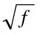

 0.73 / f 0,92 / f 6 10-400 MHz 28 0,073 0,092 6 400-2000 MHz 1,375 · 

 0,0037 · 

 0,0046 · 

 6 2-10 GHz 61 0,16 0,20 6 10-300 GHz 61 0,16 0,20 68 / f 1.05 Dabei bedeutet f die Frequenz in der in der ersten Tabellenspalte angegebenen Einheit. 2) Zusätzlich zu Abs. 1 gelten bei gepulsten Immissionen für den während der Pulsdauer gemittelten Effektivwert der elektrischen Feldstärke, der magnetischen Feldstärke und der magnetischen Flussdichte die folgenden Immissionsgrenzwerte: Frequenz Immissionsgrenzwerte für den Effektivwert der Mittelungsdauer elektrischen Feldstärke E P,f (V/m) magnetischen Feldstärke H P,f (A/m) magnetischen Flussdichte B P,f (µT) 10-400 MHz 900 2,3 2,9 Pulsdauer 400-2000 MHz 44 · 

 0,12 · 

 0,15 · 

 Pulsdauer 2-300 GHz 1950 5,1 6,4 Pulsdauer Dabei bedeutet f die Frequenz in MHz. 12 Immissionsgrenzwert für den induzierten Körperableitstrom Für Frequenzen zwischen 10 und 110 MHz beträgt der Immissionsgrenzwert für den Effektivwert des über eine Körper-Extremität abgeleiteten elektrischen Stroms 45 mA. Die Mittelungsdauer beträgt 6 Minuten. 13 Immissionsgrenzwert für den Berührungsstrom Der Immissionsgrenzwert für den Effektivwert des Berührungsstroms beträgt: Frequenz Immissionsgrenzwert für den Effektivwert des Berührungsstroms I B,Gf (mA) < 2,5 kHz 0,5 2,5-100 kHz 0,2 · f 0,1-110 MHz 20 Dabei bedeutet f die Frequenz in kHz. 2 Immissionen mit mehreren Frequenzen 21 Grundsätze 1) Sind verschiedene Frequenzen gleichzeitig vorhanden, so werden die Immissionen für jede Frequenz einzeln ermittelt. 2) Die so ermittelten Immissionen werden nach Ziff. 22 mit einem frequenzabhängigen Faktor gewichtet und summiert. 3) Der Immissionsgrenzwert für jede der nach Ziff. 22 berechneten Summen beträgt 1. 22 Summierungsvorschriften Ziffer Frequenzbereich Physikalische Grösse Summierungsvorschrift Mittelungsdauer 221 1 Hz - 10 MHz elektrische Feldstärke 

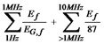

 - magnetische Feldstärke 

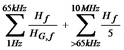

 - magnetische Flussdichte 

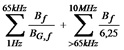

 - 222 100 kHz - 300 GHz elektrische Feldstärke 

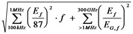

 6 Minuten magnetische Feldstärke 

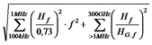

 6 Minuten magnetische Flussdichte 

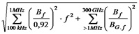

 6 Minuten 223 Zusätzlich bei gepulsten Immissionen 10 MHz - 300 GHz elektrische Feldstärke 

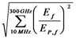

 Pulsdauer magnetische Feldstärke 

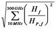

 Pulsdauer magnetische Flussdichte 

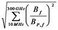

 Pulsdauer 224 10 MHz - 110 MHz induzierter Körperableitstrom 

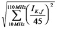

 6 Minuten 225 1 Hz - 110 MHz Berührungsstrom 

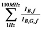

 - Die Summierung erfolgt jeweils innerhalb des beim Summenzeichen angegebenen Frequenzbereichs über alle Frequenzen f, bei denen Immissionen gleichzeitig vorhanden sind. Dabei bedeuten: f Frequenz in MHz E f Effektivwert der elektrischen Feldstärke in V/m bei der Frequenz f E G,f Immissionsgrenzwert für den Effektivwert der elektrischen Feldstärke in V/m bei der Frequenz f nach Ziff. 11 Abs. 1 E P,f Immissionsgrenzwert für den Effektivwert der elektrischen Feldstärke in V/m bei der Frequenz f nach Ziff. 11 Abs. 2 H f Effektivwert der magnetischen Feldstärke in A/m bei der Frequenz f H G,f Immissionsgrenzwert für den Effektivwert der magnetischen Feldstärke in A/m bei der Frequenz f nach Ziff. 11 Abs. 1 H P,f Immissionsgrenzwert für den Effektivwert der magnetischen Feldstärke in A/m bei der Frequenz f nach Ziff. 11 Abs. 2 B f Effektivwert der magnetischen Flussdichte in µT bei der Frequenz f B G,f Immissionsgrenzwert für den Effektivwert der magnetischen Flussdichte in µT bei der Frequenz f nach Ziff. 11 Abs. 1 B P,f Immissionsgrenzwert für den Effektivwert der magnetischen Flussdichte in µT bei der Frequenz f nach Ziff. 11 Abs. 2 I K,f Effektivwert des über eine Körper-Extremität abgeleiteten elektrischen Stroms in mA bei der Frequenz f I B,f Effektivwert des Berührungsstroms in mA bei der Frequenz f I B,G,f Immissionsgrenzwert für den Effektivwert des Berührungsstroms in mA bei der Frequenz f nach Ziff. 13
