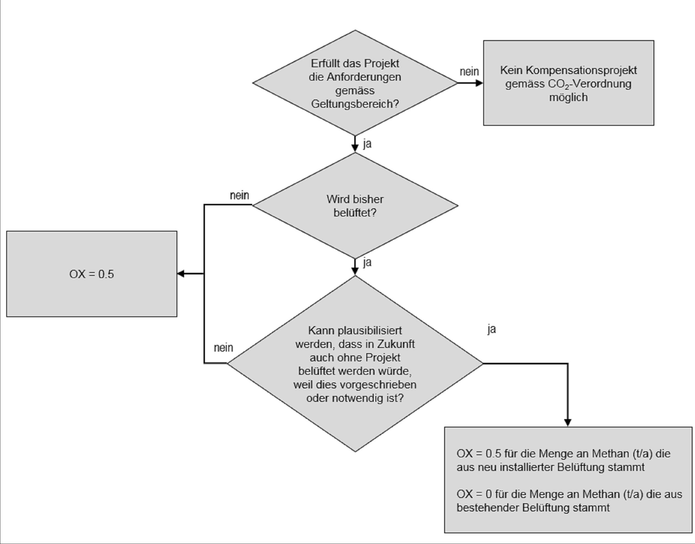

Verordnung vom 29. Oktober 2013 über die Reduktion der CO 2 -Emissionen (CO 2 -Verordnung) Aufgrund von Art. 2 Abs. 2, Art. 2b Abs. 1 und 3, Art. 2c, 3 Abs. 2, Art. 5 Abs. 5, Art. 5c, 7 Abs. 3 und 4, Art. 7a Abs. 3, Art. 7b Abs. 2, Art. 9 Abs. 3, Art. 10 Abs. 2, Art. 11 Abs. 3 und 4, Art. 13 Abs. 2 bis 4, Art. 14 Abs. 2 und 6, Art. 15, 16 Abs. 4 und Art. 26 des Gesetzes vom 6. September 2013 über die Reduktion der CO 2 -Emissionen (CO 2 -Gesetz), LGBl. 2013 Nr. 358, in der geltenden Fassung, sowie aufgrund der Vereinbarung zum Vertrag zwischen dem Fürstentum Liechtenstein und der Schweizerischen Eidgenossenschaft betreffend die Umweltabgaben im Fürstentum Liechtenstein, LGBl. 2010 Nr. 13, verordnet die Regierung: I. Allgemeine Bestimmungen Art. 1 Treibhausgase 1) Diese Verordnung regelt die Verminderung der Emission folgender Treibhausgase: a) Kohlendioxid (CO 2 ); b) Methan (CH 4 ); c) Distickstoffmonoxid (N 2 O, Lachgas); d) Fluorkohlenwasserstoffe (HFCs); e) perfluorierte Kohlenwasserstoffe (PFCs); f) Schwefelhexafluorid (SF 6 ); g) Stickstofftrifluorid (NF 3 ). 2) Die erwärmende Wirkung der Treibhausgase auf das Klima wird in CO 2 -Äquivalente (CO 2 eq) umgerechnet. Die Werte sind in Anhang 1 aufgeführt. Art. 2 Begriffe und Bezeichnungen 1) Im Sinne dieser Verordnung gelten als: a) "Feuerungswärmeleistung": einer Anlage maximal zuführbare Wärmeenergie pro Zeiteinheit; b) "Unternehmen": Betreiber von ortsfesten Anlagen an einem Standort; ausgenommen sind Anlagenbetreiber nach dem Emissionshandelsgesetz (EHG); c) "Emissionsgutschriften": Emissionsreduktionen, die durch Projektmassnahmen im Sinne von Art. 3 Abs. 1 Bst. n EHG erzielt wurden und zur Kompensation von Emissionen im Ausland verwendet werden können; d) "Partnerstaat": Staat, mit welchem Liechtenstein eine völkerrechtliche Vereinbarung zur Durchführung von Klimaschutzprojekten Liechtensteins in diesem Staat abgeschlossen hat. 2) Unter den in dieser Verordnung verwendeten Personenbezeichnungen sind alle Personen unabhängig ihres Geschlechts zu verstehen, sofern sich die Personenbezeichnungen nicht ausdrücklich auf ein bestimmtes Geschlecht beziehen. Art. 2a Verweis auf EWR-Rechtsvorschriften 1) Wird in dieser Verordnung auf EWR-Rechtsvorschriften verwiesen, so beziehen sich diese Verweise auf deren jeweils geltende Fassung, einschliesslich deren Abänderungen und Ergänzungen durch das EWRA. 2) Die geltende Fassung der in Abs. 1 genannten Rechtsvorschriften ergibt sich aus der Kundmachung der Beschlüsse des Gemeinsamen EWR-Ausschusses im Liechtensteinischen Landesgesetzblatt nach Art. 3 Bst. k des Kundmachungsgesetzes. Bescheinigungen für Projekte und Programme für Emissionsverminderungen oder die Erhöhung der Senkenleistungen im In- und Ausland Art. 3 a) Grundsatz Emissionsverminderungen und die Erhöhung der Senkenleistungen durch Projekte und Programme werden in Liechtenstein berücksichtigt, wenn sie mit einer nationalen Bescheinigung oder mit einer internationalen Bescheinigung nach Art. 6 Abs. 2 oder 4 des Klimaübereinkommens vom 12. Dezember 2015 nachgewiesen sind. Art. 3a b) Anforderungen 1) Für Projekte und Programme für Emissionsverminderungen oder die Erhöhung der Senkenleistungen im In- und Ausland werden nationale beziehungsweise internationale Bescheinigungen (Bescheinigungen) ausgestellt, wenn: a) die Anhänge 2 oder 2a dies nicht ausschliessen; b) glaubhaft und nachvollziehbar dargestellt wird, dass das Projekt: 1. ohne den Erlös aus dem Verkauf der Bescheinigungen über die Projektdauer nicht wirtschaftlich wäre, 2. mindestens dem Stand der Technik entspricht, 3. Massnahmen vorsieht, die, gemessen an der Referenzentwicklung nach Art. 3d Abs. 2 Bst. d, zu einer zusätzlichen Emissionsverminderung oder einer Erhöhung der Senkenleistung führen, 4. die übrigen massgebenden rechtlichen Bestimmungen einhält, 5. im Ausland zur nachhaltigen Entwicklung vor Ort beiträgt und dieser Beitrag vom Partnerstaat bestätigt wurde; c) die Emissionsverminderungen oder die Erhöhung der Senkenleistungen: 1. nachweisbar und quantifizierbar sind sowie entweder mittels Messungen bestätigt werden oder mittels eines wissenschaftlichen Modells, das mittels Messungen plausibilisiert wird, bestätigt werden, 2. nicht Treibhausgasemissionen betreffen, die vom Emissionshandelsgesetz erfasst sind, 3. nicht von einem Unternehmen mit Verminderungsverpflichtung nach Art. 15 Abs. 1 erzielt wurden; davon ausgenommen sind Unternehmen mit Verminderungsverpflichtung, soweit die Emissionsverminderungen aus Projekten oder Programmen vom Treibhausgaseffizienzziel nach Art. 16 oder vom Massnahmenziel nach Art. 17 nicht erfasst sind, 4. so berechnet sind, dass wesentliche Überschätzungen der anrechenbaren Emissionsverminderungen oder der anrechenbaren Erhöhung der Senkenleistungen ausgeschlossen sind; d) der Beginn der Umsetzung des Projekts oder des Programmes bei der Einreichung des Gesuchs nach Art. 3e nicht länger als drei Monate zurückliegt; e) das Projekt oder Programm noch nicht beendet ist; f) die Umsetzung des Projekts oder des Programms zu keiner Verlagerung der Emissionen führt; und g) die gesuchstellende Person, sofern sie nicht selber durch das Projekt begünstigt wird, nachweisen kann, dass sie die Berechtigung an den Emissionsverminderungen oder der Erhöhung der Senkenleistungen hat. 2) Für Projekte und Programme, die Kohlenstoff speichern, werden Bescheinigungen ausgestellt, wenn sie zusätzlich zu den Anforderungen nach Abs. 1 die Voraussetzungen nach Anhang 2b erfüllen, wobei: a) die Permanenz der Kohlenstoffbindung nach Anhang 2b Bst. a unabhängig von der Projektdauer während mindestens 30 Jahren ab Wirkungsbeginn sichergestellt sein und nachvollziehbar dargelegt werden muss; und b) eine geologische Speicherung in einer Speicherstätte erfolgen kann, die im Rahmen eines multilateralen Abkommens von den Partnerstaaten anerkannt wurde. 3) Als Beginn der Umsetzung gilt der Zeitpunkt, zu dem sich die gesuchstellende Person gegenüber Dritten finanziell massgeblich verpflichtet oder bei sich projekt- oder programmbezogene organisatorische Massnahmen ergreift. Art. 3b c) Programme 1) Projekte können zu einem Programm zusammengefasst werden, wenn: a) sie nebst der Emissionsverminderung oder der Erhöhung der Senkenleistung einen gemeinsamen Zweck verfolgen; b) in der Programmbeschreibung eine Technologie oder eine Gruppe von zusammenhängenden Technologien festgelegt wird und alle Projekte diese Technologie einsetzen; c) sie die in der Programmbeschreibung festgelegten Aufnahmekriterien erfüllen, die gewährleisten, dass die Projekte die Anforderungen nach Art. 3a erfüllen; d) mit deren Umsetzung noch nicht begonnen wurde; und e) sie innerhalb eines Landes umgesetzt wurden. 2) Projekte können in bestehende Programme aufgenommen werden, wenn sie die Voraussetzungen nach Abs. 1 erfüllen. 3) Programme, die nach Ablauf der ersten Kreditierungsperiode nur ein Projekt umfassen, werden als Projekte nach Art. 3a weitergeführt. Art. 3c d) Wissenschaftliche Begleitung 1) Bei Projekten oder Programmen, deren Wirkung nach Art. 3a Abs. 1 Bst. c Ziff. 1 nicht ausreichend genau quantifiziert werden kann, führt die gesuchstellende Person auf eigene Kosten projektbegleitende Massnahmen nach wissenschaftlichen Grundsätzen (wissenschaftliche Begleitung) durch. 2) Die gesuchstellende Person reicht dem Amt für Umweltschutz ein Konzept für die wissenschaftliche Begleitung ein. Das Konzept enthält insbesondere Angaben über: a) das Ziel und die Fragestellung; b) den aktuellen Stand des Wissens, inklusive die statistischen Daten, die zur Bestimmung der Ungenauigkeit der Messbarkeit benutzt wurden; c) das Vorgehen und die Auswertung; d) die Fachkenntnisse der an der wissenschaftlichen Begleitung beteiligten Personen; e) die Unabhängigkeit sowie mögliche Interessenkonflikte der an der wissenschaftlichen Begleitung beteiligten Personen. 3) Die wissenschaftliche Begleitung wird beendet, wenn die Wirkung des Projekts oder Programmes ausreichend genau quantifiziert worden ist. Das Amt für Umweltschutz entscheidet über die Beendigung der wissenschaftlichen Begleitung. 4) Die Resultate der wissenschaftlichen Begleitung sind unter Wahrung des Betriebs- und Geschäftsgeheimnisses zu publizieren. Art. 3d e) Validierung von Projekten und Programmen 1) Wer für ein Projekt oder ein Programm Bescheinigungen beantragen möchte, muss dieses durch eine vom schweizerischen Bundesamt für Umwelt (BAFU) zugelassene Validierungsstelle auf eigene Kosten validieren lassen. 2) Der Validierungsstelle ist eine Beschreibung des Projekts oder des Programms einzureichen. Diese muss insbesondere Angaben enthalten über: a) die Massnahmen zur Emissionsverminderung oder zur Erhöhung der Senkenleistung; b) die eingesetzten Technologien; c) die Abgrenzung von anderen klima- und energiepolitischen Instrumenten; d) die hypothetische Entwicklung der Treibhausgasemissionen, wenn die Massnahmen des Projekts beziehungsweise des Programmes zur Emissionsverminderung oder zur Erhöhung der Senkenleistung nicht umgesetzt würden (Referenzentwicklung); e) den Umfang der erwarteten jährlichen Emissionsverminderungen oder der Erhöhung der Senkenleistungen und die zugrundeliegende Berechnungsmethode; f) die Organisation des Projekts beziehungsweise des Programmes; g) die voraussichtlichen Investitions- und Betriebskosten und die voraussichtlichen Erträge; h) die Finanzierung; i) das Monitoringkonzept, das den Beginn des Monitorings festlegt und die Methode zum Nachweis der Emissionsverminderungen oder der Erhöhung der Senkenleistungen umschreibt; k) die Dauer des Projekts beziehungsweise des Programms; l) bei Programmen zusätzlich: den Zweck, die Kriterien für die Aufnahme der Projekte ins Programm, die Verwaltung der Projekte sowie, pro festgelegte Technologie, ein Beispiel für ein Projekt; m) bei Projekten oder Programmen mit einer wissenschaftlichen Begleitung zusätzlich, im Monitoringkonzept nach Bst. i: ein Konzept nach Art. 3c; n) bei Projekten oder Programmen zur Erhöhung der Senkenleistung zusätzlich, im Monitoringkonzept nach Bst. i: die Vorgehensweise für den Nachweis, dass die Permanenz nach Art. 3a Abs. 2 sichergestellt ist; o) bei Projekten oder Programmen im Ausland zusätzlich: 1. den erwarteten Beitrag zur nachhaltigen Entwicklung vor Ort anhand von Indikatoren, die Beiträge zu den nachhaltigen Entwicklungszielen der Vereinten Nationen aufzeigen und die objektiv überprüft werden können, 2. ein Konzept zur finanziellen Nachhaltigkeit, welches den langfristigen Betrieb und Unterhalt der Technologie nach dem Ende der Kreditierungsperiode aufzeigt, und 3. die Ergebnisse der Konsultation der betroffenen Interessensgruppen sowie über die Möglichkeit, Rückmeldungen zur Umsetzung des Projekts oder Programms zu geben. 3) Bei Projekten und Programmen im Inland im Zusammenhang mit einem Wärmeverbund und bei Deponiegasprojekten und -programmen erfolgt die Beschreibung der in Abs. 2 Bst. d, e und i verlangten Angaben nach den Anforderungen der Anhänge 2c beziehungsweise 2d. 4) Die gesuchstellende Person kann eine Projektskizze durch das Amt für Umweltschutz vorprüfen lassen. Hat das Amt für Umweltschutz eine Vorprüfung der Projektskizze durchgeführt, so sind der Validierungsstelle zusätzlich zu den Angaben nach Abs. 2 die Projektskizze und die Resultate der Vorprüfung einzureichen. 5) Die Validierungsstelle prüft die Angaben nach Abs. 2 sowie, ob das Projekt den Anforderungen nach Art. 3a beziehungsweise ob das Programm den Anforderungen nach den Art. 3a und 3b entspricht. Sie führt soweit notwendig Besichtigungen durch. Diese sind der gesuchstellenden Person und dem Amt für Umweltschutz rechtzeitig anzukündigen. 6) Die Validierungsstelle fasst die Ergebnisse der Prüfung in einem Validierungsbericht zusammen. 7) Das Amt für Umweltschutz legt die Form der Beschreibung des Projekts oder Programmes und des Validierungsberichts fest. Art. 3e f) Gesuch um die Beurteilung der Eignung eines Projekts oder Programms für das Ausstellen von Bescheinigungen 1) Wer für ein Projekt oder ein Programm Bescheinigungen beantragen möchte, muss dem Amt für Umweltschutz über die Validierungsstelle ein Gesuch um die Beurteilung der Eignung für die Ausstellung von Bescheinigungen einreichen. Das Gesuch umfasst die Projekt- oder Programmbeschreibung und den Validierungsbericht. 2) Bei Projekten oder Programmen im Ausland umfasst das Gesuch zusätzlich den Entscheid über die Eignung des Projektes oder Programmes durch den Partnerstaat. 3) Das Amt für Umweltschutz kann von der gesuchstellenden Person zusätzliche Informationen verlangen, soweit es diese für die Beurteilung des Gesuchs benötigt. Art. 3f g) Entscheid über die Eignung eines Projekts oder Programms für das Ausstellen von Bescheinigungen 1) Das Amt für Umweltschutz entscheidet gestützt auf das Gesuch und gegebenenfalls auf die zusätzlichen Informationen nach Art. 3e Abs. 3, ob das Projekt beziehungsweise das Programm für die Ausstellung von Bescheinigungen geeignet ist. 2) Falls bei Projekten oder Programmen im Ausland der Partnerstaat in der Bewilligung des Projektes oder des Programmes eine Beschränkung zur zugelassenen Nutzung der Emissionsverminderungen oder der Erhöhung der Senkenleistungen festlegt, wird diese Beschränkung im Entscheid berücksichtigt. 3) Der Entscheid gilt ab dem Beginn der Umsetzung des Projektes beziehungsweise des Programmes bis spätestens am 31. Dezember 2030 (Kreditierungsperiode). Art. 3g h) Anmerkung im Grundbuch 1) Die Nutzungsbeschränkung als biologischer Speicher von Kohlenstoff ist auf Anmeldung des Amtes für Umweltschutz im Grundbuch anzumerken. Dies gilt nicht für die Speicherung von Kohlenstoff in Baustoffen. 2) Das Amt für Umweltschutz meldet die Löschung der Anmerkung im Grundbuch an, wenn: a) das Projekt oder Programm beendet ist, frühestens jedoch 30 Jahre nach Wirkungsbeginn; oder b) der gespeicherte Kohlenstoff vor diesem Zeitpunkt auf dem betroffenen Grundstück freigesetzt wird. 3) Der Eigentümer des betroffenen Grundstücks trägt die Kosten für den Eintrag, die Änderung und die Löschung der Anmerkung. 4) Die Gemeinden informieren das Amt für Umweltschutz unverzüglich, sobald das betroffene Grundstück anderweitig genutzt wird. Art. 3h i) Monitoringbericht und Verifizierung des Monitoringberichts 1) Die gesuchstellende Person erhebt die Daten, die gemäss dem Monitoringkonzept für den Nachweis der Emissionsverminderungen oder der Erhöhung der Senkenleistungen und ihrer Permanenz erforderlich sind, und hält diese in einem Monitoringbericht fest. 2) Sie lässt den Monitoringbericht auf eigene Kosten von einer vom BAFU zugelassenen Verifizierungsstelle verifizieren. Die Verifizierung darf nicht von der Stelle durchgeführt werden, die das Projekt oder das Programm zuletzt validiert hat. 3) Die Verifizierungsstelle prüft, ob die ausgewiesenen Emissionsverminderungen oder die Erhöhung der Senkenleistungen die Anforderungen nach Art. 3a erfüllen. Bei Programmen prüft sie zusätzlich, ob die Projekte die Aufnahmekriterien nach Art. 3b Abs. 1 Bst. c erfüllen. Sie kann die Prüfung auf einzelne repräsentative Projekte des Programmes beschränken. 4) Die Verifizierungsstelle führt soweit notwendig Besichtigungen durch. Diese sind der gesuchstellenden Person und dem Amt für Umweltschutz rechtzeitig anzukündigen. 5) Die Verifizierungsstelle hält die Ergebnisse der Verifizierung in einem Verifizierungsbericht fest. 6) Der Monitoringbericht, die zugrundeliegenden Messdaten und der dazugehörige Verifizierungsbericht umfassen einen Zeitraum von höchstens vier Jahren. Die Verifizierungsstelle muss sie spätestens ein Jahr nach dem Ende des Zeitraums dem Amt für Umweltschutz einreichen. Die Emissionsverminderungen oder die Erhöhung der Senkenleistungen sind pro Kalenderjahr auszuweisen. 7) Für Projekte und Programme mit einer wissenschaftlichen Begleitung sind dem Amt für Umweltschutz die Monitoringberichte, die dazugehörigen Verifizierungsberichte sowie die Resultate der wissenschaftlichen Begleitung jährlich einzureichen. Die Quantifizierung der Emissionsverminderungen oder der Erhöhung der Senkenleistungen ist jährlich neu auszuwerten. 8) Für Projekte und Programme, die in Bezug zu einer Verminderungsverpflichtung nach Art. 5 des Gesetzes stehen, sind dem Amt für Umweltschutz die Monitoringberichte und die Verifizierungsberichte jährlich bis am 31. August des Folgejahres einzureichen. Die Anzahl der beantragten Bescheinigungen, die Anlagen eines Unternehmens mit Verminderungsverpflichtung betreffen, ist dem Unternehmen, das diese Verminderungsverpflichtung eingegangen ist, und dem Amt für Umweltschutz umgehend zu melden. 9) Für Projekte oder Programme, die Kohlenstoff speichern, sind dem Amt für Umweltschutz unabhängig von ihrer Laufzeit für das Jahr 2030 ein Monitoring- und ein Verifizierungsbericht einzureichen. 10) Das Amt für Umweltschutz macht Vorgaben für die Form des Monitoring- und des Verifizierungsberichts. Art. 3i k) Ausstellung der Bescheinigungen 1) Das Amt für Umweltschutz prüft den Monitoringbericht und den dazugehörigen Verifizierungsbericht. Soweit es für die Ausstellung von Bescheinigungen notwendig ist, führt es bei der gesuchstellenden Person weitere Abklärungen durch. 2) Das Amt für Umweltschutz prüft für die Ausstellung von internationalen Bescheinigungen zusätzlich die Anerkennung der Übertragung der Emissionsverminderungen oder der Erhöhung der Senkenleistungen durch den Partnerstaat. Soweit es für die Ausstellung von internationalen Bescheinigungen erforderlich ist, führt es beim Partnerstaat weitere Abklärungen durch. 3) Das Amt für Umweltschutz entscheidet gestützt auf die Angaben nach den Abs. 1 und 2 über die Ausstellung von Bescheinigungen. 4) Bei Projekten und Programmen werden Bescheinigungen im Umfang der Emissionsverminderungen oder der Erhöhung der Senkenleistungen ausgestellt, die bis zum Ende der Kreditierungsperiode nachweislich erzielt wurden. 5) Für noch nicht umgesetzte Projekte in Programmen werden keine Bescheinigungen ausgestellt, wenn eine Änderung massgebender gesetzlicher Bestimmungen dazu führt, dass die im Programm geplanten Massnahmen zur Emissionsverminderung oder zur Erhöhung der Senkenleistung umgesetzt werden müssen. 6) Die Bescheinigungen werden im Umfang der gesamten jährlich ausgewiesenen Emissionsverminderungen oder Erhöhung der Senkenleistung ausgestellt. 7) Von den ausgestellten internationalen Bescheinigungen werden 2 % stillgelegt und nicht an die Erreichung der Reduktionsziele angerechnet. Stilllegungen des Partnerstaats werden dabei berücksichtigt. 8) Die Emissionsverminderungen oder die Erhöhung der Senkenleistungen, die auf nichtrückzahlbare Geldleistungen des Landes oder der Gemeinden zur Förderung erneuerbarer Energien, der Energieeffizienz oder des Klimaschutzes zurückzuführen sind, werden der gesuchstellenden Person nur bescheinigt, wenn diese nachweist, dass das zuständige Gemeinwesen die Emissionsverminderungen nicht anderweitig geltend macht. 9) Der ökologische Mehrwert von Emissionsverminderungen oder der Erhöhung der Senkenleistung ist mit der Ausstellung der Bescheinigung abgegolten. Ist der ökologische Mehrwert bereits vergütet worden, so werden keine Bescheinigungen ausgestellt. Art. 3k l) Wesentliche Änderungen des Projekts oder des Programms 1) Wesentliche Änderungen des Projekts oder des Programms, die nach dem Entscheid über die Eignung oder die Verlängerung der Kreditierungsperiode erfolgen, müssen dem Amt für Umweltschutz mit dem nächsten Monitoringbericht gemeldet werden. 2) Eine Änderung eines Projekts oder Programms ist insbesondere dann wesentlich, wenn: a) die Emissionsverminderungen oder die Erhöhung der Senkenleistungen um mehr als 20 % von den in der Projekt- oder Programmbeschreibung angegebenen erwarteten jährlichen Emissionsverminderungen oder Erhöhungen der Senkenleistungen abweichen; b) die Investitionskosten, die Betriebskosten oder die Einnahmen um mehr als 20 % von den in der Projekt- oder Programmbeschreibung angegebenen Werten abweichen; c) ein Technologiewechsel stattfindet; oder d) die Systemgrenze eines Projekts oder Programms geändert wird. 3) Soweit notwendig ordnet das Amt für Umweltschutz eine erneute Validierung an. Die Emissionsverminderungen oder die Erhöhung der Senkenleistungen, die nach einer wesentlichen Änderung erzielt werden, werden erst nach dem erneuten Entscheid über die Eignung nach Art. 3f bescheinigt. 4) Bei Projekten und Programmen im Ausland ist zusätzlich ein erneuter Entscheid des Partnerstaats über die Eignung erforderlich. 5) Das Amt für Umweltschutz genehmigt die wesentliche Änderung, wenn die Anforderungen nach den Art. 3a und 3b weiterhin erfüllt sind. 6) Nach einer erneuten Validierung dauert die Kreditierungsperiode ab dem Zeitpunkt des Eintritts der wesentlichen Änderung bis spätestens zum 31. Dezember 2030. Art. 3l m) Internationale Bescheinigungen nach Art. 6 Abs. 4 des Klimaübereinkommens 1) Wer internationale Bescheinigungen nach Art. 6 Abs. 4 des Klimaübereinkommens in Liechtenstein anrechnen lassen möchte, benötigt ein Genehmigungsschreiben des Amtes für Umweltschutz. Das Amt für Umweltschutz legt die Form des Antrags fest. 2) Das Amt für Umweltschutz stellt das Genehmigungsschreiben aus, wenn: a) Anhang 2 die Ausstellung internationaler Bescheinigungen für das Projekt oder Programm nicht ausschliesst; und b) das Projekt oder Programm nach dem 1. Januar 2021 registriert und gemäss dem Mechanismus nach Art. 6 Abs. 4 des Klimaübereinkommens anerkannt wurde. Verwaltung von Bescheinigungen und Datenschutz Art. 3m a) Verwaltung der Bescheinigungen und der Daten 1) Wer die Ausstellung von Bescheinigungen beantragt, muss dem Amt für Umweltschutz gleichzeitig das Konto angeben, auf das die Bescheinigungen ausgestellt werden sollen. Die Bescheinigungen werden im Emissionshandelsregister ausgestellt und nach den Art. 15 bis 17 des Emissionshandelsgesetzes verwaltet. 2) Die folgenden Daten und Dokumente werden in einer vom Amt für Umweltschutz geführten Datenbank verwaltet: a) Vornamen, Namen und Kontaktangaben der gesuchstellenden Person, der Validierungsstelle und der Verifizierungsstelle; b) die Anzahl ausgestellter Bescheinigungen; c) die Kerndaten des Projekts beziehungsweise des Programms; und d) die Projekt- und Programmbeschreibung, die Validierungs-, die Monitoring- und die Verifizierungsberichte sowie die dazugehörigen Daten. 3) Dem Inhaber einer Bescheinigung wird auf Anfrage Einsicht in die Daten nach Abs. 2 Bst. a und b gewährt, die im Zusammenhang mit seiner Bescheinigung stehen. Einsicht in die Daten und Unterlagen nach Abs. 2 Bst. c und d kann unter Wahrung des Betriebs- und Geschäftsgeheimnisses gewährt werden. Art. 3n b) Veröffentlichung von Informationen 1) Das Amt für Umweltschutz kann unter Wahrung des Betriebs- und Geschäftsgeheimnisses veröffentlichen: a) Beschreibungen der Projekte und Programme zur Emissionsverminderung oder zur Erhöhung der Senkenleistung; b) die Validierungsberichte nach Art. 3d Abs. 6; c) die Monitoringberichte nach Art. 3h Abs. 1; d) die Verifizierungsberichte nach Art. 3h Abs. 5; e) die Entscheide nach den Art. 3f Abs. 1 und Art. 3i Abs. 3. 2) Vor der Veröffentlichung stellt das Amt für Umweltschutz der gesuchstellenden Person die Unterlagen nach Abs. 1 zu. Es fordert die gesuchstellende Person auf, die Informationen zu bezeichnen, die aus ihrer Sicht dem Betriebs- und Geschäftsgeheimnis unterliegen. Art. 3o Koordination der Anpassungsmassnahmen 1) Das Amt für Umweltschutz berücksichtigt bei der Koordination der Anpassungsmassnahmen nach Art. 2b Abs. 1 des Gesetzes die Massnahmen der Gemeinden. 2) Die Gemeinden informieren das Amt für Umweltschutz regelmässig über ihre Massnahmen. II. CO 2 -Abgabe A. Allgemeine Bestimmungen Art. 4 Abgabeobjekt Der CO 2 -Abgabe unterliegen die Herstellung, Gewinnung und Einfuhr: a) von Kohle; b) der übrigen Brennstoffe nach Art. 2 Abs. 1 Bst. a des Gesetzes, sofern sie der Mineralölsteuer nach dem schweizerischen Mineralölsteuergesetz unterliegen. Art. 5 Abgabesatz 1) Der Abgabesatz nach Art. 3 Abs. 2 des Gesetzes beträgt ab dem 1. Januar 2022 120 Franken je Tonne CO 2 . 2) Der Abgabesatz wird nach dem Tarif im Anhang 3 erhoben. Art. 6 Nachweis der Abgabeentrichtung Wer mit Brennstoffen nach Art. 4 handelt, muss auf den Rechnungen für Erwerber die mit der CO 2 -Abgabe belastete Brennstoffmenge und den angewendeten Abgabesatz angeben. B. Rückerstattung der CO 2 -Abgabe Art. 7 Anspruch auf Rückerstattung 1) Die Rückerstattung der CO 2 -Abgabe beantragen können Unternehmen und Personen: a) die von der CO 2 -Abgabe befreit sind; b) die Wärme-Kraft-Kopplungs (WKK)-Anlagen betreiben, die weder in den Anwendungsbereich des EHG fallen noch einer Verminderungsverpflichtung unterliegen (Art. 7a des Gesetzes); oder c) die abgabebelastete Brennstoffe nicht energetisch nutzen (Art. 6 Abs. 1 Bst. a des Gesetzes). 2) Von der CO 2 -Abgabe befreit sind: a) Unternehmen, die in den Anwendungsbereich des EHG fallen (Art. 6 Bst. c des Gesetzes); b) Unternehmen mit Verminderungsverpflichtung (Art. 5 und 5a des Gesetzes). Art. 7a Aufgehoben Art. 8 Gesuch um Rückerstattung für von der CO 2 -Abgabe befreite Unternehmen 1) Das Rückerstattungsgesuch ist beim Bundesamt für Zoll und Grenzsicherheit (BAZG) in der von diesem vorgeschriebenen Form einzureichen. 2) Es muss die Art und Menge des Brennstoffs pro Einkauf enthalten. 3) Das BAZG kann weitere Nachweise verlangen, soweit sie diese für die Rückerstattung benötigt. Insbesondere sind ihr auf Verlangen die Rechnungen über die bezahlten CO 2 -Abgaben vorzulegen. Art. 9 Periodizität der Rückerstattung für von der CO 2 -Abgabe befreite Unternehmen 1) Ein Rückerstattungsgesuch kann einen Zeitraum von 1 bis 12 Monaten umfassen. 2) Es ist innert sechs Monaten nach Ablauf des Geschäftsjahres, in dem der mit der CO 2 -Abgabe belastete Brennstoff eingekauft wurde, einzureichen. 3) Der Anspruch auf Rückerstattung verwirkt, wenn das Gesuch nicht fristgemäss eingereicht wird. Art. 9a Rückerstattung für Unternehmen, die WKK-Anlagen betreiben und weder in den Anwendungsbereich des EHG fallen noch einer Verminderungsverpflichtung unterliegen 1) Ein Unternehmen, das weder in den Anwendungsbereich des EHG fällt noch einer Verminderungsverpflichtung unterliegt und das WKK-Anlagen nach Art. 7a Abs. 1 des Gesetzes betreibt, erhält für jede WKK-Anlage, die je eine Feuerungswärmeleistung von mindestens 0,5 MW und höchstens 20 MW aufweist, auf Gesuch hin 60 % der CO 2 -Abgabe auf den Brennstoffen, die zur Stromproduktion eingesetzt wurden, rückerstattet. 2) Das Unternehmen hat Anspruch auf die Rückerstattung der restlichen 40 % der CO 2 -Abgabe auf den Brennstoffen, die zur Stromproduktion eingesetzt wurden, wenn es: a) diesen Betrag für Massnahmen nach Art. 7b Abs. 2 des Gesetzes einsetzt; b) die Massnahme wirksam der Steigerung der Energieeffizienz dient; c) die Massnahmen nicht in einem Unternehmen, das einer Verminderungsverpflichtung unterliegt oder in den Anwendungsbereich des EHG fällt, umsetzt; d) die Wirkung der Massnahmen nicht anderweitig geltend macht; und e) die Massnahmen innerhalb von drei Folgejahren umsetzt. 3) Das BAFU kann die Frist nach Abs. 2 Bst. e auf Gesuch hin um zwei Jahre erstrecken. Art. 9b Gesuch um Rückerstattung für Unternehmen, die WKK-Anlagen betreiben und weder in den Anwendungsbereich des EHG fallen noch einer Verminderungsverpflichtung unterliegen 1) Unternehmen, die WKK-Anlagen betreiben und weder in den Anwendungsbereich des EHG fallen noch einer Verminderungsverpflichtung unterliegen, müssen bis zum 30. Juni beim BAFU eine Bestätigung der Höhe der rückerstattungsberechtigen Brennstoffmenge einholen. Sie müssen dabei insbesondere die folgenden Angaben einreichen: a) die Menge der für die Stromproduktion verwendeten abgabebelasteten Brennstoffe; diese berechnet sich anhand der auf dem Herkunftsnachweis ausgewiesenen jährlichen Strommenge und des Heizwertes des verwendeten Energieträgers; b) den Herkunftsnachweis, der die Elektrizität hinsichtlich der Menge, des Produktionszeitraumes, des eingesetzten Energieträgers und die Anlagedaten sowie den Erzeugungsnachweis erfasst; c) Angaben über die Feuerungswärmeleistung; d) den Monitoringbericht; e) Angaben über die jährliche Entwicklung der CO 2 -Emissionen, die aufgrund der gemessenen Produktion von Strom entstanden sind; f) die Bestätigung des Amts für Umweltschutz, dass die Emissionsgrenzwerte nach der Luftreinhalteverordnung eingehalten sind; g) Angaben über geplante Massnahmen; h) Aufgehoben i) Aufgehoben k) die Bestätigung, dass für den Betrieb der WKK-Anlagen abgabebelastete Brennstoffe eingesetzt wurden, sowie die Angabe des angewendeten CO 2 -Abgabesatzes. 2) Aufgehoben 3) Das Unternehmen kann innert sechs Monaten seit Ausstellung der Bestätigung des BAFU beim BAZG in der von diesem vorgeschriebenen Form die Auszahlung des Rückerstattungsbetrags beantragen. 3a) Dem BAZG sind auf Verlangen die Bestätigung des BAFU sowie die Rechnungen über die bezahlten CO 2 -Abgaben vorzulegen. 4) Der Monitoringbericht nach Abs. 1 Bst. d muss insbesondere Angaben über die Entwicklung der CO 2 -Emissionen, die aufgrund der Stromproduktion entstanden sind, sowie eine Beschreibung der umgesetzten Massnahmen und Investitionen enthalten. Das BAFU macht Vorgaben für die Form des Berichts. Art. 9c Periodizität der Rückerstattung für Unternehmen, die WKK-Anlagen betreiben und weder in den Anwendungsbereich des EHG fallen noch einer Verminderungsverpflichtung unterliegen 1) Das Rückerstattungsgesuch nach Art. 9b wird für einen Zeitraum von 12 Monaten eingereicht und gilt für die verbrauchten Brennstoffe im Vorjahr oder in dem im Vorjahr abgelaufenen Geschäftsjahr. 2) Die Rückerstattung erfolgt durch das BAZG und umfasst 100 % der CO 2 -Abgabe auf die Brennstoffe, die zur Stromproduktion eingesetzt wurden. 3) Der Anspruch auf Rückerstattung verwirkt, wenn: a) die Bestätigung des BAFU nicht fristgerecht eingeholt wird; oder b) die Auszahlung des Rückerstattungsbetrags nicht fristgerecht beim BAZG beantragt wird. Art. 10 Rückerstattung für nicht energetische Nutzung 1) Wer abgabebelastete Brennstoffe nicht energetisch nutzt und eine Rückerstattung beantragen will, muss nachweisen, welche Mengen nicht energetisch genutzt worden sind. Er muss zu diesem Zweck Aufzeichnungen (Verbrauchskontrollen) über Eingang, Ausgang und Verbrauch der Brennstoffe sowie über die Lagerbestände führen. 1a) Das BAZG kann die Rückerstattung der Abgabe für nicht energetisch genutzte Brennstoffe aufgrund der eingekauften Menge gewähren, sofern aufgrund der betrieblichen Verhältnisse beim Gesuchsteller keine Zweifel am nichtenergetischen Verwendungszweck bestehen und der Gesuchsteller die nichtenergetische Verwendung der Brennstoffe gegenüber dem BAZG verbindlich bestätigt. 2) Das Rückerstattungsgesuch ist beim BAZG in der von diesem vorgeschriebenen Form einzureichen. 3) Es muss Angaben enthalten über: a) die Art der nicht energetischen Nutzung; b) Menge und Art der nicht energetisch genutzten Brennstoffe; c) Aufgehoben 4) Das BAZG kann weitere Nachweise verlangen, soweit es diese für die Rückerstattung benötigt. Insbesondere sind ihm auf Verlangen die Rechnungen über die bezahlten CO 2 -Abgaben vorzulegen. Art. 11 Periodizität der Rückerstattung für nicht energetische Nutzung 1) Ein Rückerstattungsgesuch kann einen Zeitraum von 1 bis 12 Monaten umfassen. 2) Es ist innerhalb von sechs Monaten nach Ablauf des Geschäftsjahres, in dem der Brennstoff verbraucht oder eingekauft wurde, einzureichen. 3) Der Anspruch auf Rückerstattung verwirkt, wenn das Gesuch nicht fristgerecht eingereicht wird. Art. 12 Aufbewahrung von Belegen Alle für die Rückerstattung wesentlichen Unterlagen sind während fünf Jahren aufzubewahren und dem BAZG auf Verlangen vorzulegen. Art. 13 Mindestbetrag für eine Rückerstattung Rückerstattungsbeträge unter 100 Franken pro Gesuch werden nicht ausbezahlt. Art. 14 Aufschub der Rückerstattung Verletzt ein Unternehmen oder eine Person nach Art. 7 seine Mitwirkungspflichten nach dieser Verordnung, so kann das BAZG in Absprache mit dem BAFU die Rückerstattung der CO 2 -Abgabe aufschieben. C. Verpflichtung zur Verminderung der Treibhausgasemissionen 1. Voraussetzungen und Inhalt Art. 15 Voraussetzungen 1) Unternehmen können eine Verminderungsverpflichtung nach Art. 5 Abs. 1 des Gesetzes eingehen, wenn die Treibhausgasemissionen, die durch die wirtschaftliche oder die öffentlich-rechtliche Tätigkeit verursacht werden, mindestens 60 % der gesamten Treibhausgasemissionen des Standorts betragen. 2) Eine wirtschaftliche Tätigkeit liegt vor, wenn das Unternehmen: a) im Handelsregister eingetragen ist; b) über eine Unternehmens-Identifikationsnummer (UID-Nummer) verfügt; und c) die Tätigkeit in Konkurrenz zu anderen Marktteilnehmern erbracht wird. 3) Die Herstellung von Wärme oder Kälte für Wohngebäude gilt nicht als wirtschaftliche Tätigkeit. 4) Eine Verminderungsverpflichtung kann eingegangen werden, wenn die vom Gemeinwesen betriebenen Anlagen für eine der folgenden öffentlich-rechtlichen Tätigkeiten verwendet werden: a) Betrieb von Bädern; b) Betrieb von Kunsteisbahnen; c) Betrieb von dampfbetriebenen Lokomotiven und Schiffen; d) Betrieb von Spitälern, Alters- und Pflegeheimen; e) Herstellung von fossil erzeugter Wärme oder Kälte, die in regionale Fernwärme- und Fernkältenetze eingespeist oder von Unternehmen nach Abs. 1 verwendet wird; ausgenommen davon ist die Herstellung von Wärme oder Kälte für Wohngebäude. Art. 15a Inhalt der Verminderungsverpflichtung 1) Mit der Verminderungsverpflichtung verpflichtet sich das Unternehmen: a) eine Steigerung seiner Treibhausgaseffizienz zu erreichen, mit der es sein aus der Zielvereinbarung nach Art. 41 oder 46 Abs. 2 des schweizerischen Energiegesetzes abgeleitetes Treibhausgaseffizienzziel einhält, die jedoch jährlich mindestens 2,25 % gegenüber dem Ausgangswert der Zielvereinbarung beträgt (Verminderungsverpflichtung mit Treibhausgaseffizienzziel); oder b) eine Gesamtwirkung seiner Massnahmen zu erreichen, mit der es sein aus der Zielvereinbarung nach Art. 41 oder 46 Abs. 2 des schweizerischen Energiegesetzes abgeleitetes Massnahmenziel einhält, mindestens aber eine Gesamtwirkung, die einer jährlichen Treibhausgasverminderung von mindestens 2,25 % gegenüber dem Ausgangswert der Zielvereinbarung entspricht (Verminderungsverpflichtung mit Massnahmenziel). 1a) Das BAFU genehmigt auf Gesuch hin einen Mindestwert von weniger als 2,25 %, wenn der Betreiber im Dekarbonisierungsplan nachweist, dass die Treibhausgasemissionen zu einem wesentlichen Anteil durch die Nutzung von Hochtemperaturprozesswärme verursacht werden und keine zumutbare Alternative zum Einsatz von fossilen Regelbrennstoffen zur Verfügung steht. 2) Der Mindestwert von 2,25 % und allfällige nach Abs. 1a genehmigte reduzierte Mindestwerte gelten nur für Treibhausgasemissionen aus fossilen Regelbrennstoffen. 3) Die Verminderungsverpflichtung kann auch Massnahmen umfassen, mit denen CO 2 abgeschieden und nach den Anforderungen von Anhang 2b dauerhaft gespeichert oder dauerhaft in mineralischen Karbonaten, die in Bauprodukten verwendet werden, chemisch gebunden wird. 4) Für die Festlegung des Treibhausgaseffizienzziels oder des Massnahmenziels werden alle Massnahmen mit einer Amortisationsdauer von bis zu sechs Jahren berücksichtigt. Bei Infrastrukturmassnahmen, insbesondere bei Massnahmen an Gebäuden, an langlebigen Anlagen und an Anlagen, die auf mehrere Produkte oder Prozesse ausgerichtet sind, gilt eine Amortisationsdauer von bis zu zwölf Jahren. Art. 16 Verminderungsverpflichtung mit Treibhausgaseffizienzziel Unternehmen, deren Anlagen in den vorangehenden zwei Jahren Treibhausgase im Umfang von mindestens 200 Tonnen CO 2 eq pro Jahr ausgestossen haben, können eine Verminderungsverpflichtung mit Treibhausgaseffizienzziel eingehen. Art. 17 Verminderungsverpflichtung mit Massnahmenziel Eine Verminderungsverpflichtung mit Massnahmenziel können Unternehmen eingehen, die in den vorangehenden zwei Jahren Treibhausgase im Umfang von maximal 1 500 Tonnen CO 2 eq pro Jahr ausgestossen haben. Art. 17a Gemeinschaft für Verminderungsverpflichtung 1) Unternehmen können sich für die Verminderungsverpflichtung zu einer Gemeinschaft zusammenschliessen, wenn die Voraussetzungen nach Art. 15 für jeden Standort einzeln erfüllt sind. 2) Die Zielvereinbarung der Gemeinschaft nach Art. 41 oder 46 Abs. 2 des schweizerischen Energiegesetzes muss alle Standorte der beteiligten Unternehmen umfassen. Eine Gemeinschaft darf aus höchstens 50 Standorten bestehen. Das BAFU kann auf Gesuch Ausnahmen gewähren, wenn die Standorte zentral verwaltet werden. 3) Im Dekarbonisierungsplan müssen die Massnahmen für jeden Standort aufgezeigt werden. Pro Gemeinschaft können mehrere Dekarbonisierungspläne eingereicht werden. 4) Die Gemeinschaft muss eine Vertretung bezeichnen. 2. Gesuch um Festlegung einer Verminderungsverpflichtung Art. 18 Grundsatz 1) Das Gesuch um Festlegung einer Verminderungsverpflichtung ist dem BAFU bis zum 1. September des Vorjahres über das Informations- und Dokumentationssystem nach Art. 40c Abs. 1 des schweizerischen CO 2 -Gesetzes einzureichen. 2) Das Gesuch muss enthalten: a) Name und Adresse des Unternehmens; b) bei einer Gemeinschaft Name und Adresse aller zusammengeschlossenen Unternehmen; c) Namen und Kontaktangaben der zuständigen Personen; d) Angaben über die wirtschaftliche oder die öffentlich-rechtliche Tätigkeit; e) die ausgestossenen Treibhausgasemissionen der zwei vorangehenden Jahre in Tonnen CO 2 eq; f) eine Analyse des Potenzials für Verminderungen; g) die Gebäude-Identifikator Nummern (GEID-Nummern) für jeden Standort des Unternehmens; h) die UID-Nummern; i) Angaben über die AHV-Abrechnungsnummern; k) für den Fall, dass ein Unternehmen neben den Anlagen, für die es die Festlegung der Verminderungsverpflichtung beantragt, auch Anlagen betreibt, für die es keine Rückerstattung der CO 2 -Abgabe erhält oder mit denen es in den Anwendungsbereich des EHG fällt: Angaben über die Abgrenzung dieser Anlagen innerhalb der AHV-Abrechnungsnummern des Unternehmens; l) die Zielvereinbarung nach Art. 41 oder 46 Abs. 2 des schweizerischen Energiegesetzes einschliesslich dem angestrebten Treibhausgaseffizienzziel oder Massnahmenziel. 3) Soweit es für die Festlegung der Verminderungsverpflichtung notwendig ist, kann das BAFU weitere Angaben verlangen. 4) Setzt ein Unternehmen andere als fossile Regelbrennstoffe ein, kann das BAFU verlangen, dass es ein Monitoringkonzept nach Art. 51 der schweizerischen CO 2 -Verordnung einreicht. 5) Liegen die Angaben nach Abs. 2 Bst. f und l zum Zeitpunkt der Gesuchseinreichung noch nicht vor, kann das BAFU die Frist für die Einreichung dieser Angaben auf Gesuch hin angemessen erstrecken. Art. 19 Aufgehoben 3. Monitoringbericht und Dekarbonisierungsplan Art. 20 Monitoringbericht 1) Unternehmen mit einer Verminderungsverpflichtung müssen dem schweizerischen Bundesamt für Energie (BFE) in der vorgeschriebenen Form jährlich bis zum 31. Mai einen Monitoringbericht einreichen. 2) Der Monitoringbericht muss die folgenden Angaben in Bezug auf das vergangene Jahr enthalten: a) Angaben über die Entwicklung der Treibhausgasemissionen; b) Angaben über die umgesetzten Massnahmen und deren Wirkung zur Verminderung der Treibhausgasemissionen; c) bei einer Verminderungsverpflichtung mit Treibhausgaseffizienzziel: Angaben über die Entwicklung der Treibhausgaseffizienz; d) Angaben über die Entwicklung der Produktionsindikatoren; e) eine Warenbuchhaltung der Brennstoffe; f) Angaben über allfällige Abweichungen von der Verminderungsverpflichtung mit einer Begründung und den vorgesehenen Korrekturmassnahmen; g) Angaben über Art und Wirkung der in der Zielvereinbarung nach Art. 41 oder 46 Abs. 2 des schweizerischen Energiegesetzes festgelegten Massnahmen, die nach Art. 20d nicht an die Erfüllung der Verminderungsverpflichtung angerechnet werden können; und h) eine Übersichtstabelle in Form einer Zeitreihe, in der die Daten des Monitoringjahres den Daten der Vorjahre und den Zielwerten gegenübergestellt sind. 3) Beinhaltet eine Massnahme die Verwendung von erneuerbaren Brennstoffen, so muss das Unternehmen nachweisen, dass ihm im Herkunftsnachweissystem für Brenn- und Treibstoffe die entsprechenden Herkunftsnachweise nach dem 2a. Abschnitt der schweizerischen Energieverordnung zugewiesen wurden. Kann der Nachweis erbracht werden, so beträgt der Emissionsfaktor für diese Brennstoffe null. Die Menge der erneuerbaren Brennstoffe muss auf den Rechnungen ausgewiesen sein. 4) Das BAFU kann weitere Angaben verlangen, soweit es diese für die Beurteilung des Monitorings benötigt. Art. 20a Inhalt des Dekarbonisierungsplans 1) Der Dekarbonisierungsplan nach Art. 5 Bst. b des Gesetzes muss mindestens enthalten: a) eine Bilanzierung aller direkten Treibhausgasemissionen (Art. 2 Bst. b des schweizerischen Bundesgesetzes über die Ziele im Klimaschutz, die Innovation und die Stärkung der Energiesicherheit) aus fossilen Brennstoffen; b) eine Beschreibung der bestehenden Anlagen und Prozesse; c) eine Analyse, mit welchen Lösungen in welchem Umfang Treibhausgasemissionen aus fossilen Brennstoffen vermindert werden können; d) die gestützt auf die Analyse nach Bst. c zu ergreifenden Massnahmen zur Verminderung der Treibhausgasemissionen aus fossilen Brennstoffen; und e) einen Absenkpfad für die direkten Treibhausgasemissionen bis zum Jahr 2040; der Absenkpfad muss sich am Netto-Null-Ziel nach Art. 4 Abs. 4 des Emissionshandelsgesetzes orientieren. 2) Zu den Massnahmen nach Abs. 1 Bst. d müssen die folgenden Angaben gemacht werden: a) eine präzise Beschreibung der Massnahmen; b) eine Schätzung der Kosten der Umsetzung; c) eine Berechnung der durch die Massnahmen zu erzielenden Wirkung in Tonnen CO 2 eq und der damit verbundenen Auswirkungen auf den Energieverbrauch; d) ein Zeitplan für die Umsetzung. 3) Die Abgabe von nationalen oder internationalen Bescheinigungen kann im Rahmen des Dekarbonisierungsplans nicht als Massnahme geltend gemacht werden. Art. 20b Prüfung des Dekarbonisierungsplans Der Dekarbonisierungsplan muss von einer Person geprüft werden, die nach Art. 8 der schweizerischen Klimaschutz-Verordnung registriert oder bei einer nach Art. 39 Abs. 2 des schweizerischen CO 2 -Gesetzes beigezogenen privaten Organisation tätig ist. Art. 20c Einreichung und Aktualisierung des Dekarbonisierungsplans 1) Der Dekarbonisierungsplan ist dem BAFU erstmalig bis zum 31. Dezember des dritten Jahres der Verminderungsverpflichtung einzureichen. 2) Er ist alle drei Jahre zu aktualisieren und dem BAFU jeweils bis zum 31. Dezember einzureichen. 3) Die Einreichung und die Aktualisierung des Dekarbonisierungsplans erfolgen über das Informations- und Dokumentationssystem das das BAFU gestützt auf Art. 40c Abs. 1 des schweizerischen CO 2 -Gesetzes betreibt. 4. Erfüllung der Verminderungsverpflichtung Art. 20d Nichtanrechnung von Emissionsverminderungen Nicht an die Erfüllung der Verminderungsverpflichtung angerechnet werden: a) Emissionsverminderungen, für die Bescheinigungen ausgestellt wurden, die nach Art. 3h Abs. 8 ausgestellt wurden; b) Emissionsverminderungen, die auf Massnahmen zurückgehen, für die eine Finanzhilfe gewährt wurde. Art. 20e Anrechnung von Bescheinigungen an die Erfüllung der Verminderungsverpflichtung im Jahr 2030 1) Hat ein Unternehmen das in der Verminderungsverpflichtung festgelegte Treibhausgaseffizienz- oder Massnahmenziel in der Zeitspanne 2025 bis 2030 nicht erreicht, so kann es sich auf Gesuch hin nationale und internationale Bescheinigungen im Umfang von 2,5 % der Treibhausgasemissionen der Jahre 2025 bis 2030 an die Erfüllung der Verminderungsverpflichtung anrechnen lassen. 2) Ist das Unternehmen nur für einen Teil der Zeitspanne 2025 bis 2030 eine Verminderungsverpflichtung eingegangen, so reduziert sich die nach Abs. 1 anrechenbare Menge pro rata temporis. Art. 20f Nichtberücksichtigung zusätzlicher Treibhausgasemissionen bei Wechsel des Energieträgers und bei Stromproduktion infolge Reserveabruf 1) Stossen die Anlagen eines Unternehmens aus einem der folgenden Gründe mehr Treibhausgasemissionen aus, so werden die zusätzlichen Treibhausgasemissionen auf Gesuch hin bei der Beurteilung der Erfüllung der Verminderungsverpflichtung nicht berücksichtigt: a) Wechsel des Energieträgers aufgrund einer Anordnung der Regierung oder einer Empfehlung des Eidgenössischen Departements für Wirtschaft, Bildung und Forschung (WBF) und des Eidgenössischen Departements für Umwelt, Verkehr, Energie und Kommunikation (UVEK); b) Stromproduktion infolge eines Reserveabrufs nach der schweizerischen Winterreserveverordnung. 2) Das Gesuch um Nichtberücksichtigung der zusätzlichen Treibhausgasemissionen ist dem BAFU bis zum 31. Mai des Folgejahres in der von diesem vorgeschriebenen Form einzureichen. 3) Das Gesuch nach Abs. 2 muss insbesondere die folgenden Angaben enthalten: a) Art und Menge des im Vorjahr ersetzten und des neu eingesetzten Energieträgers bei einem Wechsel des Energieträgers, beziehungsweise des aufgrund der Stromproduktion zusätzlich eingesetzten Energieträgers; b) Menge der im Vorjahr zusätzlich verursachten Treibhausgasemissionen; und c) Zeit, während der im Vorjahr der andere/neue Energieträger eingesetzt wurde beziehungsweise Strom infolge eines Reserveabrufs produziert wurde. 5. Anpassung und vorzeitige Beendigung der Verminderungsverpflichtung Art. 21 Meldepflicht bei Änderungen Unternehmen melden dem BAFU unverzüglich: a) Änderungen, die sich auf die Verminderungsverpflichtung auswirken könnten; b) Änderungen, die sich auf die Pflicht zur Teilnahme am Emissionshandel auswirken könnten; c) der Wechsel des Unternehmens; d) Änderungen der AHV-Abrechnungsnummern; e) Änderungen der Kontaktangaben der zuständigen Personen. Art. 21a Entlassung eines Unternehmens aus einer Verminderungsverpflichtung einer Gemeinschaft 1) Ein Unternehmen kann für einen Standort aus einer Verminderungsverpflichtung einer Gemeinschaft entlassen werden, wenn: a) die Anlagen verkauft wurden; b) es infolge eines Anstiegs der Treibhausgasemissionen der Anlagen neu am Emissionshandel teilnehmen muss; c) in den Anlagen für die Tätigkeit im Regelbetrieb keine fossilen Regelbrennstoffe mehr energetisch genutzt werden; d) es die Voraussetzungen nach Art. 15 nicht mehr erfüllt; oder e) nach Art. 5b Abs. 2 des Gesetzes keine Zielvereinbarung mehr besteht oder es keinen Dekarbonisierungsplan einreicht. 2) Für einen Standort, für den ein Unternehmen aus einer Verminderungsverpflichtung entlassenen wurde, kann keine Verminderungsverpflichtung mehr eingegangen werden. Art. 22 Anpassung der Verminderungsverpflichtung 1) Das BAFU passt eine Verminderungsverpflichtung an, wenn eine Anpassung insbesondere aus einem der folgenden Gründe angezeigt ist: a) Die Zielwerte der Zielvereinbarung nach Art. 41 oder 46 Abs. 2 des schweizerischen Energiegesetzes werden angepasst. b) Die Zielvereinbarung nach Art. 41 oder 46 Abs. 2 des schweizerischen Energiegesetzes wird durch eine neue ersetzt. c) Ein Unternehmen wird aus der Verminderungsverpflichtung entlassen (Art. 21a oder 22a). d) Aufgrund einer Meldung nach Art. 21 ergibt sich, dass die Verminderungsverpflichtung angepasst werden muss. 2) Wird die Verminderungsverpflichtung angepasst, so gilt die angepasste Verpflichtung rückwirkend ab dem Beginn des Jahres, in dem sich die veränderten Verhältnisse erstmals auswirken. 3) Das BAFU passt eine Verminderungsverpflichtung zudem an, wenn die Voraussetzungen nach Art. 15a Abs. 1a erfüllt sind. Die angepasste Verminderungsverpflichtung gilt rückwirkend ab dem vom BAFU bestimmten Zeitpunkt. Art. 22a Vorzeitige Beendigung der Verminderungsverpflichtung 1) Ein Unternehmen, das seine Verminderungsverpflichtung auf den 31. Dezember 2030 vorzeitig beenden möchte, muss dies beim BAFU bis zum 31. Mai 2031 beantragen. 2) Ein Unternehmen, das seine Verminderungsverpflichtung aus einem der folgenden Gründe auf Ende eines Kalenderjahres vorzeitig beenden möchte, muss dies beim BAFU bis zum 31. Mai des Folgejahres beantragen: a) Pflicht zur Teilnahme am Emissionshandel infolge eines Anstiegs der Treibhausgasemissionen der Anlagen; oder b) keine energetische Nutzung von fossilen Regelbrennstoffen mehr für seine Tätigkeiten im Regelbetrieb. Art. 23 Aufgehoben 6. Nichterfüllung der Verminderungsverpflichtung und Sicherstellung der Sanktion Art. 24 Nichterfüllung der Verminderungsverpflichtung 1) Erfüllt ein Unternehmen seine Verminderungsverpflichtung nicht, weil es die Zielwerte im Jahr 2030 oder im Jahr 2040 nicht einhält, so verfügt das BAFU die Sanktion nach Art. 6 des Gesetzes. 2) Wird die Verminderungsverpflichtung nicht erfüllt, so wird die Menge der zu viel ausgestossenen Tonnen CO 2 eq nach Massgabe der fehlenden Massnahmenwirkung berechnet. 3) Die Frist für die Bezahlung der Sanktion beträgt 30 Tage ab Eröffnung der Verfügung. Bei verspäteter Zahlung ist ein Verzugszins geschuldet. Das Eidgenössische Finanzdepartement (EFD) setzt den Zinssatz fest. Art. 25 Sicherstellung der Sanktion Ist die Einhaltung der Zielwerte bei einem Unternehmen gefährdet, so kann das BAFU vom BAZG die Sicherstellung der voraussichtlichen Sanktion nach Art. 6 des Gesetzes verlangen, bis die Gefährdung nicht mehr besteht. Art. 26 Aufgehoben 7. Veröffentlichung von Informationen Art. 27 Grundsatz Das BAFU kann unter Wahrung des Betriebs- und Geschäftsgeheimnisses Informationen zu den Unternehmen mit einer Verminderungsverpflichtung veröffentlichen. Dazu gehören insbesondere: a) Namen und Adressen der Unternehmen; b) Treibhausgaseffizienzziele- oder Massnahmenziele und deren Einhaltung; c) Absenkpfade gemäss den Dekarbonisierungsplänen und deren Einhaltung; d) die nach Art. 39 Abs. 2 des schweizerischen CO 2 -Gesetzes beigezogenen privaten Organisationen. D. Übererfüllung der Verminderungsverpflichtung Art. 28 Aufgehoben Art. 29 Aufgehoben E. Rückverteilung der Erträge aus der CO 2 -Abgabe Art. 30 Aufgehoben Art. 31 Anteil der Wirtschaft 1) Die Liechtensteinische Alters- und Hinterlassenenversicherung (AHV) verteilt den Arbeitgebern den Anteil der Wirtschaft entsprechend dem abgerechneten massgebenden Lohn der Arbeitnehmer. Nachträglich korrigierte Lohnsummen aus Arbeitgeberkontrollen werden nicht berücksichtigt. 2) Der zu verteilende Betrag ergibt sich aus dem vom Amt für Umweltschutz ermittelten Verteilungsfaktor. Die Verteilung erfolgt jeweils bis zum 30. Juni des übernächsten Jahres (Verteilungsjahr). 3) Die AHV verteilt den Ertragsanteil der Wirtschaft, indem sie ihn mit den im Erhebungsjahr fälligen Beitragsabrechnungen der Arbeitgeber verrechnet oder ihn an die Arbeitgeber auszahlt. Beträge, die nicht verrechnet werden können, werden ab einer Höhe von 50 Franken ausgezahlt. Bei Mutationen kann die AHV bestimmen, dass Beträge erst ab einer Höhe von 50 Franken verrechnet oder ausbezahlt werden. Art. 31a Ausschluss von der Verteilung des Ertragsanteils 1) Unternehmen mit Verminderungsverpflichtung, die für Anlagen an verschiedenen Standorten die gleiche AHV-Abrechnungsnummer verwenden, sind von der Verteilung des Ertragsanteils der Wirtschaft nur für die Lohnsumme der Arbeitnehmer ausgeschlossen, die an Standorten tätig sind, für die sie von der CO 2 -Abgabe befreit sind (Teilausschluss). 2) Um den Ertragsanteil zu erhalten, der einem Unternehmen mit Teilausschluss zusteht, muss es die betreffenden Lohnsummen bis zum 15. April des Erhebungsjahres der AHV melden. 3) Unternehmen, deren Verminderungsverpflichtung vorzeitig endet, haben ab dem Folgejahr Anspruch auf den Ertragsanteil der Wirtschaft. Die Verteilung erfolgt durch das Amt für Umweltschutz. Die dafür verwendeten Mittel können aus den Erträgen der CO 2 -Abgabe eines anderen Jahres stammen. 4) Unternehmen nach Abs. 3 müssen dem Amt für Umweltschutz innerhalb von drei Monaten ab dem Zeitpunkt der Aufforderung insbesondere melden: a) die für die Verteilung betreffende Lohnsumme; b) die Kontoverbindung. Art. 32 Organisation 1) Das Amt für Umweltschutz teilt der AHV jährlich den Verteilungsfaktor mit. 2) Die AHV informiert die anspruchsberechtigten Arbeitgeber jährlich über den Verteilungsfaktor und die ausbezahlte Summe. Art. 33 Entschädigung der AHV Die Regierung legt die Entschädigung der AHV fest. Sie orientiert sich dabei am entsprechenden Verfahren in der Schweiz. III. Kompensation der CO 2 -Emissionen von Treibstoffen Art. 34 Kompensationspflicht 1) Der Kompensationspflicht unterliegt, wer: a) Treibstoffe nach Anhang 5 in den steuerrechtlich freien Verkehr überführt; oder b) fossile Gase zu Brennzwecken in Gase nach Anhang 5 zu Treibstoffzwecken umwandelt. 2) Nicht kompensiert werden müssen die CO 2 -Emissionen von Treibstoffen, die nach Art. 17 des schweizerischen Mineralölsteuergesetzes ganz von der Mineralölsteuer befreit sind. Art. 35 Ausnahme von der Kompensationspflicht bei geringen Mengen 1) Die Pflicht nach Art. 34 Abs. 1 gilt nicht für Personen, die in den vergangenen drei Jahren Treibstoffmengen in den steuerrechtlich freien Verkehr überführt haben, bei deren energetischer Nutzung weniger als 10 000 Tonnen CO 2 pro Jahr ausgestossen wurden. 2) Die Ausnahme von der Kompensationspflicht dauert bis zum Beginn des Jahres, in dem die CO 2 -Emissionen, die durch die energetische Nutzung der in den steuerrechtlich freien Verkehr überführten Treibstoffmenge ausgestossen wurden, mehr als 10 000 Tonnen CO 2 betragen. Art. 36 Kompensationsgemeinschaften 1) Kompensationspflichtige Personen können beim Amt für Umweltschutz jeweils bis zum 30. November des Vorjahres beantragen, als Kompensationsgemeinschaft behandelt zu werden. 2) Eine Kompensationsgemeinschaft hat die Rechte und Pflichten einer einzelnen kompensationspflichtigen Person. 3) Sie hat einen Vertreter zu bezeichnen. 3a) Der Sitz des Vertreters gilt als einziges Zustellungsdomizil. 4) Die Regierung kann Kompensationsgemeinschaften, welche in der Schweiz vom BAFU anerkannt sind, auch für Liechtenstein anerkennen. Art. 37 Kompensationssatz 1) Kompensiert werden müssen die CO 2 -Emissionen, die bei der energetischen Nutzung der im betreffenden Jahr in den steuerrechtlich freien Verkehr überführten Treibstoffe entstehen. 2) Der Anteil der zu kompensierenden CO 2 -Emissionen (Kompensationssatz) im Inland beträgt ab dem Jahr 2025 mindestens 12 %. 3) Der Kompensationssatz beträgt insgesamt: a) für das Jahr 2025: 25 %; b) für das Jahr 2026: 30 %; c) für das Jahr 2027: 35 %; d) für das Jahr 2028: 40 %; e) für das Jahr 2029: 45 %; f) für das Jahr 2030: 50 %. 4) Die CO 2 -Emissionen je Treibstoff berechnen sich anhand der Emissionsfaktoren nach Anhang 5. 5) Das BAFU überprüft im Jahr 2027 die Höhe der Kompensationssätze; es berücksichtigt dabei die aktuellen verkehrsbedingten Emissionen und die Preise für internationale Bescheinigungen. Art. 38 Zulässige Kompensationsmassnahmen 1) Zur Erfüllung der Kompensationspflicht ist die Abgabe von Bescheinigungen für Emissionsverminderungen oder für die Erhöhung der Senkenleistungen zugelassen; nicht zugelassen ist die Abgabe von internationalen Bescheinigungen für leitungsgebundenes ausländisches erneuerbares Gas. 2) Für die Erfüllung der Kompensationspflicht im Inland im Jahr 2030 werden ausschliesslich Emissionsverminderungen oder die Erhöhung der Senkenleistungen angerechnet, die im Jahr 2030 erzielt wurden. 3) Das Amt für Umweltschutz orientiert sich bei der Genehmigung von Kompensationsmassnahmen am entsprechenden Verfahren in der Schweiz. 4) Die kompensationspflichtige Person erfüllt ihre Kompensationspflicht jeweils bis zum 1. Juni des Folgejahres. 5) Vorbehalten bleibt der Verzicht auf die Durchführung von Kompensationsmassnahmen nach Art. 9 Abs. 4 des Gesetzes. Art. 39 Nichterfüllung der Kompensationspflicht 1) Erfüllt die kompensationspflichtige Person ihre Kompensationspflicht nicht fristgemäss, so setzt ihr das Amt für Umweltschutz eine angemessene Nachfrist. 2) Erfüllt sie ihre Kompensationspflicht auch nach Ablauf dieser Frist nicht, so verfügt das Amt für Umweltschutz die Sanktion nach Art. 10 des Gesetzes. 3) Die Zahlungsfrist beträgt 30 Tage ab Eröffnung der Verfügung. Bei verspäteter Zahlung ist ein Verzugszins geschuldet. Das EFD setzt den Zinssatz fest. 4) Die Frist für die Abgabe der Bescheinigungen ist der 1. Juni des Folgejahres. IIIa. Anrechnung der Verminderungsleistung von erneuerbaren Brenn- und Treibstoffen A. Grundsatz Art. 39a Voraussetzungen 1) Die Verminderungsleistung von erneuerbaren Brenn- und Treibstoffen kann im Rahmen einer Massnahme nach dem Gesetz angerechnet werden, wenn: a) die Brenn- und Treibstoffe die Anforderungen der schweizerischen Verordnung über das Inverkehrbringen von erneuerbaren oder emissionsarmen Brenn- und Treibstoffen (IBTV) erfüllen; und b) ein Herkunftsnachweis nach dem 2a. Abschnitt der schweizerischen Energieverordnung vorliegt, der der betreffenden Massnahme nach dem Gesetz zugewiesen wurde. 2) Die Zuweisung des Herkunftsnachweises zur betreffenden Massnahme erfolgt für Unternehmen durch den Lieferanten des Brenn- oder Treibstoffs. B. Anrechnung der Verminderungsleistung von leitungsgebundenem ausländischem erneuerbarem Gas Art. 39b Gesuch um internationale Bescheinigungen für leitungsgebundenes ausländisches erneuerbares Gas 1) Ein Importeur kann für die Verminderungsleistung von leitungsgebundenem ausländischem erneuerbarem Gas beim Amt für Umweltschutz internationale Bescheinigungen beantragen. 2) Wer für die Verminderungsleistung internationale Bescheinigungen beantragen möchte, muss das entsprechende Projekt durch eine vom BAFU anerkannte Auditstelle auf eigene Kosten validieren lassen. 3) Das Gesuch muss die folgenden Unterlagen enthalten: a) Entscheid des Partnerstaates zum konkreten Projekt; b) Prüfbericht einer vom BAFU anerkannten Auditstelle über die Erfüllung der Voraussetzungen nach Art. 5 Abs. 5 des Gesetzes. 4) Das Amt für Umweltschutz kann von der gesuchstellenden Person zusätzliche Informationen verlangen, soweit es diese für die Beurteilung des Gesuchs benötigt. Art. 39c Ausstellung von internationalen Bescheinigungen für leitungsgebundenes ausländisches erneuerbares Gas 1) Das Amt für Umweltschutz entscheidet gestützt auf das Gesuch, ob die Verminderungsleistung des leitungsgebundenen ausländischen erneuerbaren Gases für die Ausstellung von internationalen Bescheinigungen geeignet ist. 2) Ist die Eignung einer Verminderungsleistung gegeben, so prüft das Amt für Umweltschutz auf Gesuch hin den Umfang der geltend gemachten Verminderungsleistung. Soweit notwendig führt es weitere Abklärungen durch. 3) Das Amt für Umweltschutz stellt die internationalen Bescheinigungen aus, soweit für die Verminderungsleistung die Anerkennung der Übertragung der Emissionsverminderungen durch den Partnerstaat vorliegt. 4) Der ökologische Mehrwert der Verminderungsleistung ist mit der Ausstellung der Bescheinigung abgegolten. Ist der ökologische Mehrwert bereits vergütet worden, so werden keine Bescheinigungen ausgestellt. 5) Das Amt für Umweltschutz informiert die gesuchstellende Person über die Menge der ausgestellten internationalen Bescheinigungen. Art. 39d Voraussetzungen für die Anrechnung der Verminderungsleistung 1) Unternehmen mit Verminderungsverpflichtung können sich die Verminderungsleistung von leitungsgebundenem ausländischem erneuerbarem Gas anrechnen lassen. Sie müssen nachweisen, dass: a) leitungsgebundenes ausländisches erneuerbares Gas auf den Rechnungen ausgewiesen ist; und b) das Amt für Umweltschutz in genügendem Umfang internationale Bescheinigungen für die Verminderungsleistung von leitungsgebundenem ausländischem erneuerbarem Gas ausgestellt hat. 2) Internationale Bescheinigungen für die Verminderungsleistung von leitungsgebundenem ausländischem erneuerbarem Gas, die angerechnet werden, werden durch das Amt für Umweltschutz dem Liechtensteiner Klimaziel angerechnet. IV. Massnahmen zur Verminderung der CO2-Emissionen von Fahrzeugen A. Allgemeine Bestimmungen Art. 40 Aufgehoben Art. 40a Personenwagen 1) Die Bestimmungen dieses Kapitels gelten für Personenwagen nach Art. 11 Abs. 2 Bst. a der Verordnung über die technischen Anforderungen an Strassenfahrzeuge (VTS). 2) Sie gelten nicht für Fahrzeuge mit besonderer Zweckbestimmung nach Anhang I Teil A Ziff. 5 der Verordnung (EU) 2018/858 . Art. 40b Lieferwagen 1) Die Bestimmungen dieses Kapitels gelten für folgende Lieferwagen: a) Lieferwagen nach Art. 11 Abs. 2 Bst. e VTS mit einem Gesamtgewicht von höchstens 3,50 t; b) Fahrzeuge mit einem emissionsfreien Antrieb und einem Gesamtgewicht von über 3,50 t bis zu 4,25 t, die abgesehen vom Gewicht der Definition des Lieferwagens entsprechen und bei denen das 3,50 t überschreitende Gewicht einzig durch das Mehrgewicht des emissionsfreien Antriebs verursacht wird. 2) Sie gelten nicht für Fahrzeuge mit besonderer Zweckbestimmung nach Anhang I Teil A Ziff. 5 der Verordnung (EU) 2018/858. Art. 40c Leichte Sattelschlepper 1) Die Bestimmungen dieses Kapitels gelten für Sattelschlepper nach Art. 11 Abs. 2 Bst. i VTS mit einem Gesamtgewicht von bis zu 3,50 t. 2) Sie gelten nicht für Fahrzeuge mit besonderer Zweckbestimmung nach Anhang I Teil A Ziff. 5 der Verordnung (EU) 2018/858. Art. 40c bis Schweres Fahrzeug 1) Die Bestimmungen dieses Kapitels gelten für folgende schwere Fahrzeuge: a) Lastwagen nach Art. 11 Abs. 2 Bst. f VTS: 1. mit einer Achskonfiguration von 4 x 2 und einem Garantiegewicht von mehr als 16 t, oder 2. mit einer Achskonfiguration von 6 x 2; b) Sattelschlepper nach Art. 11 Abs. 2 Bst. i VTS: 1. mit einer Achskonfiguration von 4 x 2 und einem Garantiegewicht von mehr als 16 t, oder 2. mit einer Achskonfiguration von 6 x 2. 2) Handelt es sich um ein Fahrzeug mit Mehrstufen-Typengenehmigung nach Art. 3 Ziff. 8 der Verordnung (EU) 2018/858, so ist der Zustand als Basisfahrzeug massgebend. 3) Die Bestimmungen dieses Kapitels gelten nicht für: a) Kehrichtabfuhrfahrzeuge; b) Ausnahmefahrzeuge nach Art. 25 VTS; c) Fahrzeuge, die vor dem 1. Juli 2019 verzollt worden sind. Art. 40d Erstmaliges Inverkehrsetzen 1) Als erstmals in Liechtenstein in Verkehr gesetzt gelten Fahrzeuge, die erstmals zum Verkehr in Liechtenstein zugelassen werden und bei denen die in der erstmaligen Zulassung festgelegte Verwendung der tatsächlichen Verwendung durch den Endabnehmer entspricht. 2) Nicht als erstmals in Verkehr gesetzt gelten eingeführte Fahrzeuge, die: a) vor mehr als zwölf Monaten vor der Zollanmeldung zum Verkehr im Ausland zugelassen worden sind; oder b) vor mehr als sechs Monaten und vor höchstens zwölf Monaten vor der Zollanmeldung zum Verkehr im Ausland zugelassen worden sind und zu folgendem Zeitpunkt eine Fahrleistung von 5 000 km oder mehr aufweisen: 1. zum Zeitpunkt der Zollanmeldung; 2. zum Zeitpunkt der erstmaligen Zulassung zum Verkehr, wenn die Fahrleistung zum Zeitpunkt der Zollanmeldung nicht erfasst ist. 3) Aufgehoben Art. 40e Referenzjahr Als Referenzjahr gilt das Kalenderjahr, für das die Erreichung der individuellen Zielvorgabe überprüft wird. Art. 40f Aufgehoben B. Importeure und Hersteller Art. 41 Importeur 1) Als Importeur nach Art. 12 Abs. 1 des Gesetzes gilt, wer ein Fahrzeug beim BFE nach Art. 46 Abs. 4 bescheinigen lässt oder wer dem BFE die Daten nach Art. 46a Abs. 1 Bst. b bekanntgibt. 2) Wird das Fahrzeug nicht bescheinigt, so gilt als Importeur, wer im Informationssystem Verkehrszulassung nach Art. 89a des schweizerischen Strassenverkehrsgesetzes als solcher erfasst ist. 3) Wird das Fahrzeug nicht bescheinigt und ist im Informationssystem Verkehrszulassung nicht ersichtlich, wer der Importeur ist, so gilt als Importeur, wer in der Zollanmeldung als solcher bezeichnet ist. Art. 42 Grossimporteur 1) Ein Importeur gilt in einem Referenzjahr für die jeweiligen Fahrzeuge als Grossimporteur, wenn die betreffende Neuwagenflotte am 31. Dezember des Referenzjahres mindestens die folgende Anzahl Fahrzeuge umfasst: a) 50 Personenwagen; b) sechs Lieferwagen oder leichte Sattelschlepper; oder c) zwei schwere Fahrzeuge. 2) Bestand eine Neuwagenflotte eines Importeurs im Vorjahr aus der Anzahl Fahrzeuge nach Abs. 1 oder mehr, so wird der Importeur für die betreffenden Fahrzeuge im Referenzjahr provisorisch wie ein Grossimporteur behandelt. 3) Bestand eine Neuwagenflotte eines Importeurs im Vorjahr aus weniger Fahrzeugen als jenen nach Abs. 1, so kann der Importeur beim BFE beantragen, dass er im Referenzjahr ab dem Datum der Gutheissung des Gesuchs für die betreffenden Fahrzeuge provisorisch wie ein Grossimporteur behandelt wird. 4) Stellt sich am 31. Dezember des Referenzjahres heraus, dass die Neuwagenflotte nach Abs. 2 oder 3 aus weniger Fahrzeugen als jenen nach Abs. 1 besteht, so gilt der Importeur für die betreffenden Fahrzeuge im Referenzjahr als Kleinimporteur. Art. 43 Kleinimporteur Ein Importeur gilt in einem Referenzjahr für die jeweiligen Fahrzeuge als Kleinimporteur, wenn die betreffende Neuwagenflotte am 31. Dezember des Referenzjahres weniger Fahrzeuge umfasst als nach Art. 42 Abs. 1. Art. 44 Hersteller Abhängig von der Anzahl der im Jahr vor dem Referenzjahr erstmals in Verkehr gesetzten Fahrzeuge eines Herstellers sind für diesen im Referenzjahr entweder die für Grossimporteure oder die für Kleinimporteure geltenden Bestimmungen dieses Kapitels sinngemäss anwendbar. Art. 45 Emissionsgemeinschaft 1) Importeure und Hersteller, die sich zu einer Emissionsgemeinschaft zusammenschliessen wollen, müssen dem BFE bis zum 31. Dezember des Jahres vor dem Referenzjahr einen entsprechenden Antrag für die Dauer von ein bis fünf Jahren stellen. 2) Die Emissionsgemeinschaft hat einen Vertreter zu bezeichnen. Art. 45a Vereinbarung zur Übernahme von Fahrzeugen 1) Ein Importeur kann mit einem Grossimporteur vereinbaren, dass dieser Fahrzeuge von ihm übernimmt und damit in Bezug auf diese Fahrzeuge in sämtliche Pflichten nach diesem Kapitel eintritt. 2) Er oder der Grossimporteur muss dies dem BFE vor dem erstmaligen Inverkehrsetzen der betreffenden Fahrzeuge melden. 3) Fahrzeuge können nur einmal abgetreten werden. Ein Widerruf einer Abtretung ist nicht möglich. C. Bemessungsgrundlagen Art. 46 Pflichten der Importeure von Personenwagen, Lieferwagen und leichten Sattelschleppern 1) Importeure von Personenwagen, Lieferwagen und leichten Sattelschleppern müssen dem schweizerischen Bundesamt für Strassen (ASTRA) vor dem erstmaligen Inverkehrsetzen eines Fahrzeugs die Daten bekanntgeben, die für dessen Zuweisung zum Importeur und für die Berechnung einer allfälligen Sanktion erforderlich sind. 2) Geben Grossimporteure dem BFE für die folgenden Fahrzeuge bis zum 31. Januar des auf das Referenzjahr folgenden Jahres die Daten bekannt, die auf der Übereinstimmungsbescheinigung nach Art. 36 oder 37 der Verordnung (EU) 2018/858 (Certificate of Conformity, COC) basieren, so berücksichtigt das BFE für die Berechnung einer allfälligen Sanktion diese Daten statt der Daten nach Abs. 1: a) Fahrzeuge mit einer Typengenehmigung oder einem Datenblatt nach Art. 3 und 3a TGV; b) Lieferwagen und leichte Sattelschlepper mit einer Mehrstufen-Typengenehmigung nach Art. 3 Ziff. 8 der Verordnung (EU) 2018/858. 3) Das BFE kann zur Kontrolle der nach Abs. 2 bekanntgegebenen Daten verlangen, dass der Grossimporteur ein Duplikat oder eine Kopie des COC nachreicht. 4) Kleinimporteure müssen ein Fahrzeug vor dem erstmaligen Inverkehrsetzen beim BFE bescheinigen lassen. Art. 46a Pflichten der Importeure von schweren Fahrzeugen 1) Importeure von schweren Fahrzeugen müssen der folgenden Behörde vor dem erstmaligen Inverkehrsetzen eines Fahrzeugs die Daten bekanntgeben, die für die Zuweisung des Fahrzeugs zum Importeur erforderlich sind: a) dem ASTRA: wenn für das Fahrzeug eine Typengengenehmigung oder ein Datenblatt nach Art. 46 Abs. 2 Bst. a oder ein COC in elektronischer Form vorliegt; b) dem BFE: wenn für das Fahrzeug keines der Dokumente nach Bst. a vorliegt. 2) Sie müssen dem BFE bis zum 31. März des auf das Referenzjahr folgenden Jahres die Daten bekanntgeben, die für die Berechnung einer allfälligen Sanktion erforderlich sind. Art. 47 Quellen der Daten für die Berechnung der Zielvorgabe und der durchschnittlichen CO 2 -Emissionen der Neuwagenflotte Die für die Berechnung der individuellen Zielvorgabe und für die Berechnung der durchschnittlichen CO 2 -Emissionen der Neuwagenflotte verwendeten Daten müssen einem Dokument entstammen, das vom Fahrzeughersteller, von einer staatlichen Behörde oder von einer in Anhang 2 TGV aufgeführten Prüfstelle oder einer ausländischen Prüfstelle ausgestellt worden und dem COC gleichwertig ist. Art. 48 Bestimmung der CO 2 -Emissionen von Personenwagen, Lieferwagen und leichten Sattelschleppern 1) Für die Bestimmung der CO 2 -Emissionen eines Personenwagens, Lieferwagens oder leichten Sattelschleppers werden die Emissionen gemäss dem weltweit harmonisierten Prüfverfahren für leichte Nutzfahrzeuge nach Anhang XXI der Verordnung (EU) 2017/1151 (WLTP) verwendet. 2) Für Fahrzeuge, für die keine nach dem WLTP ermittelten Werte vorliegen, werden die CO 2 -Emissionen nach Anhang 7 berechnet. 3) Können die CO 2 -Emissionen nicht nach Anhang 7 berechnet werden, so werden bei Personenwagen 350 g CO 2 /km und bei Lieferwagen und leichten Sattelschleppern 400 g CO 2 /km angenommen. Art. 48a Bestimmung der CO 2 -Emissionen eines schweren Fahrzeugs 1) Für die Bestimmung der CO 2 -Emissionen eines schweren Fahrzeugs gilt: a) die Zuordnung des Fahrzeugs zu einer Fahrzeuguntergruppe nach Massgabe von Anhang I Ziff. 1 der Verordnung (EU) 2019/1242 ; b) der Emissionswert in Gramm pro Tonnenkilometer, der nach der Vorgabe von Anhang I Ziff. 2.2 der Verordnung (EU) 2019/1242 berechnet wird. 2) Können die CO 2 -Emissionen nicht nach Abs. 1 bestimmt werden, so werden die folgenden Emissionswerte angenommen: a) für Fahrzeuge, die nicht rein elektrisch angetrieben werden: das 1.1-Fache des Ausgangswerts der entsprechenden Fahrzeuguntergruppe nach Anhang 8 Ziff. 3.3; b) für Fahrzeuge, die rein elektrisch angetrieben werden: 0 Gramm pro Tonnenkilometer. D. Berücksichtigung von Verminderungen der CO 2 -Emissionen sowie Erleichterungen Art. 49 Verminderung durch Ökoinnovationen Werden bei Personenwagen oder bei Lieferwagen und leichten Sattelschleppern die durchschnittlichen CO 2 -Emissionen einer Neuwagenflotte eines Grossimporteurs oder die CO 2 -Emissionen eines Fahrzeugs eines Kleinimporteurs durch den Einsatz von Ökoinnovationen vermindert, so wird diese Verminderung bis höchstens 7g CO 2 /km berücksichtigt. Art. 49a Aufgehoben Art. 49b Verminderung durch erneuerbare synthetische Treibstoffe 1) Die Verminderung der CO 2 -Emissionen die durch die Verwendung von erneuerbaren synthetischen Treibstoffen erzielt und bei den durchschnittlichen CO 2 -Emissionen einer Neuwagenflotte eines Grossimporteurs oder eines Fahrzeugs eines Kleinimporteurs berücksichtigt wird, berechnet sich nach Anhang 7a. 2) Als erneuerbare synthetische Treibstoffe nach Art. 12a des Gesetzes gelten erneuerbare Treibstoffe, die: a) unter Verwendung anderer erneuerbarer Energiequellen als Biomasse hergestellt wurden; und b) für den Betrieb von Fahrzeugen eingesetzt werden. 3) Das Gesuch um Berücksichtigung einer Verminderung der CO 2 -Emissionen ist bis zu folgendem Zeitpunkt beim BFE einzureichen: a) Grossimporteure von Personenwagen, Lieferwagen und leichten Sattelschleppern: bis zum 31. Januar des auf das Referenzjahr folgenden Jahres; b) Kleinimporteure von Personenwagen, Lieferwagen und leichten Sattelschleppern: vor dem erstmaligen Inverkehrsetzen; c) Importeure von schweren Fahrzeugen: bis zum 31. März des auf das Referenzjahr folgenden Jahres. Art. 49c Erleichterungen bei emissionsarmen und emissionsfreien Fahrzeugen 1) Überschreitet der nach Anhang 7b Ziff. 1.1.3 berechnete Anteil der emissionsarmen und emissionsfreien Personenwagen oder Lieferwagen und Sattelschlepper an einer Neuwagenflotte eines Grossimporteurs in den Jahren 2025 bis 2027 und 2030 die folgenden Prozentsätze, so wird bei der Berechnung der durchschnittlichen CO 2 -Emissionen der Neuwagenflotte im betreffenden Referenzjahr eine Verminderung in der Höhe nach Abs. 3 gemacht: a) für Personenwagen: 1. im Referenzjahr 2025: 23 %, 2. im Referenzjahr 2026: 24 %, 3. im Referenzjahr 2027: 25 %; b) für Lieferwagen und leichte Sattelschlepper: 1. im Referenzjahr 2025: 8 %, 2. im Referenzjahr 2026: 9 %, 3. im Referenzjahr 2027: 10 %, 4. im Referenzjahr 2030: 30 %. 2) Überschreitet der Anteil der emissionsfreien schweren Fahrzeuge an einer Neuwagenflotte eines Grossimporteurs in den Jahren 2025 bis 2027 und 2030 die folgenden Prozentsätze, so wird bei der Berechnung der durchschnittlichen CO 2 -Emissionen der Neuwagenflotte im betreffenden Jahr eine Verminderung in der Höhe nach Abs. 3 gemacht: a) in den Referenzjahren 2025 bis 2027: 6 %; b) im Referenzjahr 2030: 10 %. 3) Die Verminderung entspricht der Höhe der Überschreitung, höchstens aber: a) für Personenwagen: 1. im Referenzjahr 2025: 7 %, 2. im Referenzjahr 2026: 6 %, 3. im Referenzjahr 2027: 5 %; b) für Lieferwagen und leichte Sattelschlepper: 1. im Referenzjahr 2025: 7 %, 2. im Referenzjahr 2026: 6 %, 3. im Referenzjahr 2027: 5 %, 4. im Referenzjahr 2030: 5 %; c) für schwere Fahrzeuge: 3 %. E. Berechnung der CO 2 -Emissionen und der individuellen Zielvorgabe sowie die Berechnung und Erhebung der Sanktion Art. 50 Berechnung der durchschnittlichen CO 2 -Emissionen einer Neuwagenflotte eines Grossimporteurs Die durchschnittlichen CO 2 -Emissionen einer Neuwagenflotte eines Grossimporteurs berechnen sich: a) Neuwagenflotte aus Personenwagen, Lieferwagen oder leichten Sattelschleppern: nach Anhang 7b Ziff. 1.1; b) Neuwagenflotte aus schweren Fahrzeugen: nach Anhang 7b Ziff. 1.2. Art. 50a Berechnung der CO 2 -Emissionen eines schweren Fahrzeugs Die CO 2 -Emissionen eines schweren Fahrzeugs berechnen sich nach Anhang 7b Ziff. 2. Art. 51 Individuelle Zielvorgabe Die individuelle Zielvorgabe für die CO 2 -Emissionen der Neuwagenflotte eines Grossimporteurs oder des einzelnen Fahrzeugs eines Kleinimporteurs berechnet sich nach Anhang 8. Art. 52 Sanktionsbeträge Die Sanktionsbeträge für Personenwagen, Lieferwagen und leichte Sattelschlepper sowie schwere Fahrzeuge bei Überschreiten der individuellen Zielvorgabe (Art. 14 des Gesetzes) sind in Anhang 9 aufgeführt. Art. 53 Sanktion bei Grossimporteuren 1) Überschreiten die durchschnittlichen CO 2 -Emissionen einer Neuwagenflotte eines Grossimporteurs die individuelle Zielvorgabe, so verfügt das BFE die Sanktion. 2) Emissionen, welche die individuelle Zielvorgabe überschreiten, werden zur Berechnung der Sanktion wie folgt abgerundet: a) bei Personenwagen, Lieferwagen und leichten Sattelschleppern: auf einen Hundertstel Gramm CO 2 /km; b) bei schweren Fahrzeugen: auf einen Hundertstel Gramm CO 2 /tkm. 3) Bezahlt ein Grossimporteur die Sanktion nicht fristgerecht, so schuldet er einen Verzugszins. Das EFD legt den Zinssatz fest. 4) Aufgehoben Art. 54 Quartalsweise Anzahlungen 1) Das BFE übermittelt jedem Grossimporteur quartalsweise eine Liste der im laufenden Referenzjahr erstmals in Verkehr gesetzten Fahrzeuge sowie die durchschnittlichen CO 2 -Emissionen und die individuelle Zielvorgabe von dessen Neuwagenflotten. 2) Es kann Grossimporteuren quartalsweise Anzahlungen in Anrechnung an die allfällige Sanktion im Referenzjahr in Rechnung stellen, insbesondere wenn: a) die durchschnittlichen CO 2 -Emissionen einer Neuwagenflotte die individuelle Zielvorgabe im Referenzjahr um mehr als 5 g CO 2 /km überschreitet; b) der Grossimporteur Sitz im Ausland hat; c) gegen den Grossimporteur Betreibungen hängig sind oder ein Verlustschein vorliegt. 3) Die Höhe der Anzahlungen berechnet das BFE aufgrund der Daten nach Abs. 1. Bereits geleistete Anzahlungen werden bei der Rechnungsstellung berücksichtigt. 4) Übersteigen die geleisteten Anzahlungen die für das ganze Jahr geschuldete Sanktion für die Neuwagenflotte, so erstattet das BFE die Differenz zuzüglich eines Rückerstattungszinses zurück. Art. 55 und 56 Aufgehoben Art. 57 Sicherheiten 1) Ist ein Grossimporteur mit der Begleichung einer Rechnung in Verzug, so kann das BFE verfügen, dass er bis zur vollständigen Begleichung des geschuldeten Betrags wie ein Kleinimporteur behandelt wird. 2) Erachtet das BFE die Bezahlung der Sanktion oder von Verzugszinsen als gefährdet, so kann es deren Sicherstellung in Form einer Barhinterlage oder einer Bankgarantie verfügen. Art. 58 Sanktion bei Kleinimporteuren 1) Überschreiten die CO 2 -Emissionen eines Fahrzeugs eines Kleinimporteurs die individuelle Zielvorgabe, so verfügt das BFE die Sanktion. 1a) Bei Personenwagen, Lieferwagen und leichten Sattelschleppern ist die Sanktion vor dem erstmaligen Inverkehrsetzen des Fahrzeugs zu entrichten. 2) Art. 53 Abs. 2 und 3 gilt sinngemäss. 3) Aufgehoben Art. 59 Aufgehoben Art. 60 Aufgehoben V. Vollzug Art. 61 Vollzugsbehörden 1) Das BAZG, das BAFU, das BFE und das ASTRA vollziehen diese Verordnung auf der Grundlage der Vereinbarung zum Vertrag zwischen dem Fürstentum Liechtenstein und der Schweizerischen Eidgenossenschaft betreffend die Umweltabgaben im Fürstentum Liechtenstein, mit Ausnahme der Bestimmungen über die Verteilung und Verwendung der Abgaben- und Sanktionserträge sowie der Bestimmungen über die Kompensation bei Treibstoffen. 2) Das BAZG vollzieht die Bestimmungen über die Erhebung und Rückerstattung der CO 2 -Abgabe. 3) Das BAFU vollzieht die Bestimmungen über die Festlegung und Überwachung einer Verminderungsverpflichtung nach Art. 18. Das BFE und die vom Amt für Umweltschutz beauftragten privaten Organisationen unterstützen das BAFU beim Vollzug dieser Aufgaben. 4) Das BFE vollzieht die Bestimmungen über die Verminderung der CO 2 -Emissionen von Personenwagen, Lieferwagen und leichten Sattelschleppern. Es wird dabei vom ASTRA unterstützt. 5) Das Amt für Umweltschutz vollzieht die Bestimmungen über: a) die Verteilung und Verwendung des Abgabenertrages; b) den finanziellen Ausgleich für zusätzlich erbrachte Emissionsverminderungen; und c) die Kompensation bei Treibstoffen. Art. 62 Datenbearbeitung Die im Rahmen des Vollzuges des Gesetzes und dieser Verordnung erhobenen Daten stehen den betroffenen Vollzugsbehörden zur Verfügung, soweit sie diese für den Vollzug benötigen. Insbesondere übermittelt: a) das Amt für Strassenverkehr über das ASTRA dem BFE die Daten, die für die Berechnung und das Inkasso der Sanktion für Grossimporteure erforderlich sind; b) das BAFU dem BFE die Daten, die erforderlich sind für die Prüfung der: 1. Gesuche um Festlegung einer Verminderungsverpflichtung; 2. Monitoringberichte nach Art. 20; c) das BAZG dem Amt für Umweltschutz und dem BAFU die Daten, die erforderlich sind für die Prüfung der: 1. Erfüllung der Kompensationspflicht bei Treibstoffen; 2. Monitoringberichte nach Art. 20; d) das Amt für Umweltschutz dem BAFU und dem BAZG die Daten, die für die Rückerstattung der CO 2 -Abgabe erforderlich sind. VI. Übergangs- und Schlussbestimmungen Art. 63 Aufhebung bisherigen Rechts Es werden aufgehoben: a) Verordnung vom 26. Januar 2010 über die CO 2 -Abgabe (CO 2 -Verordnung), LGBl. 2010 Nr. 24; b) Kundmachung vom 7. Februar 2012 über die Berichtigung des Landesgesetzblattes 2010 Nr. 24, LGBl. 2012 Nr. 37; c) Verordnung vom 26. Januar 2010 über die Anrechnung von Emissionsverminderungen (CO 2 -Anrechnungsverordnung), LGBl. 2010 Nr. 25; d) Verordnung vom 19. Juni 2012 über die Verminderung der CO 2 -Emissionen von Personenwagen, LGBl. 2012 Nr. 195. Art. 64 Umwandlung nicht verwendeter Emissionsrechte aus dem Zeitraum 2008 bis 2012 1) Bescheinigungen aus umgewandelten Emissionsrechten nach Art. 138 Abs. 1 Bst. c der schweizerischen CO 2 -Verordnung von Unternehmen mit Verminderungsverpflichtung nach Art. 15 werden auf Antrag bis 31. Dezember 2014 in Gutschriften zur Kompensation einer allfälligen Nichterreichung der Emissions- oder Massnahmenziele dieser Unternehmen umgewandelt. 2) Die Unternehmen können jederzeit beantragen, dass ihre Gutschriften nach Abs. 1 in Bestätigungen nach Art. 28 Abs. 3 umgewandelt werden. Art. 65 Übertragung nicht verwendeter Emissionsgutschriften aus dem Zeitraum 2008 bis 2012 1) Unternehmen mit Verminderungsverpflichtung nach Art. 15, welche Emissionsgutschriften auf einem Konto im nationalen Emissionshandelsregister der Schweiz besitzen, können beim Amt für Umwelt beantragen, dass höchstens so viele nicht verwendete Emissionsgutschriften aus dem Zeitraum 2008 bis 2012 in den Zeitraum 2013 bis 2020 übertragen werden, wie sie zur Erfüllung ihrer Pflichten nach dieser Verordnung abgeben werden können. 2) Unternehmen, welche eine Übertragung nach Abs. 1 vornehmen möchten, müssen bis zum 31. Dezember 2014 einen Antrag auf Übertragung beim Amt für Umwelt stellen. 3) Die Übertragung nach Abs. 1 erfolgt ausschliesslich über das liechtensteinische Emissionshandelsregister. 4) Es können nur Emissionsgutschriften übertragen werden, die den Anforderungen nach Art. 3 entsprechen. 5) Nicht übertragene Emissionsgutschriften können bis zum 30. April 2015 zur Erfüllung von Pflichten nach dieser Verordnung abgegeben werden, sofern sie den Anforderungen nach Art. 3 entsprechen. 6) Nicht übertragene Emissionsgutschriften werden nach dem 30. April 2015 vom BAFU gelöscht. Art. 66 Berechnung der CO 2 -Emissionen von Personenwagen Personenwagen mit CO 2 -Emissionen von weniger als 50g CO 2 /km werden bei der Berechnung der massgebenden CO 2 -Emissionen von Grossimporteuren wie folgt berücksichtigt: a) 2013: 3,5-fach; b) 2014: 2,5-fach; c) 2015: 1,5-fach. Art. 67 Verpflichtung zur Verminderung der Treibhausgasemissionen 1) Unternehmen nach Art. 15, die die Rückerstattung der CO 2 -Abgabe ab dem Jahr 2013 oder 2014 beantragen möchten, reichen das Gesuch um Festlegung einer Verminderungsverpflichtung bis zum 1. März 2014 beim BAFU ein. Dabei machen sie Angaben über die Treibhausgasemissionen: a) der Jahre 2010 und 2011 für die Rückerstattung ab 2013; b) der Jahre 2011 und 2012 für die Rückerstattung ab 2014. 2) Für die Beurteilung der Erfüllung oder Nichterfüllung der Verpflichtungen und die Sanktionierung einer allfälligen Nichterfüllung im Zeitraum 2008 bis 2012 gilt das bisherige Recht. Art. 68 Rückerstattung der CO 2 -Abgabe 1) Das BAZG kann die CO 2 -Abgabe auf Gesuch vorläufig rückerstatten, wenn das Unternehmen: a) in den Jahren 2008 bis 2012 einer Verminderungsverpflichtung unterlag; und b) beim BAFU ein Gesuch um Festlegung einer Verminderungsverpflichtung eingereicht hat. 2) Wird das Gesuch um Festlegung einer Verminderungsverpflichtung abgelehnt, so muss das Unternehmen die vorläufig rückerstatteten Beträge einschliesslich Zinsen nachzahlen. Übergangsbestimmungen zur Änderung vom 7. Dezember 2021 Art. 68a a) Vorläufige Rückerstattung der CO 2 -Abgabe 1) Das BAZG kann Unternehmen mit Verminderungsverpflichtung, die nach Art. 5 Abs. 1a des Gesetzes ein Gesuch um Verlängerung der Verminderungsverpflichtung eingereicht haben, die CO 2 -Abgabe auf Gesuch vorläufig rückerstatten. 2) Unternehmen nach Abs. 1 müssen vorläufig rückerstattete Beträge, einschliesslich Zinsen, zurückzahlen, wenn ihre Verminderungsverpflichtung nicht zustande kommt. Art. 68b b) Emissions- und Massnahmenziel bei Verlängerung der Verminderungsverpflichtung nach Art. 5 Abs. 1a des Gesetzes 1) Das Emissionsziel einer Verminderungsverpflichtung, die nach Art. 5 Abs. 1a des Gesetzes bis Ende 2021 verlängert wird, umfasst die Gesamtmenge der Treibhausgase, die das Unternehmen bis Ende 2021 ausstossen darf. 2) Der Reduktionspfad nach Art. 16 Abs. 2 und 3 wird bei einer Verlängerung der Verminderungsverpflichtung linear um ein Jahr weitergeführt. Massgebend dafür sind die Jahre 2019 und 2020. Wurde das Emissionsziel nach Art. 21 Abs. 1 Bst. a in den Jahren 2018 bis 2020 angepasst, so sind die Jahre 2016 und 2017 massgebend. Wurde es nach Art. 21 Abs. 1 Bst. b im Jahr 2020 angepasst, so sind die Jahre 2018 und 2019 massgebend. 3) Der vereinfacht festgelegte Reduktionspfad nach Art. 16 Abs. 4 und 5 beträgt bei einer Verlängerung der Verminderungsverpflichtung 1,875 %. Die Mehrleistungen der Jahre 2008 bis 2012 werden nicht berücksichtigt. 4) Das Massnahmenziel einer Verminderungsverpflichtung, die nach Art. 5 Abs. 1a des Gesetzes bis Ende 2021 verlängert wird, umfasst die Gesamtmenge der Treibhausgase, die das Unternehmen bis Ende 2021 mittels Massnahmen vermindern muss. Das bisherige Massnahmenziel wird dazu mit 1,125 multipliziert. Art. 68c c) Bestätigungen sowie Anpassung des Emissions- und Massnahmenziels im Jahr 2020 1) Unternehmen, die im Jahr 2019 keinen Anspruch auf Bestätigungen nach Art. 28 hatten und die im Jahr 2020 den Reduktionspfad um mehr als 30 % unterschritten haben, erhalten für das Jahr 2020 keine Bestätigungen nach Art. 28. Ausgenommen davon sind Fälle, in denen das Unternehmen nachweist, dass die Unterschreitung des Reduktionspfads auf die Umsetzung von Massnahmen zur Verminderung von Treibhausgasemissionen zurückzuführen ist. 2) Das BAFU passt das Emissionsziel nach Art. 16 sowie das Massnahmenziel nach Art. 17 für das Jahr 2020 bei einer Unterschreitung des Reduktionspfades nur infolge eines Wärme- oder Kältebezugs von einem Dritten oder durch die Schliessung einer Anlage an. Art. 68d d) Erstmalige Berichterstattung der vom Emissionshandel ausgeschlossenen Anlagenbetreiber Der Emissionsbericht nach Art. 20a für das Jahr 2021 ist spätestens bis zum 31. März 2022 zu erstatten. Übergangsbestimmungen zur Änderung vom 17. Mai 2022 Art. 68e a) Anrechnung von Emissionsverminderungen für Projekte im Ausland bis 2021 Emissionsverminderungen im Ausland sind bis im Jahr 2021 anrechenbar, wenn: a) sie mit einer Emissionsgutschrift nach dem Rahmenübereinkommen vom 9. Mai 1992 der Vereinten Nationen über Klimaänderungen (Klimakonvention) bescheinigt sind; und b) ihre Anrechnung nicht nach Anhang 2 ausgeschlossen ist. Art. 68f b) Vorläufige Rückerstattung der CO 2 -Abgabe 2022 1) Das BAZG kann Unternehmen mit Verminderungsverpflichtung, die nach Art. 5 Abs. 1b des Gesetzes ein Gesuch um Verlängerung der Verminderungsverpflichtung eingereicht haben, auf Gesuch die CO 2 -Abgabe vorläufig rückerstatten. 2) Die Unternehmen müssen vorläufig rückerstattete Beträge, einschliesslich Zinsen, zurückzahlen, wenn ihre Verminderungsverpflichtung nicht zustande kommt. Art. 68g c) Emissions- und Massnahmenziel bei Verlängerung der Verminderungsverpflichtung nach Art. 5 Abs. 1b des Gesetzes 1) Das Emissionsziel einer Verminderungsverpflichtung, die bis Ende 2024 verlängert wird, umfasst die Gesamtmenge der Treibhausgase, die das Unternehmen bis Ende 2024 ausstossen darf. 2) Der Reduktionspfad nach Art. 16 wird bei einer Verlängerung der Verminderungsverpflichtung bis im Jahr 2024 weitergeführt. Ausgangspunkt bildet dabei das Zwischenziel für das Jahr 2021. Die jährlich zu erbringende Reduktionsleistung beträgt 2 %. 3) Das Massnahmenziel einer Verminderungsverpflichtung, die bis Ende 2024 verlängert wird, umfasst die Gesamtmenge der Treibhausgase, die das Unternehmen bis Ende 2024 mittels Massnahmen vermindern muss. Das bisherige Massnahmenziel wird dazu mit 2 multipliziert. 4) Für die Erreichung des Massnahmenziels kann das Unternehmen neue, durch das BAFU zugelassene Massnahmen im Monitoringbericht nach Art. 20 aufnehmen. 5) Eine Verminderungsverpflichtung, die nach den Abs. 1 oder 3 verlängert wird, umfasst die Treibhausgasemissionen aller bisher von der Verminderungsverpflichtung eingeschlossenen Anlagen. Davon ausgenommen werden können Unternehmen nach Art. 15 Abs. 3, sofern ihre Anlagen im Jahr 2021 nicht mehr als 5 % der gemeinsamen Treibhausgasemissionen verursachen. Art. 68h d) Emissions- und Massnahmenziel bei Verminderungsverpflichtung ab 2022 Für Unternehmen, die sich nach Art. 5 Abs. 1c des Gesetzes verpflichten, ihre Treibhausgasemissionen bis im Jahr 2024 zu vermindern, gelten die Bestimmungen des Kapitels II Abschnitt C sinngemäss. Art. 68i e) Gesuch für Verminderungsverpflichtung 2022 Unternehmen, die nach Art. 5 Abs. 1b des Gesetzes ihre Verminderungsverpflichtung verlängern oder nach Art. 5 Abs. 1c des Gesetzes ab 2022 neu eine Verminderungsverpflichtung eingehen wollen, müssen das Gesuch bis zum 31. Juli 2022 einreichen. Bei Gesuchen für neue Verminderungsverpflichtungen sind abweichend von Art. 18 Abs. 2 Bst. b Angaben über die Treibhausgasemissionen der Jahre 2019 und 2020 zu machen. Art. 68k f) Bestätigung sowie Anpassung des Emissions- und Massnahmenziels im Jahr 2021 1) Unternehmen, die im Jahr 2019 oder im Jahr 2020 keinen Anspruch auf Bestätigungen nach Art. 28 Abs. 3 hatten und die im Jahr 2021 den Reduktionspfad um mehr als 30 % unterschritten haben, erhalten für das Jahr 2021 keine Bestätigung nach Art. 28 Abs. 3. Ausgenommen davon sind Fälle, in denen das Unternehmen nachweist, dass die Unterschreitung des Reduktionspfads auf die Umsetzung von Massnahmen zur Verminderung von Treibhausgasemissionen zurückzuführen ist. 2) Das BAFU passt das Emissionsziel nach Art. 16 sowie das Massnahmenziel nach Art. 17 für das Jahr 2021 bei einer Unterschreitung des Reduktionspfads nur infolge eines Wärme- oder Kältebezugs von einem Dritten oder durch die Schliessung einer Anlage an. g) Anpassung des Emissions- und des Massnahmenziels in den Jahren 2022 bis 2024 Art. 68l Aufgehoben Art. 68m h) Anrechnung von Emissionsrechten Ein Unternehmen, das sein Emissions- oder Massnahmenziel nicht erreicht hat und dem keine Bestätigung nach Art. 28 Abs. 3 ausgestellt wurde, kann sich für die Jahre 2022 bis 2024 Emissionsrechte im Umfang von 4,5 % der Treibhausgasemissionen der Jahre 2022 bis 2024 an die Erfüllung der Verminderungsverpflichtung anrechnen lassen. Art. 68n i) Anpassung des Emissions- und des Massnahmenziels in den Jahren 2022 bis 2024 Das BAFU passt das Emissionsziel nach Art. 16 sowie das Massnahmenziel nach Art. 17 für die Jahre 2022 bis 2024 bei einer Unterschreitung des Reduktionspfades nur infolge eines Wärme- oder Kältebezugs von einem Dritten oder infolge der Schliessung einer Anlage an. Art. 68o k) Nichtberücksichtigung von CO 2 -Emissionen bei Wechsel des Energieträgers 1) CO 2 -Emissionen, die ein von der Regierung nach Massgabe des anwendbaren schweizerischen Rechts empfohlener oder verordneter Wechsel des Energieträgers verursacht, werden in den Jahren 2022 bis 2024 auf Gesuch hin bei der Beurteilung der Erfüllung oder Nichterfüllung der Verminderungsverpflichtung nicht berücksichtigt. 2) Das Gesuch um Nichtberücksichtigung der CO 2 -Emissionen nach Abs. 1 ist dem BAFU jährlich bis zum 31. Mai des Folgejahres in der von diesem vorgeschriebenen Form einzureichen. Es muss insbesondere enthalten: a) Art und Menge des in Folge des Energieträgerwechsels neu eingesetzten Energieträgers; b) Art und Menge des in Folge des Energieträgerwechsels ersetzten Energieträgers; c) Menge der durch den Energieträgerwechsel zusätzlich verursachten CO 2 -Emissionen; d) Dauer des Energieträgerwechsels. 3) Das BAFU kann die mit dem Wechsel des Energieträgers verbundene Menge an CO 2 -Emissionen publizieren. Art. 68p Übergangsbestimmung zur Änderung vom 31. Oktober 2023 Für eingeführte Fahrzeuge, deren Zollanmeldung vor Inkrafttreten der Änderung vom 31. Oktober 2023 eingereicht wurde, gilt Art. 40d Abs. 2 bis zum 31. Dezember 2024 in der bisherigen Fassung. Übergangsbestimmungen zur Änderung vom 8. April 2025 Art. 68q a) Inhalt der Verminderungsverpflichtung 1) Für die Festlegung des Treibhausgaseffizienzziels oder des Massnahmenziels basierend auf einer Zielvereinbarung, die vor dem 1. Januar 2025 eingegangen worden ist, werden in Abweichung von Art. 15a Abs. 3 alle Massnahmen mit einer Amortisationsdauer von bis zu vier Jahren berücksichtigt. 2) Bei Infrastrukturmassnahmen, insbesondere bei Massnahmen an Gebäuden, an langlebigen Anlagen und an Anlagen, die auf mehrere Produkte oder Prozesse ausgerichtet sind, gilt eine Amortisationsdauer von bis zu acht Jahren. Art. 68r b) Gesuch für Verminderungsverpflichtung 2025 Unternehmen, die nach Art. 5 des Gesetzes eine Verminderungsverpflichtung ab 1. Januar 2025 eingehen wollen, müssen das Gesuch bis zum 1. September 2025 einreichen. Dabei sind in Abweichung von Art. 18 Abs. 2 Bst. e Angaben über die Treibhausgasemissionen der Jahre 2022 und 2023 zu machen. Art. 68s c) Vorläufige Rückerstattung der CO 2 -Abgabe 2025 1) Das BAZG kann Unternehmen, die bis zum 31. Dezember 2024 einer Verminderungsverpflichtung unterlagen oder am Emissionshandel teilgenommen haben und die nach Art. 5 des Gesetzes ein Gesuch für eine Verminderungsverpflichtung ab 1. Januar 2025 eingereicht haben, auf Gesuch hin die CO 2 -Abgabe vorläufig rückerstatten. 2) Die Unternehmen müssen vorläufig rückerstattete Beträge, einschliesslich Zinsen, zurückzahlen, wenn ihre Verminderungsverpflichtung bis zum 31. Dezember 2026 nicht zustande kommt. Art. 68t d) Frist zur Einreichung der Rückerstattungsgesuche Für Gesuche um Rückerstattung der CO 2 -Abgabe, die bis zum 30. Juni 2026 eingereicht werden, gelten die Fristen nach Art. 9 Abs. 2 sowie Art. 11 Abs. 2 und 3 in der bisherigen Fassung. Art. 68u e) Verteilung an die Wirtschaft Die Verteilung des Ertragsanteils der Wirtschaft des Jahres 2025 erfolgt im Jahr 2026 in Abweichung von Art. 31 Abs. 2 und 3 gemeinsam mit der Verteilung des Ertragsanteils der Wirtschaft des Jahres 2026 und basiert auf dem abgerechneten massgebenden Lohn der Arbeitnehmer des Jahres 2024. Art. 68v f) Steigung der Zielwertgeraden sowie nach dem Messverfahren für schwere Motorwagen gemessene Fahrzeuge 1) Für Kleinimporteure von Personenwagen sowie Lieferwagen und leichten Sattelschleppern gelten bis zum 30. April 2025 für die Steigung der Zielwertgeraden (a) nach Anhang 8 die Werte gemäss bisherigem Recht. 2) Für Lieferwagen mit einem Leergewicht von über 2,585 t, die nach dem Messverfahren für schwere Motorwagen nach der Verordnung (EG) Nr. 595/2009 gemessen werden und die nicht mit Elektrizität oder mit Wasserstoff als Energiequelle ausschliesslich elektrisch angetrieben werden, gilt bis zum 30. April 2025 die bisherige Fassung von Art. 40b Abs. 2. 3) Für Sattelschlepper mit einem Leergewicht von über 2,585 t, die nach dem Messverfahren für schwere Motorwagen nach der Verordnung (EG) Nr. 595/2009 gemessen werden, gilt bis zum 30. April 2025 die bisherige Fassung von Art. 40c Abs. 2. Art. 69 Inkrafttreten Diese Verordnung tritt gleichzeitig mit dem CO 2 -Gesetz vom 6. September 2013 in Kraft. Fürstliche Regierung: gez. Adrian Hasler Fürstlicher Regierungschef Anhang 1 (Art. 1 Abs. 2) Erwärmende Wirkung der Treibhausgase auf das Klima in CO 2 eq Treibhausgas Chemische Formel Wirkung in CO 2 eq Kohlendioxid CO 2 1 Methan CH 4 28 Distickstoffmonoxid, Lachgas N 2 O 265 Fluorkohlenwasserstoffe (HFCs) - HFC-23 CHF 3 12 400 - HFC-32 CH 2 F 2 677 - HFC-41 CH 3 F 116 - HFC-43-10mee CF 3 CHFCHFCF 2 CF 3 1 650 - HFC-125 CHF 2 CF 3 3 170 - HFC-134 CHF 2 CHF 2 1 120 - HFC-134a CHF 2 FCF 3 1 300 - HFC-143 CH 2 FCHF 2 328 - HFC-143a CH 3 CF 3 4 800 - HFC-152 CH 2 FCH 2 F 16 - HFC-152a CH 3 CHF 2 138 - HFC-161 CH 3 CH 2 F 4 - HFC-227ca CF 3 CF 2 CHF 2 2 640 - HFC-227ea CF 3 CHFCF 3 3 350 - HFC-236cb CH 2 FCF 2 CF 3 1 210 - HFC-236ea CHF 2 CHFCF 3 1 330 - HFC-236fa CF 3 CH 2 CF 3 8 060 - HFC-245ca CH 2 FCF 2 CHF 2 716 - HFC-245cb CF 3 CF 2 CH 3 4 620 - HFC-245ea CHF 2 CHFCHF 2 235 - HFC-245eb CH 2 FCHFCF 3 290 - HFC-245fa CHF 2 CH 2 CF 3 858 - HFC-263fb CH 3 CH 2 CF 3 76 - HFC-272ca CH 3 CF 2 CH 3 144 - HFC-329p CHF 2 CF 2 CF 2 CF 3 2 360 - HFC-365mfc CH 3 CF 2 CH 2 CF 3 804 Perfluorierte Kohlenwasserstoffe - Perfluormethan - PFC-14 CF 4 6 630 - Perfluorethan - PFC-116 C 2 F 6 11 100 - Perfluorcyclopropan - PFC-c216 c-C 3 F 6 9 200 - Perfluorpropan - PFC-218 C 3 F 8 8 900 - Perfluorbutan - PFC-31-10 C 4 F 10 9 200 - Perfluorcyclobutan - PFC-318 c-C 4 F 8 9 540 - Perfluourpentan - PFC-41-12 n-C 5 F 12 8 550 - Perfluorhexan - PFC-51-14 n-C 6 F 14 7 910 - Perfluorheptan - PFC-61-16 n-C 7 F 16 7 820 - Perfluoroctan - PFC-71-18 C 8 F 18 7 620 - Perfluorodecalin - PFC-91-18 C 10 F 18 7 190 - Perfluorodecalin (cis) Z-C 10 F 18 7 240 - Perfluorodecalin (trans) E-C 10 F 18 6 290 Schwefelhexafluorid SF 6 23 500 Stickstofftrifluorid NF 3 16 100 Anhang 2 (Art. 3a Abs. 1 Bst. a) Emissionsverminderungen oder Erhöhung der Senkenleistungen im Ausland, für die keine Bescheinigungen ausgestellt werden 1. Für ein Projekt oder Programm im Ausland werden keine internationalen Bescheinigungen ausgestellt, wenn die Emissionsverminderungen oder die Erhöhung der Senkenleistungen erzielt werden durch: a) Investitionen in die Nutzung fossiler Brenn- oder Treibstoffe zur Energiegewinnung oder in die Extraktion fossiler Energieträger; b) den Einsatz von Kernenergie; c) den Einsatz von Wasserkraftanlagen mit einer installierten Produktionskapazität von mehr als 20 MW; d) Projekte in industriellen Grossbetrieben, die nicht dem im globalen Markt verfügbaren Stand der Technik entsprechen; e) Aktivitäten im Abfallsektor ohne stoffliche oder energetische Nutzung oder Reduktion des Abfalls; f) Projekte zur biologischen CO 2 -Sequestrierung; g) die Reduktion von Entwaldung; h) die Degradierung von Wäldern; i) den Verzicht auf die Extraktion fossiler Energieträger; k) Aktivitäten, die im Widerspruch zu von Liechtenstein ratifizierten Umwelt- und Menschenrechtsübereinkommen stehen; l) Aktivitäten, die erhebliche negative soziale oder ökologische Auswirkungen haben; m) Aktivitäten, die Anliegen der Aussen- oder Entwicklungspolitik Liechtensteins widersprechen; n) den Einsatz von Pflanzenkohle; ausgenommen ist die Verwendung in Baumaterial, sofern eine nachhaltige Produktion der Pflanzenkohle sowie eine ökologisch verträgliche Behandlung der Bauabfälle sichergestellt ist. 2. Bei Aktivitäten im Abfallsektor mit einer verzögerten energetischen Nutzung des Abfalls werden 55 % der Emissionsverminderungen erst bescheinigt, wenn die energetische Nutzung tatsächlich stattfindet. 3. Für ein Projekt oder Programm im Ausland werden keine internationalen Bescheinigungen ausgestellt, wenn keine Konsultation der betroffenen Interessensgruppen durchgeführt wird. Anhang 2a (Art. 3a Abs. 1 Bst. a) Emissionsverminderungen oder Erhöhung der Senkenleistungen im Inland, für die keine Bescheinigungen ausgestellt werden Für ein Projekt oder Programm im Inland werden keine nationalen Bescheinigungen ausgestellt, wenn die Emissionsverminderungen oder die Erhöhung der Senkenleistungen erzielt werden durch: a) den Einsatz von Kernenergie; b) Forschung und Technologien in frühen Entwicklungsstadien oder Information und Beratung; c) den Einsatz erneuerbarer Brenn- und Treibstoffe, für die im Herkunftsnachweissystem für Brenn- und Treibstoffe kein Herkunftsnachweis zugewiesen wurden; d) den Ersatz fossiler Energieträger durch fossile Energieträger (z.B. in Heizkesseln, Fahrzeugen und Hybridfahrzeugen); e) Strom als Brennstoffersatz für Prozesswärme; ausgenommen ist die Verwendung von Strom in Wärmepumpen oder wenn die Herkunft des verwendeten Stroms aus erneuerbaren Energiequellen garantiert wird; f) Nutzungsverzicht oder Unternutzung; g) den Einsatz von Pflanzenkohle; ausgenommen ist die Verwendung als: 1. Dünger, wenn die eingesetzte Pflanzenkohle den Anforderungen der zum Zeitpunkt des Gesucheingangs geltenden schweizerischen Düngerverordnung und der darin festgelegten maximalen jährlichen Ausbringrate entspricht, oder 2. Baumaterial, sofern eine nachhaltige Produktion der Pflanzenkohle sichergestellt ist; h) den Einsatz von Ad- und Absorptionstechniken zur Bereitstellung von Kälte oder Wärme; ausgenommen ist deren Einsatz bei der dezentralen Nutzung von ausreichend verfügbarer Abwärme nach Art. 2 Bst. e der schweizerischen Energieförderungsverordnung. Anhang 2b (Art. 3a Abs. 2 und 15a Abs. 3) Speicherung und chemische Bindung von CO 2 Bei der Speicherung oder der chemischen Bindung von CO 2 müssen die folgenden Anforderungen erfüllt werden: a) Die Permanenz der Kohlenstoffspeicherung oder -bindung ist sichergestellt und wird nachvollziehbar dargelegt. b) Die Permanenz der Kohlenstoffspeicherung oder -bindung ist jährlich zu überprüfen. Leckagen gelten als CO 2 -Emissionen und sind dem Amt für Umweltschutz zu melden. c) Leckagen beim Transport von abgeschiedenem CO 2 gelten als CO 2 -Emissionen und sind dem Amt für Umweltschutz zu melden. d) Die Speicherung muss in einer in Liechtenstein genehmigten und im Grundbuch eingetragenen Speicherstätte oder in einer nach der Richtlinie 2009/31/EG genehmigten Speicherstätte im Ausland erfolgen. Anhang 2c (Art. 3d Abs. 3) Anforderungen an die Berechnung der Emissionsverminderungen und das Monitoringkonzept für Projekte und Programme im Zusammenhang mit Wärmeverbünden 1. Geltungsbereich Dieser Anhang gilt für Projekte und Programme, wenn diese umfassen: a) den Bau eines neuen Wärmeverbunds mit einer oder mehreren CO 2 -neutralen Wärmequellen; b) die Erweiterung oder die Verdichtung eines bestehenden Wärmeverbunds mit mehrheitlich CO 2 -neutralen Wärmequellen; c) den Ersatz oder die Ergänzung einer oder mehrerer zentraler fossiler Wärmequellen in einem bestehenden Wärmeverbund durch eine oder mehrere mehrheitlich CO 2 -neutrale Wärmequellen. 2. Begriffe Im Sinne dieses Anhangs bedeuten: a) Wärmeverbund: Netz zur Verteilung von Wärme mit zentralen Wärmequellen und dezentralen Bezügern; b) neue Bezüger: Wärmebezüger, welche nach Beginn der Umsetzung des Projekts (Art. 3a Abs. 3) an einen neuen oder bestehenden Wärmeverbund angeschlossen werden; c) bestehende Bezüger: Wärmebezüger, welche bereits vor Beginn der Umsetzung des Projekts an einen bestehenden Wärmeverbund angeschlossen sind; d) Neubauten: Gebäude, die zum Zeitpunkt des Anschlusses an den Wärmeverbund erstellt werden und keine bestehenden Bezüger sind. 3. Anforderungen an die Berechnung der Emissionsverminderungen 3.1 Messtechnische Anforderungen Für die Berechnung der Emissionsverminderungen von Projekten und Programmen ist insbesondere zu messen: a) der Verbrauch aller zentralen fossilen Wärmequellen; b) der Elektrizitätsverbrauch der Wärmepumpen; c) die Wärmemengen bei allen Wärmebezügern, wobei die folgenden Wärmemengen separat ausgewiesen werden müssen: - Wärmemengen, die an Neubauten verteilt werden, - Wärmemengen, die an von der CO 2 -Abgabe befreite Unternehmen nach Art. 7 Abs. 2 verteilt werden. 3.2 Systemgrenzen Die Systemgrenzen des Projektes oder Programmes müssen umfassen: a) die zentralen Wärmequellen; b) das Netz zur Verteilung der Wärme; c) die Wärmebezüger; d) die eingehenden Energieflüsse; e) die aus dem Projekt oder Programm resultierenden Emissionen. 3.3 Referenzszenario 1. In der Beschreibung des Projektes oder Programmes sind mindestens zwei plausible alternative Szenarien zum Projekt oder Programm darzustellen. 2. Die Szenarien sind auf maximal 20 Jahre auszulegen. 3. Es ist die Wahrscheinlichkeit des Eintritts der einzelnen Szenarien darzulegen und zu bestimmen, welches Szenario das wahrscheinlichste ist. Dieses gilt als Referenzszenario. 3.4 Berechnung der Referenzemissionen Die jährlichen Gesamtemissionen im Referenzszenario sind wie folgt zu berechnen: RE y = (RE neu,y + RE bestehend,y + RE EHS,y ) (1) dabei bedeuten: RE y Emissionen des Referenzszenarios im Jahr y [tCO 2 eq] RE neu,y Emissionen des Referenzszenarios von neuen Bezügern im Jahr y [tCO 2 eq], vgl. Gleichung (2) RE bestehend,y Emissionen des Referenzszenarios von bestehenden Bezügern im Jahr y [tCO 2 eq], vgl. Gleichung (3) RE EHS,y Parameter, der eingesetzt wird, um die Doppelzählung von Emissionen hier und im Emissionshandelssystem zu verhindern; dieser Parameter ist gleich 0 zu setzen. Bezieht das Projekt Wärme aus einer Wärmequelle, welche sich im Perimeter einer Anlage befindet, deren Betreiber am Emissionshandelssystem teilnimmt, so hat der Parameter den Wert der für diese Wärmelieferung zugeteilten Emissionsrechte im Jahr y [tCO 2 eq]; dieser Wert wird beim Gesuch um die Beurteilung der Eignung des Projektes festgelegt und während der Kreditierungsperiode nur geändert, wenn sich Änderungen im Emissionshandelssystem ergeben, die eine Anpassung notwendig machen. Die Terme sind wie folgt zu berechnen: RE neu,y = ∑i W neu,i,y * EF WV, y, z (2) dabei bedeuten: W neu,i,y Erwartete Wärmelieferung an neue Bezüger im Jahr y [MWh]; dieser Parameter wird im Monitoring durch den gemessenen Wert nach Ziff. 4.2 ersetzt. i Alle neuen Bezüger ohne: - Neubauten, - Gebäude, die vor Anschluss an den Wärmeverbund bereits CO 2 -neutral beheizt wurden, und - Anlagen, bei denen das Unternehmen nach Art. 7 Abs. 2 von der CO 2 -Abgabe befreit ist. EF WV, y, z Pauschaler Emissionsfaktor des Wärmeverbundes im Jahr y; wie folgt berechnet: 5 > y - z: 0,198 tCO 2 eq/MWh; 5 ≤ y - z < 9: 0,154 tCO 2 eq/MWh; 9 ≤ y - z < 14: 0,116 tCO 2 eq/MWh; 14 ≤ y - z < 20: 0,081 tCO 2 eq/MWh; z Kalenderjahr in dem der Umsetzungsbeginn des Projektes nach Art. 3a Abs. 3 stattfand. RE bestehend,y = ∑k W bestehend,k , y * EF bestehend * RF bestehend , v,y * 1/(1-WVN) (3) dabei bedeuten: K alle bestehenden Bezüger ohne Anlagen, deren Betreiber nach Art. 7 Abs. 2 von der CO 2 -Abgabe befreit sind. W bestehend,k,y Erwartete Wärmelieferungen an bestehende Bezüger im Jahr y [MWh]; dieser Parameter wird im Monitoring durch den nach Ziff. 4.2 gemessenen Wert ersetzt. EF bestehend Emissionsfaktor des bestehenden Wärmeverbundes inklusive Wirkungsgrad, abhängig von der Art der zu ersetzenden zentralen Wärmequelle oder den zu ersetzenden zentralen Wärmequellen; er beträgt: - 0,226 tCO 2 /MWh: für Projekte, die nur erdgasbetriebene Wärmequellen ersetzen - 0,312 tCO 2 /MWh: für Projekte, die nur heizölbetriebene Wärmequellen ersetzen - 0,269 tCO 2 /MWh: für Projekte, die nur erdgas- und heizölbetriebene Wärmequellen ersetzen - 0,113 tCO 2 /MWh: für Projekte, die fossile und erneuerbare Wärmequellen ersetzen RF bestehend,y,v Referenzfaktor des Jahres y; er beträgt: 100 %: wenn y - v < 20 80 %: wenn y - v ≥ 20 und < 24 60 %: wenn y - v ≥ 24 und < 29 40 %: wenn y - v ≥ 29 dabei bedeuten: y Jahr, für welches die Emissionsreduktionen berechnet werden v Installationsjahr der ältesten zu ersetzenden fossil betriebenen Wärmequelle WVN Pauschaler Abzug für Wärmeverluste des Netzes zur Verteilung der Wärme; dieser beträgt 10 %. 3.5 Berechnung der Projekt- oder Programmemissionen Die jährlichen Emissionen eines Projektes und die jährlichen Emissionen jedes Projektes eines Programmes sind wie folgt zu berechnen: PE y = EF Heizöl * M Heizöl,y / 1 000 + EF Gas * M Gas,y + EF Strom * M Strom,y + PE EHS,y (4) dabei bedeuten: PE y Erwartete Emissionen des Projektes im Jahr y [tCO 2 eq] M Heizöl,y Erwartete Menge an verbranntem Heizöl zum Betrieb der zentralen Wärmequelle oder der zentralen Wärmequellen im Jahr y [l]; dieser Parameter wird im Monitoring durch den gemessenen Wert nach Ziff. 4.4 ersetzt. M Gas,y Erwartete Menge an verbranntem Gas zum Betrieb der zentralen Wärmequelle oder der zentralen Wärmequellen im Jahr y [Nm³ oder im MWh]; dieser Parameter wird im Monitoring durch den gemessenen Wert nach Ziff. 4.5 ersetzt. M Strom,y Erwartete Menge an elektrischer Energie zum Betrieb von zentralen Wärmepumpen im Jahr y [kWh]; dieser Parameter wird im Monitoring durch den gemessenen Wert nach Ziff. 4.6 ersetzt. EF Gas Emissionsfaktor Erdgas nach Anhang 5 in tCO 2 eq/Nm³ oder in tCO 2 eq/MWh umgerechnet je nachdem, welche Einheit für M Gas verwendet wird. Für die Umrechnung der Einheit tCO 2 /TJ in die Einheit tCO 2 eq/MWh ist der Faktor 0,0036 TJ/MWh zu verwenden. EF Heizöl Emissionsfaktor von Heizöl; dieser beträgt 2,65 tCO 2 eq/1 000 l. PE EHS,y Parameter, der eingesetzt wird, um die Doppelzählung von Emissionen hier und im Emissionshandelssystem zu verhindern; dieser Parameter ist gleich 0 zu setzen. Bezieht der Wärmeverbund Wärme aus einer Wärmequelle, welche sich im Perimeter einer Anlage befindet, deren Betreiber am Emissionshandelssystem teilnimmt, so hat der Parameter den Wert der für diese Wärmelieferung zugeteilten Emissionsrechte im Jahr y [tCO 2 eq]; dieser Wert wird jährlich im Monitoringbericht festgelegt; er entspricht den dem Betreiber der Anlagen im Emissionshandelssystem ausgestellten Emissionsrechten. EF Strom Emissionsfaktor von Strom; dieser beträgt 29,6 * 10-6 tCO 2 eq/kWh. 3.6 Berechnung der jährlichen Emissionsverminderungen Die jährlichen Emissionsverminderungen sind für Projekte wie folgt zu berechnen: ER y = RE y - PE y (5) dabei bedeuten: ER y Emissionsverminderungen im Jahr y [tCO 2 eq] RE y Emissionen des Referenzszenarios im Jahr y [tCO 2 eq] PE y Projektemissionen des Wärmeverbundes im Jahr y [tCO 2 eq] 4. Anforderungen an das Monitoringkonzept 4.1 Wärmebezügerliste mit nachgewiesenen Wärmelieferungen 1. Dem Monitoringbericht ist eine Liste aller Wärmebezüger beizulegen. Diese muss die folgenden Angaben enthalten: a) Name und Adresse der Bezüger; b) Jahr, in dem die Bezüger an den Wärmeverbund angeschlossen wurden; c) Menge an Wärme in MWh, die den Bezügern in der Monitoringperiode geliefert wurde, aufgeschlüsselt nach Kalenderjahr; die Menge ist nach Ziff. 2.4 zu berechnen. 2. Handelt es sich bei den Bezügern um von der CO 2 -Abgabe befreite Unternehmen nach Art. 7 Abs. 2, so muss die Liste zusätzlich zu den Angaben nach Ziff. 1 die Emissionen des Referenzszenarios in tCO 2 eq enthalten. Die Emissionen sind nach Ziff. 3.4 zu berechnen. 4.2 Messung der an Wärmebezüger gelieferte Wärmemenge Bei der Messung der an neue und bestehende Wärmebezüger gelieferten Wärme (W neu,1,y ) (W bestehend,l,y ) sind die folgenden Anforderungen zu erfüllen: a) Es ist die gelieferte Wärme an den Wärmebezüger l im Jahr y zu messen. b) Als Datenquelle muss ein Wärmemengenzähler verwendet werden. c) Die Messung hat in Kilowattstunden (kWh) oder Megawattstunden (MWh) zu erfolgen. d) Die Messung hat kontinuierlich zu erfolgen. e) Die Qualitätssicherung hat nach den Anforderungen der schweizerischen Messmittelverordnung und den entsprechenden Ausführungsvorschriften des Eidgenössischen Justiz- und Polizeidepartements (EJPD) zu erfolgen. f) Als Messort ist die Übergabestelle zum Wärmebezüger zu verwenden. 4.3 Alter der zu ersetzenden zentralen fossilen Wärmequelle Zur Bestimmung des Referenzfaktors ist das Herstellerjahr oder das Installationsjahr der ältesten zu ersetzenden fossil betriebenen Wärmequelle zu berücksichtigen. 4.4 Messung der Heizölmenge Bei der Messung der Heizölmenge (M Heizöl,y ) sind die folgenden Anforderungen zu erfüllen: a) Es ist die Menge an verbranntem Heizöl zum Betrieb der zentralen fossilen Wärmequelle oder Wärmequellen im Jahr y zu messen. b) Als Datenquelle muss ein Heizölzähler oder eine Heizöllagerbilanz verwendet werden. c) Die Messung hat in Litern (l) zu erfolgen. d) Die Messung hat entweder pro Monitoringperiode oder, wenn diese über ein Kalenderjahr hinausgeht, pro Kalenderjahr zu erfolgen. e) Die Qualitätssicherung erfolgt durch Kalibrierung des Heizölzählers; ansonsten muss eine Plausibilisierung über alternative Datenquellen erfolgen. 4.5 Messung der Gasmenge Bei der Messung der Gasmenge (M Gas,y ) sind die folgenden Anforderungen zu erfüllen: a) Es ist die Menge an verbranntem Gas zum Betrieb der zentralen fossilen Wärmequelle oder Wärmequellen im Jahr y zu messen. b) Als Datenquelle muss ein Gaszähler verwendet werden. c) Die Messung hat in Normkubikmetern (Nm³) oder Megawattstunden (MWh) zu erfolgen. d) Die Messung hat kontinuierlich zu erfolgen. e) Die Qualitätssicherung hat nach den Vorgaben der schweizerischen Messmittelverordnung und den entsprechenden Ausführungsvorschriften des EJPD zu erfolgen. 4.6 Messung der Menge an elektrischer Energie Bei der Messung der Menge an elektrischer Energie (M Strom,y ) sind die folgenden Anforderungen zu erfüllen: a) Es ist die Menge an elektrischer Energie zum Betrieb der zentralen Wärmepumpe oder Wärmepumpen im Jahr y zu messen. b) Als Datenquelle muss ein Elektrizitätszähler verwendet werden. c) Die Messung hat in Kilowattstunden (kWh) oder Megawattstunden (MWh) zu erfolgen. d) Die Messung hat kontinuierlich zu erfolgen. e) Die Qualitätssicherung hat nach den Vorgaben der schweizerischen Messmittelverordnung und den entsprechenden Ausführungsvorschriften des EJPD zu erfolgen. 4.7 Erwartete Projektemissionen: Verhinderung von Doppelzählungen mit dem Emissionshandelssystem (PE EHS,y ) 1. Bezieht ein Projekt Wärme aus einer Wärmequelle, welche sich im Perimeter einer Anlage befindet, bei der das Unternehmen am Emissionshandelssystem teilnimmt, so hat dieser Parameter den Wert für diese Wärmelieferung der zugeteilten Emissionsrechte im Jahr y [tCO 2 eq]. 2. Dieser Wert wird jährlich im Monitoringbericht als die dem Unternehmen im Emissionshandelssystem ausgestellten Emissionsrechte festgelegt. Anhang 2d (Art. 3d Abs. 3) Anforderungen an die Berechnung der Emissionsverminderungen und das Monitoringkonzept für Deponiegasprojekte und ‑programme 1. Geltungsbereich Die Anforderungen dieses Anhangs gelten für Deponiegasprojekte und -programme, wenn: a) diese Deponien oder Altablagerungen umfassen, die ohne die geplante Schwachgasbehandlung Methanemissionen verursachen und die über einen ausreichend hohen Anteil an organischen Abfällen verfügen; b) die geplante Schwachgasbehandlung nicht bereits gesetzlich oder per Verfügung vorgeschrieben ist; und c) die geplante Schwachgasbehandlung mindestens dem Stand der Technik entspricht und auf die derzeitige und zukünftige Deponiegaszusammensetzung optimiert ist. 2. Begriffe Im Sinne dieses Anhangs bedeuten: a) Abfackelungseffizienz (AE): Anteil an Methan der bei der Abfackelung effektiv verbrannt wird oder generell bei Verfahren zur Gasbehandlung oxidiert wird; b) Aerober Abbau: Mikrobieller Abbau organischer Substanz unter aeroben Bedingungen; c) Anaerober Abbau: Mikrobieller Abbau organischer Substanz unter anaeroben Bedingungen; d) Deponien: Abfallanlagen, in denen Abfälle kontrolliert abgelagert werden; e) Deponiegas: durch die biologische Umsetzung von in Deponien enthaltenen organischen Substanzen gebildetes Gas; f) Intermittierender Fackelbetrieb: nur zeitweises Verbrennen von Deponiegas aufgrund eines zu niedrigen Methangehaltes; g) Oxidationsfaktor (OX): Anteil an Methan im Deponiegas, der in der Grenzschicht vor dem Austritt in die Atmosphäre oxidiert wird; h) Saugeffizienz (SE): Anteil des mit einer Entgasungsanlage erfassten Deponiegases; i) Schwachgasbehandlung: Anlage zur Oxidation von Deponiegas mit Methankonzentration von weniger als 25 Vol.-%. Die Oxidation kann in einer Fackel oder einer anderen technischen Vorrichtung stattfinden; k) bestehende Entgasungsanlagen: Erfassungssysteme für Deponiegas, welche zur Speisung der Schwachgasbehandlung genutzt werden sollen und bereits vor Beginn der Umsetzung nach Art. 3a Abs. 2 existierten; l) neue Entgasungsanlagen: Erfassungssysteme für bisher nicht erfasstes Deponiegas, welche zur Speisung der Schwachgasbehandlung genutzt werden sollen und nach Beginn der Umsetzung nach Art. 3a Abs. 2 erstellt werden. 3. Anforderungen an die Berechnung der Emissionsverminderungen 3.1 Systemgrenzen 1. Die Systemgrenzen des Projektes oder Programmes müssen die Deponie und die fossilen Emissionen der Schwachgasbehandlung umfassen. 2. Die Zulieferwege des deponierten Guts müssen ausserhalb der Systemgrenze liegen. 3.2 Festlegen eines Oxidationsfaktors Für die Festlegung des Werts für den in den Berechnungen der Emissionsverminderungen notwendige Paramater Oxidationsfaktor (OX) ist der folgende Entscheidungsbaum zu verwenden: 3.3 Ex-ante-Berechnung der Methanreduktion 

 Die Methanreduktion kann ex-ante aufgrund von Messdaten der vorhergegangenen ein bis drei Jahre ermittelt oder gemäss nachfolgender Formel berechnet werden: ER ex-ante,y,Fackel = (AE - OX) * SE * FOD CH4,y * GWP CH4 - PE y (1) dabei bedeuten: ER ex-ante,y,Fackel Geschätzte Emissionsverminderungen bei einer Schwachgasbehandlung im Jahr y (tCO 2 eq) GWP CH4 Treibhausgaspotenzial von Methan nach Anhang 1 AE Abfackelungseffizienz OX Oxidationsfaktor SE Saugeffizienz FOD CH4,y Die mit einer "First Order Decay"-Formel berechnete Methanmenge, die in der Deponie im Jahr y erzeugt wird (t CH 4 ), vgl. Gleichung (2) PE y Projektemissionen aus dem Jahr y FOD CH4,y = (16/12)*F*DOC f * ∑ x ∑ j A j,x *DOC j *Exp(-k j (y-x))*(1-Exp(-k j )) (2) dabei bedeuten: y Jahr, für welches die Methanemissionen berechnet werden x Jahr, in dem die Deponie mit einer gewissen Abfallmenge Aj,x der Kategorie j befüllt wurde; läuft von EJ bis y. 16/12 Quotient Molekulargewicht CH 4 zu C F= 0.5 Anteil an Methan im Methan/Kohlendioxid-Gemisch im Deponiegas DOC f Anteil des biologisch abbaubaren Kohlenstoffes, der unter anaeroben Bedingungen abgebaut wird (Massen %) A j,x Abfallmenge der Abfallkategorie j, die im Jahr x deponiert wurde (t Abfall) EJ Das erste Jahr in dem Abfall eingelagert wurde (Eröffnungsjahr der Deponie) j Abfallkategorie DOC j Anteil des abbaubaren organischen Kohlenstoffes der jeweiligen Abfallkategorie (t C / t Abfall) k j Abbaukonstante der jeweiligen Abfallkategorie j (1/Jahr) 3.4 Ex-post-Berechnung der Methanreduktion Für neue und bestehende Entgasungsanlagen ist die Methanreduktion ex-post wie folgt zu berechnen: ER ex-post,y,Fackel = (AE - OX) * GWP CH4 * V DG,y * c CH4 * D CH4 - PE y (3) dabei bedeuten: ER ex-post,y,Fackel Anrechenbare Emissionsverminderungen, ex-post bestimmt mithilfe der gemessenen Emissionen während der Schwachgasbehandlung im Jahr y (tCO 2 eq) AE Abfackelungseffizienz OX Oxidationsfaktor GWP CH4 Treibhausgaspotenzial von Methan nach Anhang 1 V DG,y Volumenstrom an Deponiegas, der am Eingang der Schwachgasbehandlung gemessen wird im Jahr y (Nm³); dieser Parameter wird im Monitoring durch den gemessenen Wert nach Ziff. 4 ersetzt. c CH4 Methangehalt im Deponiegas (Volumen %); dieser Parameter wird im Monitoring durch den gemessenen Wert nach Ziff. 4 ersetzt. D CH4 Methandichte bei Standardbedingungen (0,0007202 tCH 4 /Nm³) PE y Projektemissionen im Jahr y 3.5 Berechnung der Projektemissionen Die Projektemissionen aus dem Betrieb der Schwachgasbehandlung sind wie folgt aus den eingesetzten Energieträgern zu berechnen: PE y = EF Gas * M Gas,y (4) dabei bedeuten: EF Gas Emissionsfaktor des verwendeten Gases [tCO 2 eq/Nm³]; dieser Parameter wird im Monitoring durch den Wert nach Ziff. 4 ersetzt. M Gas,y Erwartete Menge an verbranntem Gas im Jahr y [Nm³]; dieser Parameter wird im Monitoring durch den gemessenen Wert nach Ziff. 4 ersetzt. 4. Anforderungen an das Monitoringkonzept 1. Für Projekte und Programme nach diesem Anhang sind im Monitoringbericht die in Ziff. 4.1 bis 4.6 aufgeführten Messwerte und Belege beizulegen. 2. Die Berechnung der Emissionsverminderungen muss anhand der Messwerte belegt werden. 4.1 Abfackelungseffizienz Im Monitoringbericht ist der Wert der Abfackelungseffizienz (AE) wie folgt festzulegen: a) Es ist der Methananteil festzuhalten, der bei der Abfackelung effektiv verbrannt wird oder generell bei Verfahren zur Gasbehandlung oxidiert wird. b) Es gilt die folgende Vorgehensweise zu beachten: 1. Als Pauschalwert ist ein Wert von 90 % für die Verbrennungseffizienz einer geschlossenen Fackel zu verwenden. 2. Gesuchstellende Personen können auch die Herstellerangaben verwenden, falls nachgewiesen werden kann, dass diese eingehalten werden. 3. Gesuchstellende Personen können eigene Messungen vornehmen. c) Die Festlegung der Abfackelungseffizienz muss als Anteil (%) erfolgen. d) Die Festlegung hat jährlich zu erfolgen. 4.2 Volumenstrom des Deponiegases Bei der Bestimmung des Volumenstroms (V DG,y ) sind alle der folgenden Anforderungen zu beachten: a) Es ist der Volumenstrom des Deponiegases zu bestimmen. b) Als Datenquelle müssen Messgeräte zur Bestimmung des Volumenstroms verwendet werden. c) Die Bestimmung hat in Normkubikmeter (Nm³) zu erfolgen. d) Die Bestimmung hat kontinuierlich zu erfolgen. e) Die Art und das Intervall der Kalibrierung der Messgeräte müssen im ersten Monitoringbericht festgelegt werden. 4.3 Methangehalt des Deponiegases Bei der Messung des Methangehalts (c CH4 ) sind alle der folgenden Anforderungen zu beachten: a) Es ist der Methangehalt im Deponiegas zu messen. b) Als Datenquelle muss ein Methan-Messsensor verwendet werden. c) Die Messung muss in Volumenprozent (Vol-%) erfolgen. d) Die Messung muss kontinuierlich erfolgen. e) Die Art und die Dauer der Kalibrierung des Messgeräts müssen im ersten Monitoringbericht festgelegt werden. 4.4 Neu installierte Entgasungsanlagen Es ist nachvollziehbar darzulegen, wie das Erfassungssystem verändert wurde und welche Entgasungsanlagen nach Ziff. 2 Bst. l als neue Entgasungsanlagen gelten. 4.5 Emissionsfaktor Gas Bei der Festlegung des Emissionsfaktors des verwendeten Gases (EF Gas ) sind alle der folgenden Anforderungen zu beachten: a) Als Datenquelle muss das Schweizer Treibhausgasinventar oder eine vergleichbare Publikation verwendet werden. Für Flüssiggas (Butan, Propan) muss Anhang 5 verwendet werden. b) Die Festlegung muss in Tonnen Kohlendioxidäquivalent pro Normkubikmeter (tCO 2 eq/Nm³) oder bei Flüssiggas (Butan, Propan) in Tonnen Kohlendioxidäquivalent pro Tonne (tCO 2 eq/t) erfolgen. 4.6 Gasmenge Bei der Bestimmung der Gasmenge (M Gas,y ) sind alle der folgenden Anforderungen zu beachten: a) Es ist die Menge an für die Schwachgasbehandlung verbranntem Gas im Jahr y zu bestimmen. b) Als Datenquelle müssen Messgeräte zur Bestimmung des Volumenstroms oder der Lieferungsbelege von Gasflaschen verwendet werden. c) Die Messung hat in Normkubikmetern (Nm³) oder durch Angabe der gelieferten Anzahl Gasflaschen sowie deren Inhalt (l) zu erfolgen. d) Die Messung hat kontinuierlich oder bei jeder Lieferung neuer Gasflaschen zu erfolgen. e) Die Qualitätssicherung hat gemäss Herstellerangaben zu erfolgen. Anhang 3 (Art. 5 Abs. 2) Tarif der CO 2 -Abgabe auf Brennstoffen: 120 Franken pro Tonne CO 2 1. Aufgehoben 2. Abgabesätze Für die folgenden Brennstoffe gelten die folgenden Abgabesätze: Zolltarif nummer Warenbezeichnung Abgabesatz Fr. je 1000 kg 2701. Steinkohle; Briketts und ähnliche feste Brennstoffe aus Steinkohle: - Steinkohle, auch in Pulverform, aber nicht agglomeriert: 1100 - Anthrazit 283.20 1200 - bituminöse Steinkohle 283.20 1900 - andere Steinkohle 283.20 2000 - Briketts und ähnliche feste Brennstoffe aus Steinkohle 283.20 2702. Braunkohle, auch agglomeriert, ausgenommen Jett: 1000 - Braunkohle, auch in Pulverform, aber nicht agglomeriert 272.40 2000 - Braunkohle, agglomeriert 272.40 2704. 0000 Koks und Schwelkoks, aus Steinkohle, Braunkohle oder Torf, auch agglomeriert; Retortenkohle 340.80 je 1000 l bei 15 °C 2710. Erdöle oder Öle aus bituminösen Mineralien, andere als rohe Öle; anderweit weder genannte noch inbegriffene Zubereitungen mit einem Gewichtsanteil an Erdölen oder Ölen aus bituminösen Mineralien von 70 % oder mehr, in denen diese Öle den wesentlichen Bestandteil bilden; Ölabfälle: - Erdöle oder Öle aus bituminösen Mineralien (andere als rohe Öle) und anderweit weder genannte noch inbegriffene Zubereitungen mit einem Gewichtsanteil an Erdölen oder Ölen aus bituminösen Mineralien von 70 % oder mehr, in denen diese Öle den wesentlichen Bestandteil bilden, andere als solche die Biodiesel enthalten und andere als Ölabfälle: - Leichtöle und Zubereitungen: - zu andern Zwecken: 1291 - Benzin und seine Fraktionen 278.40 1292 - White Spirit 278.40 1299 - andere 278.40 - andere: - zu andern Zwecken: 1991 - Petroleum 301.20 1992 - Heizöle zu Feuerungszwecken: - extraleicht 318.00 je 1000 kg - mittel und schwer 380.40 1993 - Mineralöldestillate, bei denen weniger als 20 % Vol vor 300 °C übergehen, unvermischt 379.40 1999 - andere Destillate und Produkte: je 1000 l bei 15 °C - Gasöl 318.00 je 1000 kg - andere 380.40 je 1000 l bei 15 °C - Erdöle oder Öle aus bituminösen Mineralien (andere als rohe Öle) und anderweit weder genannte noch inbegriffene Zubereitungen mit einem Gewichtsanteil an Erdölen oder Ölen aus bituminösen Mineralien von 70 % oder mehr, in denen diese Öle den wesentlichen Bestandteil bilden, Biodiesel enthaltend, andere als Ölabfälle: 2090 - zu andern Zwecken (nur fossiler Anteil) 318.00 je 1000 kg 2711. Erdgas und andere gasförmige Kohlenwasserstoffe: - verflüssigt: - Erdgas: 1190 - anderes 321.60 je 1000 l bei 15 °C - Propan: 1290 - anderes 182.40 - Butane: 1390 - andere 211.20 - Ethylen, Propylen, Butylen und Butadien: 1490 - andere 234.00 - andere: 1990 - andere 234.00 je 1000 kg - in gasförmigem Zustand: - Erdgas: 2190 - anderes 321.60 - andere: 2990 - andere 331.30 2713. Petrolkoks, Bitumen aus Erdöl und andere Rückstände aus Erdölen oder Ölen aus bituminösen Mineralien: - Petrolkoks: 1100 - nicht calciniert 349.20 1200 - calciniert 349.20 je 1000 l bei 15 °C 2905. Acyclische Alkohole und ihre Halogen-, Sulfo-, Nitro- oder Nitrosoderivate: - gesättigte einwertige Alkohole: - Methanol (Methylalkohol): 1190 - anderer (nur fossiler Anteil) 130.75 3826. Biodiesel und seine Mischungen, keine Erdöle oder Öle aus bituminösen Mineralien enthaltend oder mit einem Gewichtsanteil an Erdölen oder Ölen aus bituminösen Mineralien von weniger als 70 %: 0090 - andere (nur fossiler Anteil) 318.00 ... Brennstoffe aus anderen fossilen Ausgangsstoffen 278.40 3. Höhe der CO 2 -Abgabe und Abgabesätze für Brennstoffe für bestimmte stationäre Verwendungen 3.1 Höhe der CO 2 -Abgabe Die CO 2 -Abgabe beträgt 120 Franken pro Tonne CO 2 , wenn die Brennstoffe verwendet werden: - zum Antrieb von WKK-Anlagen, von Turbinen oder von Motoren stationärer Wärmepumpen für die Erzeugung von Wärme oder von wechselweise Wärme und Kälte; oder - zur Erzeugung von Elektrizität in thermischen Anlagen. 3.2 Abgabesätze Die nach Ziff. 3.1 verwendeten Brennstoffe unterliegen den Abgabesätzen nach Ziff. 2. Anhang 4 Anhang 5 (Art. 34 Abs. 1 und 37 Abs. 4) Treibstoffe, deren CO 2 -Emissionen kompensiert werden müssen Zolltarifnummer Warenbezeichnung Emissionsfaktor t CO 2 je 1000 kg Emissionsfaktor t CO 2 je TJ Emissionsfaktor t CO 2 je m 3 2710. 1211 Benzin und seine Fraktionen, ohne Flugbenzin 3.14 73.90 bei einem Heizwert (Hu) von 42.5 MJ/kg 2.34 bei einer Dichte* von 744 kg/m 3 ex 2710. 1211 Flugbenzin 3.17 72.50 bei einem Heizwert (Hu) von 43.7 MJ/kg 2. 27 bei einer Dichte* von 715 kg/m 3 2710. 1911 Petroleum, inkl. Flugpetrol 3.15 73.20 bei einem Heizwert (Hu) von 43.0 MJ/kg 2.52 bei einer Dichte* von 800 kg/m 3 2710. 1912 Dieselöl 3.15 73.60 bei einem Heizwert (Hu) von 42.8 MJ/kg 2.63 bei einer Dichte* von 835 kg/m 3 2711. 1110 Erdgas verflüssigt 2.56 55.0 bei einem Heizwert (Hu) von 46.5 MJ/kg 1.15 bei einer Dichte** von 451 kg/m 3 2711. 2110 Erdgas in gasförmigem Zustand 2.56 55.0 bei einem Heizwert (Hu) von 46.5 MJ/kg 0.002 bei einer Dichte*** von 0.793 kg/m 3 ex 2711 LPG (Butan, Propan) 3.01 65.50 bei einem Heizwert (Hu) von 46.0 MJ/kg 1.63 bei einer Dichte* von 540 kg/m 3 * bei 15 °C ** bei -161.5 °C *** bei 0 °C, 1 bar Anhang 6 Anhang 7 (Art. 48 Abs. 2) Berechnung der CO 2 -Emissionen von Fahrzeugen ohne Angaben nach Art. 48 Abs. 2 1. Legende In den nachstehenden Formeln bedeuten: CO 2 : CO 2 -Emissionen (kombiniert) in g/km m: Leergewicht des Fahrzeugs in kg p: Motorhöchstleistung in kW 2. Berechnung der CO 2 -Emissionen von Personenwagen 2.1 Benzinmotor und Getriebe mit Handschaltung: CO 2 = 0,050 m + 0,371 p + 37,751 2.2 Benzinmotor und automatisches Getriebe: CO 2 = 0,077 m + 0,226 p + 14,107 2.3 Benzinmotor und Hybrid-Elektro-Antrieb: CO 2 = 0,025 m + 0,392 p + 53,679 2.4 Dieselmotor und Getriebe mit Handschaltung: CO 2 = 0,086 m + 0,160 p - 19,698 2.5 Dieselmotor und automatisches Getriebe: CO 2 = 0,093 m + 0,089 p - 21,938 2.6 Dieselmotor und Hybrid-Elektro-Antrieb: CO 2 = 0,072 m + 0,170 p - 18,692 2.7 Plug-in-Hybrid-Elektro-Antrieb: CO 2 = - 0,025 m + 0,205 p + 56,308 2.8 Die CO 2 -Emissionen von Personenwagen mit Verbrennungsmotor, die weder mit Benzin noch mit Diesel angetrieben werden, werden je nach Getriebe mit den entsprechenden Gleichungen der Fahrzeuge mit Benzinantrieb berechnet. 2.9 Bei rein elektrisch angetriebenen Personenwagen und bei Personenwagen mit Brennstoffzellenantrieb gilt ein CO 2 -Emissionswert von 0 g/km. 3. Berechnung der CO 2 -Emissionen von Lieferwagen und leichten Sattelschleppern 3.1 Dieselmotor und Getriebe mit Handschaltung: CO 2 = 0,133 m + 0,512 p - 113,494 3.2 Dieselmotor und automatisches Getriebe: CO 2 = 0,133 m - 61,014 3.3 Benzinmotor: CO 2 = 0,017 m + 0,954 p + 61,697 3.4 Die CO 2 -Emissionen von Lieferwagen und von leichten Sattelschleppern, die nicht durch Ziff. 3.1, 3.2 oder 3.3 abgedeckt sind, werden mit den entsprechenden Gleichungen für Personenwagen nach Ziff. 2 berechnet. 4. Rundung der CO 2 -Emissionen Die CO 2 -Emissionen werden wie folgt auf die erste Dezimalstelle gerundet: a) Ist der Wert der zweiten Dezimalstelle 4 oder kleiner, so wird abgerundet. b) Ist der Wert der zweiten Dezimalstelle 5 oder grösser, so wird aufgerundet. Anhang 7a (Art. 49b Abs. 1) Verminderung der CO 2 -Emissionen durch die Verwendung von erneuerbaren synthetischen Treibstoffen 1. Berechnung der Verminderung bei Personenwagen, Lieferwagen und leichten Sattelschleppern RedST = ST * EFref * 1 000 000 / FL g CO 2 /km RedST: CO 2 -Verminderung durch die Anrechnung jeweils eines Typs von synthetischem Treibstoff als Summe in g CO 2 /km ST: Menge des anzurechnenden synthetischen Treibstoffs gemäss den zugewiesenen Herkunftsnachweisen nach Art. 39a, in kWh enthaltener Energie EFref: Emissionsfaktor des zu ersetzenden fossilen Treibstoffs nach Anhang 5, umgerechnet in t CO 2 /kWh FL: Durchschnittliche Lebensfahrleistung in km: 175 000 km 2. Berechnung der Verminderung bei schweren Fahrzeugen RedST = ST * EFref * 1 000 000 / (avgTL * AnzFzg) g CO 2 /tkm RedST: CO 2 -Verminderung durch die Anrechnung jeweils eines Typs von synthetischem Treibstoff als Flottendurchschnitt in g CO 2 /tkm ST: Menge des anzurechnenden synthetischen Treibstoffs gemäss den zugewiesenen Herkunftsnachweisen nach Art. 39a, in kWh enthaltener Energie EFref: Emissionsfaktor des zu ersetzenden fossilen Treibstoffs nach Anhang 5, umgerechnet in t CO 2 /kWh avgTL: Durchschnittliche Lebenstransportleistung der Fahrzeuge in der Neuwagenflotte. Sie entspricht dem nach den Anteilen der Untergruppen in der Neuwagenflotte gewichteten Durchschnitt der Werte der Untergruppen. Die Lebenstransportleistungen der einzelnen Untergruppen betragen: 4-UD: 1 113 000 tkm 4-RD: 1 736 280 tkm 4-LH: 5 090 120 tkm 5-RD: 5 600 868 tkm 5-LH: 9 689 400 tkm 9-RD: 3 209 080 tkm 9-LH: 9 380 000 tkm 10-RD: 4 882 808 tkm 10-LH: 9 689 400 tkm AnzFzg: Anzahl der Fahrzeuge in der Neuwagenflotte Anhang 7b (Art. 49c Abs. 1, 50 und 50a) Berechnung der CO 2 -Emissionen 1. Durchschnittliche CO 2 -Emissionen von Neuwagenflotten von Grossimporteuren 1.1 Neuwagenflotte aus Personenwagen, Lieferwagen oder leichten Sattelschleppern 1.1.1 Die durchschnittlichen CO 2 -Emissionen einer Neuwagenflotte aus Personenwagen, Lieferwagen oder leichten Sattelschleppern werden anhand der folgenden Formel berechnet und auf drei Dezimalstellen gerundet: MCO 2 = (1 - ZLEV) * [∑ fzg CO 2fzg / AnzFzg] - RedST / AnzFzg g CO 2 /km 1.1.2 Dabei gelten folgende Parameter: MCO 2 : Durchschnittliche CO 2 -Emissionen der Neuwagenflotte in Gramm CO 2 pro Kilometer ZLEV: Verminderung aufgrund der Überschreitung der vorgegebenen Anteile von emissionsarmen oder emissionsfreien Personenwagen, Lieferwagen oder leichten Sattelschlepper in Prozentpunkten (Art. 49c) CO 2fzg : CO 2 -Emissionen der einzelnen Fahrzeuge der Neuwagenflotte, unter Berücksichtigung allfälliger Verminderungen durch Ökoinnovationen (Art. 49) und Erd- und Biogas (Art. 49a) AnzFzg: Anzahl der Fahrzeuge in der Neuwagenflotte RedST: CO 2 -Verminderung durch die Verwendung von erneuerbaren synthetischen Treibstoffen als Summe in g CO 2 /km (Art. 49b) 1.1.3 Für die Berechnung des Anteils der emissionsarmen und emissionsfreien Fahrzeuge werden die Fahrzeuge wie folgt nach ihrem Emissionswert gewichtet: Personenwagen: Gewichtung = 1-CO 2fzg *0.7/50 Lieferwagen und leichte Sattelschlepper: Gewichtung = 1-CO 2fzg /50 Fahrzeuge mit einem negativen Gewichtungswert gelten nicht als emissionsarm oder emissionsfrei. 1.2 Neuwagenflotte aus schweren Fahrzeugen 1.2.1 Die durchschnittlichen CO 2 -Emissionen einer Neuwagenflotte aus schweren Fahrzeugen werden anhand der folgenden Formel berechnet und auf drei Dezimalstellen gerundet: MCO 2 = (1 - ZLEV) * [∑ sg (Ant sg * MPW sg * MCO 2sg )] - RedST g CO 2 /tkm 1.2.2 Dabei gelten folgende Parameter: MCO 2 : Durchschnittliche CO 2 -Emissionen der Neuwagenflotte in Gramm CO 2 pro Tonnenkilometer ZLEV: Verminderung aufgrund der Überschreitung der vorgegebenen Anteile von emissionsfreien schweren Fahrzeugen in Prozentpunkten (Art. 49c) Ant sg : Untergruppen-Anteile in der Neuwagenflotte MPW sg : Gewichtungsfaktor der Untergruppen für Kilometerleistung und Nutzlast nach Anhang I Ziff. 2.6 der Verordnung (EU) 2019/1242 MCO 2sg : Durchschnittliche CO 2 -Emissionen je Untergruppe in der Neuwagenflotte, berechnet nach der Formel nach Anhang I Ziff. 2.2 der Verordnung (EU) 2019/1242 aus den Werten je Fahrzeug nach Art. 48a Abs. 1 Bst. b unter Berücksichtigung allfälliger Verminderungen durch Erd- und Biogas (Art. 49a) RedST: CO 2 -Verminderung durch die Verwendung von erneuerbaren synthetischen Treibstoffen in g CO 2 /tkm (Art. 49b) 2. CO 2 -Emissionen eines schweren Fahrzeugs 2.1 Die CO 2 -Emissionen eines schweren Fahrzeugs werden anhand der folgenden Formel berechnet und auf drei Dezimalstellen gerundet: CO 2 = MPW sg * CO 2fzg - RedST g CO 2 /tkm 2.2 Dabei gelten folgende Parameter: CO 2 : CO 2 -Emissionen des Fahrzeugs in g CO 2 /tkm MPW sg : Gewichtungsfaktor der entsprechenden Untergruppe für Kilometerleistung und Nutzlast (Anhang I Ziff. 2.6 der Verordnung (EU) 2019/1242) CO 2fzg : CO 2 -Emissionen des Fahrzeugs, berechnet nach Anhang I Ziff. 2.2 der Verordnung (EU) 2019/1242 aus den Werten nach Art. 48a Abs. 1, unter Berücksichtigung allfälliger Verminderungen durch Erd- und Biogas (Art. 49a) RedST: CO 2 -Verminderung durch die Verwendung von erneuerbaren synthetischen Treibstoffen in g CO 2 /tkm nach Anhang 7a Anhang 8 (Art. 51 und 68v Abs. 1) Berechnung der individuellen Zielvorgabe 1. Berechnung der individuellen Zielvorgabe bei Personenwagen, Lieferwagen und leichten Sattelschleppern 1.1 Bei Kleinimporteuren wird die individuelle Zielvorgabe für die CO 2 -Emissionen anhand der folgenden Formel für jedes Fahrzeug einzeln berechnet und auf drei Dezimalstellen gerundet: Individuelle Zielvorgabe des Fahrzeugs: z + a * (m - M t-2 ) g CO 2 /km; 1.2 Bei Grossimporteuren wird die individuelle Zielvorgabe für die durchschnittlichen CO 2 -Emissionen anhand der folgenden Formel für jede Neuwagenflotte einzeln berechnet und auf drei Dezimalstellen gerundet: Individuelle Zielvorgabe der Neuwagenflotte: z + a * (M i,t - M t-2 ) g CO 2 /km; 1.3 Bei den Formeln der Ziff. 1.1 und 1.2 gelten folgende Parameter: z: Zielwert für CO 2 -Emissionen nach Art. 11 Abs. 1 des Gesetzes: bei Personenwagen: 93.6 g CO2/km in den Jahren 2025 bis 2029; 49.5 g CO 2 /km ab 2030 bei Lieferwagen und leichten Sattelschleppern: 153.9 g CO 2 /km in den Jahren 2025 bis 2029; 90.6 g CO 2 /km ab 2030 a: Steigung der Zielwertgeraden: bei Personenwagen: -0.0144 in den Jahren 2025 bis 2029; -0.0076 ab 2030 bei Lieferwagen und leichten Sattelschleppern: In den Jahren 2025 bis 2029: 0.1064 für Fahrzeuge oder Flotten mit einem Leergewicht grösser M t-2 ; 0.0848 für solche mit einem Leergewicht kleiner oder gleich M t-2 Ab 2030: 0.1064 für Fahrzeuge oder Flotten mit einem Leergewicht grösser M t-2 ; 0.0499 für solche mit einem Leergewicht kleiner oder gleich M t-2 m: Leergewicht des Personenwagens beziehungsweise des Lieferwagens oder des leichten Sattelschleppers in kg M i,t : durchschnittliches Leergewicht der im Referenzjahr erstmals in Verkehr gesetzten Personenwagen beziehungsweise Lieferwagen oder leichten Sattelschlepper des Grossimporteurs in kg, gerundet auf drei Dezimalstellen M t-2 : durchschnittliches Leergewicht der in Liechtenstein im vorletzten Kalenderjahr vor dem Referenzjahr erstmals in Verkehr gesetzten Personenwagen beziehungsweise Lieferwagen oder leichten Sattelschlepper in kg 2. Durchschnittliches Leergewicht 2.1 Personenwagen Das durchschnittliche Leergewicht der erstmals in Verkehr gesetzten Personenwagen betrug im Kalenderjahr: a) 2015: 1532 kg; b) 2016: 1563 kg; c) 2017: 1588 kg; d) 2018: 1601 kg; e) 2019: 1636 kg; f) 2020: 1674 kg; g) 2021: 1693 kg; h) 2022: 1727 kg; i) 2023: 1767 kg; k) 2024: 1777 kg. 2.2 Lieferwagen und leichte Sattelschlepper Das durchschnittliche Leergewicht der erstmals in Verkehr gesetzten Lieferwagen und leichten Sattelschlepper betrug im Kalenderjahr: a) 2018: 2056 kg; b) 2019: 2067 kg; c) 2020: 2089 kg; d) 2021: 2094 kg; e) 2022: 2117 kg; f) 2023: 2110 kg; g) 2024: 2130 kg. 3. Berechnung der individuellen Zielvorgabe bei schweren Fahrzeugen 3.1 Bei Kleinimporteuren wird die individuelle Zielvorgabe für die CO 2 -Emissionen anhand der folgenden Formel für jedes Fahrzeug einzeln berechnet und auf drei Dezimalstellen gerundet: Individuelle Zielvorgabe des Fahrzeugs in Gramm CO 2 pro Tonnenkilometer: MPW sg * (1-rf) * AWCO 2sg g CO 2 /tkm 3.2 Bei Grossimporteuren wird die individuelle Zielvorgabe für die durchschnittlichen CO 2 -Emissionen anhand der folgenden Formel für jede Neuwagenflotte einzeln berechnet und auf drei Dezimalstellen gerundet: Individuelle Zielvorgabe der Neuwagenflotte in Gramm CO 2 pro Tonnenkilometer: ∑ sg Ant sg * MPW sg * (1-rf) * AWCO 2sg g CO 2 /tkm 3.3 Bei den Formeln der Ziff. 3.1 und 3.2 gelten folgende Parameter: Ant sg : Anteile der Untergruppen in der Neuwagenflotte des Importeurs MPW sg : Gewichtungsfaktor für Kilometerleistung und Nutzlast (Anhang I Ziff. 2.6 der Verordnung (EU) 2019/1242) rf: Reduktionsfaktor für die durchschnittlichen CO 2 -Emissionen: in den Jahren 2025 bis 2029: 15 % ab 2030: 30 % AWCO 2sg : 4-UD: 307.23 4-RD: 197.16 4-LH: 105.96 5-RD: 84.00 5-LH: 56.60 9-RD: 110.98 9-LH: 65.16 10-RD: 83.26 10-LH: 58.26 Anhang 9 (Art. 52) Sanktionsbeträge bei Überschreiten der individuellen Zielvorgabe 1. Sanktionsbeträge für Personenwagen, Lieferwagen und leichte Sattelschlepper Die zu entrichtenden Sanktionsbeträge bei Überschreiten der individuellen Zielvorgabe betragen für jedes Gramm CO 2 pro Kilometer (ab 0,1 Gramm) über der individuellen Zielvorgabe: a) für das Referenzjahr 2024: 95 Franken; b) für das Referenzjahr 2025: 95 Franken; c) für das Referenzjahr 2026: 95 Franken. 2. Sanktionsbeträge für schwere Fahrzeuge Die zu entrichtenden Sanktionsbeträge bei Überschreiten der individuellen Zielvorgabe betragen für jedes Gramm CO 2 pro Tonnenkilometer (ab 0,1 Gramm) über der individuellen Zielvorgabe: a) für das Referenzjahr 2025: 4250 Franken; b) für das Referenzjahr 2026: 4250 Franken. Übergangsbestimmungen 814.065.1 Verordnung über die Reduktion der CO2-Emissionen (CO2-Verordnung) Verordnung vom 20. März 2018 über die Abänderung der CO 2 -Verordnung ... II. Übergangsbestimmung Die Bestimmungen des Kapitels IV, soweit sie Lieferwagen und leichte Sattelschlepper betreffen, sind ab dem Referenzjahr 2020 anwendbar. ...
