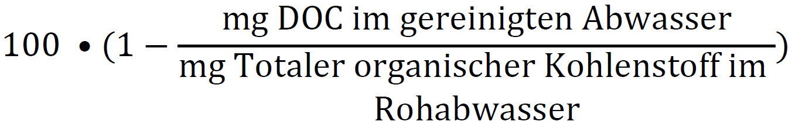
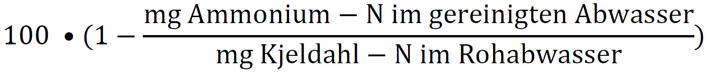
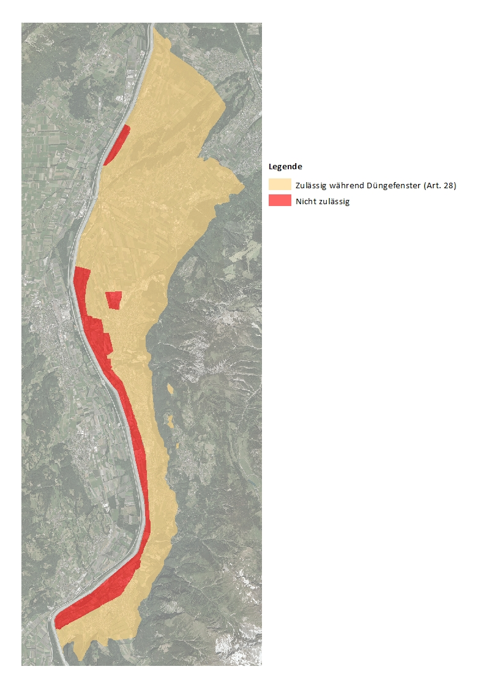

Gewässerschutzverordnung (GSchV) vom 18. Januar 2017 Aufgrund von Art. 8 Abs. 1 und 2, Art. 16, 23a Abs. 1, Art. 24 Abs. 3 und Art. 67 des Gewässerschutzgesetzes (GSchG) vom 15. Mai 2003, LGBl. 2003 Nr. 159, in der geltenden Fassung, verordnet die Regierung: I. Allgemeine Bestimmungen Art. 1 Zweck und Grundsatz 1) Diese Verordnung soll ober- und unterirdische Gewässer vor nachteiligen Einwirkungen schützen und deren nachhaltige Nutzung ermöglichen. 2) Zu diesem Zweck müssen bei allen Massnahmen nach dieser Verordnung die Umweltziele für Gewässer nach Art. 41a GSchG berücksichtigt werden. 3) Diese Verordnung dient zudem der Umsetzung der im Anhang 1 aufgeführten EWR-Rechtsvorschriften. Art. 2 Gegenstand und Geltungsbereich 1) Diese Verordnung regelt: a) die Anforderungen an die Wasserqualität; b) die Abwasserbeseitigung; c) die Entsorgung des Klärschlamms; d) die Verwendung von Düngern; e) die Verwendung von Pflanzenschutzmitteln; f) die Anforderungen an Betriebe mit Nutztierhaltung; g) den planerischen Schutz der Gewässer; h) die Verhinderung und Behebung anderer nachteiliger Einwirkungen auf Gewässer. 2) Für radioaktive Stoffe gilt die Verordnung, soweit diese Stoffe biologische Wirkungen auf Grund ihrer chemischen Eigenschaften zur Folge haben. Soweit diese Stoffe biologische Wirkungen auf Grund ihrer Strahlung zur Folge haben, gelten die Strahlenschutz- und die Atomgesetzgebung. Art. 3 Verhältnis zum EWR-Recht Legt diese Verordnung keine oder keine strengeren Anforderungen an den Gewässerschutz fest, finden auf die Anforderungen an den Gewässerschutz die Regelungen der in Anhang 1 enthaltenen Rechtsakte, in ihrer nach Massgabe von Art. 4 gültigen Fassung, ergänzend Anwendung. Dies gilt insbesondere für die Anforderungen nach Massgabe der Anhänge 2 und 3. Art. 4 Gültige Fassung 1) Die gültige Fassung des Anhangs 1 sowie der Regelungen der im Anhang 1 enthaltenen Rechtsakte bestimmt sich nach Massgabe von Abs. 2 in Verbindung mit der Kundmachung ihres vollständigen Wortlautes im Amtsblatt der Europäischen Union . 2) Nach dem Inkrafttreten dieser Verordnung ergibt sich die gültige Fassung des Anhangs 1 sowie der Regelungen der im Anhang 1 enthaltenen Rechtsakte aus der Kundmachung der Beschlüsse des Gemeinsamen EWR-Ausschusses im Liechtensteinischen Landesgesetzblatt nach Art. 3 Bst. k des Kundmachungsgesetzes. Diese Kundmachung gilt als Abänderung oder Ergänzung sowohl des Anhangs 1 als auch der Regelungen der im Anhang 1 enthaltenen Rechtsakte. II. Abwasserbeseitigung A. Abgrenzung zwischen verschmutztem und nicht verschmutztem Abwasser Art. 5 Abwasser 1) Das Amt für Umweltschutz beurteilt, ob Abwasser bei der Einleitung in ein Gewässer oder bei der Versickerung als verschmutzt oder nicht verschmutzt gilt, auf Grund: a) der Art, der Menge, der Eigenschaften und des zeitlichen Anfalls der Stoffe, die im Abwasser enthalten sind und Gewässer verunreinigen können; b) des Zustandes des Gewässers, in welches das Abwasser gelangt. 2) Bei der Versickerung von Abwasser berücksichtigt das Amt für Umweltschutz ausserdem, ob: a) das Abwasser wegen der bestehenden Belastung des Bodens oder des nicht wassergesättigten Untergrundes verunreinigt werden kann; b) das Abwasser im Boden ausreichend gereinigt wird; c) die Richtwerte für anorganische Schadstoffe im Boden nach Anhang 4 langfristig eingehalten werden können, ausgenommen bei der Versickerung in einer dafür bestimmten Anlage oder an Verkehrswegen im Bereich der Böschungen und der Grünstreifen. 3) Von bebauten oder befestigten Flächen abfliessendes Niederschlagswasser gilt in der Regel als nicht verschmutztes Abwasser, wenn es: a) von Dachflächen stammt; b) von Strassen, Wegen und Plätzen stammt, auf denen keine erheblichen Mengen von Stoffen, die Gewässer verunreinigen können, umgeschlagen, verarbeitet und gelagert werden, und wenn es bei der Versickerung im Boden ausreichend gereinigt wird; bei der Beurteilung, ob Stoffmengen erheblich sind, muss das Risiko von Unfällen berücksichtigt werden; c) von Gleisanlagen stammt, bei denen langfristig sichergestellt ist, dass auf den Einsatz von Pflanzenschutzmitteln verzichtet wird, oder wenn Pflanzenschutzmittel bei der Versickerung durch eine biologisch aktive Bodenschicht ausreichend zurückgehalten und abgebaut werden. B. Entwässerungsplanung Art. 6 Landesweite Entwässerungsplanung 1) Die Gemeinden erstellen einen landesweiten Entwässerungsplan. 2) Der Entwässerungsplan legt insbesondere fest: a) den Standort der zentralen Abwasserreinigungsanlagen und die Gebiete, die daran anzuschliessen sind; b) welche oberirdischen Gewässer in welchem Ausmass für die Einleitung von Abwasser, insbesondere bei Niederschlägen, geeignet sind; c) die zentralen Abwasserreinigungsanlagen, bei denen die Anforderungen an die Einleitung verschärft oder ergänzt werden müssen. 3) Die Gemeinden berücksichtigen bei der Erstellung des Entwässerungsplans den Raumbedarf der Gewässer, den Hochwasserschutz und andere Massnahmen zum Schutz der Gewässer als die Abwasserbehandlung. 4) Der Entwässerungsplan ist für die Planung und Festlegung der Gewässerschutzmassnahmen in den Gemeinden verbindlich. 5) Er ist öffentlich zugänglich. Art. 7 Kommunale Entwässerungsplanung 1) Die Gemeinden erstellen generelle Entwässerungspläne (GEP), die einen sachgemässen Gewässerschutz und eine zweckmässige Siedlungsentwässerung gewährleisten. 2) Der GEP legt mindestens fest: a) die Gebiete, für die öffentliche Kanalisationen zu erstellen sind; b) die Gebiete, in denen das von bebauten oder befestigten Flächen ab-fliessende Niederschlagswasser getrennt vom anderen Abwasser zu beseitigen ist; c) die Gebiete, in denen nicht verschmutztes Abwasser versickern zu lassen ist; d) die Gebiete, in denen nicht verschmutztes Abwasser in ein oberirdisches Gewässer einzuleiten ist; e) die Massnahmen, mit denen nicht verschmutztes Abwasser, das stetig anfällt, von der zentralen Abwasserreinigungsanlage fernzuhalten ist; f) die Gebiete, in denen andere Systeme als zentrale Abwasserreinigungsanlagen anzuwenden sind, und wie das Abwasser in diesen Gebieten zu beseitigen ist. 3) Der GEP wird nötigenfalls angepasst: a) an die Siedlungsentwicklung; b) wenn der landesweite Entwässerungsplan erstellt oder geändert wird. 4) Er ist öffentlich zugänglich. C. Ableitung von verschmutztem Abwasser Art. 8 Einleitung in Gewässer 1) Das Amt für Umweltschutz bewilligt die Einleitung von verschmutztem Abwasser in oberirdische Gewässer, Drainagen sowie unterirdische Flüsse und Bäche, wenn die Anforderungen an die Einleitung in Gewässer nach Anhang 3 eingehalten sind. 2) Es verschärft oder ergänzt die Anforderungen, wenn: a) die betroffenen Gewässer durch die Einleitung des Abwassers die Anforderungen an die Wasserqualität nach Anhang 2 nicht erfüllen oder wenn dies zur Einhaltung internationaler Vereinbarungen oder Beschlüsse erforderlich ist; und b) auf Grund von Abklärungen (Art. 48) feststeht, dass die ungenügende Wasserqualität zu einem wesentlichen Teil auf die Einleitung des Abwassers zurückzuführen ist und die entsprechenden Massnahmen bei der Abwasserreinigungsanlage nicht unverhältnismässig sind. 3) Es kann die Anforderungen verschärfen oder ergänzen, wenn die Wasserqualität nach Anhang 2 für eine besondere Nutzung des betroffenen Gewässers nicht ausreicht. 4) Es kann die Anforderungen erleichtern, wenn: a) durch eine Verminderung der eingeleiteten Abwassermenge trotz der Zulassung höherer Stoffkonzentrationen die Menge der eingeleiteten Stoffe, die Gewässer verunreinigen können, vermindert wird; oder b) die Umwelt durch die Einleitung nicht verwertbarer Stoffe in Industrieabwasser gesamthaft weniger belastet wird als durch eine andere Entsorgung; die Anforderungen an die Wasserqualität nach Anhang 2 und internationale Vereinbarungen oder Beschlüsse müssen eingehalten werden. Art. 9 Einleitung in die öffentliche Kanalisation 1) Die Gemeinden bewilligen die Einleitung von kommunalem Abwasser in die öffentliche Kanalisation. 2) Das Amt für Umweltschutz bewilligt die Einleitung von Industrieabwasser nach Anhang 3 Abschnitt B oder von anderem Abwasser nach Anhang 3 Abschnitt C in die öffentliche Kanalisation, wenn die Anforderungen des entsprechenden Anhangs eingehalten sind. 3) Es verschärft oder ergänzt die Anforderungen, wenn durch die Einleitung des Abwassers: a) der Betrieb der öffentlichen Kanalisation erschwert oder gestört werden kann; b) beim Abwasser der zentralen Abwasserreinigungsanlage die Anforderungen an die Einleitung in ein Gewässer nicht oder nur mit unverhältnismässigen Massnahmen eingehalten werden können oder der Betrieb der Anlage in anderer Weise erschwert oder gestört werden kann; oder c) der Betrieb der Anlage, in der Klärschlamm entwässert, getrocknet oder verbrannt wird, erschwert oder gestört werden kann. 4) Es kann die Anforderungen erleichtern, wenn: a) durch eine Verminderung der eingeleiteten Abwassermenge trotz der Zulassung höherer Stoffkonzentrationen die Menge der eingeleiteten Stoffe, die Gewässer verunreinigen können, vermindert wird; b) die Umwelt durch die Einleitung nicht verwertbarer Stoffe in Industrieabwasser gesamthaft weniger belastet wird als durch eine andere Entsorgung und beim Abwasser der zentralen Abwasserreinigungsanlage die Anforderungen an die Einleitung in ein Gewässer eingehalten werden; oder c) dies für den Betrieb der Abwasserreinigungsanlage zweckmässig ist. Art. 10 Versickerung 1) Das Versickernlassen von verschmutztem Abwasser ist verboten. 2) Das Amt für Umweltschutz kann das Versickernlassen von kommunalem Abwasser oder von anderem verschmutztem Abwasser vergleichbarer Zusammensetzung bewilligen, wenn: a) das Abwasser behandelt worden ist und die Anforderungen an die Einleitung in Gewässer erfüllt; b) beim betroffenen Grundwasser die Anforderungen an die Wasserqualität nach Anhang 2 nach der Versickerung des Abwassers eingehalten werden; c) die Versickerung in einer dafür bestimmten Anlage erfolgt, die Richtwerte für anorganische Schadstoffe im Boden nach Anhang 4 auch langfristig nicht überschritten werden oder beim Fehlen von Richtwerten die Bodenfruchtbarkeit auch langfristig gewährleistet ist; und d) die Anforderungen eingehalten sind, die für den Betrieb von Abwasseranlagen, die Abwasser in ein Gewässer einleiten, gelten (Art. 16 bis 20). Art. 11 Abwasser besonderer Herkunft 1) Verschmutztes Abwasser, das ausserhalb des Bereichs der öffentlichen Kanalisationen anfällt und für das weder die Einleitung in ein Gewässer, noch die Versickerung, noch die Verwertung zusammen mit Hofdünger (Art. 11 Abs. 4 GSchG) zulässig ist, muss in einer abflusslosen Grube gesammelt und regelmässig einer zentralen Abwasserreinigungsanlage oder einer besonderen Behandlung zugeführt werden. 2) Abwasser aus der Aufbereitung von Hofdüngern, der hors-sol-Produktion und ähnlichen pflanzenbaulichen Verfahren muss umweltverträglich und entsprechend dem Stand der Technik landwirtschaftlich oder gartenbaulich verwertet werden. 3) Abwasser aus beweglichen Sanitäranlagen muss gesammelt werden und darf nur unter Benutzung der dafür vorgesehenen Einrichtungen in öffentliche Kanalisationen eingeleitet werden. Davon ausgenommen sind Sanitäranlagen in: a) Eisenbahnfahrzeugen mit eigener Abwasserbehandlung; b) Eisenbahnfahrzeugen für den Fernverkehr, die vor dem 1. Januar 1997 in Betrieb genommen wurden; c) Eisenbahnfahrzeugen für den Regional- und Agglomerationsverkehr, die vor dem 1. Januar 2000 in Betrieb genommen wurden. Art. 12 Verbot der Abfallentsorgung mit dem Abwasser Es ist verboten: a) feste und flüssige Abfälle mit dem Abwasser zu entsorgen, ausser wenn dies für die Behandlung des Abwassers zweckmässig ist; b) Stoffe entgegen den Angaben des Herstellers auf der Etikette oder der Gebrauchsanweisung abzuleiten. D. Projektierung, Bau und Betrieb von Abwasseranlagen Art. 13 Projektgenehmigungen Das Amt für Umweltschutz bewilligt Projekte für: a) Abwasserreinigungsanlagen, Spezialbauwerke und Verbundsleitungen; b) Abwasservorbehandlungs- und -reinigungsanlagen von Industrie- und Gewerbebetrieben. Art. 14 Trennung des Abwassers bei Gebäuden Die Inhaber von Gebäuden müssen bei deren Erstellung oder bei wesentlichen Änderungen dafür sorgen, dass das Niederschlagswasser und das stetig anfallende nicht verschmutzte Abwasser bis ausserhalb des Gebäudes getrennt vom verschmutzten Abwasser abgeleitet werden. Art. 15 Kanalisationsanschluss 1) Der Anschluss von verschmutztem Abwasser an die öffentliche Kanalisation ausserhalb von Bauzonen (Art. 10 Abs. 2 Bst. b GSchG) ist: a) zweckmässig, wenn er sich einwandfrei und mit normalem baulichem Aufwand herstellen lässt; b) zumutbar, wenn die Kosten des Anschlusses diejenigen für vergleichbare Anschlüsse innerhalb der Bauzone nicht wesentlich überschreiten. 2) Das Amt für Umweltschutz darf neue Zuleitungen von nicht verschmutztem Abwasser, das stetig anfällt, in eine zentrale Abwasserreinigungsanlage nur bewilligen (Art. 11 Abs. 3 GSchG), wenn die örtlichen Verhältnisse die Versickerung oder die Einleitung in ein Gewässer nicht erlauben. Art. 16 Fachgerechter Betrieb 1) Die Inhaber von Abwasseranlagen müssen: a) die Anlagen in funktionstüchtigem Zustand erhalten; b) Abweichungen vom Normalbetrieb feststellen, deren Ursachen abklären und diese unverzüglich beheben; c) beim Betrieb alle verhältnismässigen Massnahmen ergreifen, die zur Verminderung der Mengen der abzuleitenden Stoffe beitragen. 2) Die Inhaber von Betrieben, die Industrieabwasser in die öffentliche Kanalisation einleiten, und die Inhaber von Abwasserreinigungsanlagen, die Abwasser in die öffentliche Kanalisation oder in ein Gewässer einleiten, müssen sicherstellen, dass: a) die für den Betrieb verantwortlichen Personen bezeichnet sind; b) das Betriebspersonal über die erforderlichen Fachkenntnisse verfügt; und c) die Mengen und Konzentrationen der eingeleiteten Stoffe ermittelt werden, wenn die Bewilligung numerische Anforderungen enthält. 3) Das Amt für Umweltschutz kann von den Inhabern nach Abs. 2 verlangen, dass diese: a) die abgeleiteten Mengen und Konzentrationen von Stoffen, die auf Grund ihrer Eigenschaften, ihrer Menge und ihres zeitlichen Anfalles für die Beschaffenheit des Abwassers und für die Wasserqualität des Gewässers von Bedeutung sind, auch dann ermitteln, wenn die Bewilligung keine numerischen Anforderungen enthält; b) bestimmte Abwasserproben während einer angemessenen Zeit aufbewahren; c) die Auswirkungen der Abwassereinleitung oder -versickerung auf die Wasserqualität ermitteln, wenn die Gefahr besteht, dass die Anforderungen an die Wasserqualität nach Anhang 2 nicht eingehalten werden. 4) Die Mengen und Konzentrationen der eingeleiteten Stoffe können auch rechnerisch auf Grund der Stoffflüsse ermittelt werden. Art. 17 Meldung über den Betrieb 1) Die Inhaber von Betrieben, die Industrieabwasser in die öffentliche Kanalisation einleiten, und die Inhaber von Abwasserreinigungsanlagen, die Abwasser in die öffentliche Kanalisation oder in ein Gewässer einleiten, müssen dem Amt für Umweltschutz nach dessen Anordnungen melden: a) die eingeleitete Abwassermenge; b) die Mengen und Konzentrationen der eingeleiteten Stoffe, die sie nach Art. 16 ermitteln müssen. 2) Die Inhaber von zentralen Abwasserreinigungsanlagen müssen ausserdem melden: a) die wichtigen Betriebsdaten wie Wirkungsgrad, Menge und Eigenschaften des Klärschlammes, Art der Klärschlammentsorgung, Energieverbrauch und Betriebskosten; b) die Verhältnisse im Einzugsgebiet der Anlage wie Anschlussgrad und Anteil des nicht verschmutzten Abwassers, das stetig anfällt. Art. 18 Überwachung 1) Das Amt für Umweltschutz überprüft periodisch, ob: a) die Betriebe, die Industrieabwasser in die öffentliche Kanalisation einleiten, und die Abwasserreinigungsanlagen, die Abwasser in die öffentliche Kanalisation oder in ein Gewässer einleiten, die in den Bewilligungen festgelegten Anforderungen einhalten; b) diese Anforderungen weiterhin einen sachgemässen Gewässerschutz gewährleisten. 2) Es berücksichtigt dabei die Ergebnisse der Ermittlungen der Inhaber. 3) Es passt die Bewilligungen nötigenfalls an und ordnet die erforderlichen Massnahmen an. Es berücksichtigt dabei die Dringlichkeit der erforderlichen Massnahmen sowie die Verpflichtungen, die sich aus internationalen Vereinbarungen oder Beschlüssen ergeben. Art. 19 Massnahmen im Hinblick auf ausserordentliche Ereignisse 1) Die Inhaber von Abwasserreinigungsanlagen, die Abwasser in ein Gewässer einleiten, und die Inhaber von Betrieben, die Industrieabwasser in eine Abwasserreinigungsanlage ableiten, müssen zur Verminderung des Risikos einer Gewässerverunreinigung durch ausserordentliche Ereignisse die geeigneten und wirtschaftlich tragbaren Massnahmen treffen. 2) Ist das Risiko trotz dieser Massnahmen nicht tragbar, so ordnet das Amt für Umweltschutz die erforderlichen zusätzlichen Massnahmen an. 3) Weitergehende Vorschriften der Störfallverordnung und der schweizerischen Verordnung über die Sicherstellung der Trinkwasserversorgung in Notlagen (SR 531.32) bleiben vorbehalten. Art. 20 Meldung ausserordentlicher Ereignisse 1) Die Inhaber von Abwasserreinigungsanlagen, die Abwasser in ein Gewässer einleiten, müssen dafür sorgen, dass ausserordentliche Ereignisse unverzüglich dem Amt für Umweltschutz gemeldet werden, wenn diese dazu führen können, dass die vorschriftgemässe Einleitung des Abwassers in ein Gewässer oder die vorgesehene Verwertung oder Beseitigung des Klärschlamms nicht mehr möglich ist. 2) Die Inhaber von Betrieben, die Industrieabwasser ableiten, müssen dafür sorgen, dass ausserordentliche Ereignisse unverzüglich dem Inhaber der Abwasserreinigungsanlage gemeldet werden, wenn diese dazu führen können, dass der ordnungsgemässe Betrieb der Abwasseranlagen erschwert oder gestört wird. 3) Das Amt für Umweltschutz sorgt dafür, dass die von einem ausserordentlichen Ereignis betroffenen Gemeinden und Privaten rechtzeitig über mögliche nachteilige Einwirkungen auf Gewässer informiert werden. Wenn erhebliche Einwirkungen über die Landesgrenze hinaus erwartet werden, sorgt es zudem dafür, dass die Landespolizei sowie die betroffenen Nachbarstaaten informiert werden. 4) Weitergehende Melde- und Informationspflichten nach der Störfallverordnung bleiben vorbehalten. III. Entsorgung von Klärschlamm Art. 21 Düngerverbot Klärschlamm darf nicht als Dünger verwendet werden. Art. 22 Klärschlamm-Entsorgungsplan 1) Das Amt für Umweltschutz erstellt einen Klärschlamm-Entsorgungsplan und passt ihn in den fachlich gebotenen Zeitabständen den neuen Erfordernissen an. 2) Der Entsorgungsplan legt mindestens fest: a) wie der Klärschlamm der zentralen Abwasserreinigungsanlagen entsorgt werden soll; b) welche Massnahmen, einschliesslich der Erstellung und Änderung von Anlagen, die der Entsorgung des Klärschlamms dienen, bis zu welchem Zeitpunkt erforderlich sind. Art. 23 Lagereinrichtungen 1) Die Inhaber von Abwasserreinigungsanlagen müssen dafür sorgen, dass sie den Klärschlamm so lange lagern können, bis eine umweltverträgliche Entsorgung sichergestellt ist. 2) Wenn der Klärschlamm der zentralen Abwasserreinigungsanlagen nicht jederzeit umweltverträglich beseitigt werden kann, muss eine Lagerkapazität von mindestens zwei Monaten vorhanden sein. Art. 24 Untersuchung und Meldepflichten Die Inhaber der zentralen Abwasserreinigungsanlagen müssen dafür sorgen, dass die Qualität des Klärschlamms in den fachlich gebotenen Zeitabständen nach den Vorgaben des Amtes für Umweltschutz untersucht wird. Die Untersuchungsergebnisse sind dem Amt für Umweltschutz zu melden. Art. 25 Abgabe 1) Die Inhaber der zentralen Abwasserreinigungsanlagen müssen über die Abnehmer von Klärschlamm, die abgegebene Menge, die angegebene Entsorgung und den Zeitpunkt der Abgabe Buch führen, diese Angaben während mindestens zehn Jahren aufbewahren und dem Amt für Umweltschutz auf Verlangen zur Verfügung stellen. 2) Sie dürfen den Klärschlamm nur mit Zustimmung des Amtes für Umweltschutz auf andere Weise entsorgen, als dies der Klärschlamm-Entsorgungsplan vorsieht. IV. Verwendung von Düngern Art. 26 Begriffe Auf die in diesem Kapitel verwendeten Begriffe findet die schweizerische Dünger-Verordnung (SR 916.171) Anwendung. Art. 27 Verbote und Vegetationsruhe 1) Die Verwendung von Düngern ist in oberirdischen Gewässern und in einem Streifen von drei Metern Breite entlang von oberirdischen Gewässern verboten, wobei der Streifen bei Fliessgewässern ab der Böschungsoberkante gemessen wird. 2) Flüssige Dünger dürfen nur ausgebracht werden, wenn der Boden saug- und aufnahmefähig ist. Sie dürfen vor allem dann nicht ausgebracht werden, wenn der Boden wassergesättigt, gefroren, schneebedeckt oder ausgetrocknet ist. 3) Mist darf nicht ausgebracht werden, wenn der Boden wassergesättigt oder schneebedeckt ist. 4) Stickstoffhaltige Dünger, insbesondere Gülle, dürfen vorbehaltlich Art. 28 nicht zu Zeiten ausgebracht werden, in denen die Pflanzen den Stickstoff nicht aufnehmen können (Vegetationsruhe). Erfordern besondere Bedürfnisse des Pflanzenbaus ausserhalb dieser Zeiten dennoch eine Düngung, so dürfen solche Dünger nur ausgebracht werden, wenn keine Beeinträchtigung der Gewässer zu befürchten ist; die Ausbringung bedarf der Zustimmung des Amtes für Umweltschutz. 5) Die Vegetationsruhe wird wie folgt festgelegt: a) für Ausbringungsflächen bis 800 m über Meer: 15. Dezember bis 15. Februar; b) für Ausbringungsflächen über 800 bis 1 200 m über Meer: 1. Dezember bis 28. Februar; c) für Ausbringungsflächen über 1 200 m über Meer: 15. November bis 15. März. 6) Vorbehalten bleiben besondere Bestimmungen zum Schutz von Quellfassungen und Grundwasserpumpwerken sowie die Verbote betreffend den Natur- und Landschaftsschutz. Art. 28 Düngefenster 1) Das Amt für Umweltschutz kann auf Antrag der Vereinigung Bäuerlicher Organisationen (VBO) das Ausbringen von flüssigen Hofdüngern während der Vegetationsruhe in den in Anhang 5 ausgewiesenen Gebieten generell zulassen (Düngefenster), wenn: a) die Tagesmitteltemperatur während mindestens sieben aufeinander folgenden Tagen über 5 °C liegt; b) der Boden weder wassergesättigt noch gefroren oder schneebedeckt ist; und c) in den auf das Düngefenster drei nachfolgenden Tagen gemäss Meteo Schweiz keine starken und anhaltenden Niederschläge (über 20 mm/24h) zu erwarten sind. 2) Beim Ausbringen von flüssigen Hofdüngern ist: a) ein Abstand von mindestens 20 Metern zu den Gewässern und Entwässerungsanlagen einzuhalten; b) die Austragsmenge auf maximal 20 m³/ha zu beschränken; und c) der flüssige Hofdünger auf bewachsenen Boden auszubringen. 3) Das Amt für Umweltschutz informiert in geeigneter Weise über das Düngefenster. V. Verwendung von Pflanzenschutzmitteln Art. 29 Verbote und Einschränkungen 1) Die Verwendung von Pflanzenschutzmitteln ist in oberirdischen Gewässern und in einem Streifen von drei Metern Breite entlang von oberirdischen Gewässern verboten, wobei der Streifen bei Fliessgewässern ab der Böschungsoberkante gemessen wird. Vorbehalten bleiben besondere Bestimmungen zum Schutz von Quellfassungen und Grundwasserpumpwerken. 2) Die Verwendung von Pflanzenschutzmitteln, die dazu bestimmt sind, unerwünschte Pflanzen oder Pflanzenteile zu vernichten oder auf ein unerwünschtes Pflanzenwachstum Einfluss zu nehmen, ist zudem verboten: a) auf Dächern und Terrassen; b) auf Lagerplätzen; c) auf und an Strassen, Wegen und Plätzen; d) auf Böschungen und Grünstreifen entlang von Strassen und Gleisanlagen. 3) Für die Verwendung von Pflanzenschutzmitteln in den Zuströmbereichen Z u und Z o legt das Amt für Umweltschutz, unter Berücksichtigung der Ausnahmen nach Art. 30 dieser Verordnung und Art. 16 der Waldverordnung über Abs. 1 und 2 hinausgehende Einschränkungen fest, soweit dies zum Schutz der Gewässer erforderlich ist. Insbesondere schränkt es die Verwendung eines Pflanzenschutzmittels im Zuströmbereich Z u ein, wenn dieses in einer Trinkwasserfassung festgestellt wird und die Anforderungen an genutztes oder zur Nutzung vorgesehenes Grundwasser wiederholt nicht erfüllt werden. 4) Für die Verwendung von Pflanzenschutzmitteln auf und an Gleisanlagen ausserhalb der Zonen S 1 und S 2 von Grundwasserschutzzonen legt das Amt für Umweltschutz die zum Schutz der Umwelt erforderlichen Einschränkungen und Verbote fest. Es berücksichtigt dabei die örtlichen Verhältnisse. Art. 30 Ausnahmen 1) Das Amt für Umweltschutz kann abweichend vom Verbot nach Art. 29 Abs. 1 im Einzelfall Einzelstockbehandlungen von invasiven Pflanzen genehmigen, sofern diese nicht mit einem angemessen Aufwand mechanisch bekämpft werden können. 2) Vom Verbot nach Art. 29 Abs. 2 Bst. c ausgenommen sind Einzelstockbehandlungen von Problempflanzen bei Landstrassen, sofern diese mit anderen Massnahmen, wie regelmässiges Mähen, nicht erfolgreich bekämpft werden können. 3) Vom Verbot nach Art. 29 Abs. 2 Bst. d ausgenommen sind Einzelstockbehandlungen von Problempflanzen, sofern diese mit anderen Massnahmen, wie regelmässiges Mähen, nicht erfolgreich bekämpft werden können. 4) Entlang von Gleisanlagen ist vorbehaltlich Art. 29 Abs. 1 bis zu vier Meter ab Gleisachse die Verwendung von Blattherbiziden, welche die Wirkstoffe Glyphosat oder Sulfosat enthalten, zulässig. 5) Für den Unterhalt von Gleisanlagen ist ein Spritzplan zu erstellen und dem Amt für Umweltschutz zur Genehmigung vorzulegen. Die Genehmigung wird erteilt, wenn die gewässer- und naturschutzrechtlichen Bestimmungen erfüllt sind. VI. Anforderungen an Betriebe mit Nutztierhaltung Art. 31 Betriebe mit Nutztierhaltung Als Betriebe mit Nutztierhaltung (Art. 13 GSchG) gelten: a) landwirtschaftliche Betriebe und Betriebsgemeinschaften mit Nutztierhaltung; b) übrige Betriebe mit gewerblicher Nutztierhaltung; ausgenommen sind Betriebe mit Zoo- und Zirkustieren sowie mit einzelnen Zug-, Reit- oder Liebhabertieren. Art. 32 Düngergrossvieheinheit (DGVE) Für die Umrechnung der Nutztiere eines Betriebs auf DGVE (Art. 13 Abs. 4 GSchG) ist ihre jährlich ausgeschiedene Nährelementmenge massgebend. Diese beträgt für eine DGVE 105 kg Stickstoff und 15 kg Phosphor. Art. 33 Kontrolle der Lagereinrichtungen für Hofdünger und flüssiges Gärgut 1) Das Amt für Umweltschutz kontrolliert regelmässig die Lagereinrichtungen für Hofdünger und flüssiges Gärgut; die Zeitabstände richten sich nach der Gewässergefährdung. 2) Kontrolliert wird, ob: a) die vorgeschriebene Lagerkapazität vorhanden ist; b) die Lagereinrichtungen (einschliesslich Leitungen) dicht sind; c) die Einrichtungen funktionstüchtig sind; d) die Einrichtungen ordnungsgemäss betrieben werden. VII. Planerischer Schutz der Gewässer Art. 34 Bezeichnung von Gewässerschutzbereichen sowie Ausscheidung von Wasserschutzgebieten, Schutzzonen und -arealen 1) Die Kriterien und Perimeter zur Ausscheidung von besonders gefährdeten Bereichen nach Art. 23a GSchG richten sich nach Anhang 6 Ziff. 11. Die besonders gefährdeten Bereiche umfassen: a) den Gewässerschutzbereich A u zum Schutz nutzbarer unterirdischer Gewässer; b) den Gewässerschutzbereich A o zum Schutz der Wasserqualität oberirdischer Gewässer, wenn dies zur Gewährleistung einer besonderen Nutzung eines Gewässers erforderlich ist; c) den Zuströmbereich Z u zum Schutz der Wasserqualität bei bestehenden und geplanten Grundwasserfassungen, wenn das Wasser durch Stoffe verunreinigt ist, die nicht genügend abgebaut oder zurückgehalten werden, oder wenn die konkrete Gefahr einer Verunreinigung durch solche Stoffe besteht; d) den Zuströmbereich Z o zum Schutz der Wasserqualität oberirdischer Gewässer, wenn das Wasser durch abgeschwemmte Pflanzenschutzmittel oder Nährstoffe verunreinigt ist. 2) Die Kriterien und Perimeter zur Ausscheidung von Wasserschutzgebieten und Schutzzonen nach Art. 24 GSchG richten sich nach Anhang 6 Ziff. 12 und 13. 3) Die Kriterien und Perimeter zur Ausscheidung von Schutzarealen nach Art. 24 GSchG richten sich nach Anhang 6 Ziff. 14. 4) Bei der Bezeichnung von Gewässerschutzbereichen sowie bei der Ausscheidung von Wasserschutzgebieten, Schutzzonen und -arealen ist auf die vorhandenen hydrogeologischen Kenntnisse abzustellen; reichen diese nicht aus, so sind die erforderlichen hydrogeologischen Abklärungen durchzuführen. Art. 35 Gewässerschutzkarten 1) Das Amt für Umweltschutz erstellt Gewässerschutzkarten und passt diese bei Bedarf an. Die Gewässerschutzkarten enthalten mindestens: a) die Gewässerschutzbereiche; b) die Wasserschutzgebiete; c) die Schutzzonen; d) die Schutzareale; e) die Grundwasseraustritte, -fassungen und -anreicherungsanlagen, die für die Wasserversorgung von Bedeutung sind. 2) Die Gewässerschutzkarten sind öffentlich zugänglich. Art. 36 Schutzmassnahmen 1) Wer in den besonders gefährdeten Bereichen (Art. 34 Abs. 1) sowie in Wasserschutzgebieten, Schutzzonen und -arealen Anlagen erstellt oder ändert oder wer dort andere Tätigkeiten, die eine Gefahr für die Gewässer darstellen, ausübt, muss die nach den Umständen gebotenen Massnahmen zum Schutz der Gewässer treffen; insbesondere muss er: a) die Massnahmen nach Anhang 6 Ziff. 2 treffen; b) die erforderlichen Überwachungs-, Alarm- und Bereitschaftsdispositive erstellen. 2) Das Amt für Umweltschutz sorgt dafür, dass: a) bei bestehenden Anlagen in den Gebieten nach Abs. 1, bei denen die konkrete Gefahr einer Gewässerverunreinigung besteht, die nach den Umständen gebotenen Massnahmen zum Schutz der Gewässer, insbesondere diejenigen nach Anhang 6 Ziff. 2, getroffen werden; b) bestehende Anlagen in den Schutzzonen S 1 und S 2, die eine Grundwasserfassung oder -anreicherungsanlage gefährden, innert angemessener Frist beseitigt werden und bis zur Beseitigung der Anlagen andere Massnahmen zum Schutz des Trinkwassers, insbesondere Entkeimung oder Filtration, getroffen werden. Art. 37 Bewilligungen für Anlagen und Tätigkeiten in den besonders gefährdeten Bereichen 1) In den besonders gefährdeten Bereichen (Art. 34) ist eine Bewilligung nach Art. 23a Abs. 2 GSchG insbesondere erforderlich für: a) Untertagebauten; b) Anlagen, die Deckschichten oder Grundwasserstauer verletzen; c) dauernde Entwässerungen und Bewässerungen; d) Freilegungen des Grundwasserspiegels; e) Bohrungen; f) Lageranlagen für flüssige Hofdünger und flüssiges Gärgut. 2) Ist eine Bewilligung erforderlich, müssen die Gesuchsteller nachweisen, dass die Anforderungen zum Schutz der Gewässer erfüllt sind, und die dafür notwendigen Unterlagen (gegebenenfalls hydrogeologische Abklärungen) beibringen. 3) Das Amt für Umweltschutz erteilt eine Bewilligung, wenn mit Auflagen und Bedingungen ein ausreichender Schutz der Gewässer gewährleistet werden kann; es legt dabei auch die Anforderungen an die Stilllegung der Anlagen fest. 4) Vorbehalten bleiben die Bewilligungen und Konzessionen nach dem Wasserrechtsgesetz und der Verordnung über den Schutz der Gewässer vor wassergefährdenden Flüssigkeiten. VIII. Verhinderung und Behebung anderer nachteiliger Einwirkungen auf Gewässer A. Schwall und Sunk Art. 38 Wesentliche Beeinträchtigung durch Schwall und Sunk Eine wesentliche Beeinträchtigung der einheimischen Tiere und Pflanzen sowie von deren Lebensräumen durch Schwall und Sunk liegt vor, wenn: a) die Abflussmenge bei Schwall mindestens 1,5-mal grösser ist als bei Sunk; und b) die standortgerechte Menge, Zusammensetzung und Vielfalt der pflanzlichen und tierischen Lebensgemeinschaften nachteilig verändert werden, insbesondere weil regelmässig und auf unnatürliche Weise Fische stranden, Fischlaichplätze zerstört werden, Wassertiere abgeschwemmt werden, Trübungen entstehen oder die Wassertemperatur in unzulässiger Weise verändert wird. Art. 39 Planung der Massnahmen zur Sanierung bei Schwall und Sunk 1) Die Inhaber bestehender Wasserkraftwerke haben der Regierung eine Planung der Massnahmen zur Sanierung von Wasserkraftwerken, die Schwall und Sunk verursachen, nach den Vorgaben des Art. 34a GSchG einzureichen. 2) Der Sanierungsplan muss mindestens enthalten: a) die Koordinaten und die Bezeichnung der einzelnen Anlagenteile; b) die Abflussmengen des betroffenen Gewässers mit Messwerten im Abstand von höchstens 15 Minuten (Ganglinie) über den Zeitraum der letzten fünf Jahre; liegen solche Messwerte nicht vor, kann die Ganglinie aus Angaben zur Produktion des Wasserkraftwerks und dem Abfluss im Gewässer berechnet werden; c) die durchgeführten und die geplanten Massnahmen zur Verminderung der Auswirkungen von Schwall und Sunk; d) die vorhandenen Untersuchungsergebnisse zu den Auswirkungen von Schwall und Sunk; e) die vorgesehenen baulichen und betrieblichen Veränderungen der Anlage. Art. 40 Massnahmen zur Sanierung bei Schwall und Sunk 1) Die Regierung ordnet gestützt auf den Sanierungsplan nach Art. 39 die Sanierungen bei Schwall und Sunk nach Art. 34a Abs. 3 GSchG an. 2) Die Inhaber von Wasserkraftwerken prüfen nach Anordnung der Regierung die Wirksamkeit der getroffenen Massnahmen. 3) Ergibt die Prüfung nach Abs. 2, dass die getroffenen Massnahmen nicht genügend wirksam sind, ordnet die Regierung weitere Massnahmen an. B. Spülung und Entleerung von Stauräumen Art. 41 Grundsatz 1) Bevor das Amt für Umweltschutz eine Spülung oder Entleerung eines Stauraumes bewilligt, stellt es sicher, dass die Sedimente anders als durch Ausschwemmung entfernt werden, wenn dies umweltverträglich und wirtschaftlich tragbar ist. 2) Bei der Ausschwemmung von Sedimenten stellt das Amt für Umweltschutz sicher, dass Lebensgemeinschaften von Pflanzen, Tieren und Mikroorganismen möglichst wenig beeinträchtigt werden, insbesondere indem es festlegt: a) Zeitpunkt und Art der Spülung oder Entleerung; b) die maximale Schwebstoffkonzentration, die im Gewässer während der Spülung oder Entleerung eingehalten werden muss; c) in welchem Umfang nachgespült werden muss, damit während der Spülung oder Entleerung im Fliessgewässer abgelagertes Feinmaterial entfernt wird. 3) Abs. 1 und 2 gelten nicht für sofortige Absenkungen aufgrund ausserordentlicher Ereignisse (Art. 35 Abs. 3 GSchG). C. Geschiebehaushalt Art. 42 Wesentliche Beeinträchtigung durch veränderten Geschiebehaushalt Eine wesentliche Beeinträchtigung der einheimischen Tiere und Pflanzen sowie von deren Lebensräumen durch einen veränderten Geschiebehaushalt liegt vor, wenn Anlagen wie Wasserkraftwerke, Kiesentnahmen, Geschiebesammler oder Gewässerverbauungen die morphologischen Strukturen oder die morphologische Dynamik des Gewässers nachteilig verändern. Art. 43 Planung der Massnahmen zur Sanierung des Geschiebehaushalts 1) Das Amt für Umweltschutz erstellt eine Planung der Massnahmen zur Sanierung des Geschiebehaushalts. 2) Die Inhaber von Anlagen müssen dem Amt für Umweltschutz Zutritt gewähren und die erforderlichen Auskünfte erteilen, insbesondere über: a) die Koordinaten und die Bezeichnung der Anlagen und bei Wasserkraftwerken der einzelnen Anlagenteile; b) den Umgang mit Geschiebe; c) die durchgeführten und die geplanten Massnahmen zur Verbesserung des Geschiebehaushalts; d) die vorhandenen Untersuchungsergebnisse zum Geschiebehaushalt; e) die vorgesehenen baulichen und betrieblichen Veränderungen der Anlage. Art. 44 Massnahmen zur Sanierung des Geschiebehaushalts 1) Das Amt für Umweltschutz erstellt für Anlagen, für die gemäss der Planung Massnahmen zur Sanierung des Geschiebehaushalts zu treffen sind, eine Studie über die Art und den Umfang der notwendigen Massnahmen. 2) Die Regierung ordnet gestützt auf die Studie nach Abs. 1 die Sanierungen nach Art. 40a GSchG an. Bei Wasserkraftwerken muss das Geschiebe soweit möglich durch die Anlage durchgeleitet werden. 3) Die Inhaber von Wasserkraftwerken prüfen nach Anordnung der Regierung die Wirksamkeit der getroffenen Massnahmen. 4) Ergibt die Prüfung nach Abs. 3, dass die getroffenen Massnahmen nicht genügend wirksam sind, ordnet die Regierung weitere Massnahmen an. Art. 45 Ausbeutung von Kies, Sand und anderem Material in Fliessgewässern 1) Damit bei der Ausbeutung von Kies, Sand und anderem Material der Geschiebehaushalt eines Fliessgewässers nicht nachteilig beeinflusst wird (Art. 41 Abs. 2 Bst. b GSchG), muss insbesondere sichergestellt werden, dass: a) dem Fliessgewässer langfristig nicht mehr Geschiebe entnommen als natürlicherweise zugeführt wird; b) die Ausbeutung langfristig nicht zu einer Absenkung der Sohle ausserhalb des Abbauperimeters führt; c) die Ausbeutung nicht zu einer erheblichen Veränderung der Korngrössenverteilung des Sohlenmaterials ausserhalb des Abbauperimeters führt. 2) Ausbeutungen nach Abs. 1 dürfen nicht zu Trübungen führen, die Fischgewässer beeinträchtigen können. D. Drainagewasser aus Untertagebauten Art. 46 Grundsatz 1) Drainagewasser aus Untertagebauten muss so gefasst und abgeleitet werden, dass es bei deren Betrieb, insbesondere durch ausserordentliche Ereignisse, nicht verunreinigt werden kann; dies gilt nicht für kleine Mengen von Drainagewasser, wenn durch Rückhaltemassnahmen verhindert wird, dass ein Gewässer verunreinigt werden kann. 2) Für die Einleitung von Drainagewasser aus Untertagebauten in Fliessgewässer gilt: a) Das Einlaufbauwerk muss eine rasche Durchmischung gewährleisten. b) Die Aufwärmung des Gewässers darf gegenüber dem möglichst unbeeinflussten Zustand höchstens 3 °C, in Gewässerabschnitten der Forellenregion höchstens 1,5 °C, betragen. c) Die Einleitung darf nicht dazu führen, dass die Wassertemperatur 25 °C überschreitet. 3) Das Amt für Umweltschutz legt entsprechend den örtlichen Verhältnissen fest: a) Anforderungen an die Versickerung; b) nötigenfalls weitere Anforderungen an die Einleitung in Fliessgewässer. IX. Organisation und Durchführung Art. 47 Vollzug Der Vollzug dieser Verordnung obliegt dem Amt für Umweltschutz, soweit bestimmte Aufgaben nicht der Regierung oder den Gemeinden übertragen sind. Sie können die Einhaltung der Bestimmungen dieser Verordnung jederzeit durch Kontrollen vor Ort sicherstellen. Art. 48 Vorgehen bei verunreinigten Gewässern 1) Stellt das Amt für Umweltschutz fest, dass ein Gewässer die Anforderungen an die Wasserqualität nach Anhang 2 nicht erfüllt oder dass die besondere Nutzung des Gewässers nicht gewährleistet ist, so: a) ermittelt und bewertet es die Art und das Ausmass der Verunreinigung; b) ermittelt es die Ursachen der Verunreinigung; c) beurteilt es die Wirksamkeit der möglichen Massnahmen; d) sorgt es dafür, dass gestützt auf die entsprechenden Vorschriften die erforderlichen Massnahmen getroffen werden. 2) Sind mehrere Quellen an der Verunreinigung beteiligt, so sind die bei den Verursachern erforderlichen Massnahmen aufeinander abzustimmen. Art. 49 Untersuchungen und Ermittlungen 1) Untersuchungen und Ermittlungen richten sich nach den anerkannten Regeln der Technik sowie nach den massgebenden EWR-rechtlichen Vorschriften. Als Regeln der Technik gelten insbesondere die entsprechenden Normen des CEN (Europäisches Komitee für Normung) oder andere Normen, die gleichwertige Ergebnisse liefern. 2) Soweit diese Verordnung oder die anwendbaren EWR-Rechtsvorschriften keine Vorschriften über die Art und Häufigkeit der Probenahmen und die Ermittlung der Einhaltung der Anforderungen enthält, legt dies das Amt für Umweltschutz im Einzelfall fest. X. Strafbestimmungen Art. 50 Übertretungen Nach Art. 61 Abs. 1 Bst. u GSchG wird bestraft, wer: 1. ohne Bewilligung verschmutztes Abwasser in oberirdische Gewässer, Drainagen, unterirdische Flüsse oder Bäche einleitet (Art. 8 Abs. 1); 2. ohne Bewilligung Industrieabwasser oder anderes Abwasser in die öffentliche Kanalisation einleitet (Art. 9 Abs. 2); 3. Anforderungen an die Abwassereinleitung nicht einhält (Art. 8. Abs. 1, 2 und 3 sowie Art. 9 Abs. 2 und 3); 4. verschmutztes Abwasser ohne Bewilligung versickern lässt (Art. 10); 5. verschmutztes Abwasser ausserhalb des Bereichs der öffentlichen Kanalisation nicht sammelt und einer Abwasserreinigungsanlage oder einer besonderen Behandlung zuführt (Art. 11 Abs. 1); 6. Abwasser aus Gartenbau oder Landwirtschaft so verwertet, dass die Umwelt belastet wird (Art. 11 Abs. 2); 7. Abwasser aus beweglichen Sanitäranlagen weder sammelt noch in die öffentliche Kanalisation einleitet (Art. 11 Abs. 3); 8. Abfälle mit Abwasser entsorgt oder Stoffe entgegen den Angaben des Herstellers ableitet (Art. 12); 9. ohne Bewilligung Projekte für bestimmte Anlagen, Bauwerke und Leitungen durchführt (Art. 13); 10. das Niederschlagswasser und das stetig anfallende nicht verschmutzte Abwasser zusammen mit dem verschmutzten Abwasser ableitet (Art. 14); 11. verschmutztes Abwasser ausserhalb von Bauzonen entgegen Art. 15 Abs. 1 nicht an die öffentliche Kanalisation anschliesst; 12. die Anforderungen an einen fachgerechten Betrieb einer Abwasseranlage oder Abwasserreinigungsanlage nicht erfüllt (Art. 16 Abs. 1, 2 und 3); 13. Meldungen und Untersuchungen nach Art. 17, 20 Abs. 1 und 2 sowie Art. 24 unterlässt; 14. angeordnete und zumutbare Massnahmen im Zusammenhang mit dem Betrieb einer Abwasserreinigungsanlage nicht trifft (Art. 18 Abs. 3 sowie Art. 19 Abs. 1 und 2); 15. Klärschlamm als Dünger verwendet (Art. 21); 16. nicht über ausreichend Lagerkapazität für Klärschlamm verfügt (Art. 23); 17. die Buchführungs- und Aufbewahrungspflicht nicht erfüllt (Art. 25 Abs. 1); 18. Klärschlamm entgegen Art. 25 Abs. 2 entsorgt; 19. Dünger oder Mist entgegen Art. 27 und 28 ausbringt; 20. Pflanzenschutzmittel entgegen Art. 29 verwendet; 21. die nach den Umständen gebotenen Schutzmassnahmen oder andere Massnahmen nach Art. 36 nicht trifft; 22. in den besonders gefährdeten Bereichen ohne Bewilligung Anlagen erstellt oder Tätigkeiten ausübt (Art. 37 Abs. 1 ); 23. angeordnete Massnahmen zur Sanierung nicht trifft (Art. 40 Abs. 1 und 3 sowie Art. 44 Abs. 2 und 4); 24. den Zutritt oder Auskünfte in Zusammenhang mit der Planung der Massnahmen zur Sanierung des Geschiebehaushalts verweigert (Art. 43); 25. die Anforderungen an die Einleitung und Versickerung von Drainagewasser aus Untertagebauten nicht einhält (Art. 46). XI. Übergangs- und Schlussbestimmungen Art. 51 Aufhebung bisherigen Rechts Es werden aufgehoben: a) Verordnung vom 17. Dezember 1996 zum Gewässerschutzgesetz (GSchV), LGBl. 1997 Nr. 42; b) Verordnung vom 16. März 1999 über die Abänderung der Verordnung zum Gewässerschutzgesetz (GSchV), LGBl. 1999 Nr. 73; c) Verordnung vom 20. Dezember 2011 über die Abänderung der Verordnung zum Gewässerschutzgesetz, LGBl. 2011 Nr. 590; d) Verordnung vom 12. März 2013 über die Abänderung der Verordnung zum Gewässerschutzgesetz, LGBl. 2013 Nr. 130; e) Verordnung vom 8. Februar 1972 über die Beseitigung von Altöl und mineralölhaltigen Abfällen, LGBl. 1972 Nr. 15; f) Verordnung vom 8. Februar 1972 über den Bau und Betrieb von Öl- und Fettabscheidern, LGBl. 1972 Nr. 16; g) Verordnung vom 28. März 1972 über Gewässerschutzmassnahmen beim Strassenbau, LGBl. 1972 Nr. 23; h) Verordnung vom 18. Juni 1971 über die technische Gestaltung und Bemessung von Abwasseranlagen, LGBl. 1971 Nr. 34; i) Verordnung vom 1. Juni 1971 über Abwasser-Einzelreinigungsanlagen, LGBl. 1971 Nr. 28. Art. 52 Inkrafttreten Diese Verordnung tritt am Tag nach der Kundmachung in Kraft. Fürstliche Regierung: gez. Adrian Hasler Fürstlicher Regierungschef Anhang 1 (Art. 1, 3 und 4) EWR-Rechtsvorschriften Diese Verordnung dient der Umsetzung folgender EWR-Rechtsvorschriften: a) Richtlinie 91/271/EWG des Rates vom 21. Mai 1991 über die Behandlung von kommunalem Abwasser (EWR-Rechtssammlung: Anh. XX - 13.01); b) Richtlinie 91/676/EWG des Rates vom 12. Dezember 1991 zum Schutz der Gewässer vor Verunreinigung durch Nitrat aus landwirtschaftlichen Quellen (EWR-Rechtssammlung: Anh. XX - 13b.01); c) Richtlinie 2000/60/EG des Europäischen Parlaments und des Rates vom 23. Oktober 2000 zur Schaffung eines Ordnungsrahmens für Massnahmen der Gemeinschaft im Bereich der Wasserpolitik (EWR-Rechtssammlung: Anh. XX - 13ca.01); d) Richtlinie 2006/118/EG des Europäischen Parlaments und des Rates vom 12. Dezember 2006 zum Schutz des Grundwassers vor Verschmutzung und Verschlechterung (EWR-Rechtssammlung: Anh. XX - 13caa.01); e) Richtlinie 2008/105/EG des Europäischen Parlaments und des Rates vom 16. Dezember 2008 über Umweltqualitätsnormen im Bereich der Wasserpolitik und zur Änderung und anschliessenden Aufhebung der Richtlinien des Rates 82/176/EWG, 83/513/EWG, 84/156/EWG, 84/491/EWG und 86/280/EWG sowie zur Änderung der Richtlinie 2000/60/EG (EWR-Rechtssammlung: Anh. XX - 13cad.01); f) Richtlinie 2009/90/EG der Kommission vom 31. Juli 2009 zur Festlegung technischer Spezifikationen für die chemische Analyse und die Überwachung des Gewässerzustands gemäss der Richtlinie 2000/60/EG des Europäischen Parlaments und des Rates (EWR-Rechtssammlung: Anh. XX - 13cae.01). Anhang 2 (Art. 3, 8, 10, 16, 48) Anforderungen an die Wasserqualität 1 Oberirdische Gewässer 11 Allgemeine Anforderungen 1) Die Wasserqualität muss so beschaffen sein, dass: a) sich im Gewässer keine mit blossem Auge sichtbaren Kolonien von Bakterien, Pilzen oder Protozoen und keine unnatürlichen Wucherungen von Algen oder höheren Wasserpflanzen bilden; b) Laichgewässer für Fische erhalten bleiben; c) das Wasser bei Infiltration das Grundwasser nicht verunreinigt; d) die hygienischen Voraussetzungen für das Baden dort gewährleistet sind, wo üblicherweise eine grosse Anzahl von Personen badet und das Amt für Lebensmittelkontrolle und Veterinärwesen nicht vom Baden abrät; e) Stoffe, die durch menschliche Tätigkeit ins Gewässer gelangen, die Fortpflanzung, Entwicklung und Gesundheit empfindlicher Pflanzen, Tiere und Mikroorganismen nicht beeinträchtigen. 2) Durch Abwassereinleitungen darf sich im Gewässer nach weitgehender Durchmischung: a) kein Schlamm bilden; b) keine Trübung, keine Verfärbung und kein Schaum bilden, ausgenommen bei starken Regenfällen; c) der Geruch des Wassers gegenüber dem natürlichen Zustand nicht störend verändern; d) kein sauerstoffarmer Zustand und kein nachteiliger pH-Wert ergeben. 3) Die nachfolgenden numerischen Anforderungen gelten bei jeder Wasserführung nach weitgehender Durchmischung des eingeleiteten Abwassers im Gewässer; besondere natürliche Verhältnisse wie Wasserzufluss aus Moorgebieten, seltene Hochwasserspitzen oder seltene Niederwasserereignisse bleiben vorbehalten. Nr. Parameter Anforderungen 1 Stickstoffverbindungen Nitrat (NO 3 - - N) Für Gewässer, die der Trinkwassernutzung dienen: 5,6 mg/l N (entspricht 25 mg/l Nitrat) 2 Schwermetalle Blei (Pb) 0,01 mg/l Pb (gesamt) 1 0,001 mg/l Pb (gelöst) Cadmium (Cd) 0,2 μg/l Cd (gesamt) 1 0,05 μg/l Cd (gelöst) Chrom (Cr) 0,005 mg/l Cr (gesamt) 1 0,002 mg/l Cr (III und VI) Kupfer (Cu) 0,005 mg/l Cu (gesamt) 1 0,002 mg/l Cu (gelöst) Nickel (Ni) 0,01 mg/l Ni (gesamt) 1 0,005 mg/l Ni (gelöst) Quecksilber (Hg) 0,03 μg/l Hg (gesamt) 1 0,01 μg/l Hg (gelöst) Zink (Zn) 0,02 mg/l Zn (gesamt) 1 0,005 mg/l Zn (gelöst) 3 Arzneimittel Azithromycin (CAS-Nr. 83905-01) 0,18 µg/l 0,019 µg/l (andauernd) 2 Clarithromycin (CAS-Nr. 81103-11-9) 0,19 µg/l 0,12 µg/l (andauernd) 2 Diclofenac (CAS-Nr. 15307-86-5) 0,05 µg/l (andauernd) 2 4 Organische Pestizide (Biozidprodukte und Pflanzenschutzmittel) Für Gewässer, die der Trinkwassernutzung dienen: Für Gewässer, die nicht der Trinkwassernutzung dienen: 0,1 μg/l je Einzelstoff, soweit nachstehend nicht abweichend geregelt. 0,1 μg/l je Einzelstoff, soweit nachstehend nicht abweichend geregelt. Azoxystrobin (CAS-Nr. 131860-33-8) 0,55 µg/l 0,2 µg/l (andauernd) 2 Chlorpyrifos (CAS-Nr. 2921-88-2) 0,0044 µg/l 0,00046 µg/l (andauernd) 2 0,0044 µg/l 0,00046 µg/l (andauernd) 2 Cypermethrin (CAS-Nr. 52315-07-8) 0,00044 µg/l 0,00003 µg/l (andauernd) 2 0,00044 µg/l 0,00003 µg/l (andauernd) 2 Cyprodinil (CAS-Nr. 121552-61-2) 3,3 µg/l 0,33 µg/l (andauernd) 2 Diazinon (CAS-Nr. 333-41-5) 0,02 µg/l 0,012 µg/l (andauernd) 2 0,02 µg/l 0,012 µg/l (andauernd) 2 Diuron (CAS-Nr. 330-54-1) 0,07 µg/l (andauernd) 2 0,25 µg/l 0,07 µg/l (andauernd) 2 Epoxiconazol (CAS-Nr. 133855-98-8) 0,24 µg/l 0,2 µg/l (andauernd) 2 Imidacloprid (CAS-Nr. 138261-41-3) 0,013 µg/l (andauernd) 2 0,1 µg/l 0,013 µg/l (andauernd) 2 Isoproturon (CAS-Nr. 34123-59-6) 1,7 µg/l 0,64 µg/l (andauernd) 2 MCPA (CAS-Nr. 94-74-6) 6,4 µg/l 0,66 µg/l (andauernd) 2 Metazachlor (CAS-Nr. 67129-08-2) 0,02 µg/l (andauernd) 2 0,28 µg/l 0,02 µg/l (andauernd) 2 Metribuzin (CAS-Nr. 21087-64-9) 0,058 µg/l (andauernd) 2 0,87 µg/l 0,058 µg/l (andauernd) 2 Nicosulfuron (CAS-Nr. 111991-09-4) 0,0087 µg/l (andauernd) 2 0,23 µg/l 0,0087 µg/l (andauernd) 2 Pirimicarb (CAS-Nr. 23103-98-2) 0,09 µg/l (andauernd) 2 1,8 µg/l 0,09 µg/l (andauernd) 2 S-Metolachlor (CAS-Nr. 87392-12-9) 3,3 µg/l 0,69 µg/l (andauernd) 2 Terbuthylazin (CAS-Nr. 5915-41-3) 1,3 µg/l 0,22 µg/l (andauernd) 2 Terbutryn (CAS-Nr. 886-50-0) 0,065 µg/l (andauernd) 2 0,34 µg/l 0,065 µg/l (andauernd) 2 Thiacloprid (CAS-Nr. 111988-49-9) 0,08 µg/l 0,01 µg/l (andauernd) 2 0,08 µg/l 0,01 µg/l (andauernd) 2 Thiamethoxam (CAS-Nr. 153719-23-4) 0,042 µg/l (andauernd) 2 1,4 µg/l 0,042 µg/l (andauernd) 2 1 Massgebend ist der Wert für die gelöste Konzentration. Wird der Wert für die gesamte Konzentration eingehalten, ist davon auszugehen, dass auch der Wert für die gelöste Konzentration eingehalten ist. 2 Konzentration gemittelt über einen Zeitraum von zwei Wochen. 12 Zusätzliche Anforderungen an Fliessgewässer 1) Die Wasserqualität muss so beschaffen sein, dass: a) sich in der Gewässersohle keine von blossem Auge sichtbaren Eisensulfidflecken bilden; besondere natürliche Verhältnisse bleiben vorbehalten; b) die Nitrit- und Ammoniak-Konzentrationen die Fortpflanzung, Entwicklung und Gesundheit empfindlicher Organismen, wie Salmoniden, nicht beeinträchtigen. 2) Der Sauerstoffgehalt in der Gewässersohle darf nicht nachteilig verändert werden durch: a) eine erhöhte Sauerstoffzehrung infolge eines unnatürlichen Überangebotes an oxidierbaren Stoffen; b) eine verminderte Durchlässigkeit der Sohle infolge unnatürlich hoher Sedimentation feiner Partikel (Kolmation) oder künstlicher Abdichtung. 3) Durch Wasserentnahmen, Wassereinleitungen und bauliche Eingriffe dürfen die Hydrodynamik, die Morphologie und die Temperaturverhältnisse des Gewässers nicht derart verändert werden, dass dessen Selbstreinigungsvermögen vermindert wird oder die Wasserqualität für das Gedeihen der für das Gewässer typischen Lebensgemeinschaften nicht mehr genügt. 4) Die Temperatur eines Fliessgewässers darf durch Wärmeeintrag oder -entzug gegenüber dem möglichst unbeeinflussten Zustand um höchstens 3 °C, in Gewässerabschnitten der Forellenregion um höchstens 1,5 °C, verändert werden; dabei darf die Wassertemperatur 25 °C nicht übersteigen. Diese Anforderungen gelten nach weitgehender Durchmischung. 5) Die nachfolgenden numerischen Anforderungen gelten bei jeder Wasserführung nach weitgehender Durchmischung des eingeleiteten Abwassers im Gewässer; besondere natürliche Verhältnisse wie Wasserzufluss aus Moorgebieten, seltene Hochwasserspitzen oder seltene Niederwasserereignisse bleiben vorbehalten. Nr. Parameter Anforderungen 1 Biochemischer Sauerstoffbedarf (BSB 5 ) 2 bis 4 mg/l O 2 Bei natürlicherweise wenig belasteten Gewässern gilt der untere Wert. 2 Gelöster organischer Kohlenstoff (DOC) 1 bis 4 mg/l C Bei natürlicherweise wenig belasteten Gewässern gilt der untere Wert. 3 Ammonium (Summe von NH 4 + - N und NH 3 - N) Bei Temperaturen: - über 10 °C: 0,2 mg/l N - unter 10 °C: 0,4 mg/l N 6) Es gelten zudem die Umweltqualitätsnormen für prioritäre Stoffe und andere Schadstoffe nach Anhang I Teil A der Richtlinie 2008/105/EG. Sehen die Ziff. 11 und 12 dieses Anhangs strengere Anforderungen vor, so gehen diese den Umweltqualitätsnormen der Richtlinie 2008/105/EG vor. Die Umweltqualitätsnormen sind nach Anhang I Teil B der Richtlinie 2008/105/EG anzuwenden. 2 Unterirdische Gewässer 21 Allgemeine Anforderungen 1) Die Konzentration von Stoffen, für die Ziff. 22 nummerische Anforderungen enthält, darf im Grundwasser nicht stetig zunehmen. 2) Die Qualität des Grundwassers muss so beschaffen sein, dass es bei Exfiltration oberirdische Gewässer nicht verunreinigt. 3) Die Temperatur des Grundwassers darf durch Wärmeeintrag um höchstens 1,5 °C, durch Wärmeentzug um höchstens 3 °C gegenüber dem natürlichen Zustand verändert werden; vorbehalten sind örtlich eng begrenzte Temperaturveränderungen. 4) Durch die Versickerung von Abwasser darf sich im Wasser unterirdischer Gewässer: a) der Geruch gegenüber dem natürlichen Zustand nicht störend verändern; b) kein sauerstoffarmer Zustand und kein nachteiliger pH-Wert ergeben; c) keine Trübung und keine Verfärbung ergeben, ausgenommen bei Festgesteinsgrundwasser. 5) Durch Versickerungsanlagen, Wasserentnahmen und andere bauliche Eingriffe dürfen die schützende Deckschicht möglichst nicht verletzt und die Hydrodynamik nicht derart verändert werden, dass sich nachteilige Auswirkungen auf die Wasserqualität ergeben. 6) Es gelten zudem die Grundwasserqualitätsnormen nach der Richtlinie 2006/118/EG sowie die nach Anhang II der Richtlinie durch das Amt für Umweltschutz festgelegten Schwellenwerte. 22 Zusätzliche Anforderungen an Grundwasser, das als Trinkwasser genutzt wird oder dafür vorgesehen ist 1) Die Wasserqualität muss so beschaffen sein, dass das Wasser nach Anwendung einfacher Aufbereitungsverfahren die Anforderungen der Lebensmittelgesetzgebung einhält. 2) Es gelten die nachfolgenden numerischen Anforderungen; vorbehalten bleiben besondere natürliche Verhältnisse. Für Stoffe, die von belasteten Standorten stammen, gelten diese Anforderungen nicht im Abstrombereich, in dem der grösste Teil dieser Stoffe abgebaut oder zurückgehalten wird. Nr. Parameter Anforderungen 1 Gelöster organischer Kohlenstoff (DOC) 2 mg/l C 2 Ammonium (Summe von NH 4 + - N und NH 3 - N) bei oxischen Verhältnissen: 0,08 mg/l N (entspricht 0,1 mg/l Ammonium) bei anoxischen Verhältnissen: 0,4 mg/l N (entspricht 0,5 mg/l Ammonium) 3 Nitrat (NO 3 - - N) 5,6 mg/l N (entspricht 25 mg/l Nitrat) 4 Sulfat (SO 4 2 - ) 40 mg/l SO 4 2 - 5 Chlorid (Cl -) 40 mg/l Cl - 6 Aliphatische Kohlenwasserstoffe 0,001 mg/l je Einzelstoff 7 Monocyclische aromatische Kohlenwasserstoffe 0,001 mg/l je Einzelstoff 8 Polycyclische aromatische Kohlenwasserstoffe (PAK) 0,1 µg/l je Einzelstoff 9 Flüchtige halogenierte Kohlenwasserstoffe (FHKW) 0,001 mg/l je Einzelstoff 10 Adsorbierbare organische Halogenverbindungen (AOX) 0,01 mg/l X 11 Organische Pestizide (Biozidprodukte und Pflanzenschutzmittel) 0,1 µg/l je Einzelstoff Anhang 3 (Art. 3, 8 und 9) Anforderungen an die Ableitung von verschmutztem Abwasser A. Einleitung von kommunalem Abwasser in Gewässer 1 Begriff und Grundsätze 1) Kommunales Abwasser umfasst: a) häusliches Abwasser (Abwasser aus Haushalten und gleichartiges Abwasser); b) das von bebauten oder befestigten Flächen abfliessende und mit dem häuslichen Abwasser abgeleitete Niederschlagswasser. 2) Die nachstehenden Anforderungen gelten für kommunales Abwasser aus Abwasserreinigungsanlagen mit mehr als 200 Einwohnerwerten (EW ). Sie gelten am Ort der Einleitung und für den Normalbetrieb der Anlage; vorbehalten sind Ausnahmesituationen wie extrem starke Niederschläge. 3) Für kommunales Abwasser aus Abwasserreinigungsanlagen mit 200 oder weniger EW und für Abwasser aus Überläufen von Mischsystemen legt das Amt für Umweltschutz die Anforderungen im Einzelfall unter Berücksichtigung der örtlichen Verhältnisse fest. 4) Wenn das Abwasser einer zentralen Abwasserreinigungsanlage auch Industrieabwasser (Abschnitt B) oder anderes verschmutztes Abwasser (Abschnitt C) enthält, legt das Amt für Umweltschutz die Anforderungen an die Einleitung ins Gewässer in der Bewilligung, nötigenfalls in Abweichung von den Anforderungen nach den Ziff. 2 und 3, so fest, dass mit dem Abwasser gesamthaft nicht mehr Stoffe eingeleitet werden, die Gewässer verunreinigen können, als dies bei getrennter Behandlung und Einhaltung der Anforderungen der entsprechenden Anhänge der Fall wäre. 2 Allgemeine Anforderungen Nr. Parameter Anforderungen 1 Gesamte ungelöste Stoffe Für Abwasser aus Anlagen mit weniger als 10 000 EW gilt: - Abflusskonzentration: 20 mg/l Für Abwasser aus Anlagen ab 10 000 EW gilt: - Abflusskonzentration: 15 mg/l 2 Chemischer Sauerstoffbedarf (CSB) Für Abwasser aus Anlagen mit weniger als 10 000 EW gilt: - Abflusskonzentration: 60 mg/l O 2 und - Reinigungseffekt, bezogen auf Rohabwasser: 80 % Für Abwasser aus Anlagen ab 10 000 EW gilt: - Abflusskonzentration: 45 mg/l O 2 und - Reinigungseffekt, bezogen auf Rohabwasser: 85 % 3 Gelöster organischer Kohlenstoff (DOC) Für Abwasser aus Anlagen ab 2 000 EW gilt: - Abflusskonzentration: 10 mg/l und - Reinigungseffekt: 85 %, ausgedrückt in 

 Ist der Wert nicht eingehalten, bewertet das Amt für Umweltschutz die Stoffe, ermittelt deren Herkunft und legt gegebenenfalls die nach den Abschnitten B und C erforderlichen Massnahmen fest. 4 Durchsichtigkeit (nach Snellen) 30 cm 5 Ammonium (Summe von NH 4 + - N und NH 3 - N) Können die Ammoniumkonzentrationen im Abwasser nachteilige Auswirkungen auf die Wasserqualität eines Fliessgewässers haben, gilt für eine Abwassertemperatur von mehr als 10 °C: - Abflusskonzentration: 2 mg/l N und - Wirkungsgrad der Behandlung: 90 %, ausgedrückt in 

 In diesen Fällen ist die Nitrifikation ganzjährig durchzuführen. Hinweis: Der Kjeldahl-Stickstoff ist die Summe von Ammonium-Stickstoff, Ammoniak-Stickstoff und organischem Stickstoff. 6 Nitrit (NO 2 - - N) 0,3 mg/l N (Richtwert) 7 Gesamtstickstoff Anlagen, bei denen keine Abflusskonzentration und kein Reinigungseffekt für Gesamtstickstoff festgelegt sind, müssen so betrieben werden, dass bei der Abwasserreinigung und der Schlammbehandlung möglichst viel Stickstoff eliminiert wird. Bauliche Anpassungen sind so weit vorzunehmen, als dies mit geringem Aufwand möglich ist; dies gilt insbesondere für Anlagen, die bereits eine Nitrifikation durchführen. 8 Gesamtphosphor (nach Aufschluss) Für Abwasser aus Anlagen - Abflusskonzentration: 0,8 mg/l P und - Reinigungseffekt, bezogen auf Rohabwasser: 80 % 9 Adsorbierbare organische Halogenverbindungen (AOX) 0,08 mg/l X. Ist der Wert nicht eingehalten, bewertet das Amt für Umweltschutz die Stoffe, ermittelt deren Herkunft und legt gegebenenfalls die nach den Abschnitten B und C erforderlichen Massnahmen fest. 10 Organische Stoffe, die bereits in tiefen Konzentrationen Gewässer verunreinigen können (organische Spurenstoffe) Der Reinigungseffekt, bezogen auf Rohabwasser, muss anhand von ausgewählten Substanzen gemessen werden für Abwasser aus Anlagen ab 24 000 angeschlossenen Einwohnern. Das Amt für Umweltschutz legt fest, anhand welcher Substanzen der Reinigungseffekt gemessen und wie er berechnet wird. 11 Biochemischer Sauerstoffbedarf (BSB 5 , mit Nitrifikationshemmung) Für Abwasser aus Anlagen mit weniger als 10 000 EW, bei denen die BSB 5 - Konzentrationen im Abwasser nachteilige Auswirkungen auf die Wasserqualität eines Fliessgewässers haben, gilt: - Abflusskonzentration: 20 mg/l O 2 und - Reinigungseffekt, bezogen auf Rohabwasser: 90 % Für Abwasser aus Anlagen ab 10 000 EW, bei denen die BSB 5 - Konzentrationen im Abwasser nachteilige Auswirkungen auf die Wasserqualität eines Fliessgewässers haben, gilt: - Abflusskonzentration: 15 mg/l O 2 und - Reinigungseffekt, bezogen auf Rohabwasser: 90 % 3 Häufigkeit der Probenahme und zulässige Abweichungen 31 Häufigkeit der Probenahme 1) Die Anforderungen nach den Ziff. 2 beziehen sich auf einen Untersuchungszeitraum von einem Jahr und auf 24-Stunden-Sammelproben, die in regelmässigen zeitlichen Abständen an verschiedenen Wochentagen, entnommen werden. 2) Die Kontrolle der Reinigungsleistung ist im 5-Tages-Rhythmus (d.h. 72 Proben pro Jahr) durchzuführen. Die Analysehäufigkeit kann bei Vorhandensein einer zuverlässigen Onlineanalytik sowie bei Abwasserreinigungsanlagen mit weniger als 2 000 EW mit Zustimmung des Amtes für Umweltschutz reduziert werden. Hinsichtlich der organischen Spurenstoffe legt das Amt für Umweltschutz die Häufigkeit der Probenahmen fest. 32 Zulässige Abweichungen 1) Die Höchstzahl der Proben, bei denen Abweichungen zulässig sind, richtet sich nach der Anzahl der Probenahmen gemäss Tabelle. 2) Die folgenden Werte dürfen bei keiner Probe überschritten werden: - Gesamte ungelöste Stoffe 50 mg/l - Chemischer Sauerstoffbedarf (CSB) 120 mg/l - Gelöster organischer Kohlenstoff (DOC) 20 mg/l - Biochemischer Sauerstoffbedarf (BSB 5 ) 40 mg/l 3) Der folgende Jahresmittelwert darf nicht überschritten werden: - Phosphor bei Anlagen ab 10 000 EW 0,8 mg/l P Tabelle der zulässigen Abweichungen Anzahl der jährlichen Probenahmen Anzahl der zulässigen Abweichungen Anzahl der jährlichen Probenahmen Anzahl der zulässigen Abweichungen 4 - 7 1 172 - 187 14 8 - 16 2 188 - 203 15 17 - 28 3 204 - 219 16 29 - 40 4 220 - 235 17 41 - 53 5 236 - 251 18 54 - 67 6 252 - 268 19 68 - 81 7 269 - 284 20 82 - 95 8 285 - 300 21 96 - 110 9 301 - 317 22 111 - 125 10 318 - 334 23 126 - 140 11 335 - 350 24 141 - 155 12 351 - 365 25 156 - 171 13 B. Einleitung von Industrieabwasser in Gewässer oder in die öffentliche Kanalisation 1 Begriff und Grundsätze 1) Industrieabwasser umfasst: a) Abwasser aus gewerblichen und industriellen Betrieben; b) damit vergleichbares Abwasser, wie solches aus Laboratorien und Spitälern. 2) Wer Industrieabwasser ableitet, muss bei Produktionsprozessen und bei der Abwasserbehandlung die nach dem Stand der Technik notwendigen Massnahmen treffen, um Verunreinigungen der Gewässer zu vermeiden. Insbesondere muss er dafür sorgen, dass: a) so wenig abzuleitendes Abwasser anfällt und so wenig Stoffe, die Gewässer verunreinigen können, abgeleitet werden, als dies technisch und betrieblich möglich und wirtschaftlich tragbar ist; b) nicht verschmutztes Abwasser und Kühlwasser getrennt von verschmutztem Abwasser anfällt; c) verschmutztes Abwasser weder verdünnt noch mit anderem Abwasser vermischt wird, um die Anforderungen einzuhalten; die Verdünnung oder Vermischung ist erlaubt, wenn dies für die Behandlung des Abwassers zweckmässig ist und dadurch nicht mehr Stoffe, die Gewässer verunreinigen können, abgeleitet werden als bei getrennter Behandlung. 3) Er muss bei der Einleitung des Abwassers in Gewässer oder in die öffentliche Kanalisation am Ort der Einleitung einhalten: a) die allgemeinen Anforderungen nach Ziff. 2; und b) für Abwasser aus bestimmten Branchen die besonderen Anforderungen für bestimmte Stoffe nach Ziff. 3. 4) Wenn der Inhaber des Betriebes nachweist, dass er die nach dem Stand der Technik erforderlichen Massnahmen nach Abs. 2 getroffen hat und dass die Einhaltung der allgemeinen Anforderungen nach Ziff. 2 unverhältnismässig wäre, legt das Amt für Umweltschutz weniger strenge Werte fest. 5) Wenn die nach dem Stand der Technik nach Abs. 2 erforderlichen Massnahmen ermöglichen, strengere Anforderungen als diejenigen nach den Ziff. 2 und 3 einzuhalten, kann das Amt für Umweltschutz aufgrund der Angaben des Betriebsinhabers und nach dessen Anhörung strengere Werte festlegen. 6) Wenn die Ziff. 2 und 3 für bestimmte Stoffe, die Gewässer verunreinigen können, keine Anforderungen enthalten, so legt das Amt für Umweltschutz in der Bewilligung auf Grund des Standes der Technik die erforderlichen Anforderungen fest. Sie berücksichtigt dabei internationale oder nationale Normen, vom schweizerischen Bundesamt für Umwelt (BAFU) veröffentlichte Richtlinien oder von der betroffenen Branche in Zusammenarbeit mit dem BAFU erarbeitete Normen. 7) Wenn Industrieabwasser, das auch kommunales Abwasser (Abschnitt A) oder anderes verschmutztes Abwasser (Abschnitt B) enthält, in ein Gewässer eingeleitet wird, legt das Amt für Umweltschutz die Anforderungen in der Bewilligung so fest, dass mit dem Abwasser gesamthaft nicht mehr Stoffe eingeleitet werden, die Gewässer verunreinigen können, als dies bei getrennter Behandlung und Einhaltung der entsprechenden Anhänge der Fall wäre. 2 Allgemeine Anforderungen Nr. Parameter Kolonne 1: Anforderungen an die Einleitung in Gewässer Kolonne 2: Anforderungen an die Einleitung in die öffentliche Kanalisation 1 pH-Wert 6,5 bis 9,0 6,5 bis 9,0; Abweichungen sind bei ausreichender Vermischung in der Kanalisation zulässig. 2 Temperatur Höchstens 30 °C. Das Amt für Umweltschutz kann kurzfristige, geringfügige Überschreitungen im Sommer zulassen. Höchstens 60 °C. Die Temperatur in der Kanalisation darf nach der Vermischung höchstens 40 °C betragen. 3 Durchsichtigkeit (nach Snellen) 30 cm - 4 Gesamte ungelöste Stoffe 20 mg/l - 5 Arsen (As) 0,1 mg/l As (gesamt) 0,1 mg/l As (gesamt) 6 Blei (Pb) 0,5 mg/l Pb (gesamt) 0,5 mg/l Pb (gesamt) 7 Cadmium (Cd) 0,1 mg/l Cd (gesamt) 0,1 mg/l Cd (gesamt) 8 Chrom (Cr) 2 mg/l Cr (gesamt); 0,1 mg/l Cr-VI 2 mg/l Cr (gesamt) 9 Kobalt (Co) 0,5 mg/l Co (gesamt) 0,5 mg/l Co (gesamt) 10 Kupfer (Cu) 0,5 mg/l Cu (gesamt) 1 mg/l Cu (gesamt) 11 Molybdän (Mo) - 1 mg/l Mo (gesamt) 12 Nickel (Ni) 2 mg/l Ni (gesamt) 2 mg/l Ni (gesamt) 13 Zink (Zn) 2 mg/l Zn (gesamt) 2 mg/l Zn (gesamt) 14 Cyanide (CN - ) 0,1 mg/l CN - (freies und leicht freisetzbares Cyanid) 0,5 mg/l CN - (freies und leicht freisetzbares Cyanid) 15 Gesamte Kohlenwasserstoffe 10 mg/l 20 mg/l 16 Leichtflüchtige chlorierte Kohlenwasserstoffe (FOCl) oder Leichtflüchtige halogenierte Kohlenwasserstoffe (VOX) 0,1 mg/l Cl oder 0,1 mg/l X 0,1 mg/l C oder 0,1 mg/l X 3 Besondere Anforderungen für bestimmte Stoffe aus bestimmten Branchen Das Amt für Umweltschutz legt die Anforderungen an die Einleitung aufgrund der Eigenschaften des Abwassers, des Standes der Technik und des Zustandes des Gewässers im Einzelfall fest. Zusätzlich gelten die nachfolgenden branchenspezifischen Anforderungen. 31 Lebensmittelverarbeitung Nr. Branche / Prozess Kolonne 1: Anforderungen an die Einleitung in Gewässer Kolonne 2: Anforderungen an die Einleitung in die öffentliche Kanalisation - Milchverarbeitung - Obst- und Gemüseverarbeitung - Herstellung von Erfrischungsgetränken und Getränkeabfüllungen - Kartoffelverarbeitung - Fleischwarenverarbeitung - Brauereien - Herstellung von Alkohol und alkoholischen Getränken - Herstellung von Tierfutter aus Pflanzenerzeugnissen - Herstellung von Hauptleim, Gelatine und Knochenleim - Mälzereien - Fischverarbeitung Es gelten die Anforderungen an kommunales Abwasser nach Abschnitt A. Ausgenommen sind die Anforderungen an Gesamtphosphor, in Fällen in denen für die biologische Behandlung des Abwassers in der Abwasserreinigungsanlage Phosphor zugegeben werden muss. In fett- und ölverarbeitenden Betrieben sind nötigenfalls Abscheider einzubauen. 32 Oberflächenbehandlung / Galvanik Nr. Branche / Prozess Parameter/Anforderungen an die Einleitung in Gewässer und in die öffentliche Kanalisation 1 Verwendung von 1,2-Dichlorethan zum Entfetten von Metallen 1,2-Dichlorethan: - 0,1 mg/l im Monatsmittel - 0,2 mg/l im Tagesmittel 2 Verwendung von Trichlorethen zum Entfetten von Metallen Trichlorethen: - 0,1 mg/l im Monatsmittel - 0,2 mg/l im Tagesmittel 3 Verwendung von Tetrachlorethen zum Entfetten von Metallen Tetrachlorethen: - 0,1 mg/l im Monatsmittel - 0,2 mg/l im Tagesmittel 4 Oberflächenbehandlung Leichtflüchtige halogenierte Kohlenwasserstoffe (VOX): - 0,1 mg/l VOX im Tagesmittel Cyanid (CN - ): - 0,2 mg/l CN - (leicht freisetzbare) im Tagesmittel Quecksilber (Hg): - 0,05 mg/l Hg im Tagesmittel oder - 0,03 kg Hg pro Tonne verwendetes Quecksilber im Tagesmittel Cadmium (Cd): - 0,2 mg/l Cd im Tagesmittel oder - 0,3 kg Cd pro Tonne verwendetes Cadmium im Tagesmittel Chrom (Cr): - 0,1 mg/l Cr-VI im Tagesmittel - 0,5 mg/l Cr (gesamt) im Tagesmittel 1 Blei (Pb): - 0,5 mg/l Pb im Tagesmittel 1 Kupfer (Cu): - 0,5 mg/l Cu im Tagesmittel 1 Nickel (Ni): - 0,5 mg/l Ni im Tagesmittel 1 Zink (Zn): - 0,5 mg/l Zn im Tagesmittel; in begründeten Fällen kann das Amt für Umweltschutz bis zu 2 mg/l Zn im Tagesmittel zulassen Silber (Ag): - 0,1 mg/l Ag im Tagesmittel Zinn (Sn): - 2 mg/l Sn im Tagesmittel 1 Für Betriebe der Oberflächenbehandlung, die kleine Metallfrachten ableiten (weniger als 200 g der Summe Gesamtchrom, Blei, Kupfer, Nickel und Zink pro Tag), kann das Amt für Umweltschutz höchstens 2 mg/l im Monatsmittel zulassen. 33 Weitere Branchen Nr. Branche / Prozess Kolonne 1: Anforderungen an die Einleitung in Gewässer Kolonne 2: Anforderungen an die Einleitung in die öffentliche Kanalisation 1 Fotografische Prozesse Silber (Ag): Das Amt für Umweltschutz legt Anforderungen im Einzelfall fest: Silber (Ag): 50 mg/l Ag für Betriebe mit einem Fixierbadverbrauch bis 1 000 l/a 5 mg/l Ag für Betriebe mit einem Fixierbadverbrauch über 1 000 l/a 2 Zahnarztpraxen und Zahnkliniken Amalgam: Das Amt für Umweltschutz legt Anforderungen im Einzelfall fest: Amalgam: Behandlungseinheiten, an welchen Amalgam verarbeitet wird, sind mit einem Amalgamabscheider mit einem Wirkungsgrad von mindestens 95 % auszurüsten. C. Einleitung von anderem verschmutzten Abwasser in Gewässer oder in die öffentliche Kanalisation 1 Allgemeine Anforderungen 1) Für anderes verschmutztes Abwasser als kommunales Abwasser oder Industrieabwasser legt das Amt für Umweltschutz die Anforderungen an die Einleitung auf Grund der Eigenschaften des Abwassers, des Standes der Technik und des Zustandes des Gewässers im Einzelfall fest. Es berücksichtigt dabei internationale oder nationale Normen, vom BAFU veröffentlichte Richtlinien oder von der betroffenen Branche in Zusammenarbeit mit dem BAFU erarbeitete Normen. 2) Als anderes verschmutztes Abwasser gilt auch verschmutztes Niederschlagswasser, das von bebauten oder befestigten Flächen abfliesst und nicht mit anderem verschmutzten Abwasser vermischt ist. 3) Damit für verschmutztes Abwasser aus Branchen, Prozessen und Anlagen der Stand der Technik eingehalten ist, müssen mindestens die Anforderungen nach Ziff. 2 eingehalten sein; nummerische Anforderungen gelten am Ort der Einleitung. 2 Besondere Anforderungen 21 Durchlaufkühlung 1) Anlagen mit Durchlaufkühlung sind so zu planen und zu betreiben, dass nach dem Stand der Technik möglichst wenig Wärme anfällt und die Abwärme soweit möglich zurückgewonnen wird. 2) Der Gelöste organische Kohlenstoff (DOC) darf im Kühlwasser um höchstens 5 mg/l DOC erhöht werden. 3) Werden dem Kühlwasser Stoffe zugegeben, die Gewässer verunreinigen können (z.B. Biozide), sind für diese Stoffe Anforderungen an die Einleitung festzulegen. 4) Für Einleitungen in Fliessgewässer und Flussstaue gilt zudem: a) Die Temperatur des Kühlwassers darf höchstens 30 °C betragen. Davon abweichend kann das Amt für Umweltschutz zulassen, dass sie höchstens 33 °C beträgt, wenn die Temperatur des Gewässers, aus dem die Entnahme erfolgt, 20 °C übersteigt. b) Die Aufwärmung des Gewässers darf gegenüber dem möglichst unbeeinflussten Zustand höchstens 3 °C, in Gewässerabschnitten der Forellenregion höchstens 1,5 °C, betragen; dabei darf die Wassertemperatur 25 °C nicht übersteigen. Übersteigt die Wassertemperatur 25 °C, so kann das Amt für Umweltschutz Ausnahmen zulassen, wenn die Erwärmung der Wassertemperatur höchstens 0,01 °C pro Einleitung beträgt. c) Das Einlaufbauwerk muss eine rasche Durchmischung gewährleisten. d) Das Gewässer darf nur so schnell aufgewärmt werden, dass keine nachteiligen Auswirkungen für Lebensgemeinschaften von Pflanzen, Tieren und Mikroorganismen entstehen. 22 Kreislaufkühlung 1) Bei der Einleitung von Abschlämmwasser aus Kreislaufkühlung in ein Gewässer dürfen die folgenden Werte nicht überschritten werden: a) Temperatur: 30 °C; b) Gesamte ungelöste Stoffe: 40 mg/l; c) Gelöster organischer Kohlenstoff (DOC): 10 mg/l. 2) Werden dem Kühlwasser Stoffe zugegeben, die Gewässer verunreinigen können, sind für diese Stoffe durch das Amt für Umweltschutz Anforderungen festzulegen. 23 Baustellen 1) Abwasser von Baustellen darf in ein Gewässer oder in die öffentliche Kanalisation eingeleitet werden, wenn es die allgemeinen Anforderungen für Industrieabwasser nach Abschnitt B Ziff. 2 einhält. 2) Bei der Einleitung in ein Gewässer dürfen zudem die folgenden Werte nicht überschritten werden: a) AOX: 0,08 mg/l X; b) Nitrit: 0,3 mg/l N. 3) Wasser von Grundwasserabsenkungen darf nicht in die öffentliche Kanalisation eingeleitet werden. 24 Fassaden- und Tunnelreinigung 1) Abwasser aus der Fassaden- oder Tunnelreinigung darf nur in ein Gewässer eingeleitet werden, wenn es keine Reinigungsmittel enthält und in einer Anlage ausreichend gereinigt wird. 2) Es darf in die öffentliche Kanalisation eingeleitet werden, wenn dadurch die Behandlung des Klärschlamms nicht erschwert wird und die Reinigungswirkung der Anlage ausreicht, um die Stoffe, die Gewässer verunreinigen können, zu eliminieren. 25 Deponien 1) Gefasstes Sickerwasser aus Deponien darf in ein Gewässer eingeleitet werden, wenn: a) es die allgemeinen Anforderungen für Industrieabwasser nach Abschnitt B Ziff. 2 einhält; b) der Biochemische Sauerstoffbedarf (BSB 5 ) nicht mehr als 20 mg/l O 2 beträgt; und c) der gelöste organische Kohlenstoff (DOC) nicht mehr als 10 mg/l C beträgt. 2) Es darf in eine öffentliche Kanalisation eingeleitet werden, wenn es die allgemeinen Anforderungen nach Abschnitt B Ziff. 2 einhält. 3) Das Amt für Umweltschutz beurteilt im Einzelfall, ob die Werte nach Abs. 1 und 2 angepasst und zusätzliche Anforderungen auf Grund der Beschaffenheit des Sickerwassers oder des Zustandes des betroffenen Gewässers festgelegt werden müssen. 26 Kiesaufbereitung 1) Kieswaschwasser darf in ein Gewässer eingeleitet werden, wenn: a) es die allgemeinen Anforderungen für Industrieabwasser nach Abschnitt B Ziff. 2 einhält; b) der pH-Wert höchstens 9 beträgt. 2) Es darf nicht in eine öffentliche Kanalisation eingeleitet werden. 27 Fischzuchtanlagen 1) In Fischzuchtanlagen darf nur phosphorarmes Futtermittel verwendet werden. 2) Die Anlagen müssen nach Anordnung des Amtes für Umweltschutz entschlammt werden. 3) Das aus der Anlage abfliessende Wasser darf nicht mehr als 20 mg/l (Richtwert) gesamte ungelöste Stoffe enthalten. 4) Müssen, insbesondere zur Erhaltung der Gesundheit der Fische, Therapeutika oder andere Stoffe, die Gewässer verunreinigen können, verwendet werden, legt das Amt für Umweltschutz die zum Schutz der Gewässer erforderlichen Anforderungen im Einzelfall fest. 28 Schwimmbecken Wasser aus Schwimmbecken darf nur in ein Gewässer eingeleitet werden, wenn es höchstens 0,05 mg/l (Richtwert) desinfizierende Wirkstoffe (z.B. Aktivchlor) enthält. Anhang 4 (Art. 5 und 10) Richtwerte für anorganische Schadstoffe im Boden Schadstoffe Gehalte (mg/kg TS für Böden bis 15 % Humus, mg/dm 3 für Böden über 15 % Humus) Totalgehalt löslicher Gehalt Chrom (Cr) 50 - Nickel (Ni) 50 0,2 Kupfer (Cu) 40 0,7 Zink (Zn) 150 0,5 Molybdän (Mo) 5 - Cadmium (Cd) 0,8 0,02 Quecksilber (Hg) 0,5 - Blei (Pb) 50 - Fluor (F) 700 20 TS = Trockensubstanz Anhang 5 (Art. 28 Abs. 1) Gebiete, für die das Amt für Umweltschutz das Ausbringen von flüssigen Hofdüngern während der Vegetationsruhe generell zulassen kann 

 Anhang 6 (Art. 34 und 36) Planerischer Schutz der Gewässer 1 Bezeichnung der besonders gefährdeten Gewässerschutzbereiche sowie Ausscheidung von Wasserschutzgebieten, Schutzzonen und -arealen 11 Besonders gefährdete Gewässerschutzbereiche 111 Gewässerschutzbereich A u 1) Der Gewässerschutzbereich A u umfasst die nutzbaren unterirdischen Gewässer sowie die zu ihrem Schutz notwendigen Randgebiete. 2) Ein unterirdisches Gewässer ist nutzbar beziehungsweise für die Wassergewinnung geeignet, wenn das Wasser im natürlichen oder angereicherten Zustand: a) in einer Menge vorhanden ist, dass eine Nutzung in Betracht fallen kann; dabei wird der Bedarf nicht berücksichtigt; und b) die Anforderungen der Trinkwasserverordnung an Trinkwasser, nötigenfalls nach Anwendung einfacher Aufbereitungsverfahren, einhält. 112 Gewässerschutzbereich A o Der Gewässerschutzbereich A o umfasst das oberirdische Gewässer und dessen Uferbereiche, soweit dies zur Gewährleistung einer besonderen Nutzung erforderlich ist. 113 Zuströmbereich Z u Der Zuströmbereich Z u umfasst das Gebiet, aus dem bei niedrigem Wasserstand etwa 90 % des Grundwassers, das bei einer Grundwasserfassung höchstens entnommen werden darf, stammt. Kann dieses Gebiet nur mit unverhältnismässigem Aufwand bestimmt werden, umfasst der Zuströmbereich Z u das gesamte Einzugsgebiet der Grundwasserfassung. 114 Zuströmbereich Z o Der Zuströmbereich Z o umfasst das Einzugsgebiet, aus dem der grösste Teil der Verunreinigung des oberirdischen Gewässers stammt. 12 Wasserschutzgebiete 1) Die Wasserschutzgebiete umfassen grossflächige Gebiete mit Wasservorkommen, welche sich für die Trinkwasserversorgung eignen. 2) Wasserschutzgebiete sind dort auszuscheiden, wo das Grundwasservorkommen besonders gut zur Trinkwasserversorgung geeignet ist und nicht durch Siedlungseinflüsse gefährdet wird. 13 Schutzzonen 131 Allgemeines 1) Schutzzonen bestehen aus dem Fassungsbereich (Zone S 1), der Engeren Schutzzone (Zone S 2) und der Weiteren Schutzzone (Zone S 3). Bei Karst- und Kluftgesteinsgrundwasser ist anstelle der Zone S 3 ein Zuströmbereich Z u auszuscheiden. 2) Für die Dimensionierung der Grundwasserschutzzonen bei Förderbrunnen ist von der Wassermenge, die höchstens entnommen werden darf, auszugehen. 132 Fassungsbereich (Zone S 1) 1) Die Zone S 1 soll verhindern, dass Grundwasserfassungen und -anreicherungsanlagen sowie deren unmittelbare Umgebung beschädigt oder verschmutzt werden. 2) Sie umfasst die Grundwasserfassung oder -anreicherungsanlage, den durch den Bohr- oder Bauvorgang aufgelockerten Bereich sowie, soweit zweckmässig, die unmittelbare Umgebung der Anlagen. 133 Engere Schutzzone (Zone S 2) 1) Die Zone S 2 soll verhindern, dass: a) Keime und Viren in die Grundwasserfassung oder -anreicherungsanlage gelangen; b) das Grundwasser durch Grabungen und unterirdische Arbeiten verunreinigt wird; und c) der Grundwasserzufluss durch unterirdische Anlagen behindert wird. 2) Sie wird bei Lockergesteinsgrundwasser so dimensioniert, dass: a) die Fliessdauer des Grundwassers vom äusseren Rand der Zone S 2 bis zur Grundwasserfassung oder -anreicherungsanlage mindestens zehn Tage beträgt; und b) der Abstand von der Zone S 1 bis zum äusseren Rand der Zone S 2 in Zuströmrichtung mindestens 100 m beträgt; er kann kleiner sein, wenn durch hydrogeologische Untersuchungen nachgewiesen ist, dass die Grundwasserfassung oder -anreicherungsanlage durch wenig durchlässige und nicht verletzte Deckschichten gleichwertig geschützt ist. 134 Weitere Schutzzone (Zone S 3) 1) Die Zone S 3 soll gewährleisten, dass bei unmittelbar drohenden Gefahren (z.B. Unfällen mit Stoffen, die Wasser verunreinigen können) ausreichend Zeit und Raum für die erforderlichen Massnahmen zur Verfügung stehen. 2) Bei Lockergesteinsgrundwasser ist der Abstand vom äusseren Rand der Zone S 2 bis zum äusseren Rand der Zone S 3 in der Regel mindestens so gross wie der Abstand von der Zone S 1 bis zum äusseren Rand der Zone S 2. 14 Schutzareale Die Schutzareale werden so ausgeschieden, dass die Standorte der Grundwasserfassungen und -anreicherungsanlagen zweckmässig festgelegt und die Schutzzonen entsprechend ausgeschieden werden können. 2 Massnahmen zum Schutz der Gewässer 21 Besonders gefährdete Gewässerschutzbereiche 211 Gewässerschutzbereiche A u und A o 1) In den Gewässerschutzbereichen A u und A o dürfen keine Anlagen erstellt werden, die eine besondere Gefahr für ein Gewässer darstellen; nicht zulässig ist insbesondere das Erstellen von Lagerbehältern mit mehr als 250 000 l Nutzvolumen und mit Flüssigkeiten, die in kleinen Mengen Wasser verunreinigen können. Das Amt für Umweltschutz kann aus wichtigen Gründen Ausnahmen gestatten. 2) Im Gewässerschutzbereich A u dürfen keine Anlagen erstellt werden, die mehr als 3 m unter dem gewachsenen Terrain und unter dem mittleren Grundwasserspiegel liegen. Das Amt für Umweltschutz kann Ausnahmen bewilligen, soweit die Durchflusskapazität des Grundwassers gegenüber dem unbeeinflussten Zustand um höchstens 10 % vermindert wird. 3) Die Ausbeutung von Kies, Sand und anderem Material richtet sich nach Art. 41 GSchG. Im Gewässerschutzbereich A u muss: a) eine schützende Materialschicht von mindestens 2 m über dem natürlichen, zehnjährigen Grundwasserhöchstspiegel belassen werden; liegt bei einer Grundwasseranreicherung der Grundwasserspiegel höher, so ist dieser massgebend; b) die Ausbeutungsfläche so begrenzt werden, dass die natürliche Grundwasserneubildung gewährleistet ist; c) der Boden nach der Ausbeutung wieder so hergestellt werden, dass seine Schutzwirkung der ursprünglichen entspricht. 212 Zuströmbereiche Z u und Z o Werden bei der Bodenbewirtschaftung in den Zuströmbereichen Z u und Z o wegen der Abschwemmung und Auswaschung von Stoffen wie Pflanzenschutzmitteln oder Düngern Gewässer verunreinigt, so legt das Amt für Umweltschutz die zum Schutz des Wassers erforderlichen Massnahmen fest. Als solche gelten beispielsweise: a) Verwendungseinschränkungen für Pflanzenschutzmittel und für Dünger, welche das Amt für Umweltschutz nach den Anhängen 2.5 Ziff. 1.1 Abs. 4 und 2.6 Ziff. 3.3.1 Abs. 3 der schweizerischen Chemikalien-Risikoreduktions-Verordnung (SR 814.81) festlegt; b) Einschränkung der acker- und gemüsebaulichen Produktionsflächen; c) Einschränkung bei der Kulturwahl, bei der Fruchtfolge und bei Anbauverfahren; d) Verzicht auf Wiesenumbruch im Herbst; e) Verzicht auf Umwandlung von Dauergrünland in Ackerland; f) Verpflichtung zu dauernder Bodenbedeckung; g) Verpflichtung zur Verwendung besonders geeigneter technischer Hilfsmittel, Verfahren, Einrichtungen oder Betriebsmethoden. 22 Wasserschutzgebiete Für Wasserschutzgebiete gelten die Massnahmen und Nutzungsbeschränkungen gemäss der Verordnung zum Schutze des Grundwassers. 23 Schutzzonen und Schutzareale Für die Weitere Schutzzone (Zone S 3), die Engere Schutzzone (Zone S 2), den Fassungsbereich (Zone S 1) und die Schutzareale gelten die Massnahmen und Nutzungsbeschränkungen der entsprechenden Verordnungen zum Schutze der Grundwasserpumpwerke oder Quellfassungen und die entsprechenden Verordnungen über die Schutzareale.
