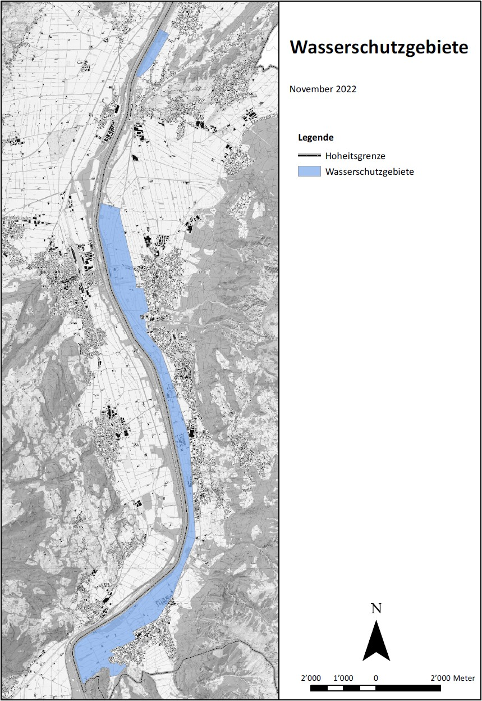

Verordnung vom 20. September 1988 zum Schutze des Grundwassers Aufgrund von Art. 24 und 67 des Gewässerschutzgesetzes (GSchG) vom 15. Mai 2003, LGBl. 2003 Nr. 159, verordnet die Regierung: Art. 1 Die in Art. 2 näher umschriebenen Gebiete entlang des Rheines werden als Wasserschutzgebiete im Sinne von Art. 24 des Gewässerschutzgesetzes festgelegt. Art. 2 1) Die Grenzen der Wasserschutzgebiete sind im Anhang dargestellt. 2) Die Wasserschutzgebiete sind in den Zonenplänen der Gemeinden ersichtlich zu machen. Art. 3 1) In den Wasserschutzgebieten sind alle Vorkehrungen, die der Menge und Güte der Grundwasservorkommen nachteilig sind oder die die öffentliche Wasserversorgung gefährden können, verboten. 2) Es ist insbesondere verboten: a) Bauten und Anlagen mit Abwasseranfall zu erstellen; b) Tankanlagen, Rohrleitungen und Umschlagplätze für flüssige Brenn- und Treibstoffe zu erstellen; c) Grundwasser-Wärmepumpen- und Erdsondenanlagen zu erstellen; d) Abwasserleitungen zu verlegen; e) Kiesgruben anzulegen; f) Deponien, mit Ausnahme solcher für unverschmutztes Aushubmaterial, zu erstellen; g) Grabungen und Sondierungen mit Tiefen grösser als 2 m ab natürlichem Terrain vorzunehmen. 3) Vom Verbot ausgenommen sind Bauten und Anlagen für landwirtschaftliche Zwecke und Umbauten, sofern dadurch keine Gefährdung oder andere Beeinträchtigung des Grundwassers zu befürchten ist, sowie Bauten und Anlagen mit überwiegendem öffentlichen Interesse und deren Standortgebundenheit nachgewiesen ist. Art. 4 1) Alle bestehenden Gebäude und Anlagen innerhalb der Wasserschutzgebiete unterliegen einer besonderen gewässerschutztechnischen Kontrolle. 2) Im übrigen bleibt die Nutzung, wie sie bisher ausgeübt wurde, unter Vorbehalt von Art. 3, gestattet. 3) Die Nutzung der bestehenden Gebäude und Anlagen des Mühleareals in Balzers ist nach Massgabe der Bauvorschriften der Gemeinde Balzers für die Denkmalschutzzone "Mühle" vom 9. September 1992 gestattet. Art. 5 1) In den Wasserschutzgebieten dürfen weder Bauzonen erweitert noch neue ausgeschieden werden; vorbehalten bleibt eine Zonenerweiterung für Bauten und Anlagen im Sinne von Art. 3 Abs. 3. 2) Soweit sich in den Wasserschutzgebieten Bauzonen oder Zonen für Sport- und Freizeitanlagen befinden, können in Abwägung der privaten und öffentlichen Interessen Bauten und Anlagen errichtet werden, deren Bewilligung jedoch an besondere Bedingungen und Auflagen des Gewässerschutzes gebunden ist. Art. 6 Die Aufsicht über die Wasserschutzgebiete obliegt dem Amt für Umweltschutz. Die Gemeinden haben bei der Aufsicht mitzuwirken. Art. 7 Nach Art. 61 des Gewässerschutzgesetzes wird bestraft, wer: a) verbotene Vorkehrungen in Wasserschutzgebieten vornimmt (Art. 3); b) besondere Bedingungen oder Auflagen des Gewässerschutzes, die mit einer Bewilligung verbunden sind, nicht einhält (Art. 5 Abs. 2). Art. 8 Diese Verordnung tritt am Tage der Kundmachung in Kraft. Fürstliche Regierung: gez. Hans Brunhart Fürstlicher Regierungschef Anhang (Art. 2 Abs. 1) Wasserschutzgebiete 

