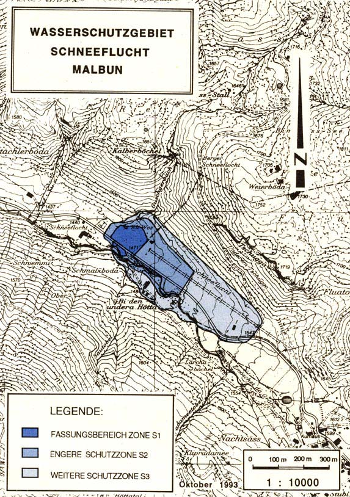

Verordnung vom 12. Oktober 1993 zum Schutze der Quellfassungen der Gemeinde Vaduz im Gebiet "Schneeflucht", Malbun Aufgrund von Art. 24 und 67 des Gewässerschutzgesetzes (GSchG) vom 15. Mai 2003, LGBl. 2003 Nr. 159 , verordnet die Regierung: I. Allgemeine Bestimmungen Art. 1 Zweck Zum Schutz der Wasserversorgung werden die in Art. 2 näher umschriebenen Gebiete als Schutzzonen im Sinne von Art. 5 Abs. 1 Bst. n des Gewässerschutzgesetzes festgelegt. Art. 2 Geltungsbereich 1) Die Grenzen der Schutzzonen sind in dem dieser Verordnung beigegebenen Situationsplan dargestellt. Der Plan ist Bestandteil der Verordnung und gilt für eine Entnahmemenge von 50 Litern pro Sekunde. 2) Die Schutzzonen sind in den Bauordnungen zu berücksichtigen und in den Zonenplänen der Gemeinden Vaduz und Triesenberg ersichtlich zu machen. 3) Die detaillierten Umgrenzungen der Schutzzonen sind aus dem Situationsplan 1 : 1 000 ersichtlich, welcher bei den Gemeinden Vaduz und Triesenberg sowie beim Amt für Umweltschutz aufliegt. Art. 3 Umschreibung Die Schutzzonen werden unterteilt in: a) Fassungsbereich (Zone S 1); b) engere Schutzzone (Zone S 2); c) weitere Schutzzone (Zone S 3). Art. 4 Zonen 1) Der Fassungsbereich (Zone S 1) dient dem unmittelbaren Schutze der Quellfassungen. Er umfasst die Quellschächte, die Fassungsstränge und deren nächstes Zuflussgebiet. 2) Die engere Schutzzone (Zone S 2) dient dazu, schädliche Einflüsse vom Fassungsbereich fernzuhalten. In der Zone S 2 dürfen schwer oder nicht abbaubare Schadstoffe nicht ins Grundwasser gelangen. Abbaubare Schadstoffe müssen auf dem Fliessweg so weit reduziert bzw. zurückgehalten werden, dass die Fassungen weder chemisch noch bakteriologisch belastet werden. Bei einer unfallbedingten Gewässerverschmutzung müssen in der Zone S 2 Sanierungsmassnahmen getroffen werden können, bevor die Verschmutzung den Fassungsbereich erreicht. 3) Die weitere Schutzzone (Zone S 3) dient als Pufferzone zwischen der Zone S 2 und der Umgebung. 4) Die Ausdehnung der Zonen S 2 und S 3 richtet sich nach den Zuflussrichtungen, der Fliessgeschwindigkeit und der Überdeckung des Grundwassers sowie der Infiltration von Oberflächengewässern ins Grundwasser im Zuflussbereich der Fassungen. Art. 5 Kennzeichnung der Schutzzonen Die Schutzzonen sind an der Strasse Steg - Malbun mit entsprechenden Hinweistafeln zu signalisieren. II. Bestimmungen für die weitere Schutzzone (Zone S 3) Art. 6 Grundsatz 1) In der Zone S 3 sind Vorkehrungen, welche die Menge und Güte der Grundwasservorkommen oder die öffentliche Wasserversorgung gefährden, verboten. 2) Insbesondere verboten sind: a) Lager- und Betriebsanlagen, Rohrleitungen sowie Umschlagplätze für wassergefährdende Flüssigkeiten unter Vorbehalt von Art. 10 der Verordnung über den Schutz der Gewässer vor wassergefährdenden Flüssigkeiten (VWF); b) Recyclingbaustoffe, wie Asphaltgranulat und dergleichen; c) Wildfütterungen. 3) Bei Bauarbeiten sind spezielle Schutzmassnahmen zu treffen. Art. 7 Bauten und Anlagen Aufgehoben Art. 8 Tankanlagen Aufgehoben Art. 9 Verkehrsanlagen 1) Die Hauptstrasse Steg-Malbun hat einen Hartbelag und Bordsteine aufzuweisen. Das Oberflächenwasser ist entsprechend den gewässerschutzrechtlichen Bestimmungen in den Malbunbach abzuleiten. 2) Die Parkplätze dürfen von Fahrzeugen zum Transport wassergefährdender Stoffe nicht benützt werden. Die Plätze sind entsprechend zu signalisieren. Art. 9a Versickerungen Das Versickern von Abwasser ist verboten. Ausgenommen ist die Versickerung von unverschmutztem Niederschlagswasser, wenn die Versickerung über die bewachsene Bodenschicht erfolgt. Art. 10 Abwasseranlagen 1) Schmutzwasserleitungen haben den Dichtheitsanforderungen der SIA-Norm 190, Kanalisationen, zu genügen. 2) Die Dichtheit von Schmutzwasserleitungen, Kläranlagen, Jauchebehältern und dergleichen ist vom Eigentümer alle drei Jahre zu prüfen. 3) Mangelhafte Anlagen sind vom Eigentümer auf seine Kosten abzudichten oder zu ersetzen. Art. 11 Grabarbeiten und Auffüllungen 1) Grabarbeiten und Geländeveränderungen sind bewilligungspflichtig. Sie sind zulässig, wenn ein sachlich begründetes Bedürfnis besteht, die schützende Deckschicht nicht wesentlich vermindert wird und spezielle Schutzmassnahmen getroffen werden. 2) Auffüllungen dürfen nur aus inertem Material (sauberes Aushubmaterial) bestehen. Art. 12 Düngung 1) Die Düngung richtet sich nach der Bodenbelastbarkeit. Sie darf nur während der Vegetationsperiode erfolgen. 2) Düngemittel sind gleichmässig zu verteilen. Die Düngung ist unzulässig, wenn der Boden wassergesättigt, schneebedeckt oder gefroren ist. 3) Es gelten die Richtlinien über die Düngung von alpwirtschaftlich genutzten Wiesen und Weiden sowie Anhang 2.6 der schweizerischen Chemikalien-Risikoreduktions-Verordnung (SR 814.81). 4) Die Verwendung von Klärschlamm und Flüssigdünger ist verboten. Art. 13 Pflanzen- und Holzschutzmittel 1) Für die Verwendung von Pflanzenschutzmitteln gilt Anhang 2.5 der schweizerischen Chemikalien-Risikoreduktions-Verordnung. 2) Für die Verwendung von Holzschutzmitteln gilt Anhang 2.4 der schweizerischen Chemikalien-Risikoreduktions-Verordnung. Art. 14 Lagerhaltungen 1) Es sind verboten: a) Fahrsilos; b) Ablagerungen im freien Feld von: 1. Düngern, wie Mist, Kompost und Klärschlamm; 2. Siloballen und -würsten; c) Ablagerungen von wassergefährdenden Stoffen. 2) Handelsdünger und Pflanzenschutzmittel sind geschützt gegen Durchnässung und Versickerung aufzubewahren. Art. 15 Weidegang Der Weidegang ist grundsätzlich auf die Zeit der Vor- und Nachsömmerung zu beschränken. Eine Ausnahme ist gestattet bei sommerlichen Schneefällen in höheren Weidelagen (Schneeflucht). Art. 16 Alpstall Untere Pradame Wird der Alpstall Untere Pradame zur Einstallung von Vieh genutzt, gelten folgende Auflagen: a) Die Standflächen des Viehs müssen dicht sein und in die Stallgüllengrube entwässern. b) Der Miststock ist auf eine dichte Platte mit Randumfassung zu stellen. Die Sickerwässer sind in die Güllengrube zu leiten. c) Die Güllengrube muss absolut dicht sein; Nachweis mittels Dichtigkeitsprüfung durch den Eigentümer. d) Vorplätze müssen befestigt sein. Das Niederschlagswasser ist flächenhaft zu versickern. Art. 17 Kälberstall Wird der Kälberstall wieder zur längerfristigen Einstallung von Vieh genutzt, gelten die gleichen Auflagen wie für den Alpstall Untere Pradame gemäss Art. 16. Art. 18 Skipisten Die Anwendung von wassergefährdenden Stoffen zur Verbesserung (Zementierung) des Schnees ist verboten. III. Bestimmungen für die engere Schutzzone (Zone S 2) Art. 19 Grundsatz Alle nachfolgenden Massnahmen und Nutzungsbeschränkungen gelten zusätzlich zu den in Art. 6 bis 18 enthaltenen Bestimmungen. Art. 20 Bauten und Anlagen In der Zone S 2 gilt ein allgemeines Bauverbot. Aus wichtigen Gründen können Ausnahmen gestattet werden (Art. 33). Art. 21 Skiliftanlagen und Restaurant Schneeflucht 1) Für die Skiliftanlagen und das Restaurant Schneeflucht besteht eine Bestandesgarantie unter Einschluss des Wiederaufbaurechts bei teilweiser oder gänzlicher Zerstörung. 2) Massvolle Umbauten und Erweiterungen der Anlagen im Rahmen der bisherigen Nutzung sind möglich. 3) Die Beheizung und Warmwasseraufbereitung darf nicht mit flüssigen Mineralölprodukten erfolgen. Art. 22 Tankanlagen Aufgehoben Art. 23 Verkehrsanlagen 1) An der Strasse Steg - Malbun sind entlang dem Quellfassungsbereich (Zone S 1 und S 2) beidseits erhöhte Bordsteine und auf schwere Motorwagen dimensionierte Begrenzungen anzubringen. 2) Der Parkplatz bei der Talstation des Schneeflucht-Skiliftes ist vollumfänglich über einen Ölabscheider zu entwässern. Die Kanalisation ist an die Strassenentwässerungsanlage anzuschliessen. 3) Auf Strassen, Parkplätzen und Verkehrsflächen aller Art sind im Winterdienst grundsätzlich keine Tausalze zu verwenden. Bei der Schneeräumung darf verunreinigter Schnee nicht ins angrenzende Wiesland der Zone S 2 gestossen oder geschleudert werden. 4) Frisch gefallener noch nicht befahrener Schnee des Parkplatzes vor dem Schneeflucht-Lift darf auf Zusehen hin bergwärts in das Skigelände gestossen oder geschleudert werden. Art. 24 Abstellen von Fahrzeugen Das dauernde Abstellen von Fahrzeugen mit Explosionsmotoren im Freien ist verboten. Art. 24a Pflanzen- und Holzschutzmittel, Forstwirtschaft 1) Die Anwendung von Pflanzen- und Holzschutzmitteln ist verboten. 2) Es dürfen keine Holzlager angelegt werden. 3) Forstmaschinen sind, wenn immer möglich, abends und übers Wochenende ausserhalb der Zone S 2 abzustellen. 4) Das Reparieren oder Reinigen von grossen Maschinen und von Fahrzeugen ist untersagt. 5) Für das Betanken von stationären Forstmaschinen, wie Seilbahnen und dergleichen, sind spezielle Schutzmassnahmen zu treffen. Art. 25 Schmutzwasserleitungen 1) Die Schmutzwasserkanalisationen müssen in doppelwandigen Rohren oder in Doppelrohren ausgeführt sein. 2) Für den Abwasserhauptsammelkanal Malbun - Steg genügt auf Zusehen hin die einwandige Ausführungsart. Die Anlage ist jedoch, wie in Art. 10 Abs. 2 festgelegt, regelmässig zu kontrollieren. Art. 26 Landwirtschaft 1) Güllengruben, erdverlegte Güllenleitungen, Güllenzapfstellen, Mistlager, Raufuttersilos und dergleichen sind unzulässig. 2) Bei Brunnen und Tränkestellen sind Massnahmen zur Bodenverfestigung zu treffen. Anfallender Kot ist regelmässig zu entfernen. IV. Bestimmungen für den Fassungsbereich (Zone S 1) Art. 27 Grundsatz 1) In der Zone S 1 sind grundsätzlich nur Nutzungen zulässig, die der Wassergewinnung und Aufbereitung dienen. 2) Gestattet sind einzig die Nutzung als Magerwiese mit Grasschnitt und Gründüngung sowie die Forstwirtschaft im bewaldeten Nordostteil des Fassungsbereiches (Zone S 1). 3) Im Fassungsbereich darf kein Abraumschnee abgelagert werden. Art. 28 Zutritt Die Zone S 1 ist vor dem Zutritt Unbefugter zu schützen. Sie ist mit einer festen Umgrenzung zu umgeben. V. Schlussbestimmungen Art. 29 Bauliche Schutzmassnahmen Die baulichen Schutzmassnahmen sind innerhalb von zwei Jahren nach Inkrafttreten dieser Verordnung zu treffen. Art. 30 Magerwiese Der Wald im Bereich der Quellfassungen und der Fassungsstränge ist bei der Erneuerung der Fassungsanlagen zu entfernen. Einzelne Bäume können bestehen bleiben, sofern die Nutzung als Magerwiese nicht beeinträchtigt wird. Art. 31 Aufsicht 1) Die Aufsicht über die Schutzzonen obliegt dem Amt für Umweltschutz. Die Gemeinde Vaduz (Wassermeister) hat bei der Aufsicht mitzuwirken, wobei Umfang und Durchführung der Kontrollen durch Vereinbarung geregelt werden. 2) Aufgehoben Art. 32 Verfügungen Das Amt für Umweltschutz erlässt die gemäss dieser Verordnung erforderlichen Verfügungen und überwacht deren Vollzug. Art. 33 Ausnahmebewilligungen 1) Die Regierung kann im Einvernehmen mit der Gemeinde Vaduz aus wichtigen Gründen von den Vorschriften dieser Verordnung abweichende Bewilligungen erteilen, sofern eine Gefährdung der Trinkwassernutzung ausgeschlossen werden kann. 2) In der Bewilligung sind die zu treffenden, speziellen Schutzmassnahmen festzulegen. Art. 33a Kosten 1) Die aus der Ausscheidung der Schutzzonen erwachsenden Kosten trägt die Gemeinde Vaduz. 2) Allfällige Entschädigungsleistungen sind vertraglich festzulegen und gehen zu Lasten der Gemeinde Vaduz. Art. 34 Strafbestimmung Nach Art. 61 des Gewässerschutzgesetzes wird bestraft, wer: a) verbotene Vorkehrungen in Schutzzonen vornimmt (Art. 6 Abs. 1 und 2, Art. 9 Abs. 2, Art. 9a, 18, 20, 21 Abs. 2 und 3, Art. 24 und 27); b) die geforderten Schutzmassnahmen nicht trifft (Art. 6 Abs. 3, Art. 25 Abs. 1 und Art. 29); c) die Anforderungen an Abwasseranlagen nicht erfüllt (Art. 10); d) unzulässige Geländeveränderungen oder ohne Bewilligung Auffüllungen oder Grabarbeiten vornimmt (Art. 11); e) die Vorschriften über die Land- und Forstwirtschaft nicht einhält (Art. 12, 15, 16, 17, 24a Abs. 2 bis 4 und Art. 26); f) die Vorschriften über Pflanzen- und Holzschutzmittel nicht einhält (Art. 13 und Art. 24a Abs. 1); g) die Vorschriften über die Lagerhaltung nicht einhält (Art. 14 und 24a Abs. 2). Art. 35 Inkrafttreten Die Verordnung tritt am Tag der Kundmachung in Kraft. Fürstliche Regierung: gez. Markus Büchel Fürstlicher Regierungschef Anhang 

