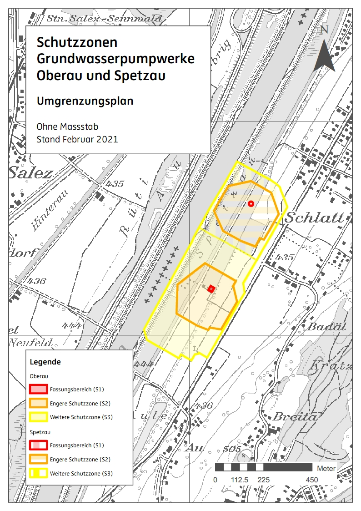

Verordnung vom 1. Juli 2014 zum Schutze der Grundwasserpumpwerke "Oberau" und "Spetzau" der Wasserversorgung Liechtensteiner Unterland Aufgrund von Art. 24 und 67 des Gewässerschutzgesetzes (GSchG) vom 15. Mai 2003, LGBl. 2003 Nr. 159, verordnet die Regierung: I. Allgemeine Bestimmungen Art. 1 Zweck Zum Schutz der Wasserversorgung werden die im Art. 2 näher umschriebenen Gebiete als Schutzzonen im Sinne von Art. 5 Abs. 1 Bst. q des Gewässerschutzgesetzes festgelegt. Art. 2 Geltungsbereich 1) Die Grenzen der Schutzzonen sind in dem dieser Verordnung beigegebenen Situationsplan dargestellt. Der Plan ist Bestandteil dieser Verordnung und gilt für eine maximale Entnahmemenge von 75 Litern pro Sekunde pro Pumpwerk. 2) Die Schutzzonen sind in den Bauordnungen zu berücksichtigen und in den Zonenplänen der Gemeinden Gamprin und Ruggell ersichtlich zu machen. 3) Die detaillierten Umgrenzungen der Schutzzonen sind aus dem Situationsplan 1 : 2 000 ersichtlich, welcher bei den Gemeinden Gamprin und Ruggell sowie beim Amt für Umweltschutz aufliegt. Art. 3 Umschreibung Die Schutzzonen werden unterteilt in: a) Fassungsbereich (Zone S 1); b) engere Schutzzone (Zone S 2); c) weitere Schutzzone (Zone S 3). Art. 4 Zonen 1) Der Fassungsbereich (Zone S 1) dient dem unmittelbaren Schutz der Grundwasserfassung. Er umfasst die eigentliche Grundwasserfassung (Brunnen) sowie das unmittelbar umliegende Zuflussgebiet. 2) Die engere Schutzzone (Zone S 2) dient dazu, schädliche Einflüsse vom Fassungsbereich fernzuhalten. In der Zone S 2 dürfen schwer oder nicht abbaubare Schadstoffe nicht ins Grundwasser gelangen. Abbaubare Schadstoffe müssen auf dem Fliessweg so weit reduziert bzw. zurückgehalten werden, dass die Fassung weder chemisch noch bakteriologisch belastet wird. Bei einer unfallbedingten Gewässerverschmutzung müssen in der Zone S 2 Sanierungsmassnahmen getroffen werden können, bevor die Verschmutzung den Fassungsbereich erreicht. 3) Die weitere Schutzzone (Zone S 3) dient als Pufferzone zwischen der Zone S 2 und der Umgebung. 4) Die Ausdehnung der Zonen S 2 und S 3 richtet sich nach den Zuflussrichtungen, nach der Fliessgeschwindigkeit und nach der Überdeckung des Grundwassers sowie nach der Infiltration von Oberflächengewässern ins Grundwasser im Zuflussbereich der Fassung. Art. 5 Bewilligungspflicht Bauten und Anlagen in den Schutzzonen dürfen nur mit einer Bewilligung des Amtes für Umweltschutz erstellt oder geändert werden. Art. 6 Kennzeichnung der Schutzzonen Die Schutzzonen sind an geeigneten Stellen am Rand der Strassen und Wege mit entsprechenden Hinweistafeln zu signalisieren. II. Bestimmungen für die weitere Schutzzone (Zone S 3) Art. 7 Grundsatz 1) In der Zone S 3 sind Vorkehrungen, welche die Menge und Güte der Grundwasservorkommen oder die öffentliche Wasserversorgung gefährden, verboten. 2) Insbesondere verboten sind: a) Lager- und Betriebsanlagen, Rohrleitungen sowie Umschlagplätze für wassergefährdende Flüssigkeiten unter Vorbehalt von Art. 10 der Verordnung über den Schutz der Gewässer vor wassergefährdenden Flüssigkeiten (VWF); b) Kreisläufe, die dem Wasser Wärme entziehen oder abgeben; c) Revitalisierungsmassnahmen am Binnenkanal und am Mühlebach; d) Dichtungs- und Spundwände; e) Kies-, Sand- und Lehmgruben; f) Deponien mit Ausnahme solcher für unverschmutztes Aushubmaterial; g) Recyclingbaustoffe, wie Asphaltgranulat und dergleichen. 3) Bei Bauarbeiten sind spezielle Schutzmassnahmen zu treffen. Art. 8 Bauten und Anlagen In der Zone S 3 gilt ein allgemeines Bauverbot. Aus wichtigen Gründen können Ausnahmen gestattet werden (Art. 26). Art. 9 Verkehrsanlagen Die Rheindammstrasse sowie die Feldwege sind mit einem Fahrverbot für Motorfahrzeuge (land- und forstwirtschaftlicher Verkehr sowie Zubringerdienst gestattet) zu belegen. Art. 10 Versickerungen Das Versickern von Abwasser ist verboten. Ausgenommen ist die Versickerung von unverschmutztem Niederschlagswasser, wenn die Versickerung über die bewachsene Bodenschicht erfolgt. Art. 11 Abwasseranlagen, Erdgasleitung 1) Schmutzwasserleitungen haben den Dichtheitsanforderungen der SIA-Norm 190, Kanalisationen, zu genügen. 2) Der am Binnenkanal entlang führende Abwasserkanal ist vom Eigentümer jährlich auf Dichtheit zu prüfen. Das Prüfprotokoll ist dem Amt für Umweltschutz und der Wasserversorgung Liechtensteiner Unterland zuzustellen. 3) Mangelhafte Abwasseranlagen sind vom Eigentümer unverzüglich auf seine Kosten abzudichten oder zu ersetzen. 4) Alle Abwasseranlagen sind spätestens bis zum 31. Dezember 2027 in Gebiete ausserhalb der Schutzzonen zu verlegen. 5) Die bestehende Erdgas-Hochdruckleitung ist gemäss den Weisungen des Amtes für Volkswirtschaft regelmässig zu kontrollieren. Art. 12 Grabarbeiten und Auffüllungen 1) Grabarbeiten und Geländeveränderungen sind bewilligungspflichtig. Sie sind zulässig, wenn ein sachlich begründetes Bedürfnis besteht, die schützende Deckschicht nicht wesentlich vermindert wird und spezielle Schutzmassnahmen getroffen werden. 2) Auffüllungen dürfen nur aus sauberem Aushubmaterial bestehen. Art. 13 Landwirtschaft 1) In der Zone S 3 sind Acker-, Gemüse-, Obst- und Gartenbau nicht gestattet. Es ist lediglich eine Nutzung als Dauergrünland ohne Beweidung zulässig. 2) Die Verwendung von Gülle, Mist und sonstigem Dünger ist verboten. 3) Die Verwendung von Klärschlamm ist verboten. Art. 14 Pflanzen- und Holzschutzmittel Die Anwendung von Pflanzen- und Holzschutzmitteln ist verboten. Art. 15 Lagerhaltungen Es sind verboten: a) Fahrsilos; b) Ablagerungen im freien Feld von: 1. Düngern, wie Mist, Kompost und Klärschlamm; 2. Siloballen und -würsten; c) Ablagerungen von wassergefährdenden Stoffen. III. Bestimmungen für die engere Schutzzone (Zone S 2) Art. 16 Grundsatz Alle nachfolgenden Massnahmen und Nutzungsbeschränkungen gelten zusätzlich zu den in Art. 7 bis 15 enthaltenen Bestimmungen. Art. 17 Abwasseranlagen 1) Das Abwasserpumpwerk ist über das Fernwirksystem des Abwasserzweckverbandes dauernd zu überwachen. Störfälle sind mit hoher Priorität zu beheben. 2) Das Abwasserpumpwerk ist vom Eigentümer jährlich auf Dichtheit zu prüfen. Das Prüfprotokoll ist dem Amt für Umweltschutz und der Wasserversorgung Liechtensteiner Unterland zuzustellen. 3) Das Abwasserpumpwerk "Oberau" ohne Trafoanlage sowie die Abwasserkanäle sind spätestens bis zum 31. Dezember 2027 in Gebiete ausserhalb der Schutzzonen zu verlegen. Art. 18 Beeinflussung des Grundwassers durch Mühlebach Sofern eine negative Beeinflussung des Grundwassers durch den Mühlebach eintritt, hat die Wasserversorgung Liechtensteiner Unterland dessen Bachsohle abzudichten. Art. 19 Abstellen von Fahrzeugen Das dauernde Abstellen von Fahrzeugen mit Explosionsmotoren im Freien ist verboten. Art. 20 Forstwirtschaft 1) Aufgehoben 2) Es dürfen keine Holzlager angelegt werden. 3) Forstmaschinen sind, soweit möglich, abends und übers Wochenende ausserhalb der Zone S 2 abzustellen. 4) Das Reparieren oder Reinigen von grossen Maschinen und von Fahrzeugen ist untersagt. Art. 21 Landwirtschaft Güllengruben, erdverlegte Güllenleitungen, Güllenzapfstellen, Mistlager, Raufuttersilos und dergleichen sind unzulässig. IV. Bestimmungen für den Fassungsbereich (Zone S 1) Art. 22 Grundsatz 1) In der Zone S 1 sind grundsätzlich nur Nutzungen zulässig, die der Wassergewinnung und -aufbereitung dienen. 2) Gestattet ist einzig die Nutzung als Magerwiese mit Grasschnitt. Art. 23 Zutritt Die Zone S 1 ist vor dem Zutritt Unbefugter zu schützen. Sie ist mit einem wildgerechten Zaun zu umgeben. V. Organisation und Durchführung Art. 24 Aufsicht Die Aufsicht über die Schutzzonen obliegt dem Amt für Umweltschutz. Die Wasserversorgung Liechtensteiner Unterland (Brunnenmeister) hat bei der Aufsicht mitzuwirken, wobei Umfang und Durchführung der Kontrollen durch Vereinbarung geregelt werden. Art. 25 Verfügungen Das Amt für Umweltschutz erlässt die gemäss dieser Verordnung erforderlichen Verfügungen und überwacht deren Vollzug. Art. 26 Ausnahmebewilligungen 1) Die Regierung kann im Einvernehmen mit den Gemeinden Gamprin und Ruggell sowie der Wasserversorgung Liechtensteiner Unterland aus wichtigen Gründen von den Vorschriften dieser Verordnung abweichende Bewilligungen erteilen, sofern eine Gefährdung der Trinkwassernutzung ausgeschlossen werden kann. 2) In der Bewilligung sind die zu treffenden, speziellen Schutzmassnahmen festzulegen. Art. 27 Kosten 1) Die Kosten für die Ausscheidung der Schutzzonen trägt die Wasserversorgung Liechtensteiner Unterland. 2) Allfällige Entschädigungsleistungen an die betroffenen Grundeigentümer gehen zu Lasten der Wasserversorgung Liechtensteiner Unterland nach Massgabe vertraglicher Vereinbarungen. VI. Strafbestimmungen Art. 28 Übertretungen Nach Art. 61 des Gewässerschutzgesetzes wird bestraft, wer: a) Bauten und Anlagen ohne Bewilligung erstellt oder ändert (Art. 5); b) verbotene Vorkehrungen in Schutzzonen vornimmt (Art. 7 Abs. 1 und 2, Art. 8, 10, 19 und 22); c) die geforderten Schutzmassnahmen nicht trifft (Art. 7 Abs. 3); d) die Anforderungen an Abwasseranlagen sowie die Erdgasleitung nicht erfüllt (Art. 11 und 17); e) unzulässige Geländeveränderungen oder ohne Bewilligung Auffüllungen oder Grabarbeiten vornimmt (Art. 12); f) die Vorschriften über die Land- und Forstwirtschaft nicht einhält (Art. 13, 20 Abs. 3 und 4, Art. 21 und 30 Abs. 1 bis 3); g) die Vorschriften über Pflanzen- und Holzschutzmittel nicht einhält (Art. 14 und 30 Abs. 1 und 4); h) die Vorschriften über die Lagerhaltung nicht einhält (Art. 15 und 20 Abs. 2). VII. Übergangs- und Schlussbestimmungen Art. 29 Aufhebung bisherigen Rechts Es werden aufgehoben: a) Verordnung vom 8. April 1997 zum Schutze des Grundwasserpumpwerkes "Oberau" der Wasserversorgung Liechtensteiner Unterland, LGBl. 1997 Nr. 95; b) Verordnung vom 5. Juli 2005 über die Abänderung der Verordnung zum Schutze des Grundwasserpumpwerkes "Oberau" der Wasserversorgung Liechtensteiner Unterland, LGBl. 2005 Nr. 134; c) Verordnung vom 26. Mai 2009 über die Abänderung der Verordnung zum Schutze des Grundwasserpumpwerkes "Oberau" der Wasserversorgung Liechtensteiner Unterland, LGBl. 2009 Nr. 146. Art. 30 Übergangsbestimmungen 1) Art. 13 Abs. 1 und 2 sowie Art. 14 gelten für die Zone S 2 "Spetzau" mit Errichtung des Grundwasserpumpwerks "Spetzau", spätestens jedoch ab dem 1. Januar 2024. In der gesamten Zone S 2 "Spetzau" sind auch während der Übergangszeit verboten: a) der Einsatz von Holzschutzmitteln; b) der Einsatz von Pflanzenschutzmitteln mit folgenden Wirkstoffen: 1. Isoxaflutole; 2. Aminopyralid; 3. Azoxystrobin; 4. Chloridazon; 5. Dazomet (DMTT); 6. Dimethachlor; 7. Fluopicolide; 8. Flutolanil; 9. Glufosinate; 10. Lenacil; 11. Metazachlor; 12. Penconazole; 13. Penoxsulam; 14. Pethoxamid; 15. Picloram; 16. Pinoxaden; 17. S-Metolachlor; 18. Terbuthylazin; 19. Triclopyr(ester); 20. Tritosulfuron; 21. Bentazon; 22. Clethodim; 23. Nicosulfuron; 24. Quinmerac; 25. Thifensulfuronmethyl. 2) Art. 13 Abs. 1 gilt für die Zone S 3 "Spetzau" mit Errichtung des Grundwasserpumpwerks "Spetzau". Ab dem 1. Januar 2024 sind, sofern bis zu diesem Zeitpunkt kein Grundwasserpumpwerk errichtet wurde, der Acker-, Gemüse-, Obst- und Gartenbau unter folgenden Voraussetzungen weiterhin zulässig: a) Der Anbau muss nach den Richtlinien der Bio Suisse erfolgen; der Einsatz von chemisch-synthetischen Düngern ist verboten. b) Bei der ackerbaulichen Nutzung ist die ausgewogene Fruchtfolge so zu gestalten, dass der unbewachsene Boden zeitlich auf ein Minimum reduziert und ein Wieslandanteil von mindestens 30 % (bewachsener Boden) eingehalten wird. c) Der Boden muss während der Vegetationsruhe mit einer winterharten Kultur oder Begrünung bedeckt sein. 3) Art. 13 Abs. 2 gilt in der Zone S 3 "Spetzau" mit Errichtung des Grundwasserpumpwerks "Spetzau". Ab dem 1. Januar 2024 ist, sofern bis zu diesem Zeitpunkt kein Grundwasserpumpwerk errichtet wurde, die Düngung unter folgenden Voraussetzungen weiterhin zulässig: a) Gülle und leicht löslicher Dünger dürfen nur von April bis Oktober, Mist und schwer löslicher Dünger nur von März bis Oktober verwendet werden. b) Düngemittel müssen gleichmässig verteilt werden. c) Die Düngung darf nur auf Böden erfolgen, die nicht wassergesättigt, schneebedeckt oder gefroren sind. d) Brachliegende Äcker müssen im Anschluss an die Düngung umgehend bepflanzt werden. e) Beidseitig des Mühlebaches darf ein Streifen von 5 m Breite ab Böschungsoberkante nicht gedüngt werden. 4) Art. 14 gilt in der Zone S 3 "Spetzau" mit Errichtung des Grundwasserpumpwerks "Spetzau". Ab dem 1. Januar 2024 dürfen, sofern bis zu diesem Zeitpunkt kein Grundwasserpumpwerk errichtet wurde, nur noch solche Pflanzenschutzmittel eingesetzt werden, die nach den Richtlinien von Bio Suisse zulässig sind. Der Einsatz von chemisch-synthetischen Pflanzenschutzmitteln ist verboten. Art. 31 Inkrafttreten Diese Verordnung tritt am 1. August 2014 in Kraft. Fürstliche Regierung: gez. Adrian Hasler Fürstlicher Regierungschef Anhang (Art. 2 Abs. 1) 

