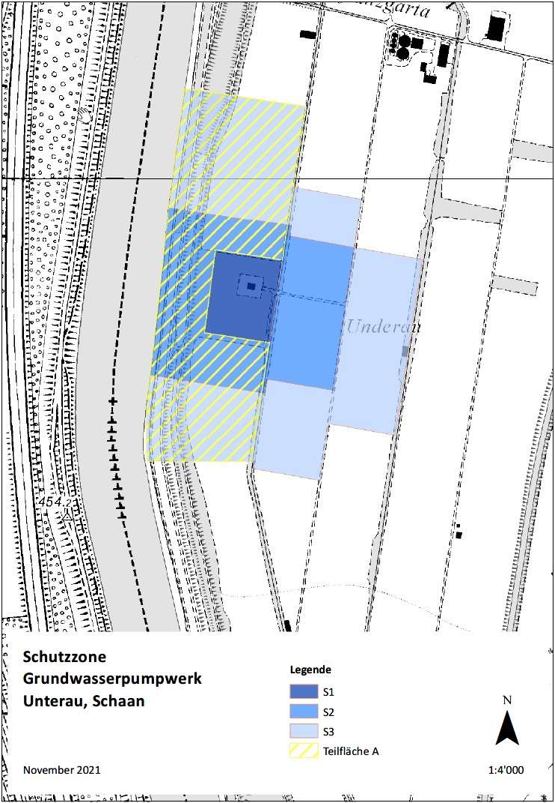

Verordnung vom 7. November 2000 zum Schutze des Grundwasserpumpwerkes "Unterau" in der Gemeinde Schaan Aufgrund von Art. 24 und 67 des Gewässerschutzgesetzes (GSchG) vom 15. Mai 2003, LGBl. 2003 Nr. 159, verordnet die Regierung: I. Allgemeine Bestimmungen Art. 1 Zweck Zum Schutz der Wasserversorgung werden die in Art. 2 näher umschriebenen Gebiete als Schutzzonen im Sinne von Art. 5 Abs. 1 Bst. q des Gewässerschutzgesetzes festgelegt. Art. 2 Geltungsbereich 1) Die Grenzen der Schutzzonen sind in dem dieser Verordnung beigegebenen Situationsplan dargestellt. Der Plan ist Bestandteil dieser Verordnung. Die Abgrenzung der Schutzzonen gilt für eine maximale Entnahmemenge von 90 Litern pro Sekunde. 2) Die Schutzzonen sind in der Bauordnung zu berücksichtigen und im Zonenplan der Gemeinde Schaan ersichtlich zu machen. 3) Die detaillierten Umgrenzungen der Schutzzonen sind aus dem Situationsplan 1 : 2 000 ersichtlich, welcher bei der Gemeinde Schaan sowie beim Amt für Umweltschutz aufliegt. Art. 3 Umschreibung Die Schutzzonen werden unterteilt in: a) Fassungsbereich (Zone S 1); b) engere Schutzzone (Zone S 2); c) weitere Schutzzone (Zone S 3). Art. 4 Zonen 1) Der Fassungsbereich (Zone S 1) dient dem unmittelbaren Schutz der Grundwasserfassung. Er umfasst die eigentliche Grundwasserfassung (Brunnen) sowie das unmittelbar umliegende Zuflussgebiet. 2) Die engere Schutzzone (Zone S 2) dient dazu, schädliche Einflüsse vom Fassungsbereich fernzuhalten. In der Zone S 2 dürfen schwer oder nicht abbaubare Schadstoffe nicht ins Grundwasser gelangen. Abbaubare Schadstoffe müssen auf dem Fliessweg so weit reduziert bzw. zurückgehalten werden, dass die Fassung weder chemisch noch bakteriologisch belastet wird. Bei einer unfallbedingten Gewässerverschmutzung müssen in der Zone S 2 Sanierungsmassnahmen getroffen werden können, bevor die Verschmutzung den Fassungsbereich erreicht. 3) Die weitere Schutzzone (Zone S 3) dient als Pufferzone zwischen der Zone S 2 und der Umgebung. 4) Die Ausdehnung der Zonen S 2 und S 3 richtet sich nach den Zuflussrichtungen, nach der Fliessgeschwindigkeit und nach der Überdeckung des Grundwassers sowie nach der Infiltration von Oberflächengewässern ins Grundwasser im Zuflussbereich der Fassung. Art. 4a Bewilligungspflicht Bauten und Anlagen in den Schutzzonen dürfen vorbehaltlich Art. 11 nur mit einer Bewilligung des Amtes für Umweltschutz erstellt oder geändert werden. Art. 4b Kennzeichnung der Schutzzonen Die Schutzzonen sind an geeigneten Stellen am Rand der Strassen und Wege mit entsprechenden Hinweistafeln zu signalisieren. II. Bestimmungen für die weitere Schutzzone (Zone S 3) A. Allgemeines Art. 5 Grundsatz 1) In der Zone S 3 sind Vorkehrungen, welche die Menge und Güte der Grundwasservorkommen oder die öffentliche Wasserversorgung gefährden, verboten. 2) Insbesondere verboten sind: a) Lager- und Betriebsanlagen, Rohrleitungen sowie Umschlagplätze für wassergefährdende Flüssigkeiten unter Vorbehalt von Art. 10 der Verordnung über den Schutz der Gewässer vor wassergefährdenden Flüssigkeiten (VWF); b) Kreisläufe, die dem Wasser Wärme entziehen oder abgeben; c) Dichtungs- und Spundwände; d) Kies- und Sandgruben; e) Deponien mit Ausnahme solcher für unverschmutztes Aushubmaterial; f) Recyclingbaustoffe, wie Asphaltgranulat und dergleichen. 3) Bei Bauarbeiten sind spezielle Schutzmassnahmen zu treffen. Art. 5a Verkehrsanlagen Die Rheindammstrasse sowie Feldwege sind mit einem Fahrverbot für Motorfahrzeuge (land- und forstwirtschaftlicher Verkehr sowie Zubringerdienst gestattet) zu belegen. Art. 5b Versickerungen Das Versickern von Abwasser ist verboten. Ausgenommen ist die Versickerung von unverschmutztem Niederschlagswasser, wenn die Versickerung über die bewachsene Bodenschicht erfolgt. Art. 6 Abwasseranlagen, Augraba West 1) Schmutzwasserleitungen haben den Dichtheitsanforderungen der SIA-Norm 190, Kanalisationen, zu genügen. 2) Die Dichtheit von Schmutzwasserleitungen, Kläranlagen, Jauchebehältern und dergleichen ist vom Eigentümer alle drei Jahre zu prüfen. 3) Mangelhafte Anlagen sind vom Eigentümer auf seine Kosten abzudichten oder zu ersetzen. 4) Der Augraba West ist abzudichten. Die Ausführung erfolgt im Zusammenhang mit der Revitalisierung "Schaaner Riet". 5) Aufgehoben Art. 6a Grabarbeiten und Auffüllungen 1) Grabarbeiten und Geländeveränderungen sind bewilligungspflichtig. Sie sind zulässig, wenn ein sachlich begründetes Bedürfnis besteht, die schützende Deckschicht nicht wesentlich vermindert wird und spezielle Schutzmassnahmen getroffen werden. 2) Auffüllungen dürfen nur aus sauberem Aushubmaterial bestehen. Art. 7 Düngung 1) Gülle und leicht löslicher Handelsdünger dürfen nur von April bis Oktober, Mist und schwer löslicher Handelsdünger nur von März bis Oktober ausgebracht werden. 2) Düngemittel sind gleichmässig zu verteilen. Die Düngung ist unzulässig, wenn der Boden wassergesättigt, schneebedeckt oder gefroren ist. 3) Es gilt Anhang 2.6 der schweizerischen Chemikalien-Risikoreduktions-Verordnung (SR 814.81). 4) Äcker dürfen nicht über längere Zeit brach gelassen werden. Brachliegende Äcker dürfen nur gedüngt werden, wenn sie sofort anschliessend bepflanzt werden. 5) Die Verwendung von Klärschlamm ist verboten. Art. 8 Pflanzen- und Holzschutzmittel 1) Für die Verwendung von Pflanzenschutzmitteln gilt Anhang 2.5 der schweizerischen Chemikalien-Risikoreduktions-Verordnung. 2) Für die Verwendung von Holzschutzmitteln gilt Anhang 2.4 der schweizerischen Chemikalien-Risikoreduktions-Verordnung. Art. 9 Lagerhaltungen 1) Es sind verboten: a) Fahrsilos; b) Ablagerungen im freien Feld von: 1. Düngern, wie Mist, Kompost und Klärschlamm; 2. Siloballen und -würsten; c) Ablagerungen von wassergefährdenden Stoffen. 2) Handelsdünger und Pflanzenbehandlungsmittel sind geschützt gegen Durchnässung und Versickerung aufzubewahren. 3) Mistlager bei den Ställen bedürfen einer dichten Bodenplatte mit Randumfassung. Die anfallende Gülle ist aufzufangen. B. Besondere Anforderungen an die Teilfläche A Art. 9a Grundsatz Zusätzlich zu den Anforderungen nach Art. 5 bis 9 gilt für die Teilfläche A (schraffierte Fläche im Situationsplan gemäss Anhang) Folgendes: a) Acker-, Gemüse-, Obst- und Gartenbau sind verboten. Es ist lediglich eine Nutzung als Dauergrünland ohne Beweidung zulässig; b) die Verwendung von Gülle, Mist und sonstigem Dünger ist verboten; c) die Anwendung von Pflanzen- und Holzschutzmitteln ist verboten. III. Bestimmungen für die engere Schutzzone (Zone S 2) Art. 10 Grundsatz Alle nachfolgenden Massnahmen und Nutzungsbeschränkungen gelten zusätzlich zu den in Art. 5 bis 9 enthaltenen Bestimmungen. Art. 11 Bauten und Anlagen In der Zone S 2 gilt ein allgemeines Bauverbot. Aus wichtigen Gründen können Ausnahmen gestattet werden (Art. 20). Art. 12 Abstellen von Fahrzeugen Das dauernde Abstellen von Fahrzeugen mit Explosionsmotoren im Freien ist verboten. Art. 13 Verkehrsanlagen Aufgehoben Art. 14 Landwirtschaft 1) Güllengruben, erdverlegte Güllenleitungen, Güllenzapfstellen, Mistlager, Raufuttersilos und dergleichen sind unzulässig. 2) In der Zone S 2 dürfen höchstens 120 kg Stickstoff pro Hektare und Jahr ausgebracht werden. Pro Einzelgabe können maximal 15 t Mist pro Hektare verteilt werden. Bei Handelsdüngern ist die Einzelgabe auf 30 kg Stickstoff pro Hektare zu beschränken. 3) Das Ausbringen von Gülle ist verboten. 4) Der Weidegang ist grundsätzlich nur während der Vegetationsperiode zulässig. Das Weidegebiet ist so zu bewirtschaften, dass ganzflächig eine geschlossene Grasnarbe erhalten bleibt. 5) Bei Brunnen und Tränkestellen sind Massnahmen zur Bodenverfestigung zu treffen. Anfallender Kot ist regelmässig zu entfernen. Art. 15 Pflanzenbehandlungsmittel und Holzschutzmittel In der Zone S 2 ist die Anwendung von Pflanzenbehandlungsmitteln und Holzschutzmitteln verboten. IV. Bestimmungen für den Fassungsbereich (Zone S 1) Art. 16 Grundsatz 1) In der Zone S 1 sind grundsätzlich nur Nutzungen zulässig, die der Wassergewinnung und Wasseraufbereitung dienen. 2) Gestattet sind einzig die Nutzung als Magerwiese mit Grasschnitt sowie die Forstwirtschaft im bewaldeten Teil des Fassungsbereiches. Art. 17 Zutritt In der Zone S 1 ist der Fassungsbereich mit einem Durchmesser von 20 m mit einem festen, wildgerechten Zaun zu umgeben, um diesen vor dem Zutritt Unbefugter zu schützen. V. Organisation und Durchführung Art. 18 Aufsicht Die Aufsicht über die Schutzzonen obliegt dem Amt für Umweltschutz. Die Gemeinde Schaan (Wassermeister) hat bei der Aufsicht mitzuwirken, wobei Umfang und Durchführung der Kontrollen durch Vereinbarung geregelt werden. Art. 19 Verfügungen Das Amt für Umweltschutz erlässt die gemäss dieser Verordnung erforderlichen Verfügungen und überwacht deren Vollzug. Art. 20 Ausnahmebewilligungen 1) Die Regierung kann im Einvernehmen mit der Gemeinde Schaan aus wichtigen Gründen von den Vorschriften dieser Verordnung abweichende Bewilligungen erteilen, sofern eine Gefährdung der Trinkwassernutzung ausgeschlossen werden kann. 2) In der Bewilligung sind die zu treffenden, speziellen Schutzmassnahmen festzulegen. Art. 21 Kosten 1) Die aus der Ausscheidung der Schutzzonen erwachsenden Kosten trägt die Gemeinde Schaan. 2) Allfällige Entschädigungsleistungen sind vertraglich festzulegen und gehen zu Lasten der Gemeinde Schaan. VI. Strafbestimmung Art. 22 Übertretungen Nach Art. 61 des Gewässerschutzgesetzes wird bestraft, wer: a) Bauten und Anlagen ohne Bewilligung erstellt oder ändert (Art. 4a); a bis ) verbotene Vorkehrungen in Schutzzonen vornimmt (Art. 5 Abs. 1 und 2, Art. 5b, 11, 12 und 16); b) die geforderten Schutzmassnahmen nicht trifft (Art. 5 Abs. 3); c) die Anforderungen an Abwasseranlagen nicht erfüllt (Art. 6); d) unzulässige Geländeveränderungen oder ohne Bewilligung Auffüllungen oder Grabarbeiten vornimmt (Art. 6a); e) die Vorschriften über die Landwirtschaft nicht einhält (Art. 7 und 14); f) die Vorschriften über Pflanzen- und Holzschutzmittel nicht einhält (Art. 8 und 15); g) die Vorschriften über die Lagerhaltung nicht einhält (Art. 9); h) die besonderen Anforderungen an die Teilfläche A nicht erfüllt (Art. 9a). VII. Schlussbestimmung Art. 23 Inkrafttreten Diese Verordnung tritt am Tage der Kundmachung in Kraft. Fürstliche Regierung: gez. Dr. Mario Frick Fürstlicher Regierungschef Anhang (Art. 2 Abs. 1 und Art. 9a) 

