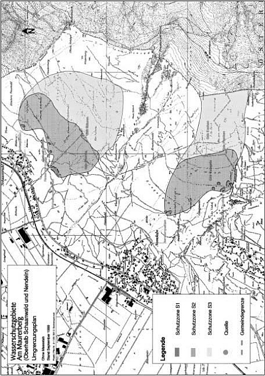

Verordnung vom 6. März 2001 zum Schutze der Quellfassungen der Wasserversorgung Liechtensteiner Unterland am "Maurerberg" (oberhalb Schaanwald und Nendeln) Aufgrund von Art. 24 und 67 des Gewässerschutzgesetzes (GSchG) vom 15. Mai 2003, LGBl. 2003 Nr. 159 , verordnet die Regierung: I. Allgemeine Bestimmungen Art. 1 Zweck Zum Schutz der Wasserversorgung werden die in Art. 2 näher umschriebenen Gebiete als Schutzzonen im Sinne von Art. 5 Abs. 1 Bst. n des Gewässerschutzgesetzes festgelegt. Art. 2 Geltungsbereich 1) Die Grenzen der Schutzzonen sind in dem dieser Verordnung beigegebenen Situationsplan dargestellt. Der Plan ist Bestandteil der Verordnung. 2) Die Schutzzonen sind in den Bauordnungen zu berücksichtigen und in den Zonen- und Waldfunktionsplänen der Gemeinden Eschen, Gamprin, Mauren und Planken ersichtlich zu machen. 3) Die detaillierten Umgrenzungen der Schutzzonen sind aus dem Situationsplan 1 : 5 000 ersichtlich, welcher bei den Gemeinden Eschen, Gamprin, Mauren und Planken sowie beim Amt für Umweltschutz aufliegt. Art. 3 Umschreibung Die Schutzzonen werden unterteilt in: a) Fassungsbereich (Zone S 1); b) engere Schutzzone (Zone S 2); c) weitere Schutzzone (Zone S 3). Art. 4 Zonen 1) Der Fassungsbereich (Zone S 1) dient dem unmittelbaren Schutz der Quellfassungen. Er umfasst die Quellschächte, die Fassungsstränge und deren nächstes Zuflussgebiet. 2) Die engere Schutzzone (Zone S 2) dient dazu, schädliche Einflüsse vom Fassungsbereich fernzuhalten. In der Zone S 2 dürfen schwer oder nicht abbaubare Schadstoffe nicht ins Grundwasser gelangen. Abbaubare Schadstoffe müssen auf dem Fliessweg so weit reduziert bzw. zurückgehalten werden, dass die Fassungen weder chemisch noch bakteriologisch belastet werden. Bei einer unfallbedingten Gewässerverschmutzung müssen in der Zone S 2 Sanierungsmassnahmen getroffen werden können, bevor die Verschmutzung den Fassungsbereich erreicht. 3) Die weitere Schutzzone (Zone S 3) dient als Pufferzone zwischen der Zone S 2 und der weiteren Umgebung. 4) Die Ausdehnung der Zonen S 2 und S 3 richtet sich nach den Zuflussrichtungen des Grundwassers zu den Fassungen, nach der Fliessgeschwindigkeit des Grundwassers, nach der Überdeckung des Grundwassers und nach der Infiltration von Oberflächengewässern ins Grundwasser im Zuflussbereich der Fassungen. Art. 5 Kennzeichnung der Schutzzonen Die Schutzzonen sind an geeigneten Stellen am Strassenrand mit entsprechenden Hinweistafeln zu signalisieren. II. Bestimmungen für die weitere Schutzzone (Zone S 3) Art. 6 Grundsatz 1) In der Zone S 3 sind Vorkehrungen, welche die Menge und Güte der Grundwasservorkommen oder die öffentliche Wasserversorgung gefährden, verboten. 2) Insbesondere verboten sind: a) Lager- und Betriebsanlagen, Rohrleitungen sowie Umschlagplätze für wassergefährdende Flüssigkeiten unter Vorbehalt von Art. 10 der Verordnung über den Schutz der Gewässer vor wassergefährdenden Flüssigkeiten (VWF); b) Recyclingbaustoffe, wie Asphaltgranulat und dergleichen; c) Rotwildfütterungen. 3) Bei Bauarbeiten sind spezielle Schutzmassnahmen zu treffen. Art. 7 Bauten und Anlagen Aufgehoben Art. 8 Tankanlagen 1) Aufgehoben 2) Aufgehoben 3) Die Treibstofftankanlage für die Stromerzeugungsanlage bei der Alpenvereinshütte Gafadura darf weiter betrieben und erforderlichenfalls auf 3000 Liter Nutzvolumen erweitert werden. Art. 9 Verkehrsanlagen Die in der Schutzzone liegenden Waldstrassen sind mit einem Fahrverbot für Motorfahrzeuge (alp- und forstwirtschaftlicher Verkehr sowie Zubringerdienst gestattet) zu belegen. Art. 10 Versickerungen Das Versickern von Abwasser ist verboten. Ausgenommen ist die Versickerung von unverschmutztem Niederschlagswasser, wenn die Versickerung über die bewachsene Bodenschicht erfolgt. Art. 11 Abwasseranlagen 1) Schmutzwasserleitungen haben den Dichtheitsanforderungen der SIA-Norm 190, Kanalisationen, zu genügen. 2) Die Dichtigkeit von Schmutzwasserleitungen, Kläranlagen, Jauchebehältern und dergleichen ist vom Eigentümer auf seine Kosten alle drei Jahre zu prüfen. 3) Mangelhafte Anlagen sind vom Eigentümer auf seine Kosten abzudichten oder zu ersetzen. Art. 12 Grabarbeiten und Auffüllungen 1) Grabarbeiten und Geländeveränderungen sind bewilligungspflichtig. Sie sind zulässig, wenn ein sachlich begründetes Bedürfnis besteht, die schützende Deckschicht nicht wesentlich vermindert wird und spezielle Schutzmassnahmen getroffen werden. 2) Auffüllungen dürfen nur aus inertem Material (sauberes Aushubmaterial) bestehen. Art. 13 Düngung 1) Die Düngung richtet sich nach der Bodenbelastbarkeit. Sie darf nur während der Vegetationsperiode erfolgen. 2) Düngemittel sind gleichmässig zu verteilen. Die Düngung ist unzulässig, wenn der Boden wassergesättigt, schneebedeckt oder gefroren ist. 3) Es gelten die Richtlinien über die Düngung von alpwirtschaftlich genutzten Wiesen und Weiden sowie Anhang 2.6 der schweizerischen Chemikalien-Risikoreduktions-Verordnung (SR 814.81). 4) Die Verwendung von Klärschlamm ist verboten. Art. 14 Pflanzen- und Holzschutzmittel 1) Für die Verwendung von Pflanzenschutzmitteln gilt Anhang 2.5 der schweizerischen Chemikalien-Risikoreduktions-Verordnung. 2) Für die Verwendung von Holzschutzmitteln gilt Anhang 2.4 der schweizerischen Chemikalien-Risikoreduktions-Verordnung. Art. 15 Lagerhaltungen 1) Es sind verboten: a) Fahrsilos; b) Ablagerungen im freien Feld von: 1. Düngern, wie Mist, Kompost und Klärschlamm; 2. Siloballen und -würsten; c) Ablagerungen von wassergefährdenden Stoffen. 2) Handelsdünger und Pflanzenschutzmittel sind geschützt gegen Durchnässung und Versickerung aufzubewahren. Art. 16 Alpstall Hanaböda und Alpenvereinshütte Gafadura 1) Für den Alpstall Hanaböda gelten im Fall der Einstallung von Tieren folgende Auflagen: a) die Standflächen des Viehs müssen dicht sein und in die Stallgüllengrube entwässern; b) der Miststock ist auf eine dichte Platte mit Randumfassung zu stellen. Die Sickerwässer sind in die Güllengrube zu leiten; c) die Güllengrube muss absolut dicht sein (Nachweis mittels Dichtigkeitsprüfung durch den Eigentümer); d) Vorplätze müssen befestigt sein. Das Niederschlagswasser ist flächenhaft zu versickern. 2) Der Klärschlamm der Kläranlage der Alpenvereinshütte Gafadura ist im Turnus abzutransportieren und darf nicht im Quelleinzugsgebiet (Schutzzone S 1 bis S 3) ausgebracht werden. III. Bestimmungen für die engere Schutzzone (Zone S 2) Art. 17 Grundsatz Alle nachfolgenden Massnahmen und Nutzungsbeschränkungen gelten zusätzlich zu den in Art. 6 bis 16 enthaltenen Bestimmungen. Art. 18 Bauten und Anlagen 1) In der Zone S 2 gilt ein allgemeines Bauverbot. Aus wichtigen Gründen können Ausnahmen gestattet werden (Art. 28). 2) Wildfütterungen jeglicher Art sind in den Schutzzonen S 1 und S 2 nicht zulässig. Art. 19 Tankanlagen Aufgehoben Art. 20 Schmutzwasserleitungen Schmutzwasserleitungen müssen in doppelwandigen Rohren oder in Doppelrohren geführt sein. Art. 21 Abstellen von Fahrzeugen Das dauernde Abstellen von Fahrzeugen mit Explosionsmotoren im Freien ist verboten. Art. 22 Pflanzen- und Holzschutzmittel, Forstwirtschaft 1) Die Anwendung von Pflanzen- und Holzschutzmitteln ist verboten. Ausgenommen sind die Verhütungsmittel gegen Verbiss- und Fegeschäden, die von den Forstdiensten der Gemeinden Eschen, Gamprin, Mauren und Planken mit Bewilligung des Amtes für Umweltschutz und unter strenger Einhaltung der Vorschriften und Gebrauchsanweisungen angewendet werden dürfen. 2) Es dürfen keine Holzlager angelegt werden. Ausgenommen sind Holzzwischenlager für Beladungszwecke; die Lagerdauer darf maximal zwei Monate betragen. 3) Forstmaschinen sind, wenn immer möglich, abends und übers Wochenende ausserhalb der Zone S 2 abzustellen. 4) Das Reparieren bzw. Reinigen von grossen Maschinen und von Fahrzeugen ist in der Zone S 2 untersagt. 5) Für das Betanken von stationären Forstmaschinen, wie Seilbahnen und dergleichen, innerhalb der Zone S 2 sind spezielle Schutzmassnahmen zu treffen. Art. 23 Landwirtschaft 1) Güllengruben, erdverlegte Güllenleitungen, Güllenzapfstellen, Mistlager, Raufuttersilos und dergleichen sind unzulässig. 2) Das Ausbringen von Gülle ist verboten. 3) Der Weidegang ist grundsätzlich nur während der Vegetationsperiode zulässig. Das Weidegebiet ist so zu bewirtschaften, dass ganzflächig eine geschlossene Grasnarbe erhalten bleibt. 4) Bei Brunnen und Tränkestellen sind Massnahmen zur Bodenverfestigung zu treffen. Anfallender Kot ist regelmässig zu entfernen. IV. Bestimmungen für den Fassungsbereich (Zone S 1) Art. 24 Grundsatz 1) In der Zone S 1 sind grundsätzlich nur Nutzungen zulässig, die der Wassergewinnung und Wasseraufbereitung dienen. 2) Die Zone S 1 ist als naturbelassene Wiese zu gestalten. Einzelne Bäume und Sträucher ausserhalb der Fassungen können bestehen bleiben. 3) In der Zone S 1 dürfen keine Pflanzenbehandlungsmittel angewendet werden. Art. 25 Schutzmassnahmen 1) Der Zutritt Unbefugter zur Zone S 1 ist durch geeignete Massnahmen zu erschweren. Von einer Umzäunung wird abgesehen. 2) Bei den Walserbachquellen ist der Holzlagerplatz auf der Südseite durch einen Zaun abzugrenzen. Der über das Quellgebiet führende Maschinenweg darf nur vom Forstdienst der Gemeinden Eschen, Gamprin und Mauren benutzt werden und ist beidseitig durch eine abschliessbare Schranke zu sichern. 3) Die Schutzmassnahmen sind innerhalb eines Jahres nach Inkrafttreten dieser Verordnung zu treffen. Die Kosten gehen zu Lasten der Wasserversorgung Liechtensteiner Unterland. V. Organisation und Durchführung Art. 26 Aufsicht 1) Die Aufsicht über die Schutzzonen obliegt dem Amt für Umweltschutz. Die Wasserversorgung Liechtensteiner Unterland (Wassermeister) hat bei der Aufsicht mitzuwirken, wobei Umfang und Durchführung der Kontrollen durch Vereinbarung geregelt werden. 2) Aufgehoben Art. 27 Verfügungen Das Amt für Umweltschutz erlässt die gemäss dieser Verordnung erforderlichen Verfügungen und überwacht deren Vollzug. Art. 28 Ausnahmebewilligungen 1) Die Regierung kann im Einvernehmen mit der Wasserversorgung Liechtensteiner Unterland aus wichtigen Gründen von den Vorschriften dieser Verordnung abweichende Bewilligungen erteilen, sofern eine Gefährdung der Trinkwassernutzung ausgeschlossen werden kann. 2) In der Bewilligung sind die zu treffenden, speziellen Schutzmassnahmen festzulegen. g) die Vorschriften über die Lagerhaltung nicht einhält (Art. 15 und 22 Abs. 2). Art. 28a Kosten 1) Die aus der Ausscheidung der Schutzzonen erwachsenden Kosten trägt die Wasserversorgung Liechtensteiner Unterland. 2) Allfällige Entschädigungsleistungen sind vertraglich festzulegen und gehen zu Lasten der Wasserversorgung Liechtensteiner Unterland. VI. Strafbestimmung Art. 29 Übertretungen Nach Art. 61 des Gewässerschutzgesetzes wird bestraft, wer: a) verbotene Vorkehrungen in Schutzzonen vornimmt (Art. 6 Abs. 1 und 2, Art. 10, 18, 21 und 24); b) die geforderten Schutzmassnahmen nicht trifft (Art. 6 Abs. 3 und Art. 20); c) die Anforderungen an Abwasseranlagen nicht erfüllt (Art. 11); d) unzulässige Geländeveränderungen oder ohne Bewilligung Auffüllungen oder Grabarbeiten vornimmt (Art. 12); e) die Vorschriften über die Land- und Forstwirtschaft nicht einhält (Art. 13, 16, 22 Abs. 3 bis 5 und Art. 23); f) die Vorschriften über Pflanzen- und Holzschutzmittel nicht einhält (Art. 14 und 22 Abs. 1); VII. Schlussbestimmung Art. 30 Inkrafttreten Diese Verordnung tritt am Tage der Kundmachung in Kraft. Fürstliche Regierung: gez. Dr. Mario Frick Fürstlicher Regierungschef Anhang (Art. 2 Abs. 1) 

