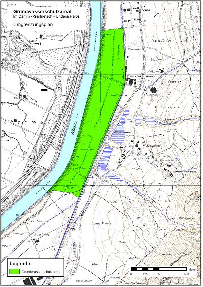

Verordnung vom 18. März 2008 über das Grundwasserschutzareal "Im Damm - Gartnetsch - Undera Hälos" in der Gemeinde Triesen Aufgrund von Art. 24 und 67 des Gewässerschutzgesetzes (GSchG) vom 15. Mai 2003, LGBI. 2003 Nr. 159 , verordnet die Regierung: I. Allgemeine Bestimmungen Art. 1 Zweck Das in Art. 2 näher umschriebene Gebiet wird als Schutzareal im Sinne von Art. 5 Abs. 1 Bst. o des Gewässerschutzgesetzes festgelegt. Art. 2 Geltungsbereich 1) Die Grenzen des Schutzareals sind in dem dieser Verordnung beigegebenen Situationsplan dargestellt. Der Plan ist Bestandteil dieser Verordnung. 2) Das Schutzareal ist in der Bauordnung zu berücksichtigen und im Zonenplan der Gemeinde Triesen ersichtlich zu machen. 3) Die detaillierten Umgrenzungen des Schutzareals sind aus dem Situationsplan 1 : 2 000 ersichtlich, welcher bei der Gemeinde Triesen sowie beim Amt für Umweltschutz aufliegt. Art. 3 Umschreibung Das Schutzareal dient der Freihaltung eines Gebietes, das für eine zukünftige Grundwasserfassung mit den dazugehörigen Schutzzonen im Sinne von Art. 5 Abs. 1 Bst. n des Gewässerschutzgesetzes geeignet ist. II. Bestimmungen für das Schutzareal Art. 4 Grundsatz Im Schutzareal sind Vorkehrungen, welche die Menge und Güte der Grundwasservorkommen oder die öffentliche Wasserversorgung gefährden, verboten. Art. 5 Bauten und Anlagen 1) Im Schutzareal gilt ein allgemeines Bauverbot. Aus wichtigen Gründen können Ausnahmen gestattet werden (Art. 15). 2) Beim Binnenkanal sind wasserbauliche Massnahmen erlaubt. Diese müssen auf die spezifischen Gegebenheiten künftiger Schutzzonen abgestimmt sein und mit dem Amt für Umweltschutz koordiniert werden. Art. 6 Verkehrsanlagen Die Rheindammstrasse sowie Feldwege sind mit einem Fahrverbot für Motorfahrzeuge (landwirtschaftlicher Verkehr, Wuhrpflege sowie Zubringerdienst gestattet) zu belegen. Art. 7 Versickerungen Das Versickern von Abwasser ist verboten. Ausgenommen ist die Versickerung von unverschmutztem Niederschlagswasser, wenn die Versickerung über die bewachsene Bodenschicht erfolgt. Art. 8 Abwasseranlagen, Erdgasleitung 1) Schmutzwasserleitungen haben den Dichtheitsanforderungen der SIA-Norm 190, Kanalisationen, zu genügen. 2) Die Dichtheit von Schmutzwasserleitungen, Jauchebehältern und dergleichen ist vom Eigentümer alle drei Jahre zu prüfen. 3) Mangelhafte Anlagen sind vom Eigentümer auf seine Kosten abzudichten oder zu ersetzen. 4) Die Erdgas-Hochdruckleitung ist gemäss den Weisungen des Amtes für Volkswirtschaft regelmässig zu kontrollieren. Art. 9 Grabarbeiten, Geländeveränderungen und Auffüllungen 1) Grabarbeiten und Geländeveränderungen sind bewilligungspflichtig. 2) Sie sind zu bewilligen, wenn ein sachlich begründetes Bedürfnis besteht, die schützende Deckschicht nicht wesentlich vermindert wird und spezielle Schutzmassnahmen getroffen werden. 3) Auffüllungen dürfen nur aus inertem Material (sauberes Aushubmaterial) bestehen. Art. 10 Düngung 1) Die Düngung richtet sich nach der Bodenbelastbarkeit. Sie darf nur während der Vegetationsperiode erfolgen. 2) Düngemittel sind gleichmässig zu verteilen. Die Düngung ist unzulässig, wenn der Boden wassergesättigt, schneebedeckt oder gefroren ist. 3) Es gilt Anhang 2.6 der schweizerischen Chemikalien-Risikoreduktions-Verordnung (SR 814.81). 4) Äcker dürfen nicht über längere Zeit brach gelassen werden. Brachliegende Äcker dürfen nur gedüngt werden, wenn sie anschliessend sofort bepflanzt werden. 5) Die Verwendung von Klärschlamm ist verboten. Art. 11 Pflanzen- und Holzschutzmittel 1) Für die Verwendung von Pflanzenschutzmitteln gilt Anhang 2.5 der schweizerischen Chemikalien-Risikoreduktions-Verordnung. Insbesondere ist die ganzflächige Vorauflauf-Behandlung mit chemischen Bodenherbiziden untersagt. 2) Für die Verwendung von Holzschutzmitteln gilt Anhang 2.4 der schweizerischen Chemikalien-Risikoreduktions-Verordnung. Art. 12 Lagerhaltungen 1) Es sind verboten: a) Fahrsilos; b) Ablagerungen im freien Feld von: 1. Düngern, wie Mist, Kompost und Klärschlamm; 2. Siloballen und -würsten; c) Ablagerungen von wassergefährdenden Stoffen. 2) Handelsdünger und Pflanzenschutzmittel sind geschützt gegen Durchnässung und Versickerung aufzubewahren. III. Organisation und Durchführung Art. 13 Aufsicht Die Aufsicht über das Schutzareal obliegt dem Amt für Umweltschutz. Die Gemeinde Triesen (Wassermeister) hat bei der Aufsicht mitzuwirken, wobei Umfang und Durchführung der Kontrollen durch Vereinbarung geregelt werden. Art. 14 Verfügungen Das Amt für Umweltschutz erlässt die gemäss dieser Verordnung erforderlichen Verfügungen und überwacht deren Vollzug. Art. 15 Ausnahmebewilligungen 1) Die Regierung kann im Einvernehmen mit der Gemeinde Triesen aus wichtigen Gründen von den Vorschriften dieser Verordnung abweichende Bewilligungen erteilen, sofern eine Gefährdung der Trinkwassernutzung ausgeschlossen werden kann. 2) In der Bewilligung sind die zu treffenden, speziellen Schutzmassnahmen festzulegen. Art. 16 Kosten 1) Die aus der Ausscheidung des Schutzareals erwachsenden Kosten trägt die Gemeinde Triesen. 2) Allfällige Entschädigungsleistungen an die betroffenen Grundeigentümer gehen zu Lasten der Gemeinde Triesen nach Massgabe vertraglicher Vereinbarungen. IV. Strafbestimmung Art. 17 Übertretungen Nach Art. 61 des Gewässerschutzgesetzes wird bestraft, wer: a) verbotene Vorkehrungen im Schutzareal vornimmt (Art. 4); b) die Vorschriften über Bauten und Anlagen nicht einhält (Art. 5); c) die Vorschriften über Versickerungen nicht einhält (Art. 7); d) die Anforderungen an die Abwasseranlagen sowie an die Erdgasleitung nicht erfüllt (Art. 8); e) unzulässige Geländeveränderungen oder ohne Bewilligung Aufschüttungen oder Grabarbeiten vornimmt (Art. 9); f) die Vorschriften über die Düngung nicht einhält (Art. 10); g) die Vorschriften über Pflanzen- und Holzschutzmittel nicht einhält (Art. 11); h) die Vorschriften über die Lagerhaltung nicht einhält (Art. 12); i) die Vorschriften über den Motocrossplatz nicht einhält (Art. 18). V. Übergangs- und Schlussbestimmung Art. 18 Motocrossplatz 1) Die bisherige Nutzung des im Schutzareal gelegenen Motocrossplatzes ist weiterhin zulässig, sofern dadurch eine zukünftige Grundwasserfassung im Schutzareal nicht verunmöglicht wird. 2) Grabarbeiten und Geländeveränderungen bedürfen keiner Bewilligung im Sinne von Art. 9. Vorbehalten bleibt Abs. 3. 3) Auf dem Motocrossplatz sind verboten: a) die Errichtung von Bauten, mit Ausnahme von Fahrnisbauten wie Containern zur Materiallagerung; b) Tätigkeiten, bei denen Abwasser anfällt; c) Unterhalts- und Reparaturarbeiten an Motorfahrzeugen; d) das dauernde Abstellen von Fahrzeugen im Freien; e) die Lagerung von Treibstoffen und Schmiermitteln; und f) Grabarbeiten und Geländeveränderungen unter das natürlich gewachsene Niveau. 4) Auf dem Motocrossplatz sind folgende Auflagen einzuhalten: a) die Betankung von Motorfahrzeugen darf nur in einer Wanne erfolgen, die allfällig austretende Treibstoffe vollständig auffangen kann; b) Sanitäranlagen sind als geschlossene Systeme auszuführen; c) zur Beseitigung wassergefährdender Stoffe bei Unfällen ist geeignetes Material wie Ölbindemittel bereit zu halten; die Benutzer des Motocrossplatzes sind über deren Handhabung zu instruieren; d) Unfälle mit wassergefährdenden Stoffen sind unverzüglich der Landespolizei und dem Amt für Umweltschutz zu melden und es sind die notwendigen Massnahmen zu treffen; e) der Platz ist zu umzäunen. 5) Der Moto-Cross-Club Triesen hat dem Amt für Umweltschutz einen Gewässerschutzverantwortlichen zu benennen. Der Gewässerschutzverantwortliche hat die in Abs. 3 und 4 genannten Verbote und Auflagen zu überwachen. Art. 19 Inkrafttreten Diese Verordnung tritt am Tag der Kundmachung in Kraft. Fürstliche Regierung: gez. Otmar Hasler Fürstlicher Regierungschef Anhang (Art. 2 Abs. 1) 

