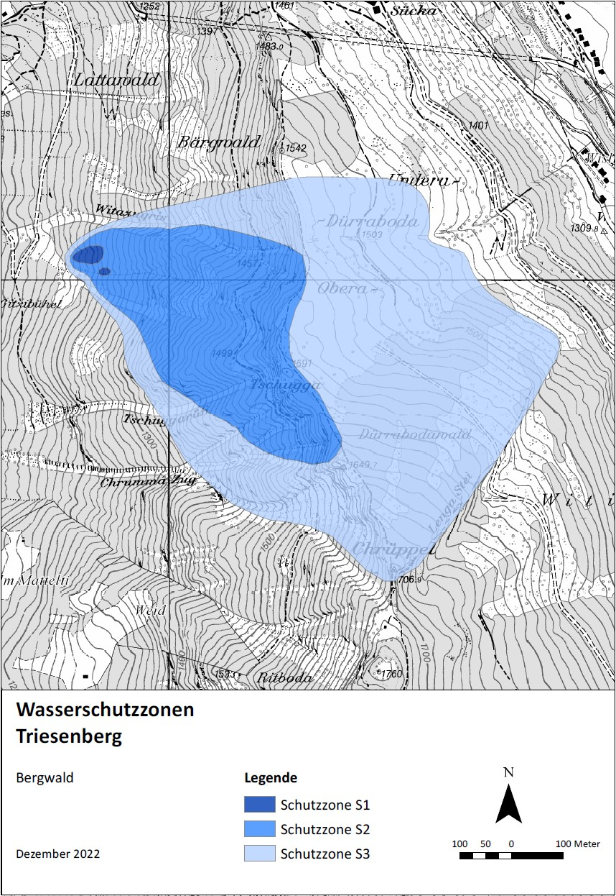

Verordnung vom 18. Januar 2011 zum Schutze der Quellfassungen "Bergwald" in der Gemeinde Triesenberg Aufgrund von Art. 24 und 67 des Gewässerschutzgesetzes (GSchG) vom 15. Mai 2003, LGBI. 2003 Nr. 159, verordnet die Regierung: I. Allgemeine Bestimmungen Art. 1 Zweck Zum Schutz der Wasserversorgung wird das in Art. 2 näher umschriebene Gebiet als Schutzzone im Sinne von Art. 5 Abs. 1 Bst. q des Gewässerschutzgesetzes festgelegt. Art. 2 Geltungsbereich 1) Die Grenzen der Schutzzone sind in dem dieser Verordnung beigegebenen Situationsplan dargestellt. Der Plan ist Bestandteil dieser Verordnung. 2) Die Schutzzone ist in der Bauordnung zu berücksichtigen und im Zonen- und Waldfunktionsplan der Gemeinde Triesenberg ersichtlich zu machen. 3) Die detaillierten Umgrenzungen der Schutzzone sind aus dem Situationsplan 1 : 2 000 ersichtlich, welcher bei der Gemeinde Triesenberg und beim Amt für Umweltschutz aufliegt. Art. 3 Umschreibung Die Schutzzone wird unterteilt in: a) Fassungsbereich (Zone S 1); b) engere Schutzzone (Zone S 2); c) weitere Schutzzone (Zone S 3). Art. 4 Zonen 1) Der Fassungsbereich (Zone S 1) dient dem unmittelbaren Schutz der Quellfassungen. Er umfasst die Quellschächte, die Fassungsstränge und deren nächstes Zuflussgebiet. 2) Die engere Schutzzone (Zone S 2) dient dazu, schädliche Einflüsse vom Fassungsbereich fernzuhalten. In der Zone S 2 dürfen schwer oder nicht abbaubare Schadstoffe nicht ins Grundwasser gelangen. Abbaubare Schadstoffe müssen auf dem Fliessweg so weit reduziert bzw. zurückgehalten werden, dass die Fassungen weder chemisch noch bakteriologisch belastet werden. Bei einer unfallbedingten Gewässerverschmutzung müssen in der Zone S 2 Sanierungsmassnahmen getroffen werden können, bevor die Verschmutzung den Fassungsbereich erreicht. 3) Die weitere Schutzzone (Zone S 3) dient als Pufferzone zwischen der Zone S 2 und der Umgebung. 4) Die Ausdehnung der Zonen S 2 und S 3 richtet sich nach den Zuflussrichtungen, nach der Fliessgeschwindigkeit und nach der Überdeckung des Grundwassers sowie nach der Infiltration von Oberflächengewässern ins Grundwasser im Zuflussbereich der Fassungen. Art. 5 Bewilligungspflicht Bauten und Anlagen in der Schutzzone dürfen nur mit einer Bewilligung des Amtes für Umweltschutz erstellt oder geändert werden. Art. 6 Kennzeichnung der Schutzzone Die Zone S 1 ist an geeigneten Stellen mit entsprechenden Hinweistafeln zu signalisieren. II. Bestimmungen für die weitere Schutzzone (Zone S 3) Art. 7 Grundsatz 1) In der Zone S 3 sind Vorkehrungen, welche die Menge und Güte der Grundwasservorkommen oder die öffentliche Wasserversorgung gefährden, verboten. 2) Insbesondere verboten sind: a) Lager- und Betriebsanlagen, Rohrleitungen sowie Umschlagplätze für wassergefährdende Flüssigkeiten unter Vorbehalt von Art. 10 der Verordnung über den Schutz der Gewässer vor wassergefährdenen Flüssigkeiten (VWF); b) Recyclingbaustoffe, wie Asphaltgranulat und dergleichen; c) Wildfütterungen. 3) Bei Bauarbeiten sind spezielle Schutzmassnahmen zu treffen. Art. 8 Verkehrsanlagen Die in der Schutzzone liegenden Waldstrassen sind mit einem Fahrverbot für Motorfahrzeuge (alp- und forstwirtschaftlicher Verkehr sowie Zubringerdienst gestattet) zu belegen. Art. 9 Versickerungen Das Versickern von Abwasser ist verboten. Ausgenommen ist die Versickerung von unverschmutztem Niederschlagswasser, wenn die Versickerung über die bewachsene Bodenschicht erfolgt. Art. 10 Grabarbeiten und Auffüllungen 1) Grabarbeiten und Geländeveränderungen sind bewilligungspflichtig. Sie sind zulässig, wenn ein sachlich begründetes Bedürfnis besteht, die schützende Deckschicht nicht wesentlich vermindert wird und spezielle Schutzmassnahmen getroffen werden. 2) Auffüllungen dürfen nur aus inertem Material (sauberes Aushubmaterial) bestehen. Art. 11 Düngung 1) Die Düngung richtet sich nach der Bodenbelastbarkeit. Sie darf nur während der Vegetationsperiode erfolgen. 2) Düngemittel sind gleichmässig zu verteilen. Die Düngung ist unzulässig, wenn der Boden wassergesättigt, schneebedeckt oder gefroren ist. 3) Es gelten die Richtlinien über die Düngung von alpwirtschaftlich genutzten Wiesen und Weiden sowie Anhang 2.6 der schweizerischen Chemikalien-Risikoreduktions-Verordnung (SR 814.81). 4) Die Verwendung von Klärschlamm ist verboten. Art. 12 Pflanzen- und Holzschutzmittel 1) Für die Verwendung von Pflanzenschutzmitteln gilt Anhang 2.5 der schweizerischen Chemikalien-Risikoreduktions-Verordnung. 2) Für die Verwendung von Holzschutzmitteln gilt Anhang 2.4 der schweizerischen Chemikalien-Risikoreduktions-Verordnung. Art. 13 Lagerhaltungen 1) Es sind verboten: a) Fahrsilos; b) Ablagerungen im freien Feld von: 1. Düngern, wie Mist, Kompost und Klärschlamm; 2. Siloballen und -würsten; c) Ablagerungen von wassergefährdenden Stoffen. 2) Handelsdünger und Pflanzenschutzmittel sind geschützt gegen Durchnässung und Versickerung aufzubewahren. 3) Mistlager bei den Ställen bedürfen einer dichten Bodenplatte mit Randumfassung. Die anfallende Gülle ist aufzufangen. III. Bestimmungen für die engere Schutzzone (Zone S 2) Art. 14 Grundsatz Alle nachfolgenden Massnahmen und Nutzungsbeschränkungen gelten zusätzlich zu den in Art. 7 bis 13 enthaltenen Bestimmungen. Art. 15 Bauten und Anlagen In der Zone S 2 gilt ein allgemeines Bauverbot. Aus wichtigen Gründen können Ausnahmen gestattet werden (Art. 22). Art. 16 Pflanzen- und Holzschutzmittel, Forstwirtschaft 1) Die Anwendung von Pflanzen- und Holzschutzmitteln ist verboten. Davon ausgenommen sind Mittel gegen Verbiss- und Fegeschäden, die vom Forstdienst der Gemeinde Triesenberg mit Bewilligung des Amtes für Umweltschutz und unter strenger Einhaltung der Vorschriften und Gebrauchsanweisungen angewendet werden dürfen. 2) Es dürfen keine Holzlager angelegt werden. 3) Forstmaschinen sind, soweit möglich, abends und übers Wochenende ausserhalb der Zone S 2 abzustellen. 4) Das Reparieren oder Reinigen von grossen Maschinen und von Fahrzeugen ist untersagt. 5) Für das Betanken von stationären Forstmaschinen, wie Seilbahnen und dergleichen, sind spezielle Schutzmassnahmen zu treffen. Art. 17 Düngung Das Ausbringen von Gülle ist verboten. IV. Bestimmungen für den Fassungsbereich (Zone S 1) Art. 18 Grundsatz 1) In der Zone S 1 sind grundsätzlich nur Nutzungen zulässig, die der Wassergewinnung und Wasseraufbereitung dienen. 2) Die Zone S 1 ist als Niederwald zu bewirtschaften. Einzelne gefällte Bäume können zur Minderung der Steinschlaggefahr als Schutzriegel platziert werden. 3) Die Anwendung von Pflanzen- und Holzschutzmitteln ist verboten. Art. 19 Zutritt Die Zone S 1 ist vor dem Zutritt Unbefugter zu schützen. V. Organisation und Durchführung Art. 20 Aufsicht 1) Die Aufsicht über die Schutzzone obliegt dem Amt für Umweltschutz. Die Gemeinde Triesenberg (Wassermeister) hat bei der Aufsicht mitzuwirken, wobei Umfang und Durchführung der Kontrollen durch Vereinbarung geregelt werden. 2) Aufgehoben Art. 21 Verfügungen Das Amt für Umweltschutz erlässt die gemäss dieser Verordnung erforderlichen Verfügungen und überwacht deren Vollzug. Art. 22 Ausnahmebewilligungen 1) Die Regierung kann im Einvernehmen mit der Gemeinde Triesenberg aus wichtigen Gründen von den Vorschriften dieser Verordnung abweichende Bewilligungen erteilen, sofern eine Gefährdung der Trinkwassernutzung ausgeschlossen werden kann. 2) In der Bewilligung sind die zu treffenden, speziellen Schutzmassnahmen festzulegen. Art. 23 Kosten 1) Die aus der Ausscheidung der Schutzzone erwachsenden Kosten trägt die Gemeinde Triesenberg. 2) Allfällige Entschädigungsleistungen an die betroffenen Grundeigentümer gehen zu Lasten der Gemeinde Triesenberg nach Massgabe vertraglicher Vereinbarungen. VI. Strafbestimmungen Art. 24 Übertretungen Nach Art. 61 des Gewässerschutzgesetzes wird bestraft, wer: a) Bauten und Anlagen ohne Bewilligung erstellt oder ändert (Art. 5); b) verbotene Vorkehrungen in Schutzzonen vornimmt (Art. 7 Abs. 1 und 2, Art. 9, 15 und 18 Abs. 1); c) die geforderten Schutzmassnahmen nicht trifft (Art. 7 Abs. 3); d) unzulässige Geländeveränderungen oder ohne Bewilligung Auffüllungen oder Grabarbeiten vornimmt (Art. 10); e) die Vorschriften über die Düngung nicht einhält (Art. 11 und 17); f) die Vorschriften über Pflanzen- und Holzschutzmittel nicht einhält (Art. 12, 16 Abs. 1 und Art. 18 Abs. 3); g) die Vorschriften über die Lagerhaltung nicht einhält (Art. 13); h) die Vorschriften über die Forstwirtschaft nicht einhält (Art. 16 Abs. 2 bis 5). VII. Übergangs- und Schlussbestimmungen Art. 25 Bauliche Massnahmen Die baulichen Schutzmassnahmen sind innerhalb von drei Jahren nach Inkrafttreten dieser Verordnung zu treffen. Art. 26 Fassungsbereich Die Waldfläche ist im Bereich der Quellfassungen und der Fassungsstränge innerhalb von drei Jahren als Niederwald zu gestalten (Art. 18). Art. 27 Inkrafttreten Diese Verordnung tritt am Tage der Kundmachung in Kraft. Fürstliche Regierung: gez. Dr. Klaus Tschütscher Fürstlicher Regierungschef Anhang (Art. 2 Abs. 1) 

