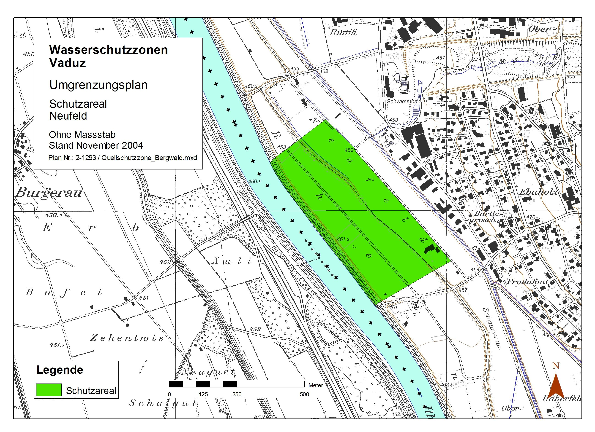

Verordnung vom 22. Februar 2011 über das Grundwasserschutzareal "Neufeld" in der Gemeinde Vaduz Aufgrund von Art. 24 und 67 des Gewässerschutzgesetzes (GSchG) vom 15. Mai 2003, LGBl. 2003 Nr. 159, verordnet die Regierung: I. Allgemeine Bestimmungen Art. 1 Zweck Das in Art. 2 näher umschriebene Gebiet wird als Schutzareal im Sinne von Art. 5 Abs. 1 Bst. o des Gewässerschutzgesetzes festgelegt. Art. 2 Geltungsbereich 1) Die Grenzen des Schutzareals sind in dem dieser Verordnung beigegebenen Situationsplan dargestellt. Der Plan ist Bestandteil dieser Verordnung. 2) Das Schutzareal ist in der Bauordnung zu berücksichtigen und im Zonenplan der Gemeinde Vaduz ersichtlich zu machen. 3) Die detaillierten Umgrenzungen des Schutzareals sind aus dem Situationsplan 1 : 2 000 ersichtlich, welcher bei der Gemeinde Vaduz sowie beim Amt für Umweltschutz aufliegt. Art. 3 Umschreibung Das Schutzareal dient der Freihaltung eines Gebietes, das für eine zukünftige Grundwasserfassung mit den dazugehörigen Schutzzonen im Sinne von Art. 5 Abs. 1 Bst. n des Gewässerschutzgesetzes geeignet ist. II. Bestimmungen für das Schutzareal Art. 4 Grundsatz Im Schutzareal sind Vorkehrungen, welche die Menge und Güte der Grundwasservorkommen oder die öffentliche Wasserversorgung gefährden, verboten. Art. 5 Bauten und Anlagen Im Schutzareal gilt ein allgemeines Bauverbot. Aus wichtigen Gründen können Ausnahmen gestattet werden (Art. 15). Art. 6 Verkehrsanlagen 1) Feldwege sind mit einem Fahrverbot für Motorfahrzeuge (landwirtschaftlicher Verkehr sowie Zubringerdienst gestattet) zu belegen. 2) Für die Rheindammstrasse gilt ein Fahrverbot für Fahrzeuge mit wassergefährdender Ladung. Art. 7 Versickerungen Das Versickern von Abwasser ist verboten. Ausgenommen ist die Versickerung von unverschmutztem Niederschlagswasser, wenn die Versickerung über die bewachsene Bodenschicht erfolgt. Art. 8 Abwasseranlagen, Erdgasleitung 1) Schmutzwasserleitungen haben den Dichtheitsanforderungen der SIA-Norm 190, Kanalisationen, zu genügen. 2) Die Dichtheit von Schmutzwasserleitungen, Jauchebehältern und dergleichen ist vom Eigentümer alle drei Jahre zu prüfen. 3) Die Erdgas-Hochdruckleitung ist gemäss den Weisungen des Amtes für Volkswirtwirtschaft regelmässig zu kontrollieren. 4) Mangelhafte Anlagen sind vom Eigentümer auf seine Kosten abzudichten oder zu ersetzen. Art. 9 Grabarbeiten, Geländeveränderungen und Auffüllungen 1) Grabarbeiten und Geländeveränderungen sind bewilligungspflichtig. 2) Sie sind zu bewilligen, wenn ein sachlich begründetes Bedürfnis besteht, die schützende Deckschicht nicht wesentlich vermindert wird und spezielle Schutzmassnahmen getroffen werden. 3) Auffüllungen dürfen nur aus sauberem Aushubmaterial bestehen. Art. 10 Düngung 1) Die Düngung richtet sich nach der Bodenbelastbarkeit. Sie darf nur während der Vegetationsperiode erfolgen. 2) Düngemittel sind gleichmässig zu verteilen. Die Düngung ist unzulässig, wenn der Boden wassergesättigt, schneebedeckt oder gefroren ist. 3) Es gilt Anhang 2.6 der schweizerischen Chemikalien-Risikoreduktions-Verordnung (SR 814.81). 4) Äcker dürfen nicht über längere Zeit brach gelassen werden. Brachliegende Äcker dürfen nur gedüngt werden, wenn sie anschliessend sofort bepflanzt werden. 5) Die Verwendung von Klärschlamm ist verboten. Art. 11 Pflanzen- und Holzschutzmittel 1) Für die Verwendung von Pflanzenschutzmitteln gilt Anhang 2.5 der schweizerischen Chemikalien-Risikoreduktions-Verordnung. Insbesondere ist die ganzflächige Vorauflauf-Behandlung mit chemischen Bodenherbiziden untersagt. 2) Für die Verwendung von Holzschutzmitteln gilt Anhang 2.4 der schweizerischen Chemikalien-Risikoreduktions-Verordnung. Art. 12 Lagerhaltungen Es sind verboten: a) Fahrsilos; b) Ablagerungen im freien Feld von: 1. Düngern, wie Mist, Kompost und Klärschlamm; 2. Siloballen und -würsten; c) Ablagerungen von wassergefährdenden Stoffen. III. Organisation und Durchführung Art. 13 Aufsicht Die Aufsicht über das Schutzareal obliegt dem Amt für Umweltschutz. Die Gemeinde Vaduz (Wassermeister) hat bei der Aufsicht mitzuwirken, wobei Umfang und Durchführung der Kontrollen durch Vereinbarung geregelt werden. Art. 14 Verfügungen Das Amt für Umweltschutz erlässt die gemäss dieser Verordnung erforderlichen Verfügungen und überwacht deren Vollzug. Art. 15 Ausnahmebewilligungen 1) Die Regierung kann im Einvernehmen mit der Gemeinde Vaduz aus wichtigen Gründen von den Vorschriften dieser Verordnung abweichende Bewilligungen erteilen, sofern eine Gefährdung der Trinkwassernutzung ausgeschlossen werden kann. 2) In der Bewilligung sind die zu treffenden, speziellen Schutzmassnahmen festzulegen. Art. 16 Kosten 1) Die aus der Ausscheidung des Schutzareals erwachsenden Kosten trägt die Gemeinde Vaduz. 2) Allfällige Entschädigungsleistungen an die betroffenen Grundeigentümer gehen zu Lasten der Gemeinde Vaduz nach Massgabe vertraglicher Vereinbarungen. IV. Strafbestimmung Art. 17 Übertretungen Nach Art. 61 des Gewässerschutzgesetzes wird bestraft, wer: a) verbotene Vorkehrungen im Schutzareal vornimmt (Art. 4); b) die Vorschriften über Bauten und Anlagen nicht einhält (Art. 5); c) die Vorschriften über Versickerungen nicht einhält (Art. 7); d) die Anforderungen an die Abwasseranlagen sowie an die Erdgasleitung nicht erfüllt (Art. 8); e) unzulässige Geländeveränderungen oder ohne Bewilligung Aufschüttungen oder Grabarbeiten vornimmt (Art. 9); f) die Vorschriften über die Düngung nicht einhält (Art. 10); g) die Vorschriften über Pflanzen- und Holzschutzmittel nicht einhält (Art. 11); h) die Vorschriften über die Lagerhaltung nicht einhält (Art. 12). V. Übergangs- und Schlussbestimmungen Art. 18 Bestehender Landwirtschaftsbetrieb 1) Die bisherige Nutzung und Nutzungserweiterungen nach Massgabe der Bauordnung vom bestehenden Landwirtschaftsbetrieb im Schutzareal sind zulässig, sofern die Gefährdung für das Grundwasser nur geringfügig ist. Das Amt für Umweltschutz legt die erforderlichen Schutzmassnahmen fest. 2) Bei teilweiser oder vollständiger Zerstörung ist der Wiederaufbau des Landwirtschaftsbetriebes nach Massgabe der Bauordnung zulässig, sofern die Gefährdung des Grundwassers nur geringfügig ist und die vom Amt für Umweltschutz festgelegten Schutzmassnahmen ergriffen werden. Art. 19 Inkrafttreten Diese Verordnung tritt am Tage der Kundmachung in Kraft. Fürstliche Regierung: gez. Dr. Klaus Tschütscher Fürstlicher Regierungschef Anhang (Art. 2 Abs. 1) 

