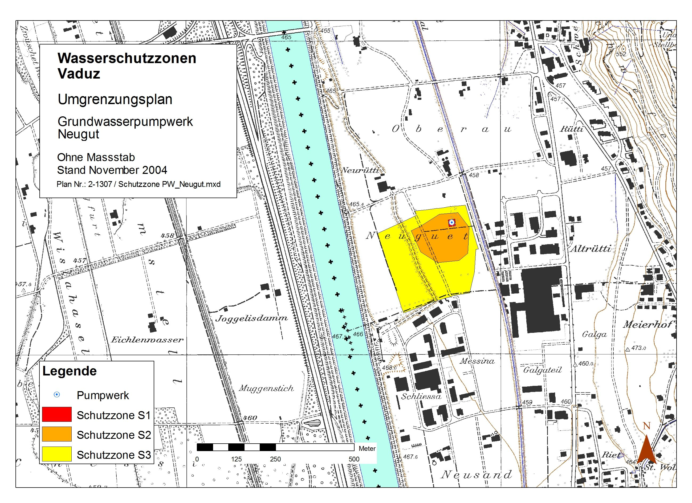

Verordnung vom 22. Februar 2011 zum Schutze des Grundwasserpumpwerkes "Neugut" in der Gemeinde Vaduz Aufgrund von Art. 24 und 67 des Gewässerschutzgesetzes (GSchG) vom 15. Mai 2003, LGBl. 2003 Nr. 159 , verordnet die Regierung: I. Allgemeine Bestimmungen Art. 1 Zweck Zum Schutz der Wasserversorgung wird das im Art. 2 näher umschriebene Gebiet als Schutzzone im Sinne von Art. 5 Abs. 1 Bst. n des Gewässerschutzgesetzes festgelegt. Art. 2 Geltungsbereich 1) Die Grenzen der Schutzzone sind in dem dieser Verordnung beigegebenen Situationsplan dargestellt. Der Plan ist Bestandteil dieser Verordnung und gilt für eine maximale Entnahmemenge von 45 Litern pro Sekunde. 2) Die Schutzzone ist in der Bauordnung zu berücksichtigen und im Zonenplan der Gemeinde Vaduz ersichtlich zu machen. 3) Die detaillierten Umgrenzungen der Schutzzone sind aus dem Situationsplan 1 : 2 000 ersichtlich, welcher bei der Gemeinde Vaduz sowie beim Amt für Umweltschutz aufliegt. Art. 3 Umschreibung Die Schutzzone wird unterteilt in: a) Fassungsbereich (Zone S 1); b) engere Schutzzone (Zone S 2); c) weitere Schutzzone (Zone S 3). Art. 4 Zonen 1) Der Fassungsbereich (Zone S 1) dient dem unmittelbaren Schutz der Grundwasserfassung. Er umfasst die eigentliche Grundwasserfassung (Brunnen) sowie das unmittelbar umliegende Zuflussgebiet. 2) Die engere Schutzzone (Zone S 2) dient dazu, schädliche Einflüsse vom Fassungsbereich fernzuhalten. In der Zone S 2 dürfen schwer oder nicht abbaubare Schadstoffe nicht ins Grundwasser gelangen. Abbaubare Schadstoffe müssen auf dem Fliessweg so weit reduziert bzw. zurückgehalten werden können, dass die Fassung weder chemisch noch bakteriologisch belastet wird. Bei einer unfallbedingten Gewässerverschmutzung müssen in der Zone S 2 Sanierungsmassnahmen getroffen werden können, bevor die Verschmutzung den Fassungsbereich erreicht. 3) Die weitere Schutzzone (Zone S 3) dient als Pufferzone zwischen der Zone S 2 und der Umgebung. 4) Die Ausdehnung der Zonen S 2 und S 3 richtet sich nach den Zuflussrichtungen, nach der Fliessgeschwindigkeit und nach der Überdeckung des Grundwassers sowie nach der Infiltration von Oberflächengewässern ins Grundwasser im Zuflussbereich der Fassung. Art. 5 Bewilligungspflicht Bauten und Anlagen in den Schutzzonen dürfen nur mit einer Bewilligung des Amtes für Umweltschutz erstellt oder geändert werden. Art. 6 Kennzeichnung der Schutzzonen Die Schutzzonen sind an geeigneten Stellen am Rand der Feldwege mit entsprechenden Hinweistafeln zu signalisieren. II. Bestimmungen für die weitere Schutzzone (Zone S 3) Art. 7 Grundsatz 1) In der Zone S 3 sind Vorkehrungen, welche die Menge und Güte der Grundwasservorkommen oder die öffentliche Wasserversorgung gefährden, verboten. 2) Insbesondere verboten sind: a) Lager- und Betriebsanlagen, Rohrleitungen sowie Umschlagplätze für wassergefährdende Flüssigkeiten unter Vorbehalt von Art. 10 der Verordnung über den Schutz der Gewässer vor wassergefährdenden Flüssigkeiten (VWF); b) Kreisläufe, die dem Wasser Wärme entziehen oder abgeben; c) Dichtungs- und Spundwände; d) Kies-, Sand und Lehmgruben; e) Deponien mit Ausnahme solcher für unverschmutztes Aushubmaterial; f) Recyclingbaustoffe, wie Asphaltgranulat und dergleichen. 3) Bei Bauarbeiten sind spezielle Schutzmassnahmen zu treffen. Art. 8 Verkehrsanlagen Feldwege sind mit einem Fahrverbot für Motorfahrzeuge (landwirtschaftlicher Verkehr sowie Zubringerdienst gestattet) zu belegen. Art. 9 Versickerungen Das Versickern von Abwasser ist verboten. Ausgenommen ist die Versickerung von unverschmutztem Niederschlagswasser, wenn die Versickerung über die bewachsene Bodenschicht erfolgt. Art. 10 Abwasseranlagen, Erdgasleitung 1) Schmutzwasserleitungen haben den Dichtheitsanforderungen der SIA-Norm 190, Kanalisationen, zu genügen. 2) Die Dichtheit von Schmutzwasserleitungen, Kläranlagen, Jauchebehältern und dergleichen ist vom Eigentümer alle drei Jahre zu prüfen. 3) Die bestehende Erdgas-Hochdruckleitung ist gemäss den Weisungen des Amtes für Volkswirtschaft regelmässig zu kontrollieren. 4) Mangelhafte Anlagen sind vom Eigentümer auf seine Kosten abzudichten oder zu ersetzen. Art. 11 Grabarbeiten und Auffüllungen 1) Grabarbeiten und Geländeveränderungen sind bewilligungspflichtig. Sie sind zulässig, wenn ein sachlich begründetes Bedürfnis besteht, die schützende Deckschicht nicht wesentlich vermindert wird und spezielle Schutzmassnahmen getroffen werden. 2) Auffüllungen dürfen nur aus sauberem Aushubmaterial bestehen. Art. 12 Düngung 1) Gülle und leicht löslicher Handelsdünger dürfen nur von April bis Oktober, Mist und schwer löslicher Handelsdünger nur von März bis Oktober ausgebracht werden. 2) Düngemittel sind gleichmässig zu verteilen. Die Düngung ist unzulässig, wenn der Boden wassergesättigt, schneebedeckt oder gefroren ist. 3) Es gilt Anhang 2.6 der schweizerischen Chemikalien-Risikoreduktions-Verordnung (SR 814.81). 4) Äcker dürfen nicht über längere Zeit brach gelassen werden. Brachliegende Äcker dürfen nur gedüngt werden, wenn sie anschliessend sofort bepflanzt werden. 5) Die Verwendung von Klärschlamm ist verboten. Art. 13 Pflanzen- und Holzschutzmittel 1) Für die Verwendung von Pflanzenschutzmitteln gilt Anhang 2.5 der schweizerischen Chemikalien-Risikoreduktions-Verordnung. Insbesondere ist die ganzflächige Vorauflauf-Behandlung mit chemischen Bodenherbiziden untersagt. 2) Für die Verwendung von Holzschutzmitteln gilt Anhang 2.4 der schweizerischen Chemikalien-Risikoreduktions-Verordnung. Art. 14 Lagerhaltungen 1) Es sind verboten: a) Fahrsilos; b) Ablagerungen im freien Feld von: 1. Düngern, wie Mist, Kompost und Klärschlamm; 2. Siloballen und -würsten; c) Ablagerungen von wassergefährdenden Stoffen. III. Bestimmungen für die engere Schutzzone (Zone S 2) Art. 15 Grundsatz Alle nachfolgenden Massnahmen und Nutzungsbeschränkungen gelten zusätzlich zu den in Art. 7 bis 14 enthaltenen Bestimmungen. Art. 16 Bauten und Anlagen In der Zone S 2 gilt ein allgemeines Bauverbot. Aus wichtigen Gründen können Ausnahmen gestattet werden (Art. 24). Art. 17 Abstellen von Fahrzeugen Das dauernde Abstellen von Fahrzeugen mit Explosionsmotoren im Freien ist verboten. Art. 18 Pflanzen- und Holzschutzmittel In der Zone S2 ist die Anwendung von Pflanzen- und Holzschutzmitteln verboten. Art. 19 Landwirtschaft 1) Güllengruben, erdverlegte Güllenleitungen, Güllenzapfstellen, Mistlager, Raufuttersilos und dergleichen sind unzulässig. 2) Das Ausbringen von Gülle ist verboten. 3) In der Zone S 2 dürfen höchstens 120 kg Stickstoff pro Hektare und Jahr ausgebracht werden. Pro Einzelgabe können maximal 15 t Mist pro Hektare verteilt werden. Bei Handelsdüngern ist die Einzelgabe auf 30 kg Stickstoff pro Hektare zu beschränken. 4) In der Zone S 2 sind Acker-, Gemüse-, Obst- und Gartenbau nicht gestattet. Es ist lediglich Gras- und Weidewirtschaft zulässig. 5) Der Weidegang ist grundsätzlich nur während der Vegetationsperiode zulässig. Das Weidegebiet ist so zu bewirtschaften, dass ganzflächig eine geschlossene Grasnarbe erhalten bleibt. 6) Brunnen und Tränkestelle müssen mindestens 50 m von den Grundwasserpumpwerken entfernt sein und einen befestigten Boden aufweisen. Anfallender Kot ist regelmässig zu entfernen. IV. Bestimmungen für den Fassungsbereich (Zone S 1) Art. 20 Grundsatz 1) In der Zone S 1 sind grundsätzlich nur Nutzungen zulässig, die der Wassergewinnung und -aufbereitung dienen. 2) Gestattet sind einzig die Nutzung als Magerweise mit Grasschnitt. Art. 21 Zutritt Der Fassungsbereich ist mit einem festen, wildgerechten Zaun zu umgeben und so vor dem Zutritt Unbefugter zu schützen. V. Organisation und Durchführung Art. 22 Aufsicht Die Aufsicht über das Wasserschutzgebiet obliegt dem Amt für Umweltschutz. Die Gemeinde Vaduz (Wassermeister) hat bei der Aufsicht mitzuwirken, wobei Umfang und Durchführung der Kontrollen durch Vereinbarung geregelt werden. Art. 23 Verfügungen Das Amt für Umweltschutz erlässt die gemäss dieser Verordnung erforderlichen Verfügungen und überwacht deren Vollzug. Art. 24 Ausnahmebewilligungen 1) Die Regierung kann im Einvernehmen mit der Gemeinde Vaduz aus wichtigen Gründen von den Vorschriften dieser Verordnung abweichende Bewilligungen erteilen, sofern eine Gefährdung der Trinkwassernutzung ausgeschlossen werden kann. 2) In der Bewilligung sind die zu treffenden, speziellen Schutzmassnahmen festzulegen. Art. 25 Kosten 1) Die aus der Ausscheidung der Schutzzone erwachsenden Kosten trägt die Gemeinde Vaduz. 2) Allfällige Entschädigungsleistungen an die betroffenen Grundeigentümer gehen zu Lasten der Gemeinde Vaduz nach Massgabe vertraglicher Vereinbarungen. VI. Strafbestimmungen Art. 26 Übertretungen Nach Art. 61 des Gewässerschutzgesetzes wird bestraft, wer: a) Bauten und Anlagen ohne Bewilligung erstellt oder ändert (Art. 5); b) verbotene Vorkehrungen in Schutzzonen vornimmt (Art. 7 Abs. 1 und 2, Art. 9, 17, 20 und 21); c) die geforderten Schutzmassnahmen nicht trifft (Art. 7 Abs. 3); d) die Anforderungen an Abwasseranlagen und die Erdgasleitung nicht erfüllt (Art. 10); e) unzulässige Geländeveränderungen oder ohne Bewilligung Auffüllungen oder Grabarbeiten vornimmt (Art. 11); f) die Vorschriften über die Landwirtschaft nicht einhält (Art. 12 und 19); g) die Vorschriften über Pflanzen- und Holzschutzmittel nicht einhält (Art. 13 und 18); h) die Vorschriften über die Lagerhaltung nicht einhält (Art. 14). VII. Übergangs- und Schlussbestimmungen Art. 27 Fassungsbereich Der Baumbestand im Fassungsbereich ist innerhalb von zwei Jahren zu entfernen. Art. 28 Inkrafttreten Diese Verordnung tritt am Tage der Kundmachung in Kraft. Fürstliche Regierung: gez. Dr. Klaus Tschütscher Fürstlicher Regierungschef Anhang (Art. 2 Abs. 1) 

