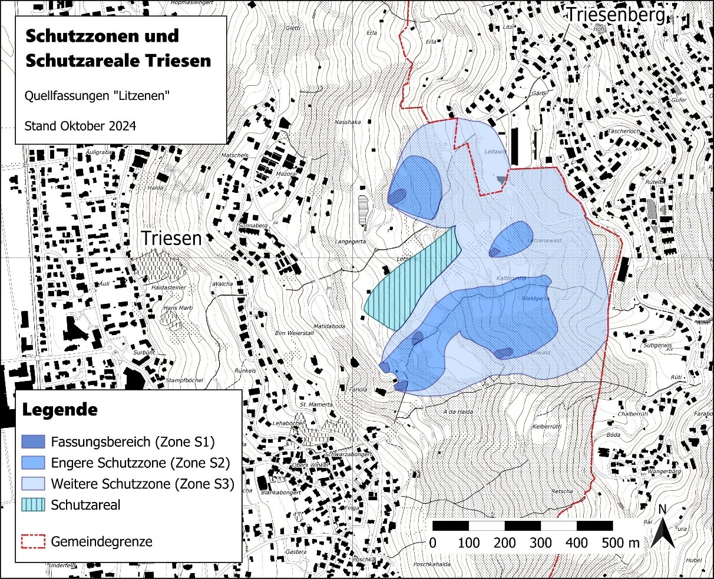

Verordnung vom 10. Mai 2011 zum Schutze der Quellfassungen "Litzenen" in der Gemeinde Triesen Aufgrund von Art. 24 und 67 des Gewässerschutzgesetzes (GSchG) vom 15. Mai 2003, LGBI. 2003 Nr. 159, verordnet die Regierung: I. Allgemeine Bestimmungen Art. 1 Zweck Zum Schutz der Wasserversorgung wird das in Art. 2 näher umschriebene Gebiet als Schutzzone im Sinne von Art. 5 Abs. 1 Bst. q des Gewässerschutzgesetzes festgelegt. Art. 2 Geltungsbereich 1) Die Grenzen der Schutzzone sind in dem dieser Verordnung beigegebenen Situationsplan dargestellt. Der Plan ist Bestandteil dieser Verordnung. 2) Die Schutzzone ist in den Bauordnungen zu berücksichtigen und in den Zonen- und Waldfunktionsplänen der Gemeinden Triesen und Triesenberg ersichtlich zu machen. 3) Die detaillierten Umgrenzungen der Schutzzone sind aus dem Situationsplan 1 : 2 000 ersichtlich, welcher bei den Gemeinden Triesen und Triesenberg sowie beim Amt für Umweltschutz aufliegt. Art. 3 Umschreibung Die Schutzzone wird unterteilt in: a) Fassungsbereich (Zone S 1); b) engere Schutzzone (Zone S 2); c) weitere Schutzzone (Zone S 3); d) Schutzareal. Art. 4 Zonen 1) Der Fassungsbereich (Zone S 1) dient dem unmittelbaren Schutz der Quellfassungen. Er umfasst die Quellschächte, die Fassungsstränge und deren nächstes Zuflussgebiet. 2) Die engere Schutzzone (Zone S 2) dient dazu, schädliche Einflüsse vom Fassungsbereich fernzuhalten. In der Zone S 2 dürfen schwer oder nicht abbaubare Schadstoffe nicht ins Grundwasser gelangen. Abbaubare Schadstoffe müssen auf dem Fliessweg so weit reduziert bzw. zurückgehalten werden, dass die Fassungen weder chemisch noch bakteriologisch belastet werden. Bei einer unfallbedingten Gewässerverschmutzung müssen in der Zone S 2 Sanierungsmassnahmen getroffen werden können, bevor die Verschmutzung den Fassungsbereich erreicht. 3) Die weitere Schutzzone (Zone S 3) dient als Pufferzone zwischen der Zone S 2 und der Umgebung. 4) Die Ausdehnung der Zonen S 2 und S 3 richtet sich nach den Zuflussrichtungen, nach der Fliessgeschwindigkeit und nach der Überdeckung des Grundwassers sowie nach der Infiltration von Oberflächengewässern ins Grundwasser im Zuflussbereich der Fassungen. 5) Das Schutzareal dient der Freihaltung eines Gebietes, das für eine zukünftige Quellwassernutzung notwendig ist. Art. 5 Bewilligungspflicht Bauten und Anlagen in der Schutzzone dürfen nur mit einer Bewilligung des Amtes für Umweltschutz erstellt oder geändert werden. Art. 6 Kennzeichnung der Schutzzone Die Zone S 2 ist an geeigneten Stellen am Rand der Landstrasse "Triesen - Triesenberg" und der Fahrwege mit entsprechenden Hinweistafeln zu signalisieren. II. Bestimmungen für die weitere Schutzzone (Zone S 3) Art. 7 Grundsatz 1) In der Zone S 3 sind Vorkehrungen, welche die Menge und Güte der Grundwasservorkommen oder die öffentliche Wasserversorgung gefährden, verboten. 2) Insbesondere verboten sind: a) Lager- und Betriebsanlagen, Rohrleitungen sowie Umschlagplätze für wassergefährdende Flüssigkeiten unter Vorbehalt von Art. 10 der Verordnung über den Schutz der Gewässer vor wassergefährdenden Flüssigkeiten (VWF); b) Kreisläufe, die dem Wasser Wärme entziehen oder abgeben; c) Dichtungs- und Spundwände; d) Kies-, Sand- und Lehmgruben sowie Steinbrüche; e) Deponien mit Ausnahme solcher für unverschmutztes Aushubmaterial; f) Recyclingbaustoffe, wie Asphaltgranulat und dergleichen; g) Wildfütterungen. 3) Bei Bauarbeiten sind spezielle Schutzmassnahmen zu treffen. Art. 8 Verkehrsanlagen 1) Strassen und Plätze, die dem allgemeinen Motorfahrzeugverkehr offen stehen, sind mit dichten Belägen und Randbordüren zu erstellen. Das Oberflächenwasser ist abzuleiten und beim Kiessammler auf der Parzelle 1290 in den Tiefegraben und beim Kiessammler auf der Parzelle 306 in den Litzenenbach einzuleiten. Die übrigen Strassen und Fahrwege sind mit einem Fahrverbot für Motorfahrzeuge (land- und forstwirtschaftlicher Verkehr und Zubringerdienst gestattet) zu belegen. 2) Einzelpark- und Garagenvorplätze mit Wasseranschluss sowie Autowaschplätze sind mit dichten Belägen, Randbordüren und Ölrückhaltevorrichtungen zu erstellen. Die Entwässerung ist an die Kanalisation anzuschliessen. 3) Der Winterdienst auf der Landstrasse Triesen - Triesenberg hat mechanisch zu erfolgen. Der Einsatz von Tausalzen ist dann zulässig, wenn es die Verkehrssicherheit erfordert. Art. 9 Versickerungen Das Versickern von Abwasser ist verboten. Ausgenommen ist die Versickerung von unverschmutztem Niederschlagswasser, wenn die Versickerung über die bewachsene Bodenschicht erfolgt. Art. 10 Abwasseranlagen 1) Schmutzwasserleitungen haben den Dichtheitsanforderungen der SIA-Norm 190, Kanalisationen, zu genügen. 2) Die Dichtheit von Schmutzwasserleitungen, Kläranlagen, Jauchebehälter und dergleichen ist vom Eigentümer alle drei Jahre zu prüfen. 3) Mangelhafte Anlagen sind vom Eigentümer auf seine Kosten abzudichten oder zu ersetzen. 4) Abwasseranlagen sind möglichst so zu planen und zu erstellen, dass sie bei Hangrutschungen funktionsfähig bleiben. Art. 11 Grabarbeiten und Auffüllungen 1) Grabarbeiten und Geländeveränderungen sind bewilligungspflichtig. Sie sind zulässig, wenn ein sachlich begründetes Bedürfnis besteht, die schützende Deckschicht nicht wesentlich vermindert wird und spezielle Schutzmassnahmen getroffen werden. 2) Auffüllungen dürfen nur mit sauberem Aushubmaterial erfolgen. Art. 12 Düngung 1) Die Düngung richtet sich nach der Bodenbelastbarkeit. Sie darf nur während der Vegetationsperiode erfolgen. 2) Düngemittel sind gleichmässig zu verteilen. Die Düngung ist unzulässig, wenn der Boden wassergesättigt, schneebedeckt oder gefroren ist. 3) Es gelten die Bestimmungen über die Düngung gemäss Anhang 2.6 der schweizerischen Chemikalien-Risikoreduktions-Verordnung (SR 814.81). 4) Die Verwendung von Klärschlamm sowie das Ausbringen von Gülle sind verboten. Art. 13 Pflanzen- und Holzschutzmittel 1) Für die Verwendung von Pflanzenschutzmitteln gilt Anhang 2.5 der schweizerischen Chemikalien-Risikoreduktions-Verordnung. 2) Für die Verwendung von Holzschutzmitteln gilt Anhang 2.4 der schweizerischen Chemikalien-Risikoreduktions-Verordnung. Art. 14 Lagerhaltungen 1) Es sind verboten: a) Fahrsilos; b) Ablagerungen im freien Feld von: 1. Düngern, wie Mist, Kompost und Klärschlamm; 2. Siloballen und -würsten; c) Ablagerungen von wassergefährdenden Stoffen. 2) Handelsdünger und Pflanzenschutzmittel sind geschützt gegen Durchnässung und Versickerung aufzubewahren. 3) Mistlager bei den Ställen bedürfen einer dichten Bodenplatte mit Randumfassung. Die anfallende Gülle ist aufzufangen. III. Bestimmungen für die engere Schutzzone (Zone S 2) Art. 15 Grundsatz Alle nachfolgenden Massnahmen und Nutzungsbeschränkungen gelten zusätzlich zu den in Art. 7 bis 14 enthaltenen Bestimmungen. Art. 16 Bauten und Anlagen In der Zone S 2 gilt ein allgemeines Bauverbot. Aus wichtigen Gründen können Ausnahmen gestattet werden (Art. 27). Art. 17 Schmutzwasserleitungen Schmutzwasserleitungen müssen in doppelwandigen Rohren oder in Doppelrohren geführt sein. Art. 18 Verkehrsanlagen 1) Die Landstrasse Triesen - Triesenberg muss talseits für schwere Lastwagen dimensionierte Leitplanken aufweisen. 2) Der bei der Schneeräumung der Landstrasse Triesen - Triesenberg anfallende, verunreinigte Schnee darf nicht in der Zone S 2 abgelagert werden. Art. 19 Abstellen von Fahrzeugen Das dauernde Abstellen von Fahrzeugen mit Explosionsmotoren im Freien ist verboten. Art. 20 Pflanzen- und Holzschutzmittel, Forstwirtschaft 1) Die Anwendung von Pflanzen- und Holzschutzmitteln ist verboten. 2) Es dürfen keine Holzlager angelegt werden. 3) Forstmaschinen sind, soweit möglich, abends und übers Wochenende ausserhalb der Zone S 2 abzustellen. 4) Das Reparieren oder Reinigen von grossen Maschinen und von Fahrzeugen ist untersagt. 5) Für das Betanken von stationären Forstmaschinen, wie Seilbahnen und dergleichen, sind spezielle Schutzmassnahmen zu treffen. Art. 21 Landwirtschaft 1) Güllengruben, erdverlegte Güllenleitungen, Güllenzapfstellen, Mistlager, Raufuttersilos und dergleichen sind unzulässig. 2) Der Weidegang ist grundsätzlich nur während der Vegetationsperiode zulässig. Das Weidegebiet ist so zu bewirtschaften, dass ganzflächig eine geschlossene Grasnarbe erhalten bleibt. 3) Bei Melkständen, Brunnen und festen Tränkestellen sind Massnahmen zur Bodenverfestigung zu treffen. Anfallender Kot ist regelmässig zu entfernen. 4) Entlang des Tiefegrabens ist beidseitig ein Gewässerrandstreifen von 10 m Breite auszuscheiden, wo keine Düngung und Beweidung erfolgen darf. IV. Bestimmungen für den Fassungsbereich (Zone S 1) Art. 22 Grundsatz 1) In der Zone S 1 sind grundsätzlich nur Nutzungen zulässig, die der Wassergewinnung und Wasseraufbereitung dienen. 2) Die Zone S 1 ist als naturbelassene Wiese zu gestalten. Einzelne Bäume und Sträucher sind zulässig, sofern der Nutzungszweck dem nicht entgegensteht. 3) Die Anwendung von Pflanzen- und Holzschutzmitteln ist verboten. Art. 23 Zutritt Die Zone S 1 ist vor dem Zutritt Unbefugter zu schützen. V. Bestimmungen für das Schutzareal Art. 24 Grundsatz Für das Schutzareal gelten die Bestimmungen der Art. 7 bis 14 und 16. VI. Organisation und Durchführung Art. 25 Aufsicht 1) Die Aufsicht über die Schutzzone obliegt dem Amt für Umweltschutz. Die Gemeinde Triesen (Wassermeister) hat bei der Aufsicht mitzuwirken, wobei Umfang und Durchführung der Kontrollen durch Vereinbarung geregelt werden. 2) Aufgehoben Art. 26 Verfügungen Das Amt für Umweltschutz erlässt die gemäss dieser Verordnung erforderlichen Verfügungen und überwacht deren Vollzug. Art. 27 Ausnahmebewilligungen 1) Die Regierung kann im Einvernehmen mit der Gemeinde Triesen aus wichtigen Gründen von den Vorschriften dieser Verordnung abweichende Bewilligungen erteilen, sofern eine Gefährdung der Trinkwassernutzung ausgeschlossen werden kann. 2) In der Bewilligung sind die zu treffenden, speziellen Schutzmassnahmen festzulegen. Art. 28 Kosten 1) Die aus der Ausscheidung der Schutzzone erwachsenden Kosten trägt die Gemeinde Triesen. 2) Allfällige Entschädigungsleistungen an die betroffenen Grundeigentümer gehen zu Lasten der Gemeinde Triesen nach Massgabe vertraglicher Vereinbarungen. VII. Strafbestimmungen Art. 29 Übertretungen Nach Art. 61 des Gewässerschutzgesetzes wird bestraft, wer: a) Bauten und Anlagen ohne Bewilligung erstellt oder ändert (Art. 5); b) verbotene Vorkehrungen in Schutzzonen vornimmt (Art. 7 Abs. 1 und 2, Art. 9, 16, 19 und 22 Abs. 1); c) die geforderten Schutzmassnahmen nicht trifft (Art. 7 Abs. 3, Art. 8 Abs. 2, Art. 17 und 30 Abs. 1); d) die Anforderungen an Abwasseranlagen nicht erfüllt (Art. 10); e) unzulässige Geländeveränderungen oder ohne Bewilligung Auffüllungen oder Grabarbeiten vornimmt (Art. 11); f) die Vorschriften über die Land- und Forstwirtschaft nicht einhält (Art. 12, 20 Abs. 3 bis 5 und Art. 21); g) die Vorschriften über Pflanzen- und Holzschutzmittel nicht einhält (Art. 13, 20 Abs. 1 und Art. 22 Abs. 3 ); h) die Vorschriften über die Lagerhaltung nicht einhält (Art. 14 und 20 Abs. 2). VIII. Übergangs- und Schlussbestimmungen Art. 30 Bauten und Anlagen 1) Die bisherige Nutzung und Nutzungserweiterungen nach Massgabe der Bauordnung von bestehenden Bauten und Anlagen in der Zone S 2 und S 3 sind zulässig, sofern die Gefährdung für das Grundwasser nur geringfügig ist. Das Amt für Umweltschutz legt die erforderlichen Schutzmassnahmen fest. 2) Bei teilweiser oder vollständiger Zerstörung ist der Wiederaufbau der Bauten und Anlagen nach Massgabe der Bauordnung zulässig, sofern die Gefährdung des Grundwassers nur geringfügig ist und die vom Amt für Umweltschutz festgelegten Schutzmassnahmen ergriffen werden. 3) Für die Nutzungen in der Zone S 3 (Sportplatz, Festplatz, Lagerflächen und Aufbereitungsplatz für Aushubmaterial) ist durch die Gemeinde Triesenberg ein Nutzungsreglement im Sinne von Abs. 1 und 2 zu erstellen. Art. 31 Bauliche Massnahmen Die baulichen Schutzmassnahmen sind innerhalb von drei Jahren nach Inkrafttreten dieser Verordnung zu treffen. Art. 32 Baumbestand im Fassungsbereich Der Baumbestand im Bereich von Quellfassungen ist bei der Erneuerung der Fassungsanlagen zu entfernen. Art. 33 Inkrafttreten Diese Verordnung tritt am Tage der Kundmachung in Kraft. Fürstliche Regierung: gez. Dr. Klaus Tschütscher Fürstlicher Regierungschef Anhang (Art. 2 Abs. 1) 

