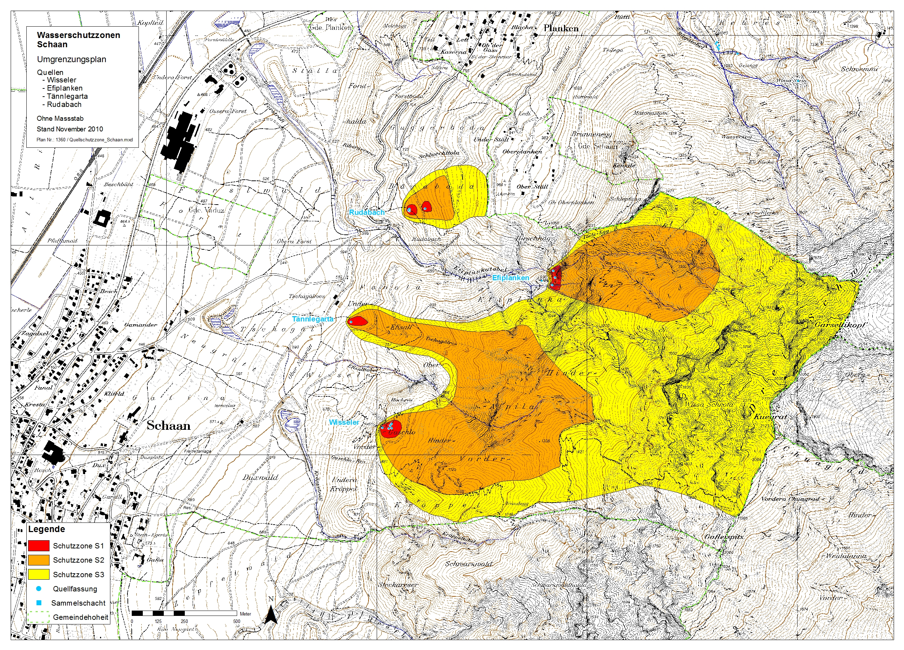

Verordnung vom 7. Juni 2011 zum Schutze der Quellfassungen "Wisseler", "Efiplanken", "Tännlegarta" und "Rudabach" in der Gemeinde Schaan Aufgrund von Art. 24 und 67 des Gewässerschutzgesetzes (GSchG) vom 15. Mai 2003, LGBI. 2003 Nr. 159 , verordnet die Regierung: I. Allgemeine Bestimmungen Art. 1 Zweck Zum Schutz der Wasserversorgung werden die in Art. 2 näher umschriebenen Gebiete als Schutzzonen im Sinne von Art. 5 Abs. 1 Bst. n des Gewässerschutzgesetzes festgelegt. Art. 2 Geltungsbereich 1) Die Grenzen der Schutzzonen sind in dem dieser Verordnung beigegebenen Situationsplan dargestellt. Der Plan ist Bestandteil dieser Verordnung. 2) Die Schutzzonen sind in der Bauordnung zu berücksichtigen und im Zonen- und Waldfunktionsplan der Gemeinde Schaan ersichtlich zu machen. 3) Die detaillierten Umgrenzungen der Schutzzonen sind aus dem Situationsplan 1 : 5 000 ersichtlich, welcher bei der Gemeinde Schaan und beim Amt für Umweltschutz aufliegt. Art. 3 Umschreibung Die Schutzzonen werden unterteilt in: a) Fassungsbereich (Zone S 1); b) engere Schutzzone (Zone S 2); c) weitere Schutzzone (Zone S 3). Art. 4 Zonen 1) Der Fassungsbereich (Zone S 1) dient dem unmittelbaren Schutz der Quellfassungen. Er umfasst die Quellschächte, die Fassungsstränge und deren nächstes Zuflussgebiet. 2) Die engere Schutzzone (Zone S 2) dient dazu, schädliche Einflüsse vom Fassungsbereich fernzuhalten. In der Zone S 2 dürfen schwer oder nicht abbaubare Schadstoffe nicht ins Grundwasser gelangen. Abbaubare Schadstoffe müssen auf dem Fliessweg so weit reduziert bzw. zurückgehalten werden, dass die Fassungen weder chemisch noch bakteriologisch belastet werden. Bei einer unfallbedingten Gewässerverschmutzung müssen in der Zone S 2 Sanierungsmassnahmen getroffen werden können, bevor die Verschmutzung den Fassungsbereich erreicht. 3) Die weitere Schutzzone (Zone S 3) dient als Pufferzone zwischen der Zone S 2 und der Umgebung. 4) Die Ausdehnung der Zonen S 2 und S 3 richtet sich nach den Zuflussrichtungen, nach der Fliessgeschwindigkeit und nach der Überdeckung des Grundwassers sowie nach der Infiltration von Oberflächengewässern ins Grundwasser im Zuflussbereich der Fassungen. Art. 5 Bewilligungspflicht Bauten und Anlagen in den Schutzzonen dürfen nur mit einer Bewilligung des Amtes für Umweltschutz erstellt oder geändert werden. Art. 6 Kennzeichnung der Schutzzone Die Schutzzonen sind an geeigneten Stellen am Rand der Waldstrassen mit entsprechenden Hinweistafeln zu signalisieren. II. Bestimmungen für die weitere Schutzzone (Zone S 3) Art. 7 Grundsatz 1) In der Zone S 3 sind Vorkehrungen, welche die Menge und Güte der Grundwasservorkommen oder die öffentliche Wasserversorgung gefährden, verboten. 2) Insbesondere verboten sind: a) Kies-, Sand- und Lehmgruben sowie Steinbrüche; b) Deponien mit Ausnahme solcher für unverschmutztes Aushubmaterial; c) Recyclingbaustoffe, wie Asphaltgranulat und dergleichen; d) Wildfütterungen. 3) Bei Bauarbeiten sind spezielle Schutzmassnahmen zu treffen. Art. 8 Verkehrsanlagen Die in der Schutzzone liegenden Waldstrassen sind mit einem Fahrverbot für Motorfahrzeuge (forstwirtschaftlicher Verkehr gestattet) zu belegen. Art. 9 Versickerungen Das Versickern von Abwasser ist verboten. Ausgenommen ist die Versickerung von unverschmutztem Niederschlagswasser, wenn die Versickerung über die bewachsene Bodenschicht erfolgt. Art. 10 Grabarbeiten und Auffüllungen 1) Grabarbeiten und Geländeveränderungen sind bewilligungspflichtig. Sie sind zulässig, wenn ein sachlich begründetes Bedürfnis besteht, die schützende Deckschicht nicht wesentlich vermindert wird und spezielle Schutzmassnahmen getroffen werden. 2) Auffüllungen dürfen nur aus sauberem Aushubmaterial bestehen. Art. 11 Pflanzen- und Holzschutzmittel 1) Für die Verwendung von Pflanzenschutzmitteln gilt Anhang 2.5 der schweizerischen Chemikalien-Risikoreduktions-Verordnung (SR 814.81). 2) Für die Verwendung von Holzschutzmitteln gilt Anhang 2.4 der schweizerischen Chemikalien-Risikoreduktions-Verordnung. III. Bestimmungen für die engere Schutzzone (Zone S 2) Art. 12 Grundsatz Alle nachfolgenden Massnahmen und Nutzungsbeschränkungen gelten zusätzlich zu den in Art. 7 bis 11 enthaltenen Bestimmungen. Art. 13 Bauten und Anlagen In der Zone S 2 gilt ein allgemeines Bauverbot. Aus wichtigen Gründen können Ausnahmen gestattet werden (Art. 20). Art. 14 Abstellen von Fahrzeugen Das dauernde Abstellen von Fahrzeugen mit Explosionsmotoren im Freien ist verboten. Art. 15 Pflanzen- und Holzschutzmittel, Forstwirtschaft 1) Die Anwendung von Pflanzen- und Holzschutzmitteln ist verboten. Davon ausgenommen sind Mittel gegen Verbiss- und Fegeschäden, die vom Forstdienst der Gemeinde Schaan mit Bewilligung des Amtes für Umweltschutz und unter strenger Einhaltung der Vorschriften und Gebrauchsanweisungen angewendet werden dürfen. 2) Es dürfen keine Holzlager angelegt werden. 3) Forstmaschinen sind, soweit möglich, abends und übers Wochenende ausserhalb der Zone S 2 abzustellen. 4) Das Reparieren oder Reinigen von grossen Maschinen und von Fahrzeugen ist untersagt. 5) Für das Betanken von stationären Forstmaschinen, wie Seilbahnen und dergleichen, sind spezielle Schutzmassnahmen zu treffen. IV. Bestimmungen für den Fassungsbereich (Zone S 1) Art. 16 Grundsatz 1) In der Zone S 1 sind grundsätzlich nur Nutzungen zulässig, die der Wassergewinnung und Wasseraufbereitung dienen. 2) Die Zone S 1 ist als Niederwald zu bewirtschaften. Einzelne gefällte Bäume können zur Minderung der Steinschlaggefahr als Schutzriegel platziert werden. 3) Die Anwendung von Pflanzen- und Holzschutzmitteln ist verboten. Art. 17 Zutritt Die Zone S 1 ist vor dem Zutritt Unbefugter zu schützen. V. Organisation und Durchführung Art. 18 Aufsicht 1) Die Aufsicht über die Schutzzonen obliegt dem Amt für Umweltschutz. Die Gemeinde Schaan (Wassermeister) hat bei der Aufsicht mitzuwirken, wobei Umfang und Durchführung der Kontrollen durch Vereinbarung geregelt werden. 2) Aufgehoben Art. 19 Verfügungen Das Amt für Umweltschutz erlässt die gemäss dieser Verordnung erforderlichen Verfügungen und überwacht deren Vollzug. Art. 20 Ausnahmebewilligungen 1) Die Regierung kann im Einvernehmen mit der Gemeinde Schaan aus wichtigen Gründen von den Vorschriften dieser Verordnung abweichende Bewilligungen erteilen, sofern eine Gefährdung der Trinkwassernutzung ausgeschlossen werden kann. 2) In der Bewilligung sind die zu treffenden, speziellen Schutzmassnahmen festzulegen. Art. 21 Kosten 1) Die aus der Ausscheidung der Schutzzone erwachsenden Kosten trägt die Gemeinde Schaan. 2) Allfällige Entschädigungsleistungen an die betroffenen Grundeigentümer gehen zu Lasten der Gemeinde Schaan nach Massgabe vertraglicher Vereinbarungen. VI. Strafbestimmungen Art. 22 Übertretungen Nach Art. 61 des Gewässerschutzgesetzes wird bestraft, wer: a) Bauten und Anlagen ohne Bewilligung erstellt oder ändert (Art. 5); b) verbotene Vorkehrungen in Schutzzonen vornimmt (Art. 7 Abs. 1 und 2, Art. 9, 13, 14 und 16 Abs. 1); c) die geforderten Schutzmassnahmen nicht trifft (Art. 7 Abs. 3, Art. 15 Abs. 5 und Art. 23 Abs. 1); d) unzulässige Geländeveränderungen oder ohne Bewilligung Auffüllungen oder Grabarbeiten vornimmt (Art. 10 Abs. 1); e) die Vorschriften über die Forstwirtschaft nicht einhält (Art. 15 Abs. 2 bis 4); f) die Vorschriften über Pflanzen- und Holzschutzmittel nicht einhält (Art. 11 und 15 Abs. 1). VII. Übergangs- und Schlussbestimmungen Art. 23 Alpilahütte 1) Die bisherige Nutzung der in der Zone S 3 bestehenden Alpilahütte und der in der Zone S 2 bestehenden Jägerhütte ist zulässig. Das Amt für Umweltschutz legt die erforderlichen Schutzmassnahmen, insbesondere die Art der Abwasserbeseitigung, fest. 2) Bei teilweiser oder vollständiger Zerstörung ist der Wiederaufbau im heutigen Umfang und im Sinne der bisherigen Nutzung zulässig. Art. 24 Inkrafttreten Diese Verordnung tritt am Tage der Kundmachung in Kraft. Fürstliche Regierung: gez. Dr. Klaus Tschütscher Fürstlicher Regierungschef Anhang (Art. 2 Abs. 1) 

