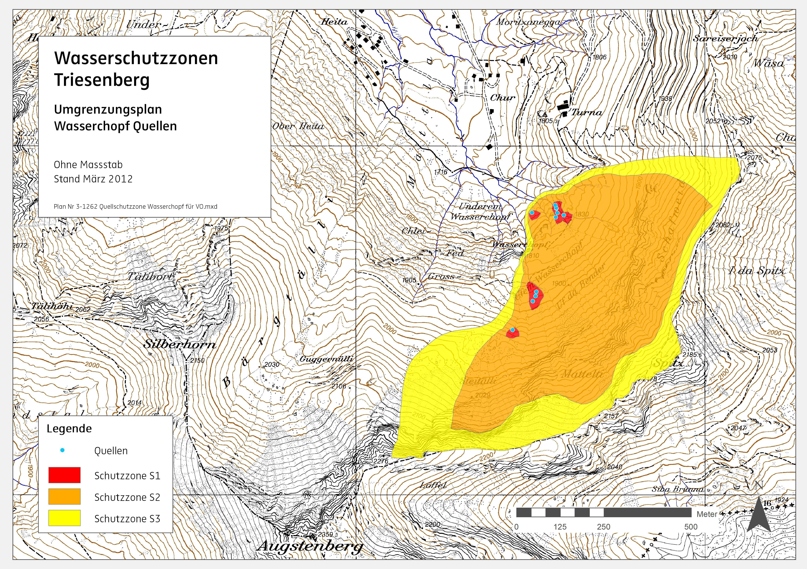

Verordnung vom 17. April 2012 zum Schutze der Quellfassungen "Wasserchopf" in der Gemeinde Triesenberg Aufgrund von Art. 24 und 67 des Gewässerschutzgesetzes (GSchG) vom 15. Mai 2003, LGBI. 2003 Nr. 159, verordnet die Regierung: I. Allgemeine Bestimmungen Art. 1 Zweck Zum Schutz der Wasserversorgung werden die in Art. 2 näher umschriebenen Gebiete als Schutzzonen im Sinne von Art. 5 Abs. 1 Bst. n des Gewässerschutzgesetzes festgelegt. Art. 2 Geltungsbereich 1) Die Grenzen der Schutzzonen sind in dem dieser Verordnung beigegebenem Situationsplan dargestellt. Der Plan ist Bestandteil dieser Verordnung. 2) Die Schutzzonen sind in der Bauordnung zu berücksichtigen und im Zonen- und Waldfunktionsplan der Gemeinde Triesenberg ersichtlich zu machen. 3) Die detaillierten Umgrenzungen der Schutzzonen sind aus dem Situationsplan 1 : 2 000 ersichtlich, welcher bei der Gemeinde Triesenberg und beim Amt für Umweltschutz aufliegt. Art. 3 Umschreibung Die Schutzzonen werden unterteilt in: a) Fassungsbereich (Zone S 1); b) engere Schutzzone (Zone S 2); c) weitere Schutzzone (Zone S 3). Art. 4 Zonen 1) Der Fassungsbereich (Zone S 1) dient dem unmittelbaren Schutz der Quellfassungen. Er umfasst die Quellschächte, die Fassungsstränge und deren nächstes Zuflussgebiet. 2) Die engere Schutzzone (Zone S 2) dient dazu, schädliche Einflüsse vom Fassungsbereich fernzuhalten. In der Zone S 2 dürfen schwer oder nicht abbaubare Schadstoffe nicht ins Grundwasser gelangen. Abbaubare Schadstoffe müssen auf dem Fliessweg so weit reduziert bzw. zurückgehalten werden, dass die Fassungen weder chemisch noch bakteriologisch belastet werden. Bei einer unfallbedingten Gewässerverschmutzung müssen in der Zone S 2 Sanierungsmassnahmen getroffen werden können, bevor die Verschmutzung den Fassungsbereich erreicht. 3) Die weitere Schutzzone (Zone S 3) dient als Pufferzone zwischen der Zone S 2 und der Umgebung. 4) Die Ausdehnung der Zonen S 2 und S 3 richtet sich nach den Zuflussrichtungen, nach der Fliessgeschwindigkeit und nach der Überdeckung des Grundwassers sowie nach der Infiltration von Oberflächengewässern ins Grundwasser im Zuflussbereich der Fassungen. Art. 5 Bewilligungspflicht Bauten und Anlagen in den Schutzzonen dürfen nur mit einer Bewilligung des Amtes für Umweltschutz erstellt oder geändert werden. II. Bestimmungen für die weitere Schutzzone (Zone S 3) Art. 6 Grundsatz 1) In der Zone S 3 sind Vorkehrungen, welche die Menge und Güte der Grundwasservorkommen oder die öffentliche Wasserversorgung gefährden, verboten. 2) Insbesondere verboten sind: a) Lager- und Betriebsanlagen, Rohrleitungen sowie Umschlagplätze für wassergefährdende Flüssigkeiten unter Vorbehalt von Art. 10 der Verordnung über den Schutz der Gewässer vor wassergefährdenen Flüssigkeiten (VWF); b) Recyclingbaustoffe, wie Asphaltgranulat und dergleichen; c) Alpbrunnen und Tränkestellen ohne Bodenbefestigung; d) Wildfütterungen. 3) Bei Bauarbeiten sind spezielle Schutzmassnahmen zu treffen. Art. 7 Verkehrsanlagen Die Alpstrassen sind mit einem Fahrverbot für Motorfahrzeuge (alp- und forstwirtschaftlicher Verkehr sowie Zubringerdienst gestattet) zu belegen. Art. 8 Versickerungen Das Versickern von Abwasser ist verboten. Ausgenommen ist die Versickerung von unverschmutztem Niederschlagswasser, wenn die Versickerung über die bewachsene Bodenschicht erfolgt. Art. 9 Grabarbeiten und Auffüllungen 1) Grabarbeiten und Geländeveränderungen sind bewilligungspflichtig. Sie sind zulässig, wenn ein sachlich begründetes Bedürfnis besteht, die schützende Deckschicht nicht wesentlich vermindert wird und spezielle Schutzmassnahmen getroffen werden. 2) Auffüllungen dürfen nur aus sauberem Aushubmaterial bestehen. Art. 10 Landwirtschaft 1) Die Düngung richtet sich nach der Bodenbelastbarkeit. Sie darf nur während der Vegetationsperiode erfolgen. 2) Düngemittel sind gleichmässig zu verteilen. Die Düngung ist unzulässig, wenn der Boden wassergesättigt, schneebedeckt oder gefroren ist. 3) Es gelten die Richtlinien über die Düngung von alpwirtschaftlich genutzten Wiesen und Weiden sowie Anhang 2.6 der schweizerischen Chemikalien-Risikoreduktions-Verordnung (SR 814.81). 4) Die Verwendung von Klärschlamm ist verboten. 5) Der Weidegang ist grundsätzlich nur während der Vegetationsperiode zulässig. Das Weidegebiet ist so zu bewirtschaften, dass ganzflächig eine geschlossene Grasnarbe erhalten bleibt. Art. 11 Pflanzen- und Holzschutzmittel 1) Für die Verwendung von Pflanzenschutzmitteln gilt Anhang 2.5 der schweizerischen Chemikalien-Risikoreduktions-Verordnung. 2) Für die Verwendung von Holzschutzmitteln gilt Anhang 2.4 der schweizerischen Chemikalien-Risikoreduktions-Verordnung. Art. 12 Lagerhaltungen 1) Es sind verboten: a) Fahrsilos; b) Ablagerungen im freien Feld von: 1. Düngern, wie Mist, Kompost und Klärschlamm; 2. Siloballen und -würsten; c) Ablagerungen von wassergefährdenden Stoffen. 2) Handelsdünger und Pflanzenschutzmittel sind geschützt gegen Durchnässung und Versickerung aufzubewahren. III. Bestimmungen für die engere Schutzzone (Zone S 2) Art. 13 Grundsatz Alle nachfolgenden Massnahmen und Nutzungsbeschränkungen gelten zusätzlich zu den in Art. 6 bis 12 enthaltenen Bestimmungen. Art. 14 Bauten und Anlagen In der Zone S 2 gilt ein allgemeines Bauverbot. Aus wichtigen Gründen können Ausnahmen gestattet werden (Art. 22). Art. 15 Pflanzenschutzmittel Die Anwendung von Pflanzenschutzmitteln ist verboten. Art. 16 Düngung Das Ausbringen von Gülle ist verboten. IV. Bestimmungen für den Fassungsbereich (Zone S 1) Art. 17 Grundsatz 1) In der Zone S 1 sind grundsätzlich nur Nutzungen zulässig, die der Wassergewinnung und Wasseraufbereitung dienen. 2) Die Zone S 1 ist als naturbelassene Alpwiese zu gestalten. Sie darf nicht beweidet werden. Art. 18 Umzäunung Die Zone S 1 ist während der Alpweidezeit durch einen Zaun an den markierten Fixpunkten zu schützen. Art. 19 Nutzung der Quelle 201.1 Die Quelle 201.1 darf vom Mai bis Ende Oktober nicht zur Trinkwassergewinnung genutzt werden. V. Organisation und Durchführung Art. 20 Aufsicht 1) Die Aufsicht über die Schutzzonen obliegt dem Amt für Umweltschutz. Die Gemeinde Triesenberg (Wassermeister) hat bei der Aufsicht mitzuwirken, wobei Umfang und Durchführung der Kontrollen durch Vereinbarung geregelt werden. 2) Aufgehoben Art. 21 Verfügungen Das Amt für Umweltschutz erlässt die gemäss dieser Verordnung erforderlichen Verfügungen und überwacht deren Vollzug. Art. 22 Ausnahmebewilligungen 1) Die Regierung kann im Einvernehmen mit der Gemeinde Triesenberg aus wichtigen Gründen von den Vorschriften dieser Verordnung abweichende Bewilligungen erteilen, sofern eine Gefährdung der Trinkwassernutzung ausgeschlossen werden kann. 2) In der Bewilligung sind die zu treffenden, speziellen Schutzmassnahmen festzulegen. Art. 23 Kosten 1) Die aus der Ausscheidung der Schutzzonen erwachsenden Kosten trägt die Gemeinde Triesenberg. 2) Allfällige Entschädigungsleistungen an die betroffenen Grundeigentümer gehen zu Lasten der Gemeinde Triesenberg nach Massgabe vertraglicher Vereinbarungen. VI. Strafbestimmungen Art. 24 Übertretungen Nach Art. 61 des Gewässerschutzgesetzes wird bestraft, wer: a) Bauten und Anlagen ohne Bewilligung erstellt oder ändert (Art. 5); b) verbotene Vorkehrungen in Schutzzonen vornimmt (Art. 6 Abs. 1 und 2, Art. 8, 14, und 17 Abs. 1); c) die geforderten Schutzmassnahmen nicht trifft (Art. 6 Abs. 3); d) unzulässige Geländeveränderungen oder ohne Bewilligung Auffüllungen oder Grabarbeiten vornimmt (Art. 9); e) die Vorschriften über die Landwirtschaft nicht einhält (Art. 10 und 16); f) die Vorschriften über Pflanzen- und Holzschutzmittel nicht einhält (Art. 11 und 15); g) die Vorschriften über die Lagerhaltung nicht einhält (Art. 12). VII. Übergangs- und Schlussbestimmung Art. 25 Bestehender Alpbrunnen Beim bestehenden Alpbrunnen sind Massnahmen zur Bodenbefestigung innerhalb von einem Jahr nach Inkrafttreten dieser Verordnung zu treffen. Art. 26 Inkrafttreten Diese Verordnung tritt am Tage der Kundmachung in Kraft. Fürstliche Regierung: gez. Dr. Klaus Tschütscher Fürstlicher Regierungschef Anhang (Art. 2 Abs. 1) 

