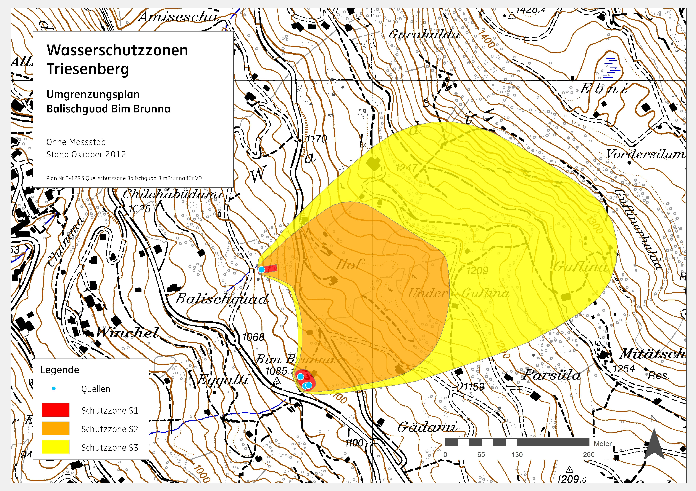

Verordnung vom 13. November 2012 zum Schutze der Quellfassungen "Balischguad" und "Bim Brunna" in der Gemeinde Triesenberg Aufgrund von Art. 24 und 67 des Gewässerschutzgesetzes (GSchG) vom 15. Mai 2003, LGBI. 2003 Nr. 159 , verordnet die Regierung: I. Allgemeine Bestimmungen Art. 1 Zweck Zum Schutz der Wasserversorgung werden die in Art. 2 näher umschriebenen Gebiete als Schutzzonen im Sinne von Art. 5 Abs. 1 Bst. n des Gewässerschutzgesetzes festgelegt. Art. 2 Geltungsbereich 1) Die Grenzen der Schutzzonen sind in dem dieser Verordnung beigegebenen Situationsplan dargestellt. Der Plan ist Bestandteil dieser Verordnung. 2) Die Schutzzonen sind in der Bauordnung zu berücksichtigen und im Zonen- und Waldfunktionsplan der Gemeinde Triesenberg ersichtlich zu machen. 3) Die detaillierten Umgrenzungen der Schutzzonen sind aus dem Situationsplan 1 : 2 000 ersichtlich, welcher bei der Gemeinde Triesenberg und beim Amt für Umweltschutz aufliegt. Art. 3 Umschreibung Die Schutzzonen werden unterteilt in: a) Fassungsbereich (Zone S 1); b) engere Schutzzone (Zone S 2); c) weitere Schutzzone (Zone S 3). Art. 4 Zonen 1) Der Fassungsbereich (Zone S 1) dient dem unmittelbaren Schutz der Quellfassungen. Er umfasst die Quellschächte, die Fassungsstränge und deren nächstes Zuflussgebiet. 2) Die engere Schutzzone (Zone S 2) dient dazu, schädliche Einflüsse vom Fassungsbereich fernzuhalten. In der Zone S 2 dürfen schwer oder nicht abbaubare Schadstoffe nicht ins Grundwasser gelangen. Abbaubare Schadstoffe müssen auf dem Fliessweg so weit reduziert bzw. zurückgehalten werden, dass die Fassungen weder chemisch noch bakteriologisch belastet werden. Bei einer unfallbedingten Gewässerverschmutzung müssen in der Zone S 2 Sanierungsmassnahmen getroffen werden können, bevor die Verschmutzung den Fassungsbereich erreicht. 3) Die weitere Schutzzone (Zone S 3) dient als Pufferzone zwischen der Zone S 2 und der Umgebung. 4) Die Ausdehnung der Zonen S 2 und S 3 richtet sich nach den Zuflussrichtungen, nach der Fliessgeschwindigkeit und nach der Überdeckung des Grundwassers sowie nach der Infiltration von Oberflächengewässern ins Grundwasser im Zuflussbereich der Fassungen. Art. 5 Bewilligungspflicht Bauten und Anlagen in den Schutzzonen dürfen nur mit einer Bewilligung des Amtes für Umweltschutz erstellt oder geändert werden. Art. 6 Kennzeichnung der Schutzzone Die Schutzzonen sind an geeigneten Stellen am Rand der Strassen "Gädami - Masescha" und "Undra Büel - Waldi" mit entsprechenden Hinweistafeln zu signalisieren. II. Bestimmungen für die weitere Schutzzone (Zone S 3) Art. 7 Grundsatz 1) In der Zone S 3 sind Vorkehrungen, welche die Menge und Güte der Grundwasservorkommen oder die öffentliche Wasserversorgung gefährden, verboten. 2) Insbesondere verboten sind: a) Lager- und Betriebsanlagen, Rohrleitungen sowie Umschlagplätze für wassergefährdende Flüssigkeiten unter Vorbehalt von Art. 10 der Verordnung über den Schutz der Gewässer vor wassergefährdenen Flüssigkeiten (VWF); b) Kreisläufe, die dem Wasser Wärme entziehen oder abgeben; c) Dichtungs- und Spundwände; d) Kies-, Sand- und Lehmgruben sowie Steinbrüche; e) Deponien mit Ausnahme solcher für unverschmutztes Aushubmaterial; f) Recyclingbaustoffe, wie Asphaltgranulat und dergleichen; g) Wildfütterungen. 3) Bei Bauarbeiten sind spezielle Schutzmassnahmen zu treffen. Art. 8 Verkehrsanlagen 1) Strassen und Plätze, die dem allgemeinen Motorfahrzeugverkehr offen stehen, sind mit Hartbelägen und Randbordüren zu erstellen. Das Oberflächenwasser ist abzuleiten. Die übrigen Strassen und Fahrwege sind mit einem Fahrverbot für Motorfahrzeuge (alp- und forstwirtschaftlicher Verkehr sowie Zubringerdienst gestattet) zu belegen. 2) Einzelpark- und Garagenvorplätze mit Wasseranschluss sowie Autowaschplätze sind mit dichten Belägen, Randbordüren und Ölrückhaltevorrichtungen zu erstellen. Die Entwässerung ist an die Kanalisation anzuschliessen. Art. 9 Versickerungen Das Versickern von Abwasser ist verboten. Ausgenommen ist die Versickerung von unverschmutztem Niederschlagswasser, wenn die Versickerung über die bewachsene Bodenschicht erfolgt. Art. 10 Abwasseranlagen 1) Schmutzwasserleitungen haben den Dichtheitsanforderungen der SIA-Norm 190, Kanalisationen, zu genügen. 2) Die Dichtheit von Schmutzwasserleitungen, Kläranlagen, Jauchebehältern und dergleichen ist vom Eigentümer alle drei Jahre zu prüfen. 3) Mangelhafte Anlagen sind vom Eigentümer auf seine Kosten abzudichten oder zu ersetzen. 4) Abwasseranlagen sind möglichst so zu planen und zu erstellen, dass sie bei Hangrutschungen funktionsfähig bleiben. Art. 11 Grabarbeiten und Auffüllungen 1) Grabarbeiten und Geländeveränderungen sind bewilligungspflichtig. Sie sind zulässig, wenn ein sachlich begründetes Bedürfnis besteht, die schützende Deckschicht nicht wesentlich vermindert wird und spezielle Schutzmassnahmen getroffen werden. 2) Auffüllungen dürfen nur aus sauberem Aushubmaterial bestehen. Art. 12 Düngung 1) Die Düngung richtet sich nach der Bodenbelastbarkeit. Sie darf nur während der Vegetationsperiode erfolgen. 2) Düngemittel sind gleichmässig zu verteilen. Die Düngung ist unzulässig, wenn der Boden wassergesättigt, schneebedeckt oder gefroren ist. 3) Es gilt Anhang 2.6 der schweizerischen Chemikalien-Risikoreduktions-Verordnung (SR 814.81). 4) Die Verwendung von Klärschlamm ist verboten. Art. 13 Pflanzen- und Holzschutzmittel 1) Für die Verwendung von Pflanzenschutzmitteln gilt Anhang 2.5 der schweizerischen Chemikalien-Risikoreduktions-Verordnung. 2) Für die Verwendung von Holzschutzmitteln gilt Anhang 2.4 der schweizerischen Chemikalien-Risikoreduktions-Verordnung. Art. 14 Lagerhaltungen 1) Es sind verboten: a) Fahrsilos; b) Ablagerungen im freien Feld von: 1. Düngern, wie Mist, Kompost und Klärschlamm; 2. Siloballen und -würsten; c) Ablagerungen von wassergefährdenden Stoffen. 2) Handelsdünger und Pflanzenschutzmittel sind geschützt gegen Durchnässung und Versickerung aufzubewahren. 3) Mistlager bei den Ställen bedürfen einer dichten Bodenplatte mit Randumfassung. Die anfallende Gülle ist aufzufangen. III. Bestimmungen für die engere Schutzzone (Zone S 2) Art. 15 Grundsatz Alle nachfolgenden Massnahmen und Nutzungsbeschränkungen gelten zusätzlich zu den in Art. 7 bis 14 enthaltenen Bestimmungen. Art. 16 Bauten und Anlagen In der Zone S 2 gilt ein allgemeines Bauverbot. Aus wichtigen Gründen können Ausnahmen gestattet werden (Art. 24). Art. 17 Abstellen von Fahrzeugen Das dauernde Abstellen von Fahrzeugen mit Explosionsmotoren im Freien ist verboten. Art. 18 Pflanzen- und Holzschutzmittel, Forstwirtschaft 1) Die Anwendung von Pflanzen- und Holzschutzmitteln ist verboten. 2) Es dürfen keine Holzlager angelegt werden. 3) Forstmaschinen sind, soweit möglich, abends und übers Wochenende ausserhalb der Zone S 2 abzustellen. 4) Das Reparieren oder Reinigen von grossen Maschinen und von Fahrzeugen ist untersagt. 5) Für das Betanken von stationären Forstmaschinen, wie Seilbahnen und dergleichen, sind spezielle Schutzmassnahmen zu treffen. Art. 19 Landwirtschaft 1) Güllengruben, erdverlegte Güllenleitungen, Güllenzapfstellen, Mistlager, Raufuttersilos und dergleichen sind unzulässig. 2) Das Ausbringen von Gülle ist verboten. 3) Der Weidegang ist grundsätzlich nur während der Vegetationsperiode zulässig. Das Weidegebiet ist so zu bewirtschaften, dass ganzflächig eine geschlossene Grasnarbe erhalten bleibt. 4) Bei Brunnen und Tränkestellen sind Massnahmen zur Bodenverfestigung zu treffen. Anfallender Kot ist regelmässig zu entfernen. IV. Bestimmungen für den Fassungsbereich (Zone S 1) Art. 20 Grundsatz 1) In der Zone S 1 sind grundsätzlich nur Nutzungen zulässig, die der Wassergewinnung und Wasseraufbereitung dienen. 2) Die Zone S 1 ist als naturbelassene Wiese zu gestalten. Einzelne Bäume und Sträucher ausserhalb der Fassungen können bestehen bleiben, sofern der Nutzungszweck dem nicht entgegensteht. Art. 21 Zutritt Die Zone S 1 ist vor dem Zutritt Unbefugter zu schützen. V. Organisation und Durchführung Art. 22 Aufsicht Die Aufsicht über die Schutzzonen obliegt dem Amt für Umweltschutz. Die Gemeinde Triesenberg (Wassermeister) hat bei der Aufsicht mitzuwirken, wobei Umfang und Durchführung der Kontrollen durch Vereinbarung geregelt werden. Art. 23 Verfügungen Das Amt für Umweltschutz erlässt die gemäss dieser Verordnung erforderlichen Verfügungen und überwacht deren Vollzug. Art. 24 Ausnahmebewilligungen 1) Die Regierung kann im Einvernehmen mit der Gemeinde Triesenberg aus wichtigen Gründen von den Vorschriften dieser Verordnung abweichende Bewilligungen erteilen, sofern eine Gefährdung der Trinkwassernutzung ausgeschlossen werden kann. 2) In der Bewilligung sind die zu treffenden, speziellen Schutzmassnahmen festzulegen. Art. 25 Kosten 1) Die aus der Ausscheidung der Schutzzonen erwachsenden Kosten trägt die Gemeinde Triesenberg. 2) Allfällige Entschädigungsleistungen an die betroffenen Grundeigentümer gehen zu Lasten der Gemeinde Triesenberg nach Massgabe vertraglicher Vereinbarungen. VI. Strafbestimmungen Art. 26 Übertretungen Nach Art. 61 des Gewässerschutzgesetzes wird bestraft, wer: a) Bauten und Anlagen ohne Bewilligung erstellt oder ändert (Art. 5); b) verbotene Vorkehrungen in Schutzzonen vornimmt (Art. 7 Abs. 1 und 2, Art. 9, 16, 17 und 20 Abs. 1); c) die geforderten Schutzmassnahmen nicht trifft (Art. 7 Abs. 3, Art. 8 Abs. 2, Art. 27 Abs. 1 und Art. 28); d) die Anforderungen an Abwasseranlagen nicht erfüllt (Art. 10); e) unzulässige Geländeveränderungen oder ohne Bewilligung Auffüllungen oder Grabarbeiten vornimmt (Art. 11); f) die Vorschriften über die Land- und Forstwirtschaft nicht einhält (Art. 12, 18 Abs. 3 bis 5, Art. 19 und 31); g) die Vorschriften über Pflanzen- und Holzschutzmittel nicht einhält (Art. 13 und 18 Abs. 1); h) die Vorschriften über die Lagerhaltung nicht einhält (Art. 14 und 18 Abs. 2); i) Versickerungsanlagen für verschmutztes Abwasser nicht beseitigt (Art. 30 Abs. 1). VII. Übergangs- und Schlussbestimmungen Art. 27 Bauten und Anlagen 1) Die bisherige Nutzung sowie Nutzungserweiterungen nach Massgabe der Bauordnung der in der Zone S 2 bestehenden Hochbauten (Wohn-, Ferienhäuser und Ställe) sind zulässig, sofern die Gefährdung für das Grundwasser nur geringfügig ist. Das Amt für Umweltschutz legt die erforderlichen Schutzmassnahmen fest. 2) Bei teilweiser oder vollständiger Zerstörung ist der Wiederaufbau im heutigen Umfang und im Sinne der bisherigen Nutzung gewährleistet. Art. 28 Tankanlagen Die bestehenden Tankanlagen innerhalb der Zonen S 2 und S 3 können weiter bestehen, sofern folgende Schutzmassnahmen getroffen werden: a) die Heizöl- und Treibstoffbehälter sind in eine dichte Wanne mit 100 %-igem Auffangvolumen zu stellen; b) bei den Rohrleitungen und Abfüllstellen ist zu gewährleisten, dass Flüssigkeitsverluste leicht erkannt und auslaufende Flüssigkeiten zurückgehalten werden. Art. 29 Verkehrsanlagen Die bestehende Strasse "Gädami - Masescha" in der Zone S 2 muss innerhalb von drei Jahren nach Inkrafttreten dieser Verordnung: a) den Vorschriften von Art. 8 entsprechen; und b) für Lastwagen dimensionierte Leitplanken aufweisen. Art. 30 Versickerungen 1) Die bestehenden Versickerungsanlagen für verschmutztes Abwasser in den Zonen S 2 und S 3 sind innerhalb von zwei Jahren nach Inkrafttreten dieser Verordnung zu beseitigen. 2) Das verschmutzte Abwasser ist in Gruben zu sammeln und periodisch den öffentlichen Abwasseranlagen zuzuführen. Art. 31 Landwirtschaft Bei bestehenden Stallungen in der Zone S 2 sind Güllengruben, Mistlager und Raufuttersilos weiterhin zulässig, sofern die Vorschriften von Art. 14 eingehalten werden. Art. 32 Bauliche Massnahmen Die baulichen Schutzmassnahmen mit Ausnahme von Art. 30 sind innerhalb von drei Jahren nach Inkrafttreten dieser Verordnung zu treffen. Art. 33 Fassungsbereich Der Baumbestand im Bereich der Quellfassung "Balischguad" und der Fassungsstränge ist schrittweise innerhalb von fünf Jahren zu entfernen. Art. 34 Inkrafttreten Diese Verordnung tritt am 1. Januar 2013 in Kraft. Fürstliche Regierung: gez. Dr. Martin Meyer Regierungschef-Stellvertreter Anhang (Art. 2 Abs. 1) 

