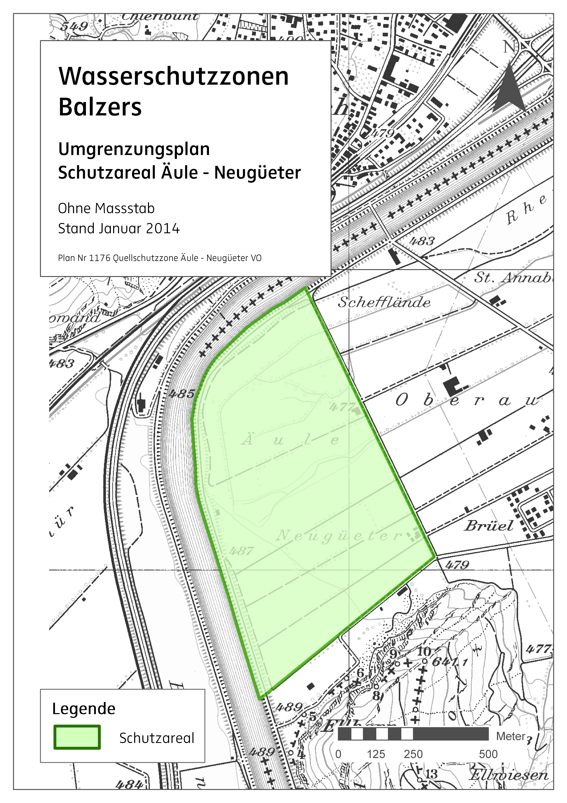

Verordnung vom 3. Mai 2016 über das Grundwasserschutzareal "Äule-Neugüeter" der Gemeinde Balzers Aufgrund von Art. 24 und 67 des Gewässerschutzgesetzes (GSchG) vom 15. Mai 2003, LGBI. 2003 Nr. 159, verordnet die Regierung: I. Allgemeine Bestimmungen Art. 1 Zweck Das in Art. 2 näher umschriebene Gebiet wird als Schutzareal im Sinne von Art. 5 Abs. 1 Bst. r des Gewässerschutzgesetzes festgelegt. Art. 2 Geltungsbereich 1) Die Grenzen des Schutzareals sind in dem dieser Verordnung beigegebenem Situationsplan dargestellt. Der Plan ist Bestandteil dieser Verordnung. 2) Das Schutzareal ist in der Bauordnung zu berücksichtigen und im Zonenplan der Gemeinde Balzers ersichtlich zu machen. 3) Die detaillierten Umgrenzungen des Schutzareals sind aus dem Situationsplan 1 : 2 500 ersichtlich, welcher bei der Gemeinde Balzers sowie beim Amt für Umweltschutz aufliegt. Art. 3 Umschreibung Das Schutzareal dient der Freihaltung eines Gebietes, das für eine zukünftige Grundwasserfassung mit den dazugehörigen Schutzzonen im Sinne von Art. 5 Abs. 1 Bst. q des Gewässerschutzgesetzes geeignet ist. Art. 4 Vorbehaltenes Recht Diese Verordnung lässt die Bestimmungen der Verordnung betreffend das Naturschutzgebiet "Äulehäg" in Balzers unberührt. II. Bestimmungen für das Schutzareal Art. 5 Grundsatz Im Schutzareal sind Vorkehrungen, welche die Menge und Güte der Grundwasservorkommen oder die öffentliche Wasserversorgung gefährden, verboten. Art. 6 Bauten und Anlagen 1) Im Schutzareal gilt ein allgemeines Bauverbot. Aus wichtigen Gründen können Ausnahmen gestattet werden (Art. 16). 2) Vorbehalten bleibt Art. 19. Art. 7 Verkehrsanlagen 1) Feldwege sind mit einem Fahrverbot für Motorfahrzeuge (landwirtschaftlicher Verkehr sowie Zubringerdienst gestattet) zu belegen. 2) Für die Rheindammstrasse gilt ein Fahrverbot für Fahrzeuge mit wassergefährdenden Flüssigkeiten. Art. 8 Versickerungen Das Versickern von Abwasser ist verboten. Ausgenommen ist die Versickerung von unverschmutztem Niederschlagswasser, wenn die Versickerung über die bewachsene Bodenschicht erfolgt. Art. 9 Abwasseranlagen 1) Schmutzwasserleitungen haben den Dichtheitsanforderungen der SIA-Norm 190, Kanalisationen, zu genügen. 2) Das Amt für Umweltschutz ordnet mindestens alle zehn Jahre oder bei Bedarf die Prüfung von Schmutzwasserleitungen, Jauchebehältern und dergleichen durch den Eigentümer an. 3) Mangelhafte Anlagen sind vom Eigentümer auf seine Kosten abzudichten oder zu ersetzen. Art. 10 Grabarbeiten, Geländeveränderungen und Auffüllungen 1) Grabarbeiten und Geländeveränderungen sind bewilligungspflichtig. 2) Sie sind zu bewilligen, wenn ein sachlich begründetes Bedürfnis besteht, die schützende Deckschicht nicht wesentlich vermindert wird und spezielle Schutzmassnahmen getroffen werden. 3) Auffüllungen dürfen nur aus sauberem Aushubmaterial bestehen. Art. 11 Düngung Für die Düngung gelten die Bestimmungen der Verordnung zum Gewässerschutzgesetz sowie Anhang 2.6 der schweizerischen Chemikalien-Risikoreduktions-Verordnung (SR 814.81). Art. 12 Pflanzen- und Holzschutzmittel 1) Für die Verwendung von Pflanzenschutzmitteln gelten die Bestimmungen der Verordnung zum Gewässerschutzgesetz sowie Anhang 2.5 der schweizerischen Chemikalien-Risikoreduktions-Verordnung. Die ganzflächige Vorauflauf-Behandlung mit persistenten chemischen Bodenherbiziden ist untersagt. Das Amt für Umweltschutz veröffentlicht ein Verzeichnis der verbotenen Bodenherbizide und führt dieses laufend nach. 2) Für die Verwendung von Holzschutzmitteln gilt Anhang 2.4 der schweizerischen Chemikalien-Risikoreduktions-Verordnung. Art. 13 Lagerhaltungen 1) Für die Lagerung von Hofdüngern gilt die Hofdüngerverordnung. 2) Ablagerungen von wassergefährdenden Stoffen sind verboten. 3) Handelsdünger und Pflanzenschutzmittel sind geschützt gegen Durchnässung und Versickerung aufzubewahren. III. Organisation und Durchführung Art. 14 Aufsicht Die Aufsicht über das Schutzareal obliegt dem Amt für Umweltschutz. Die Gemeinde Balzers (Wassermeister) hat bei der Aufsicht mitzuwirken, wobei Umfang und Durchführung der Kontrollen durch Vereinbarung geregelt werden. Art. 15 Verfügungen Das Amt für Umweltschutz erlässt die gemäss dieser Verordnung erforderlichen Verfügungen und überwacht deren Vollzug. Art. 16 Ausnahmebewilligungen 1) Die Regierung kann im Einvernehmen mit der Gemeinde Balzers aus wichtigen Gründen von den Vorschriften dieser Verordnung abweichende Bewilligungen erteilen, sofern eine Gefährdung der Trinkwassernutzung ausgeschlossen werden kann. 2) In der Bewilligung sind die zu treffenden, speziellen Schutzmassnahmen festzulegen. Art. 17 Kosten 1) Die Kosten für die Ausscheidung des Schutzareals trägt die Gemeinde Balzers. 2) Allfällige Entschädigungsleistungen an die betroffenen Grundeigentümer gehen zu Lasten der Gemeinde Balzers nach Massgabe vertraglicher Vereinbarungen. IV. Strafbestimmungen Art. 18 Übertretungen Nach Art. 61 des Gewässerschutzgesetzes wird bestraft, wer: a) verbotene Vorkehrungen im Schutzareal vornimmt (Art. 5); b) die Vorschriften über Bauten und Anlagen nicht einhält (Art. 6); c) die Vorschriften über Versickerungen nicht einhält (Art. 8); d) die Anforderungen an die Abwasseranlagen nicht erfüllt (Art. 9); e) die Vorschriften über Grabarbeiten, Geländeveränderungen und Auffüllungen nicht einhält (Art. 10); f) die Vorschriften über die Düngung nicht einhält (Art. 11); g) die Vorschriften über Pflanzen- und Holzschutzmittel nicht einhält (Art. 12); h) die Vorschriften über die Lagerhaltung nicht einhält (Art. 13). V. Übergangs- und Schlussbestimmungen Art. 19 Bestehende Landwirtschaftsbetriebe 1) Bei bestehenden Landwirtschaftsbetrieben im Schutzareal sind vorbehaltlich Abs. 2 die bisherige Nutzung sowie Nutzungserweiterungen nach Massgabe der Art. 5 bis 13 zulässig. 2) Die Errichtung, der Umbau sowie der Wiederaufbau von Bauten und Anlagen eines bestehenden Landwirtschaftsbetriebs im Schutzareal sind zulässig, wenn sie erfolgen: a) nach Massgabe der Vorschriften der Baugesetzgebung; b) in einem Abstand von 50 Metern zu den im Zeitpunkt des Inkrafttretens dieser Verordnung bestehenden Bauten und Anlagen. 3) Das Amt für Umweltschutz ordnet in den Fällen nach Abs. 2 die zum Schutz des Grundwassers erforderlichen Massnahmen an. Es wendet dabei insbesondere die in den Vollzugshilfen "Wegleitung Grundwasserschutz" und "Baulicher Umweltschutz in der Landwirtschaft" des Bundesamtes für Umwelt und des Bundesamtes für Landwirtschaft für die Zone S 3 aufgestellten Grundsätzen an. Art. 20 Ablagerungsstandorte Die im Schutzareal liegenden Ablagerungsstandorte sind nach Massgabe der Altlasten-Verordnung zu untersuchen, zu überwachen und gegebenenfalls zu sanieren. Art. 21 Inkrafttreten Diese Verordnung tritt am 1. Juni 2016 in Kraft. Fürstliche Regierung: gez. Adrian Hasler Fürstlicher Regierungschef Anhang (Art. 2 Abs. 1) 

