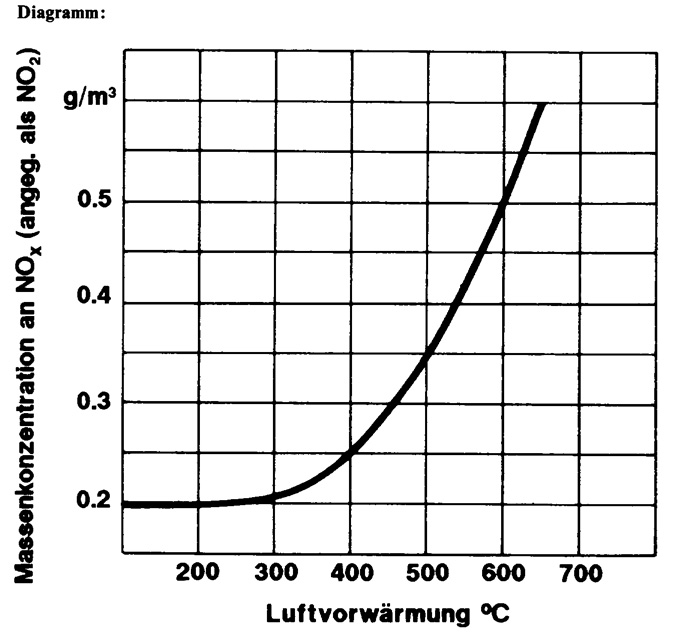
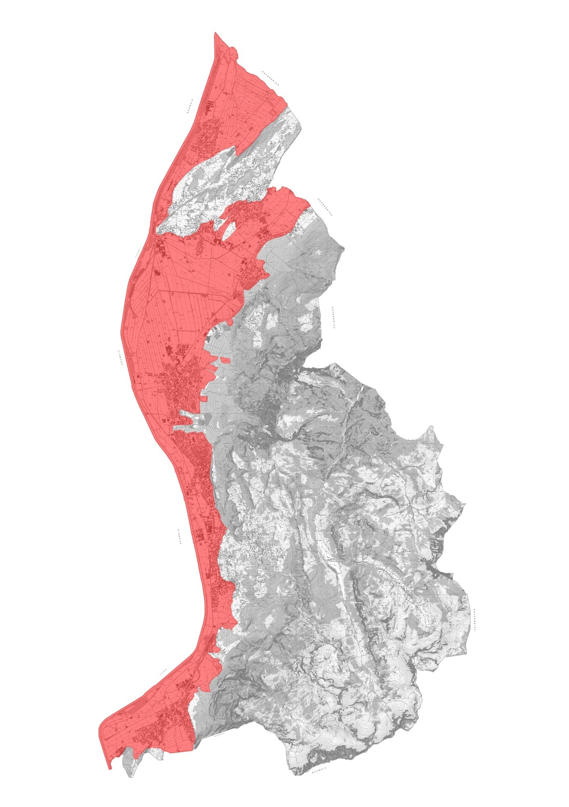
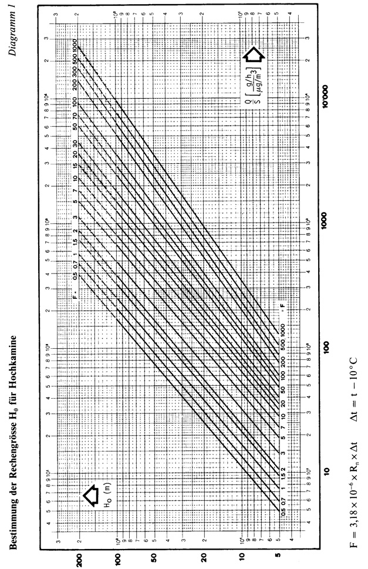
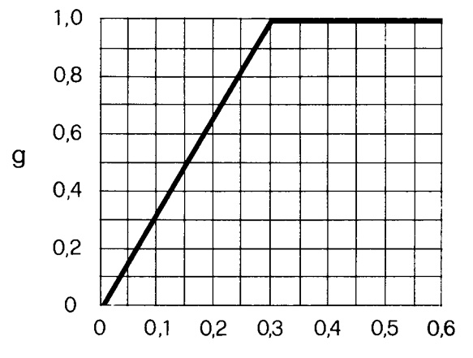

Luftreinhalteverordnung (LRV) vom 30. September 2008 Aufgrund von Art. 15 Abs. 2, Art. 16 Abs. 1, Art. 19 Abs. 2, Art. 23, 69 und 94 des Umweltschutzgesetzes (USG) vom 29. Mai 2008, LGBl. 2008 Nr. 199 , verordnet die Regierung: I. Allgemeine Bestimmungen Art. 1 Zweck und Geltungsbereich 1) Diese Verordnung soll Menschen, Tiere, Pflanzen, ihre Lebensgemeinschaften und Lebensräume sowie den Boden vor schädlichen oder lästigen Luftverunreinigungen schützen. Sie bezweckt zudem die Reduktion des Ausstosses von Treibhausgasen. 2) Sie regelt: a) die vorsorgliche Emissionsbegrenzung bei Anlagen nach Art. 6 Abs. 1 Bst. t des Gesetzes, welche die Luft verunreinigen; b) die Anforderungen an Brenn- und Treibstoffe; c) die höchstzulässige Belastung der Luft (Immissionsgrenzwerte; Zielwerte); d) das Vorgehen für den Fall, dass die Immissionen übermässig sind. 3) Sie dient der Umsetzung der im Anhang 8 aufgeführten EWR-Rechtsvorschriften. Art. 1a Verweis auf EWR-Rechtsvorschriften 1) Wird in dieser Verordnung auf Rechtsvorschriften verwiesen, auf die im EWR-Abkommen Bezug genommen wird, so beziehen sich diese Verweise auf die jeweils gültige Fassung dieser EWR-Rechtsvorschriften, einschliesslich ihrer Anpassungen und Ergänzungen. 2) Die Regelungen der EWR-Rechtsvorschriften, auf die in dieser Verordnung verwiesen wird, sind unmittelbar anwendbar und allgemein verbindlich. 3) Die gültige Fassung der in Anhang 8 genannten Rechtsvorschriften ergibt sich aus der Kundmachung der Beschlüsse des Gemeinsamen EWR-Ausschusses im Liechtensteinischen Landesgesetzblatt nach Art. 3 Bst. k des Kundmachungsgesetzes. Art. 2 Begriffsbestimmungen und Bezeichnungen 1) Im Sinne dieser Verordnung gelten als: a) "stationäre Anlagen": 1. Bauten und andere ortsfeste Einrichtungen; 2. Terrainveränderungen; 3. Geräte und Maschinen; 4. Lüftungsanlagen, welche die Abgase von Fahrzeugen sammeln und als Abluft an die Umwelt abgeben; b) "Fahrzeuge": Motorfahrzeuge, Luftfahrzeuge und Eisenbahnen; c) "Verkehrsanlagen": Strassen, Flugplätze, Geleise und andere Anlagen, bei denen die Abgase von Fahrzeugen nicht gesammelt als Abluft an die Umwelt abgegeben werden; d) "neue Anlagen": auch Anlagen, die umgebaut, erweitert oder instand gestellt werden, wenn: 1. dadurch höhere oder andere Emissionen zu erwarten sind; oder 2. mehr als die Hälfte der Kosten aufgewendet wird, die eine neue Anlage verursachen würde; e) "übermässige Immissionen": Immissionen, die einen oder mehrere Immissionsgrenzwerte nach Anhang 6, einen oder mehrere Zielwerte nach Anhang 7 oder einen oder mehrere kritische Werte nach Anhang 7b überschreiten. Bestehen für einen Schadstoff keine Immissionsgrenzwerte, so gelten die Immissionen als übermässig, wenn: 1. sie Menschen, Tiere, Pflanzen, ihre Lebensgemeinschaften oder ihre Lebensräume gefährden; 2. aufgrund einer Erhebung feststeht, dass sie einen wesentlichen Teil der betroffenen Bevölkerung in ihrem Wohlbefinden erheblich stören; 3. sie Bauwerke beschädigen; oder 4. sie die Fruchtbarkeit des Bodens, die Vegetation oder die Gewässer beeinträchtigen. f) "Inverkehrbringen": die erstmalige entgeltliche oder unentgeltliche Übertragung oder Überlassung eines Gerätes oder einer Maschine zum Vertrieb oder Gebrauch. Dem Inverkehrbringen gleichgestellt ist die erstmalige Inbetriebnahme von Geräten und Maschinen im eigenen Betrieb, wenn zuvor kein Inverkehrbringen stattgefunden hat. 2) Im Übrigen finden die Begriffsbestimmungen des EWR-Rechts, insbesondere der Richtlinien 2008/50/EG und 2010/75/EU, ergänzend Anwendung. 3) Die in dieser Verordnung verwendeten Personenbezeichnungen gelten für Personen männlichen und weiblichen Geschlechts. II. Emissionen A. Emissionsbegrenzung bei neuen stationären Anlagen Art. 3 Vorsorgliche Emissionsbegrenzung nach den Anhängen 1 bis 3 1) Neue stationäre Anlagen müssen so ausgerüstet und betrieben werden, dass sie die im Anhang 1 festgelegten Emissionsbegrenzungen einhalten. 2) Für folgende Anlagen gelten ergänzende oder abweichende Anforderungen: a) für Anlagen nach Anhang 2: die in diesem Anhang festgelegten Anforderungen; b) für Feuerungsanlagen: die Anforderungen nach Anhang 3; c) für Feuerungsanlagen nach Art. 22 und nicht für den Strassenverkehr bestimmte mobile Maschinen und Geräte mit Verbrennungsmotor: die aufgrund des Zollvertrages in Liechtenstein anwendbaren Bestimmungen; d) für Baumaschinen und deren Partikelfiltersysteme: die aufgrund der Baustellen-Emissionsbegrenzungs-Verordnung anwendbaren Bestimmungen. Art. 4 Vorsorgliche Emissionsbegrenzung durch die Behörde Emissionen, für die diese Verordnung keine Emissionsbegrenzung festlegt oder eine bestimmte Begrenzung als nicht anwendbar erklärt, sind vom Amt für Umweltschutz vorsorglich so weit zu begrenzen, als dies technisch und betrieblich möglich und wirtschaftlich tragbar ist. Art. 5 Verschärfte Emissionsbegrenzungen durch die Behörde 1) Ist zu erwarten, dass eine einzelne geplante Anlage übermässige Immissionen verursachen wird, obwohl die vorsorglichen Emissionsbegrenzungen eingehalten sind, so verfügt das Amt für Umweltschutz für diese Anlage ergänzende oder verschärfte Emissionsbegrenzungen. 2) Die Emissionsbegrenzungen sind so weit zu ergänzen oder zu verschärfen, dass keine übermässigen Immissionen verursacht werden. Art. 6 Erfassung und Ableitung von Emissionen 1) Emissionen sind möglichst nahe am Ort ihrer Entstehung möglichst vollständig zu erfassen und so abzuleiten, dass keine übermässigen Immissionen entstehen. 2) Sie müssen in der Regel durch Kamine oder Abluftkanäle über Dach ausgestossen werden. 3) Für Hochkamine gilt Anhang 5. Kann die erforderliche Kaminbauhöhe H nicht verwirklicht werden oder beträgt die Rechengrösse H 0 mehr als 100 m, so verschärft das Amt für Umweltschutz ersatzweise die in den Anhängen 1 bis 3 vorgesehenen Emissionsbegrenzungen. B. Emissionsbegrenzung bei bestehenden stationären Anlagen Art. 7 Vorsorgliche Emissionsbegrenzung Die Bestimmungen über die vorsorgliche Emissionsbegrenzung bei neuen stationären Anlagen (Art. 3, 4 und 6) gelten auch für bestehende stationäre Anlagen. Art. 8 Sanierungspflicht 1) Das Amt für Umweltschutz sorgt dafür, dass bestehende stationäre Anlagen, die den Anforderungen dieser Verordnung nicht entsprechen, saniert werden. 2) Es erlässt die erforderlichen Verfügungen und legt darin die Sanierungsfrist nach Art. 10 fest. Notfalls verfügt es für die Dauer der Sanierung Betriebseinschränkungen oder die Stilllegung der Anlage. 3) Auf die Sanierung kann verzichtet werden, wenn sich der Inhaber verpflichtet, die Anlage innert der Sanierungsfrist stillzulegen. Art. 9 Verschärfte Emissionsbegrenzungen 1) Steht fest, dass eine einzelne bestehende Anlage übermässige Immissionen verursacht, obwohl sie die vorsorglichen Emissionsbegrenzungen einhält, so verfügt das Amt für Umweltschutz für diese Anlage ergänzende oder verschärfte Emissionsbegrenzungen. 2) Die Emissionsbegrenzungen sind so weit zu ergänzen oder zu verschärfen, dass keine übermässigen Immissionen mehr verursacht werden. 3) Die ergänzenden oder verschärften Emissionsbegrenzungen werden durch Sanierungsverfügungen mit einer Sanierungsfrist bis zu höchstens zwei Jahren angeordnet. Notfalls verfügt das Amt für Umweltschutz für die Dauer der Sanierung Betriebseinschränkungen oder die Stilllegung der Anlage. 4) Werden die übermässigen Immissionen durch mehrere Anlagen verursacht, ist der Massnahmenplan nach Art. 66 des Gesetzes anzupassen. Art. 10 Sanierungsfristen 1) Die ordentliche Sanierungsfrist beträgt zwei Jahre. 2) Kürzere Fristen bis zu höchstens einem Jahr, mindestens aber 30 Tage, werden festgelegt, wenn: a) die Sanierung ohne erhebliche Investitionen durchgeführt werden kann; b) die Emissionen mehr als das Dreifache des Wertes betragen, der für die vorsorgliche Emissionsbegrenzung gilt; oder c) die von der Anlage allein verursachten Immissionen übermässig sind. 3) Längere Fristen bis zu höchstens fünf Jahren können festgelegt werden, wenn: a) die Emissionen weniger als das Anderthalbfache des Wertes betragen, der für die vorsorgliche Emissionsbegrenzung gilt, oder die Vorschriften über die Abgasverluste nicht eingehalten werden; und b) weder Bst. a noch Bst. c von Abs. 2 erfüllt ist. Art. 11 Erleichterungen 1) Das Amt für Umweltschutz gewährt dem Inhaber einer Anlage auf Gesuch hin Erleichterungen, wenn eine Sanierung nach den Art. 8 und 10 unverhältnismässig, insbesondere technisch oder betrieblich nicht möglich oder wirtschaftlich nicht tragbar wäre. 2) Als Erleichterung kann das Amt für Umweltschutz in erster Linie längere Fristen einräumen. Genügt die Einräumung längerer Fristen nicht, so legt das Amt für Umweltschutz mildere Emissionsbegrenzungen fest. C. Kontrolle von stationären Anlagen Art. 12 Emissionserklärung 1) Wer eine Anlage betreibt oder errichten will, die Luftverunreinigungen verursacht, muss dem Amt für Umweltschutz auf Verlangen Auskunft erteilen, insbesondere über: a) die Art und Menge der Emissionen; b) den Ort, die Höhe und den zeitlichen Verlauf des Ausstosses; c) weitere Bedingungen des Ausstosses, die für die Beurteilung der Emissionen nötig sind. 2) Die Emissionserklärung kann sich auf Messungen oder Materialbilanzen der eingesetzten Stoffe stützen. Art. 13 Emissionsmessungen und -kontrollen 1) Das Amt für Umweltschutz überwacht die Einhaltung der Emissionsbegrenzungen. Es führt selber Emissionsmessungen oder -kontrollen durch oder lässt solche durchführen. Art. 14 Abs. 1 bleibt vorbehalten. 2) Die erste Messung (Abnahmemessung) oder Kontrolle muss wenn möglich innert drei, spätestens jedoch innert zwölf Monaten nach der Inbetriebnahme der neuen oder sanierten Anlage erfolgen. Vorbehalten bleiben abweichende Bestimmungen in Anhang 3. Bei mit Öl oder Gas betriebenen Feuerungsanlagen mit einer Feuerungswärmeleistung von 1 000 kW und mehr ist die erste Messung innerhalb von vier Monaten nach der Inbetriebnahme der Anlage vorzunehmen. 3) Bei Anlagen, aus denen erhebliche Emissionen austreten können, ordnet das Amt für Umweltschutz die kontinuierliche Messung und Aufzeichnung der Emissionen oder einer anderen Betriebsgrösse an, welche die Kontrolle der Emissionen ermöglicht. 4) Das Amt für Umweltschutz führt bei Bedarf weitere Emissionskontrollen oder die Messung weiterer Parameter als in den Anhängen 1 bis 3 vorgesehen durch oder ordnet solche an. 5) Für Emissionsmessungen und Kontrollen finden die massgebenden Bestimmungen des EWR-Rechts, insbesondere der Richtlinie 2010/75/EU, ergänzend Anwendung. Art. 14 Überwachung der Feuerungsanlagen 1) Die Feuerungskontrolleure nach Art. 70 des Gesetzes haben jährlich die mit Öl oder Gas betriebenen Feuerungsanlagen mit einer Feuerungswärmeleistung bis zu 1 000 Kilowatt zu messen oder zu kontrollieren. Zudem unterstützen sie das Amt für Umweltschutz bei der Kontrolle von Brennstoffen. 2) Das Amt für Umweltschutz hat jährlich die mit Öl oder Gas betriebenen Feuerungsanlagen mit einer Feuerungswärmeleistung über 1 000 Kilowatt sowie die mit festen Brennstoffen betriebenen Feuerungsanlagen zu messen oder zu kontrollieren. Für die periodische Messung oder Kontrolle von mit festen Brennstoffen betriebenen Feuerungsanlagen kann das Amt für Umweltschutz grössere Zeitabstände festlegen. 3) Vorbehalten bleiben abweichende Bestimmungen in Anhang 3. 4) Das Amt für Umweltschutz und die Feuerungskontrolleure arbeiten bei den ihnen zugeteilten Aufgaben zusammen. 5) Die Feuerungskontrolleure erstatten dem Amt für Umweltschutz über ihre Kontrolltätigkeit fortlaufend Bericht. Zudem reichen sie dem Amt für Umweltschutz jeweils bis Mitte Januar eine Statistik über die durchgeführten Kontrollen und die Kontrollergebnisse des vorangegangenen Jahres ein. Art. 15 Überwachung der besonderen Anlagen 1) Das Amt für Umweltschutz hat in der Regel alle drei Jahre die besonderen Anlagen nach Anhang 2 zu messen oder zu kontrollieren. 2) Bei Bedarf ordnet das Amt für Umweltschutz periodische Kontrollen in kürzeren Zeitabständen an. 3) Vorbehalten bleiben abweichende Bestimmungen in Anhang 2. 4) Die massgebenden Bestimmungen des EWR-Rechts, insbesondere der Richtlinie 2010/75/EU, finden ergänzend Anwendung. Art. 15a Nachweis der anerkannten Regeln der Messtechnik 1) Lässt das Amt für Umweltschutz Emissionsmessungen und Kontrollen nach Art. 13 bis 15 durch Dritte durchführen, so muss es periodisch prüfen, ob diese die anerkannten Regeln der Messtechnik ausreichend kennen. 2) Das Amt für Umweltschutz kann von der periodischen Prüfung nach Abs. 1 absehen, wenn der Dritte nur Messungen und Kontrollen durchführt, für die vereinfachte Messverfahren vorgesehen sind. Art. 16 Durchführung der Messungen 1) Die Messungen müssen die für die Beurteilung wichtigen Betriebszustände erfassen. Wenn nötig legt das Amt für Umweltschutz Art und Umfang der Messung sowie die zu erfassenden Betriebszustände fest. 2) Emissionsmessungen sind nach den anerkannten Regeln der Messtechnik durchzuführen. Es gelten die Empfehlungen des Bundesamtes für Umwelt (BAFU) über die Durchführung der Messungen . Die massgebenden Bestimmungen des EWR-Rechts, insbesondere der Richtlinie 2010/75/EU, finden ergänzend Anwendung. Für die technischen Anforderungen an die Messsysteme und an die Messbeständigkeit gelten die schweizerische Messmittelverordnung (SR 941.210) und die entsprechenden Ausführungsvorschriften des Eidgenössischen Justiz- und Polizeidepartements. 3) Der Inhaber der zu überprüfenden Anlage muss nach Anweisung des Amtes für Umweltschutz geeignete Messplätze einrichten und zugänglich machen. 4) Die gemessenen und errechneten Werte, die verwendeten Messverfahren und die Betriebsbedingungen der Anlage während der Messungen müssen in einem Messbericht festgehalten werden. Art. 17 Beurteilung der Emissionen 1) Das Amt für Umweltschutz beurteilt die Emissionen. 2) Die gemessenen Werte sind auf die in Anhang 1 Ziff. 23 festgelegten Bezugsgrössen umzurechnen. 3) Soweit die Anhänge 1 bis 3 nichts anderes bestimmen, sind die nach Abs. 2 errechneten Werte für die Beurteilung über den Zeitraum einer Stunde zu mitteln. Das Amt für Umweltschutz kann in begründeten Fällen andere geeignete Mittelungszeiten festlegen. 4) Bei Abnahme- und Kontrollmessungen gelten die Emissionsbegrenzungen als eingehalten, wenn keiner der nach Abs. 3 bestimmten Mittelwerte den Grenzwert überschreitet. 5) Bei kontinuierlicher Messung der Emissionen gelten die Emissionsgrenzwerte als eingehalten, wenn innerhalb des Kalenderjahres: a) keiner der Tagesmittelwerte den Emissionsgrenzwert überschreitet; b) 97 % aller Stundenmittelwerte das 1,2-fache des Grenzwertes nicht überschreiten; und c) keiner der Stundenmittelwerte das Zweifache des Grenzwertes überschreitet. 6) Die Emissionen während der An- und Abfahrzeiten der Anlage werden unter Berücksichtigung der besonderen Umstände beurteilt. 7) Die massgebenden Bestimmungen des EWR-Rechts, insbesondere der Richtlinie 2010/75/EU, finden ergänzend Anwendung. Art. 18 Umgehungsleitungen, Betriebsstörungen und fehlende Verfügbarkeit von Chemikalien zur Abgasreinigung 1) Eine Umgehungsleitung zum Schutze von Abgasreinigungsanlagen darf nur mit Zustimmung des Amtes für Umweltschutz verwendet werden. 2) Können durch die Verwendung von Umgehungsleitungen oder bei Betriebsstörungen erhebliche Emissionen auftreten, so legt das Amt für Umweltschutz fest, welche Massnahmen zu treffen sind. 3) Das Amt für Umweltschutz kann für stationäre Anlagen mildere Emissionsbegrenzungen festlegen, wenn nachgewiesen ist, dass die für den Betrieb der Abgasreinigungsanlagen notwendigen Chemikalien nicht verfügbar sind. Mildere Emissionsbegrenzungen sind ausgeschlossen für hochtoxische oder krebserzeugende Stoffe. D. Emissionen von Fahrzeugen und Verkehrsanlagen Art. 19 Vorsorgliche Emissionsbegrenzung bei Fahrzeugen Die Emissionen von Fahrzeugen sind nach den Gesetzgebungen über den Strassenverkehr, die Luftfahrt und die Eisenbahnen vorsorglich so weit zu begrenzen, als dies technisch und betrieblich möglich sowie wirtschaftlich tragbar ist. Art. 20 Vorsorgliche Emissionsbegrenzung bei Verkehrsanlagen Bei Verkehrsanlagen ordnet die zuständige Behörde alle technisch und betrieblich möglichen und wirtschaftlich tragbaren Massnahmen an, mit denen die vom Verkehr verursachten Emissionen begrenzt werden können. Art. 21 Massnahmen gegen übermässige Immissionen aus dem Verkehr Steht fest oder ist zu erwarten, dass Fahrzeuge oder Verkehrsanlagen übermässige Immissionen verursachen, ist der Massnahmenplan nach Art. 66 des Gesetzes anzupassen. E. Inverkehrbringen von Feuerungsanlagen Art. 22 Voraussetzungen für das Inverkehrbringen 1) Die folgenden Feuerungsanlagen dürfen nur in Verkehr gebracht werden, wenn die aufgrund des Zollvertrages in Liechtenstein anwendbaren Rechtsvorschriften zum Konformitätsnachweis eingehalten sind: a) Gebläsebrenner für Heizöl "Extra leicht" oder Gas mit einer Feuerungswärmeleistung bis 350 kW; b) Heizkessel für Gebläsebrenner nach Bst. a, sofern als Wärmeträger Wasser verwendet wird und die Absicherungstemperatur wasserseitig höchstens 110 °C beträgt; c) Heizkessel nach Bst. b mit fest zugeordneten Gebläsebrennern (Unit); d) Heizkessel für gasförmige Brennstoffe mit einer Feuerungswärmeleistung bis 350 kW, sofern als Wärmeträger Wasser verwendet wird und die Absicherungstemperatur wasserseitig höchstens 110 °C beträgt; e) Aufgehoben f) direkt befeuerte Gas-Speicherwassererwärmer (Boiler) mit einem Wasserinhalt von mehr als 30 Litern und einer Feuerungswärmeleistung bis 350 kW; g) Gas-Durchflusswassererwärmer mit einer Feuerungswärmeleistung von 35 kW bis 350 kW; h) Heizkessel für feste Brennstoffe nach Anhang 4 mit einer Feuerungswärmeleistung bis 350 kW und Pelletbrenner für kleine Heizkessel mit einer Feuerungswärmeleistung bis 70 kW. 2) Aufgehoben 3) Das Amt für Umweltschutz kann die praktische Erprobung von Anlagen ohne Konformitätserklärung in begrenzter Anzahl während einer Dauer von höchstens zwei Jahren zulassen. Anlagen, die nach Ablauf dieser Frist in der vorliegenden Form noch keine Konformitätserklärung haben, müssen wieder ausser Betrieb genommen werden. F. Brenn- und Treibstoffe Art. 23 Brenn- und Treibstoffe Für die Anforderungen an und die Deklaration von Brenn- und Treibstoffen gelten die Bestimmungen nach Anhang 4 sowie die aufgrund des Zollvertrages und des EWR-Abkommens in Liechtenstein anwendbaren Rechtsvorschriften. Art. 24 Anlagen für unverbleites Motorenbenzin 1) Anlagen für unverbleites Motorenbenzin, wie Lager- und Transportbehälter, Tankfahrzeuge und Zapfsäulen, müssen mit der Aufschrift "Bleifrei" deutlich gekennzeichnet sein. 2) Soll für unverbleites Benzin eine Anlage verwendet werden, die vorher Bleibenzin enthielt, so muss der Inhaber die Anlage vorher gründlich reinigen oder durch andere Massnahmen dafür sorgen, dass sie keine übermässigen Bleirückstände enthält. G. Verbrennen von Abfällen Art. 25 Verbrennen von Abfällen 1) Abfälle dürfen nur in Anlagen nach Anhang 2 Ziff. 7 verbrannt oder thermisch zersetzt werden; ausgenommen ist die Verbrennung von Abfällen nach Anhang 2 Ziff. 11. 2) Für das Verbrennen von Abfällen ausserhalb von Anlagen gilt Art. 45 des Gesetzes. III. Immissionen A. Ermittlung und Beurteilung Art. 26 Ermittlung der Immissionen 1) Das Amt für Umweltschutz überwacht den Stand und die Entwicklung der Luftverunreinigung; es ermittelt insbesondere das Ausmass der Immissionen. 2) Es führt dazu Erhebungen, Messungen und Ausbreitungsrechnungen durch und wendet dabei auch die Vorgaben der massgebenden Bestimmungen des EWR-Rechts, insbesondere der Richtlinie 2008/50/EG, an. Art. 27 Immissionsprognose 1) Bevor eine stationäre Anlage oder eine Verkehrsanlage, aus der erhebliche Emissionen zu erwarten sind, errichtet oder saniert wird, kann das Amt für Umweltschutz vom Inhaber eine Immissionsprognose verlangen. 2) Die Prognose muss angeben, welche Immissionen in welchen Gebieten, in welchem Umfang und mit welcher Häufigkeit zu erwarten sind. 3) In der Prognose sind die Art und Menge der Emissionen sowie die Ausbreitungsbedingungen und die Berechnungsmethoden anzugeben. Art. 28 Überwachung bei einzelnen Anlagen Vom Inhaber einer Anlage, aus der erhebliche Emissionen austreten, kann das Amt für Umweltschutz verlangen, dass er die Immissionen im betroffenen Gebiet messtechnisch überwacht. Art. 29 Beurteilung der Immissionen Das Amt für Umweltschutz beurteilt, ob die ermittelten Immissionen übermässig sind (Art. 2 Abs. 1 Bst. e). Es wendet dabei auch die Kriterien zur Beurteilung von Immissionen nach den massgebenden Bestimmungen des EWR-Rechts, insbesondere der Richtlinie 2008/50/EG, an. B. Massnahmenplan und Information Art. 29a Massnahmenplan zur Luftreinhaltung 1) Der Massnahmenplan nach Art. 66 des Gesetzes hat für Gebiete, in denen ein oder mehrere Immissionsgrenzwerte nach Anhang 6 oder ein oder mehrere Zielwerte nach Anhang 7 überschritten sind, mindestens die im Anhang XV Abschnitt A der Richtlinie 2008/50/EG genannten Informationen zu enthalten. 2) Der Massnahmenplan muss geeignete Massnahmen enthalten, um den Zeitraum der Nichteinhaltung der Grenzwerte so kurz wie möglich zu halten. Er kann zusätzlich gezielte Massnahmen zum Schutz empfindlicher Bevölkerungsgruppen, einschliesslich Massnahmen zum Schutz von Kindern, enthalten. Art. 29b Information der Öffentlichkeit 1) Wird die Informationsschwelle nach Anhang 7a oder eine der dort festgelegten Alarmschwellen überschritten, ist die Öffentlichkeit über Radio, Fernsehen, Zeitungen oder Internet zu informieren. 2) Werden die Informationsschwelle oder Alarmschwellen überschritten, sind die zuständigen Behörden der betroffenen Nachbarstaaten so schnell wie möglich zu informieren. 3) Sobald Liechtenstein von einem Nachbarstaat über die Überschreitung der Informationsschwelle oder Alarmschwellen informiert wird, ist die Öffentlichkeit darüber zu informieren. 4) Das Amt für Umweltschutz stellt im Rahmen der Information nach Art. 5 Abs. 1 des Gesetzes sicher, dass die Öffentlichkeit, insbesondere relevante Organisationen wie Umweltschutzorganisationen und Verbraucherverbände, Interessensvertretungen empfindlicher Bevölkerungsgruppen, andere mit dem Gesundheitsschutz befasste relevante Stellen und die betreffenden Wirtschaftsverbände, angemessen und rechtzeitig informiert werden über: a) die Luftqualität nach den Vorgaben in Anhang XVI der Richtlinie 2008/50/EG; und b) den Massnahmenplan nach Art. 66 des Gesetzes. 5) Die Informationen nach Abs. 4 sind kostenlos über leicht zugängliche Medien einschliesslich des Internets oder jede andere geeignete Form der elektronischen Kommunikation zu Verfügung zu stellen; sie müssen den Bestimmungen der Richtlinie 2007/2/EG des Europäischen Parlaments und des Rates vom 14. März 2007 zur Schaffung einer Geodateninfrastruktur in der europäischen Gemeinschaft (INSPIRE) (EWR-Rechtssammlung: Anh. XX - 1j.01) entsprechen. 6) Das Amt für Umweltschutz veröffentlicht Jahresberichte für die Schadstoffe Schwefeldioxid, Stickstoffdioxid, Partikel PM10 und PM2,5, Blei, Benzol, Ozon sowie Kohlenmonoxid. Die Jahresberichte haben den Vorgaben von Art. 26 Abs. 2 der Richtlinie 2008/50/EG zu entsprechen. C. Nationales Ziel für die Reduzierung der Exposition gegenüber PM2,5 Art. 29c Grundsatz 1) Das Amt für Umweltschutz setzt ein nationales Ziel zur Reduzierung der PM2,5-Exposition nach Anhang XIV Abschnitt B der Richtlinie 2008/50/EG fest. Die Höhe dieses Ziels ist vom Wert des Indikators für die durchschnittliche PM2,5-Exposition im Referenzjahr 2010 abhängig. 2) Das Amt für Umweltschutz berechnet den Indikator nach Abs. 1 nach Anhang XIV Abschnitt A der Richtlinie 2008/50/EG. 3) Der Indikator für die durchschnittliche PM2,5-Exposition darf den Wert von 20 µg/m³ ab dem 1. Januar 2015 nicht mehr überschreiten. 4) Das nationale Ziel ist ab dem 1. Januar 2020 einzuhalten. IV. Emissionshöchstmengen Art. 30 Versauernde, eutrophierende und photochemische Luftschadstoffe 1) Die Emissionen von Schwefeldioxid, Stickstoffoxiden und flüchtigen organischen Verbindungen sind gegenüber 1990 gesamthaft um mindestens folgende Anteile zu vermindern: a) Schwefeldioxid: 27 %; b) Stickstoffoxide: 41 %; c) flüchtige organische Verbindungen: 45 %. 2) Die Emissionsreduktionen sind bis zum Jahre 2010 zu erreichen. V. Übergangs- und Schlussbestimmungen Art. 31 Zielwerte Die Zielwerte nach Anhang 7 sind ab 2012 einzuhalten. Art. 32 Sanierungsfristen 1) Für Anlagen, die gemäss der Verordnung vom 15. März 2005 über die Abänderung der Verordnung zum Luftreinhaltegesetz, LGBl. 2005 Nr. 63, sanierungspflichtig werden, aber bereits die vorsorglichen Emissionsbegrenzungen aufgrund der bis dahin gültigen Bestimmungen erfüllen, gewährt das Amt für Umwelt abweichend von Art. 10 Sanierungsfristen von sechs bis zehn Jahren. Vorbehalten bleiben die Bestimmungen von Art. 10 Abs. 2 Bst. a und c. 2) Für Anlagen, die aufgrund der Bestimmungen dieser Verordnung sanierungspflichtig werden, welche aber bereits die vorsorglichen Emissionsbegrenzungen aufgrund der bisherigen Bestimmungen erfüllen, gewährt das Amt für Umwelt abweichend von Art. 10 Sanierungsfristen von sechs bis zehn Jahren. Vorbehalten bleiben die Bestimmungen von Art. 10 Abs. 2 Bst. a und c. Art. 32a Übergangsbestimmungen zur Änderung vom 6. Dezember 2022 1) Für Feuerungsanlagen, die für den Betrieb mit Gas und Heizöl ausgerüstet sind und die aufgrund einer Empfehlung oder Anordnung der Regierung nach Massgabe des anwendbaren schweizerischen Rechts mit Heizöl "Extra leicht" betrieben werden, gelten abweichend von Anhang 3 Ziff. 411 folgende Emissionsgrenzwerte: - Kohlenmonoxid (CO) 170 mg/m 3 - Stickoxide (NO x ), angegeben als Stickstoffdioxid 250 mg/m 3 2) Bei Anlagen nach Abs. 1 muss zum Zeitpunkt der Umstellung auf Heizöl "Extra leicht", spätestens jedoch innert 30 Tagen, der Brenner durch eine Fachperson gewartet werden. Dabei ist eine Emissionsmessung durchzuführen, und die Messresultate sind dem Amt für Umwelt zu übermitteln. 3) Die Emissionsgrenzwerte nach Abs. 1 sind bis zum 31. März 2023 befristet. Art. 33 Aufhebung bisherigen Rechts Es werden aufgehoben: a) Verordnung vom 24. August 1987 zum Luftreinhaltegesetz (Luftreinhalteverordnung; LRV), LGBl. 1987 Nr. 62; b) Verordnung vom 22. November 1988 über die Abänderung der Verordnung zum Luftreinhaltegesetz, LGBl. 1988 Nr. 45; c) Verordnung vom 28. April 1992 über die Abänderung der Verordnung zum Luftreinhaltegesetz, LGBl. 1992 Nr. 54; d) Verordnung vom 19. Oktober 1999 über die Abänderung der Verordnung zum Luftreinhaltegesetz, LGBl. 1999 Nr. 203; e) Verordnung vom 9. Dezember 2003 über die Abänderung der Verordnung zum Luftreinhaltegesetz, LGBl. 2003 Nr. 260; f) Verordnung vom 15. März 2005 über die Abänderung der Verordnung zum Luftreinhaltegesetz, LGBl. 2005 Nr. 63; g) Verordnung vom 15. März 2005 über die Delegation von Geschäften nach dem Luftreinhaltegesetz, LGBl. 2005 Nr. 64. Art. 34 Inkrafttreten Diese Verordnung tritt am Tage der Kundmachung in Kraft. Fürstliche Regierung: gez. Otmar Hasler Fürstlicher Regierungschef Anhang 1 (Art. 3 Abs. 1) Allgemeine vorsorgliche Emissionsbegrenzungen 1 Geltungsbereich 1) Die Bestimmungen dieses Anhangs gelten für die vorsorgliche Begrenzung der Emissionen von stationären Anlagen. 2) Vorbehalten bleiben die ergänzenden oder abweichenden Bestimmungen: a) für die besonderen Anlagen nach Anhang 2; b) für die Feuerungsanlagen nach Anhang 3; c) für Anlagen nach Anhang VII der Richtlinie 2010/75/EU. 2 Begriffe 21 Abgase Abluft, Rauchgase und andere von Anlagen abgegebene Luftverunreinigungen werden als Abgase bezeichnet. 22 Emissionen Das Mass der Emissionen wird angegeben als: a) Konzentration: Masse der emittierten Stoffe bezogen auf das Volumen des Abgases (z. B. in Milligramm pro Kubikmeter [mg/m³]); b) Massenstrom: Masse der emittierten Stoffe pro Zeiteinheit (z. B. in Gramm pro Stunde [g/h]); c) Emissionsfaktor: Verhältnis der Masse der emittierten Stoffe zur Masse der erzeugten oder verarbeiteten Produkte (z. B. in Kilogramm pro Tonne [kg/t]); d) Emissionsgrad: Verhältnis der emittierten Masse eines luftverunreinigenden Stoffes zur Masse dieses Stoffes, welche der Anlage mit den Brenn- und Einsatzstoffen zugeführt wird (in Prozent [% Masse]); e) Russzahl: Der durch Abgase erzeugte Grad der Schwärzung auf einem Filterpapier. Die für die Bestimmung der Russzahl (nach Bacharach) zu verwendende Vergleichsskala umfasst 10 Stufen; die Stufen werden mit 0 bis 9 angegeben. 23 Bezugsgrösse bei Emissionskonzentrationen 1) Die als Konzentrationen angegebenen Grenzwerte und die als Bezugsgrössen angegebenen Sauerstoffgehalte beziehen sich auf das Volumen des Abgases im Normzustand (0 °C, 1013 mbar) nach Abzug des Feuchtegehaltes (trocken). 2) Die als Emissionskonzentrationen angegebenen Grenzwerte beziehen sich auf die Abgasmenge, die nicht stärker verdünnt ist, als dies technisch und betrieblich unvermeidlich ist. 3) Wird für eine Anlage in den Anhängen 2 und 3 als Bezugsgrösse ein Volumengehalt an Sauerstoff angegeben, so sind die gemessenen Emissionskonzentrationen jeweils auf diese Bezugsgrösse umzurechnen. 24 Feuerungswärmeleistung Die Feuerungswärmeleistung bezeichnet die Wärmeenergie, die einer Anlage pro Zeiteinheit maximal zugeführt werden kann. Sie wird errechnet, indem der Brennstoffverbrauch der Anlage mit dem unteren Heizwert des Brennstoffes multipliziert wird. 3 Allgemeine Bestimmungen 31 Emissionsbegrenzung 1) Es gelten folgende Emissionsbegrenzungen: a) für Staub: Ziff. 4; b) für anorganische, vorwiegend staubförmige Stoffe: Ziff. 5; c) für anorganische gas- oder dampfförmige Stoffe: Ziff. 6; d) für organische gas-, dampf- oder partikelförmige Stoffe: Ziff. 7; e) für krebserzeugende Stoffe: Ziff. 8. 2) Die in Ziff. 5 bis 8 nicht aufgeführten Stoffe werden durch das Amt für Umweltschutz den Stoffklassen zugeordnet, mit denen sie in ihrer Einwirkung auf die Umwelt vergleichbar sind. Dabei sind insbesondere die Abbaubarkeit und Anreicherbarkeit, die Toxizität, die Auswirkungen von Abbauvorgängen und deren Folgeprodukten sowie die Geruchsintensität zu berücksichtigen. 32 Emissionsbegrenzungen, welche von der Anlagegrösse abhängig sind 1) Sind mehrere Emissionsquellen vorhanden und hängt die Anforderung an die Emissionsbegrenzung von der Grösse einer Anlage (z. B. Leistung oder Massenstrom) ab, so legt das Amt für Umweltschutz fest, welche Emissionsquellen zusammen als eine einzige Anlage gelten. 2) Als eine einzige Anlage sind in der Regel Emissionsquellen zu bezeichnen, die in einem engen räumlichen Zusammenhang stehen und deren Emissionen: a) im Wesentlichen die gleichen oder ähnliche Schadstoffe enthalten; oder b) mit der gleichen Technik vermindert werden können. 3) Teile einer Anlage, die nur dazu dienen, bei Betriebsausfällen die Leistung anderer Anlageteile zu ersetzen, werden bei der Bestimmung der Anlagegrösse nicht berücksichtigt. 4) Emissionsgrenzwerte, die von einem bestimmten Massenstrom abhängen, gelten nur, wenn: a) dieser Massenstrom während mehr als fünf Stunden pro Woche erreicht oder überschritten wird; oder b) während einer kürzeren Zeit das Zweifache dieses Massenstroms erreicht oder überschritten wird. 4 Staub 41 Grenzwert für den Gesamtstaub Beträgt der Massenstrom an Staub 0,20 kg/h oder mehr, so dürfen die staubförmigen Emissionen gesamthaft 20 mg/m³ nicht überschreiten. 42 Immissionsbegrenzung für die Inhaltsstoffe des Staubes Für die Begrenzung der einzelnen Inhaltsstoffe des Staubes gelten die Anforderungen nach Ziff. 5, 7 und 8. 43 Massnahmen bei Aufbereitungs-, Lagerungs-, Umschlags- und Transportvorgängen 1) Können in gewerblichen oder industriellen Betrieben durch Vorgänge wie Fördern, Zerkleinern, Klassieren oder Abfüllen staubender Güter erhebliche Staubemissionen entstehen, so müssen die staubhaltigen Abgase erfasst und einer Entstaubungsanlage zugeführt werden. 2) Bei der Lagerung und beim Umschlag staubender Güter im Freien müssen Massnahmen zur Verhinderung von erheblichen Staubemissionen getroffen werden. 3) Beim Transport staubender Güter müssen Transporteinrichtungen verwendet werden, welche die Entstehung erheblicher Staubemissionen verhindern. 4) Können durch den Werkverkehr auf Fahrwegen erhebliche Staubemissionen entstehen, so müssen die Fahrwege staubfrei gehalten werden. 5 Anorganische, vorwiegend staubförmige Stoffe 51 Grenzwerte 1) Die Emissionskonzentration der in Ziff. 52 aufgeführten Stoffe darf folgende Werte nicht übersteigen: a) Stoffe der Klasse 1 bei einem Massenstrom von 1 g/h oder mehr 0,2 mg/m³ b) Stoffe der Klasse 2 bei einem Massenstrom von 5 g/h oder mehr 1 mg/m³ c) Stoffe der Klasse 3 bei einem Massenstrom von 25 g/h oder mehr 5 mg/m³ 2) Die Grenzwerte gelten für die gesamte Masse eines emittierten Stoffes, einschliesslich der gas- und dampfförmigen Anteile im Abgas. 3) Enthält das Abgas mehrere Stoffe der gleichen Klasse, so gilt der Grenzwert für die Summe dieser Stoffe. 52 Tabelle der anorganischen, vorwiegend staubförmigen Stoffe Stoff angegeben als Klasse Antimon 1 und seine Verbindungen Sb 3 Arsen 1 und seine Verbindungen, ausgenommen Arsenwasserstoff As 2 Blei und seine Verbindungen Pb 3 Chrom 1 und seine Verbindungen Cr 3 Cobalt 1 und seine Verbindungen Co 2 Cyanide 2 CN 3 Fluoride 2 soweit staubförmig F 3 Kupfer und seine Verbindungen Cu 3 Mangan und seine Verbindungen Mn 3 Nickel 1 und seine Verbindungen Ni 2 Palladium und seine Verbindungen Pd 3 Platin und seine Verbindungen Pt 3 Quarzstaub soweit kristalliner Feinstaub SiO 2 3 Quecksilber und seine Verbindungen Hg 1 Rhodium und seine Verbindungen Rh 3 Selen und seine Verbindungen Se 2 Tellur und seine Verbindungen Te 2 Thallium und seine Verbindungen Tl 1 Vanadium und seine Verbindungen V 3 Zinn und seine Verbindungen Sn 3 1 Soweit nicht als krebserzeugende Verbindung nach Ziff. 8 erfasst. 2 Soweit leicht löslich. 6 Anorganische gas- oder dampfförmige Stoffe 61 Grenzwerte Die Emissionskonzentration eines der in Ziff. 62 aufgeführten Stoffe darf folgende Werte nicht übersteigen: a) bei einem Stoff der Klasse 1 bei einem Massenstrom von 10 g/h oder mehr 1 mg/m³ b) bei einem Stoff der Klasse 2 bei einem Massenstrom von 50 g/h oder mehr 5 mg/m³ c) bei einem Stoff der Klasse 3 bei einem Massenstrom von 300 g/h oder mehr 30 mg/m³ d) bei einem Stoff der Klasse 4 bei einem Massenstrom von 2500 g/h oder mehr 250 mg/m³ 62 Tabelle der anorganischen gas- oder dampfförmigen Stoffe Stoff Klasse Ammoniak und Ammoniumverbindungen, angegeben als Ammoniak 3 Arsenwasserstoff 1 Brom und seine dampf- und gasförmigen Verbindungen, angegeben als Bromwasserstoff 2 Chlor 2 Chlorcyan 1 Chlorverbindungen, dampf- oder gasförmige anorganische Chlorverbindungen, ausgenommen Chlorcyan und Phosgen, angegeben als Chlorwasserstoff 3 Cyanwasserstoff 2 Fluor und seine dampf- oder gasförmigen Verbindungen, angegeben als Fluorwasserstoff 2 Phosgen 1 Phosphorwasserstoff 1 Schwefeloxide (Schwefeldioxid und Schwefeltrioxid), angegeben als Schwefeldioxid 4 Schwefelwasserstoff 2 Stickoxide (Stickstoffmonoxid und Stickstoffdioxid), angegeben als Stickstoffdioxid 4 7 Organische gas-, dampf- oder partikelförmige Stoffe 71 Grenzwerte 1) Die Emissionskonzentration der in Ziff. 72 aufgeführten Stoffe darf folgende Werte nicht übersteigen: a) Stoffe der Klasse 1 bei einem Massenstrom von 0,1 kg/h oder mehr 20 mg/m³ b) Stoffe der Klasse 2 bei einem Massenstrom von 2,0 kg/h oder mehr 100 mg/m³ c) Stoffe der Klasse 3 bei einem Massenstrom von 3,0 kg/h oder mehr 150 mg/m³ 2) Für partikelförmige organische Stoffe der Klassen 2 und 3 gelten abweichend von Abs. 1 die Vorschriften über die Staubbegrenzung nach Ziff. 41. 3) Enthält das Abgas mehrere Stoffe der gleichen Klasse, so gilt der Grenzwert für die Summe dieser Stoffe. 4) Enthält das Abgas Stoffe von verschiedenen Klassen, so darf zusätzlich zu den Anforderungen nach Abs. 1 und 2 die Summe der Stoffe bei einem Massenstrom von insgesamt 3,0 kg/h oder mehr den Grenzwert von 150 mg/m³ nicht übersteigen. 5) Für Stoffe, bei denen der begründete Verdacht auf eine krebserzeugende Wirkung besteht und die nicht in der Tabelle Ziff. 72 als Stoffe der Klasse 1 klassiert sind, müssen die Emissionen nach Abs. 1 Bst. a begrenzt werden. 6) Für Stoffe, die nach Anhang 1.4 der schweizerischen Chemikalien-Risikoreduktions-Verordnung, SR 814.81 , zu einem Abbau der Ozonschicht führen und die nicht in der Tabelle unter Ziff. 72 als Stoffe der Klasse 1 klassiert sind, müssen die Emissionen nach Abs. 1 Bst. a begrenzt werden. Vorbehalten bleiben die Bestimmungen von Ziff. 8. 72 Tabelle der organischen gas-, dampf- oder partikelförmigen Stoffe Stoff Summenformel Klasse Acetaldehyd C 2 H 4 O 1 Aceton C 3 H 6 O 3 Acrolein (s. 2-Propenal) Acrylsäure C 3 H 4 O 2 1 Acrylsäureethylester (s. Ethylacrylat) Acrylsäuremethylester (s. Methylacrylat) Alkane, ausgenommen Methan 3 Alkene, ausgenommen 1,3-Butadien und Ethen 3 Alkylalkohole 3 Alkylbleiverbindungen 1 Ameisensäure CH 2 O 2 1 Ameisensäuredimethylamid (s. N,N-Dimethylformamid) Ameisensäuremethylester (s. Methylformiat) Anilin C 6 H 7 N 1 Benzoesäuremethylester (s. Methylbenzoat) Biphenyl C 12 H 10 1 Brommethan CH 3 Br 1 2-Butanon C 4 H 8 O 3 2-Butoxyethanol C 6 H 14 O 2 2 Butylacetate C 6 H 12 O 2 3 Butylglykol (s. 2-Butoxyethanol) Butyraldehyd C 4 H 8 O 2 Chloracetaldehyd C 2 H 3 ClO 1 Chlorbenzol C 6 H 5 Cl 2 Chloressigsäure C 2 H 3 ClO 2 1 Chlorethan C 2 H 5 Cl 1 Chlormethan CH 3 Cl 1 Chloroform (s. Trichlormethan) 2-Chloropren 2-Chlorpropan C 3 H 7 Cl 2 Cumol (s. Isopropylbenzol) Cyclohexanon C 6 H 10 O 1 Diacetonalkohol (s. 4-Hydroxy-4-methyl-2-pentanon) Dibutylether C 8 H 18 O 3 1,2-Dichlorbenzol C 6 H 4 Cl 2 1 1,1-Dichlorethan C 2 H 4 Cl 2 2 1,1-Dichlorethen C 2 H 2 Cl 2 1 1,2-Dichlorethen C 2 H 2 Cl 2 3 Dichlormethan CH 2 Cl 2 1 Dichlorphenole C 6 H 4 Cl 2 O 1 Diethanolamin (s. 2,2'-Iminodiethanol) Diethylamin C 4 H 11 N 1 Diethylether C 4 H 10 O 3 Di-(2-ethylhexyl)-phthalat C 24 H 38 O 4 2 Diisopropylether C 6 H 14 O 3 Diisobutylketon (s. 2,6-Dimethyl-4-heptanon) Diisocyanatotoluol (s. 4-Methyl-m-Phenylendiisocyanat) Dimethylamin C 2 H 7 N 1 Dimethylether C 2 H 6 O 3 N,N-Dimethylformamid C 3 H 7 NO 2 2,6-Dimethyl-4-heptanon C 9 H 18 O 2 Dioctylphthalat (s. Di-(2-ethylhexyl)-phthalat) 1,4-Dioxan C 4 H 8 O 2 1 Diphenyl (s. Biphenyl) Essigester (s. Ethylacetat) Essigsäure C 2 H 4 O 2 2 Essigsäurebutylester (s. Butylacetat) Essigsäureethylester (s. Ethylacetat) Essigsäuremethylester (s. Methylacetat) Essigsäurevinylester (s. Vinylacetat) Ethanol (s. Alkylalkohole) Ethen C 2 H 4 1 Ether (s. Diethylether) 2-Ethoxyethanol C 4 H 10 O 2 2 Ethylacetat C 4 H 8 O 2 3 Ethylacrylat C 5 H 8 O 2 1 Ethylamin C 2 H 7 N 1 Ethylbenzol C 8 H 10 1 Ethylchlorid (s. Chlorethan) Ethylenglykol C 2 H 6 O 2 3 Ethylenglykolmonobutylether (s. 2-Butoxyethanol) Ethylenglykolmonoethylether (s. 2-Ethoxyethanol) Ethylenglykolmonomethylether (s. 2-Methoxyethanol) Ethylglykol (s. 2-Ethoxyethanol) Ethylmethylketon (s. 2-Butanon) FCKW, Fluorchlorkohlenwasserstoffe, vollständig halogeniert, mit bis zu 3 C-Atomen 1 Formaldehyd CH 2 O 1 2-Furaldehyd C 5 H 4 O 2 1 Furfural, Furfurol, 2-Furylmethanal (s. 2-Furaldehyd) Furfurylalkohol C 5 H 6 O 2 2 Glykol (s. Ethylenglykol) Halone, bromhaltige Fluorkohlenwasserstoffe, vollständig halogeniert, mit bis zu 3 C-Atomen 1 HFBKW, bromhaltige Fluorkohlenwasserstoffe, teilweise halogeniert, mit bis zu 3 C-Atomen 1 HFCKW, Fluorchlorkohlenwasserstoffe, teilweise halogeniert, mit bis zu 3 C-Atomen 1 Holzstaub, in atembarer Form (ausgenommen Buchen- und Eichenholzstaub) 1 4-Hydroxy-4-methyl-2-pentanon C 6 H 12 O 2 3 2,2'-Iminodiethanol C 4 H 11 NO 2 1 Isobutylmethylketon (s. 4-Methyl-2-pentanon) Isopropenylbenzol C 9 H 10 2 Isopropylbenzol C 9 H 12 2 Kohlenstoffdisulfid CS 2 2 Kresole C 7 H 8 O 1 Maleinsäureanhydrid C 4 H 2 O 3 1 Mercaptane (s. Thioalkohole) Methacrylsäuremethylester (s. Methylmethacrylat) Methanol (s. Alkylalkohole) 2-Methoxyethanol C 3 H 8 O 2 2 Methylacetat C 3 H 6 O 2 2 Methylacrylat C 4 H 6 O 2 1 Methylamin CH 5 N 1 Methylbenzoat C 8 H 8 O 2 3 Methylchlorid (s. Chlormethan) Methylchloroform (s. 1,1,1-Trichlorethan) Methylcyclohexanone C 7 H 12 O 2 Methylenchlorid (s. Dichlormethan) Methylethylketon (s. 2-Butanon) Methylformiat C 2 H 4 O 2 2 Methylglykol (s. 2-Methoxyethanol) Methylisobutylketon (s. 4-Methyl-2-pentanon) Methylmethacrylat C 5 H 8 O 2 2 4-Methyl-2-pentanon C 6 H 12 O 3 4-Methyl-m-phenylendiisocyanat C 9 H 6 N 2 O 2 1 N-Methylpyrrolidon C 5 H 9 NO 3 Naphthalin C 10 H 8 1 Nitrobenzol C 6 H 5 NO 2 1 Nitrokresole C 7 H 7 NO 3 1 Nitrophenole C 6 H 5 NO 3 1 Nitrotoluole, ausser 2-Nitrotoluol C 7 H 7 NO 2 1 Olefinkohlenwasserstoffe (s. Alkene) 3 Paraffinkohlenwasserstoffe (s. Alkane) 3 Perchlorethylen (s. Tetrachlorethen) Phenol C 6 H 6 O 1 Phthalsäure-bis-(2-Ethylhexyl)-Ester (s. Di-(2-Ethylhexyl)-phthalat) Phthalsäure-Dioctylester (s. Di-(2-Ethylhexyl)-phthalat) Pinene C 10 H 16 3 2-Propenal C 3 H 4 O 1 Propionaldehyd C 3 H 6 O 2 Propionsäure C 3 H 6 O 2 2 Pyridin C 5 H 5 N 1 Schwefelkohlenstoff (s. Kohlenstoffdisulfid) Styrol C 8 H 8 2 1,1,2,2-Tetrachlorethan C 2 H 2 Cl 4 1 Tetrachlorethen C 2 Cl 4 1 Tetrachlorkohlenstoff (s. Tetrachlormethan) Tetrachlormethan CCl 4 1 Tetrahydrofuran C 4 H 8 O 1 Thioalkohole 1 Thioether 1 Toluol C 7 H 8 2 Tolylen-2,4-diisocyanat (s. 4-Methyl-m-phenylendiisocyanat) 1,1,1-Trichlorethan C 2 H 3 Cl 3 1 1,1,2-Trichlorethan C 2 H 3 Cl 3 1 Aufgehoben Trichlormethan CHCl 3 1 Trichlorphenole C 6 H 3 OCl 3 1 Triethylamin C 6 H 15 N 1 Trimethylbenzole C 9 H 12 2 Vinylacetat C 4 H 6 O 2 1 Xylenole, ausgenommen 2,4-Xylenol C 8 H 10 O 1 2,4-Xylenol C 8 H 10 O 2 Xylole C 8 H 10 2 8 Krebserzeugende Stoffe 81 Begriff Als krebserzeugend gelten Stoffe, die in der Liste der arbeitshygienischen Grenzwerte der Schweizerischen Unfallversicherungsanstalt (SUVA) als krebserzeugend (K) bezeichnet sind. 82 Emissionsbegrenzung 1) Die Emissionen von krebserzeugenden Stoffen sind unabhängig vom Risiko der durch sie verursachten krebserzeugenden Belastung so weit zu begrenzen, als dies technisch und betrieblich möglich und wirtschaftlich tragbar ist. 2) Die Emissionen der in Ziff. 83 aufgeführten krebserzeugenden Stoffe sind mindestens so weit zu begrenzen, dass die Emissionskonzentrationen die folgenden Werte nicht übersteigen: a) Stoffe der Klasse 1 bei einem Massenstrom von 0,5 g/h oder mehr 0,1 mg/m³ b) Stoffe der Klasse 2 bei einem Massenstrom von 5 g/h oder mehr 1 mg/m³ c) Stoffe der Klasse 3 bei einem Massenstrom von 25 g/h oder mehr 5 mg/m³ 3) Enthält das Abgas mehrere Stoffe der gleichen Klasse, so gilt die Begrenzung nach Abs. 2 für die Summe dieser Stoffe. 83 Tabelle von krebserzeugenden Stoffen Stoff Summenformel Klasse Acrylnitril C 3 H 3 N 3 Antimontrioxid (in atembarer Form), angegeben als Sb Sb 2 Arsentrioxid und Arsenpentoxid, arsenige Säure und ihre Salze, Arsensäure und ihre Salze (in atembarer Form), angegeben als As As 2 Asbest (Chrysotil, Krokydolith, Amosit, Anthophyllit, Aktinolith, Tremolit) als Feinstaub 1 Benzo(a)pyren C 20 H 12 1 Benzol C 6 H 6 3 Beryllium und seine Verbindungen in atembarer Form, angegeben als Be Be 1 Bromethan C 2 H 7 Br 3 Buchenholzstaub in atembarer Form 3 1,3-Butadien C 4 H 6 3 Cadmium und seine Verbindungen Cadmiumchlorid, Cadmiumoxid, Cadmiumsulfat, Cadmiumsulfid, und andere bioverfügbare Verbindungen (in atembarer Form), angegeben als Cd Cd 1 2-Chlor-1,3-butadien C 4 H 5 Cl 3 1-Chlor-2,3-epoxypropan C 3 H 5 ClO 3 α-Chlortoluol C 7 H 7 Cl 3 α-Chlortoluole: Gemische aus -Chlortoluol, α, α-Dichlortoluol, α, α, α-Trichlortoluol und Benzoylchlorid 3 Chrom(VI)verbindungen (in atembarer Form) soweit Calciumchromat, Chrom(III)chromat, Strontiumchromat und Zinkchromat, angegeben als Cr Cr 2 Cobalt (in Form atembarer Stäube oder Aerosole von Cobaltmetall und schwerlöslichen Cobaltsalzen), angegeben als Co Co 2 Dibenz(a, h)anthracen C 22 H 14 1 1,2-Dibromethan C 2 H 4 Br 2 3 3,3-Dichlorbenzidin C 12 H 10 N 2 Cl 2 2 1,4-Dichlorbenzol C 6 H 4 Cl 2 3 1,2-Dichlorethan C 2 H 4 Cl 2 3 Dieselruss 3 Diethylsulfat C 4 H 10 O 4 S 2 Dimethylsulfat C 2 H 6 O 4 S 2 Eichenholzstaub in atembarer Form 3 Epichlorhydrin (s. 1-Chlor-2,3-epoxypropan) 1,2-Epoxypropan C 3 H 6 O 3 Ethylenimin C 2 H 5 N 2 Ethylenoxid C 2 H 4 O 3 Hydrazin H 4 N 2 3 2-Naphthylamin C 10 H 9 N 1 Nickel (in Form atembarer Stäube oder Aerosole von Nickelmetall, Nickelsulfid und sulfidischen Erzen, Nickeloxid und Nickelcarbonat, Nickeltetracarbonyl), angegeben als Ni Ni 2 2-Nitrotoluol C 7 H 7 NO 2 3 o-Toluidin C 7 H 9 N 3 Trichlorethen C2HCl3 3 Vinylchlorid C 2 H 3 Cl 3 N-Vinyl-2-pyrrolidon C 6 H 9 NO 3 Anhang 2 (Art. 3 Abs. 2 Bst. a) Ergänzende und abweichende Emissionsbegrenzungen für besondere Anlagen Inhaltsübersicht 1 Steine und Erden 11 Zementöfen und Kalkklinkeröfen 12 Anlagen zum Brennen von keramischen Erzeugnissen unter Verwendung von Ton 13 Anlagen zur Herstellung von Glas 14 Asphaltmischanlagen 2 Chemie 21 Anlagen zur Herstellung von Schwefelsäure 22 Claus-Anlagen 23 Anlagen zur Herstellung von Chlor 24 Anlagen zur Herstellung von 1,2-Dichlorethan und Vinylchlorid 25 ... 26 Herstellung und Konfektionierung von Pflanzenschutzmitteln 27 Anlagen zur Herstellung von Russ 28 Anlagen zur Herstellung von Kohlenstoff (Hartbrandkohle) oder Elektrographit durch Brennen 29 Anlagen zur Herstellung von Salpetersäure 3 Mineralölindustrie 31 Raffinerien 32 Grosstankanlagen 33 Anlagen zum Umschlag von Benzin 4 Metalle 41 Giessereien 42 Kupolöfen 43 Aluminiumhütten 44 Umschmelzanlagen für Nichteisenmetalle 45 Verzinkungsanlagen 46 Anlagen zur Herstellung von Blei-Akkumulatoren 47 Wärme- und Wärmebehandlungsöfen 48 Elektrostahlwerke 5 Landwirtschaft und Lebensmittel 51 Tierhaltung 52 Räucheranlagen 53 Anlagen zur Tierkörper-Verwertung und Kot-Trocknung 54 Anlagen zum Trocknen von Grünfutter 55 Anlagen zur Lagerung und Ausbringung von flüssigen Hofdüngern 56 Kaffee- und Kakao-Röstereien 6 Beschichten und Bedrucken 61 Anlagen zum Beschichten und Bedrucken mit organischen Stoffen 7 Abfälle 71 Anlagen zum Verbrennen von Siedlungs- und Sonderabfällen 72 Anlagen zum Verbrennen von Altholz, Papier- und ähnlichen Abfällen 73 Anlagen zum Verbrennen von Sulfit-Ablauge aus der Zellstoffherstellung 74 Anlagen zum Verbrennen von biogenen Abfällen und Erzeugnissen der Landwirtschaft 8 Weitere Anlagen 81 Anlagen, in denen Güter durch unmittelbare Berührung mit Feuerungsabgasen behandelt werden 82 Stationäre Verbrennungsmotoren 83 Gasturbinen 84 Anlagen zur Herstellung von Spanplatten 85 Textilreinigung 86 Krematorien 87 Anlagen zur Oberflächenbehandlung 88 Baustellen 89 Arbeitsgeräte mit Verbrennungsmotoren 1 Steine und Erden 11 Zementöfen und Kalkklinkeröfen 111 Brennstoffe und Abfälle 1) Ziff. 81 gilt nicht für Zementöfen. 2) Abfälle dürfen in Zementöfen nur verwertet werden, wenn sie nach Art. 24 der schweizerischen Abfallverordnung (SR 814.600) dazu geeignet sind. 111a Bezugsgrösse Die Emissionsgrenzwerte beziehen sich auf einen Sauerstoffgehalt im Abgas von 10 % (% vol). 112 Stickoxide und Ammoniak 1) Die Emissionen von Stickoxiden (Stickstoffmonoxid und Stickstoffdioxid), angegeben als Stickstoffdioxid, dürfen 200 mg/m³ nicht überschreiten. 2) Die Emissionen von Ammoniak dürfen 30 mg/m³ nicht überschreiten. 113 Schwefeloxide Die Emissionen von Schwefeloxiden, angegeben als Schwefeldioxid, sind so weit zu begrenzen, als dies technisch und betrieblich möglich und wirtschaftlich tragbar ist, mindestens aber auf 400 mg/m³. 114 Gasförmige organische Stoffe 1) Die Emissionsbegrenzungen nach Anhang 1 Ziff. 7 gelten nicht. 2) Die Emissionen von gasförmigen organischen Stoffen werden als Gesamtkohlenstoff angegeben. 3) Das Amt für Umweltschutz legt unter Berücksichtigung der Zusammensetzung der natürlichen Rohstoffe einen werkspezifischen Grenzwert für den Gesamtkohlenstoff unter folgenden Vorgaben fest: a) die Emissionen von gasförmigen organischen Stoffen aus der Verwertung von Abfällen nach Ziff. 111 Abs. 2 dürfen 10 mg/m³ betragen; b) der Grenzwert darf insgesamt 50 mg/m³ nicht überschreiten. 4) Es gelten die Empfehlungen des BAFU über geeignete Verfahren zur Ermittlung der Emissionen von gasförmigen organischen Stoffen aus natürlichen Rohstoffen. 115 Staub Die staubförmigen Emissionen dürfen 10 mg/m³ nicht überschreiten. 116 Quecksilber und Cadmium Die Emissionen von Quecksilber und Cadmium sowie deren Verbindungen, angegeben als Metalle, dürfen je 0,05 mg/m³ nicht überschreiten. 117 Blei und Zink Die Emissionen von Blei und Zink sowie deren Verbindungen, angegeben als Metalle, dürfen als Summe 1 mg/m³ nicht überschreiten. 118 Dioxine und Furane Die Emissionen von polychlorierten Dibenzo-p-dioxinen (Dioxine) und Dibenzofuranen (Furane), angegeben als Summenwert der Toxizitätsäquivalente nach EN 1948-1 , dürfen 0,1 ng/m³ nicht überschreiten. 119 Überwachung 1) Kontinuierlich zu messen und aufzuzeichnen ist der Gehalt im Abgas von: a) Stickoxiden und Ammoniak; b) Schwefeloxiden; c) gasförmigen organischen Stoffen; d) Staub. 2) Wer Abfälle, die organische Verbindungen enthalten, als Rohmaterial in der Zementherstellung einsetzt, muss zusätzlich zu Abs. 1: a) den Gehalt von Benzol im Abgas kontinuierlich messen und aufzeichnen; b) jährlich kontrollieren, ob insbesondere die Emissionsgrenzwerte für Benzo(a)pyren und Dibenz(a,h)anthracen eingehalten sind. 12 Anlagen zum Brennen von keramischen Erzeugnissen unter Verwendung von Ton 121 Bezugsgrösse Die Emissionsgrenzwerte beziehen sich auf einen Sauerstoffgehalt im Abgas von 18 % (% vol). 122 Fluorverbindungen 1) Die Emissionsbegrenzungen für Fluorverbindungen nach Anhang 1 Ziff. 5 und 6 gelten nicht. 2) Die Emissionen von Fluorverbindungen, angegeben als Fluorwasserstoff, dürfen 250 g/h nicht überschreiten. 123 Stickoxide Die Emissionen von Stickoxiden (Stickstoffmonoxid und Stickstoffdioxid), angegeben als Stickstoffdioxid, sind so weit zu begrenzen, als dies technisch und betrieblich möglich und wirtschaftlich tragbar ist, bei einem Massenstrom von 2000 g/h oder mehr, mindestens aber auf 150 mg/m³. 124 Organische Stoffe 1) Die Emissionsbegrenzungen nach Anhang 1 Ziff. 7 gelten nicht. 2) Die Emissionen von gas- und dampfförmigen organischen Stoffen werden als Gesamtkohlenstoff angegeben und dürfen 100 mg/m³ nicht überschreiten. 125 Verhältnis zu Ziff. 81 Die Bestimmungen von Ziff. 81 sind anwendbar. 13 Anlagen zur Herstellung von Glas 131 Geltungsbereich Die Bestimmungen dieser Ziffer gelten für Anlagen, in denen mehr als 2 Tonnen Glas pro Jahr produziert werden. 132 Bezugsgrösse Die Emissionsgrenzwerte beziehen sich auf folgende Sauerstoffgehalte im Abgas: a) bei flammenbeheizten Glasschmelzöfen 8 % (% vol) b) bei flammenbeheizten Hafenöfen 13 % (% vol) 133 Stickoxide 1) Die Emissionsbegrenzung für Stickoxide nach Anhang 1 Ziff. 6 gilt nicht. 2) Die Emissionen von Stickoxiden (Stickstoffmonoxid und Stickstoffdioxid), angegeben als Stickstoffdioxid, sind so weit zu begrenzen, als dies technisch und betrieblich möglich und wirtschaftlich tragbar ist, mindestens aber so weit, dass sie folgende Werte nicht überschreiten: a) Hohlglas 2,5 kg pro Tonne produziertes Glas b) übriges Glas 6,5 kg pro Tonne produziertes Glas 134 Aufgehoben 135 Schwefeloxide Die Emissionen von Schwefeloxiden aus dem Rohstoff, angegeben als Schwefeldioxid, dürfen 500 mg/m³ nicht überschreiten. 136 Verhältnis zu Ziff. 81 Die Bestimmungen von Ziff. 81 sind anwendbar. 14 Asphaltmischanlagen 141 Bezugsgrösse Die Emissionsgrenzwerte beziehen sich auf einen Sauerstoffgehalt im Abgas von 17 % (% vol). 142 Bauliche und betriebliche Anforderungen 1) Die Abgase des Mischers sind zu erfassen und einer Abgasreinigungsanlage zuzuführen. 2) Beim Befüllen der Bitumenlagertanks ist das Gaspendelverfahren anzuwenden. 143 Staub Die staubförmigen Emissionen dürfen 20 mg/m³ nicht überschreiten. 144 Gasförmige organische Stoffe 1) Die Emissionsbegrenzungen nach Anhang 1 Ziff. 7 gelten nicht. 2) Die Emissionen von gasförmigen organischen Stoffen werden als Gesamtkohlenstoff angegeben und dürfen 80 mg/m³ nicht überschreiten. 145 Stickoxide Die Emissionen von Stickoxiden (Stickstoffmonoxid und Stickstoffdioxid), angegeben als Stickstoffdioxid, dürfen 100 mg/m³ nicht überschreiten. 146 Kohlenmonoxid Die Emissionen von Kohlenmonoxid dürfen 500 mg/m³ nicht überschreiten. 147 Überwachung 1) Die periodische Messung und Kontrolle nach Art. 15 ist jährlich zu wiederholen. 2) Die Temperaturen der Mineralstoff- und der Asphaltgranulat-Trommeln sind kontinuierlich zu messen und aufzuzeichnen. 2 Chemie 21 Anlagen zur Herstellung von Schwefelsäure 211 Geltungsbereich Die Bestimmungen dieser Ziffer gelten für Anlagen zur Herstellung von Schwefeldioxid, Schwefeltrioxid, Schwefelsäure und Oleum. 212 Schwefeldioxid 1) Die Emissionsbegrenzung für Schwefeldioxid nach Anhang 1 Ziff. 6 gilt nicht. 2) Die Emissionen von Schwefeldioxid dürfen 2,6 kg pro Tonne 100-prozentige Schwefelsäure nicht überschreiten. 213 Schwefeltrioxid Die Emissionen von Schwefeltrioxid dürfen bei konstanten Gasbedingungen 60 mg/m³, in den übrigen Fällen 120 mg/m³, nicht überschreiten. 22 Claus-Anlagen 221 Schwefel Der Schwefel Emissionsgrad darf folgende Grenzwerte nicht überschreiten: Bei Anlagen mit einer Produktionskapazität von Grenzwert in % (% Masse) weniger als 20 t/Tag 3,0 20-50 t/Tag 2,0 mehr als 50 t/Tag 0,5 222 Schwefelwasserstoff 1) Die Abgase sind einer Nachverbrennung zuzuführen. 2) Die Emissionen von Schwefelwasserstoff dürfen 10 mg/m³ nicht überschreiten. 23 Anlagen zur Herstellung von Chlor 231 Chlor 1) Die Emissionen von Chlor dürfen 3 mg/m³ nicht überschreiten. 2) Bei Anlagen zur Herstellung von Chlor mit vollständiger Verflüssigung dürfen die Emissionen von Chlor 6 mg/m³ nicht überschreiten. 232 Quecksilber Bei der Chloralkali-Elektrolyse nach dem Amalgam-Verfahren dürfen die Emissionen von Quecksilber im Jahresmittel 1 g pro Tonne installierte Chlorkapazität nicht überschreiten. 24 Anlagen zur Herstellung von 1,2-Dichlorethan und Vinylchlorid 1) Die Abgase sind einer Abgasreinigung zuzuführen. 2) Die Emissionsbegrenzungen für 1,2-Dichlorethan und Vinylchlorid nach Anhang 1 gelten unabhängig von den dort festgelegten Massenströmen. 26 Herstellung und Konfektionierung von Pflanzenschutzmitteln 1) Wer Pflanzenschutzmittel herstellt oder konfektioniert, muss dies dem Amt für Umweltschutz melden. 2) Das Amt für Umweltschutz legt die vorsorglichen Emissionsbegrenzungen für Gesamtstaub nach Art. 4 fest; Anhang 1 Ziff. 41 ist nicht anwendbar. 27 Anlagen zur Herstellung von Russ Die staubförmigen Emissionen dürfen gesamthaft 20 mg/m³ nicht überschreiten. 28 Anlagen zur Herstellung von Kohlenstoff (Hartbrandkohle) oder Elektrographit durch Brennen 281 Organische Stoffe 1) Die Emissionen von organischen Stoffen, angegeben als Gesamtkohlenstoff, dürfen die Emissionsbegrenzungen nach Ziff. 282 bis 284 nicht überschreiten. 2) Die Emissionsbegrenzungen nach Anhang 1 Ziff. 7 gelten nicht. 282 Mischen und Formen Die Emissionen von organischen Stoffen im Abgas von Misch- und Formgebungsanlagen, in denen Pech, Teer oder sonstige flüchtige Binde- oder Fliessmittel bei erhöhter Temperatur verarbeitet werden, dürfen 100 mg/m³ nicht überschreiten. 283 Brennen 1) Die Emissionen von organischen Stoffen im Abgas von Einzelkammeröfen, Kammerverbundöfen und Tunnelöfen dürfen 50 mg/m³ nicht überschreiten. 2) Die Emissionen von gasförmigen organischen Stoffen im Abgas von Ringöfen für Graphitelektroden, Kohlenstoffelektroden und Kohlenstoffsteine dürfen 200 mg/m³ nicht überschreiten. 284 Imprägnieren Die Emissionen von organischen Stoffen im Abgas von Imprägnieranlagen, in denen Imprägniermittel auf Teerbasis verwendet werden, dürfen 50 mg/m³ nicht überschreiten. 285 Verhältnis zu Ziff. 81 Für Anlagen, in denen Güter durch unmittelbare Berührung mit Feuerungsabgasen behandelt werden, gelten zusätzlich die Bestimmungen von Ziff. 81. 29 Anlagen zur Herstellung von Salpetersäure 291 Stickoxide Die Emissionen von Stickoxiden (Stickstoffmonoxid und Stickstoffdioxid), angegeben als Stickstoffdioxid, sind so weit zu begrenzen, als dies technisch und betrieblich möglich und wirtschaftlich tragbar ist, mindestens aber auf 190 mg/m³. 3 Mineralölindustrie 31 Raffinerien 311 Begriff und Geltungsbereich Die Bestimmungen dieser Ziffer gelten für Anlagen zur Destillation oder Raffination von Erdöl und Erdölerzeugnissen sowie für andere Anlagen zur Herstellung von Kohlenwasserstoffen. 312 Raffineriefeuerungen 312.1 Bezugsgrössen 1) Die Emissionsgrenzwerte beziehen sich auf einen Sauerstoffgehalt im Abgas von 3 % (% vol). 2) Für die Anforderungen an die Emissionsbegrenzung der Raffineriefeuerungen ist die gesamte Feuerungswärmeleistung der Raffinerie massgebend. 312.2 Schwefeloxide Die Emissionen von Schwefeloxiden, angegeben als Schwefeldioxid, dürfen folgende Emissionskonzentrationen nicht überschreiten: a) bei einer Feuerungswärmeleistung bis 300 MW 350 mg/m³ b) bei einer Feuerungswärmeleistung von mehr als 300 MW 100 mg/m³ 312.3 Stickoxide Die Emissionen von Stickoxiden (Stickstoffmonoxid und Stickstoffdioxid), angegeben als Stickstoffdioxid, dürfen 300 mg/m³ nicht überschreiten. 313 Lagerung 1) Für die Lagerung von Rohölen und Verarbeitungsprodukten, die bei einer Temperatur von 20 °C einen Dampfdruck von mehr als 13 mbar aufweisen, sind Schwimmdachtanks, Festdachtanks mit Schwimmdecke, Festdachtanks mit Anschluss an die Raffineriegasleitung oder gleichwertige Massnahmen vorzusehen. Schwimmdachtanks müssen wirksame Randabdichtungen aufweisen. 2) Festdachtanks müssen eine Zwangsbeatmung aufweisen, und die anfallenden Gase müssen dem Gassammelsystem oder einer Nachverbrennung zugeführt werden, wenn: a) Flüssigkeiten gelagert werden, die unter Lagerungsbedingungen Stoffe der Klasse 1 nach Anhang 1 Ziff. 7 oder Stoffe nach Anhang 1 Ziff. 8 emittieren können; und b) die zu erwartenden Emissionen die in Anhang 1 angegebenen Massenströme übersteigen. 314 Andere Emissionsquellen 1) Austretende organische Gase und Dämpfe sind mit einem Gassammelsystem zu erfassen. Sie sind zu verwerten, einer Gasreinigung zuzuführen, nachzuverbrennen oder abzufackeln. Diese Vorschrift gilt insbesondere für: a) Druckentlastungs- und Entleerungseinrichtungen; b) Prozessanlagen; c) das Regenerieren von Katalysatoren; d) Inspektionen und Reinigungsarbeiten; e) Anfahr- und Abstellvorgänge; sowie f) das Umfüllen von Roh-, Zwischen- und Fertigprodukten, die bei einer Temperatur von 20 °C einen Dampfdruck von mehr als 13 mbar aufweisen. 2) Entlastungseinrichtungen für den Katastrophen- und Brandfall müssen nicht in ein Gassammelsystem eingeleitet werden. 315 Schwefelwasserstoff 1) Gase aus Entschwefelungsanlagen und anderen Quellen sind weiter zu verarbeiten, wenn sie gleichzeitig folgende Voraussetzungen erfüllen: a) Volumengehalt an Schwefelwasserstoff über 0,4 % b) Massenstrom von Schwefelwasserstoff über 2 t/Tag 2) Die Emissionen von Schwefelwasserstoff in Gasen, die nicht weiterverarbeitet werden, dürfen 10 mg/m³ nicht überschreiten. 316 Prozesswasser und Ballastwasser 1) Bevor Prozesswasser oder überschüssiges Ballastwasser in ein offenes System eingeleitet wird, muss es entgast werden. 2) Die entstehenden Abgase sind durch Wäsche oder Verbrennung zu reinigen. 32 Grosstankanlagen 321 Begriff und Geltungsbereich Die Bestimmungen dieser Ziff. gelten für Grosstankanlagen mit einem Fassungsvermögen von mehr als 500 m³ pro Tank, die zur Lagerung von Produkten mit einem Dampfdruck von mehr als 1 mbar bei einer Temperatur von 20 °C bestimmt sind. 322 Lagerung Für die Lagerung sind Festdachtanks mit Schwimmdecke oder Schwimmdachtanks mit wirksamen Randabdichtungen oder andere gleichwertige Massnahmen zur Emissionsminderung vorzusehen. 33 Anlagen zum Umschlag von Benzin 1) Das Befüllen von Tankfahrzeugen, Kesselwagen oder ähnlichen Transportbehältern mit Motorenbenzin oder Flugbenzin muss mittels Untenbefüllung oder anderen gleichwertigen Massnahmen zur Emissionsminderung erfolgen. 2) Für Tankstellen sind die Emissionsbegrenzungen nach Anhang 1 Ziff. 7 und 8 nicht anwendbar. 3) Tankstellen sind so auszurüsten und zu betreiben, dass: a) die bei der Belieferung der Tankstelle verdrängten organischen Gase und Dämpfe erfasst und in den Transportbehälter zurückgeführt werden (Gaspendelung); das Gaspendelsystem und die angeschlossenen Anlagen dürfen während des Gaspendelns im Normalbetrieb keine Öffnungen ins Freie aufweisen; b) beim Betanken von Fahrzeugen mit genormten Tankeinfüllstutzen höchstens 10 % der in der Verdrängungsluft enthaltenen organischen Stoffe emittiert werden; diese Anforderung gilt als erfüllt, wenn entsprechende Messresultate einer amtlichen Fachstelle vorliegen und wenn das Gaspendelsystem ordnungsgemäss installiert und betrieben wird. 4) Die Bestimmungen von Abs. 3 Bst. b gelten nicht beim Betanken mit Kleinabgabe-Geräten. 5) Neue Tankstellen sind mit Gasrückführungssystemen mit automatischer Funktionssicherung auszurüsten. Bestehende Tankstellen sind bis zum 31. Dezember 2017 mit Gasrückführungssystemen mit automatischer Funktionssicherung auszurüsten. 4 Metalle 41 Giessereien 411 Amine Die bei der Kernherstellung entstehenden Emissionen von Aminen dürfen 5 mg/m³ nicht überschreiten. 412 Verhältnis zu Ziff. 81 Für Anlagen, in denen Güter durch unmittelbare Berührung mit Feuerungsabgasen behandelt werden, gelten zusätzlich die Bestimmungen von Ziff. 81. 42 Kupolöfen 421 Staub Die staubförmigen Emissionen dürfen gesamthaft 20 mg/m³ nicht überschreiten. 422 Kohlenmonoxid Die Emissionen von Kohlenmonoxid im Abgas dürfen bei Heisswindöfen mit nachgeschaltetem eigenbeheiztem Rekuperator 1000 mg/m³ nicht überschreiten. 423 Verhältnis zu Ziff. 81 Die Bestimmungen von Ziff. 81 sind anwendbar. 43 Aluminiumhütten 431 Fluorverbindungen 1) Die Emissionsbegrenzungen für Fluorverbindungen nach Anhang 1 Ziff. 5 und 6 gelten nicht. 2) Die Emissionen von Fluorverbindungen, angegeben als Fluorwasserstoff, dürfen insgesamt 700 g pro Tonne produziertes Aluminium nicht überschreiten. 3) Die Emissionen von gasförmigen Fluorverbindungen, angegeben als Fluorwasserstoff, dürfen 250 g pro Tonne produziertes Aluminium nicht überschreiten. 432 Beurteilung der Emissionen Für den Vergleich mit den Emissionsgrenzwerten werden die gemessenen Emissionen über eine Betriebsperiode von einem Monat gemittelt. 44 Umschmelzanlagen für Nichteisenmetalle 441 Organische Stoffe 1) Die Emissionsbegrenzungen nach Anhang 1 Ziff. 7 gelten nicht. 2) Die Emissionen von organischen Stoffen, angegeben als Gesamtkohlenstoff, dürfen 50 mg/m³ nicht überschreiten. 442 Verhältnis zu Ziff. 81 Für Anlagen, in denen Güter durch unmittelbare Berührung mit Feuerungsabgasen behandelt werden, gelten zusätzlich die Bestimmungen von Ziff. 81. 45 Verzinkungsanlagen 451 Staub Die staubförmigen Emissionen dürfen gesamthaft 10 mg/m³ nicht überschreiten. 452 Ergänzende Bestimmungen für Feuerverzinkereien 1) Die Emissionsgrenzwerte beziehen sich auf eine Abluftmenge von 3000 m³ je Quadratmeter Zinkbadoberfläche und Stunde. 2) Die Emissionen des Zinkbades sind durch Einhausungen, Hauben, Randabsaugungen oder ähnliche Massnahmen zu mindestens 80 % zu erfassen. 3) Die Emissionen sind nur während der Tauchzeit zu messen. Die Tauchzeit beginnt jeweils beim ersten und endet mit dem letzten Kontakt des Verzinkungsgutes mit dem Verzinkungsbad. 46 Anlagen zur Herstellung von Blei-Akkumulatoren 461 Blei 1) Die Abgase der Anlagen sind zu erfassen und einer Entstaubungsanlage zuzuführen. 2) Die Emissionen von Blei dürfen 1 mg/m³ nicht überschreiten. 462 Schwefelsäure-Dämpfe 1) Schwefelsäure-Dämpfe, die bei der Formierung auftreten, sind zu erfassen und einer Abgasreinigungsanlage zuzuführen. 2) Die Emissionen von Schwefelsäure, angegeben als H 2 SO 4 , dürfen 1 mg/m³ nicht überschreiten. 463 Verhältnis zu Ziff. 81 Für Anlagen, in denen Güter durch unmittelbare Berührung mit Feuerungsabgasen behandelt werden, gelten zusätzlich die Bestimmungen von Ziff. 81. 47 Wärme- und Wärmebehandlungsöfen 471 Geltungsbereich Die Bestimmungen dieser Ziffer gelten für Wärme- und Wärmebehandlungsöfen mit einer Feuerungswärmeleistung von mehr als 100 kW, die mit Gasbrennstoffen nach Anhang 4 Ziff. 4 Bst. a bis c beheizt werden. 472 Bezugsgrösse Die Emissionsgrenzwerte beziehen sich auf einen Sauerstoffgehalt im Abgas von 5 % (% vol). 473 Stickoxide Die Emissionen von Stickoxiden, angegeben als Stickstoffdioxid, dürfen die Werte nach dem folgenden Diagramm nicht überschreiten. Diagramm: 

 474 Messungen Die Emissionen sind bei mindestens 80 % Nennlast und bei der jeweils höchsten Betriebstemperatur zu messen. 475 Verhältnis zu Ziff. 81 Die Bestimmungen von Ziff. 81 sind anwendbar. 48 Elektrostahlwerke 481 Geltungsbereich Die Bestimmungen dieser Ziffer gelten für Anlagen zur Elektrostahlherstellung einschliesslich Stranggiessen mit einer Schmelzleistung von mehr als 2,5 Tonnen Stahl pro Stunde. 482 Staub Die staubförmigen Emissionen dürfen gesamthaft 5 mg/m³ nicht überschreiten. 483 Dioxine und Furane Die in Elektrolichtbogenöfen entstehenden Emissionen polychlorierter Dibenzo-p-dioxine (Dioxine) und Dibenzofurane (Furane), angegeben als Summenwert der Toxizitätsäquivalente nach EN 1948-1 , dürfen 0,1 ng/m³ nicht überschreiten. 5 Landwirtschaft und Lebensmittel 51 Tierhaltung 511 Geltungsbereich Die Bestimmungen dieser Ziffer gelten für Anlagen der bäuerlichen Tierhaltung und der Intensivtierhaltung. 512 Mindestabstand Bei der Errichtung von Anlagen müssen die nach den anerkannten Regeln der Tierhaltung erforderlichen Mindestabstände zu bewohnten Zonen eingehalten werden. Als solche Regeln gelten insbesondere die Empfehlungen der Eidgenössischen Forschungsanstalt für Betriebswirtschaft und Landtechnik . 513 Lüftungsanlagen Die Lüftungsanlagen müssen den anerkannten Regeln der Lüftungstechnik entsprechen. Als solche gelten insbesondere die Empfehlungen der Schweizerischen Stallklima-Norm. 514 Ammoniak Das Amt für Umweltschutz legt die vorsorglichen Emissionsbegrenzungen nach Art. 4 fest; Anhang 1 Ziff. 62 gilt nicht. Es gelten die Empfehlungen des BAFU . 52 Räucheranlagen 521 Geltungsbereich Die Bestimmungen dieser Ziffer gelten für Anlagen zum Räuchern von Fleisch, Wurstwaren und Fischen. 522 Raucherzeugung Ziff. 81 ist nicht anwendbar. 523 Organische Stoffe 1) Die Emissionsbegrenzungen nach Anhang 1 Ziff. 7 gelten nicht. 2) Die Emissionen von organischen Stoffen werden als Gesamtkohlenstoff angegeben. Sie dürfen folgende Werte nicht überschreiten: a) beim Heissräuchern bei einem Massenstrom von 50 g/h oder mehr 50 mg/m³ b) beim Kalträuchern bei einem Massenstrom von 50 g/h bis 300 g/h 120 mg/m³ c) beim Kalträuchern bei einem Massenstrom von mehr als 300 g/h 50 mg/m³ 53 Anlagen zur Tierkörper-Verwertung und Kot-Trocknung 531 Begriff und Geltungsbereich Die Bestimmungen dieser Ziffer gelten für: a) Tierkörper-Verwertungsanstalten; b) Einrichtungen, in denen Tierkörper, Tierkörper-Teile und Erzeugnisse tierischer Herkunft zur Verwertung oder Beseitigung in Tierkörper-Verwertungsanstalten gesammelt und gelagert werden; c) Anlagen zum Schmelzen von tierischen Fetten; d) Anlagen zur Herstellung von Gelatine, Hämoglobin sowie von Tierfutterprodukten; e) Anlagen zur Trocknung von Kot. 532 Bauliche und betriebliche Anforderungen 1) Prozessanlagen und Lager, bei denen sich Gerüche entwickeln können, sind in geschlossenen Räumen unterzubringen. 2) Geruchsintensive Abgase sind zu erfassen und einer Abgasreinigungsanlage zuzuführen. 3) Roh- und Zwischenprodukte sind in verschlossenen Behältern zu lagern. 533 Verhältnis zu Ziff. 81 Für Anlagen, in denen Güter durch unmittelbare Berührung mit Feuerungsabgasen behandelt werden, gelten zusätzlich die Bestimmungen von Ziff. 81. 54 Anlagen zum Trocknen von Grünfutter 541 Geltungsbereich Die Bestimmungen dieser Ziffer gelten für Anlagen, in denen Gras, Maispflanzen und ähnliche Grünfutter sowie Trester, Kartoffeln und Zuckerrübenschnitzel getrocknet werden. 542 Staub Die staubförmigen Emissionen sind so weit zu begrenzen, als dies technisch und betrieblich möglich und wirtschaftlich tragbar ist, mindestens aber auf 150 mg/m³. 543 Verhältnis zu Ziff. 81 Für Anlagen, in denen Güter durch unmittelbare Berührung mit Feuerungsabgasen behandelt werden, gelten zusätzlich die Bestimmungen von Ziff. 81. 55 Anlagen zur Lagerung und Ausbringung von flüssigen Hofdüngern 551 Lagerung von flüssigen Hofdüngern Für Einrichtungen zur Lagerung von Gülle und flüssigen Vergärungsprodukten gelten die Bestimmungen der Hofdüngerverordnung. 552 Ausbringung von flüssigen Hofdüngern 1) Gülle und flüssige Vergärungsprodukte sind auf den in Anhang 2a dargestellten Flächen im Talraum und angrenzenden Hanglagen durch geeignete Verfahren möglichst emissionsarm auszubringen. 2) Als geeignete Verfahren nach Abs. 1 gelten: a) die bandförmige Ausbringung mit Schleppschlauch- oder Schleppschuhverteilern; b) das Schlitzdrillverfahren mit offenem oder geschlossenem Schlitz. 3) Das Amt für Umweltschutz kann auf schriftliches Gesuch im Einzelfall technisch oder betrieblich begründete Ausnahmen gewähren. 4) Soweit in den vorstehenden Absätzen nichts anderes bestimmt ist, gilt die Vollzughilfe des BAFU über den Umweltschutz in der Landwirtschaft, insbesondere das Modul Nährstoffe und Verwendung von Düngern in der Landwirtschaft . 56 Kaffee- und Kakao-Röstereien 561 Organische Stoffe 1) Die Emissionsbegrenzungen nach Anhang 1 Ziff. 7 gelten nicht. 2) Die Emissionen von gas- und dampfförmigen organischen Stoffen werden als Gesamtkohlenstoff angegeben. Sie dürfen bei Anlagen mit einer Röstleistung von mehr als 100 kg Rohprodukt pro Stunde folgende Werte nicht überschreiten: a) bei Anlagen mit einer Röstleistung bis 750 kg/h 150 mg/m³ b) bei Anlagen mit einer Röstleistung von mehr als 750 kg/h 50 mg/m³ 562 Verhältnis zu Ziff. 81 Für Anlagen, in denen Güter durch unmittelbare Berührung mit Feuerungsabgasen behandelt werden, gelten zusätzlich die Bestimmungen von Ziff. 81. 6 Beschichten und Bedrucken 61 Anlagen zum Beschichten und Bedrucken mit organischen Stoffen 611 Geltungsbereich 1) Die Bestimmungen dieser Ziffer gelten für: a) Anlagen zum Beschichten und Bedrucken von Oberflächen mit organischen Stoffen wie Farben, Lacke oder Kunststoffe; b) Anlagen zum Imprägnieren. 2) Sie gelten sowohl für die Applikations- und Abdunstzone als auch für die zugehörigen Trocknungs- und Einbrennanlagen. 612 Staub Die staubförmigen Emissionen dürfen gesamthaft folgende Werte nicht überschreiten: a) beim Spritzlackieren 5 mg/m³ b) beim Pulverlackieren 15 mg/m³ 613 Lösemittel-Emissionen 1) Für die gas- und dampfförmigen organischen Emissionen von Stoffen der Klassen 2 und 3 nach Anhang 1 Ziff. 72 gelten die Emissionsbegrenzungen nach Anhang 1 Ziff. 71 nicht. 2) Diese Emissionen werden als Gesamtkohlenstoff angegeben und dürfen bei einem Massenstrom von 3 kg/h oder mehr gesamthaft 150 mg/m³ nicht überschreiten. 3) Werden Farben verwendet, die als Lösemittel neben Wasser ausschliesslich Ethanol bis zu 15 % (% Masse) enthalten, so dürfen die Emissionen von Ethanol bei einem Massenstrom von 3 kg/h oder mehr 300 mg/m³ nicht überschreiten. 614 Abgase von Trocknungs- und Einbrennanlagen 1) Für Trocknungs- und für Einbrennanlagen, in denen bei Temperaturen von mehr als 120 °C getrocknet oder eingebrannt wird, gelten die Emissionsbegrenzungen nach Anhang 1 Ziff. 7 nicht. 2) Die Emissionen von gas- und dampfförmigen organischen Stoffen werden als Gesamtkohlenstoff angegeben und dürfen bei einem Massenstrom von mehr als 250 g/h folgende Werte nicht überschreiten: a) für Rollenoffset-Druckanlagen 20 mg/m³ b) für alle übrigen Anlagen 50 mg/m³ 615 Verhältnis zu Ziff. 81 Für Anlagen, in denen Güter durch unmittelbare Berührung mit Feuerungsabgasen behandelt werden, gelten zusätzlich die Bestimmungen von Ziff. 81. 7 Abfälle 71 Anlagen zum Verbrennen von Siedlungs- und Sonderabfällen 711 Geltungsbereich und Begriffe 1) Die Bestimmungen dieser Ziffer gelten für Anlagen, in denen Siedlungs- oder Sonderabfälle verbrannt oder thermisch zersetzt werden. Ausgenommen sind die Anlagen zum Verbrennen von Altholz, Papier- und ähnlichen Abfällen (Ziff. 72), von Sulfit-Ablauge aus der Zellstoffherstellung (Ziff. 73) sowie Zementöfen (Ziff. 11). 2) Siedlungsabfälle sind die aus Haushalten stammenden Abfälle sowie andere Abfälle vergleichbarer Zusammensetzung. Dazu gehören insbesondere: a) Gartenabfälle; b) Marktabfälle; c) Strassenkehricht; d) Büroabfälle, Verpackungen und Küchenabfälle aus dem Gastgewerbe; e) aufbereitete Siedlungsabfälle; f) Tierkörper und Fleischabfälle; g) Schlamm aus kommunalen Abwasserreinigungsanlagen; h) Abfallgase nach Anhang 4 Ziff. 41 Abs. 2; i) Abfälle nach Anhang 4 Ziff. 31 Abs. 2 Bst. b. 3) Sonderabfälle sind Abfälle, die im Abfallverzeichnis, das nach Art. 2 der schweizerischen Verordnung über den Verkehr mit Abfällen (VeVA), SR 814.610 , erlassen wurde, als Sonderabfälle bezeichnet sind. 712 Verhältnis zu Anhang 1 1) Die Emissionsbegrenzungen nach Anhang 1 Ziff. 7 gelten nicht. 2) Soweit Emissionsbegrenzungen nach Anhang 1 gültig sind, gelten sie unabhängig von den dort festgelegten Massenströmen. 713 Bezugsgrösse und Beurteilung der Emissionen 1) Die Emissionsgrenzwerte beziehen sich auf folgende Sauerstoffgehalte im Abgas: a) bei Anlagen zum Verbrennen von flüssigen Abfällen 3 % (% vol) b) bei Anlagen zum Verbrennen von Abfallgasen allein oder zusammen mit flüssigen Abfällen 3 % (% vol) c) bei Anlagen zum Verbrennen von festen Abfällen allein oder zusammen mit flüssigen Abfällen oder Abfallgasen 11 % (% vol) 2) Für die Beurteilung der Emissionen sind die ermittelten Werte über eine Betriebsperiode von mehreren Stunden zu mitteln. 714 Emissionsgrenzwerte 1) Die Emissionen dürfen folgende Werte nicht überschreiten: a) Staub 10 mg/m³ b) Blei und Zink sowie deren Verbindungen, angegeben als Metalle, als Summe 1 mg/m³ c) Quecksilber und Cadmium sowie deren Verbindungen, angegeben als Metalle, je 0,05 mg/m³ d) Schwefeloxide, angegeben als Schwefeldioxid 50 mg/m³ e) Stickoxide (Stickstoffmonoxid und Stickstoffdioxid), angegeben als Stickstoffdioxid, bei einem Massenstrom von 2,5 kg/h und mehr 80 mg/m³ f) Gasförmige anorganische Chlorverbindungen, angegeben als Chlorwasserstoff 20 mg/m³ g) Gasförmige anorganische Fluorverbindungen, angegeben als Fluorwasserstoff 2 mg/m³ h) Ammoniak und Ammoniumverbindungen, angegeben als Ammoniak 5 mg/m³ i) Gasförmige organische Stoffe, angegeben als Gesamtkohlenstoff 20 mg/m³ k) Kohlenmonoxid 50 mg/m³ l) Polychlorierte Dibenzo-p-dioxine (Dioxine) und Dibenzofurane (Furane), angegeben als Summenwert der Toxizitätsäquivalente nach EN 1948-1 0,1 ng/m³ 2) Für Anlagen mit einem Gehalt an Stickoxiden (Stickstoffmonoxid und Stickstoffdioxid), angegeben als Stickstoffdioxid, von 1000 mg/m³ oder mehr im Rohgas, kann das Amt für Umweltschutz abweichend von Abs. 1 Bst. h einen milderen Emissionsgrenzwert für Ammoniak und Ammoniumverbindungen festlegen. 716 Überwachung 1) Es sind kontinuierlich zu messen und aufzuzeichnen: a) die Temperatur der Abgase im Bereich der Ausbrandzone sowie im Kamin; b) der Sauerstoffgehalt der Abgase nach dem Austritt aus der Ausbrandzone; c) der Kohlenmonoxidgehalt der Abgase. 2) Der Betrieb der Abgasreinigungsanlage muss durch Messung einer Emissionsgrösse oder einer geeigneten Betriebsgrösse, wie Abgastemperatur, Druckabfall oder Wasserdurchsatz des Rauchgaswäschers, kontinuierlich überwacht werden. 717 Lagerung Geruchsintensive Abfälle und Abfälle, die gefährliche Dämpfe entwickeln, sind in geschlossenen Bunkern, Räumen oder Tankanlagen zu lagern. Die Abluft ist abzusaugen und zu reinigen. 718 Verbot der Abfallverbrennung in Kleinanlagen 1) Siedlungs- und Sonderabfälle dürfen nicht in Anlagen mit einer Feuerungswärmeleistung von weniger als 350 kW verbrannt werden. 2) Das Verbot gilt nicht für Sonderabfälle aus Krankenhäusern, die aufgrund ihrer Zusammensetzung nicht als Siedlungsabfälle entsorgt werden können. 719 Verbrennung besonders umweltgefährdender Abfälle 1) Bevor der Inhaber einer Anlage Abfälle verbrennt, bei denen die Emissionen besonders umweltgefährdend sein können, muss er durch Vorversuche mit geringen Mengen die zu erwartenden Emissionen ermitteln und das Ergebnis dem Amt für Umweltschutz mitteilen. 2) Als besonders umweltgefährdend gelten Emissionen, die gleichzeitig hochtoxisch und schwer abbaubar sind, wie polyhalogenierte aromatische Kohlenwasserstoffe. 72 Anlagen zum Verbrennen von Altholz, Papier- und ähnlichen Abfällen 721 Geltungsbereich 1) Die Bestimmungen dieser Ziffer gelten für Anlagen, in denen Abfälle aus folgenden Arten von Stoffen allein oder zusammen mit Holzbrennstoffen nach Anhang 4 verbrannt oder thermisch zersetzt werden: a) Altholz nach Anhang 4 Ziff. 31 Abs. 2 Bst. a; b) Papier und Karton; c) andere Abfälle, bei deren Verbrennung ähnliche Emissionen auftreten wie bei Abfällen nach Bst. a und b. 2) Werden solche Abfälle zusammen mit Abfällen nach Ziff. 711 verbrannt, so gelten die Bestimmungen von Ziff. 71. 3) Die Bestimmungen dieser Ziffer gelten nicht für Zementöfen (Ziff. 11). 722 Bezugsgrösse Die Emissionswerte beziehen sich auf einen Sauerstoffgehalt im Abgas von 11 % (% vol). 723 Staub Die staubförmigen Emissionen dürfen folgende Werte nicht überschreiten: a) bei Anlagen mit einer Feuerungswärmeleistung bis 10 MW: 20 mg/m³ b) bei Anlagen mit einer Feuerungswärmeleistung über 10 MW: 10 mg/m³ 724 Blei und Zink Die Emissionen von Blei und Zink dürfen zusammen 5 mg/m³ nicht überschreiten. 725 Organische Stoffe 1) Die Emissionsbegrenzungen nach Anhang 1 Ziff. 7 gelten nicht. 2) Die Emissionen von gasförmigen organischen Stoffen, angegeben als Gesamtkohlenstoff, dürfen 50 mg/m³ nicht überschreiten. 726 Kohlenmonoxid und Stickoxide 1) Die Emissionen von Kohlenmonoxid dürfen 250 mg/m³ nicht überschreiten. 1a) Bei Anlagen mit einer Feuerungswärmeleistung über 10 MW dürfen die Emissionen von Kohlenmonoxid 150 mg/m³ nicht überschreiten. 2) Bei Anlagen mit einer Feuerungswärmeleistung über 10 MW dürfen die Emissionen von Stickoxiden, angegeben als Stickstoffdioxid, 150 mg/m³ nicht überschreiten. 727 Verbrennungsregelung Die Anlage muss mit einer automatischen Regelung für die Feuerungsführung betrieben werden. 728 Verbot der Abfallverbrennung in Kleinanlagen Abfälle nach Ziff. 721 dürfen nicht in Anlagen mit einer Feuerungswärmeleistung von weniger als 350 kW verbrannt werden. 73 Anlagen zum Verbrennen von Sulfit-Ablauge aus der Zellstoffherstellung 731 Schwefeloxide 1) Die Emissionsbegrenzung für Schwefeloxide nach Anhang 1 Ziff. 6 gilt nicht. 2) Die Emissionen von Schwefeloxiden, angegeben als Schwefeldioxid, dürfen 4,0 kg pro Tonne verbrannter Ablauge nicht überschreiten. 732 Beurteilung der Emissionen Für den Vergleich mit den Emissionsgrenzwerten werden die gemessenen Emissionen über eine Betriebsperiode von 24 Stunden gemittelt. 74 Anlagen zum Verbrennen von biogenen Abfällen und Erzeugnissen der Landwirtschaft 741 Geltungsbereich 1) Die Bestimmungen dieser Ziffer gelten für Anlagen, in denen feste biogene Abfälle und Erzeugnisse der Landwirtschaft allein oder zusammen mit Holzbrennstoffen nach Anhang 4 verbrannt oder thermisch zersetzt werden. Hofdünger sowie andere geruchsintensive Abfälle und Erzeugnisse dürfen in solchen Anlagen weder verbrannt noch thermisch zersetzt werden. 2) Werden solche Abfälle und Erzeugnisse zusammen mit Abfällen nach Ziff. 711 oder 721 verbrannt, so gelten die Bestimmungen von Ziff. 71 oder Ziff. 72. 3) Werden solche Abfälle und Erzeugnisse zusammen mit anderen Brennstoffen nach Anhang 4 verbrannt, gilt der Mischgrenzwert nach Anhang 3 Ziff. 82. 4) Die Bestimmungen dieser Ziffer gelten nicht für Zementöfen (Ziff. 11). 742 Emissionsgrenzwerte Die Emissionen dürfen folgende Werte nicht überschreiten: Feuerungswärmeleistung bis 1 MW über 1 MW bis 10 MW über 10 MW - Bezugsgrösse: Die Grenzwerte beziehen sich auf einen Sauerstoffgehalt im Abgas von % vol 13 11 11 - Feststoffe insgesamt: mg/m³ 20 20 10 - Kohlenmonoxid (CO) mg/m³ 500 250 150 - Stickoxide (NO x ), angegeben als Stickstoffdioxid (NO 2 ) 1 mg/m³ 250 250 150 1 Bei einem Massenstrom von 2500 g/h oder mehr 743 Verbot der Verbrennung in Kleinanlagen Feste biogene Abfälle und Erzeugnisse der Landwirtschaft nach Ziff. 741 dürfen nicht in Anlagen mit einer Feuerungswärmeleistung von weniger als 70 kW verbrannt werden. 8 Weitere Anlagen 81 Anlagen, in denen Güter durch unmittelbare Berührung mit Feuerungsabgasen behandelt werden 1) Es dürfen nur Brennstoffe nach Anhang 4 verwendet werden. 2) Für die Emissionen von Schwefeloxiden aus dem Brennstoff gilt Anhang 1 Ziff. 6 nicht. Wird Kohle oder Heizöl "Mittel" oder "Schwer" verwendet, so müssen die Emissionen von Schwefeloxiden, angegeben als Schwefeldioxid, so weit begrenzt werden, dass sie nicht höher sind als die ungeminderten Emissionen bei der Verwendung einer Brennstoffqualität mit einem Schwefelgehalt von 1,0 % (% Masse). 3) Für die Emissionen von Schwefeloxiden aus den behandelten Gütern gilt Anhang 1 Ziff. 6. 82 Stationäre Verbrennungsmotoren 821 Bezugsgrösse Die Emissionsgrenzwerte beziehen sich auf einen Sauerstoffgehalt im Abgas von 5 % (% vol). 822 Brenn- und Treibstoffe Stationäre Verbrennungsmotoren dürfen nur mit Gasbrenn- und Gastreibstoffen nach Anhang 4 Ziff. 41 Abs. 1 oder mit flüssigen Brenn- und Treibstoffen nach Anhang 4 betrieben werden, mit Ausnahme von Heizöl "Mittel" und "Schwer". 823 Feststoffe 1) Die staubförmigen Emissionen dürfen 10 mg/m³ nicht überschreiten. 2) Für Verbrennungsmotoren von Notstromgruppen gilt Ziff. 826 Abs. 3. 824 Kohlenmonoxid, Stickoxide und Ammoniak 1) Die Emissionen von stationären Verbrennungsmotoren dürfen folgende Grenzwerte nicht überschreiten: Feuerungswärmeleistung bis 100 kW über 100 kW über 1 MW - Kohlenmonoxid (CO) mg/m 3 - beim Betrieb mit Gasbrenn- oder Gastreibstoffen nach Anhang 4 Ziff. 41 Abs. 1 650 300 300 - beim Betrieb mit Gasbrenn- oder Gastreibstoffen nach Anhang 4 Ziff. 41 Abs. 1 Bst. d und e, wenn die Anlage jährlich mindestens zu 80 % mit diesen Stoffen betrieben wird 650 650 300 - beim Betrieb mit flüssigen Brenn- oder Treibstoffen 650 300 300 - Stickoxide (NO x ), angegeben als Stickstoffdioxid (NO 2 ) mg/m³ - beim Betrieb mit Gasbrenn- oder Gastreibstoffen nach Anhang 4 Ziff. 41 Abs. 1 120 80 80 - beim Betrieb mit Gasbrenn- oder Gastreibstoffen nach Anhang 4 Ziff. 41 Abs. 1 Bst. d und e, wenn die Anlage jährlich mindestens zu 80 % mit diesen Stoffen betrieben wird 400 250 100 - beim Betrieb mit flüssigen Brenn- oder Treibstoffen 400 250 190 2) Wird ein stationärer Verbrennungsmotor mit einer Entstickungsanlage betrieben, so dürfen die Emissionen von Ammoniak und Ammoniumverbindungen, angegeben als Ammoniak, 30 mg/m³ nicht überschreiten. 825 Prüfstände Für Prüfstände, auf denen Verbrennungsmotoren getestet werden, legt das Amt für Umweltschutz die vorsorglichen Emissionsbegrenzungen nach Art. 4 fest; Anhang 1 und Anhang 2 Ziff. 821 bis 824 gelten nicht. 826 Notstromgruppen 1) Für Verbrennungsmotoren von Notstromgruppen, die während höchstens 50 Stunden pro Jahr betrieben werden, legt das Amt für Umweltschutz die vorsorglichen Emissionsbegrenzungen nach Art. 4 fest; Anhang 1 Ziff. 6, Anhang 2 Ziff. 824 sowie Anhang 5 gelten nicht. 2) Die staubförmigen Emissionen dürfen 50 mg/m³ nicht überschreiten. 3) Die periodische Messung und Kontrolle nach Art. 15 Abs. 1 ist alle sechs Jahre zu wiederholen. 83 Gasturbinen 831 Bezugsgrösse Die Emissionsgrenzwerte beziehen sich auf einen Sauerstoffgehalt im Abgas von 15 % (% vol). 832 Brennstoffe Gasturbinen dürfen nur mit Gasbrenn- und Gastreibstoffen nach Anhang 4 Ziff. 41 Abs. 1 oder mit flüssigen Brenn- und Treibstoffen nach Anhang 4 betrieben werden, mit Ausnahme von Heizöl "Mittel" und "Schwer". 833 Russzahl Bei Einsatz von flüssigen Brenn- oder Treibstoffen dürfen die Emissionen von Russ die Russzahl 2 (Anhang 1 Ziff. 22) nicht überschreiten. 834 Kohlenmonoxid Die Emissionen von Kohlenmonoxid dürfen folgende Grenzwerte nicht überschreiten: Feuerungswärmeleistung bis 40 MW über 40 MW - Kohlenmonoxid (CO) mg/m 3 - beim Betrieb mit Gasbrenn- oder Gastreibstoffen nach Anhang 4 Ziff. 41 Abs. 1 oder flüssigen Brenn- oder Treibstoffen 100 35 - beim Betrieb mit Gasbrenn- oder Gastreibstoffen nach Anhang 4 Ziff. 41 Abs. 1 Bst. d und e, wenn die Anlage jährlich mindestens zu 80 % mit diesen Stoffen betrieben wird 240 35 835 Schwefeloxide Die Emissionen von Schwefeloxiden, angegeben als Schwefeldioxid, dürfen bei einem Massenstrom von 2,5 kg/h oder mehr 120 mg/m³ nicht überschreiten. 836 Stickoxide und Ammoniak 1) Die Emissionen von Stickoxiden (Stickstoffmonoxid und Stickstoffdioxid), angegeben als Stickstoffdioxid, dürfen folgende Grenzwerte nicht überschreiten: Feuerungswärmeleistung bis 40 MW über 40 MW - Stickoxide (NO x ) mg/m 3 - beim Betrieb mit Gasbrenn- oder Gastreibstoffen nach Anhang 4 Ziff. 41 Abs. 1 40 20 - beim Betrieb mit flüssigen Brenn- oder Treibstoffen 50 40 2) Wird eine Gasturbine mit einer Entstickungsanlage betrieben, dürfen die Emissionen von Ammoniak und Ammoniumverbindungen, angegeben als Ammoniak, 10 mg/m³ nicht überschreiten. 837 Prüfstände und Notstromgruppen 1) Für Prüfstände, auf denen Gasturbinen getestet werden, legt das Amt für Umweltschutz die vorsorglichen Emissionsbegrenzungen nach Art. 4 fest; Anhang 1 und Anhang 2 Ziff. 831 bis 836 gelten nicht. 2) Für Gasturbinen von Notstromgruppen, die während höchstens 50 Stunden pro Jahr betrieben werden, legt das Amt für Umweltschutz die vorsorglichen Emissionsbegrenzungen nach Art. 4 fest; Anhang 1 und Anhang 2 Ziff. 833, 834 und 836 gelten nicht. 84 Anlagen zur Herstellung von Spanplatten 841 Geltungsbereich Die Bestimmungen dieser Ziffer gelten für Anlagen, in denen Spanplatten im Trockenprozess hergestellt werden. 842 Staub Die staubförmigen Emissionen dürfen folgende Werte nicht überschreiten: a) im Abgas von Spänetrocknern 50 mg/m³ b) in Abgasen von Schleifmaschinen 10 mg/m³ 843 Organische Stoffe 1) Die Emissionsbegrenzungen nach Anhang 1 Ziff. 7 gelten nicht. 2) Die Emissionen von gas- und dampfförmigen organischen Stoffen werden, gemessen bei einer Temperatur von 150 °C, als Gesamtkohlenstoff angegeben. 3) Diese Emissionen sind so weit zu begrenzen, als dies technisch und betrieblich möglich und wirtschaftlich tragbar ist, mindestens aber auf 350 g pro Tonne Holzeinsatz (absolut trocken). 844 Verhältnis zu Ziff. 81 Für Anlagen, in denen Güter durch unmittelbare Berührung mit Feuerungsabgasen behandelt werden, gelten zusätzlich die Bestimmungen von Ziff. 81. 85 Textilreinigung 1) Die Bestimmungen dieser Ziffer gelten für Textilreinigungsanlagen, die mit halogenierten Kohlenwasserstoffen betrieben werden. 2) Die Beladetüre einer Textil-Reinigungsmaschine muss durch eine automatische Sicherung so lange verriegelt bleiben, bis die Konzentration an gas- und dampfförmigen organischen Stoffen in der Maschinenluft 2 g/m³ unterschreitet. 3) Die für die Verriegelung massgebende Konzentration nach Abs. 2 muss im Innern der Maschine im Bereich der Beladetüre kontinuierlich messtechnisch überwacht werden. 4) Das Reinigungsgut muss vor der Entnahme aus der Maschine eine Temperatur von mindestens 35 °C aufweisen. 5) Wird Maschinenabluft abgesaugt, so muss diese mit einem Aktivkohlefilter oder gleichwertigen Massnahmen gereinigt werden. 6) Die Raumluft muss so abgesaugt werden, dass in den Betriebsräumen stets ein Unterdruck herrscht. 86 Krematorien 861 Organische Stoffe 1) Die Emissionsbegrenzungen nach Anhang 1 Ziff. 7 gelten nicht. 2) Die Emissionen von gas- und dampfförmigen organischen Stoffen, angegeben als Gesamtkohlenstoff, dürfen 20 mg/m³ nicht überschreiten. 862 Kohlenmonoxid Die Emissionen von Kohlenmonoxid dürfen 50 mg/m³ nicht überschreiten. 87 Anlagen zur Oberflächenbehandlung 1) Die Bestimmungen dieser Ziffer gelten für Anlagen, in denen die Oberfläche von Gegenständen und Erzeugnissen aus Metall, Glas, Keramik, Kunststoff, Gummi oder anderen Stoffen mit halogenierten organischen Stoffen behandelt werden, die bei einem Druck von 1013 mbar einen Siedepunkt von weniger als 150 ºC aufweisen. 2) Anlagen zur Oberflächenbehandlung sind wie folgt auszurüsten und zu betreiben: a) Die Gegenstände und Erzeugnisse müssen in einem Gehäuse behandelt werden, das mit Ausnahme der Öffnungen, die der Absaugung von Abgasen dienen, geschlossen sind. b) Durch eine automatische Verriegelung ist sicherzustellen, dass die Gegenstände oder Erzeugnisse erst entnommen werden können, wenn die Konzentration von halogenierten organischen Stoffen von 1 g/m³ im Entnahmebereich erreicht oder unterschritten ist. c) Abgesaugte Abgase müssen in einem Abscheider gereinigt werden. Dabei dürfen die Emissionen von halogenierten organischen Stoffen nach Anhang 1 Ziff. 72 einen Massenstrom von 100 g/h und die Emissionen von halogenierten Kohlenwasserstoffen nach Anhang 1 Ziff. 83 einen Massenstrom von 25 g/h nicht überschreiten. Die Emissionsbegrenzungen von Anhang 1 Ziff. 7 und 8 gelten nicht. d) Werden halogenierte organische Stoffe in die Anlage eingefüllt oder aus der Anlage entnommen, so müssen die Emissionen mit einer Gaspendelung oder durch gleichwertige Massnahmen vermindert werden. 3) Können bei einer Anlage die Anforderungen nach Abs. 2 Bst. a und b nicht eingehalten werden, insbesondere weil die behandelten Gegenstände und Erzeugnisse sperrig sind, so müssen die Emissionen durch Massnahmen wie Kapselung, Abdichtung, Abscheidung aus der Anlagenabluft, Luftschleusen oder Absaugung so weit vermindert werden, als dies technisch und betrieblich möglich und wirtschaftlich tragbar ist. 88 Baustellen 1) Die Emissionen von Baustellen sind insbesondere durch geeignete Betriebsabläufe so weit zu begrenzen, als dies technisch und betrieblich möglich und wirtschaftlich tragbar ist. Insbesondere gelten die Bestimmungen der Baustellen-Emissionsbegrenzungs-Verordnung. 2) Die Emissionsgrenzwerte nach Anhang 1 gelten nicht für Baumaschinen und Baustellen. 89 Aufgehoben Anhang 2a (Anhang 2 Ziff. 552) Flächen im Talraum und in angrenzenden Hanglagen für die emissionsarme Ausbringung von flüssigen Hofdüngern 

 Anhang 3 (Art. 3 Abs. 2 Bst. b) Ergänzende und abweichende Emissionsbegrenzungen für Feuerungsanlagen 1 Geltungsbereich 1) Die Bestimmungen dieses Anhangs gelten für Feuerungsanlagen, die folgenden Zwecken dienen: a) Raumheizung; b) Erzeugung von Prozesswärme, einschliesslich Backwärme für gewerbliche Nutzung; c) Erzeugung von Warm- oder Heisswasser; d) Dampferzeugung. 2) Sie gelten nicht für Feuerungsanlagen, in denen Güter durch die unmittelbare Berührung mit Feuerungsabgasen behandelt werden. 2 Allgemeine Bestimmungen 21 Brennstoffe In Feuerungsanlagen nach Ziff. 1 dürfen nur Brennstoffe nach Anhang 4 verbrannt werden. 22 Feuerungskontrolle Folgende Feuerungen müssen nicht nach Art. 14 periodisch gemessen werden: a) Feuerungen, die im Kalenderjahr weniger als 100 Stunden betrieben werden; b) Feuerungen mit einer Feuerungswärmeleistung bis 12 kW, die ausschliesslich zur Heizung von Einzelräumen dienen; c) Einzelraumfeuerungen für Kohle; d) Einzelraumfeuerungen für feste Brennstoffe, sofern sie ausschliesslich mit Holzbrennstoffen nach Anhang 4 Ziff. 31 Abs. 1 Bst. a oder b betrieben werden. 23 Messung und Beurteilung der Emissionen 1) Die Emissionen sind bei jeder Einzelfeuerung im stationären Zustand in denjenigen Lastbereichen zu messen, welche für die Beurteilung wichtig sind. In der Regel sind dies mindestens der oberste und der unterste Lastpunkt, in welchen die Anlage unter üblichen Betriebsbedingungen betrieben wird. 2) Für Anlagen, die mit Russblasen oder ähnlichen Reinigungsprozessen betrieben werden, sind die Staubemissionen über eine halbe Stunde zu messen und zu beurteilen. Die Messung muss die Reinigungsphase einschliessen. 3 Besondere Vorschriften für Feuerungsanlagen mit mehreren Einzelfeuerungen 1) Bilden mehrere Einzelfeuerungen zusammen eine betriebliche Einheit, so ist für die Emissionsbegrenzung jeder Einzelfeuerung die Feuerungswärmeleistung (Anh. 1 Ziff. 24) der ganzen betrieblichen Einheit (gesamte Feuerungswärmeleistung) massgebend. 2) Als gesamte Feuerungswärmeleistung gilt die Summe der Feuerungswärmeleistungen aller Einzelfeuerungen der betrieblichen Einheit. 3) Werden mehrere Einzelfeuerungen einer betrieblichen Einheit zum Zweck der Abdeckung eines variablen Wärme- oder Dampfbedarfs in wechselnder Konstellation betrieben, so ist für die Festlegung der Emissionsbegrenzungen in der Regel von den Feuerungswärmeleistungen der Einzelfeuerungen auszugehen. 4 Ölfeuerungen 41 Anforderungen bei der Verbrennung von Heizöl "Extra leicht" 411 Emissionsgrenzwerte 1) Die Emissionen von Feuerungen, welche mit Heizöl "Extra leicht" betrieben werden, dürfen folgende Werte nicht überschreiten: Feuerungen für Heizöl "Extra leicht" - Bezugsgrösse: Die Grenzwerte für die gasförmigen Schadstoffe beziehen sich auf einen Sauerstoffgehalt im Abgas von 3 % vol - Russzahl 1 - Kohlenmonoxid (CO) 80 mg/m³ - Stickoxide (NO x ), angegeben als Stickstoffdioxid a) Hellstrahler und Dunkelstrahler 200 mg/m³ b) Anlagen mit einer Heizmediumtemperatur über 110 °C 150 mg/m³ c) Übrige Anlagen 120 mg/m³ - Ammoniak und Ammoniumverbindungen, angegeben als Ammoniak 1 30 mg/m³ Hinweise: 1 Diese Emissionsbegrenzung ist nur für Feuerungsanlagen mit Entstickungseinrichtung von Bedeutung. 2) Die Emissionen von Schwefeloxiden sind durch den Grenzwert für den Schwefelgehalt nach Anhang 4 Ziff. 11 begrenzt. Die Emissionsbegrenzungen nach Anhang 1 Ziff. 6 für Schwefeloxide gelten nicht. 3) Abweichend von Abs. 1 dürfen bei Anlagen mit einer Feuerungswärmeleistung über 300 MW die Emissionen von Stickoxiden, angegeben als Stickstoffdioxid, 100 mg/m³ nicht überschreiten. 412 Ergänzende Bestimmungen über die Stickoxid-Emissionen 1) Für Feuerungen mit einer Heizmediumtemperatur über 150 °C, bei denen die Einhaltung des Stickoxid-Grenzwertes von 150 mg/m³ nach Ziff. 411 technisch oder betrieblich nicht möglich oder wirtschaftlich nicht tragbar ist, kann das Amt für Umweltschutz mildere Grenzwerte festlegen. Die Emissionen an Stickoxiden, angegeben als Stickstoffdioxid, dürfen jedoch 250 mg/m³ nicht überschreiten. 2) Aufgehoben 3) Aufgehoben 413 Aufgehoben 414 Energetische Anforderungen 1) Die Abgasverluste von Heiz- und Dampfkesseln dürfen folgende Werte nicht überschreiten: a) bei Gebläsebrennern mit einstufigem Brennerbetrieb und bei Ölverdampfungsbrennern 7 % b) bei Gebläsebrennern mit zweistufigem Brennerbetrieb: 1. beim Betrieb der ersten Brennerstufe 6 % 2. beim Betrieb der zweiten Brennerstufe 8 % 2) Die Abgasverluste von Heizkesseln zur Raumwärmeerzeugung oder Wassererwärmung, die ab dem 1. Januar 2021 in Betrieb genommen werden, dürfen 4 % nicht überschreiten. 3) Bei Heiz- und Dampfkesseln mit einer Absicherungstemperatur wärmeträgerseitig von über 110 °C, bei denen die Anforderungen nach Abs. 1 technisch oder betrieblich nicht möglich oder wirtschaftlich nicht tragbar sind, kann das Amt für Umweltschutz mildere Grenzwerte festlegen. 415 Verwendung von Heizöl "Extra leicht Euro" Heizöl "Extra leicht Euro" darf nicht in Anlagen oder betrieblichen Einheiten verwendet werden, die für diesen Brennstoff eine Feuerungswärmeleistung von weniger als 5 MW haben. 42 Anforderungen bei der Verbrennung von anderen flüssigen Brennstoffen Andere flüssige Brennstoffe dürfen bei der Verbrennung keine höheren und keine anderen Schadstoff-Emissionen hervorrufen, als dies beim Heizöl "Extra leicht" der Fall ist. 5 Feuerungen für feste Brennstoffe 51 Kohlefeuerungen 511 Emissionsgrenzwerte 1) Die Emissionen von Feuerungen, die mit Kohle, Kohlebriketts oder Koks betrieben werden, dürfen folgende Werte nicht überschreiten: Feuerungswärmeleistung bis 70 kW über 70 kW bis 500 kW über 500 kW bis 1 MW über 1 MW bis 10 MW über 10 MW bis 100 MW über 100 MW Kohle, Kohlebriketts, Koks - Bezugsgrösse Die Grenzwerte beziehen sich auf einen Sauerstoffgehalt im Abgas von % vol 7 7 7 7 7 6 - Feststoffe insgesamt: mg/m³ 100 50 20 20 10 10 - Kohlenmonoxid (CO) mg/m³ 2500 1000 1000 150 150 150 - Schwefeloxide (SO x ), angegeben als Schwefeldioxid (SO 2 ) - Wirbelschichtfeuerungen mg/m³ - - - 350 350 200 - andere Feuerungen bei Einsatz von Steinkohle mg/m³ - - - 1300 350 150 - sonstige Anlagen mg/m³ - - - 1000 350 150 - Stickoxide (NO x ), angegeben als Stickstoffdioxid (NO 2 ) mg/m³ - - - 500 200 150 - Ammoniak und Ammoniumverbindungen, angegeben als Ammoniak 1 mg/m³ 30 30 30 30 30 30 Hinweise: - Die Angabe eines Strichs in der Tabelle bedeutet, dass weder nach Anhang 3 noch nach Anhang 1 eine Begrenzung vorgeschrieben ist. 1 Diese Emissionsbegrenzung ist nur für Feuerungsanlagen mit Entstickungseinrichtung von Bedeutung. 2) Das Amt für Umweltschutz legt die vorsorglichen Emissionsbegrenzungen für anorganische, vorwiegend staubförmige Stoffe sowie für Chlor- und Fluorverbindungen nach Art. 4 fest; Anhang 1 Ziff. 5 sowie die Emissionsbegrenzungen für Chlor- und Fluorverbindungen nach Anhang 1 Ziff. 6 gelten nicht. 3) Abweichend von Abs. 1 gilt für Zentralheizungs- und Einzelherde ein Emissionsgrenzwert für Kohlenmonoxid von 4000 mg/m³. 512 Messung und Kontrolle Für Einzelraumfeuerungen nach Ziff. 22 Bst. e und für Heizkessel mit einer Feuerungswärmeleistung bis 70 kW, die mit Kohlebrennstoffen nach Ziff. 513 betrieben werden, gelten die Anforderungen nach Ziff. 524 sinngemäss. 513 Verwendung von Kohle In Feuerungsanlagen mit einer Feuerungswärmeleistung unter 1 MW dürfen nur Kohle, Kohlebriketts und Koks mit einem Schwefelgehalt von höchstens 1 % (% Masse) verwendet werden. 52 Holzfeuerungen 521 Anlage- und Brennstoffart 1) In Holzfeuerungen dürfen nur Holzbrennstoffe nach Anhang 4 Ziff. 31 Abs. 1 verbrannt werden, die aufgrund ihrer Art, Qualität und Feuchtigkeit für das Verbrennen in diesen Anlagen geeignet sind. 2) In handbeschickten Feuerungen mit einer Feuerungswärmeleistung bis 40 kW sowie in Cheminées darf nur stückiges Holz nach Anhang 4 Ziff. 31 Abs. 1 Bst. a verbrannt werden. 3) In automatischen Feuerungen mit einer Feuerungswärmeleistung bis 40 kW dürfen nur Holzbrennstoffe nach Anhang 4 Ziff. 31 Abs. 1 Bst. a oder b verbrannt werden. 522 Emissionsgrenzwerte 1) Die Emissionen von Feuerungen, die mit Holzbrennstoffen nach Anhang 4 Ziff. 31 Abs. 1 betrieben werden, dürfen folgende Werte nicht überschreiten: Feuerungswärmeleistung bis 70 kW über 70 kW bis 500 kW über 500 kW bis 1 MW über 1 MW bis 10 MW über 10 MW Holzbrennstoffe - Bezugsgrösse Die Grenzwerte beziehen sich auf einen Sauerstoffgehalt im Abgas von % vol 13 13 13 11 11 - Für Holzbrennstoffe nach Anhang 4 Ziff. 31 Abs. 1 Bst. a oder b - für Zentralheizungs- und Einzelherde sowie gewerblich genutzte Backöfen: - Feststoffe insgesamt mg/m³ 100 50 - - - - Kohlenmonoxid (CO) mg/m³ 4000 4000 - - - - für Einzelraumfeuerungen 1 und Heizkessel handbeschickt - Feststoffe insgesamt mg/m³ 100 50 - - - - Kohlenmonoxid (CO) mg/m³ 2500 500 - - - - für Heiz- und Dampfkessel automatisch beschickt: - Feststoffe insgesamt mg/m³ 50 50 20 20 10 - Kohlenmonoxid (CO) mg/m³ 1000 500 500 250 150 - Für Holzbrennstoffe nach Anhang 4 Ziff. 31 Abs. 1 Bst. c - Feststoffe insgesamt mg/m³ 50 50 20 20 10 - Kohlenmonoxid (CO) mg/m³ 1000 500 500 250 150 - Stickoxide (NO X ), angegeben als Stickstoffdioxid (NO 2 ) mg/m³ 2 2 2 2 150 - Gasförmige organische Stoffe, angegeben als Gesamtkohlenstoff mg/m³ - - - - 50 - Ammoniak und Ammoniumverbindungen, angegeben als Ammoniak³ mg/m³ - - - 30 30 Hinweise: - Die Angabe eines Strichs in der Tabelle bedeutet, dass weder nach Anhang 3 noch nach Anhang 1 eine Begrenzung vorgeschrieben ist. 1 Bei ortsfest gesetzten Grundöfen nach der SN EN 15544 (Ortsfest gesetzte Kachelgrundöfen/Putzgrundöfen - Auslegung) gelten ungeachtet ihrer Feuerungswärmeleistung die Emissionsbegrenzungen für Feststoffe und CO bis 70 kW. 2 Siehe Stickoxid-Grenzwert Anhang 1 Ziff. 6. 3 Diese Emissionsbegrenzung ist nur für Feuerungsanlagen mit Entstickungseinrichtung von Bedeutung. 2) Die Emissionen von Schwefeloxiden, angegeben als Schwefeldioxid und bezogen auf einen Sauerstoffgehalt im Abgas von 6 %, dürfen folgende Werte nicht überschreiten: a) bei Anlagen mit einer Feuerungswärmeleistung von 50 bis 300 MW 200 mg/m³ b) bei Anlagen mit einer Feuerungswärmeleistung über 300 MW 150 mg/m³ 3) Die Emissionen von Stickoxiden, angegeben als Stickstoffdioxid und bezogen auf einen Sauerstoffgehalt im Abgas von 6 %, dürfen abweichend von Abs. 1 folgende Werte nicht überschreiten: a) bei Anlagen mit einer Feuerungswärmeleistung von 100 bis 300 MW 200 mg/m³ b) bei Anlagen mit einer Feuerungswärmeleistung über 300 MW 150 mg/m³ 4) Das Amt für Umweltschutz legt die vorsorglichen Emissionsbegrenzungen für Chlorverbindungen und für organische gas-, dampf-, oder partikelförmige Stoffe nach Art. 4 fest; die Emissionsbegrenzungen für Chlorverbindungen nach Anhang 1 Ziff. 6 sowie die Emissionsbegrenzungen für organische Stoffe nach Anhang 1 Ziff. 7 gelten nicht. 5) Vorbehalten bleiben die besonderen Anforderungen an Feuerungen nach Ziff. 523. 523 Besondere Anforderungen an Heizkessel 1) Handbeschickte Heizkessel bis 500 kW Nennwärmeleistung müssen mit einem Wärmespeicher eines Volumens von mindestens 12 Litern pro Liter Brennstofffüllraum ausgerüstet werden. Das Volumen darf 55 Liter pro kW Nennwärmeleistung nicht unterschreiten. 2) Automatische Heizkessel bis 500 kW Nennwärmeleistung müssen mit einem Wärmespeicher eines Volumens von mindestens 25 Litern pro kW Nennwärmeleistung ausgerüstet werden. Davon ausgenommen sind Heizkessel für Holzpellets bis 70 kW Feuerungswärmeleistung. 2a) Bei Heizkesseln über 500 kW Nennwärmeleistung legt das Amt für Umweltschutz die Speichergrösse fest. Dienen diese Heizkessel der Raumwärmeerzeugung oder Wassererwärmung, so müssen sie mit einem Wärmespeicher eines Volumens von mindestens 25 Litern pro kW Nennwärmeleistung ausgerüstet werden. 3) Das Amt für Umweltschutz kann in Abweichung von Abs. 1, 2 und 2a kleinere Speichergrössen festlegen, wenn: a) mehrere Einzelfeuerungen als betriebliche Einheit zum Zweck der Abdeckung eines variablen Wärme- oder Dampfbedarfs in wechselnder Konstellation betrieben werden; b) dies aus anderen betrieblichen oder aus technischen Gründen angezeigt ist. 4) Aufgehoben 524 Messung und Kontrolle 1) Serienmässig hergestellte Einzelraumfeuerungen nach Ziff. 22 Bst. d sind von einer Abnahmemessung ausgenommen, wenn mittels einer Konformitätserklärung nach Art. 7 der schweizerischen Energieeffizienzverordnung (EnEV) (SR 730.02) bestätigt wird, dass die Anlage den in Anhang 1.19 EnEV festgelegten Anforderungen entspricht. 2) Handwerklich hergestellte Einzelraumfeuerungen nach Ziff. 22 Bst. d sind von einer Abnahmemessung ausgenommen, wenn: a) sie nach einem anerkannten Berechnungsverfahren, insbesondere dem Kachelofenberechnungsprogramm des schweizerischen Verbandes feusuisse, gebaut wurden; oder b) sie mit einem Staubabscheidesystem ausgerüstet sind, welches dem Stand der Technik, namentlich den Anforderungen der technischen Regel VDI 3670 (Abgasreinigung - Nachgeschaltete Staubminderungseinrichtungen für Kleinfeuerungsanlagen für feste Brennstoffe) entspricht. 3) Schützenswerte historische Zimmeröfen bis zu einem Volumen von 0,4 m³ und handwerklich hergestellte Kochherde sind ebenfalls von der Abnahmemessung ausgenommen, wenn sie nach den anerkannten Regeln der Feuerungstechnik gebaut wurden oder mit einem Staubabscheidesystem nach Abs. 2 Bst. b ausgerüstet sind. 4) Bei Heizkesseln mit einer Feuerungswärmeleistung bis 70 kW, die mit Holzbrennstoffen nach Anhang 4 Ziff. 31 Abs. 1 Bst. a oder b betrieben werden, müssen die Feststoffemissionen im Rahmen der periodischen Feuerungskontrolle nicht gemessen werden. 5) Es gelten die Empfehlungen des BAFU für geeignete Mess- und Beurteilungsverfahren. 6) Bei Einzelraumfeuerungen, die nach Ziff. 22 Bst. d nicht periodisch gemessen werden, kontrolliert das Amt für Umweltschutz insbesondere Verbrennungsrückstände und den Zustand der Anlage. Sie informiert dabei erstmalig auch über die sachgerechte Bedienung der Anlage sowie über die Verwendung und Lagerung von Brennstoffen. 525 Anforderungen an Staubabscheidesysteme Bei Staubabscheidesystemen für Anlagen über 70 kW Feuerungswärmeleistung muss die Verfügbarkeit in der Regel mindestens 90 % betragen. Die Bestimmung der Verfügbarkeit richtet sich nach der Laufzeit der Feuerungsanlage. 6 Gasfeuerungen 61 Emissionsgrenzwerte 1) Die Emissionen von Feuerungen, die mit Gasbrennstoffen betrieben werden, dürfen folgende Werte nicht überschreiten: Feuerungen für Gasbrennstoffe - Bezugsgrösse: Die Grenzwerte beziehen sich auf einen Sauerstoffgehalt im Abgas von 3 % vol - Kohlenmonoxid (CO) 100 mg/m³ - Stickoxide (NO x ), angegeben als Stickstoffdioxid (NO 2 ) a) Hellstrahler und Dunkelstrahler b) Anlagen mit einer Heizmediumtemperatur über 110 °C c) Übrige Anlagen 200 mg/m³ 110 mg/m³ 80 mg/m³ - Ammoniak und Ammoniumverbindungen, angegeben als Ammoniak 1 30 mg/m³ Hinweise: 1 Diese Emissionsbegrenzung ist nur für Feuerungsanlagen mit Entstickungseinrichtung von Bedeutung. 2) Abweichend von Abs. 1 dürfen die Emissionen von Feuerungen über 50 MW folgende Werte nicht überschreiten: a) Staub 1. beim Betrieb mit Gasbrennstoffen nach Anhang 4 Ziff. 41 Abs. 1 Bst. b bis e 10 mg/m³ 2. beim Betrieb mit Gasbrennstoffen nach Anhang 4 Ziff. 41 Abs. 1 Bst. a 5 mg/m³ b) Schwefeloxide, angegeben als Schwefeldioxid 1. beim Betrieb mit Gasbrennstoffen nach Anhang 4 Ziff. 41 Abs. 1 Bst. a und c bis e 35 mg/m³ 2. beim Betrieb mit Gasbrennstoffen nach Anhang 4 Ziff. 41 Abs. 1 Bst. b 5 mg/m³ c) Stickoxide (Stickstoffmonoxid und Stickstoffdioxid), angegeben als Stickstoffdioxid 100 mg/m³ 62 Ergänzende Bestimmungen über die Stickoxid-Emissionen 1) Für Feuerungen mit einer Heizmediumtemperatur über 150 °C, für welche die Einhaltung des Stickoxid-Grenzwertes von 110 mg/m³ nach Ziff. 61 technisch oder betrieblich nicht möglich oder wirtschaftlich nicht tragbar ist, kann das Amt für Umweltschutz mildere Grenzwerte festlegen. Die Emissionen an Stickoxiden, angegeben als Stickstoffdioxid, dürfen jedoch 200 mg/m³ nicht überschreiten. 2) Für Gasfeuerungen, die mit Gasbrennstoffen nach Anhang 4 Ziff. 41 Bst. b, d und e betrieben werden, gelten abweichend von Ziff. 61 die Stickoxid-Grenzwerte nach Anhang 3 Ziff. 411. 3) Für Gas-Durchflusswassererwärmer und Gas-Speicherwassererwärmer gelten die Emissionsbegrenzungen für Stickoxide nach Anhang 1 Ziff. 6 und nach Anhang 3 Ziff. 61 nicht; vorsorgliche Emissionsbegrenzungen nach Art. 4 werden nicht angeordnet. 63 Energetische Anforderungen 1) Die Abgasverluste von Heiz- und Dampfkesseln dürfen folgende Werte nicht überschreiten: a) bei Gebläsebrennern mit einstufigem Brennerbetrieb und bei atmosphärischen Brennern 7 % b) bei Gebläsebrennern mit zweistufigem Brennerbetrieb: 1. beim Betrieb der ersten Brennerstufe 6 % 2. beim Betrieb der zweiten Brennerstufe 8 % 2) Die Abgasverluste von Heizkesseln zur Raumwärmeerzeugung oder Wassererwärmung, die ab dem 1. Januar 2021 in Betrieb genommen werden, dürfen 4 % nicht überschreiten. 3) Bei Heiz- und Dampfkesseln mit einer Absicherungstemperatur wärmeträgerseitig von über 110 °C, bei denen die Anforderungen nach Abs. 1 technisch oder betrieblich nicht möglich oder wirtschaftlich nicht tragbar sind, kann das Amt für Umweltschutz mildere Grenzwerte festlegen. 7 Feuerungen für flüssige Brennstoffe nach Anhang 4 Ziff. 13 1) Für Feuerungen, in denen flüssige Brennstoffe nach Anhang 4 Ziff. 13 verbrannt werden, gelten die Anforderungen nach Ziff. 41. 2) Brennstoffe nach Anhang 4 Ziff. 13 dürfen in Anlagen mit einer Feuerungswärmeleistung von weniger als 350 kW nur verbrannt werden, wenn: a) sie den Qualitätsanforderungen einer Norm entsprechen; b) mittels eines behördlich begleiteten Messprogramms nachgewiesen wurde, dass die entsprechenden Anforderungen bei der Verbrennung im vorgesehenen Feuerungstyp eingehalten sind. 8 Mehrstoff- und Mischfeuerungen 81 Mehrstoff-Feuerungen Wird eine Einzelfeuerung abwechselnd mit verschiedenen Brennstoffen betrieben, so ist für die Emissionsbegrenzung der jeweils eingesetzte Brennstoff massgebend. 82 Misch-Feuerungen 1) Werden in einer Einzelfeuerung gleichzeitig verschiedene Brennstoffe verbrannt, so dürfen die Emissionskonzentrationen den Mischgrenzwert nicht überschreiten. 2) Der Mischgrenzwert wird nach der folgenden Formel berechnet: E 1 E 2 (21-B 1 ) E n (21-B 1 ) G M = G 1 × ---- + G 2 × ----------- + .... + G n × --------------- E tot E tot (21-B 2 ) E tot (21-B n ) Dabei bedeuten: G M = Mischgrenzwert, bezogen auf einen Sauerstoffgehalt B 1 G 1 , G 2 ... G n = Emissionsgrenzwert für die verschiedenen Brennstoffe E 1 , E 2 ... E n = Energie, die pro Stunde durch die einzelnen Brennstoffe zugeführt wird E tot = E 1 , E 2 ... E n B 1 , B 2 ... B n = Bezugsgrösse (Sauerstoffgehalt, auf den sich der Emissionsgrenzwert für den ersten, den zweiten und die weiteren Brennstoffe bezieht) 3) Bei der Berechnung des massgebenden Schwefelemissionsgrades ist sinngemäss nach Abs. 2 vorzugehen. Anhang 4 (Art. 23) Anforderungen an Brenn- und Treibstoffe 1 Heizöle und andere flüssige Brennstoffe 11 Begriffe 1) Als Heizöl "Extra leicht" gelten Heizöl "Extra leicht Euro" und Heizöl "Extra leicht Öko". 2) Naturbelassenes Pflanzenöl sowie Pflanzenölmethylester, der den Anforderungen der Norm SN EN 14214 (Flüssige Mineralölerzeugnisse - Fettsäure-Methylester (FAME) zur Verwendung in Dieselmotoren und als Heizöl - Anforderungen und Prüfverfahren) entspricht, sind Heizöl "Extra leicht Öko" gleichgestellt. 11a Schwefelgehalt von Heizölen Der Schwefelgehalt von: a) Heizöl "Extra leicht Euro" darf 0,1 % (% m/m) nicht übersteigen; b) Heizöl "Extra leicht Öko" darf 0,005 % (% m/m) nicht übersteigen; c) Heizöl "Mittel" und "Schwer" darf 2,8 % (% m/m) nicht übersteigen. 12 Weitere Anforderungen an Heizöle 1) Heizölen dürfen keine Zusätze beigegeben werden, die Halogen- oder Schwermetallverbindungen (ausgenommen Eisenverbindungen) enthalten. 2) Dem Heizöl "Extra leicht" dürfen zudem keine Zusätze beigegeben werden, die Stoffe wie Magnesiumverbindungen enthalten, welche das Ergebnis der Russzahl-Messung bei der Ölfeuerungskontrolle verfälschen. 3) Heizölen dürfen keine Altöle beigemischt werden. 13 Andere flüssige Brennstoffe 131 Begriff Als andere flüssige Brennstoffe gelten flüssige organische Verbindungen, die sich wie Heizöl "Extra leicht" verbrennen lassen und die Anforderungen nach Ziff. 132 erfüllen. 132 Anforderungen 1) Andere flüssige Brennstoffe dürfen bei der Verbrennung keine höheren und keine anderen Schadstoff-Emissionen hervorrufen, als dies beim Heizöl "Extra leicht" der Fall ist. 2) Der Schadstoffgehalt im Brennstoff darf folgende Werte nicht überschreiten: Asche 50 mg/kg Chlor 50 mg/kg Barium 5 mg/kg Blei 5 mg/kg Nickel 5 mg/kg Vanadium 10 mg/kg Zink 5 mg/kg Phosphor 5 mg/kg Polychlorierte aromatische Kohlenwasserstoffe (z. B. PCB) 1 mg/kg 3) Für flüssige biogene Brennstoffe gelten für Asche und Phosphor abweichend von Abs. 2 folgende Werte: Asche 100 mg/kg Phosphor 20 mg/kg 133 Verhältnis zu Anhang 2 Ziff. 71 Andere flüssige organische Verbindungen, welche den Anforderungen nach Ziff. 132 nicht entsprechen, gelten als Sonderabfälle. 2 Kohle, Kohlebriketts und Koks Der Schwefelgehalt von Kohle, Kohlebriketts und Koks darf 3,0 % (% Masse) nicht übersteigen. 3 Holzbrennstoffe 31 Begriffe 1) Als Holzbrennstoffe gelten: a) naturbelassenes stückiges Holz einschliesslich anhaftender Rinde, insbesondere Scheitholz, Holzbriketts, Reisig und Zapfen sowie unbenutzte, durch ausschliesslich mechanische Bearbeitung entstandene Abschnitte aus Massivholz; b) naturbelassenes nichtstückiges Holz, insbesondere Holzpellets, Hackschnitzel, Späne, Sägemehl, Schleifstaub und Rinde; c) Restholz aus der holzverarbeitenden Industrie und dem holzverarbeitenden Gewerbe, soweit das Holz nicht druckimprägniert ist und keine Beschichtungen aus halogenorganischen Verbindungen enthält. 2) Nicht als Holzbrennstoffe gelten: a) Altholz aus Gebäudeabbrüchen, Umbauten oder Renovationen, Restholz von Baustellen, Altholz aus Verpackungen einschliesslich Paletten und alte Holzmöbel, sowie Gemische davon mit Holzbrennstoffen nach Abs. 1; b) alle übrigen Stoffe aus Holz, wie: 1. Altholz oder Holzabfälle, die mit Holzschutzmitteln nach einem Druckverfahren imprägniert wurden oder Beschichtungen aus halogenorganischen oder bleihaltigen Verbindungen aufweisen; 2. mit Holzschutzmitteln wie Pentachlorphenol intensiv behandelte Holzabfälle oder Altholz; 3. Gemische von solchen Abfällen mit Holzbrennstoffen nach Abs. 1 oder Altholz nach Bst. a. 32 Anforderungen an Holzpellets und -briketts Holzpellets und -briketts, die als naturbelassenes Holz im Sinne von Ziff. 31 Abs. 1 Bst. a und b gelten, dürfen nur gewerbsmässig eingeführt oder in Verkehr gebracht werden, wenn: a) die Holzpellets den Anforderungen der Norm SN EN ISO 17225-2 (Feste Biobrennstoffe - Brennstoffspezifikationen und -klassen - Teil 2: Einteilung von Holzpellets) an die Eigenschaftsklassen A1 oder A2 entsprechen oder von gleichwertiger Qualität sind; b) die Holzbriketts den Anforderungen der Norm SN EN ISO 17225-3 (Feste Biobrennstoffe - Brennstoffspezifikationen und -klassen - Teil 3: Einteilung von Holzbriketts) an die Eigenschaftsklassen A1 oder A2 entsprechen oder von gleichwertiger Qualität sind. 4 Gasbrennstoffe und Gastreibstoffe 41 Begriff 1) Als Gasbrennstoffe oder Gastreibstoffe gelten: a) Erdgas, Erdölgas oder Stadtgas, das in der öffentlichen Gasversorgung eingespiesen wird; b) Flüssiggas, bestehend aus Propan und/oder Butan; c) Wasserstoff; d) dem Erdgas, Erdölgas oder Stadtgas ähnliche Gase wie Biogas, Gas aus der Vergasung von Holzbrennstoffen nach Ziff. 31 Abs. 1 Bst. a oder b oder Klärgase; e) Deponiegase, sofern deren Gehalt an anorganischen und organischen Chlor- und Fluorverbindungen, angegeben als Chlor- und Fluorwasserstoff, zusammen 50 mg/m³ nicht überschreitet. 2) Alle übrigen Gase gelten als Abfallgase, bei deren Verbrennung die Anforderungen nach Anhang 2 Ziff. 71 eingehalten werden müssen. Dies gilt namentlich auch für Deponiegase, die den Anforderungen nach Abs. 1 Bst. e nicht entsprechen. 42 Anforderungen In Gasen nach Ziff. 41 Bst. a und b darf der Schwefelgehalt den Wert von 190 mg/kg nicht überschreiten. 5 Benzine 1) Motorenbenzin darf gewerbsmässig nur eingeführt oder in Verkehr gebracht werden, wenn es den folgenden Anforderungen entspricht: Merkmal Einheit Mindestwert 1 Höchstwert 1 Prüfverfahren 2 Motorenbenzin - Research-Oktanzahl ROZc 95,0 3 - EN ISO 5164 - Motor-Oktanzahl MOZc 85,0 3 - EN ISO 5163 - Dampfdruck (DVPE): EN 13016-1 - Sommerhalbjahr kPa - 60,0 4 - Siedeverlauf: EN ISO 3405 - bei 100 °C verdampft % (V/V) 46,0 - - bei 150 °C verdampft % (V/V) 75,0 - - Analyse der Kohlenwasserstoffe: ASTM D1319 - Olefine % (V/V) - 18,0 EN 15553, EN ISO 22854 - Aromaten % (V/V) - 35,0 EN 15553, EN ISO 22854 - Benzol % (V/V) - 1,0 EN 12177, EN 238, EN ISO 22854 - Sauerstoffgehalt % (m/m) - 3,7 EN 1601, EN 13132, EN ISO 22854 - Sauerstoffhaltige Komponenten EN 1601, EN 13132, EN ISO 22854 - Methanol % (V/V) - 3,0 - Ethanol % (V/V) - 10,0 - Isopropylalkohol % (V/V) - 12,0 - Tertiärer Butylalkohol % (V/V) - 15,0 - Isobutylalkohol % (V/V) - 15,0 - Ether (5 oder mehr C-Atome) % (V/V) - 22,0 - andere sauerstoffhaltige Verbindungen 5 % (V/V) - 15,0 - Schwefelgehalt mg/kg - 10,0 EN ISO 13032, EN ISO 20846, EN ISO 20884 - Bleigehalt mg/l - 5,0 EN 237 Hinweise: 1 Die Prüfergebnisse sind nach der Norm EN ISO 4259 "Petroleum products - determination and application of precision data in relation to methods of test" zu beurteilen. 2 Für die Prüfung massgebende (gemeinsame) Normen: - EN: Norm des Europäischen Komitees für Normung CEN - ISO: Norm der Internationalen Normenorganisation ISO Die Normen können kostenlos eingesehen oder gegen Bezahlung bezogen werden bei der Schweizerischen Normen-Vereinigung (SNV), Sulzerallee 70, 8404 Winterthur; www.snv.ch . 3 Für Normalbenzin muss abweichend von dieser Tabelle die ROZ mindestens 91 und die MOZ mindestens 81 betragen. 4 Gilt für Benzine, welche vom 1. Mai bis 30. September verbraucht werden. 5 Andere Monoalkohole und Ether mit einem Siedepunkt nicht höher als 210 °C. 2) Wird dem Motorenbenzin Bioethanol beigemischt, so darf im Sommerhalbjahr bis am 30. September 2030 vom Dampfdruck-Höchstwert von 60,0 kPa nach Abs. 1 wie folgt abgewichen werden: Bioethanolgehalt % (V/V) 1,0 2,0 3,0 4,0 5,0 6,0 7,0 8,0 9,0 10,0 Maximal zulässige Dampfdruckabweichung 1 kPa 3,7 6,0 7,2 7,8 8,0 8,0 7,9 7,9 7,8 7,8 Hinweise: 1 Zwischenwerte werden durch lineare Interpolation zwischen dem unmittelbar über und dem unmittelbar unter dem Bioethanolgehalt liegenden Wert ermittelt. 3) Flugbenzin darf gewerbsmässig nur eingeführt oder in Verkehr gebracht werden, wenn der Bleigehalt höchstens 0,56 g/l und der Benzolgehalt höchstens 1 % (% V/V) beträgt. In Verkehr gebrachtes Flugbenzin muss blau eingefärbt sein. 6 Dieselöl Dieselöl darf gewerbsmässig nur eingeführt oder in Verkehr gebracht werden, wenn es den folgenden Anforderungen entspricht: Merkmal Einheit Mindestwert 1 Höchstwert 1 Prüfverfahren 2 Dieselöl - Cetanzahl 51,0 3 - EN ISO 5165, EN 15195, EN 16144, EN 16715 - Dichte bei 15 °C kg/m³ - 845,0 EN ISO 3675, EN ISO 12185 - Siedeverlauf: 95 % (V/V) aufgefangen bei °C - 360 EN ISO 3405, EN ISO 3924 - Polyzyklische aromatische Kohlenwasserstoffe % (m/m) - 8,0 EN 12916 - Schwefelgehalt mg/kg - 10,0 EN ISO 20846, EN ISO 20884, EN ISO 13032 Hinweise: 1 Die Prüfergebnisse sind nach der Norm EN ISO 4259 "Petroleum products - determination and application of precision data in realtion to methods of test" zu beurteilen. 2 Für die Prüfung massgebende (gemeinsame) Normen: - EN: Norm des Europäischen Komitees für Normen CEN - ISO: Norm der Internationalen Normenorganisation ISO Die Normen können kostenlos eingesehen und gegen Bezahlung bezogen werden bei der Schweizerischen Normen-Vereinigung (SNV), Sulzerallee 70, 8404 Winterthur; www.snv.ch . 3 Für Winterqualitäten muss die Cetanzahl abweichend von dieser Tabelle mindestens den Anforderungen nach SN EN 590 entsprechen. Anhang 5 (Art. 6 Abs. 3) Mindesthöhe von Hochkaminen 1 Geltungsbereich Die Bestimmungen dieses Anhangs gelten für Anlagen, bei denen die Grösse Q/S den Wert 5 überschreitet. Dabei bedeutet: Q = Massenstrom des emittierten luftverunreinigenden Stoffes in Gramm je Stunde; S = Rechenwert nach Ziff. 9. 2 Berechnungsverfahren 1) Die erforderliche Kaminbauhöhe wird schrittweise nach Ziff. 3 bis 6 berechnet. 2) Werden mehrere luftverunreinigende Stoffe emittiert, so wird die Kaminbauhöhe aufgrund des Stoffes berechnet, für den die Grösse Q/S den höchsten Wert aufweist. 3 Rechengrösse H 0 31 Bestimmung von H 0 nach Diagramm 1 1) Die Rechengrösse H 0 berücksichtigt die Kurzzeit-Einwirkungen der von einer Einzelanlage emittierten luftverunreinigenden Stoffe. Sie wird mit Hilfe von Diagramm 1 bestimmt. 2) Die Grössen Q und F sind von den Emissionsbedingungen der Anlage abhängig. Für die Berechnung von H 0 werden die Werte bei Volllast und die für die Luftreinhaltung ungünstigsten Brennstoff- bzw. Emissionsbedingungen eingesetzt. 3) Mit der Grösse S werden die von der Anlage verursachten maximalen Kurzzeit-Immissionen auf einen bestimmten Wert (S-Wert) begrenzt. Für die Berechnung von H 0 werden die S-Werte nach Ziff. 9 eingesetzt. 32 Bestimmung von H 0 im Einzelfall 1) Die Rechengrösse H 0 wird im Einzelfall nach den anerkannten Regeln zur Berechnung der Kaminhöhe und der Ausbreitung von Abgasen bestimmt, wenn: a) die Werte Q/S oder F ausserhalb von Diagramm 1 liegen; oder b) die Abgastemperatur weniger als 55 °C beträgt. 2) Bei Abgastemperaturen unter 55 °C darf jedoch die Rechengrösse H 0 nicht kleiner sein als der Wert, der sich nach Diagramm 1 für eine Temperatur von 55 °C ergibt. 4 Mindesthöhe für ebenes Gebiet ohne Hindernisse 1) Die Kaminhöhe für ebenes, hindernisfreies Gebiet beträgt: H 1 = f × H 0 Der Korrekturfaktor f berücksichtigt die Langzeit-Einwirkungen infolge kanalisierter Winde. 2) Für f werden Werte zwischen 1,0 und 1,5 wie folgt eingesetzt: f = 1,00 für Standorte ohne vorherrschende Windrichtung; f = 1,25 für eine durchschnittliche Standortsituation; f = 1,50 für Täler mit ausgeprägter Windkanalisierung. 3) Je nach Standortsituation sind für f auch Zwischenwerte möglich. 5 Höhenzuschlag für Bebauung und Bewuchs Erhöhte Objekte (Bebauung und Bewuchs) in der Umgebung des Hochkamins werden durch einen Höhenzuschlag I 1 berücksichtigt: I 1 = g × I Dabei bedeuten: I = Höhe des höchsten massgeblichen Hindernisbereiches im Einwirkungsgebiet der Anlage. Für I werden Werte zwischen 0 (keine Hindernisse) und 30 m (z. B. Wald) eingesetzt. g = Korrekturfaktor, mit Werten zwischen 0 und 1, nach Diagramm 2. 6 Kaminbauhöhe Die Kaminbauhöhe H wird nach folgender Formel berechnet: H = H 1 + I 1 7 Weitergehende Anforderungen In begründeten Fällen verlangt das Amt für Umweltschutz höhere Kamine, zum Beispiel bei: a) besonderen Gebäudeformen; b) Standorten mit besonders schlechten meteorologischen Ausbreitungsbedingungen; c) besonderen topographischen Situationen, wie engen Tälern, Hanglagen oder Geländemulden. 8 Formelzeichen H (m) = Kaminbauhöhe H 0 (m) = Rechengrösse für die Bestimmung von H 1 H 1 (m) = Kaminmindesthöhe für ebenes, hindernisfreies Gebiet I (m) = Höhe des höchsten massgeblichen Hindernisbereiches I 1 (m) = Höhenzuschlag für Bebauung und Bewuchs f (-) = Korrekturfaktor für Langzeiteinwirkungen infolge Windkanalisierung g (-) = Korrekturfaktor für Bebauung und Bewuchs Q (g/h) = Massenstrom des emittierten luftverunreinigenden Stoffes; Emissionen von Stickoxiden (Stickstoffmonoxid und Stickstoffdioxid) werden auf Stickstoffdioxid umgerechnet R n (m 3 /h) = Volumenstrom des Abgases im Normzustand (0 °C, 1013 mbar) t (°C) = Abgastemperatur an der Kaminmündung Δ t (°C) = t-10 °C F (m 4 /s 3 ) = Auftriebsflux; F = 3,18 × 10 -6 × R n × Δ t S (µg/m 3 ) = S-Wert (vgl. Ziff. 3 und 9) 9 S-Werte Schadstoff S (µg/m³) Schwebestaub (PM10) 1 50 Chlorwasserstoff, angegeben als HCl 100 Chlor 150 Fluorwasserstoff und anorganische gasförmige Fluorverbindungen, angegeben als HF 1 Kohlenmonoxid 8000 Schwefeloxide, angegeben als Schwefeldioxid 100 Schwefelwasserstoff 5 Stickoxide, angegeben als Stickstoffdioxid 100 Stoffe nach Anhang 1 Ziff. 5: - Klasse 1 0,5 - Klasse 2 2 - Klasse 3 5 Stoffe nach Anhang 1 Ziff. 7: - Klasse 1 50 - Klasse 2 200 - Klasse 3 1000 Stoffe nach Anhang 1 Ziff. 8: - Klasse 1 0,1 - Klasse 2 1 - Klasse 3 10 1 Feindisperse Schwebestoffe mit einem aerodynamischen Durchmesser von weniger als 10 µm. 

 Bestimmung des Korrekturfaktors g für Bebauung und Bewuchs Diagramm 2 

 

 I = Höhe des höchsten massgeblichen Hindernisbereiches (Ziff. 5) H 1 = Kaminmindesthöhe für ebenes, hindernisfreies Gebiet (Ziff. 4) Anhang 6 (Art. 2 Abs. 1 Bst. e) Immissionsgrenzwerte Schadstoff Immissionsgrenzwert Statistische Definition Schwefeldioxid (SO 2 ) 30 µg/m³ Jahresmittelwert (arithmetischer Mittelwert) 100 µg/m³ 95 % der ½-h-Mittelwerte eines Jahres ≤ 100 µg/m³ 100 µg/m³ 24-h-Mittelwert; darf höchstens einmal pro Jahr überschritten werden Stickstoffdioxid (NO 2 ) 30 µg/m³ Jahresmittelwert (arithmetischer Mittelwert) 100 µg/m³ 95 % der ½-h-Mittelwerte eines Jahres ≤ 100 µg/m³ 80 µg/m³ 24-h-Mittelwert; darf höchstens einmal pro Jahr überschritten werden Kohlenmonoxid (CO) 8 mg/m³ 24-h-Mittelwert; darf höchstens einmal pro Jahr überschritten werden Ozon (O 3 ) 100 µg/m³ 98 % der ½-h-Mittelwerte eines Monats ≤ 100 µg/m³ 120 µg/m³ 1-h-Mittelwert; darf höchstens einmal pro Jahr überschritten werden Schwebestaub (PM 10 ) 1 20 µg/m³ Jahresmittelwert (arithmetischer Mittelwert) 50 µg/m³ 24-h-Mittelwert; darf höchstens dreimal pro Jahr überschritten werden Schwebestaub (PM 2,5 ) 2 10 µg/m³ Jahresmittelwert (arithmetischer Mittelwert) Blei (Pb) im Schwebestaub (PM 10 ) 500 ng/m³ Jahresmittelwert (arithmetischer Mittelwert) Cadmium (Cd) im Schwebestaub (PM 10 ) 1,5 ng/m³ Jahresmittelwert (arithmetischer Mittelwert) Staubniederschlag insgesamt 200 mg/(m² x d) Jahresmittelwert (arithmetischer Mittelwert) Blei (Pb) im Staubniederschlag 100 µg/(m² x d) Jahresmittelwert (arithmetischer Mittelwert) Cadmium (Cd) im Staubniederschlag 2 µg/(m² x d) Jahresmittelwert (arithmetischer Mittelwert) Zink (ZN) im Staubniederschlag 400 µg/(m² x d) Jahresmittelwert (arithmetischer Mittelwert) Thallium (TI) im Staubniederschlag 2 µg/(m² x d) Jahresmittelwert (arithmetischer Mittelwert) Benzol 5 µg/m 3 Jahresmittelwert (arithmetischer Mittelwert) Hinweise: mg = Milligramm: 1 mg = 0,001 g µg = Mikrogramm: 1 µg = 0,001 mg ng = Nanogramm: 1 ng = 0,001 µg d = Tag Das Zeichen "≤" bedeutet "kleiner oder gleich". 1 Feindisperse Schwebestoffe mit einem aerodynamischen Durchmesser von weniger als 10 µm. 2 Feindisperse Schwebestoffe mit einem aerodynamischen Durchmesser von weniger als 2,5 µm. Anhang 7 (Art. 2 Abs. 1 Bst. e) Zielwerte Zielwerte für Arsen, Cadmium, Nickel und Benzo(a)pyren Schadstoff Zielwert 1 Arsen 6 ng/m³ Kadmium 1,5 ng/m³ Nickel 20 ng/m³ Benzo(a)pyren 1 ng/m³ 1 Gesamtgehalt in der PM10-Fraktion als Durchschnitt eines Kalenderjahres. Anhang 7a (Art. 29b Abs. 1) Informationsschwellen und Alarmschwellen 1 Alarmschwellen für Schwefeldioxid und Stickstoffdioxid Schadstoff Alarmschwellen 1 Schwefeldioxid 500 µg/m³ Stickstoffdioxid 400 µg/m³ 1 Die Werte sind drei aufeinander folgende Stunden an Orten zu messen, die für die Luftqualität im Staatsgebiet repräsentativ sind. 2 Informationsschwelle und Alarmschwelle für Ozon Zweck Mittelungszeitraum Schwellenwert Information 1 Stunde 180 µg/m³ Alarm 1 Stunde 1 240 µg/m³ 1 Im Zusammenhang mit der Durchführung von Art. 23 Abs. 2 des Gesetzes muss die Überschreitung des Schwellenwerts drei aufeinander folgende Stunden lang gemessen bzw. vorhergesagt werden. Anhang 7b (Art. 2 Abs. 1 Bst. e) Kritische Werte für den Schutz der Vegetation Mittelungszeitraum kritischer Wert Toleranzmarge Schwefeldioxid Kalenderjahr und Winter (1. Oktober bis 31. März) 20 µg/m³ keine Stickstoffoxid Kalenderjahr 30 µg/m³ No x keine Anhang 8 (Art. 1 Abs. 3 und Art. 1a) EWR-Rechtsvorschriften Diese Verordnung dient der Umsetzung: a) der Richtlinie 98/70/EG des Europäischen Parlaments und des Rates vom 13. Oktober 1998 über die Qualität von Otto- und Dieselkraftstoffen und zur Änderung der Richtlinie 93/12/EWG des Rates (ABl. L 350 vom 28.12.1998, S. 58) ; b) der Richtlinie 2004/107/EG des Europäischen Parlaments und des Rates vom 15. Dezember 2004 über Arsen, Kadmium, Quecksilber, Nickel und polyzyklische aromatische Kohlenwasserstoffe in der Luft (ABl. L 23 vom 26.1.2005, S. 3) ; c) der Richtlinie 2008/50/EG des Europäischen Parlaments und des Rates vom 21. Mai 2008 über Luftqualität und saubere Luft für Europa (ABl. L 152 vom 11.6.2008, S. 1) ; d) der Richtlinie 2009/126/EG des Europäischen Parlaments und des Rates vom 21. Oktober 2009 über Phase II der Benzindampf-Rückgewinnung beim Betanken von Kraftfahrzeugen an Tankstellen (ABl. L 285 vom 31.10.2009, S. 36) ; e) der Richtlinie 2010/75/EU des Europäischen Parlaments und des Rates vom 24. November 2010 über Industrieemissionen (integrierte Vermeidung und Verminderung der Umweltverschmutzung) (ABl. L 334 vom 17.12.2010, S. 17) ; f) der Richtlinie (EU) 2015/2193 des Europäischen Parlaments und des Rates vom 25. November 2015 zur Begrenzung der Emissionen bestimmter Schadstoffe aus mittelgrossen Feuerungsanlagen in die Luft (ABl. L 313 vom 28.11.2015, S. 1) . Übergangsbestimmungen 814.301.1 Luftreinhalteverordnung (LRV) Verordnung vom 15. Dezember 2020 über die Abänderung der Luftreinhalteverordnung ... II. Übergangsbestimmungen 1) Für Anlagen, die mit der Abänderung der Verordnung vom 15. Dezember 2020 sanierungspflichtig werden, aber bereits die vorsorglichen Emissionsbegrenzungen nach dem bisherigen Recht erfüllen, gewährt das Amt für Umweltschutz abweichend von Art. 10 Sanierungsfristen von zehn Jahren. Vorbehalten bleiben die Bestimmungen von Art. 10 Abs. 2 Bst. a und c. 2) Heizöl "Extra leicht Euro" darf in Anlagen oder betrieblichen Einheiten, die für diesen Brennstoff eine Feuerungswärmeleistung von weniger als 5 MW haben, bis zum 31. Mai 2023 eingesetzt werden. 3) Die Emissionsgrenzwerte für Feststoffe nach Anhang 3 Ziff. 511 Abs. 1 und Ziff. 522 Abs. 1 für Feuerungen bis 70 kW Feuerungswärmeleistung gelten ab dem 1. Januar 2022. ...
