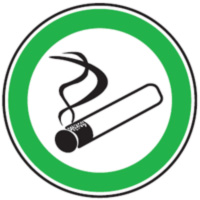
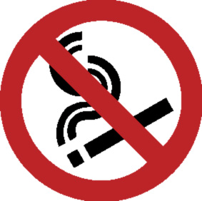

Verordnung vom 24. Juni 2008 zum Tabakpräventionsgesetz (Tabakpräventionsverordnung; TPV) Aufgrund von Art. 2a Abs. 2 und 3, Art. 8 Abs. 4, Art. 8b Abs. 3 und Art. 13 des Gesetzes vom 13. Dezember 2007 über den Nichtraucherschutz und die Werbung für Tabakprodukte und elektronische Zigaretten (Tabakpräventionsgesetz; TPG), LGBl. 2008 Nr. 27, in der geltenden Fassung, verordnet die Regierung: I. Allgemeine Bestimmungen Art. 1 Gegenstand Diese Verordnung regelt in Durchführung des Gesetzes insbesondere das Nähere über: a) die gleichartigen Produkte; b) die dem Rauchverbot unterliegenden Räume und Bereiche sowie die Ausnahmen für gastgewerbliche Betriebe; c) die Bewilligung von Raucherbetrieben; d) die Hinweise und Symbole für das Rauchverbot sowie die Raucherräume und -betriebe; e) die Durchführung von Kontrollen und die Anordnung von Massnahmen; f) den Datenschutz; g) die Gebühren und Verwaltungskosten. Art. 1a Personenbezeichnungen Unter den in dieser Verordnung verwendeten Personenbezeichnungen sind alle Personen unabhängig ihres Geschlechts zu verstehen, sofern sich die Personenbezeichnungen nicht ausdrücklich auf ein bestimmtes Geschlecht beziehen. II. Gleichartige Produkte Art. 1b Definitionen Als gleichartige Produkte im Sinne von Art. 2a des Gesetzes gelten: a) pflanzliche Produkte zum Erhitzen: feste Produkte ohne Tabak auf pflanzlicher Basis zur Verwendung mit einem Gerät, mit dem sie zur Inhalation ihrer Emissionen erhitzt werden können; b) Nikotinprodukte zum Schnupfen: nikotinhaltige Produkte ohne Tabak, die zum nasalen Gebrauch bestimmt sind; c) Produkte ohne Tabak für Wasserpfeifen: Produkte ohne Tabak oder andere Pflanzen, die zum Gebrauch in einer Wasserpfeife bestimmt sind. Art. 1c Einstufung 1) Pflanzliche Produkte zum Erhitzen gelten als gleichartige Produkte wie Tabakprodukte zum Erhitzen nach Art. 2 Abs. 1 Bst. g des Gesetzes und erfüllen dieselben Anforderungen wie diese. 2) Nikotinprodukte zum Schnupfen gelten als gleichartige Produkte wie Nikotinprodukte zum oralen Gebrauch nach Art. 2 Abs. 1 Bst. h des Gesetzes und erfüllen dieselben Anforderungen wie diese. 3) Produkte ohne Tabak für Wasserpfeifen gelten als gleichartige Produkte wie pflanzliche Rauchprodukte nach Art. 2 Abs. 1 Bst. i des Gesetzes und erfüllen dieselben Anforderungen wie diese. III. Nichtraucherschutz Art. 2 Räume und Bereiche 1) Als Gebäude des Gemeinwesens im Sinne von Art. 3 Abs. 1 Bst. a des Gesetzes gelten Räumlichkeiten: a) die im Eigentum des Landes, der Gemeinden, selbständiger oder unselbständiger Stiftungen und Anstalten des öffentlichen Rechts sowie öffentlich-rechtlicher Körperschaften stehen; oder b) in denen sich Einrichtungen des Gemeinwesens, insbesondere Behörden, mit oder ohne Publikumsverkehr befinden. 2) Als öffentlich zugängliche geschlossene Räume gelten insbesondere auch die Eingangsbereiche, Foyers und Warteräume der in Art. 3 Abs. 1 Bst. b des Gesetzes genannten Räumlichkeiten sowie Hotelhallen. 3) Gastgewerbliche Betriebe im Sinne von Art. 3 Abs. 1 Bst. c des Gesetzes sind Einrichtungen, für die eine Bewilligung nach dem Gewerbegesetz erforderlich ist. 4) Räume von Vereinen bzw. Clubs unterliegen dem Rauchverbot, wenn sie öffentlich zugänglich sind (Art. 3 Abs. 1 Bst. b des Gesetzes) oder sich in Gebäuden des Gemeinwesens (Art. 3 Abs. 1 Bst. a des Gesetzes) befinden. 5) Der Aussenbereich von Schulen sowie Begegnungs- und Betreuungsstätten für Kinder und Jugendliche im Sinne von Art. 3 Abs. 2 des Gesetzes umfasst das gesamte zur betreffenden Einrichtung gehörende Freigelände, insbesondere Pausen- und Spielplätze sowie Parkierungsflächen. 6) Raucherräume im Sinne von Art. 3 Abs. 1 Bst. c Ziff. 1 des Gesetzes sind Nebenräume gastgewerblicher Betriebe. In jedem gastgewerblichen Betrieb ist nur ein Raucherraum zulässig; dieser ist dem Amt für Lebensmittelkontrolle und Veterinärwesen zu melden. 7) Gasträume im Sinne von Art. 3 Abs. 1 Bst. c Ziff. 2 sind Räume gastgewerblicher Betriebe, in denen Speisen verabreicht und/oder Getränke ausgegeben werden. Zutritts- und Gangbereiche gelten ebenso wie Toiletten und deren Vorräume nicht als Gasträume. Art. 2a Bewilligung von Raucherbetrieben 1) Der Antrag auf Erteilung einer Bewilligung zur Führung eines Raucherbetriebes im Sinne von Art. 3 Abs. 1 Bst. c Ziff. 2 des Gesetzes ist vom Besitzer schriftlich unter Verwendung des amtlichen Formulars beim Amt für Lebensmittelkontrolle und Veterinärwesen einzureichen. 2) Dem Antrag sind aktuelle und von der Gemeindebaubehörde unterzeichnete Planunterlagen (Grundrisse im Massstab 1:100) beizulegen, aus denen sämtliche Räume des gastgewerblichen Betriebes sowie deren Verwendungszweck ersichtlich sind. 3) Die Bewilligung zur Führung eines Raucherbetriebes kann befristet und unter Bedingungen oder Auflagen erteilt werden. 4) Das Amt für Lebensmittelkontrolle und Veterinärwesen kann zur Prüfung der Bewilligungsvoraussetzungen auf Kosten des Antragstellers Gutachten einholen. 5) Für die Erteilung einer Bewilligung zur Führung eines Raucherbetriebes wird eine Gebühr von 120 Franken erhoben. Art. 2b Anforderungen an Raucherräume 1) Raucherräume nach Art. 3 Abs. 1 Bst. c Ziff. 1 und Art. 4 Abs. 2 des Gesetzes müssen folgende Anforderungen erfüllen: a) Sie sind nach Massgabe von Art. 3 Abs. 1 als Raucherraum zu kennzeichnen. b) Sie müssen durch feste Bauteile von angrenzenden Räumen dicht abgetrennt sein. c) Sie dürfen nicht als einziger Durchgang in einen oder mehrere andere Räume dienen. d) Sie müssen über eine selbsttätig schliessende Türe verfügen. e) Mit Ausnahme von Rauchwaren und Raucherutensilien dürfen in einem Raucherraum keine Leistungen angeboten werden, die im übrigen Betrieb nicht erhältlich sind. 2) Für Raucherräume nach Art. 3 Abs. 1 Bst. c Ziff. 1 des Gesetzes gilt zusätzlich: a) Ihre Fläche darf höchstens einen Drittel der Gesamtfläche der Gasträume nach Art. 2 Abs. 7 betragen. b) Ihre Öffnungszeiten sind nicht länger als diejenigen des übrigen Betriebs. Art. 3 Hinweise und Symbole 1) Raucherräume nach Art. 3 Abs. 1 Bst. c Ziff. 1 und Art. 4 Abs. 2 des Gesetzes sowie Raucherbetriebe nach Art. 3 Abs. 1 Bst. c Ziff. 2 des Gesetzes sind deutlich und an gut sichtbarer Stelle bei jedem Eingang nach Massgabe der in Anhang 1 aufgeführten Anforderungen durch Verwendung des Hinweises "Raucherraum" bzw. "Raucherbetrieb" oder des Rauchersymbols zu kennzeichnen. 2) Rauchverbotshinweis und -symbol im Sinne von Art. 5 Abs. 1 des Gesetzes sind nach Massgabe der in Anhang 2 aufgeführten Anforderungen auszugestalten. IV. Organisation und Durchführung A. Allgemeines Art. 4 Vollzug 1) Das Amt für Lebensmittelkontrolle und Veterinärwesen überprüft die Einhaltung des Rauchverbots und der Hinweispflicht (Art. 3 bis 5 des Gesetzes) sowie des Werbe- und Sponsoringverbots (Art. 6 und 7 des Gesetzes). 2) Es kann bei der Durchführung von Kontrollen private Sicherheitsdienste beiziehen. Dabei haben deren Angehörige die gleichen Rechte und Pflichten wie die Organe des Amtes für Lebensmittelkontrolle und Veterinärwesen. 3) Die Vollzugsorgane sind bei einem Verstoss gegen die Bestimmungen des Gesetzes insbesondere befugt: a) die Personalien des Zuwiderhandelnden festzustellen und den Sachverhalt zu erheben; b) die Einstellung des Rauchens anzuordnen; c) Raucher aus geschlossenen Räumen gastgewerblicher Betriebe wegzuweisen; d) die verantwortliche Person eines gastgewerblichen Betriebs anzuweisen, geeignete Massnahmen zur Verminderung der schädlichen Raucheinwirkung zu ergreifen, die Bewirtung von Rauchern einzustellen und diese nötigenfalls des Hauses zu verweisen; e) die Werbung für Tabakprodukte oder elektronische Zigaretten zu verbieten oder ihre Rücknahme anzuordnen, die Werbeträger zu beschlagnahmen, sie amtlich zu verwahren oder sie zu vernichten; f) das Sponsoring für Tabakprodukte oder elektronische Zigaretten zu verbieten. 4) Die Vollzugsorgane haben sich bei der Durchführung von Kontrollen durch die Vorlage einer Legitimationskarte auszuweisen. Art. 4a Datenschutz Personenbezogene Daten, einschliesslich personenbezogener Daten über strafrechtliche Verurteilungen und Straftaten, dürfen nach Massgabe von Art. 8a des Gesetzes verarbeitet oder übermittelt werden, insbesondere um: a) Anträge auf Erteilung einer Bewilligung zur Führung eines Raucherbetriebes zu erfassen und zu bearbeiten; b) Meldungen zu erfassen und zu bearbeiten; c) Kontrollen über die Einhaltung der Bestimmungen der Tabakpräventionsgesetzgebung durchzuführen; d) Statistiken zu erstellen und zu veröffentlichen. B. Gebühren und Verwaltungskosten Art. 4b Gebührenpflicht 1) Gebührenpflichtig ist, wer gestützt auf das Gesetz oder diese Verordnung eine Verfügung oder sonstige Amtshandlung des Amtes für Lebensmittelkontrolle und Veterinärwesen beantragt oder veranlasst. 2) Kontrollen, die zu keinen Beanstandungen führen, begründen keine Gebührenpflicht. 3) Vorbehalten bleibt Art. 2a Abs. 5. Art. 4c Gebühren nach Beanstandung 1) Für Kontrollen, deren Ergebnisse zu beanstanden sind, werden Gebühren erhoben. 2) Der Aufwand für Kontrollen wird mit 150 Franken pro Stunde, mindestens jedoch mit 75 Franken verrechnet. Der Aufwand für die Kontrollvorbereitung wird verrechnet, sofern er eine Stunde oder mehr erfordert. 3) Der Aufwand für die Probenerhebung wird nach Abs. 2 verrechnet. 4) Die Probenuntersuchung und das Material werden nach den effektiven Kosten verrechnet. Art. 4d Gebühren für besondere Dienstleistungen und Kontrollen 1) Besondere Dienstleistungen und Kontrollen, die nicht vom Amt für Lebensmittelkontrolle und Veterinärwesen veranlasst worden sind und einen Aufwand verursachen, der über die übliche Kontrolltätigkeit hinausgeht, werden mit 150 Franken pro Stunde, mindestens jedoch mit 75 Franken verrechnet. 2) Ein ausserordentlicher Aufwand für die Verfügung von Massnahmen im Zuständigkeitsbereich des Amtes für Lebensmittelkontrolle und Veterinärwesen wird mit 150 Franken pro Stunde verrechnet. Art. 4e Gebühren für Nachkontrollen Nachkontrollen, deren Durchführung aufgrund beanstandeter Befunde erforderlich ist, werden mit 150 Franken pro Stunde, mindestens jedoch mit 75 Franken verrechnet. Art. 4f Verwaltungskosten 1) Verwaltungskosten werden gesondert berechnet, jedoch zusammen mit den Gebühren erhoben. 2) Folgende Verwaltungskosten sind vom Gebührenpflichtigen zu tragen: a) Kosten für beigezogene Dritte; b) Kosten für die Beweiserhebung, die Beschaffung von Unterlagen und Proben sowie deren Entsorgung; c) Kosten für Gutachten, Untersuchungen, Analysen und besondere Prüfungen; d) Übermittlungs- und Kommunikationskosten. Art. 4g Übrige Verfahrenskosten und Gebühren Für die übrigen Verfahrenskosten und Gebühren gelten die einschlägigen Bestimmungen des Gesetzes über die allgemeine Landesverwaltungspflege. V. Schlussbestimmung Art. 5 Inkrafttreten Diese Verordnung tritt am 1. Juli 2008 in Kraft. Fürstliche Regierung: gez. Otmar Hasler Fürstlicher Regierungschef Anhang 1 (Art. 3 Abs. 1) Kennzeichnung von Raucherräumen und -betrieben A. Hinweis "Raucherraum" und "Raucherbetrieb" Der Hinweis "Raucherraum" oder "Raucherbetrieb" muss in Arial, fett und einer Schriftgrösse von mindestens 60pt angebracht werden. B. Rauchersymbol 1. Das Rauchersymbol muss wie folgt ausgestaltet sein: a) Form: rund; b) schwarzes Piktogramm auf weissem Grund, grün umrandet; c) Durchmesser: mindestens 15 cm. 2. Visuelle Darstellung: 

 Anhang 2 (Art. 3 Abs. 2) Rauchverbotshinweis und -symbol A. Rauchverbotshinweis Der Rauchverbotshinweis "Rauchen verboten" muss in Arial, fett und einer Schriftgrösse von mindestens 60pt angebracht werden. B. Rauchverbotssymbol 1. Das Rauchverbotssymbol muss wie folgt ausgestaltet sein: a) Form: rund; b) schwarzes Piktogramm auf weissem Grund, Rand und Querbalken (von links oben nach rechts unten in einem Neigungswinkel von 45° zur Horizontalen) rot; die Sicherheitsfarbe rot muss mindestens 35 % der Oberfläche des Zeichens ausmachen; c) Durchmesser: mindestens 15 cm. 2. Visuelle Darstellung (Norm: BGV A8 P00 DIN 4844-2 D-P001): 

 Übergangs- und Inkrafttretensbestimmungen 817.21 Tabakpräventionsverordnung (TPV) Verordnung vom 30. Juni 2026 über die Abänderung der Tabakpräventionsverordnung ... II. Übergangsbestimmung Art. 2b Abs. 1 Bst. f findet erstmals ab dem 1. Januar 2028 Anwendung. ...
