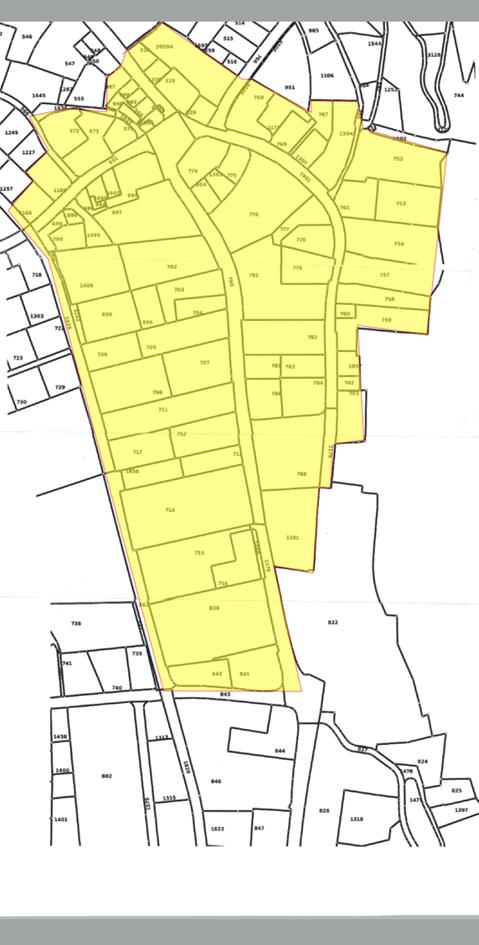
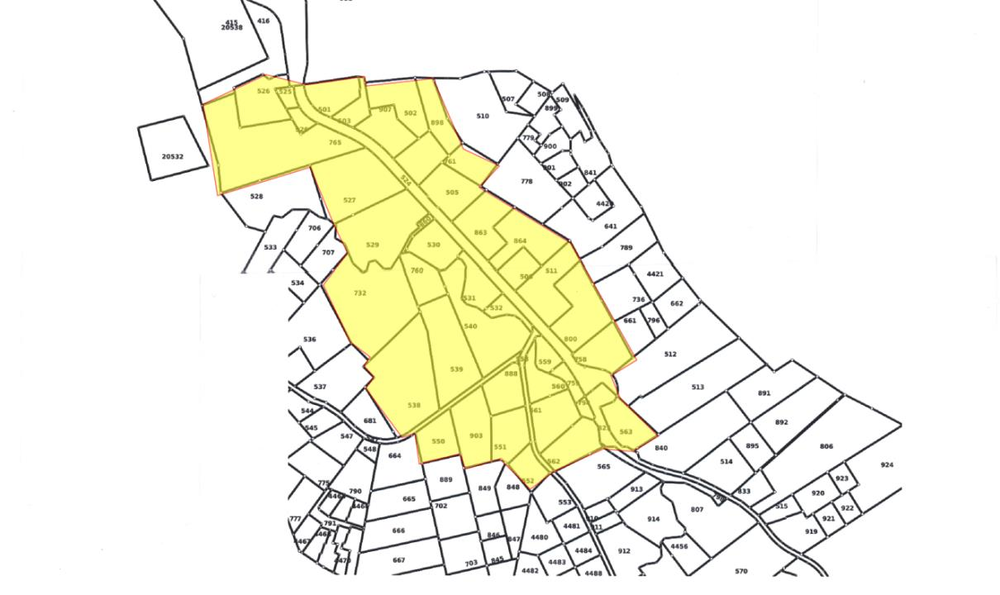

Verordnung II vom 17. Dezember 2002 zum Arbeitsgesetz (ArGV II) (Sonderbestimmungen für bestimmte Gruppen von Betrieben oder Arbeitnehmern) Aufgrund von Art. 27 und 40 des Gesetzes vom 29. Dezember 1966 über die Arbeit in Industrie, Gewerbe und Handel (Arbeitsgesetz), LGBl. 1967 Nr. 6 , verordnet die Regierung: I. Gegenstand und Begriffe Art. 1 Gegenstand und Begriffe 1) Diese Verordnung umschreibt die bei Vorliegen besonderer Verhältnisse nach Art. 27 Abs. 1 des Gesetzes möglichen Abweichungen von den gesetzlichen Arbeits- und Ruhezeitvorschriften und bezeichnet die Betriebsarten oder Gruppen von Arbeitnehmern, welche unter diese Abweichungen fallen. Sie bezeichnet für die einzelnen Branchen oder Gruppen von Arbeitnehmern den Umfang der Abweichungen. 2) Sofern diese Verordnung nicht ausdrücklich etwas anderes bestimmt, sind unter den in dieser Verordnung verwendeten, auf Personen bezogenen männlichen Begriffen Angehörige des weiblichen und männlichen Geschlechts zu verstehen. II. Sonderbestimmungen Art. 2 Geltung Die Bestimmungen dieses Abschnitts sind auf die einzelnen Betriebsarten sowie Arbeitnehmer entsprechend den Bestimmungen des dritten Abschnitts anwendbar. Art. 3 Befreiung von der Bewilligungspflicht für Nacht- und Sonntagsarbeit sowie für den ununterbrochenen Betrieb 1) Der Arbeitgeber darf die Arbeitnehmer ohne behördliche Bewilligung ganz oder teilweise in der Nacht beschäftigen. 2) Der Arbeitgeber darf die Arbeitnehmer ohne behördliche Bewilligung ganz oder teilweise am Sonntag beschäftigen. 3) Der Arbeitgeber darf die Arbeitnehmer ohne behördliche Bewilligung im ununterbrochenen Betrieb beschäftigen. Art. 4 Verlängerung des Zeitraumes der täglichen Arbeit bei Tagesarbeit Der Zeitraum der Tagesarbeit darf für die einzelnen Arbeitnehmer, mit Einschluss der Pausen und der Überzeitarbeit, auf höchstens 17 Stunden verlängert werden, sofern im Durchschnitt einer Kalenderwoche eine tägliche Ruhezeit von mindestens zwölf aufeinanderfolgenden Stunden gewährt wird. Die tägliche Ruhezeit zwischen zwei Arbeitseinsätzen muss dabei mindestens acht aufeinanderfolgende Stunden betragen. Art. 4a Verlängerung des Zeitraumes der täglichen Arbeit bei ununterbrochenem Betrieb Der Zeitraum der täglichen Arbeit bei ununterbrochenem Betrieb darf für die einzelnen Arbeitnehmer, mit Einschluss der Pausen und der Überzeitarbeit, auf höchstens zwölf Stunden verlängert werden, sofern im Durchschnitt von 16 Wochen die wöchentliche Höchstarbeitszeit von 48 Stunden eingehalten wird. Art. 5 Verlängerung der wöchentlichen Höchstarbeitszeit 1) Die wöchentliche Höchstarbeitszeit darf in einzelnen Wochen um vier Stunden verlängert werden, sofern sie im Durchschnitt von drei Wochen eingehalten wird und im Durchschnitt des Kalenderjahres die Fünf-Tage-Woche gewährt wird. 2) Die wöchentliche Höchstarbeitszeit darf auf 60 Stunden verlängert werden, sofern sie im Durchschnitt von 16 Wochen mit 48 Stunden eingehalten wird und das Einverständnis der einzelnen Arbeitnehmer vorliegt. Art. 6 Verlängerung der Arbeitswoche 1) Die einzelnen Arbeitnehmer dürfen bis zu elf aufeinanderfolgende Tage beschäftigt werden: a) wenn unmittelbar im Anschluss daran mindestens drei aufeinanderfolgende Tage frei gewährt werden; und b) wenn im Durchschnitt des Kalenderjahrs die Fünf-Tage-Woche gewährt wird. 2) Die einzelnen Arbeitnehmer dürfen sieben aufeinanderfolgende Tage beschäftigt werden: a) wenn die tägliche Arbeitszeit im Zeitraum der Tagesarbeit nicht mehr als neun Stunden beträgt; b) wenn die wöchentliche Höchstarbeitszeit im Durchschnitt von zwei Wochen eingehalten wird; und c) wenn unmittelbar im Anschluss an den siebten Tag mindestens 83 aufeinanderfolgende Stunden frei gewährt werden: diese 83 Stunden schliessen die tägliche Ruhezeit, den Ersatzruhetag für den Sonntag und den wöchentlichen freien Halbtag ein. Art. 7 Überzeitarbeit am Sonntag 1) Überzeitarbeit nach Art. 12 Abs. 1 des Gesetzes darf am Sonntag geleistet werden. Die am Sonntag geleistete Überzeitarbeit ist innert 14 Wochen durch Freizeit von gleicher Dauer auszugleichen. 2) Überzeitarbeit nach Art. 12 Abs. 1 des Gesetzes darf am Sonntag geleistet werden. Die am Sonntag geleistete Überzeitarbeit ist innert 26 Wochen durch Freizeit von gleicher Dauer auszugleichen. Art. 7a Pikettdienst 1) Im Rahmen des Pikettdienstes muss die Zeitspanne zwischen dem Einsatzaufruf an den Arbeitnehmer und seinem Eintreffen am Arbeitsort (Interventionszeit) grundsätzlich mindestens 30 Minuten betragen. 2) Ist die Interventionszeit aus zwingenden Gründen kürzer als 30 Minuten, so haben die Arbeitnehmer Anspruch auf eine Zeitgutschrift von 10 % der inaktiven Pikettdienstzeit. Unter inaktiver Pikettdienstzeit wird die für den Pikettdienst aufgewendete Zeit ausserhalb einer Intervention sowie der Zeit für den Arbeitsweg verstanden. Die für die Intervention effektiv aufgewendete Zeit sowie die Wegzeit zählen als Arbeitszeit und werden zur Zeitgutschrift dazugerechnet. 3) Muss der Pikettdienst wegen der kurzen Interventionszeit im Betrieb geleistet werden, so gilt die gesamte zur Verfügung gestellte Zeit als Arbeitszeit. 4) In den Fällen nach den Abs. 2 und 3 darf der einzelne Arbeitnehmer in einem Zeitraum von vier Wochen an höchstens sieben Tagen Pikettdienst leisten. Art. 7b Pikettplanung und -einteilung 1) Die einzelnen Arbeitnehmer dürfen im Zeitraum von vier Wochen an höchstens sieben Tagen auf Pikett sein oder Piketteinsätze leisten. Die pikettdienstfreie Zeit von zwei Wochen nach Art. 14 Abs. 2 der Verordnung I zum Arbeitsgesetz muss nicht gewährt werden. 2) Die einzelnen Arbeitnehmer dürfen im Zeitraum von vier Wochen an höchstens zehn Tagen auf Pikett sein oder Piketteinsätze leisten, wenn: a) dem Betrieb aufgrund seiner Lage in einer Randregion oder der fachlichen Spezialisierung keine genügenden Personalressourcen für einen Pikettdienst nach Abs. 1 zur Verfügung stehen; und b) sie im Durchschnitt eines Kalenderjahres pro Monat nicht mehr als sieben Pikettdienste mit tatsächlichem Einsatz leisten. 3) In Pikettdienstnächten kann die tägliche Ruhezeit auf neun Stunden verkürzt werden, sofern sie im Durchschnitt von zwei Wochen zwölf Stunden beträgt. Art. 8 Verkürzung der täglichen Ruhezeit Die Ruhezeit darf für erwachsene Arbeitnehmer bis auf neun Stunden herabgesetzt werden, sofern sie im Durchschnitt von zwei Wochen zwölf Stunden beträgt. Art. 9 Dauer der Nachtarbeit 1) Bei Nachtarbeit darf die tägliche Arbeitszeit für die einzelnen erwachsenen Arbeitnehmer neun Stunden nicht überschreiten. Sie muss, mit Einschluss der Pausen, innert eines Zeitraumes von zwölf Stunden liegen. Dabei ist den Arbeitnehmern eine tägliche Ruhezeit von zwölf Stunden und einmal in der Woche eine zusammenhängende Ruhezeit von 48 Stunden zu gewähren. 2) Nachtarbeit darf in einem Zeitraum von 12 Stunden geleistet werden, wenn darauf mindestens 12 Stunden Ruhezeit folgen, eine Gelegenheit besteht, sich hinzulegen, und wenn: a) die Arbeitszeit höchstens 10 Stunden beträgt und ein grosser Teil davon reine Präsenzzeit ist; oder b) während höchstens 8 Stunden tatsächlich gearbeitet wird, wobei die gesamten 12 Stunden als Arbeitszeit gelten. 3) Bei Nachtarbeit mit einem Arbeitsbeginn nach 4 Uhr oder einem Arbeitsschluss vor 1 Uhr darf die tägliche Arbeitszeit in einem Zeitraum von höchstens 17 Stunden liegen. Beginnt die tägliche Arbeitszeit vor 5 Uhr oder endet sie nach 24 Uhr, so ist im Durchschnitt einer Kalenderwoche eine tägliche Ruhezeit von mindestens zwölf Stunden zu gewähren. Die tägliche Ruhezeit zwischen zwei Arbeitseinsätzen muss dabei mindestens acht Stunden betragen. 4) Bei Nachtarbeit darf die tägliche Arbeitszeit innert eines Zeitraumes von 13 Stunden höchstens elf Stunden betragen, sofern sie im Durchschnitt einer Kalenderwoche acht Stunden nicht übersteigt. 5) Nachtarbeit ohne Wechsel mit Tagesarbeit darf in höchstens sechs von sieben aufeinanderfolgenden Nächten geleistet werden, sofern im Durchschnitt des Kalenderquartals die Fünf-Tage-Woche gewährt wird. Art. 10 Verschiebung der Lage des Sonntages Die Lage des Sonntagszeitraumes nach Art. 18 Abs. 1 des Gesetzes darf um höchstens drei Stunden vor- oder nachverschoben werden. Art. 11 Anzahl freie Sonntage 1) Im Kalenderjahr sind mindestens 26 freie Sonntage zu gewähren. Sie können unregelmässig auf das Jahr verteilt werden. Im Zeitraum eines Kalenderquartals sind jedoch mindestens zwei freie Sonntage zu gewähren. 1a) Im Kalenderjahr sind mindestens 18 freie Sonntage zu gewähren, sofern mindestens zwölfmal pro Jahr die wöchentliche Ruhezeit mindestens 59 aufeinanderfolgende Stunden umfasst. Diese 59 Stunden umfassen die tägliche Ruhezeit sowie den ganzen Samstag und den ganzen Sonntag. Die freien Sonntage können unregelmässig auf das Jahr verteilt werden. 2) Im Kalenderjahr sind mindestens zwölf freie Sonntage zu gewähren. Sie können unregelmässig auf das Jahr verteilt werden. In den Wochen ohne freien Sonntag ist jedoch im Anschluss an die tägliche Ruhezeit eine wöchentliche Ruhezeit von 36 aufeinanderfolgenden Stunden zu gewähren. 2a) Im Kalenderjahr sind mindestens zwölf freie Sonntage zu gewähren. Sie können unregelmässig auf das Jahr verteilt werden. In den Wochen ohne freien Sonntag ist eine wöchentliche Ruhezeit von 47 aufeinanderfolgenden Stunden oder von zweimal 35 aufeinanderfolgenden Stunden zu gewähren. 3) Wird im Durchschnitt des Kalenderjahres die Fünf-Tage-Woche gewährt, so kann die Anzahl freie Sonntage bis auf vier herabgesetzt werden. Die freien Sonntage können unregelmässig auf das Jahr verteilt werden. Art. 12 Ersatzruhetag für Feiertagsarbeit Die Ersatzruhe für Feiertagsarbeit darf für ein Kalenderjahr zusammengefasst gewährt werden. Art. 13 Wöchentlicher freier Halbtag 1) Der wöchentliche freie Halbtag darf für einen Zeitraum von höchstens acht Wochen zusammenhängend gewährt werden. 2) Der wöchentliche freie Halbtag darf in Betrieben mit erheblichen saisonmässigen Schwankungen für einen Zeitraum von höchstens zwölf Wochen zusammenhängend gewährt werden. 3) Aufgehoben III. Unterstellte Betriebsarten und Arbeitnehmer Art. 14 Krankenanstalten und Kliniken 1) Auf Krankenanstalten und Kliniken und die in ihnen beschäftigten Arbeitnehmer sind Art. 3 für die ganze Nacht und den ganzen Sonntag sowie die Art. 4, 6 Abs. 2, Art. 7 Abs. 2, Art. 7a, 8, 9 Abs. 2 und Art. 11 Abs. 2 anwendbar. 2) Krankenanstalten und Kliniken sind ärztlich betreute Betriebe für Kranke, Wöchnerinnen, Säuglinge, Verunfallte und Rekonvaleszente. Art. 15 Heime und Internate 1) Auf Heime und Internate und die in ihnen mit der Betreuung der Insassen beschäftigten Arbeitnehmer sind Art. 3 für die ganze Nacht und den ganzen Sonntag sowie die Art. 6 Abs. 2, Art. 7 Abs. 1, Art. 8, 9 Abs. 2, Art. 11 Abs. 2 und Art. 13 Abs. 1 anwendbar. 2) Heime und Internate sind Kinder-, Erziehungs-, Anlern-, Ausbildungs-, Beschäftigungs-, Alters-, Pflege-, Kranken-, Unterkunfts- und Versorgungsheime. Art. 16 Spitex-Betriebe 1) Auf Spitex-Betriebe und die von ihnen mit Pflege- und Betreuungsaufgaben beschäftigten Arbeitnehmer ist Art. 3 für die ganze Nacht und den ganzen Sonntag anwendbar. 2) Spitex-Betriebe sind Betriebe, die spitalexterne Aufgaben für pflege- und betreuungsbedürftige Personen erfüllen. Art. 17 Arzt- und Zahnarztpraxen Auf Arzt- und Zahnarztpraxen und die in ihnen beschäftigten Arbeitnehmer ist Art. 3 für die ganze Nacht und den ganzen Sonntag anwendbar, soweit die Aufrechterhaltung von Notfalldiensten zu gewährleisten ist. Art. 18 Apotheken Auf Apotheken und die in ihnen mit der Bereitstellung und dem Verkauf von Medikamenten beschäftigten Arbeitnehmer ist Art. 3 für die ganze Nacht und den ganzen Sonntag anwendbar, soweit die Aufrechterhaltung von Notfalldiensten zu gewährleisten ist. Art. 18a Medizinische Labors Auf medizinische Labors und die in ihnen beschäftigten Arbeitnehmer sind Art. 3 für die ganze Nacht und den ganzen Sonntag sowie die Art. 4, 7 Abs. 2, Art. 8, 9 Abs. 2 Bst. a und Art. 11 Abs. 2 anwendbar. Art. 19 Bestattungsbetriebe 1) Auf Bestattungsbetriebe und die in ihnen beschäftigten Arbeitnehmer sind Art. 3 für die ganze Nacht und den ganzen Sonntag sowie Art. 7 Abs. 1 anwendbar, soweit Nacht- und Sonntagsarbeit für unaufschiebbare Tätigkeiten notwendig sind. 2) Bestattungsbetriebe sind Betriebe, die Formalitäten und Verrichtungen bei Todesfällen besorgen. Art. 20 Tierarztpraxen und Tierkliniken Auf Tierarztpraxen und Tierkliniken und die in ihnen beschäftigten Arbeitnehmer sind, soweit die Aufrechterhaltung von Notfalldiensten oder die Pflege und Betreuung von kranken, pflegebedürftigen oder verunfallten Tieren zu gewährleisten ist, die folgenden Bestimmungen anwendbar: a) Art. 3 für die ganze Nacht und den ganzen Sonntag sowie Art. 7b Abs. 1 und 3; b) auf Tierarztpraxen mit höchstens vier angestellten Tierärzten zusätzlich Art. 7b Abs. 2. Art. 21 Zoologische Gärten, Tiergärten und Tierheime Auf zoologische Gärten, Tiergärten und Tierheime und die in ihnen mit der Beaufsichtigung und der Pflege der Tiere, mit dem Unterhalt der Anlagen sowie der Bedienung der Kassen beschäftigten Arbeitnehmer sind Art. 3 Abs. 1 für die ganze Nacht für Überwachungstätigkeiten und Abs. 2 für den ganzen Sonntag sowie die Art. 7 Abs. 1 und Art. 11 Abs. 2 anwendbar. Art. 22 Gastbetriebe 1) Auf Gastbetriebe und die in ihnen beschäftigten gastgewerblichen Arbeitnehmer sind Art. 3 für die ganze Nacht und den ganzen Sonntag sowie die Art. 7 Abs. 1, Art. 10, Art. 11 Abs. 3, Art. 12 und 13 Abs. 2 anwendbar. 2) Auf Arbeitnehmer mit Erziehungs- und Betreuungspflichten nach Art. 36 des Gesetzes ist anstelle von Art. 11 Abs. 3 Art. 11 Abs. 2 anwendbar. 3) Gastbetriebe sind Betriebe, die gegen Entgelt Personen beherbergen oder Speisen oder Getränke zum Genuss an Ort und Stelle abgeben. Gastbetrieben gleichgestellt sind Betriebe, die fertig zubereitete Speisen ausliefern. 4) Aufgehoben Art. 22a Spielbanken 1) Auf Spielbanken und die in ihnen beschäftigten Arbeitnehmer sind Art. 3 für die ganze Nacht und den ganzen Sonntag sowie Art. 11 Abs. 2, Art. 12 und 13 Abs. 2 anwendbar. 2) Spielbanken sind Betriebe, die über eine Spielbankenbewilligung nach dem Geldspielgesetz verfügen. Art. 23 Ladengeschäfte Auf sämtliche Ladengeschäfte und die in ihnen beschäftigten Arbeitnehmer sind Art. 3 Abs. 2 an Maria Himmelfahrt (15. August), an Maria Empfängnis (8. Dezember) und an den drei dem 24. Dezember vorausgehenden Sonntagen sowie Art. 7 Abs. 1 anwendbar. Art. 23a Betriebe in Fremdenverkehrsgebieten sowie Einkaufsläden für die Bedürfnisse des internationalen Fremdenverkehrs 1) Auf die Betriebe in Fremdenverkehrsgebieten, die der Befriedigung spezifischer Bedürfnisse der Touristen dienen, und auf die in ihnen mit der Bedienung der Kundschaft beschäftigten Arbeitnehmer sind während der Saison die Art. 3 Abs. 2 für den ganzen Sonntag sowie die Art. 7 Abs. 1, Art. 11 Abs. 1 und Art. 13 Abs. 1 anwendbar. 2) Betriebe in Fremdenverkehrsgebieten sind Betriebe in Kur-, Sport-, Ausflugs- und Erholungsorten, in denen der Fremdenverkehr von wesentlicher Bedeutung ist und erheblichen saisonmässigen Schwankungen unterliegt. 3) Auf Einkaufsläden in den Fremdenverkehrsgebieten, die den Bedürfnissen des internationalen Fremdenverkehrs dienen, sind während des ganzen Jahres Art. 3 Abs. 2 für den ganzen Sonntag und Art. 11 Abs. 1 anwendbar. 4) Die Fremdenverkehrsgebiete nach diesem Artikel werden im Anhang dargestellt. Art. 24 Kioske und Betriebe für Reisende 1) Auf Kioske an öffentlichen Strassen und Plätzen sind Art. 3 Abs. 2 für den ganzen Sonntag sowie die Art. 7 Abs. 1, Art. 11 Abs. 1 und Art. 13 Abs. 1 anwendbar. 2) Auf Kioske und Betriebe für Reisende und die in ihnen für die Bedienung der Durchreisenden beschäftigten Arbeitnehmer sind Art. 3 Abs. 1 für die Nacht bis 1 Uhr und Abs. 2 für den ganzen Sonntag sowie die Art. 7 Abs. 1, Art. 11 Abs. 2 und Art. 13 Abs. 1 anwendbar. 3) Kioske sind kleinere Verkaufsstände oder Verkaufsstellen, die der Kundschaft überwiegend Presseerzeugnisse, Süssigkeiten, Tabak- und Souvenierwaren sowie kleine Verpflegungsartikel zum Verzehr an Ort und Stelle oder für unterwegs anbieten. 4) Betriebe für Reisende sind Verkaufsstellen und Dienstleistungsbetriebe an Terminals des öffentlichen Verkehrs und in Grenzorten, die ein Waren- und Dienstleistungsangebot führen, das überwiegend auf die spezifischen Bedürfnisse der Reisenden ausgerichtet ist. Art. 25 Bäckereien, Konditoreien, Confiserien 1) Auf Bäckereien, Konditoreien, Confiserien und die in ihnen mit der Herstellung von Bäckerei-, Konditorei- oder Confiseriewaren beschäftigten Arbeitnehmer sind Art. 3 an zwei Tagen pro Woche für die ganze Nacht, für die übrigen Tage ab 1 Uhr sowie für den ganzen Sonntag sowie die Art. 9 Abs. 4 und 5, Art. 10, 11 Abs. 2 und Art. 12 anwendbar. 2) Auf die Verkaufsgeschäfte in Bäckereien, Konditoreien, Confiserien und das in ihnen beschäftigte Verkaufspersonal sind Art. 3 Abs. 2 für den ganzen Sonntag sowie die Art. 11 Abs. 2 und Art. 12 anwendbar. 3) Bäckereien, Konditoreien oder Confiserien sind Betriebe, die Bäckerei-, Konditorei- oder Confiseriewaren herstellen, einschliesslich der dazugehörigen Verkaufsgeschäfte, sofern diese überwiegend selbst hergestellte Produkte verkaufen. Art. 25a Fleischverarbeitende Betriebe 1) Auf fleischverarbeitende Betriebe und die in ihnen mit der Verarbeitung des Fleisches sowie dessen Verpackung und Lagerung beschäftigten Arbeitnehmer sind Art. 3 an zwei Tagen pro Woche ab 2 Uhr und an den übrigen Tagen ab 4 Uhr für die Nacht sowie für den Sonntag ab 17 Uhr sowie die Art. 11 Abs. 1, Art. 12 und 13 Abs. 1 anwendbar. 2) Fleischverarbeitende Betriebe sind Betriebe, die überwiegend Fleisch gewinnen, verarbeiten, veredeln und Fleischerzeugnisse herstellen. Art. 26 Milchverarbeitungsbetriebe 1) Auf Milchverarbeitungsbetriebe und die in ihnen mit der Entgegennahme und Behandlung der Milch beschäftigten Arbeitnehmer ist Art. 3 für die Nacht ab 2 Uhr und für den ganzen Sonntag anwendbar, soweit Nachtarbeit und Sonntagsarbeit notwendig sind, um den Verderb der Milch zu verhindern. 2) Milchverarbeitungsbetriebe sind Betriebe, welche Milch zur Lagerung und Weiterverarbeitung entgegen nehmen. Art. 27 Zeitungs- und Zeitschriftenredaktionen sowie Nachrichten- und Bildagenturen 1) Auf Zeitungs- und Zeitschriftenredaktionen sowie Nachrichten- und Bildagenturen und die in ihnen beschäftigten Arbeitnehmer sind Art. 3 für die ganze Nacht und für den ganzen Sonntag sowie die Art. 7 Abs. 1, Art. 10, 11 Abs. 1 und Art. 12 anwendbar, soweit Nacht- und Sonntagsarbeit zur Wahrung der Aktualität notwendig sind. 2) Auf Arbeitnehmer, die in der Sportberichterstattung tätig sind, ist anstelle von Art. 11 Abs. 1 Art. 11 Abs. 2 anwendbar. 3) Zeitungs- und Zeitschriftenredaktionen sowie Nachrichten- und Bildagenturen sind Betriebe, die Informationen oder Bildmaterial empfangen, verarbeiten, weiterleiten oder verbreiten. Art. 28 Radio- und Fernsehbetriebe 1) Auf Radio- und Fernsehbetriebe und die in ihnen mit der Vorbereitung, Produktion, Aufnahme oder Ausstrahlung der Sendung beschäftigten Arbeitnehmer sind Art. 3 für die ganze Nacht und den ganzen Sonntag sowie die Art. 4, 5 Abs. 1, Art. 6 Abs. 1, Art. 7 Abs. 1, Art. 8, 9 Abs. 3, Art. 10, 11 Abs. 1 und Art. 12 anwendbar. 2) Art. 5 Abs. 1, Art. 6 Abs. 1 und Art. 7 Abs. 1 sind nur anwendbar auf Arbeitnehmer, die bei länger dauernden zusammenhängenden Produktionen zum Einsatz gelangen. 3) Auf Arbeitnehmer, die bei der Vorbereitung, Produktion, Aufnahme oder Ausstrahlung von Sportveranstaltungen zum Einsatz kommen, ist anstelle von Art. 11 Abs. 1 Art. 11 Abs. 2 anwendbar. 4) Radio- und Fernsehbetriebe sind Betriebe, die Radio- und Fernsehsendungen vorbereiten, produzieren, aufnehmen oder ausstrahlen. Art. 29 Telekommunikationsbetriebe 1) Auf Telekommunikationsbetriebe und die in ihnen beschäftigten Arbeitnehmer ist Art. 3 für die ganze Nacht und für den ganzen Sonntag anwendbar, soweit Nacht- und Sonntagsarbeit für die Aufrechterhaltung der angebotenen Fernmeldedienste notwendig sind. 2) Telekommunikationsbetriebe sind Betriebe, die Anlagen zur Erbringung von Fernmeldediensten betreiben. Art. 29a Personal mit Aufgaben der Informations- und Kommunikationstechnik Auf Personal mit Aufgaben der Informations- und Kommunikationstechnik ist Art. 3 für die ganze Nacht und den ganzen Sonntag anwendbar, soweit Nacht- und Sonntagsarbeit notwendig sind für die folgenden Arbeiten an einer Netz- oder Informatikstruktur, deren Unterbrechung während der Betriebszeiten die Aufrechterhaltung des Betriebs gefährden würde: a) Behebung von Störungen an der Netz- oder Informatikstruktur; oder b) Wartung der Netz- oder Informatikstruktur, die weder mit planerischen Mitteln noch mit organisatorischen Massnahmen am Tag und während der Werktage erfolgen kann. Art. 30 Telefonzentralen 1) Auf Telefonzentralen und die in ihnen beschäftigten Arbeitnehmer ist Art. 3 für die ganze Nacht und den ganzen Sonntag sowie für den ununterbrochenen Betrieb anwendbar. 2) Abs. 1 ist nicht anwendbar auf Arbeitnehmer, die ausserhalb der Erbringung von reinen Telefondiensten mit kommerziellen Dienstleistungen wie namentlich Telefonmarketing und Verkauf von Waren sowie Dienstleistungen beschäftigt sind. 3) Telefonzentralen sind Betriebe, die in Zentralen telefonisch Auskunft erteilen, Anrufe und Aufträge entgegennehmen und weiterleiten. Art. 31 Banken, Effektenhandel, Finanzmarktinfrastrukturen und deren Gemeinschaftswerke Auf Arbeitnehmer in Banken, im Effektenhandel, in Finanzmarktinfrastrukturen sowie in deren Gemeinschaftswerken ist Art. 3 für die ganze Nacht und für die auf einen Werktag fallenden gesetzlichen Feiertage anwendbar, soweit Nacht- und Feiertagsarbeit für die Aufrechterhaltung des ununterbrochenen Funktionierens internationaler Zahlungsverkehrs-, Effektenhandels- und Abwicklungssysteme notwendig sind. Art. 32 Berufstheater 1) Auf Berufstheater und die in ihnen für die künstlerische Gestaltung der Aufführungen beschäftigten Arbeitnehmer sind Art. 3 für die Nacht bis 1 Uhr und für den ganzen Sonntag sowie die Art. 10, 11 Abs. 1 oder 2, Art. 12, 13 Abs. 2 und für die Vorbereitung von Premieren Art. 6 Abs. 1 anwendbar. 2) Für die mit den für die Aufführungen notwendigen Tätigkeiten sowie für die Bedienung und Betreuung der Theaterbesucher beschäftigten Arbeitnehmer sind Art. 3 für die Nacht bis 1 Uhr und für den ganzen Sonntag sowie die Art. 9 Abs. 3, Art. 11 Abs. 1 oder 2, Art. 12, 13 Abs. 2 und für die Vorbereitung von Premieren Art. 6 Abs. 1 anwendbar. 3) Für die mit der künstlerisch-technischen Gestaltung der Aufführungen beschäftigten Arbeitnehmer sind Art. 3 für die Nacht bis 1 Uhr und für den ganzen Sonntag sowie die Art. 4, 8, 11 Abs. 1 oder 2, Art. 12, 13 Abs. 2 und für die Vorbereitung von Premieren Art. 6 Abs. 1 anwendbar. Dabei darf vor oder nach einer Verlängerung der Tagesarbeit gemäss Art. 4 die tägliche Ruhezeit nicht herabgesetzt werden. 4) Für die während Tourneen oder Gastspielen beschäftigten Arbeitnehmer nach Abs. 1, 2 und 3 ist Art. 3 Abs. 1 für die Nacht bis 3 Uhr anwendbar. 5) Berufstheater sind Betriebe, die Schauspiel-, Opern-, Operetten-, Ballett- und Musicalaufführungen durchführen. Art. 33 Berufsmusiker Auf Arbeitnehmer, die mit der Durchführung musikalischer Darbietungen beschäftigt sind, sind Art. 3 für die ganze Nacht und den ganzen Sonntag sowie die Art. 11 Abs. 2 und Art. 12 anwendbar. Art. 34 Betriebe der Filmvorführung Auf Betriebe der Filmvorführung, die gewerbsmässig Kinofilme vorführen und die in ihnen beschäftigten Arbeitnehmer sind Art. 3 für die Nacht bis 2 Uhr und für den ganzen Sonntag sowie Art. 11 Abs. 2 anwendbar. Art. 35 Zirkusbetriebe 1) Auf Zirkusbetriebe und die in ihnen beschäftigten Arbeitnehmer sind Art. 3 für die ganze Nacht und den ganzen Sonntag sowie die Art. 7 Abs. 1, Art. 8, 9 Abs. 3, Art. 11 Abs. 2, Art. 12 und 13 Abs. 1 anwendbar. 2) Die Art. 3 Abs. 1 und 9 Abs. 3 sind nur anwendbar, soweit Nachtarbeit für den Auf- und Abbau der Zelte, für die Tierpflege und den Weitertransport notwendig ist. 3) Zirkusbetriebe sind Betriebe, die das Publikum gegen Entgelt mit einem artistischen Programm unterhalten und die ihren Standort in der Regel ständig ändern. Art. 36 Schaustellungsbetriebe 1) Auf Schaustellungsbetriebe und die in ihnen beschäftigten Arbeitnehmer sind Art. 3 Abs. 2 für den ganzen Sonntag sowie die Art. 11 Abs. 2 und Art. 12 anwendbar. 2) Schaustellungsbetriebe sind Betriebe, die bei Kirchmessen, Märkten oder ähnlichen Anlässen dem Publikum gegen Entgelt Darbietungen vorführen, oder Vergnügungs- oder andere Unterhaltungseinrichtungen zum Gebrauch zur Verfügung stellen. Art. 37 Sport- und Freizeitanlagen 1) Auf die in Sport- und Freizeitanlagen mit der Bedienung, Betreuung und Anleitung der Kunden sowie mit dem Unterhalt der Anlagen beschäftigten Arbeitnehmer sind Art. 3 für die ganze Nacht und den ganzen Sonntag sowie die Art. 7 Abs. 1, Art. 9 Abs. 3, Art. 11 Abs. 2 und Art. 13 Abs. 1 anwendbar. 2) Die Art. 3 Abs. 1 und Art. 9 Abs. 3 sind nur anwendbar, soweit Nachtarbeit für den Unterhalt der Anlagen notwendig ist. Art. 38 Skilifte und Luftseilbahnen 1) Auf Skilifte und Luftseilbahnen und die in ihnen mit dem Betrieb und Unterhalt beschäftigten Arbeitnehmer sind Art. 3 für die ganze Nacht und den ganzen Sonntag sowie die Art. 7 Abs. 1, Art. 11 Abs. 2, Art. 12 und 13 Abs. 1 anwendbar. 2) Art. 3 Abs. 1 ist nur anwendbar, soweit Nachtarbeit für den Unterhalt der Anlagen notwendig ist. 3) Skilifte und Luftseilbahnen sind von der Regierung konzessionierte Betriebe, die Anlagen zum Transport von Personen betreiben. Art. 39 Campingplätze Auf Campingplätze und die in ihnen mit dem Betrieb und Unterhalt der Anlagen sowie mit der Bedienung und Betreuung der Kunden beschäftigten Arbeitnehmer sind Art. 3 Abs. 2 für den ganzen Sonntag sowie die Art. 7 Abs. 1, Art. 8, 11 Abs. 2, Art. 12 und 13 Abs. 1 anwendbar. Art. 40 Konferenz-, Kongress- und Messebetriebe 1) Auf Konferenz- und Kongressbetriebe und die mit der Betreuung und Bedienung der Besucher sowie mit dem Unterhalt beschäftigten Arbeitnehmer sind Art. 3 für die ganze Nacht und für den ganzen Sonntag sowie die Art. 11 Abs. 1 und Art. 12 anwendbar. 2) Auf Messebetriebe und die in ihnen mit dem Auf- und Abbau, der Bedienung der Stände und Eintrittskassen sowie mit dem Unterhalt beschäftigten Arbeitnehmer sind Art. 3 für die ganze Nacht und den ganzen Sonntag sowie die Art. 6 Abs. 1, Art. 11 Abs. 1 und Art. 12 anwendbar. 3) Art. 3 Abs. 1 ist nur anwendbar, soweit Nachtarbeit für den Auf- und Abbau von Veranstaltungseinrichtungen und Ständen sowie für den Unterhalt notwendig ist. 4) Konferenz- und Kongressbetriebe sind Betriebe, die politische, kulturelle oder wissenschaftliche Informationsveranstaltungen durchführen. 5) Messebetriebe sind Betriebe, die für Aussteller Präsentations- und Verkaufsveranstaltungen durchführen. Art. 40a Veranstaltungsdienstleistungsbetriebe 1) Auf Veranstaltungsdienstleistungsbetriebe und die in ihnen beschäftigten Arbeitnehmer sind Art. 3 für die ganze Nacht und den ganzen Sonntag sowie die Art. 6 Abs. 1, Art. 9 Abs. 4, Art. 10, 11 Abs. 1 und Art. 12 anwendbar, soweit Nacht- und Sonntagsarbeit für den Auf- und Abbau von Veranstaltungen und deren Einrichtungen sowie für deren Bedienung und Unterhalt notwendig sind. 2) Art. 6 Abs. 1 ist nur anwendbar auf Arbeitnehmer, die bei einer länger dauernden zusammenhängenden Veranstaltung zum Einsatz gelangen. Art. 6 Abs. 1 und Art. 9 Abs. 4 dürfen nicht gleichzeitig in Anspruch genommen werden. 3) Veranstaltungsdienstleistungsbetriebe sind Betriebe, die Leistungen für die Organisation und Durchführung von Veranstaltungen wie Tourneeproduktionen, Festivals, Konzerte, Musicals, Marketinganlässe, Versammlungen, Galaveranstaltungen oder Sportanlässe erbringen. Art. 41 Museen und Ausstellungsbetriebe 1) Auf Museen und Ausstellungsbetriebe und die in ihnen mit der Bedienung der Eintrittskassen, der Verkaufsstände und der Garderoben, für Führungen und die Aufsicht sowie mit dem technischen Unterhalt beschäftigten Arbeitnehmer sind Art. 3 Abs. 2 für den ganzen Sonntag sowie die Art. 11 Abs. 2 und Art. 12 anwendbar. 2) Museen und Ausstellungsbetriebe sind Betriebe, die kulturelle Ausstellungen durchführen. Art. 41a Gewerbliche Ausstellungen und Tage der offenen Tür Auf Betriebe, die gewerbliche Ausstellungen oder Tage der offenen Tür veranstalten, und die in ihnen beschäftigten Arbeitnehmer sind Art. 3 Abs. 2 an zwei Sonntagen pro Kalenderjahr sowie Art. 7 Abs. 1 anwendbar. Art. 42 Bewachungs- und Überwachungspersonal Auf die mit Bewachungs- und Überwachungsaufgaben beschäftigten Arbeitnehmer sind Art. 3 für die ganze Nacht, für den ganzen Sonntag und für den ununterbrochenen Betrieb sowie die Art. 5 Abs. 1, Art. 7 Abs. 1, Art. 8, 9 Abs. 4 und 5, Art. 11 Abs. 2 und Art. 12 anwendbar. Art. 43 Betriebe des Autogewerbes Auf Betriebe des Autogewerbes und die in ihnen beschäftigten Arbeitnehmer ist Art. 3 für die ganze Nacht und den ganzen Sonntag anwendbar, soweit sie mit der Versorgung von Fahrzeugen mit Betriebsstoffen sowie für die Aufrechterhaltung eines Pannen-, Abschlepp- und damit verbundenen Reparaturdienstes beschäftigt sind. Art. 43a Bodenpersonal der Luftfahrt 1) Auf das Bodenpersonal der Luftfahrt sind Art. 3 für die ganze Nacht, den ganzen Sonntag und für den ununterbrochenen Betrieb sowie die Art. 4, 9 Abs. 3, Art. 11 Abs. 1a und Art. 12 anwendbar. 2) Die Art. 4 und 9 Abs. 3 sind nur anwendbar für Tätigkeiten zur Vermeidung oder Behebung von Betriebsstörungen im Flugbetrieb. 3) Bodenpersonal der Luftfahrt sind Arbeitnehmer, die Dienstleistungen erbringen, die der Aufrechterhaltung des ordentlichen Flugbetriebes dienen. Art. 43b Bau- und Unterhaltsbetriebe für Eisenbahnanlagen sowie Eisenbahnbetriebe 1) Auf Bau- und Unterhaltsbetriebe für Eisenbahnanlagen und die in ihnen mit Unterhalts- und Erneuerungsarbeiten an Eisenbahnanlagen beschäftigten Arbeitnehmer sind Art. 3 und 11 Abs. 1 für die ganze Nacht und den ganzen Sonntag anwendbar, soweit Nacht- und Sonntagsarbeit, insbesondere an Anlagen der Fahrbahn und der Stromversorgung sowie an Anlagen für die Steuerung und Sicherung des Zugverkehrs, für die Aufrechterhaltung des Bahnbetriebes notwendig sind. 2) Auf Betriebe, die für die Aufrechterhaltung des Bahnbetriebes zuständig sind, und die in ihnen beschäftigten Arbeitnehmer sind Art. 3 für die ganze Nacht und den ganzen Sonntag sowie die Art. 4a und 5 Abs. 2 anwendbar. Art. 43c Bau- und Unterhaltsbetriebe für Landes- und Hauptstrassen 1) Auf Bau- und Unterhaltsbetriebe für Landes- und Hauptstrassen und die in ihnen mit Unterhalts- und Erneuerungsarbeiten an Landes- und Hauptstrassen beschäftigten Arbeitnehmer sind Art. 3 und 11 Abs. 1 für die ganze Nacht und den ganzen Sonntag sowie die Art. 4 und 5 Abs. 2 anwendbar. 2) Bau- und Unterhaltsbetriebe für Landes- und Hauptstrassen sind Betriebe, die Arbeiten vor Ort durchführen, einschliesslich der dazugehörigen Zulieferbetriebe. 3) Das Amt für Tiefbau und Geoinformation bezeichnet die Landes- und Hauptstrassen; sie können auf der Internetseite des Amtes für Tiefbau und Geoinformation abgerufen werden. Art. 44 Betriebe der Energie- und Wasserversorgung Auf Betriebe, die die Versorgung mit Elektrizität, Gas, Wärme oder Wasser sicherstellen und die in ihnen mit der Produktion und der Sicherstellung der Verteilung beschäftigten Arbeitnehmer ist Art. 3 für die ganze Nacht, den ganzen Sonntag und für den ununterbrochenen Betrieb anwendbar. Art. 45 Betriebe der Kehricht- und Abwasserentsorgung sowie Winterdienst 1) Auf Betriebe der Kehricht- und Abwasserentsorgung und die in ihnen mit dem Betrieb und dem Unterhalt der Anlagen beschäftigten Arbeitnehmer ist Art. 3 für die ganze Nacht, den ganzen Sonntag und für den ununterbrochenen Betrieb anwendbar. 2) Auf Arbeitnehmer, die mit dem Winterdienst beauftragt sind, sind Art. 3 für die ganze Nacht und den ganzen Sonntag sowie die Art. 4, 5 Abs. 2, Art. 6 Abs. 1b, Art. 7 Abs. 2 und Art. 7a Abs. 1 anwendbar, soweit die Aufrechterhaltung der Benutzung von wichtigen Verkehrswegen zu gewährleisten ist. Art. 46 Reinigungsbetriebe 1) Auf Arbeitnehmer von Reinigungsbetrieben, die ausschliesslich oder vorwiegend in einem Betrieb eingesetzt werden, der dieser Verordnung unterstellt ist, sind die für die betreffende Betriebsart geltenden Sonderbestimmungen anwendbar, sofern: a) der betreffende Einsatzbetrieb die entsprechenden Sonderbestimmungen tatsächlich in Anspruch nimmt; und b) der Einsatz des Reinigungspersonals in der Nacht oder am Sonntag für den Betriebsablauf des Einsatzbetriebes notwendig ist. 2) Reinigungsbetriebe sind Betriebe, die Reinigungs- und Aufräumarbeiten durchführen. Art. 47 Betriebe für die Verarbeitung landwirtschaftlicher Produkte 1) Auf die Betriebe für die Verarbeitung landwirtschaftlicher Produkte und die in ihnen beschäftigten Arbeitnehmer sind Art. 3 für die ganze Nacht und den ganzen Sonntag sowie die Art. 4, 7 Abs. 1, Art. 8, 9 Abs. 1, Art. 10, 11 Abs. 2a, Art. 12 und 13 Abs. 2 anwendbar, sofern eine unverzügliche Verarbeitung zur Vermeidung einer erheblichen Qualitätseinbusse der Produkte notwendig ist. 2) Betriebe für die Verarbeitung landwirtschaftlicher Produkte sind Betriebe, die pflanzliche Erzeugnisse wie Früchte, Gemüse, Kartoffeln, Obst, Speisepilze oder Schnittblumen aufbereiten, lagern, verarbeiten, kommissionieren oder verteilen. Art. 47a Gemeindeverwaltung Auf Arbeitnehmer, die in den Gemeindeverwaltungen mit der Durchführung von Veranstaltungen und den damit zusammenhängenden Arbeiten, Kontrollgängen an Sonn- und Feiertagen sowie Tätigkeiten als Mesmer beauftragt sind, sind Art. 3 für die ganze Nacht und den ganzen Sonntag sowie die Art. 4, 7 Abs. 1, Art. 8 und 9 Abs. 1 anwendbar. IV. Schlussbestimmungen Art. 48 Inkrafttreten Diese Verordnung tritt am Tage der Kundmachung in Kraft. Fürstliche Regierung: gez. Otmar Hasler Fürstlicher Regierungschef Anhang (Art. 23a Abs. 4) Fremdenverkehrsgebiete nach Art. 23a 1. Perimeter "Vaduz Städtle" 

 2. Perimeter "Malbun" 

