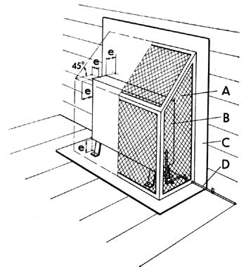
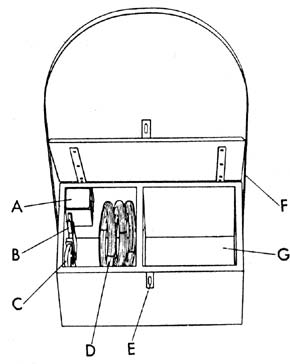
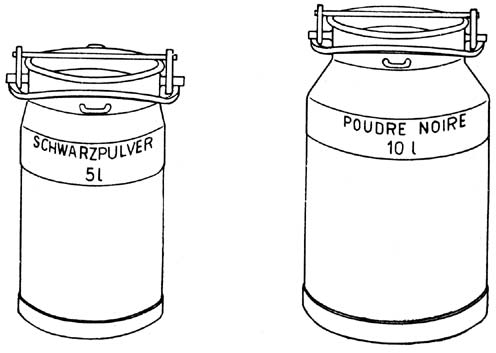
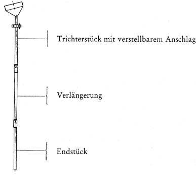

Verordnung vom 27. Januar 1971 über die Verhütung von Unfällen bei Sprengarbeiten Gestützt auf Art. 32 des Gesetzes betreffend die Unfallversicherung vom 16. Januar 1931, LGBl. 1931 Nr. 2 , verordnet die Regierung: I. Geltungsbereich Art. 1 Geltungsbereich 1) Diese Verordnung findet Anwendung auf alle Sprengarbeiten, soweit sie durch Betriebe ausgeführt werden, die unter den Geltungsbereich des Gesetzes betreffend die Unfallversicherung vom 16. Januar 1931, LGBl. 1931 Nr. 2, fallen. 2) Vorbehalten bleiben die baupolizeilichen Vorschriften. II. Allgemeines Art. 2 Zugelassene Sprengstoffe und Zündmittel 1) Es dürfen nur Sprengstoffe und Zündmittel verwendet werden, die sich im Gebrauch bewährt haben oder nach anerkannten technischen Grundsätzen hergestellt worden sind. 2) Das mit der Durchführung von Sprengarbeiten betraute Personal darf nur solche Sprengstoffe und Zündmittel verwenden, die ihm vom Unternehmer oder dessen Stellvertreter zur Verfügung gestellt werden. Art. 3 Öffentliche Sicherheit Zum Schutze der öffentlichen Sicherheit sind die notwendigen Vorkehrungen nach Massgabe des Amtes für Industrie und Gewerbe zu treffen. Art. 4 Auswahl des Personals Die Handhabung von Sprengstoffen und Zündmitteln sowie die Ausführung von Sprengungen darf nur Personen übertragen werden, die mit diesen Arbeiten vertraut sind und diese Verordnung kennen. Art. 5 Rauchverbot Bei jeder Tätigkeit mit Sprengstoffen und Zündmitteln ist das Rauchen verboten. III. Zündmittel Art. 6 Langsam brennende Zündschnüre 1) Die Verwendung einfach umsponnener Zündschnüre ist verboten. 2) Es dürfen nur Zündschnüre verwendet werden, welche nach einer Wasserlagerung von 30 Minuten noch regelmässig brennen und annähernd die gleiche Brenndauer aufweisen wie vor der Wasserlagerung. Die Zündschnurumhüllung muss so beschaffen sein, dass durch sie hindurch keine Feuerübertragung stattfinden kann. 3) Die Brenngeschwindigkeit der Zündschnüre hat 150 Sekunden per Meter zu betragen mit einer Toleranz von höchstens plus oder minus 10 %. Sie ist bei neu angelieferten oder längere Zeit im Betrieb gelagerten Zündschnüren durch Versuche festzustellen, wobei auch der Regelmässigkeit des Abbrennens die nötige Beachtung zu schenken ist. 4) Die Zündschnüre sind vor Gebrauch genau zu untersuchen. Geknickte, gebrochene, gequetschte, sonstwie beschädigte oder feuchte Zündschnüre sind nicht mehr zu verwenden, sondern zu vernichten. 5) Auf ein und derselben Baustelle dürfen nur Zündschnüre der nämlichen Fabrikation und Brenngeschwindigkeit benützt werden. Art. 7 Detonierende Zündschnüre (Knallzündschnüre) 1) Es dürfen auf ein und derselben Baustelle nur detonierende Zündschnüre des nämlichen Fabrikates zur Verwendung gelangen. 2) Geknickte, gebrochene, gequetschte oder sonstwie beschädigte Zündschnüre sind nicht mehr zu verwenden, sondern zu entfernen. Art. 8 Elektrische Zündvorrichtungen Bei elektrischer Zündung dürfen nur Gleichstromquellen verwendet werden, die eine genügende Leistung aufweisen und gegen unbefugte Betätigung gesichert sind. Art. 9 Sprengkapseln 1) Die Stärke der Sprengkapseln ist so zu wählen, dass eine sichere Detonationsübertragung gewährleistet ist. 2) Feuchte oder schadhafte Sprengkapseln sind nicht mehr zu verwenden, sondern zu entfernen. IV. Lagerung der Sprengstoffe und Zündmittel Art. 10 Lagerung im allgemeinen 1) Sprengstoffe und Zündmittel müssen trocken gelagert werden und gegen jede Beschädigung durch Sprengwirkung gesichert sein. Das Aufbewahren von Sprengstoffen und Zündmitteln in Gebäuden oder Baracken, die bewohnt sind oder dem Aufenthalt von Personen dienen, ist verboten. 2) Das Aufsichtspersonal hat dafür zu sorgen, dass die Sprengstoff- und Sprengkapselmagazine stets abgeschlossen sind. 3) Das Betreten von Sprengstofflagern ist unbefugten Personen durch auffallende Aufschrift zu verbieten. 4) Das Rauchverbot ist bei jedem Sprengstoff- und Zündmittelmagazin deutlich sichtbar anzuschlagen. Art. 11 Hauptmagazine im Freien für Sprengstoffe 1) Die Lagerräume für Sprengstoffe in Mengen über 100 kg sind in Mulden, hinter Erddämmen, Felsvorsprüngen oder an ähnlichen Orten so aufzustellen, dass bewohnte Räume sowie Arbeitsstätten nicht gefährdet werden. Sie müssen aus leichtem Material, wie Holz oder Isolierstoffen, hergestellt sein und abgeschlossen werden können. 2) Abgelegene Magazine sind mit einem Drahtzaun gegen unbefugten Zutritt abzuschranken. 3) Im Hauptmagazin dürfen nur Sprengstoffe und Zündschnüre gelagert werden. Art. 12 Handmagazine im Freien für Sprengstoffe 1) Sprengstoffe dürfen in Mengen bis zu 100 kg in der Nähe der Arbeitsstellen in abschliessbaren Hütten, Nischen oder Kisten gelagert werden, sofern diese Aufbewahrungsorte keinen andern Zwecken dienen. 2) Auf grösseren Baustellen kann in besonderen Fällen mit Bewilligung des Amtes für Industrie und Gewerbe dem Handmagazin ein Tagesbedarfsmagazin angegliedert werden. Art. 13 Hauptmagazine unter Tag für Sprengstoffe Die unterirdische Lagerung von Sprengstoffen in Mengen über 100 kg ist nur in Kavernen zulässig, die mit keinen unterirdischen Arbeitsstellen in Verbindung stehen. Dabei dürfen mit den Sprengstoffen nur langsam brennende Zündschnüre gelagert werden. Art. 14 Handmagazine unter Tag für Sprengstoffe Die unterirdische Lagerung von Sprengstoffen in Mengen bis höchstens 100 kg ist auch in anderen Stollenlagen gestattet, sofern sie in feuersicher abgeschlossenen Nischen oder Behältern erfolgt. Zündpatronen und Sprengkapseln müssen dabei in besonderen Nischen oder Behältern untergebracht sein. Solche Lager müssen sich ausserhalb der Gefahrenzone allfälliger Sprengschüsse befinden. Art. 15 Magazine für Sprengkapseln 1) Die Lagerung von Sprengkapseln in Mengen über 10 000 Stück hat in besonderen Räumen zu erfolgen, die den Vorschriften über die Einrichtung von Hauptmagazinen für Sprengstoffe entsprechen. Zündpatronen oder Sprengstoffe dürfen in diesen Räumen nicht untergebracht werden. 2) Bei Mengen bis 10 000 Stück dürfen Sprengkapseln auch in Handmagazinen für Sprengstoffe gelagert werden. Befinden sich diese Magazine im Freien, so sind Sprengstoffe, Zündpatronen, Sprengkapseln getrennt zu versorgen; befinden sie sich unter Tag, so hat die Lagerung zudem in feuersichern Behältern zu erfolgen. Art. 16 Lagerung der detonierenden Zündschnüre Detonierende Zündschnüre dürfen in den Sprengstoffmagazinen gelagert werden; sie sind getrennt zu versorgen. Art. 17 Heizung und Beleuchtung der Lagerräume 1) Die Heizung der Lagerräume für Sprengstoffe und Zündmittel ist nur durch Einrichtungen zulässig, die zu keiner Entzündung Anlass geben können. Bei elektrischer Heizung ist die im Anhang I wiedergegebene Schemazeichnung zu beachten. 2) Als künstliche, in den Lagerräumen einzurichtende Beleuchtung ist nur die elektrische Beleuchtung zulässig. Diese ist gemäss den Hausinstallationsvorschriften des Schweizerischen Elektrotechnischen Vereins (SEV), Abschnitt Feuergefährliche Räume, einzurichten. Art. 18 Temperaturkontrolle Räume, in denen Sprengstoffe aufbewahrt werden, sind mit Thermometern zu versehen. V. Behandlung und Beförderung der Sprengstoffe und Zündmittel Art. 19 Auswahl des Personals Mit der Behandlung und Beförderung der Sprengstoffe und Zündmittel sind nach Möglichkeit immer die gleichen Personen zu betrauen. Art. 20 Sprengstoffentnahme Die Sprengstoffe und Zündmittel sind den Magazinen so zu entnehmen, dass die ältesten zuerst verwendet werden. Art. 21 Behandlung gefrorener Sprengstoffe 1) Bei kalter Witterung ist vor der Entnahme von Sprengstoffen die Innentemperatur des Lagerraumes zu prüfen. 2) Ist die kritische Gefriergrenze des Sprengstoffes überschritten, so ist dieser vor der Verwendung in besonderen Gefässen aufzutauen, deren Wände und Böden von aussen durch warmes Wasser von nicht über 50 Grad Celsius (Wasserbad) erwärmt werden. Diese Arbeit darf nur unter fachmännischer Leitung erfolgen. 3) Es ist verboten, gefrorene Sprengstoffe in die Nähe eines Feuers zu bringen, auf geheizte Öfen zu legen, in warmes Wasser einzutauchen, in die Tasche zu nehmen oder auf ähnliche Weise aufzutauen. 4) Gefrorene Sprengstoffpatronen sind sehr vorsichtig zu behandeln. Sie dürfen weder gedrückt, noch zerbrochen, noch der Wirkung von Stössen, Reibungen oder Schlägen ausgesetzt werden. Art. 22 Verdorbene Sprengstoffe und Zündmittel 1) Verdorbene Sprengstoffe und Zündmittel sind an abgelegenen Orten im Freien durch hiezu befugtes FachpersonaI zu vernichten. 2) Die Vernichtung verdorbener Sprengstoffe in Mengen von über 25 kg ist Sprengstoffabrikanten oder Spezialisten im Sprengwesen zu übertragen. Art. 23 Beförderung der Sprengstoffe und Sprengkapseln; Transportbehälter 1) Für die Beförderung der festen Sprengstoffe und Sprengkapseln zwischen Magazin und Verwendungsstellen sind nur geschlossene, starke Behälter aus Holz, Aluminium, Zink, Kupfer, Leder oder anderem weichem Material zulässig, die mit starkem Schultertragband versehen sind. Sprengstoffe und Sprengkapseln sind dabei in besonderen Abteilungen unterzubringen. Die im Anhang II wiedergegebene Schemazeichnung ist zu beachten. 2) Für die Beförderung von Schwarzpulver und anderen Sprengstoffen in loser Körnerform sind mit Deckel und Tragvorrichtung versehene, geschlossene Kannen aus Zinkblech, Aluminium, Kupfer oder anderem Weichmetall zu verwenden. Die im Anhang III wiedergegebene Schemazeichnung ist zu beachten. Art. 24 Vorbereitung der langsam brennenden Zündschnüre 1) Die Länge der Zündschnur ist nach der Anzahl der gleichzeitig zu zündenden Schüsse, der Brenngeschwindigkeit der Zündschnur und der Länge des Rückzugweges in die sichere Deckung zu bemessen. Die Verwendung von Zündschnüren unter 60 cm Länge ist verboten. 2) Das gerade, rechtwinklig abgeschnittene Ende der Zündschnur ist in die Sprengkapsel, unter Vermeidung jeder Drehung, so weit hineinzuschieben, bis es die Abdeckung des Zündsatzes in der Kapsel leicht berührt. Hierauf ist der obere Rand der Kapsel mit einer Kapselzange oder einem Anwürgeapparat auf die Zündschnur aufzupressen. Die Befestigung mit anderen Instrumenten oder mit den Zähnen ist verboten. 3) Kommen Zündpatronen ins Wasser zu liegen, so ist der zugeklemmte Kapselrand durch geeignete Isolierung vor Wasserzutritt zu schützen. 4) Für eigentliche Unterwassersprengungen dürfen nur besondere, als wasserdicht bezeichnete Zündschnüre verwendet werden. Art. 25 Vorbereitung der elektrischen Sprengkapseln 1) Die elektrischen Sprengkapseln sind vor Gebrauch einzeln mit einem Ohmmeter oder ähnlichen Leitungsprüfern auf Stromdurchgang zu kontrollieren. Dabei sollen die Kapseln in Deckung gebracht und dort, ihrer Verzögerung entsprechend, so lange belassen werden, dass eine Verletzung von Personen durch Splitter allfällig detonierender Sprengkapseln ausgeschlossen ist. 2) Nach der Prüfung sind die Drähte der einzelnen Kapseln wieder kurzzuschliessen. 3) Bei Serienschüssen dürfen nur Sprengkapseln der gleichen Fabrikation und Widerstandsgruppe verwendet werden. 4) Wird ein Ohmmeter spezieller Konstruktion verwendet, z. B. ein Ohmmeter Dreomina, so brauchen die Kapseln bei ihrer Prüfung nicht in Deckung gebracht werden. Art. 26 Vorbereitung der detonierenden Zündschnüre 1) Mit der Vorbereitung der detonierenden Zündschnüre dürfen nur Fachleute betraut werden. 2) Das Abschneiden der Schnüre hat auf einer ebenen sauberen Unterlage zu erfolgen. 3) Sobald auf einer Schnur eine Sprengkapsel aufgepresst ist, darf diese nicht mehr geschnitten werden. 4) Knotenpunktausbildungen sind genau nach den Vorschriften des Schnurlieferanten auszuführen. 5) Die Schnüre einer Zündanlage dürfen sich ausser an ihren Verbindungsstellen nirgends berühren. Kreuzungen von Schnüren sind verboten. Art. 27 Herstellung von Zündpatronen 1) Die Herstellung von Zündpatronen ist in besonderen Räumen vorzunehmen, die den Vorschriften über die Einrichtung von Handmagazinen für Sprengstoffe entsprechen. Sie kann auch direkt in Handmagazinen erfolgen. 2) In der Nähe von offenem Licht oder Feuer ist die Herstellung von Zündpatronen verboten. 3) Das Vorbohren der Sprengpatronen zum Einschieben der auf die Zündschnur aufgepressten Sprengkapsel hat mit Stäbchen aus Holz oder anderem weichem Material zu geschehen. 4) Die Zündpatronen sollen sobald als möglich nach ihrer Herstellung verwendet werden. Art. 28 Beförderung der Zündpatronen Patronen, in denen die Sprengkapsel bereits eingesetzt ist, dürfen nur in besonderen, den Vorschriften von Art. 22 Abs. 1 entsprechenden Behältern befördert werden. Art. 29 Rücktransport der Sprengstoffe und Zündmittel Die Transportbehälter sind mit den übrigbleibenden Sprengstoffen und Zündmitteln beim Verlassen der Sprengstelle in das Handmagazin zu bringen oder dem Leiter der ablösenden Schicht zu übergeben. VI. Laden der Schüsse Art. 30 Überwachung der Arbeit Der Leiter der Sprengarbeiten hat darüber zu wachen, dass das Laden vorschriftsgemäss geschieht. Art. 31 Beleuchtung Offene Lampen sind beim Laden in angemessener Entfernung zu halten. Wird mit Schwarzpulver oder anderen Sprengstoffen in loser Körnerform geladen, so sind nur geschlossene Lampen zulässig. Art. 32 Ladestock Zum Laden und Besetzen der Bohrlöcher dürfen nur hölzerne Ladestöcke ohne jede Metallarmatur verwendet werden. Art. 33 Laden 1) Grundsätzlich darf mit dem Laden erst begonnen werden, nachdem sämtliche Löcher der gleichen Sprengserie gebohrt sind. 2) Ausnahmsweise kann bei günstigen Felsverhältnissen und unter Anwendung strikter Vorsichtsmassnahmen gleichzeitig gebohrt und geladen werden: a) sofern der Abstand zwischen dem geladenen und dem zu bohrenden Loch mindestens 1.50 m beträgt; b) sofern bei stufenweisem Abbau sämtliche Löcher der gleichen Stufe gebohrt sind und der Fels kompakt ist. 3) Der kleinste Durchmesser des Bohrloches muss etwas grösser sein als der Durchmesser der Sprengstoffpatronen. Vor dem Einbringen der Ladungen sind sämtliche Bohrlöcher sorgfältig zu reinigen und mit dem Ladestock auf freien Durchgang zu prüfen. 4) Die Patronen sind mit dem hölzernen Ladestock durch mässigen Druck, unter Vermeidung von Schlägen und Reibungen, so einzuschieben, dass sie satt aneinander liegen und sich dem Bohrloch anschmiegen. Das Einbringen der Patronen mit Gewalt ist verboten. 5) Bei Verwendung von Dynamit (Gurdynamit, Dynamit F oder ähnlichen Sprengstoffen) darf die Zündschnur, ausser mit der Zündpatrone, unter keinen Umständen mit den geladenen Dynamitpatronen in Berührung kommen. 6) Schwarzpulver und andere Sprengstoffe in loser Körnung sind mittels Rohr und Trichter aus Zink, Aluminium, Kupfer oder anderem Weichmetall in das Bohrloch einzufüllen. Das Rohr muss mindestens bis zur Oberfläche der Sprengladung reichen. Nach dem Laden ist verschütteter Sprengstoff sorgfältig zu entfernen. Die im Anhang IV wiedergegebene Schemazeichnung ist zu beachten. 7) Im Bohrloch eingeklemmte Patronen sowie blockiertes Schwarzpulver und andere Sprengstoffe in loser Körnerform sind in ihrer Lage zu belassen und für sich abzutun. Art. 34 Besatz 1) Wenn die Ladung verdämmt wird, ist zuerst ein Pfropfen aus Papier und nachher der eigentliche Besatz aus Sand, feiner Erde, Lehm oder anderem geeignetem Material einzubringen. 2) Das Besatzmaterial ist zu pressen; es darf nicht festgeschlagen werden. 3) Ladungen mit Schwarzpulver und anderen Sprengstoffen in loser Körnerform sind immer mindestens mit einem Papierpfropfen zu verdämmen. Art. 35 Zündschnurende 1) Das Zündschnurende muss mindestens 20 cm aus dem Bohrloch herausragen. 2) Das Einschieben zusammengefalteter Zündschnüre in das Bohrloch ist verboten. Art. 36 Vorsichtsmassnahme bei kalter Witterung Bei Gefriergefahr sind nur wenig Schüsse gleichzeitig zu laden und so rasch als möglich abzutun. VII. Sicherheitsanordnungen vor der Zündung Art. 37 Sicherung der Umgebung 1) Vor dem Zünden der Sprengladungen sind alle im Wirkungsbereich der Sprengschüsse liegenden Zugänge rechtzeitig abzusperren und zu bewachen. Wo Sprengarbeiten im Bereiche der Anlagen und des Verkehrs von Eisenbahnen, Luft- und Standseilbahnen, die der Allgemeinheit dienen, ausgeführt werden, sind die Sprengzeiten mit der Verwaltung der betreffenden Verkehrsanstalten zu vereinbaren. 2) Wo durch die Sprengungen Gebäulichkeiten, Verkehrswege, ober- oder unterirdische Leitungen oder ähnliche Anlagen gefährdet werden, sind die Ladungen vor der Zündung mit Strauchwerk, Faschinen, Seil- oder Drahtnetzen oder anderen geeigneten Materialien genügend zu überdecken. Das Überdeckungsmaterial ist so zu sichern, dass es nicht durch die Sprengschüsse fortgeschleudert werden kann. Art. 38 Verlegung der Sprengungen auf Arbeitspausen Werden regelmässig Sprengungen in grösserem Umfange vorgenommen, so sind sie, soweit möglich, in die Arbeitspausen zu verlegen. Art. 39 Warnsignale 1) Der Befehl zum Zünden der Sprengladungen darf erst nach Abgabe deutlich hörbarer Warnsignale und nur vom Leiter der Sprengarbeiten erteilt werden, nachdem er sich darüber vergewissert hat, dass die Wachen auf ihren Posten und die Arbeiter in Sicherheit sind. 2) Die Warnsignale müssen den Arbeitern des eigenen Betriebes und allfälliger Nachbarbetriebe bekannt sein. Sie dürfen für andere Zwecke nicht verwendet werden und müssen so laut tönen, dass sie trotz der durch Wind, Bohrhämmer, Schotterwerke oder ähnliche Ursachen hervorgerufenen Nebengeräusche an allen Stellen des Betriebes und in allfälligen Nachbarbetrieben sicher gehört werden. 3) Schon auf das erste Warnsignal müssen sich die Arbeiter in die angewiesene Deckung begeben. Dort haben sie zu verbleiben, bis nach erfolgter Sprengung das vereinbarte Signal zum Verlassen der Deckung gegeben wird. 4) Folgende akustische Signale sind anzuwenden: eine Anzahl lang tönender Signale = Achtung, es wird gesprengt; drei kurze Signale = es wird gezündet; ein lang tönendes Signal = Sprengung beendet. 5) Unter Tag können die Warnsignale durch Zurufe ersetzt werden. VIII. Zündung der Sprengschüsse Art. 40 Pyrotechnische Zündung; Kontrollzündschnur 1) Der Sprengstoffvorrat ist vor dem Anzünden der Zündschnüre in Sicherheit zu bringen. 2) Die Zündschnurenden sind so vorzubereiten, dass sie leicht in Brand gesetzt werden können. 3) Das Anzünden der Schüsse hat durch intensive Stichflamme zu erfolgen. Mit gewöhnlichen Zündhölzern darf nur ein Einzelschuss in Brand gesetzt werden. 4) Bei Serien von mehr als 10 Sprengschüssen ist unmittelbar vor der Zündung des ersten Schusses eine Kontrollzündschnur anzuzünden. Ihre Länge muss gegenüber der kürzesten Zündschnur der geladenen Schüsse um so viel, mindestens aber um 60 cm, kürzer sein, dass dem Zündpersonal nach dem Abbrennen der Kontrollzündschnur genügend Zeit zum Rückzug in die sichere Deckung bleibt. Der Leiter der Zündmannschaft hat die Kontrollzündschnur in der Hand zu halten und spätestens nach deren Abbrennen den Befehl zum sofortigen Rückzug in die sichere Deckung zu erteilen. Der Befehl ist streng zu befolgen. 5) Das Einführen brennender Zündschnüre ist nur bei Kessel- oder Schmierschüssen mit senkrechtem Bohrloch gestattet, sofern dabei kein loses Pulver verwendet wird. Das Nachschieben der Zündpatronen mit dem Ladestock und das Aufbringen von Besatz ist verboten. Die Länge der Zündschnur hat wenigstens 60 cm zu betragen. Art. 41 Elektrische Zündung 1) Allfällige elektrische Leitungen, welche die Ladearbeiten gefährden, sind zu entfernen oder stromlos zu machen. 2) Die Drähte der einzelnen Sprengkapseln, wie auch der Zündleitung sind kurz geschlossen zu halten und erst unmittelbar vor der Zündung miteinander zu verbinden. Getrennt geführte Drähte der Zündleitungen sind zu verdrillen. 3) Blanke Drähte dürfen nicht mit Eisenteilen, Wasser, Fels oder Erde in Berührung kommen. 4) Die Sprengkapseln der einzelnen Ladungen müssen hintereinandergeschaltet werden. Bei Gruppenzündung sind die einzelnen Serienschüsse einer Gruppe hintereinanderzuschalten; die Gruppen selbst dürfen auch parallelgeschaltet werden. Die Benützung der Erde als Rückleitung ist verboten. 5) Die Enden der Zündleitung dürfen erst an die Stromquelle angeschlossen werden, wenn sich im Wirkungsbereich der Sprengschüsse keine Personen mehr aufhalten. 6) Vor jeder Zündung ist die fertige Sprengladung mit dem Ohmmeter oder einem anderen Leitungsprüfer aus gedeckter Stellung zu kontrollieren. Sind nur einzelne Ladungen der Sprenganlage zu prüfen, so ist auf die gleiche Art vorzugehen. 7) Der Leiter der Zündmannschaft muss den Schlüssel zum Zündapparat oder zum Kasten, in dem sich der Zündschalter befindet, stets bei sich oder unter Verschluss aufbewahren; das gleiche gilt für die Kurbel bei Apparaten mit Kurbelantrieb. 8) Nach eingeleiteter Zündung, gleichgültig, ob sie von Erfolg war oder nicht, ist die Verbindung zwischen Leitung und Zündapparat oder Stromquelle zu lösen, bevor das Personal die Deckung verlässt. Art. 42 Sicherung bei Gewitter 1) Bei aufziehendem Gewitter ist das Laden von elektrisch zu zündenden Schüssen sofort einzustellen. Die bereits fertig geladenen und mit Sprengkapseln versehenen Schüsse sind unter Beobachtung der Absperr- und Warnvorschriften schnellstens zu zünden. Ist dies nicht mehr möglich, so muss der Sprengbereich verlassen und abgesperrt werden, bis das Gewitter vorüber ist. 2) Bei Untertag-Sprengstellen ist ein Warndienst einzurichten. Art. 43 Sprengarbeiten in Schächten und Aufbrüchen In tiefen Schächten und hohen Aufbrüchen ist der Zündung auf elektrischem Wege oder mit detonierenden Zündschnüren der Vorzug zu geben. IX. Kontrolle nach erfolgter Sprengung Art. 44 Kontrolle der Schusszahl Bei Zündschnurzündung ist der Leiter der Sprengarbeiten verpflichtet, vor der Sprengung die geladenen Schüsse zu zählen. Aufgrund der Detonationen hat er zu kontrollieren, ob sämtliche Schüsse explodiert sind. X. Wartezeit Art. 45 Wartezeit bei Zündschnurzündung 1) Wenn Zweifel darüber bestehen, ob alle Schüsse detoniert sind, so darf vor Ablauf von 15 Minuten nach Anzündung des letzten Schusses niemand die Deckung verlassen. 2) Das gleiche gilt, wenn bei einem Schuss scheinbar erfolglos versucht wurde, die Zündschnur in Brand zu setzen. 3) Bei Verwendung von Zündschnüren von mehr als 3 m Länge ist die Wartezeit um zwei Minuten pro Laufmeter Zündschnur zu verlängern. Art. 46 Messen der Wartezeit Die Wartezeiten sind mit der Uhr zu messen. Art. 47 Wartezeit bei elektrischer Zündung Bei elektrischer Zündung ist nur bei Verwendung von Verzögerungszündern eine Wartezeit einzuhalten. Sie beträgt fünf Minuten. Art. 48 Wartezeit bei Kammerschüssen Bei Kessel- oder Schmierschüssen darf erst nach erfolgter Abkühlung der Kammer, frühestens aber nach 30 Minuten, wieder geladen werden. Die Frist kann verkürzt werden, wenn die Kammer mit Wasser ausgespült wird. Art. 49 Wartezeit bei Sprengungen in Schächten und Stollen Nach Sprengungen in Schächten und Stollen darf erst wieder zur Sprengstelle zurückgekehrt werden, wenn durch die Belüftung dafür gesorgt worden ist, dass die giftigen Gase aus dem Arbeitsbereich entfernt worden sind. XI. Versager und zurückgebliebene Sprengstoffe Art. 50 Aufsuchen der Versager 1) Nach Ablauf der Wartezeit hat der Leiter der Sprengarbeiten die Deckung allein zu verlassen und Versager oder abgerissene Schüsse aufzusuchen. 2) Wird ein Versager festgestellt, den der Leiter der Sprengarbeiten nicht gefunden hat, so ist er ihm ohne Verzug zu melden. Art. 51 Bezeichnen der Versager 1) Wenn Versager oder abgerissene Schüsse nicht sofort unschädlich gemacht werden können, so hat sie der Leiter der Sprengarbeiten auffällig zu bezeichnen. 2) Bei Schichtwechsel hat der Leiter der Sprengarbeiten der abtretenden Schicht seinen Nachfolger über Anzahl und Lage der Versager genau zu unterrichten. Art. 52 Unschädlichmachen von Versagern 1) Versager sind, wenn immer möglich, sofort unschädlich zu machen. Auf keinen Fall darf bei Unterbruch der Arbeiten oder nicht durchgehendem Betrieb der Leiter der Sprengarbeiten die Arbeitsstelle verlassen, bevor alle Versager abgetan sind. 2) Die Versager sind durch eine der folgenden Methoden abzutun: a) Der Besatz ist bis auf den Papierpfropfen vorsichtig zu entfernen mittels Werkzeugen aus Kupfer, Messing, Aluminium, Holz oder anderem weichem Material, oder mittels Wasser- bzw. Druckluftspülung, wobei das dazu verwendete Strahlrohr mit einer Mündung aus Weichmetall versehen sein muss. Auf den Pfropfen wird eine neue Zündpatrone aufgesetzt und zur Explosion gebracht. b) In wenigstens 20 cm Entfernung vom alten Bohrloch und parallel dazu ist ein neues Loch so zu bohren, dass die Sprengladung des Versagers auf keinen Fall berührt, gefährlich erschüttert oder durch loses Gestein verletzt wird. Die Richtung des alten Bohrloches ist durch einen eingeschobenen Ladestock zu kennzeichnen. Im neuen Bohrloch ist eine Sprengladung einzubringen und zu zünden. 3) Kann ein Versager ausnahmsweise nicht durch Zündung abgetan werden, so darf nach der Entfernung des Besatzes auch die Ladung aus dem Bohrloch herausgenommen werden. Dies muss jedoch durch den Leiter der Sprengarbeiten geschehen, unter Beachtung der in Abs. 2 Bst. a umschriebenen Vorsichtsmassnahmen. 4) Schwarzpulverladungen dürfen durch Auflösen in Wasser unschädlich gemacht werden. Art. 53 Verschleuderte Sprengstoffreste In Sprengschutt festgestellte Patronenreste und Sprengkapseln sind zu entfernen. Art. 54 "Pfeifen" oder "Büchsen" Das Nach- und Tieferbohren von Bohrlochpfeifen und stehengebliebenen Bohrlochresten ist verboten. Bohrlochpfeifen sind vor Wiederaufnahme der Bohrarbeiten mit Holzpflöcken zu verschliessen. XII. Schlussbestimmungen Art. 55 Bewilligung von Ausnahmen Das Amt für Industrie und Gewerbe kann in besonderen Fällen Abweichungen von den Vorschriften dieser Verordnung gestatten oder andere Massnahmen anordnen. Art. 56 Straf- und Zwangsmassnahmen Widerhandlungen gegen die in dieser Verordnung enthaltenen Vorschriften unterliegen den Straf- und Zwangsmassnahmen gemäss Gesetz vom 29. Dezember 1966 über die Arbeit in Industrie, Gewerbe und Handel, LGBl. 1967 Nr. 6. Art. 57 Inkrafttreten Diese Verordnung tritt am Tage der Kundmachung in Kraft. Fürstliche Regierung: gez. Dr. Alfred Hilbe Fürstlicher Regierungschef Anhang I Heizung für Sprengstoff- und Zündmittelmagazin Darstellung eines vorschriftsgemäss installierten und abgeschirmten elektrischen Heizkörpers 

 Legende A Schutzkorb B Fest montierter elektrischer Heizkörper C Feuersichere Verschalung (z.B. Eternit) D Elektrische Zuleitung gemäss den Hausinstallationsvorschriften des SEV e Allseitig freier Raum min. 8 cm Anhang II Modell eines Transportbehälters für Spreng- und Zündmittel 

 Legende A Sprengkapseln B Kapselzange C Isolierband D Zündschnur E Verschluss F Schultertragband G Sprengstoff Anhang III Beispiele geschlossener Kannen aus Weichmetall für den Transport von Sprengstoffen in loser Körnerform 

 Anhang IV Modell eines Einfüllrohres zum Laden von Sprengstoffen in loser Körnerform 

