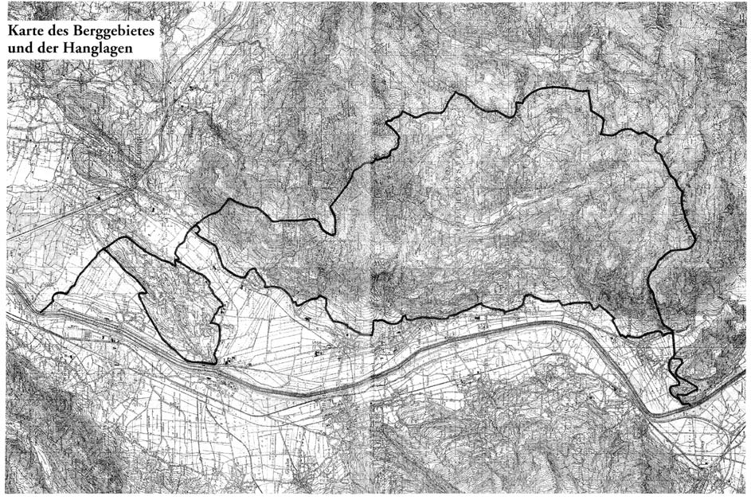

Verordnung vom 2. März 2010 über die Förderung der Landschaftspflege von Berggebieten, Hanglagen und Grenzertragsstandorten (Landschaftspflege-Förderungs-Verordnung; LPFV) Aufgrund von Art. 48 Abs. 3, Art. 49 Abs. 3, Art. 67 und 78 Abs. 1 des Landwirtschaftsgesetzes (LWG) vom 11. Dezember 2008, LGBl. 2009 Nr. 42 , verordnet die Regierung: I. Allgemeine Bestimmungen Art. 1 Gegenstand und Zweck 1) Diese Verordnung regelt die staatliche Förderung der im öffentlichen Interesse liegenden Bewirtschaftung von Berggebieten, Hanglagen und Grenzertragsstandorten. 2) Sie enthält insbesondere Bestimmungen über: a) die Förderungsvoraussetzungen sowie die Art und Höhe der Förderung; b) das Verfahren für die Ausrichtung von Förderungen. 3) Sie dient: a) dem Ausgleich produktionsbedingter Erschwernisse für die Bodenbewirtschaftung in Berggebieten, Hanglagen und Grenzertragsstandorten; b) der Förderung der im öffentlichen Interesse erbrachten landschaftspflegerischen Leistungen; c) der Sicherstellung einer nachhaltigen und flächendeckenden Bewirtschaftung der landwirtschaftlich nutzbaren Flächen in Berggebieten, Hanglagen und Grenzertragsstandorten. Art. 2 Begriffsbestimmungen und Bezeichnungen 1) Im Sinne dieser Verordnung gelten als: a) "Berggebiet und Hanglagen": die in der Karte im Anhang eingezeichneten Gebiete mit Ausnahme der Alpflächen nach dem Anhang der Alpinfrastruktur-Förderungs-Verordnung; b) "Geländehindernisse": Kupierungen, Terrassierungen, Böschungen und ähnliche Hindernisse für die Bewirtschaftung; Bäume, einzelne Steinhaufen oder Hecken zählen nicht zu den Hindernissen für die Bewirtschaftung; c) "geringe Geländehindernisse": Hindernisse, durch die ein Mehraufwand von weniger als einem Drittel zusätzlicher Arbeit bei der Bewirtschaftung entsteht; d) "mittlere Geländehindernisse": Hindernisse, durch die ein Mehraufwand von einem bis zu zwei Drittel zusätzlicher Arbeit bei der Bewirtschaftung in der Regel dadurch entsteht, dass die Flächen zwar grösstenteils maschinell bewirtschaftet werden können, jedoch nur langsames oder eingeschränktes Befahren möglich ist oder Spezialmaschinen eingesetzt werden müssen sowie teilweise Handarbeit notwendig ist; e) "starke Geländehindernisse": Hindernisse, durch die ein Mehraufwand von mehr als zwei Drittel zusätzlicher Arbeit bei der Bewirtschaftung entsteht und die insbesondere dazu führen, dass die Flächen mit Ausnahme des Mähens nur noch von Hand bearbeitet werden können; f) "Grünflächen": Dauerwiesen, Kunstwiesen oder Weiden, die als Hauptkultur genutzt werden. 2) Die in dieser Verordnung verwendeten Personen- und Berufsbezeichnungen gelten für Personen des weiblichen und männlichen Geschlechts. II. Förderungen Art. 3 Förderungsvoraussetzungen 1) Förderungsleistungen für Grünflächen in Berggebieten, Hanglagen sowie Grenzertragsstandorten werden ausgerichtet, wenn zusätzlich zu den Voraussetzungen nach Art. 48 Abs. 1 des Gesetzes: a) die bewirtschaftete Gesamtfläche mindestens 50 Aren beträgt; b) die Fläche ordnungsgemäss bewirtschaftet wird, insbesondere: 1. das Wiesland vorbehaltlich Abs. 4 und 5 mindestens einmal jährlich gemäht wird; 2. das Schnittgut abgeführt wird; 3. bei der Mähnutzung keine Schäden an der Grasnarbe, an Hecken oder Bäumen, an Entwässerungsgräben oder Stützmauern oder ähnlichem hinterlassen werden; und 4. keine Übernutzung oder Trittschäden verursacht werden. 2) Förderungsleistungen für Grenzertragsstandorte werden ausgerichtet, wenn zusätzlich zu den Voraussetzungen nach Abs. 1: a) ein öffentliches Interesse insbesondere der Standortgemeinde besteht; und b) die Fläche während drei Jahren nicht mehr bewirtschaftet wurde. 3) Grenzertragsstandorte werden vom Amt für Wald, Natur und Landwirtschaft auf Antrag der Standortgemeinde ausgeschieden. 4) Die Flächen sind jeweils vor dem 31. August zu mähen, sofern nichts anderes vereinbart ist. 5) Die Weidesäuberung gilt nicht als Mähnutzung. Das Mulchen ist nur zur Weidesäuberung zulässig. Art. 4 Art und Höhe der Förderung 1) Die Förderungsleistungen werden in Form eines Erschwernisbeitrages ausgerichtet. 2) Die Höhe des Erschwernisbeitrages beträgt 250 Franken pro Hektar und Erschwernispunkt nach Art. 5. Art. 5 Zuteilung der Erschwernispunkte 1) Das Amt für Wald, Natur und Landwirtschaft teilt den bewirtschafteten Parzellen Erschwernispunkte nach folgenden Kriterien zu: a) Höhenlage; b) Hangneigung; c) Geländehindernisse; d) Zufahrtsmöglichkeiten. 2) Die Erschwernispunkte werden wie folgt zugeteilt: a) für die Höhenlage: 1. bis 700 Meter über dem Meeresspiegel: 0 Punkte; 2. über 700 Meter über dem Meeresspiegel: 1 Punkt; b) für die Hangneigung: 1. unter 20 %: 0 Punkte; 2. zwischen 20 % und 40 %: 1 Punkt; 3. über 40 %: 2 Punkte; c) für Geländehindernisse: 1. geringe: 0 Punkte; 2. mittlere: 1 Punkt; 3. starke: 2 Punkte; d) für die Zufahrtsmöglichkeiten: 1. vorhandene Zufahrt: 0 Punkte; 2. nicht vorhandene Zufahrt: 1 Punkt. 3) Eine Zufahrt ist auch dann vorhanden, wenn eine Parzelle über ein anderes Grundstück mit einem Erntefahrzeug erreichbar ist. Trotz vorhandener Zufahrt erhält eine Parzelle einen Punkt, wenn die Ernte unter erhöhtem Arbeitsaufwand nur von Hand nach oben weggeführt werden kann. 4) Grenzertragsstandorte erhalten zusätzlich einen Punkt. 5) Das Amt für Wald, Natur und Landwirtschaft kann eine Liste der Parzellen mit Erschwernispunkten erstellen. III. Verfahren Art. 6 Einreichung und Prüfung der Gesuche 1) Gesuche um Ausrichtung von Erschwernisbeiträgen sind bis zum 30. September des Beitragsjahres beim Amt für Wald, Natur und Landwirtschaft einzureichen. Das Amt für Wald, Natur und Landwirtschaft stellt die dafür notwendigen Formulare und Unterlagen zur Verfügung. 2) Die Gesuchsteller sind verpflichtet, die Anmeldeunterlagen nach Abs. 1 vollständig und wahrheitsgetreu auszufüllen. 3) Das Amt für Wald, Natur und Landwirtschaft prüft die Gesuche und berechnet die Höhe des Erschwernisbeitrages. Art. 7 Zusicherung von Förderungen 1) Liegen sämtliche Förderungsvoraussetzungen vor, so sichert das Amt für Wald, Natur und Landwirtschaft die Ausrichtung der Erschwernisbeiträge zu. 2) Das Amt für Wald, Natur und Landwirtschaft kann die Förderungszusicherung mit den notwendigen Bedingungen und Auflagen verbinden. Art. 8 Ausrichtung von Förderungen Die zugesicherten Erschwernisbeiträge werden als Einmalzahlung jeweils im Dezember des Beitragsjahres ausgezahlt. Art. 9 Kontrollen Die Gemeinden kontrollieren jährlich die Einhaltung der ordnungsgemässen Bewirtschaftung nach Art. 3 und leiten die Ergebnisse an das Amt für Wald, Natur und Landwirtschaft weiter. IV. Rechtsmittel Art. 10 Beschwerde 1) Gegen Entscheidungen des Amtes für Wald, Natur und Landwirtschaft kann binnen 14 Tagen ab Zustellung Beschwerde bei der Beschwerdekommission für Verwaltungsangelegenheiten erhoben werden. 2) Gegen Entscheidungen der Beschwerdekommission kann binnen 14 Tagen ab Zustellung Beschwerde beim Verwaltungsgerichtshof erhoben werden. 3) Die Beschwerde an den Verwaltungsgerichtshof kann sich nur gegen rechtswidriges Vorgehen und Erledigen oder gegen aktenwidrige oder unrichtige Sachverhaltsdarstellungen richten. V. Schlussbestimmungen Art. 11 Aufhebung bisherigen Rechts Es werden aufgehoben: a) Verordnung vom 3. März 1998 zum Berggebiet- und Hanglagengesetz (Berggebiet- und Hanglagenverordnung, BHV), LGBl. 1998 Nr. 56; b) Verordnung vom 17. Dezember 2002 über die Abänderung der Berggebiet- und Hanglagenverordnung, LGBl. 2003 Nr. 16. Art. 12 Inkrafttreten Diese Verordnung tritt rückwirkend auf den 1. Januar 2010 in Kraft. Fürstliche Regierung: gez. Dr. Klaus Tschütscher Fürstlicher Regierungschef Anhang (Art. 2 Abs. 1 Bst. a) 

