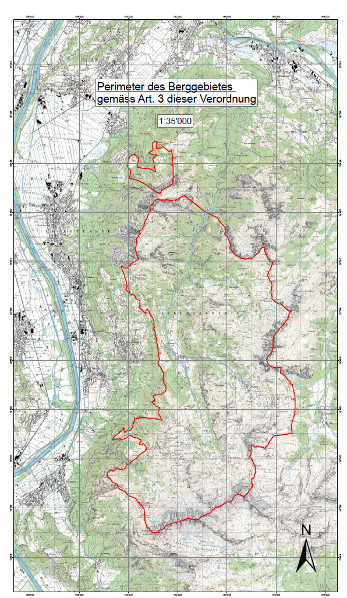

Verordnung vom 7. Oktober 2008 über die Erhaltung und Entwicklung des Berggebietes Aufgrund von Art. 52 des Waldgesetzes vom 25. März 1991, LGBl. 1991 Nr. 42 , Art. 29, 30, 42 und 48 des Landwirtschaftsgesetzes (LWG) vom 11. Dezember 2008, LGBl. 2009 Nr. 42 , Art. 53 des Gesetzes vom 23. Mai 1996 zum Schutz von Natur und Landschaft, LGBl. 1996 Nr. 117 , § 10 des Gesetzes vom 22. September 1899 betreffend die Rüfeschutzbauten, LGBl. 1899 Nr. 6 , und Art. 20 des Gesetzes vom 3. Juli 1991 über die Ausrichtung von Landessubventionen (Subventionsgesetz), LGBl. 1991 Nr. 71 , verordnet die Regierung: I. Allgemeine Bestimmungen Art. 1 Ziel Ziele für die integrale und nachhaltige Entwicklung des Berggebietes sind: a) das Berggebiet als Lebens- und Wirtschaftsraum sowie als Erholungsgebiet der Bevölkerung zu erhalten und zu fördern; b) die Lebensräume der einheimischen Pflanzen und Wildtiere im Berggebiet in ihrer Ausdehnung und in ihrer Qualität zu erhalten und zufördern; c) das Berggebiet als Rohstoffquelle und Produktionsgrundlage, insbesondere für die Alpwirtschaft, die Waldwirtschaft und den Tourismus, zu erhalten; d) die Entwicklung, die Form sowie die Intensität der Nutzung im Berggebiet nach der Verträglichkeit mit der Natur, der Landschaft und der Umwelt zu richten. Art. 2 Grundsätze Die Planung und Projektierung von Massnahmen zur Erhaltung und Entwicklung des Berggebietes orientieren sich an folgenden Grundsätzen: a) das Berggebiet ist in einem integralen und dynamischen Prozess unter Einbezug und Harmonisierung der Interessen der Grundeigentümer und aller Landschaftsnutzer zu erhalten und zu entwickeln; b) die Entwicklung sowie die Form und Intensität der Nutzung im Berggebiet erfolgen nach Massgabe der Umweltverträglichkeit sowie der Vereinbarkeit mit der Naturgefahrensituation; c) das Berggebiet ist als Rohstoffquelle und Produktionsgrundlage, insbesondere für die Alp- und Landwirtschaft sowie die Waldwirtschaft, zu erhalten und zu fördern; d) die Alpwirtschaft ist als Teil des liechtensteinischen Kulturgutes und der liechtensteinischen Identität zu erhalten und zu entwickeln; e) die Natur- und Kulturlandschaft des Berggebietes ist als Grundlage für Erholung, Freizeit und Tourismus zu erhalten und zu entwickeln; f) die spezifischen Gegebenheiten des Berggebietes sind zu berücksichtigen. Art. 3 Örtlicher Geltungsbereich Diese Verordnung gilt für das im Anhang 1 aufgeführte Gebiet (Berggebiet). II. Massnahmen Art. 4 Schutz vor Naturgefahren und Sicherung von Gefahrengebieten Der Schutz vor Naturgefahren und die Sicherung von Gefahrengebieten umfassen im Sinne eines integralen Risikomanagements: a) raumplanerische Massnahmen, insbesondere Zonierungen und Nutzungsordnungen; b) organisatorische Massnahmen, insbesondere temporäre Nutzungsbeschränkungen oder Evakuierungen; c) forstliche Massnahmen, insbesondere Sicherung von Wald sowie Aufforstung und Pflege; d) bautechnische Massnahmen, insbesondere die Erstellung von Schutzbauten und Anlagen zur Abwehr von Gefahren durch Rüfen, Lawinen, Steinschlag, Erosion und Rutschungen. Art. 5 Alpwirtschaft 1) Die Alpbetriebe sind als Lebens- und Produktionsgrundlage für die Landwirtschaft zu erhalten und zu fördern, insbesondere durch: a) die Erstellung geeigneter Weidesysteme zur Erhaltung der Weideflächen; b) die Schaffung eines ungleichförmigen Weide-Wald-Übergangsbereiches zur Gewährleistung eines Unterstands für das Vieh; c) die Erstellung, Sanierung oder Erweiterung von Einrichtungen, Anlagen und Gebäuden zur Sicherstellung eines rationellen und zeitgemässen Alpbetriebes; d) die Erstellung, Sanierung oder Erweiterung von Einrichtungen, Anlagen und Gebäuden für die Verarbeitung und Verwertung der Milch; e) Weideverbesserungen. 2) Nutzungen, die nicht einem landwirtschaftlichen Zweck im Sinne des Abs. 1 dienen, können von der Regierung gestattet werden, wenn sie die Wirtschaftlichkeit des Alpbetriebes fördern und in direktem Zusammenhang mit der Alpwirtschaft stehen. Art. 6 Waldwirtschaft 1) Die Förderung der Waldwirtschaft umfasst insbesondere Massnahmen, welche die Schutzfunktion des Waldes vor Naturgefahren erhalten und verbessern durch: a) die Trennung von Wald und Weide zur Vermeidung von Waldschäden; b) die Bewaldung, insbesondere in Anrissgebieten von Lawinen und Schneerutschungen, Rüfeeinzugsgebieten, erosionsgefährdeten Schutthängen, steinschlaggefährdeten Hängen, genutzten Quellgebieten sowie extremen Steillagen; c) die Pflege und Verjüngung der Waldbestände. 2) Pflegemassnahmen können auf der Grundlage der Waldentwicklungsplanung auch zur Erhaltung und Verbesserung anderer vorrangiger Waldfunktionen getroffen werden. Art. 7 Natur und Landschaft 1) Zur Erhaltung von Natur und Landschaft sind alle einheimischen Pflanzen- und Tierarten sowie deren Lebensräume vor schädlichen Einwirkungen und untragbaren Belastungen zu schützen. 2) Nutzungsarten, welche den Zielen des Natur- und Landschaftsschutzes entsprechen, sind zu unterstützen. 3) Das Berggebiet ist als bedeutender Lebensraum für jagdbare Tierarten zu erhalten. Gesunde und der Tragfähigkeit dieses Lebensraumes angepasste Wildpopulationen sind zu schaffen. Art. 8 Freizeit, Erholung und Tourismus 1) Das Berggebiet ist als Freizeit- und Erholungsraum zu erhalten und mit dem Ziel einer sanften Tourismusnutzung zu entwickeln. 2) Zur Vermeidung und Verminderung von schädlichen Einwirkungen auf das Berggebiet sind die Erholungsaktivitäten auf geeignete Gebiete zu konzentrieren. Art. 9 Verkehr, Energie und Infrastruktur 1) Das Berggebiet ist als Rohstoffquelle und Produktionsgrundlage, insbesondere für die Land- und Alpwirtschaft, die Waldwirtschaft sowie den Tourismus zu erhalten. 2) Zu diesem Zweck sind zusammenhängende Lebensräume zu sichern, Infrastrukturbauten möglichst zu konzentrieren, die Nutzung erneuerbarer Energieressourcen zu fördern und neue Erschliessungs- oder Wirtschaftswege so anzulegen oder auszubauen, dass sie den berechtigten Interessen der Alp- und Waldwirtschaft, des Natur- und Landschaftsschutzes, der Erholungsnutzung sowie der Jagd Rechnung tragen. III. Organisation und Durchführung Art. 10 BGS-Fachgruppe 1) Die Regierung bestellt zur Erhaltung und Entwicklung des Berggebietes eine Fachgruppe (BGS-Fachgruppe). Diese setzt sich zusammen aus zwei Vertretern des Amtes für Wald, Natur und Landwirtschaft und einem Vertreter des Amtes für Bevölkerungsschutz. Ein Vertreter des Amtes für Hochbau und Raumplanung wird bei übergeordneten, raumplanerisch relevanten Fragen beigezogen. 2) Der BGS-Fachgruppe obliegt der Vollzug dieser Verordnung, soweit bestimmte Aufgaben nicht der Regierung oder einer Amtsstelle übertragen sind. 3) Die BGS-Fachgruppe hat in alpwirtschaftlichen Belangen nach Art. 5 mit der Landesalpenkommission Einvernehmen herzustellen. Kann das Einvernehmen nicht hergestellt werden, entscheidet die Regierung. Die Zuständigkeit sowohl der Landesalpenkommission als auch der Landesrüfekommission bleibt gewahrt. Art. 11 Planung und Projektierung 1) Die Planung und Projektierung von Massnahmen im Sinne dieser Verordnung richten sich nach folgendem dreistufigen Verfahren: a) Festlegung eines Rahmens für die beabsichtigten Massnahmen in mehreren Projektgebieten (übergeordnete Konzepte); b) Festlegung eines Rahmens für die beabsichtigten Massnahmen in einem Projektgebiet (generelle Planung); c) Festlegung konkreter Massnahmen für ein bestimmtes Projekt (Detailprojektierung). 2) Die Ausarbeitung der generellen Planung oder ihre Anpassung an geänderte Verhältnisse erfolgt durch die BGS-Fachgruppe in Zusammenarbeit mit den beteiligten Bodeneigentümern und den Gemeinden, deren Hoheitsgebiet betroffen ist (betroffene Gemeinden). Die generelle Planung einschliesslich ihrer Anpassung bedarf der Genehmigung der Regierung; sie darf nur genehmigt werden, wenn ein schriftliches Einverständnis der Bodeneigentümer des Projektgebietes sowie der betroffenen Gemeinden vorliegt. 3) Die Detailprojektierung erfolgt durch die BGS-Fachgruppe in Zusammenarbeit mit den beteiligten Bodeneigentümern und den betroffenen Gemeinden. Voraussetzung für die Durchführung eines Detailprojektes ist: a) bei Projektkosten bis 50 000 Franken das schriftliche Einverständnis des Bodeneigentümers sowie die Information der betroffenen Gemeinde durch die BGS-Fachgruppe; b) bei Projektkosten zwischen 50 000 bis 150 000 Franken das schriftliche Einverständnis des Bodeneigentümers und der betroffenen Gemeinde; c) bei Projektkosten über 150 000 Franken das schriftliche Einverständnis des Bodeneigentümers und der betroffenen Gemeinde sowie die Genehmigung der Regierung. Art. 12 Ausführung des Detailprojektes 1) Die Projektausführung erfolgt durch die in der BGS-Fachgruppe vertretenen jeweils zuständigen Amtsstellen. Allfällige Arbeitsvergaben werden von der BGS-Fachgruppe vorgenommen. 2) Das Amt für Wald, Natur und Landwirtschaft leitet und beaufsichtigt die Projektausführung. Art. 13 Vordringliche Einzelmassnahmen Vordringliche Einzelmassnahmen werden im Einvernehmen mit den beteiligten Bodeneigentümern und der Regierung ausnahmsweise ohne Detailprojektierung durch die BGS-Fachgruppe angeordnet, wenn: a) eine unmittelbare Gefahr für Mensch und Tier sowie für erhebliche Sachwerte besteht; oder b) befürchtet werden muss, dass durch Zuwarten erhebliche Schäden eintreten oder sich bereits entstandene Schäden so vergrössern, dass deren spätere Behebung wesentlich höhere Kosten verursachen würde. Art. 13a Auskunfts- und Mitwirkungspflicht Bodeneigentümer müssen der BGS-Fachgruppe die für den Vollzug dieser Verordnung erforderlichen Auskünfte erteilen und Unterlagen zur Verfügung stellen. IV. Finanzierung Art. 14 Kostentragung für Planungen Sämtliche Kosten für die generelle Planung sowie für übergeordnete Konzepte werden vom Land getragen. Art. 15 Kostentragung für Projektierung und Massnahmen 1) Das Land leistet an die Kosten für die Umsetzung von Detailprojekten (Art. 11 Abs. 1 Bst. c) auf den in Anhang 2 aufgeführten Alpen (BGS-Alpen) Finanzhilfen oder Abgeltungen. Massnahmen auf privaten Grundstücken setzen ein überwiegend öffentliches Interesse voraus. 1a) Abgeltungen und Finanzhilfen werden nur gewährt, wenn: a) eine Genehmigung der generellen Planung für die entsprechende BGS-Alpe nach Art. 11 Abs. 2 vorliegt; b) die BGS-Alpen nach Massgabe der Art. 6 bis 12 der Alpinfrastruktur-Förderungs-Verordnung, sachgerecht, umweltschonend und nachhaltig bewirtschaftet werden. 2) Die Finanzierung von Massnahmen ist hinsichtlich der Notwendigkeit, Dringlichkeit, Wirtschaftlichkeit sowie Zweckmässigkeit zu überprüfen. 3) Gestützt auf die Schutzwaldkartierung trägt das Land die nicht gedeckten Kosten für Massnahmen mit Personen- und Objektschutzfunktion zum Schutz vor Naturereignissen für: a) die Erstellung, die Wiederinstandstellung und den Unterhalt von Schutzbauten innerhalb und ausserhalb des Waldes; b) waldbauliche Massnahmen zur Schaffung von Wald sowie die entsprechende Jungwald- und Stabilitätspflege; c) die Verjüngung von überalterten, instabilen oder zerstörten Wäldern; d) die Erstellung und den Unterhalt der Wald-Weide-Trennung. 4) Das Land leistet eine Abgeltung von 85 % an die Kosten für folgende Massnahmen: a) Massnahmen nach Abs. 3 ohne direkte Personen- und Objektschutzfunktion; b) Erstellung sowie Wiederinstandstellung von Erschliessungsanlagen, die für die Alp- und Waldbewirtschaftung erforderlich sind, sofern die Unterhaltspflicht erfüllt wurde; c) Behebung von ausserordentlichen Schadenereignissen, welche den laufenden Unterhalt deutlich übersteigen. 5) Das Land leistet Finanzhilfen von 60 % an die Kosten für die Erstellung, Sanierung und Erweiterung von Gebäuden, Anlagen und Einrichtungen, soweit sie für einen fachgerechten und standortgemässen Betrieb der Alpwirtschaft sowie die Verarbeitung und Vermarktung der Alpprodukte notwendig sind. 6) Sofern die Unterhaltspflicht erfüllt wurde, leistet das Land eine Abgeltung von 30 % an die Kosten für folgende Massnahmen: a) Erneuerung von bereits geförderten Objekten nach Abs. 5; b) Teilsanierungen, die den laufenden Unterhalt übersteigen; c) Weideverbesserungen. 7) Der laufende Unterhalt (z.B. kleinere Reparaturen wie Ausbessern von Schlaglöchern) ist Sache des Werkeigentümers. 8) Für Massnahmen ausserhalb der Bereiche Alp- und Waldwirtschaft sowie Sicherung von Naturgefahren, welche im Sinne der integralen Entwicklung und Nutzung sind, kann das Land Beiträge leisten. Art. 16 Kostenteilung Die Förderung oder Abgeltung erfolgt unter der Voraussetzung, dass die Restkosten gemäss untenstehender Tabelle verbindlich übernommen werden. Förderung gemäss Art. 15 Anteil Land Anteil Hoheitsgemeinde Bodeneigentümer/Dritte Abs. 4 85 % 7 1/2 % 7 1/2 % Abs. 5 60 % 13 1/3 % 26 2/3 % Abs. 6 30 % 23 1/3 % 46 2/3 % V. Schlussbestimmungen Art. 17 Aufhebung bisherigen Rechts Die Verordnung vom 1. Juli 1968 über die Sanierung der Alp- und Berggebiete, LGBl. 1968 Nr. 24, wird aufgehoben. Art. 18 Inkrafttreten Diese Verordnung tritt am Tage der Kundmachung in Kraft. Fürstliche Regierung: gez. Otmar Hasler Fürstlicher Regierungschef Anhang 1 (Art. 3) 

 Anhang 2 (Art. 15 Abs. 1) BGS-Alpen Älple Bargella Bergle Gafadura Gapfahl Garselli Gritsch Grosssteg Güschgle Guschg Guschgfiel Hintervalorsch Kleinsteg Lawena Mittlervalorsch Pradamee Sareis Silum Sücka Turna Valüna Vordervalorsch Wang-Münz-Platta Zigerberg
