Verordnung vom 31. März 2026 über die Sömmerung von landwirtschaftlichen Nutztieren im Jahr 2026 (Sömmerungsverordnung) Aufgrund von Art. 13 des Gesetzes vom 13. Juli 1966 über die Organisation der Tierseuchenpolizei (Tierseuchenpolizeigesetz; TSPG), LGBl. 1966 Nr. 17, Art. 39 Abs. 1 des Tierschutzgesetzes (TSchG) vom 23. September 2010, LGBl. 2010 Nr. 333, Art. 72 Abs. 3 des Landwirtschaftsgesetzes (LWG) vom 11. Dezember 2008, LGBl. 2009 Nr. 42, Art. 50 Abs. 1 des Bundesgesetzes vom 20. Juni 2014 über Lebensmittel und Gebrauchsgegenstände (Lebensmittelgesetz; LMG) und Art. 59 Abs. 1 des schweizerischen Tierseuchengesetzes (TSG) vom 1. Juli 1966 verordnet die Regierung: I. Allgemeine Bestimmungen Art. 1 Gegenstand und Geltungsbereich 1) Diese Verordnung regelt insbesondere: a) die Anforderungen an den Tierverkehr, dessen Kontrolle und Dokumentation im Zusammenhang mit der Sömmerung von landwirtschaftlichen Nutztieren auf Alpen im Inland und beim Grenzweidegang; b) die Anforderungen an die Gesundheit der Sömmerungstiere, einschliesslich der zur Wahrung der Tiergesundheit notwendigen veterinärpolizeilichen Vorschriften; c) die Vorschriften im Zusammenhang mit der milchwirtschaftlichen Nutzung von landwirtschaftlichen Nutztieren; d) die Anforderungen an die Ausbildung der mit der Wahrnehmung von Aufgaben nach dieser Verordnung befassten Personen; e) die Vorschriften zur Betreuung und Überwachung des Tierbestandes auf Sömmerungsbetrieben und Sömmerungsweiden; f) die Vorkehrungen zum Schutz vor und von gesömmerten Tieren; g) die besonderen Anforderungen an den Tiertransport, die Verwendung von Tierarzneimitteln sowie die Kadaverbeseitigung. 2) Sie findet Anwendung auf die Viehsömmerung auf liechtensteinischen Sömmerungsweiden und auf den Grenzweidegang. 3) Sie lässt die bei der Viehsömmerung auf benachbartem Staatsgebiet anwendbaren ausländischen Rechtsvorschriften unberührt. Art. 2 Bezeichnungen Unter den in dieser Verordnung verwendeten Personenbezeichnungen sind alle Personen unabhängig ihres Geschlechts zu verstehen, sofern sich die Personenbezeichnungen nicht ausdrücklich auf ein bestimmtes Geschlecht beziehen. Art. 3 Begriffsbestimmungen 1) Im Sinne dieser Verordnung gelten als: a) "zuständige Behörde": 1. im Inland: das Amt für Lebensmittelkontrolle und Veterinärwesen (ALKVW); 2. im angrenzenden Ausland: jene Behörde, welcher der Vollzug der örtlichen Vorschriften im Zusammenhang mit der Viehsömmerung obliegt; b) "landwirtschaftliche Nutztiere": Haustiere der Rinder-, Schweine-, Schaf-, und Ziegengattung, Equiden sowie Neuweltkameliden (Lamas, Alpakas); c) "Klauentiere": Tiere der Rinder-, Schweine-, Schaf- und Ziegengattung sowie Neuweltkameliden (Lamas, Alpakas); d) "Equiden": Pferde, Esel, Maulesel und Maultiere; e) "Sömmerungsweide (Alpe)": eine saisonal genutzte Weidefläche für landwirtschaftliche Nutztiere, die in einem für diesen Zweck ausgewiesenen, zumeist höher gelegenen Gebiet liegt. Dazu gehören auch Weiden in tiefen Lagen Vorarlbergs, die an das liechtensteinische Staatsgebiet angrenzen oder in dessen Nähe sind; f) "Sömmerungsbetrieb": eine saisonale landwirtschaftliche Tierhaltung auf ausgewiesenen Sömmerungsweiden mit oder ohne angeschlossener Alpsennerei, bei der der Viehbestand: 1. sich aus Tieren eines oder mehrerer Herkunftsbetriebe zusammensetzt; und 2. vorübergehend eine epidemiologische Einheit bildet, einschliesslich der zu ihrer Haltung, Bewirtschaftung und Betreuung notwendigen Infrastruktur; g) "Viehsömmerung (Sömmerung)": das periodisch wiederkehrende, im Zeitraum zwischen 1. April und 30. November befristete Halten von landwirtschaftlichen Nutztieren auf Sömmerungsweiden; h) "Grenzweidegang": das Verbringen von landwirtschaftlichen Nutztieren auf in Vorarlberg gelegene Sömmerungsweiden oder -betriebe; i) "Sömmerungstiere": landwirtschaftliche Nutztiere, die zum Zweck der Bestossung einer Sömmerungsweide oder im Rahmen des Grenzweideganges den Standort wechseln; k) "Alpsennerei": ein saisonal betriebener Milch verarbeitender Lebensmittelbetrieb im Sinne von Art. 2 Abs. 1 Ziff. 1 der schweizerischen Lebensmittel- und Gebrauchsgegenständeverordnung (SR 817.02), der zwecks Verarbeitung der anfallenden Rohmilch einem Sömmerungsbetrieb unmittelbar angeschlossen ist; l) "Alpvogt": eine fachkundige Person, die für sämtliche Belange der Bewirtschaftung eines Sömmerungsbetriebes verantwortlich ist; m) "Alpsenn": eine fachkundige Person, die in einer Alpsennerei für die vorschriftsgemässe, insbesondere hygienische Gewinnung, Verarbeitung, Herstellung, Lagerung, Verpackung, Kennzeichnung und Abgabe von Milch und Milchprodukten zuständig ist; n) "Hirte": eine fachkundige Person, die auf einem Sömmerungsbetrieb für die Betreuung, Überwachung und Pflege des Tierbestandes zuständig ist; o) "Mutterkuh": eine Kuh, die nur ihr Kalb aufzieht. Sie wird weder gemolken noch wird ihre Milch vermarktet. Die Mutterkuhhaltung ist eine Form der Fleischproduktion; p) "Identifikationsnummer": 1. im Inland und in der Schweiz die nach Art. 7 Abs. 2 der schweizerischen Tierseuchenverordnung (SR 916.401) dem Betrieb zugeteilte Nummer (TVD-Nummer); 2. in Österreich die der TVD-Nummer entsprechende nationale Betriebskennzeichnung (Weidebetriebs-Nummer); q) "Bewilligungsnummer": die einem Lebensmittelbetrieb nach Art. 21 der schweizerischen Lebensmittel- und Gebrauchsgegenständeverordnung erteilte Bewilligungsnummer; die Bewilligungsnummer ist Bestandteil des Identitätskennzeichens; r) "thermisierte Milch": Milch, die einer Thermisation gemäss der vom schweizerischen Bundesamt für Lebensmittelsicherheit und Veterinärwesen (BLV) anerkannten Branchenleitlinie für Sömmerungsbetriebe (SAV-Leitlinie) unterzogen wurde, d.h. mindestens 15 Sekunden auf 65 °C oder gleichwertig erhitzt wurde; s) "pasteurisierte Milch": Milch, die einer Pasteurisation gemäss der SAV-Leitlinie unterzogen wurde, d.h. mindestens 15 Sekunden auf 72 °C oder gleichwertig erhitzt wurde. 2) Im Übrigen gelten die Begriffsbestimmungen von Art. 6 der schweizerischen Tierseuchenverordnung. II. Sömmerung von landwirtschaftlichen Nutztieren Art. 4 Anforderungen an Herkunftsbestände und Sömmerungstiere 1) Herkunftsbestände von Sömmerungstieren müssen als Tierhaltungen bei der zuständigen Behörde gemeldet und in der Tierverkehrsdatenbank (TVD) erfasst sein. 2) Herkunftsbestände und deren Sömmerungstiere dürfen keinen veterinärpolizeilichen Sperrmassnahmen unterworfen sein. 3) Die zur Sömmerung bestimmten Tiere müssen gesund und körperlich belastbar sein. 4) Milchkühe, Milchschafe und Milchziegen, die zur Milchproduktion auf Sömmerungsbetrieben mit angeschlossener Alpsennerei bestimmt sind, müssen eutergesund sein. 5) Milchkühe gelten als eutergesund, wenn: a) das Zellzahlergebnis der 4/4 Tagesgemelkprobe der längstens eine Woche zurückliegenden Einzelkuhuntersuchung nicht höher als 150 000 Zellen/ml liegt; oder b) die Milch von keinem Euterviertel im längstens eine Woche zurückliegenden Schalmtest als fehlerhaft zu werten ist (++, +++). 6) Herkunftsbestände von Milchkühen haben die Eutergesundheit ihrer Tiere frühestens eine Woche vor der Alpauffahrt zu prüfen und unter Verwendung des in Anhang 1 beigefügten Eutergesundheitszeugnisses bei der Alpauffahrt gegenüber dem Alpvogt zu bestätigen. 7) Milchschafe gelten als eutergesund, wenn deren Viertelgemelksproben im Schalmtest eindeutig negativ reagieren oder der individuelle Zellzahlwert der längstens zwei Wochen zurückliegenden Milchleistungsprüfung weniger oder gleich 500 000 Zellen/ml aufweist. 8) Milchziegen gelten als eutergesund, wenn sie neben einer guten Allgemeingesundheit über ein durchtastbares, knotenfreies Euterparenchym verfügen und das Milchsekret im Vorgemelk keine offensichtliche Abweichung vom Milchcharakter erkennen lässt und eine Zellzahl von höchstens 1 Million Zellen/ml aufweist. 9) Für Rinder bis zu einem Alter von drei Jahren wird die staatlich geförderte Rauschbrandschutzimpfung empfohlen. Geimpfte Rinder, die an Rauschbrand verenden, werden gegen Vorlage einer tierärztlichen Bescheinigung mit Angabe des Kennzeichens des Tieres und des Datums der durchgeführten Impfung entschädigt. Art. 5 Pflichten der Tierhalter der Herkunftsbestände 1) Die Tierhalter der Herkunftsbestände haben bei allen Massnahmen, die der veterinärpolizeilichen Diagnostik und Prophylaxe von Erkrankungen des Tierbestandes sowie weiteren tierseuchenrechtlichen und epidemiologischen Abklärungen dienen, mit dem ALKVW zusammenzuarbeiten, tierseuchenpolizeilich begründete Untersuchungen zu dulden und auf Verlangen Einsicht in die vorhandenen Aufzeichnungen und Dokumente zu gewähren. 2) Treten in den letzten 30 Tagen vor der Alpauffahrt Erkrankungen der Atemwege, der äusseren Geschlechtsorgane, der Haut oder der Schleimhäute auf, werden Aborte oder Anzeichen des Verwerfens festgestellt oder werden andere verdächtige Krankheitserscheinungen im Bestand auffällig, so hat der Tierhalter unverzüglich die Behörde zu informieren und eine tierärztliche Abklärung zu veranlassen. Bis zur endgültigen Klärung der Krankheitsursache ist der Bestand von der Viehsömmerung ausgeschlossen. 3) Die Tierhalter stellen sicher, dass kranke oder krankheitsverdächtige Tiere sowie Tiere mit augenscheinlichen körperlichen Beeinträchtigungen nicht auf Alpen verbracht werden. Sie treiben nur Tiere auf Sömmerungsbetriebe auf, die voraussichtlich dort nicht gebären. Im Falle von Sömmerungsbetrieben mit angeschlossener Alpsennerei sind sie zudem dafür besorgt, dass Milchtiere mit mangelhafter Eutergesundheit von der Verbringung ausgeschlossen werden. 4) Die Tierhalter stellen sicher, dass ausschliesslich zahme Tiere mit einwandfreiem Charakter auf Alpen aufgetrieben werden. Tiere, die in der Vergangenheit aggressives Verhalten gegenüber Menschen gezeigt haben, dürfen nicht gesömmert werden. 5) Die Tierhalter der Herkunftsbestände sind darum besorgt, dass sämtliche im Rahmen dieser Verordnung vorgeschriebenen Untersuchungen und Behandlungen fristgerecht durchgeführt und, soweit erforderlich, die für die Viehsömmerung notwendigen Zeugnisse, Begleitdokumente, Bestätigungen und Gesundheitsbescheinigungen rechtzeitig vor der geplanten Verbringung der Tiere beigebracht werden. Art. 6 Anforderungen an Sömmerungsbetriebe 1) Sömmerungsbetriebe müssen nach Massgabe der tierseuchenrechtlichen Bestimmungen beim ALKVW gemeldet sein; sie müssen zudem in der TVD erfasst sein. 2) Für jeden Sömmerungsbetrieb sind ein für die administrative und personelle Leitung des Betriebs verantwortlicher Alpvogt sowie ein Stellvertreter zu bestellen. 3) Sömmerungsbetriebe müssen nach Massgabe der tierschutzrechtlichen Bestimmungen über die zur Haltung, Fütterung und Pflege der Tiere notwendigen personellen und infrastrukturellen Ressourcen verfügen. Geeignete Einrichtungen zum gefahrlosen Fangen, Fixieren, Untersuchen und Behandeln von Tieren müssen zumindest im Bereich des Alpstalles vorhanden sein. Art. 7 Anforderungen an Alpsennereien 1) Sömmerungsbetriebe mit angeschlossener Alpsennerei müssen nach Massgabe der lebensmittelrechtlichen Bestimmungen vom ALKVW registriert und erforderlichenfalls nach Art. 21 der schweizerischen Lebensmittel- und Gebrauchsgegenständeverordnung bewilligt sein. Die Führung der Bewilligungsnummer ist an die Einhaltung der für die Tätigkeit massgebenden lebensmittelrechtlichen Anforderungen gebunden. 2) Alpsennereien müssen über einen geeigneten Alpsenn nach Art. 11 Abs. 3 sowie über die zur Milchgewinnung, -lagerung und -verarbeitung notwendigen Gebäude, Anlagen und Einrichtungen verfügen. 3) Die Melkanlage ist jährlich vor Inbetriebnahme zu überprüfen, zu reinigen und notwendigenfalls instand zu setzen. Mindestens einmal in zwei Jahren ist die Melkanlage von einer Fachperson einem Service nach international anerkannten Normen unterziehen zu lassen. Diese Arbeiten sind vor der Inbetriebnahme abzuschliessen und zu dokumentieren. 4) Vor Beginn der Milchverarbeitung sind sämtliche Räume, Einrichtungsgegenstände und Geräte, die der Herstellung, Verarbeitung, Lagerung und Abgabe von alpwirtschaftlichen Milchprodukten dienen, gründlich zu reinigen und erforderlichenfalls zu desinfizieren. Schäden an der Bausubstanz sind fachmännisch zu reparieren. 5) Vor Produktionsbeginn ist das Trinkwasser, sofern die Versorgung nicht über das öffentliche Trinkwassernetz erfolgt, in einem akkreditierten Labor auf die mikrobiologische Qualität untersuchen zu lassen. Zu beanstandende Befunde sind dem ALKVW ohne Verzug mitzuteilen. 6) Der Zutritt von unbefugten Fremdpersonen sowie der Eintrag von Schmutz in die Verarbeitungs- und Lagerräume der Alpsennerei sind durch das Anbringen von Hinweisschildern, das Tragen von Hygienekleidung sowie durch die Einrichtung von geeigneten Schmutzschleusen zu verhindern. Art. 8 Anforderungen an die Qualitätskontrolle bei der Milchgewinnung 1) Spätestens sieben Tage nach Produktionsbeginn sind alle Milchkühe durch einen beigezogenen externen Fachmann mittels Schalmtest auf die Eutergesundheit überprüfen zu lassen. Zudem sind längstens alle vier Wochen sämtliche Milchkühe des Sömmerungsbetriebes mittels Schalmtest oder individueller Zellzahlbestimmung auf die Eutergesundheit zu kontrollieren. Ist die Zellzahl der Milch einer Kuh höher als 150 000 Zellen/ml, so ist der Schalmtest durchzuführen und die Eutergesundheit zu überprüfen. Sämtliche Kontrollen sind zu dokumentieren. Die Aufzeichnungen sind drei Jahre aufzubewahren. 2) Tiere, die den Anforderungen an die Eutergesundheit im Sinne von Art. 4 Abs. 5, 7 oder 8 nicht genügen oder für deren Milch ein Abgabeverbot im Sinne der schweizerischen Verordnung des EVD über die Hygiene bei der Milchproduktion (VHyMP; SR 916.351.021.1 ) besteht, sind von der Milchproduktion auszuschliessen, separat zu stellen, getrennt zu melken sowie tierärztlich abklären und allenfalls behandeln zu lassen. 3) Milchtiere mit beeinträchtigter Eutergesundheit dürfen erst wieder zur Milchgewinnung herangezogen werden, wenn ein dokumentierter Schalmtestbefund bzw. die individuelle labortechnische Milchuntersuchung (Einzelzellzahlbestimmung) die Eutergesundheit neuerlich bestätigt. 4) Spätestens sieben Tage nach Produktionsbeginn und nachfolgend längstens alle vier Wochen ist die Sammelmilch des Sömmerungsbetriebes auf die Einhaltung der hygienischen Anforderungen an die Milch nach den Bestimmungen der VHyMP untersuchen zu lassen. Art. 9 Anforderungen an die Qualitätskontrolle bei der Milchverarbeitung 1) Die Herstellung sämtlicher Milchprodukte hat unter Berücksichtigung der SAV-Leitlinie zu erfolgen und ist in einem fachlich anerkannten Fabrikationsprotokoll zu dokumentieren. Die kritischen Punkte des Herstellungsprozesses sind systematisch zu überwachen und deren Messwerte zu dokumentieren. Bei Abweichungen von den Sollwerten hat die verantwortliche Person geeignete Massnahmen zu ergreifen, damit die Gesundheit von Konsumenten nicht gefährdet wird. 2) Werden Milchprodukte hergestellt, welche nicht von der SAV-Leitlinie umfasst sind, ist für diese ein auf den Grundsätzen des Systems "Gefahrenanalyse und kritische Lenkungspunkte (HACCP)" beruhendes, verifiziertes Selbstkontrollkonzept samt Beprobungsplan für die analytische Überwachung zu erstellen bzw. erstellen zu lassen, um deren Sicherheit zu gewährleisten. Die Anforderungen betreffend das Fabrikationsprotokoll, die Überwachung, Dokumentation und Massnahmen nach Abs. 1 gelten sinngemäss. 3) Weichkäse und Mutschli dürfen nur aus thermisierter oder pasteurisierter Milch hergestellt werden. Butter, Joghurt, Rahm, Milch- und Molkegetränke dürfen ausschliesslich aus pasteurisierten Rohstoffen hergestellt werden. 4) Magermilch ist vorbehaltlich Abs. 2 bei der traditionellen Sauerkäseherstellung von der Thermisations- bzw. Pasteurisationspflicht nach Abs. 3 ausgenommen, sofern die Anzahl somatischer Zellen der zur Herstellung verwendeten Rohmilch weniger als 150 000/ml und die Keimzahl weniger als 30 000/ml beträgt. 5) Nach Produktionsbeginn ist die Einhaltung der produktspezifischen mikrobiologischen Kriterien nach Anhang 2 durch Untersuchungen sicherzustellen. Dazu ist vor Produktionsbeginn abgestimmt auf das Produktsortiment ein betriebsspezifischer Probenplan zu erstellen. 6) Werden bei den Untersuchungen nach Abs. 5 Überschreitungen der definierten Höchstwerte festgestellt, ist dies dem ALKVW unverzüglich zu melden. Zudem sind geeignete Korrekturmassnahmen zu treffen. Zur Prüfung von deren Wirksamkeit ist die in Anhang 2 angegebene minimale Probenhäufigkeit angemessen zu erhöhen. 7) Die zur Abgabe an die Konsumenten bereit gehaltenen und im Handel befindlichen Alpmilchprodukte müssen den mikrobiologischen Parametern nach Anhang 3 genügen. 8) Sämtliche Milchprodukte und deren Rohstoffe müssen rückverfolgbar sein. Zur Identifikation der Produktionschargen müssen sämtliche Erzeugnisse mit einer eindeutigen Warenloskennzeichnung versehen werden. Für die Warenloskennzeichnung ist zu verwenden: a) bei Halbhart- und Hartkäse eine Kaseinmarke, welche den Alpnamen oder die Alpnummer sowie das Produktionsdatum enthält; b) bei allen anderen Milchprodukten eine alternative Form der sicheren Warenloskennzeichnung (Etiketten, Käsebrettkennzeichnung etc.). 9) Warenbegleitpapiere (Lieferschein, Rechnung) an Wiederverkäufer und Laboruntersuchungsanträge für Produktanalysen müssen zusätzlich zur Bezeichnung des Produktes das Warenlos (Chargennummer) sowie die Menge enthalten. Art. 10 Pflichten des Alpvogtes 1) Der Alpvogt sorgt in dem unter seiner Leitung stehenden Sömmerungsbetrieb dafür, dass sämtliche Aufgaben einer ordnungsgemässen Bewirtschaftung vollumfänglich erfüllt werden. 2) Er hat bei allen Massnahmen, die zur Vermeidung einer drohenden Gefahr für Menschen, den Tierbestand oder die Lebensmittelproduktion notwendig sind, mit dem ALKVW zusammenzuarbeiten. 3) Er hat alle Dokumente, Zeugnisse und Aufzeichnungen, die im Rahmen einer ordnungsgemässen Bewirtschaftung in Übereinstimmung mit den einschlägigen Rechtsvorschriften zu erstellen oder einzufordern sind, drei Jahre aufzubewahren und dem ALKVW auf Verlangen zur Einsichtnahme vorzulegen. Im Falle seiner Abberufung hat er für die Weitergabe der Unterlagen an den Rechtsnachfolger Sorge zu tragen. 4) Er hat bis spätestens 30. September dem Amt für Wald, Natur und Landwirtschaft den Besatz unter Angabe von Art, Zahl und Herkunft der Tiere schriftlich unter Verwendung des in Anhang 4 beigefügten Meldeformulars bekannt zu geben; vorbehalten bleibt die Meldung nach Art. 23 Abs. 4. 5) Er hat dem ALKVW das Personal des unter seiner Leitung stehenden Sömmerungsbetriebes innerhalb von zehn Tagen nach Alpauffahrt schriftlich mitzuteilen. 6) Er stellt auf Sömmerungsbetrieben mit angeschlossener Alpsennerei jederzeit sicher, dass nur Tiere mit einwandfreier Eutergesundheit und guter Allgemeingesundheit zur Milchproduktion herangezogen werden. 7) Er informiert das ALKVW bei Überschreitung eines Höchstwertes bei der Qualitätskontrolle nach Art. 9. Art. 11 Anforderungen an den Alpvogt und das übrige Personal 1) Das Personal des Sömmerungsbetriebes muss entsprechend der ihm übertragenen Aufgaben über eine angemessene Ausbildung, Fachkompetenz und Erfahrung verfügen. 2) Als Alpvogt kann nur eine Person bestellt werden, die: a) über eine vom ALKVW anerkannte Fachausbildung oder eine von diesem als gleichwertig anerkannte Qualifikation verfügt; und b) praktische Erfahrung in der Führung eines nutztierhaltenden Landwirtschaftsbetriebes oder eines Sömmerungsbetriebes nachweisen kann. 3) Als Alpsenn kann nur eine Person bestellt werden, die: a) über einen abgeschlossenen Alpsennereikurs oder eine vergleichbare vom ALKVW anerkannte Ausbildung verfügt; b) praktische Erfahrung von mindestens zwei Jahren in der Milchgewinnung oder -verarbeitung nachweisen kann; und c) nachweislich über Kenntnisse der einschlägigen Rechtsvorschriften im Zusammenhang mit der Herstellung von Milchprodukten verfügt. 4) Als Hirte kann nur eine Person bestellt werden, die über eine landwirtschaftliche Ausbildung nach Art. 194 der Tierschutzverordnung verfügt. Abweichend davon kann auch eine Person, die nicht über eine solche Ausbildung verfügt, als Hirte bestellt werden, sofern der Alpvogt sicherstellt, dass diese von einer Person mit einer Ausbildung nach Art. 194 der Tierschutzverordnung regelmässig kontrolliert und überwacht wird. Der Hirte muss über praktische Erfahrungen in der Betreuung landwirtschaftlicher Nutztiere von mindestens einem Jahr gegenüber dem Alpvogt nachweisen können. 5) Als Melker eines Sömmerungsbetriebes kann nur eine Person bestellt werden, die eine praktische Erfahrung von mindestens sechs Monaten in der Melkarbeit nachweisen kann und mit der Melktechnik vertraut ist. Der Nachweis ist gegenüber dem Alpvogt zu erbringen. Art. 12 Tierverkehr, Tierverzeichnis und TVD 1) Landwirtschaftliche Nutztiere müssen in Übereinstimmung mit den tierseuchenrechtlichen Bestimmungen eindeutig gekennzeichnet oder identifizierbar sein und bei ihrer Verbringung zu und von Sömmerungsbetrieben bzw. Sömmerungsweiden mit den vorschriftsgemässen Begleitpapieren (Begleitdokument, Tierliste, Equidenpass oder -passkopie) versehen werden. 2) Treffen bei einer Gruppe gleichartiger Klauentiere desselben Herkunftsbestands die Angaben eines Begleitdokumentes auf mehrere Einzeltiere dieser Gruppe zu, so kann anstelle der Ausfertigung individueller Begleitdokumente ein einziges Begleitdokument für diese Tiere erstellt werden. Diesem kann zur Identifikation der davon erfassten Einzeltiere eine Tierliste beigefügt werden. 3) Der Wechsel von Tieren der Rinder-, Pferde-, Ziegen-, Schaf- und Schweinegattung zwischen Herkunftsbestand und Sömmerungsbetrieb bzw. zwischen verschiedenen Sömmerungsbetrieben ist der TVD zu melden. Die Meldung hat nach Massgabe des vom Betreiber der TVD publizierten Meldeverfahrens und unter Beachtung der tierseuchenrechtlichen Fristen zu erfolgen. 4) Der Alpvogt stellt sicher, dass: a) beim Eintreffen der Tiere auf dem Sömmerungsbetrieb die Begleitdokumente, Tierlisten, Equidenpässe oder -passkopien und Zeugnisse von den Tierhaltern der Herkunftsbestände eingezogen und evident gehalten werden; und b) auf der Grundlage der Angaben nach Bst. a ein Tierverzeichnis nach Massgabe der tierseuchenrechtlichen Vorschriften erstellt und auf dem aktuellen Stand gehalten wird. 5) Der Alpvogt hat dafür zu sorgen, dass Klauentiere und Equiden, die auf Sömmerungsbetrieben geboren werden, nach Massgabe der tierseuchenrechtlichen Bestimmungen fristgerecht gekennzeichnet werden. Neugeborene Tiere sind ins Tierverzeichnis des Sömmerungsbetriebes einzutragen. Zur Kennzeichnung von Klauentieren ist eine vom Tierhalter beigebrachte und auf den Sömmerungsbetrieb umgemeldete Ohrmarke zu verwenden. 6) Haben während der Sömmerungsperiode keine meldepflichtigen Ereignisse (Handänderung, Tierarzneimitteleinsatz, Krankheit, Verletzung etc.) stattgefunden, so gibt der Alpvogt am Ende der Sömmerung die beim Auftrieb mitgebrachten Begleitpapiere (Begleitdokumente, Tierlisten, Equidenpässe oder -passkopien) dem Tierhalter des Herkunftsbestands wieder zurück. 7) Vor der Rückgabe der Begleitpapiere an den Tierhalter des Herkunftsbestands bestätigt der Alpvogt an entsprechender Stelle mit seiner Unterschrift unter Angabe von Datum und TVD-Nummer des Sömmerungsbetriebes die Seuchenfreiheit des Betriebes, die Tiergesundheit sowie den nicht erfolgten Arzneimitteleinsatz. 8) Treffen die Voraussetzungen nach Abs. 6 nicht zu, so hat der Alpvogt bei Klauentieren ein neues Begleitdokument unter Angabe der relevanten Mutationsdaten auszustellen. Bei Equiden sind die meldepflichtigen Ereignisse an entsprechender Stelle im Equidenpass oder in der Equidenpasskopie zu dokumentieren. 9) Werden Hunde für die Dauer der Sömmerung auf die Alpe verbracht, so ist die neue Standortadresse vom Halter in der Hundedatenbank "Amicus" an der dafür vorgesehenen Stelle (Ferienadresse) zu registrieren. Art. 13 Kontrolle, Betreuung und Überwachung des Tierbestandes 1) Auf den Sömmerungsbetrieb bzw. die Sömmerungsweide dürfen nur Tiere der Rindergattung verbracht werden, die keiner Sperre aufgrund von Bovine Virus Diarrhoe (BVD) unterliegen. Der Alpvogt hat vor der Auffahrt den BVD-Status der Tiere in der TVD zu kontrollieren. 2) Mit dem Eintreffen der Tiere auf dem Sömmerungsbetrieb bzw. der Sömmerungsweide gehen, soweit nichts anderes bestimmt ist, die Verantwortung und Entscheidungsbefugnis in Belangen der Tierhaltung, des Tierschutzes und der Tiergesundheit auf den Alpvogt über. 3) Der Alpvogt hat dafür zu sorgen, dass sämtliche Tiere beim Eintreffen auf dem Sömmerungsbetrieb einer Eingangskontrolle unterzogen werden, in deren Rahmen die ordnungsgemässe Kennzeichnung und das Allgemeinbefinden sämtlicher Tiere kontrolliert werden. Zudem sorgt er dafür, dass die notwendigen Gesundheitsbescheinigungen, Zeugnisse und Begleitpapiere (Begleitdokument, Tierliste, Equidenpass oder -passkopie) überprüft werden. 4) Der Alpvogt hat sicherzustellen, dass Tiere, deren Kennzeichnung fehlt oder mangelhaft ist oder deren Identität nicht zweifelsfrei festgestellt werden kann, von den übrigen Tieren abgesondert und bis zur Klärung der Umstände getrennt gehalten werden. Ist eine eigenverantwortliche Klärung und Mängelbehebung vor Ort nicht möglich, so hat der Alpvogt das ALKVW zu informieren, das über das weitere Vorgehen entscheidet. 5) Der Alpvogt hat dafür Sorge zu tragen, dass Tiere mit augenscheinlicher körperlicher Beeinträchtigung, kranke oder krankheitsverdächtige Tiere sowie Tiere, die Anzeichen des Verwerfens zeigen oder deren Gesundheitsbescheinigungen fehlen von der Übernahme in den Sömmerungsbetrieb abgewiesen und von den übrigen Tieren getrennt gehalten werden. Er hat darüber das ALKVW zu informieren, das über das weitere Vorgehen entscheidet. 6) Der Alpvogt hat sicherzustellen, dass die Tiere auf dem Sömmerungsbetrieb mit keinen ausländischen Tieren in Kontakt kommen; davon ausgenommen sind Tiere aus der Schweiz und Österreich. 7) Der Alpvogt trägt dafür Sorge, dass sämtliche Tiere des Sömmerungsbetriebes während der gesamten Weideperiode gewissenhaft beobachtet werden. Beim geringsten Krankheitsverdacht hat er folgende Massnahmen einzuleiten: a) Kranke oder krankheitsverdächtige Tiere sowie Tiere, die geboren oder verworfen haben oder Anzeichen des Verwerfens zeigen, sind unverzüglich von der Herde abzusondern und ansteckungssicher getrennt von den anderen Tieren zu halten oder unterzubringen; dies gilt auch für eine abgegangene Frucht, Nachgeburt oder Teile davon. Lebend geborene Kälber sind unverzüglich auf BVD zu testen. Tote (abortierte) Kälber bzw. Abortmaterial und Blut des Muttertieres sind durch den beizuziehenden Tierarzt zusätzlich auf Brucella abortus, Coxiella burnetii sowie Infektiöse bovine Rhinotracheitis (IBR)/Infektiöse pustulöse Vulvovaginitis (IPV) untersuchen zu lassen. b) Bei unklarer Krankheits- oder Todesursache, insbesondere bei Seuchenverdacht und fieberhaften Allgemeininfektionen, ist unverzüglich ein Tierarzt beizuziehen, der für die Einleitung weiterer Massnahmen in Übereinstimmung mit den tierseuchenrechtlichen Vorschriften verantwortlich ist. c) Das ALKVW sowie der Tierhalter des Herkunftsbestands sind unverzüglich über den Sachverhalt zu informieren. 8) Der Alpvogt hat durch Weide-Hygienemassnahmen, insbesondere die geeignete Platzierung von Brunnentrögen, Salzlecken und Futtervorlagen, einer wechselseitigen Krankheitsübertragung von Tuberkulose zwischen Weidevieh und Wild vorzubeugen. Er hat in Absprache mit dem zuständigen Jagdaufseher den Zutritt des Weideviehs zu Wildfütterungseinrichtungen und den Zugang zu Wild-Salzlecken zu verhindern. Salzlecken für Weidevieh sind nach einem Weidewechsel zu entfernen oder ausreichend vor dem Wild zu schützen. Art. 14 Herdenschutz 1) Für Sömmerungsbetriebe mit kleinen Wiederkäuern (Schafe, Ziegen) veranlasst der Alpvogt eine Herdenschutzberatung zur Ermittlung der möglichen Schutzvorkehrungen gegen Risse, Verletzungen oder Verluste von kleinen Wiederkäuern durch den Wolf oder Luchs. 2) Er organisiert gemäss dem Protokoll der Herdenschutzberatung die erforderlichen Vorkehrungen zur: a) alpspezifischen Vorbeugung gegen Wolf- und Luchsrisse; sowie b) umgehenden Ergreifung von Schutzmassnahmen im Bedarfsfall. Art. 15 Alpung von Mutterkühen 1) Mutterkuhweiden, die über Strassen und Wanderwege betreten werden können, sind vom Alpvogt deutlich und an gut sichtbarer Stelle mit der offiziellen Warntafel der Beratungsstelle für Unfallverhütung in der Landwirtschaft (BUL) zu kennzeichnen. Bei einem mitlaufenden Stier ist in gleicher Weise mit dem Schild "Achtung Stier" zu warnen. Der Alpvogt kann sich bezüglich der Platzierung der Warntafel von der Landesalpenkommission beraten lassen. Dies entbindet ihn nicht von seiner Verantwortung. Das ALKVW stellt die Warntafeln unentgeltlich zur Verfügung. 2) Der Alpvogt erstellt eine Risikoanalyse über die Sömmerung von Mutterkühen mit entsprechender Massnahmenplanung und -umsetzung, die insbesondere die Abkalbungen während der Alpzeit regelt, sowie mögliche Konfliktstellen bei Wanderwegen berücksichtigt, welche über eine Weide führen. 3) Der Alpvogt erhebt bei den auftreibenden Haltern von Mutterkühen schriftlich die Besamungs- oder Belegungsdaten sämtlicher Mutterkühe. Können diese nicht angegeben werden, so muss der Tierhalter die Trächtigkeitsdauer durch tierärztliche Untersuchung vor dem Alpauftrieb feststellen lassen. 4) Der Alpvogt sorgt dafür, dass abkalbende Mutterkühe, Mutterkühe mit jungen Kälbern und Mutterkühe nach Abort bei fortgeschrittener Trächtigkeit auf einer Koppel geweidet werden, durch welche keine Wanderwege führen. 5) Das Alppersonal hat das Verhalten der Mutterkühe intensiv zu beobachten. Gegenüber Menschen aggressiv reagierende Tiere sind an den Alpvogt zu melden und erste Sicherheitsvorkehrungen zu treffen. 6) Der Alpvogt stellt sicher, dass Tiere mit aggressivem Verhalten gegenüber Menschen unverzüglich, spätestens jedoch innerhalb von 24 Stunden in den Heimbetrieb zurückgestellt werden. Bis zum Abtransport dieser Tiere sind die notwendigen Sicherheitsvorkehrungen zu treffen. 7) Die Weideeinteilung ist so zu wählen, dass die Tiere während der Hauptferienzeit nicht an stark frequentierten Wegen und Plätzen weiden. 8) Für Mutterkuhalpen muss eine Haftpflichtversicherung, in der Tierunfälle eingeschlossen sind, vorliegen. Art. 16 Transportvorschriften, Viehtrieb 1) Strassenfahrzeuge müssen für den Transport von landwirtschaftlichen Nutztieren geprüft und zugelassen sein. Sie müssen namentlich einen Laderaum aufweisen, der nach unten und an den Wänden so dicht abgeschlossen ist, dass tierische Ausscheidungen und Einstreu während der Fahrt nicht ausfliessen oder herausfallen können. 2) Sömmerungstiere, die mit Fahrzeugen zu oder von den Sömmerungsbetrieben gebracht werden, dürfen nicht zusammen mit Schlacht- oder Handelsvieh befördert werden. 3) Strassenfahrzeuge dürfen nur in gereinigtem und desinfiziertem Zustand für den Transport von landwirtschaftlichen Nutztieren verwendet werden. Die Reinigung und Desinfektion haben soweit möglich nach dem Entladen, jedenfalls aber vor dem neuerlichen Beladen zu erfolgen. 4) Verletzte oder kranke Tiere dürfen mit einem Helikopter nur abtransportiert werden, wenn vorgängig ein Tierarzt konsultiert wurde. Dieser entscheidet, ob und unter welchen Bedingungen ein Lebendtransport in Frage kommt. 5) Am Viehtrieb zur Alpauf- und -abfahrt dürfen nur gesunde und solche Tiere teilnehmen, die der damit verbundenen Belastung gewachsen sind. Unnötiges Überanstrengen von Tieren ist verboten. Bei länger dauerndem Viehtrieb ist für ausreichende Tränke zu sorgen. Die Bestimmungen der Strassenverkehrsgesetzgebung bleiben vorbehalten. 6) Im Übrigen gelten für den Transport von landwirtschaftlichen Nutztieren die Bestimmungen der Art. 150 bis 174 der Tierschutzverordnung. Art. 17 Tierarzneimittel 1) Der Alpvogt ist für alle Belange im Zusammenhang mit der Anwendung, Aufbewahrung und Dokumentation von Tierarzneimitteln verantwortlich, soweit die Verantwortung nicht beim behandelnden Tierarzt liegt. 2) Die Verwendung von Tierarzneimitteln auf Sömmerungsbetrieben richtet sich nach den Bestimmungen der schweizerischen Tierarzneimittelverordnung (SR 812.212.27). 3) Werden auf Sömmerungsbetrieben Tierarzneimittel vorrätig gehalten, so hat der verantwortliche Alpvogt mit einem Tierarzt eine Tierarzneimittelvereinbarung nach Art. 10 Abs. 2 der schweizerischen Tierarzneimittelverordnung abzuschliessen. 4) Wird eine Tierarzneimittelvereinbarung nach Abs. 3 abgeschlossen, so hat der Vertragstierarzt während der Sömmerungsperiode zumindest einen Betriebsbesuch durchzuführen, in dessen Rahmen der korrekte Umgang mit Tierarzneimitteln zu prüfen ist. Das Ergebnis der Kontrolle ist zu dokumentieren und dem ALKVW bekannt zu geben. 5) Die Fernapplikation von Tierarzneimitteln über Blasrohre, Narkosewaffen oder Impfstäbe ist verboten. In tierärztlich begründeten Fällen kann das ALKVW Ausnahmen bewilligen. Art. 18 Beseitigung von Tierkadavern 1) Führt eine Krankheit oder ein Unfall zum Tod eines oder mehrerer Sömmerungstiere, so hat der Alpvogt das ALKVW hierüber unverzüglich zu informieren. 2) Die auf Sömmerungsbetrieben anfallenden Tierkadaver sind in Übereinstimmung mit den tierseuchenrechtlichen Vorschriften und den Bestimmungen der schweizerischen Verordnung über die Entsorgung von tierischen Nebenprodukten (SR 916.441.22) zu beseitigen. Das ALKVW kann die Entsorgung im Einzelfall abweichend von diesen Bestimmungen regeln. 3) Bestehen keine besonderen Bestimmungen zur Beseitigung von Tierkadavern im Sinne von Abs. 2, so sind Tierkadaver bis zu einem Gewicht von 200 kg über die Regionale Tierkörpersammelstelle Buchs zu entsorgen. Bei schwereren Tieren erfolgt die Entsorgung über die Tierkörper-Direktabholung der TMF Extraktionswerk AG. III. Zusätzliche Vorschriften für den Grenzweidegang Art. 19 Anwendbares Recht Die Bestimmungen nach dem II. Kapitel finden auch auf den Grenzweidegang Anwendung, soweit in diesem Kapitel sowie in der Vereinbarung über den Alpweideviehverkehr (AWVV) nichts anderes bestimmt ist. Art. 20 Antrag auf Genehmigung des Grenzweidegangs 1) Tierhalter haben mindestens einen Monat vor einer beabsichtigten Sömmerung einen Antrag auf Genehmigung zur Teilnahme am grenzüberschreitenden Alpenweideviehverkehr nach Anlage 2 der Vereinbarung über den Alpenweideviehverkehr beim ALKVW zu stellen. Dem Antrag sind beizufügen: a) eine Eigenerklärung nach Anlage 3 der genannten Vereinbarung; b) eine Tierliste nach Anlage 4 der genannten Vereinbarung. 2) In der Eigenerklärung verpflichtet sich der Tierhalter, dass er in vollem Umfang mit der zuständigen Behörde des Staates, in dem der Grenzweidegang stattfindet, zusammenarbeitet und den behördlichen Anordnungen nachkommt. Art. 21 Veterinärpolizeiliche Massnahmen beim Grenzweidegang in Vorarlberg 1) Der Tierhalter meldet die Verbringung von Rindern von einem Grenzweidegang in Vorarlberg nach Liechtenstein spätestens 24 Stunden vor deren Eintreffen dem ALKVW. Die trächtigen Rinder sind von dem durch das ALKVW beauftragten Tierarzt mittels Blutprobe auf BVD-Antikörper untersuchen zu lassen. Zugleich sind sämtliche Rinder mittels Blutprobe auf IBR untersuchen zu lassen. Diese Rinder stehen bis zum Vorliegen eines negativen Befundes unter Verbringungssperre. 2) Das ALKVW trifft weitergehende Untersuchungs- und Sperrmassnahmen, wenn dies die Seuchensituation erfordert. Art. 22 Besondere Bestimmungen zur Verhinderung der Tuberkulose-Ausbreitung 1) Rinder, die auf Sömmerungsbetrieben in Vorarlberg gealpt wurden, werden nach der Alpabfahrt in den Beständen, in die sie verbracht werden, einer Verbringungssperre unterstellt. 2) Rinder, die unter Verbringungssperre stehen, dürfen bis zu deren Aufhebung weder mit anderen Rindern der Tierhaltung in direkten Kontakt kommen noch in andere Tierhaltungen verbracht werden. Erlaubt ist ausschliesslich die direkte Verbringung zur Schlachtung, sofern das vom ALKVW ausgestellte rote Begleitdokument beiliegt. 3) Rinder, die auf Sömmerungsbetrieben in Vorarlberg gealpt wurden, werden vom ALKVW oder einem von ihm beauftragten Tierarzt frühestens ab dem 15. November auf Tuberkulose untersucht. 4) Die Verbringungssperre wird vom ALKVW aufgehoben, wenn kein Verdacht auf das Vorliegen einer Infektion mit dem Erreger der Tuberkulose besteht. 5) Beim Nachweis der Tuberkulose-Infektion durch die labortechnische Untersuchung wird das betreffende Tier geschlachtet. Das ALKVW kann beim Vorliegen von Tuberkulose-Verdacht die Schlachtung anordnen, wenn dies aus tierseuchenpolizeilicher Sicht erforderlich ist. 6) Beim Vorliegen von Anhaltspunkten für eine Gefährdung anderer Tiere der Rindergattung des Tierhaltungsbetriebes wird dieser unter die einfache Sperre 1. Grades gestellt und die erforderlichen weitergehenden tierseuchenpolizeilichen Massnahmen angeordnet. 7) Im Übrigen finden auf die Sperrmassnahmen, insbesondere deren Anordnung und Aufhebung, die Bestimmungen der schweizerischen Tierseuchengesetzgebung Anwendung. Art. 23 Besondere Bestimmungen im Tierverkehr 1) Der genehmigte Antrag zur Teilnahme am grenzüberschreitenden Alpenweideviehverkehr, einschliesslich der Eigenerklärung und der Tierliste, ersetzt bei Klauentieren das Begleitdokument (Formular) nach der schweizerischen Tierseuchenverordnung und ist vom Tierhalter des Herkunftsbestands rechtzeitig vor der geplanten Verbringung beim ALKVW anzufordern. Equiden müssen zusätzlich von einem gültigen Equidenpass oder -passkopie begleitet und mit einem Mikrochip gekennzeichnet sein. 2) Die durch die wechselseitige Verbringung von Tieren zwischen liechtensteinischen Herkunftsbeständen und Sömmerungsbetrieben in Vorarlberg bedingten Änderungen im Tierbestand sind vom jeweils betriebsverantwortlichen Tierhalter fristgerecht zu melden. Die Meldung hat innert drei Arbeitstagen an die für den Herkunftsbestand bzw. innert sieben Tagen an die für den Sömmerungsbetrieb in Österreich zuständige zentrale Tierverkehrsdatenbank unter Beachtung der geltenden Vorschriften zu erfolgen. 3) Jede Änderung des im Rahmen des Grenzweidegangs nach Vorarlberg verbrachten Tierbestandes, die durch Geburt, Tod oder Schlachtung während der Weideperiode begründet ist, muss entsprechend den jeweils geltenden Meldevorschriften den Betreibern der Tierverkehrsdatenbanken in Österreich und der Schweiz gemeldet werden. 4) Der Alpvogt hat bis spätestens 30. September dem Amt für Wald, Natur und Landwirtschaft den Besatz liechtensteinischer Alpen in Vorarlberg unter Verwendung des in Anhang 5 beigefügten Meldeformulars bekannt zu geben. Art. 24 Grenzüberschreitende Tiertransporte 1) Transportunternehmen, die gewerbsmässig Sömmerungstiere grenzüberschreitend in den Europäischen Wirtschaftsraum (EWR) verbringen, müssen über eine Bewilligung des ALKVW nach Art. 170 der Tierschutzverordnung oder über eine gleichwertige ausländische Bewilligung verfügen. 2) Bei Tiertransporten im EWR sind sämtliche im Einzelfall anwendbaren Bestimmungen der Verordnung (EG) Nr. 1/2005 einzuhalten. IV. Kostentragung und Gebühren Kostentragung Art. 25 a) Grundsatz 1) Ist vom Alpvogt aufgrund der Umstände des Art. 13 Abs. 7 eine tierärztliche Abklärung zu veranlassen, so gehen die Kosten der tierärztlichen Behandlung und Untersuchung vorbehaltlich derjenigen nach Art. 21 und 22 Abs. 3 und 5 zu Lasten des Landes, sofern der beigezogene Tierarzt schriftlich bestätigt, dass: a) Seuchenverdacht bestand und zwar auch dann, wenn die nachfolgende tierärztliche Untersuchung den Verdacht nicht bestätigt hat; b) eine fieberhafte Allgemeininfektion ohne augenscheinlich erkennbare Ursache vorgelegen hat und die Ansteckung weiterer Tiere zu befürchten gewesen ist; c) ein Tier verworfen hat oder Anzeichen des Verwerfens gezeigt hat; d) die Krankheitssymptome auch von einem erfahrenen Tierhalter keiner alltäglichen und augenscheinlichen Ursache hätten zugeordnet werden können. 2) In allen anderen als den in Abs. 1 genannten Fällen gehen die Kosten der tierärztlichen Hilfeleistung zu Lasten des Tierhalters. 3) Tierarzthonorare für Leistungen nach Abs. 1, die durch den Tierhalter vom Land zurückgefordert werden, müssen dem ALKVW binnen einer Frist von fünf Arbeitstagen nach Rechnungseingang zur Prüfung vorgelegt werden; die tierärztliche Bestätigung nach Abs. 1 ist beizulegen. 4) Leistet das Land für Tiere aus der Schweiz Kostenbeiträge nach Abs. 1 oder Entschädigungen aus den Mitteln der Spezialfinanzierung zur Bekämpfung von Tierseuchen, so kann das Land auf den zuständigen Kanton des Tierhalters Rückgriff in der Höhe der Hälfte der geleisteten Kostenbeiträge oder Entschädigungen nehmen. Art. 26 b) bei Sömmerung in Vorarlberg 1) Werden Rinder in Vorarlberg gesömmert, so trägt der Tierhalter sämtliche Kosten, welche im Zusammenhang mit vorbeugenden und diagnostischen Massnahmen sowie Bekämpfungsmassnahmen zur Verhinderung einer Seuchenausbreitung anfallen. 2) Für diagnostische Tötungen oder Schlachtungen besteht kein Anspruch auf Tierentschädigung aus der Spezialfinanzierung zur Bekämpfung von Tierseuchen. 3) Der Tierhalter trägt die Kosten für die erforderlichen weitergehenden tierseuchenpolizeilichen Massnahmen im Tierhaltungsbetrieb nach Art. 22 Abs. 6. Art. 27 Kadaverbeseitigung Die Kosten für die Kadaverbeseitigung trägt der Tierhalter, sofern keine Entschädigung aus Mitteln der Spezialfinanzierung zur Bekämpfung von Tierseuchen erfolgt. Art. 28 Behördenaufwand Die Kosten für Aufwendungen des ALKVW, die auf Begehren des Tierhalters entstanden sind oder durch rechtswidriges Verhalten oder Missachtung von Bestimmungen dieser Verordnung verursacht wurden, trägt nach Massgabe der Verordnung über die Einhebung von Gebühren nach der Lebensmittel- und Tierseuchengesetzgebung der Verursacher. Art. 29 Haftung Für Schäden, die durch Missachtung von Bestimmungen dieser Verordnung entstehen, haftet der Verursacher. Art. 30 Gebühren für Vieh aus der Schweiz 1) Wer Tiere aus der Schweiz zur Sömmerung annimmt, hat folgende Beträge als Kontrollgebühr und Versicherungsbeitrag je Tiergattung und Stück an die Spezialfinanzierung zur Bekämpfung von Tierseuchen zu entrichten: a) je Stück Schaf, Ziege oder Schwein: 0.50 Franken; b) je Stück Rind oder Pferd: 5 Franken. 2) Der Alpvogt hat bis spätestens 30. September dem ALKVW den Besatz von Vieh aus der Schweiz unter Verwendung des in Anhang 6 beigefügten Meldeformulars bekannt zu geben. 3) Die Berechnung des zu entrichtenden Betrages erfolgt anhand der Anzahl gesömmerter Tiere zum Stichtag 15. Juli. 4) Der Betrag wird vom ALKVW auf Basis der Besatzmeldung bis spätestens 31. Oktober in Rechnung gestellt. 5) Im Fall von fehlenden oder mangelhaften Besatzmeldungen verrechnet das ALKVW seinen Aufwand dem Alpvogt. Art. 31 Amtstierärztliche Gebühren Gebühren, die zur Deckung des erforderlichen amtstierärztlichen Kontrollaufwandes im Grenzverkehr von den Veterinärbehörden der Nachbarstaaten erhoben werden, gehen zu Lasten des Tierhalters. V. Organisation und Durchführung Art. 32 Vollzugsbehörde 1) Der Vollzug dieser Verordnung obliegt dem ALKVW. 2) Das ALKVW kann den Vollzug dieser Verordnung jederzeit durch Kontrollen vor Ort und Anordnung der notwendigen Massnahmen sicherstellen. 3) Es kann Weisungen fachtechnischer Natur erlassen. Art. 33 Verwaltungsmassnahmen 1) Bei Übertretung von Bestimmungen dieser Verordnung oder der gestützt darauf erlassenen Verfügungen können gekürzt oder verweigert werden: a) staatliche Förderungsleistungen nach Art. 72 Abs. 1 des Landwirtschaftsgesetzes; b) Entschädigungsleistungen nach dem Gesetz über die Bekämpfung von Tierseuchen. 2) Die Schwere des Verstosses und der Grad des Verschuldens sind bei einer Kürzung oder Verweigerung von Förderungs- oder Entschädigungsleistungen entsprechend zu berücksichtigen. VI. Rechtsmittel Art. 34 Beschwerde 1) Gegen Entscheidungen und Verfügungen des ALKVW kann binnen 14 Tagen ab Zustellung Beschwerde bei der Regierung erhoben werden. 2) Gegen Entscheidungen der Regierung kann binnen 14 Tagen ab Zustellung Beschwerde beim Verwaltungsgerichtshof erhoben werden. VII. Strafbestimmungen Art. 35 Widerhandlungen Widerhandlungen gegen Bestimmungen dieser Verordnung werden nach den entsprechenden Strafbestimmungen der Veterinär-, Landwirtschafts-, Tierseuchen-, Tierschutz- und Lebensmittelgesetzgebung geahndet. VIII. Schlussbestimmung Art. 36 Inkrafttreten und Geltungsdauer Diese Verordnung tritt am 1. April 2026 in Kraft und gilt bis zum 30. November 2026. Fürstliche Regierung: gez. Brigitte Haas Fürstliche Regierungschefin Anhang 1 (Art. 4 Abs. 6) 

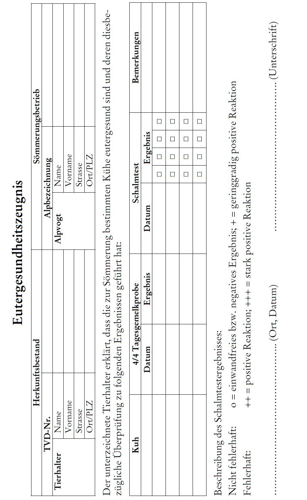

 Anhang 2 (Art. 9 Abs. 5 und 6) 

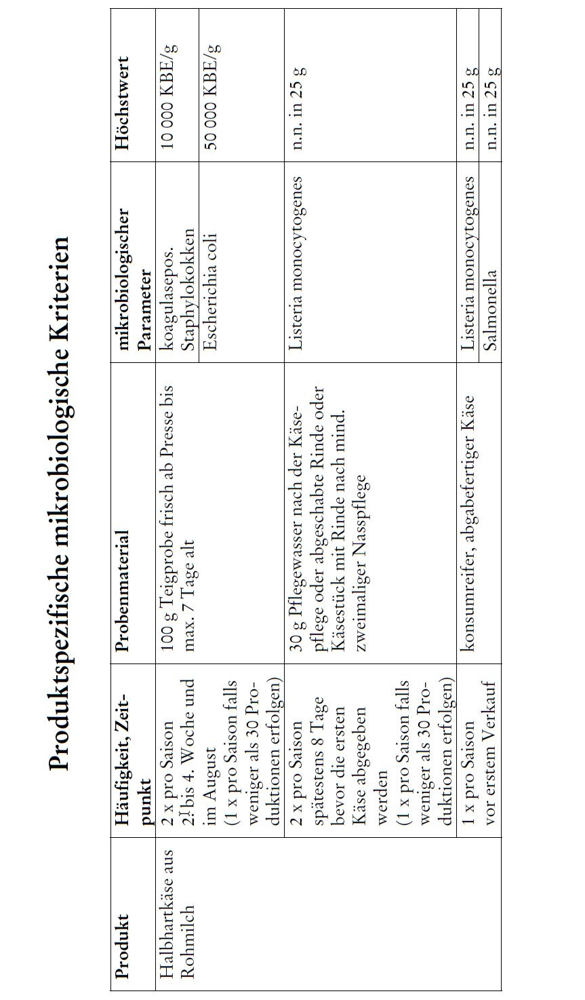

 

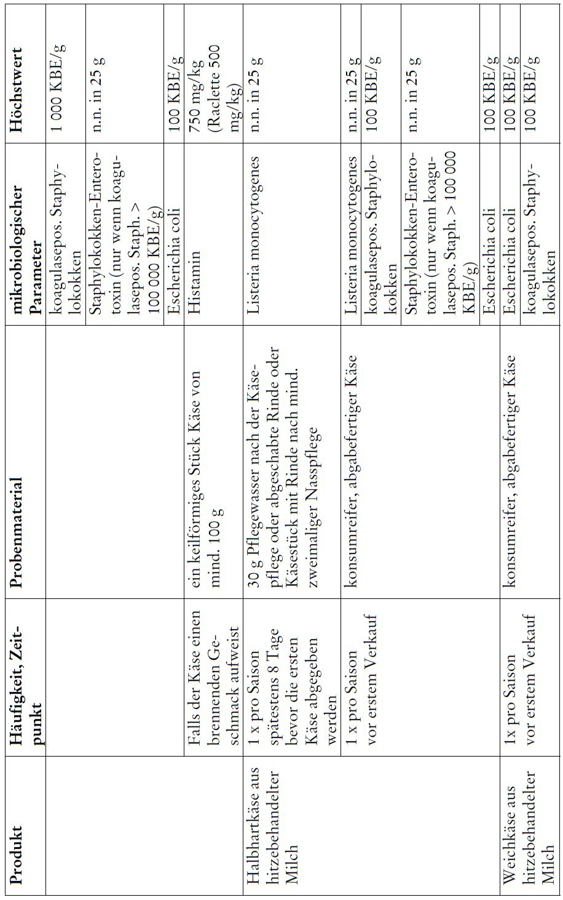

 

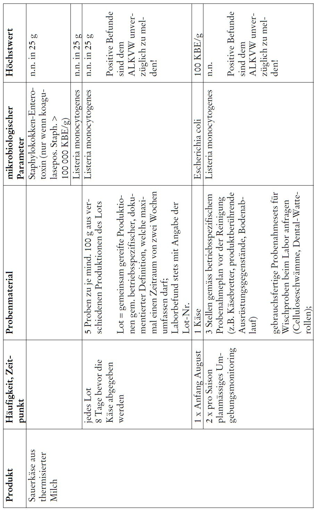

 

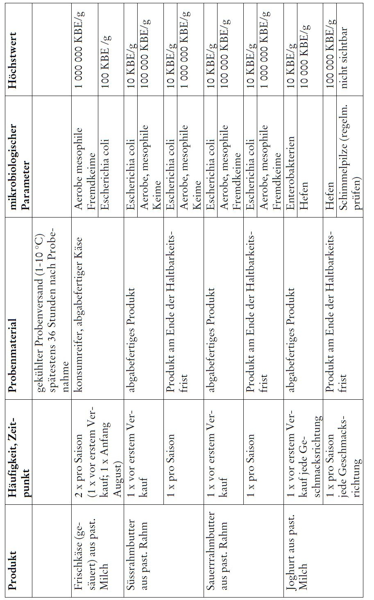

 

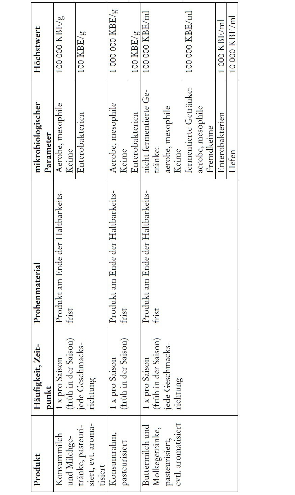

 Anhang 3 (Art. 9 Abs. 7) 

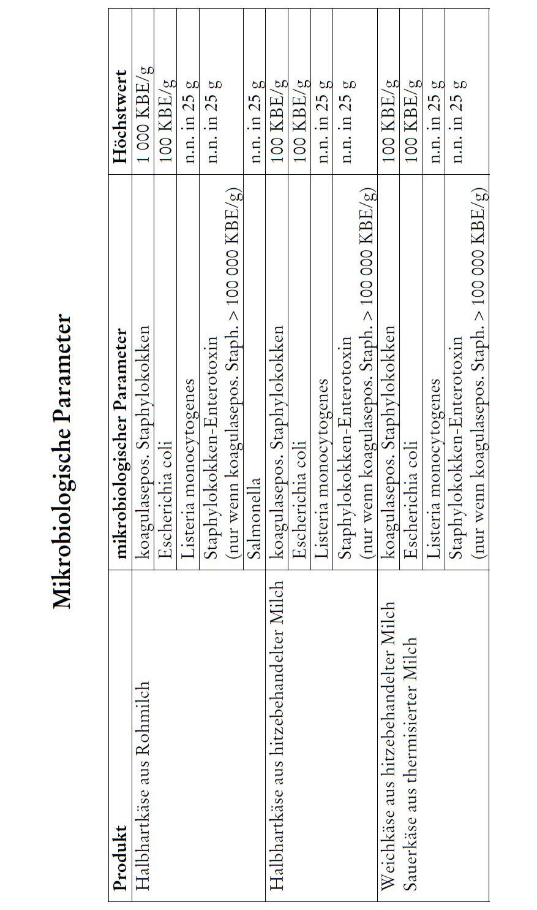

 

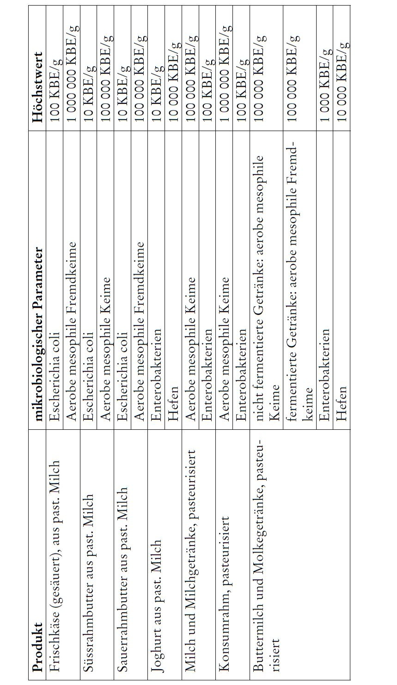

 Anhang 4 (Art. 10 Abs. 4) 

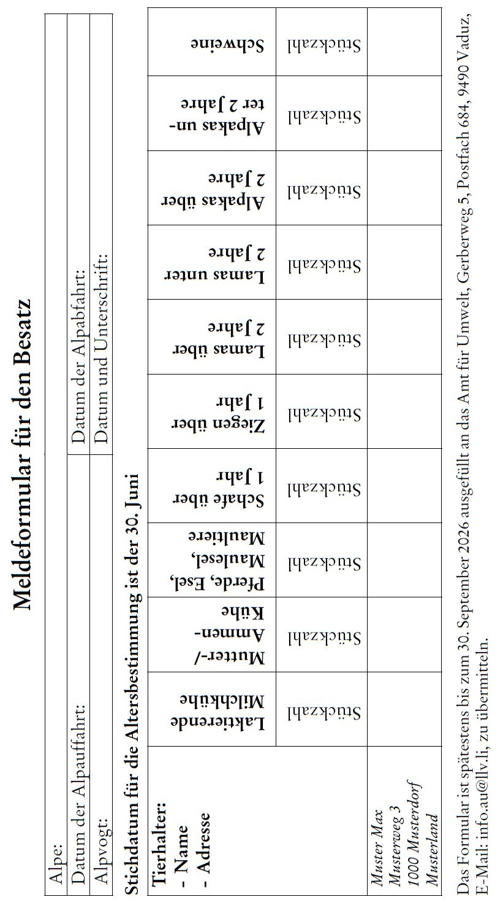

 Anhang 5 (Art. 23 Abs. 4) 

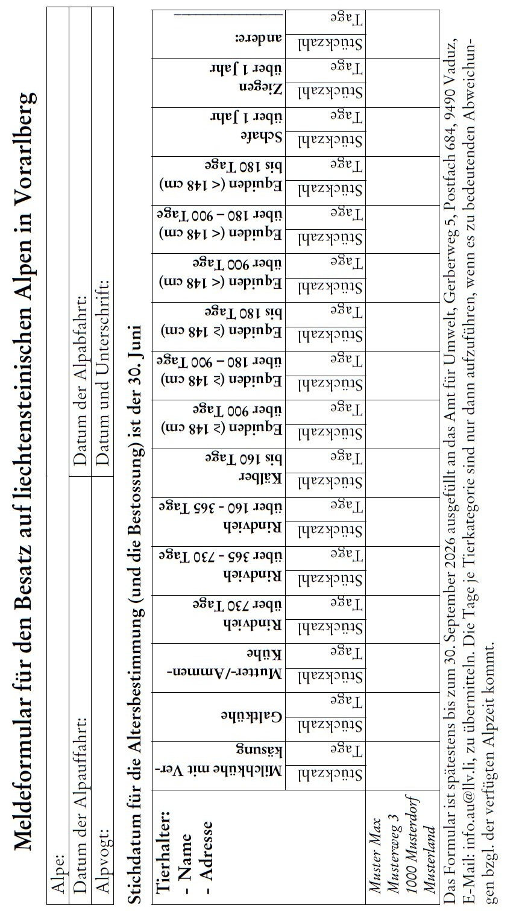

 Anhang 6 (Art. 30 Abs. 2) 

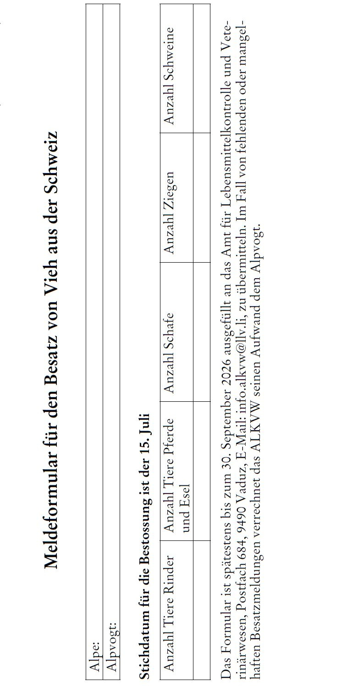
