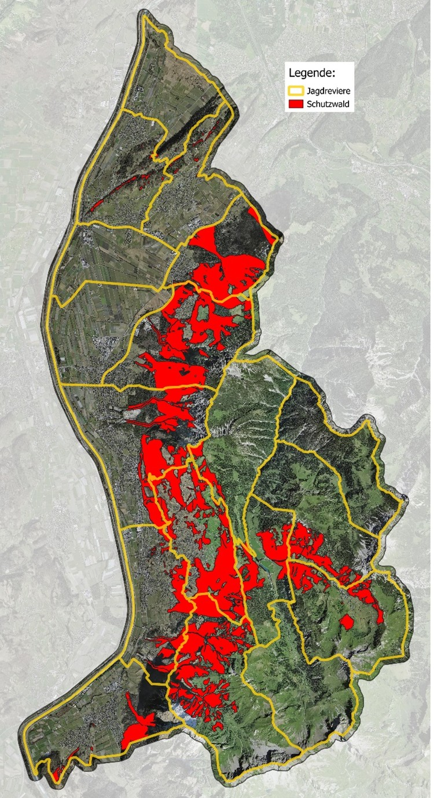
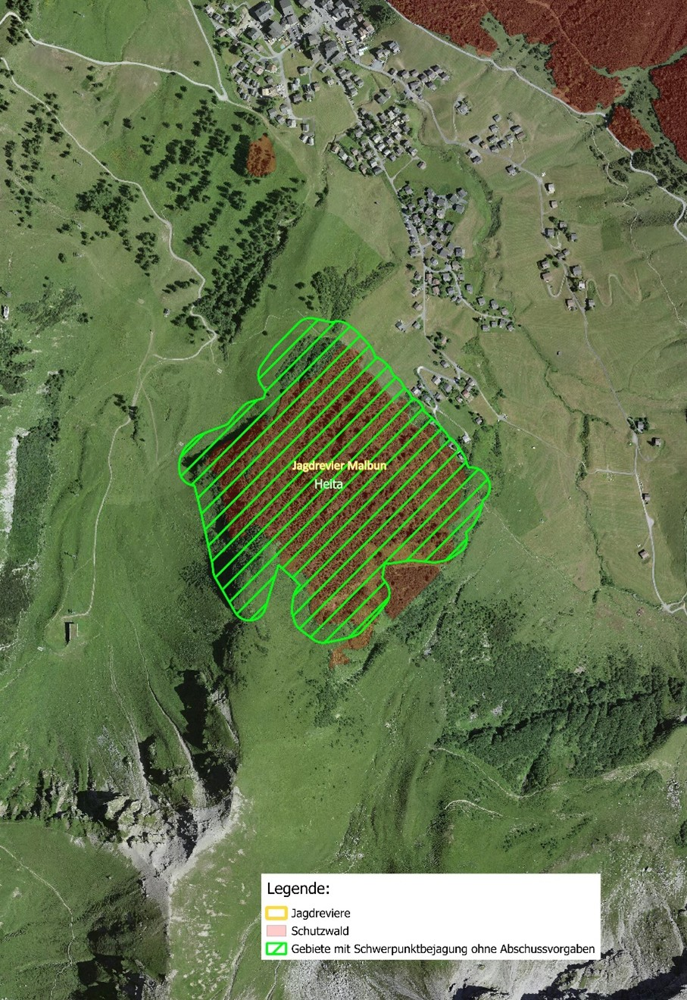
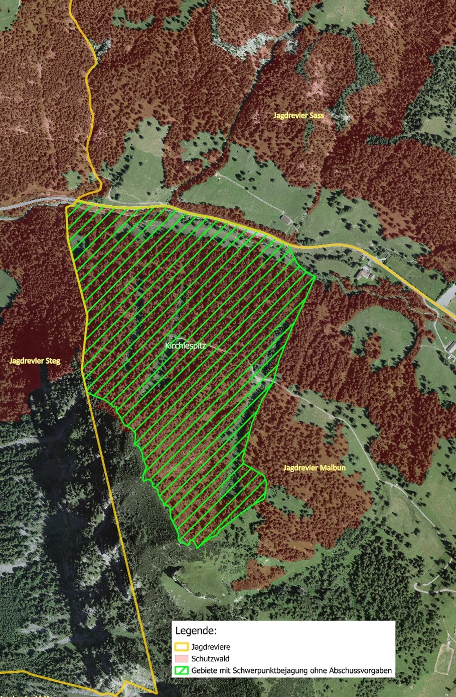

Verordnung vom 14. April 2026 über den Abschussplan für das Jagdjahr 2026/2027 Aufgrund von Art. 19h, 19m, 33 und 59 des Jagdgesetzes vom 30. Januar 1962, LGBl. 1962 Nr. 4, in der geltenden Fassung, verordnet die Regierung: I. Allgemeine Bestimmungen Art. 1 Gegenstand und Bezeichnungen 1) Diese Verordnung regelt den Abschuss von Reh-, Rot-, Gams- und Steinwild sowie von Murmeltieren und Birkhähnen für das Jagdjahr 2026/2027. 2) Unter den in dieser Verordnung verwendeten Personenbezeichnungen sind alle Personen unabhängig ihres Geschlechts zu verstehen, sofern sich die Personenbezeichnungen nicht ausdrücklich auf ein bestimmtes Geschlecht beziehen. II. Abschussplan Art. 2 Koordinierte Reduktion des Schalenwildbestandes Der Schalenwildbestand ist unter Koordination der Wildhut zu reduzieren. Art. 3 Mindest- und Höchstabschuss Für Reh-, Rot- und Gamswild gelten unter Berücksichtigung des Geschlechts und Alters (erfüllte Lebensjahre) und vorbehaltlich Art. 7 bis 9 die Mindest- und Höchstabschussvorgaben je Revier nach Anhang 1. Art. 4 Abschussvorgaben 1) Für die Bejagung des Rotwilds gelten vorbehaltlich Art. 7 bis 9 folgende Vorgaben: a) Für Schmalspiesser gelten weder eine Mindest- noch eine Höchstabschussvorgabe. b) Der Höchstabschuss von Hirschen der Jugendklasse 2 bis 4 Jahre liegt bei 20 % des Mindestabschusses von Kahlwild. c) Hirsche der Mittel- bis Altersklasse 5 Jahre und älter dürfen erst erlegt werden, wenn mindestens 50 % des Mindestabschusses beim Kahlwild im entsprechenden Revier erreicht sind. d) Pro zehn Stück des im Rahmen der Mindestabschussvorgabe festgelegten Kahlwilds darf ein Hirsch der Mittel- bis Altersklasse 5 Jahre und älter erlegt werden. e) Es gelten keine Abschusseinschränkungen in Bezug auf Kronen oder andere Geweihformen. 2) Für die Bejagung des Gamswildes gelten vorbehaltlich Art. 7 bis 9 folgende Vorgaben: a) In den Revieren Guschgfiel, Lawena, Malbun, Sass, und Valüna müssen 60 % des Gesamtabschusses auf Geissen und Kitze, 10 % auf Jährlinge und 30 % auf Böcke (2 Jahre und älter) fallen. Der Höchstabschuss liegt 30 % über dem Mindestabschuss der betreffenden Klasse. b) In den Revieren Alpila-Planken, Balzers, Bargälla, Pirschwald, Steg, Triesen, Triesenberg und Vaduz ist ein Geschlechterverhältnis von 1:1 anzustreben. c) Die Jagd auf Gamswild hat in erster Linie in dem in Anhang 2 ausgewiesenen Schutzwaldgebiet zu erfolgen. 3) Für die Bejagung des Rehwildes gilt vorbehaltlich Art. 7 bis 9, dass in den Revieren Bargälla, Guschgfiel, Malbun, Sass, Steg und Valüna pro Bock (1 Jahr und älter) vorgängig mindestens eine Geiss oder ein Kitz erlegt werden muss. 4) Für Murmeltiere gelten weder ein Mindest- noch ein Höchstabschuss. Sie sollen insbesondere in Gebieten erlegt werden, in denen für die Land- und Alpwirtschaft Schäden entstehen. In solchen Gebieten kann das Amt für Wald, Natur und Landwirtschaft in Absprache mit den Jagdgemeinschaften Sonderabschüsse in der Zeit vom 15. April bis 15. Mai anordnen. 5) In den Revieren Bargälla, Guschgfiel, Lawena, Malbun, Sass, Steg, Triesenberg und Valüna ist je ein Birkhahn zum Abschuss frei. 6) In den Revieren Balzers und Lawena sowie den Revieren Malbun und Valüna ist jeweils ein Steinbock zum Abschuss frei, nachdem jeweils eine nicht säugende Steingeiss erlegt wurde. Von den zwei Böcken hat einer in der Altersklasse 1 bis 3 Jahre und einer in der Altersklasse 12 Jahre oder älter zu liegen. Art. 5 Abschusserfüllung Die quantitativen Abschussvorgaben gelten als erfüllt, wenn für jedes Revier der Mindestabschuss nach Anhang 1 eingehalten wurde. Art. 6 Verfall Werden die Vorgaben über den Höchstabschuss nach Art. 3 oder die Abschussvorgaben nach Art. 4 Abs. 1 Bst. c sowie Abs. 3, 5 und 6 nicht eingehalten, werden die Trophäe und der Erlös des Wildbrets vom Amt für Wald, Natur und Landwirtschaft nach Massgabe von Art. 57 des Jagdgesetzes eingezogen. III. Sonderregelungen Art. 7 Intensivbejagungsgebiete 1) Die Höchstabschussvorgaben nach Art. 3 sowie die Abschussvorgaben nach Art. 4 Abs. 1 Bst. b bis d, Abs. 2 Bst. a und b sowie Abs. 3 gelten nicht in Intensivbejagungsgebieten. 2) Die Abschüsse werden zur quantitativen Abschusserfüllung nach Art. 5 angerechnet. 3) Erfolgt die Grünvorlage nicht nach Art. 10 bis 12, werden die Trophäe und der Erlös des Wildbrets vom Amt für Wald, Natur und Landwirtschaft nach Massgabe von Art. 57 des Jagdgesetzes eingezogen und der Abschuss nicht zur quantitativen Abschusserfüllung angerechnet. Art. 8 Gebiete mit nicht vertretbaren Wildschäden 1) Verursachen Einzeltiere oder Gruppen von Tieren nicht vertretbare Wildschäden, so ordnet das Amt für Wald, Natur und Landwirtschaft die Aufhebung der Höchstabschussvorgaben nach Art. 3 und der Abschussvorgaben nach Art. 4 Abs. 1 Bst. b bis d, Abs. 2 Bst. a und b sowie Abs. 3 sowie den jeweiligen Abschussperimeter an. Die Anordnung ist zu befristen. 2) Für die Anrechnung zur quantitativen Abschusserfüllung, die Trophäen und das Wildbret gilt Art. 7. Art. 9 Gebiete mit Schwerpunktbejagung ohne Abschussvorgaben 1) In den in Anhang 3 ausgewiesenen Gebieten soll die Jagd schwerpunktmässig erfolgen. In diesen Gebieten gelten die Höchstabschussvorgaben nach Art. 3 und die Abschussvorgaben nach Art. 4 Abs. 1 Bst. b bis d, Abs. 2 Bst. a und b sowie Abs. 3 nicht. 2) Für die Anrechnung zur quantitativen Abschusserfüllung, die Trophäen und das Wildbret gilt Art. 7. IV. Grünvorlage, Bestätigung der Abschussmeldung und Kennzeichnung Grünvorlage Art. 10 a) Vorlagepflicht 1) Der Erleger hat dem zuständigen Kontrollorgan (Art. 12) innerhalb von drei Tagen durch Grünvorlage vorzuzeigen: a) jedes erlegte weibliche und männliche Stück Steinwild; b) jedes erlegte weibliche und männliche Stück Reh-, Rot- und Gamswild, wenn der Abschuss erfolgte: 1. in einem Intensivbejagungsgebiet (Art. 7), einem Gebiet mit nicht vertretbaren Wildschäden (Art. 8) oder einem Gebiet mit Schwerpunktbejagung ohne Abschussvorgaben (Art. 9); oder 2. im Rahmen von durch die Wildhut getroffenen Massnahmen; c) in allen übrigen Fällen ausschliesslich die weiblichen Stücke, Kitze, Kälber und Schmalspiesser des Reh-, Rot- und Gamswilds. 2) Die Grünvorlage umfasst den ganzen Wildkörper. Art. 11 b) Ort 1) Die Grünvorlage hat vorbehaltlich Abs. 2 ortsunabhängig zu erfolgen. 2) Bei einem Abschuss in einem Intensivbejagungsgebiet (Art. 7), einem Gebiet mit nicht vertretbaren Wildschäden (Art. 8) oder einem Gebiet mit Schwerpunktbejagung ohne Abschussvorgaben (Art. 9) hat die Grünvorlage, soweit der Erlegungsort nicht anderweitig unmittelbar nachgewiesen wird, am Erlegungsort zu erfolgen. Art. 12 c) Zuständiges Kontrollorgan Die Kontrolle der Grünvorlage hat zu erfolgen durch: a) einen sachkundigen Vertreter des Amtes für Lebensmittelkontrolle und Veterinärwesen bei im Rahmen von durch die Wildhut getroffenen Massnahmen erlegtem Wild; b) den zuständigen Förster, einen Wildhüter oder andere sachkundige Vertreter des Amtes für Wald, Natur und Landwirtschaft in allen übrigen Fällen. Art. 13 Bestätigung der Abschussmeldung; Kennzeichnung 1) Das zuständige Kontrollorgan prüft und bestätigt die Richtigkeit der Abschussmeldung nach Art. 9 Abs. 2 der Hegeverordnung, soweit das Wild nicht schon gekennzeichnet ist und wenn ausgeschlossen werden kann, dass es gekennzeichnet war. 2) Es hat das vorgezeigte Wild dauerhaft zu kennzeichnen. 3) Das Amt für Wald, Natur und Landwirtschaft prüft und bestätigt Abschussmeldungen von erlegtem Wild, das nicht der Vorzeigepflicht unterliegt, anlässlich der Hegeschau anhand der vorgelegten Beweisstücke, insbesondere Trophäen. V. Mitwirkungspflicht Art. 14 Grundsatz Die Förster sind verpflichtet: a) die Entwicklung des Wildbestandes und des Waldes in Zusammenarbeit mit den Jagdgemeinschaften zu überwachen; b) die Abschusserfüllung durch geeignete Massnahmen zu unterstützen; c) in durch Verbiss oder Schälen gefährdeten Waldgebieten auf die Entwicklung der Schäden zu achten; d) nicht vertretbare Schäden durch Einzeltiere oder Gruppen von Tieren nach Art. 8 Abs. 1 zu dokumentieren; e) die Kontrolle der Grünvorlage nach Art. 12 und die Bestätigung der Abschussmeldung nach Art. 13 vorzunehmen; f) dem Amt für Wald, Natur und Landwirtschaft laufend über die aktuelle Situation zu berichten. VI. Schlussbestimmungen Art. 15 Aufhebung bisherigen Rechts Die Verordnung vom 8. April 2025 über den Abschussplan für das Jagdjahr 2025/2026, LGBl. 2025 Nr. 264, wird aufgehoben. Art. 16 Inkrafttreten Diese Verordnung tritt am 1. Mai 2026 in Kraft. Fürstliche Regierung: gez. Brigitte Haas Fürstliche Regierungschefin Anhang 1 (Art. 3, 5 Abs. 1) Mindest- und Höchstabschussvorgaben 1. Rehwild Jagdrevier MA/HA Geissen und Kitze Böcke (1 Jahr und älter) Total Rehwild Eschnerberg MA 15 10 25 Zone I HA - - - Eschner Riet MA 11 7 18 HA - - - Mauren MA 8 5 13 HA - - - Ruggell MA 16 10 26 HA - - - Schaaner MA 10 6 16 Riet HA - - - Jagdrevier MA/HA Geissen und Kitze Böcke (1 Jahr und älter) Total Rehwild Alpila- MA 12 8 20 Zone II Planken HA - - - Pirschwald MA 9 6 15 HA - - - Jagdrevier MA/HA Geissen und Kitze Böcke (1 Jahr und älter) Total Rehwild Balzers MA 14 9 23 Zone III HA - - - Lawena MA 9 6 15 HA - - - Triesen MA 11 8 19 HA - - - Triesenberg* MA 15 10 25 HA - - - Vaduz MA 10 7 17 HA - - - Jagdrevier MA/HA Geissen und Kitze Böcke (1 Jahr und älter) Total Rehwild Bargälla MA - - - Zone IV HA - - - Guschgfiel MA - - - HA - - - Malbun MA - - - HA - - - Sass MA - - - HA - - - Steg* MA - - - HA - - - Valüna MA - - - HA - - - 2. Gamswild Jagdrevier MA/HA Geissen und Kitze Jährlinge Böcke (2 Jahre und älter) Total Gamswild Alpila- MA - - - 19 Zone I Planken HA - - - - Bargälla MA - - - 17 HA - - - - Pirschwald MA - - - 13 HA - - - - Vaduz MA - - - 14 HA - - - - Jagdrevier MA/HA Geissen und Kitze Jährlinge Böcke (2 Jahre und älter) Total Gamswild Balzers MA - - - 8 Zone II HA - - - - Guschgfiel MA 5 1 2 8 HA 6 1 3 10 Lawena MA 7 1 4 12 HA 10 2 5 17 Malbun MA 9 1 5 15 HA 12 2 6 20 Sass MA 9 1 4 14 HA 11 2 5 18 Steg* MA - - - 8 HA - - - - Triesen MA - - - 2 HA - - - - Triesen- MA - - - 9 berg* HA - - - - Valüna MA 5 1 2 8 HA 6 1 3 10 3. Rotwild Jagdrevier MA/HA Tiere und Kälber Schmal-spiesser Hirsche (2 bis 4 Jahre) Hirsche (5 Jahre und älter) Total Rotwild Alpila- MA 21 - - - 21 Zone I Planken HA - - 4 2 - Eschner MA 8 - - - 8 Riet HA - - 2 0 - Pirsch- MA 21 - - - 21 wald HA - - 4 2 - Schaaner MA 10 - - - 10 Riet HA - - 2 1 - Jagdrevier MA/HA Tiere und Kälber Schmalspiesser Hirsche (2 bis 4 Jahre) Hirsche (5 Jahre und älter) Total Rotwild Balzers MA 3 - - - 3 Zone II HA - - 1 0 - Bargälla MA 15 - - - 15 HA - - 3 1 - Guschgfiel MA 10 - - - 10 HA - - 2 1 - Lawena MA 22 - - - 22 HA - - 4 2 - Malbun MA 8 - - - 8 HA - - 2 0 - Sass MA 15 - - - 15 HA - - 3 1 - Steg* MA 15 - - - 15 HA - - 3 1 - Triesen MA 6 - - - 6 HA - - 1 0 - Triesen- MA 15 - - - 15 berg* HA - - 3 1 - Vaduz MA 4 - - - 4 HA - - 1 0 - Valüna MA 10 - - - 10 HA - - 2 1 - Jagdrevier MA/HA Tiere und Kälber Schmal-spiesser Hirsche (2 bis 4 Jahre) Hirsche (5 Jahre und älter) Total Rotwild Ruggell MA - - - - - übrige HA - - 0 0 - Reviere Eschner- MA - - - - - berg HA - - 0 0 - Mauren MA - - - - - HA - - 0 0 - MA: Mindestabschuss HA: Höchstabschuss Sofern kein Höchstabschuss (-) festgelegt ist, kann der Mindestabschuss ohne Begrenzung überschritten werden. Ist der Höchstabschuss mit null (0) festgesetzt, ist die Erlegung von Tieren in dieser Klasse nicht gestattet. * Jagdrevier mit Intensivbejagungsgebiet Anhang 2 (Art. 4 Abs. 2 Bst. c) Schutzwaldgebiet mit Schwerpunktbejagung von Gamswild 

 Anhang 3 (Art. 9 Abs. 1) Gebiete mit Schwerpunktbejagung ohne Abschussvorgaben Perimeter "Heita" 

 Perimeter "Kirchlespitz" 

